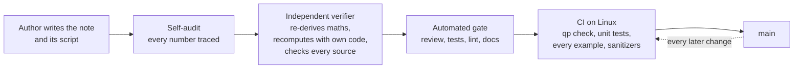

# How Notes Are Verified

A study guide is only useful if you can trust it.
One wrong number in a worked example teaches the wrong answer to everyone who reads it, and in an interview you will repeat it with confidence.
This page states exactly what the repo promises about its content, how each promise is enforced, and where the promises stop.

## The promises

| Promise | How it is enforced |
| :--- | :--- |
| Every number is computed, not recalled. | The section's `code/` scripts print each quoted number and assert it at the quoted rounding. |
| Quoted numbers cannot silently drift. | CI runs every script on every pull request and on `main`; a failed assert fails the build. |
| Results do not depend on your machine. | CI runs on Linux x86-64; authors also run the scripts in a Linux container, and tolerances sit well above floating-point noise. |
| Facts come from primary sources. | Rules cite the regulation and paragraph, conventions cite the exchange or regulator, papers cite authors, venue and year. |
| Claims about causes are tested. | A note says a simulation "shows why" only when the script changes one thing at a time and asserts the result. |
| Cards agree with the notes. | Card answers are checked against the body and the scripts during review. |
| The structure is consistent. | `./qp check` validates frontmatter, required sections, cards, links and style on every change. |

## The numbers contract

Each number in a note is one of three things:

1. **Computed and asserted.** A script prints it and asserts it to the precision the note quotes.
   If the note says 4.4107%, the script checks 4.4107 to four decimals, not 4.41 to two.
2. **A stated input.** For example "a 5-year swap at 4% fixed" or "assume 252 trading days".
   Inputs chosen for illustration are labelled hypothetical.
3. **A cited constant.** A regulatory parameter such as a risk weight, a contract specification, or a published figure, with its source.

The asserts are written to catch real errors:

- **No self-confirming checks.** An assert compares an independently computed value (a closed form, an enumeration, a simulation, a different numerical method) against the quoted literal.
  Checking a value against itself, or two expressions that are the same formula, proves nothing and is not allowed.
- **Shown working reproduces the answer.** When a card shows its arithmetic, that arithmetic gives the stated answer from the stated inputs; if rounding would change the result, the unrounded inputs are quoted.
- **Simulations are seeded.** Monte Carlo results use a fixed seed, are quoted as "about" the printed value, and name the seed; where it matters, the standard error is computed and quoted too.
- **Timings are labelled.** Benchmark numbers depend on hardware, so notes label them as a single-session observation on named hardware, give the command to reproduce them, and assert them only loosely.

## Sources and dates

- **Regulation.** Basel Committee rules are quoted from the consolidated Basel Framework with the standard and paragraph, for example `MAR21.6` or `CRE52.39`.
  US, EU and UK implementation details come from the regulator's own publication and carry a date, because they change.
- **Markets and conventions.** Contract terms, day counts and fixing conventions come from the exchange, ISDA, the central bank or the regulator.
- **Papers and books.** Citations give authors, title, venue and year, and a chapter or section where one is named.
  Results are attributed to the paper and table that contain them.
- **Firms and incidents.** Claims about a specific firm or event appear only with a public source such as a regulator report, court filing or company publication.
- **Anything time-sensitive** is stamped "as of" a date.
- **Anything that cannot be verified is removed**, not softened.

## The review pipeline

- **Self-audit.** The author extracts every number from the note, body, tables and card answers, and confirms each is printed and asserted, a stated input, or a cited constant.
- **Independent verification.** A reviewer who did not write the note re-derives the formulas, recomputes at least five headline numbers per note with separate code, checks every citation against the source, and fixes what is wrong.
  The sections rebuilt in October 2026 went through this step.
- **Automated gate.** Every pull request passes a review, test, lint and documentation gate before it can merge.
- **CI.** `./qp check --strict-sde`, the platform tests, ruff, every Python example and every C++ example under sanitizers run on each pull request and on `main`.

## What the status means

| Status | What you can rely on |
| :--- | :--- |
| `seed` | Objectives and references only; nothing to study yet. |
| `draft` | Written but not yet through the standard above; treat every number and claim as unchecked. |
| `solid` | Complete, with every required section and card, and the numbers contract met. |
| `canonical` | `solid`, and reviewed by a human expert against the references. Only a human sets this. |

The live count of each status is in the [syllabus catalog](../README.md#syllabus-at-a-glance) and in `./qp syllabus`.

## Where the promises stop

- **`solid` is not `canonical`.** Solid notes are machine-checked and reviewed, but no human expert has yet signed off every page; if something looks wrong, it may be.
- **Interview practice changes.** What a firm asks, and how, changes over time; [firm guides](../14-Firms/README.md) stay `draft` until a human verifies them.
- **Regulation changes.** Implementation dates and national choices move; check the dated source before relying on one.
- **Models are models.** A note that prices or sizes something shows the method on stated inputs; it is not trading or investment advice.

## Check a number yourself

1. Find the script: notes with computed numbers name the script that asserts them (usually in their code or "In this repo" section), and it lives in the section's `code/` folder.
2. Run it: `python 06-Fixed-Income-and-Asset-Classes/code/fi_swaps_ois.py` (the examples need numpy; some need pandas or matplotlib).
3. Compare: the script prints each number and stops with an assertion error if any differs from what the note quotes.

To run everything CI runs, use `python tools/run_examples.py` and the checks in [CONTRIBUTING](../CONTRIBUTING.md#checks).

## Found an error

Open an issue or a pull request with the note, the line, what is wrong and how you checked it.
Corrections are the most valuable contribution this repo can receive.
