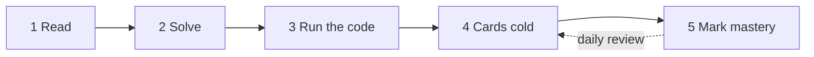

# Start Here

This page gets you from a fresh clone to a working study routine in about half an hour.

## Your first 30 minutes

1. **Pick your track or tracks** in [Tracks](Tracks.md): quant trader, quant researcher, quant developer, or quant risk and strats.
2. **Tell the platform** your tracks and weekly hours, then look at your starting point:

   ```sh
   ./qp profile --tracks quant-research --hours 10
   ./qp
   ./qp serve --open
   ```

3. **Read the [Roadmap](Roadmap.md)** for the four phases and the weekly rhythm, then run `./qp plan` to see your dated plan.
4. **Study the first topic** `./qp next` suggests, using the loop below.
5. **Review today's cards** with `./qp review` or on the dashboard's Review page.

[Using the Platform](Using-the-Platform.md) covers every command and dashboard page.

## How to study one topic



1. **Read** the TL;DR, the objectives and the core concepts.
2. **Solve** each worked example yourself before reading its solution.
3. **Run the code** that backs the note, and change an input.
4. **Answer the cards cold**, without looking at the note.
5. **Mark your mastery** with `./qp mark <topic> <level>`; daily review keeps it fresh.

Habits that make it stick:

- **Produce, do not recognise.** Interviews test whether you can produce an answer, so cover each solution until you have attempted it.
- **Predict before you run.** Change an input in the script and say what the output will be before you run it.
- **Mark mastery honestly:** 1 studied, 2 practiced, 3 mastered (you answer the cards cold), 4 interview-ready (you can teach it and handle follow-ups under time pressure).
  Readiness scores are only as good as these marks.
- **Turn every miss into a card.** When a mock interview or a review exposes a gap, write it down while it still stings.

## Pages in this folder

| Page | Read it when |
| :--- | :--- |
| [Tracks](Tracks.md) | Choosing what to study: what each role does and what its interviews test. |
| [Roadmap](Roadmap.md) | Planning: phases, exit bars and the weekly rhythm. |
| [Using the Platform](Using-the-Platform.md) | Setting up and using `qp`, the dashboard, drills, the lab and Obsidian. |
| [How Notes Are Verified](How-Notes-Are-Verified.md) | Deciding how far to trust a note, or checking a number yourself. |
| [SDE Link Map](SDE-Link-Map.md) | Pulling data structures, algorithms, C++ and system design from SDE-Interview-Prep. |
| [Note Conventions](Note-Conventions.md) | Writing or fixing notes and cards. |
| [Dashboard](Dashboard.md) | Navigating the vault from Obsidian. |

Before interviews, work the [firm guides](../14-Firms/README.md) for your targets and run `./qp firms <firm>` to see your weakest focus topics.
