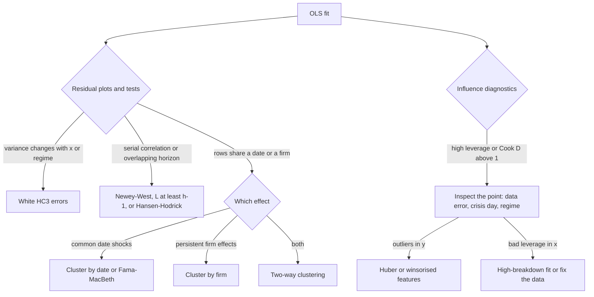

# Regression Diagnostics and Robust Inference

## TL;DR

- OLS coefficients survive heteroskedasticity and autocorrelation; their textbook standard errors do not. Use the sandwich $(X^\top X)^{-1}\,\hat S\,(X^\top X)^{-1}$ with the right "meat": White (HC) for heteroskedasticity, Newey-West (HAC) for serial correlation, clustered for grouped dependence.
- Newey-West weights lag $l$ by the Bartlett kernel $1 - l/(L+1)$, which keeps the estimate positive semi-definite but biases it down at small $L$; with overlapping $h$-period returns the score is MA($h-1$) and $L$ must be at least $h-1$.
- Leverage $h_{ii} = x_i^\top(X^\top X)^{-1}x_i$ measures how far a point sits in regressor space; Cook's distance combines leverage and residual; a high-leverage point can have a tiny residual precisely because it drags the fit onto itself.
- Multicollinearity inflates $\text{Var}(\hat\beta_j)$ by $\text{VIF}_j = 1/(1-R_j^2)$ while leaving fitted values and well-chosen combinations of coefficients precise.
- Panels: residuals that share a date or a firm are not independent; the Moulton factor $1+(m-1)\rho_x\rho_u$ says how much the naive variance understates, and only clustering (or Fama-MacBeth for pure time effects) fixes it.
- Huber M-estimation buys outlier resistance in $y$ at 95% normal efficiency with $c = 1.345$, but does not protect against bad leverage points in $x$.

## Learning objectives

- Detect and correct heteroskedasticity and autocorrelation (White, Newey-West).
- Choose a HAC bandwidth and handle overlapping-horizon regressions correctly.
- Diagnose multicollinearity and influential points.
- Use clustered standard errors and Fama-MacBeth regressions in panels.
- Use robust regression and winsorisation deliberately.

## Core concepts

### The sandwich

With $y = X\beta + \varepsilon$ and $E[\varepsilon\mid X] = 0$, $\hat\beta - \beta = (X^\top X)^{-1}X^\top\varepsilon$ whatever the error covariance $\Omega = \text{Var}(\varepsilon\mid X)$, so

$$
\text{Var}(\hat\beta\mid X) = (X^\top X)^{-1}\,X^\top\Omega X\,(X^\top X)^{-1}.
$$

The classical formula $s^2(X^\top X)^{-1}$ is the special case $\Omega = \sigma^2 I$.
Every robust standard error keeps the "bread" $(X^\top X)^{-1}$ and estimates the "meat" $X^\top\Omega X = \text{Var}\big(\sum_t g_t\big)$, where $g_t = x_t\varepsilon_t$ is the score of observation $t$.
What you assume about the dependence of the $g_t$ decides the estimator:

| Dependence of $g_t$ | Meat estimator | Name |
| :--- | :--- | :--- |
| Independent, equal variance | $s^2X^\top X$ | Classical |
| Independent, unequal variance | $\sum_t e_t^2x_tx_t^\top$ | White, HC0 |
| Serially correlated up to lag $L$ | $\hat\Gamma_0 + \sum_{l=1}^L w_l(\hat\Gamma_l + \hat\Gamma_l^\top)$ | Newey-West (HAC) |
| Correlated within groups, independent across | $\sum_g \big(\sum_{t\in g}g_t\big)\big(\sum_{t\in g}g_t\big)^\top$ | Cluster-robust (Liang-Zeger) |

Here $\hat\Gamma_l = \sum_t e_te_{t-l}x_tx_{t-l}^\top$.
None of these changes $\hat\beta$; they change only the standard errors, $t$-stats and confidence intervals.
If you know $\Omega$, GLS is more efficient; in finance you rarely do, so the industry default is OLS point estimates with robust inference.

### Heteroskedasticity: White and the HC family

White (1980) replaces $\Omega$ by $\text{diag}(e_t^2)$; the estimator is consistent without any model of the variance.
In small samples residuals are too small at high-leverage points (since $\text{Var}(e_i) = \sigma^2(1-h_{ii})$), so MacKinnon and White (1985) proposed corrections:

| Variant | Weight on $e_i^2$ |
| :--- | :--- |
| HC0 | $1$ |
| HC1 | $n/(n-p)$ |
| HC2 | $1/(1-h_{ii})$ |
| HC3 | $1/(1-h_{ii})^2$ (close to the jackknife) |

Long and Ervin (2000) recommend HC3 for small samples.
Why it matters: if the error variance rises with $|x|$, the naive formula averages $\sigma^2$ over all points, but the slope is identified mostly by the large-$|x|$ points where the noise is largest.
With $x\sim N(0,1)$ and $\text{Var}(\varepsilon\mid x) = x^2$ the asymptotic ratio of the true to the naive standard error is $\sqrt{E[x^4]/E[x^2]^2} = \sqrt3 = 1.732$, so a nominal 5% test rejects a true null $2(1-\Phi(1.96/\sqrt3)) = 25.8\%$ of the time.

Testing: the Breusch-Pagan test in Koenker's studentised form regresses $e_t^2$ on candidate variance drivers $z_t$ and uses $LM = nR^2\sim\chi^2_q$; White's test uses the regressors, their squares and cross products as $z_t$.
In practice quants skip the test and always report robust errors; the test is useful to understand where the variance comes from (volatility regimes, size, liquidity).

### Autocorrelation: Newey-West HAC

With serially correlated scores the variance of a sum is not the sum of variances.
For a scalar stationary series the long-run variance is

$$
\text{LRV} = \gamma_0 + 2\sum_{l=1}^\infty \gamma_l ,
$$

which for an AR(1) with unit variance and coefficient $\phi$ equals $(1+\phi)/(1-\phi)$.
Newey and West (1987) truncate at lag $L$ and weight by the Bartlett kernel:

$$
\hat S = \hat\Gamma_0 + \sum_{l=1}^{L}\Big(1-\frac{l}{L+1}\Big)\big(\hat\Gamma_l + \hat\Gamma_l^\top\big).
$$

The declining weights are what make $\hat S$ positive semi-definite in every sample (the Bartlett weights are the Fourier transform of a non-negative function); the price is downward bias when $L$ is small relative to the persistence.
For the AR(1) with $\phi = 0.5$ the Bartlett-weighted LRV is 1.833 at $L = 2$, 2.344 at $L = 5$ and 2.810 at $L = 20$, against the true 3.
Consistency needs $L\to\infty$ with $L/T\to0$.

Bandwidth rules in common use:

- the Newey and West (1994) pilot lag $L = \lfloor 4(T/100)^{2/9}\rfloor$, which gives 5 at $T = 500$ and 8 at $T = 2500$;
- the textbook rule $0.75\,T^{1/3}$ (Stock and Watson, *Introduction to Econometrics*), 10.2 at $T = 2500$;
- Andrews (1991) plug-in for the Bartlett kernel, $S_T = 1.1447\,(\hat\alpha(1)T)^{1/3}$ with $\hat\alpha(1) = 4\hat\rho^2/\big((1-\hat\rho)^2(1+\hat\rho)^2\big)$ from an AR(1) fitted to the score, which gives 11.0 for $\rho = 0.5$, $T = 500$.

Rules of thumb are calibrated for mildly persistent scores; they are far too short for overlapping returns.

### Overlapping returns and Hansen-Hodrick

Regress the $h$-day forward return $y_t = r_{t+1}+\dots+r_{t+h}$ on a signal $x_t$ observed daily.
Adjacent $y_t$ share $h-1$ daily returns, so under the null the residuals are MA($h-1$) with autocorrelation $1-k/h$ at lag $k$.
The score $x_te_t$ inherits that dependence when the signal is persistent; with an AR(1) signal of coefficient $\phi$ independent of returns, the variance of the summed score is inflated by

$$
1 + 2\sum_{k=1}^{h-1}\phi^k\Big(1-\frac kh\Big),
$$

which for $h = 20$, $\phi = 0.95$ is 14.62, so OLS $t$-stats have a standard deviation of about $\sqrt{14.62} = 3.82$ instead of 1.
As $\phi\to1$ the factor tends to $h$ and the $t$-stat inflation to $\sqrt h = 4.47$, which is why the problem-set rule "divide by $\sqrt{20}$" is the worst case.
Fixes:

- Hansen-Hodrick (1980): uniform weights on lags $1,\dots,h-1$; exact for an MA($h-1$) score but not guaranteed positive semi-definite.
- Newey-West with $L$ at least $h-1$, better about $2h$, since Bartlett downweights the lags that matter.
- Non-overlapping samples (every $h$-th observation): valid but throws away data.
- Regress daily returns on the signal and aggregate, when the economic question allows it.

### Leverage, influence and outliers

The hat matrix $H = X(X^\top X)^{-1}X^\top$ has diagonal $h_{ii}\in[1/n, 1]$ with $\sum_i h_{ii} = p$, so the average leverage is $p/n$; a common flag is $h_{ii} > 2p/n$.
In simple regression $h_{ii} = 1/n + (x_i-\bar x)^2/S_{xx}$.
Three facts make the leave-one-out (LOO) analysis cheap:

$$
e_{(i)} = \frac{e_i}{1-h_{ii}}, \qquad \hat\beta - \hat\beta_{(i)} = \frac{(X^\top X)^{-1}x_ie_i}{1-h_{ii}}, \qquad D_i = \frac{e_i^2}{p\,s^2}\,\frac{h_{ii}}{(1-h_{ii})^2},
$$

where $e_{(i)}$ is the prediction error for point $i$ from a fit without it and $D_i$ is Cook's distance, the scaled shift of all fitted values when point $i$ is deleted.
$D_i > 1$ is the classical alarm; $4/n$ is a stricter screen.
Studentised residuals $e_i/(s\sqrt{1-h_{ii}})$ put residuals on a common scale.
The key intuition is masking: an influential high-leverage point pulls the line toward itself, so its own residual looks small, and only LOO quantities reveal it.
In finance the high-leverage points are crisis days, tiny-cap stocks with extreme characteristics and data errors (unadjusted splits, stale prices).

### Multicollinearity and the VIF

$\text{Var}(\hat\beta_j) = \dfrac{\sigma^2}{\sum_t(x_{tj}-\bar x_j)^2}\cdot\dfrac{1}{1-R_j^2}$, where $R_j^2$ is from regressing $x_j$ on the other regressors.
The second factor is the variance inflation factor; $\sqrt{\text{VIF}}$ inflates the standard error.
Two standardised regressors with correlation $\rho$ have $\text{VIF} = 1/(1-\rho^2)$: 5.26 at $\rho = 0.9$, 10.26 at 0.95 and 50.25 at 0.99.
Collinearity is a statement about directions in coefficient space: with two standardised regressors

$$
\text{Var}(\hat\beta_1+\hat\beta_2)\propto\frac{2}{1+\rho}, \qquad \text{Var}(\hat\beta_1-\hat\beta_2)\propto\frac{2}{1-\rho},
$$

so at $\rho = 0.9$ the sum is estimated with variance factor 1.05 and the difference with 20.
The data say "the total exposure to these two similar signals is about this", not how to split it.
Belsley, Kuh and Welsch use condition indices of the scaled $X$; values above 30 signal harmful dependence.
Remedies: combine the signals, orthogonalise one against the other (Frisch-Waugh-Lovell), shrink ([Regularization](06-Regularization-Ridge-Lasso.md)), or accept wide individual errors when only predictions matter.
Dropping a correlated control to "fix" collinearity reintroduces omitted variable bias ([Linear Regression and OLS](04-Linear-Regression-OLS.md)).

### Clustered errors and panels

In a stock-by-date panel the residuals of different stocks on the same date share market and sector shocks, and the residuals of one stock over time share firm effects.
If both the regressor and the residual have a within-cluster correlation ($\rho_x$, $\rho_u$) and clusters have $m$ members, the naive variance is too small by the Moulton factor

$$
1 + (m-1)\rho_x\rho_u .
$$

The cluster-robust estimator sums scores within each cluster before squaring; it allows any dependence inside a cluster and needs many clusters (inference with a handful of clusters is unreliable; see Cameron and Miller 2015).
White errors do not help here: they treat each row as independent.
Petersen (2009) is the finance reference:

- time effects (a common shock per date) are handled by clustering on date or by Fama-MacBeth: run one cross-sectional regression per date and use the time series of slopes, with standard error $\text{sd}(\hat\beta_t)/\sqrt{T}$;
- firm effects (persistent per-firm residuals) bias both OLS and Fama-MacBeth errors; cluster on firm;
- both at once: two-way clustering (Cameron, Gelbach and Miller 2011, Journal of Business and Economic Statistics; Thompson 2011, Journal of Financial Economics);
- Fama-MacBeth slopes that are autocorrelated (persistent characteristics) need a Newey-West correction on the slope series.

### Robust regression and winsorisation

OLS minimises $\sum e_i^2$, so one point with a huge residual dominates.
An M-estimator minimises $\sum\rho(e_i/\hat s)$ with a loss that grows more slowly; Huber's loss is quadratic for $|u|\le c$ and linear beyond, with influence function $\psi(u) = \max(-c,\min(c,u))$.
It is solved by iteratively reweighted least squares with weights $w_i = \min(1, c/|u_i|)$ and a robust scale such as the normalised MAD $\text{median}|e-\text{median}(e)|/0.6745$.
Its asymptotic efficiency at the normal is $P(|Z|<c)^2/E[\psi(Z)^2]$, which equals 95% at $c = 1.345$, the default in most software.
M-estimators bound the influence of the residual, not of the regressor: a bad leverage point (extreme $x$, wrong $y$) still drags the fit.
For that you need high-breakdown estimators (least trimmed squares, MM-estimators) or diagnostics plus judgement.

Winsorisation (clipping at quantiles or at $\pm k$ MADs) is the practitioner's version:

- winsorise features cross-sectionally each date before forming signals, so one bad print does not dominate a z-score;
- winsorising the target changes the estimand (you now fit a clipped return) and can bias slopes; do it only deliberately and report it;
- always look at what you clipped: an "outlier" in returns may be the P&L that matters (a default, a squeeze).

## Worked examples

### 1. White errors when variance grows with the regressor

"$y = 1 + \varepsilon$ with $\text{Var}(\varepsilon\mid x) = x^2$, $x\sim N(0,1)$, $n = 500$. You test the slope. What goes wrong with the usual $t$-test?"

The true slope is 0, so every rejection is false.
Theory says the naive standard error is too small by $\sqrt3 = 1.732$, and the test rejects 25.8% of the time.
A simulation with 4000 samples (seed 11) agrees:

| Quantity, scaled by $\sqrt n$ | Value |
| :--- | ---: |
| Actual sd of $\hat\beta_1$ | 1.736 |
| Mean classical SE | 0.998 |
| Mean White HC0 SE | 1.705 |
| Mean HC3 SE | 1.725 |

Rejection rates at nominal 5%: classical 26.2%, HC0 5.7%, HC3 5.4%.
On one such sample the Koenker LM statistic ($nR^2$ of $e^2$ on $x^2$) is 129.4 against a $\chi^2_1$ 5% critical value of 3.841.

### 2. Overlapping 20-day returns on a persistent signal

"You regress 20-day forward returns on a daily signal with AR(1) coefficient 0.95 over 2500 days and get $t = 4$. Should you believe it?"

The score variance inflation is 14.62, so under the null the OLS $t$-stat has standard deviation about 3.82; $t = 4$ is barely one null standard deviation.
A simulation of 1000 null samples (seed 2024, no predictability at all) gives an OLS $t$ standard deviation of 3.84 and:

| Standard error | Rejection rate at 5% | 95th percentile of $\lvert t\rvert$ |
| :--- | ---: | ---: |
| OLS | 60.6% | 7.48 |
| Newey-West, rule-of-thumb $L = 8$ | 20.2% | 2.99 |
| Newey-West, $L = 20$ | 11.0% | 2.36 |
| Newey-West, $L = 40$ | 8.8% | 2.18 |
| Hansen-Hodrick, $L = 19$ | 6.1% | 2.00 |
| OLS on non-overlapping data | 5.3% | 1.97 |

The rule-of-thumb bandwidth ignores the known MA(19) structure and still over-rejects four-fold; Hansen-Hodrick and non-overlapping samples are close to nominal.
In an interview, say: "the point estimate is fine, the standard error must account for 19 lags of overlap and the persistence of the signal; I would report Hansen-Hodrick or Newey-West with $L\ge h$ and check on non-overlapping data."

### 3. A masked influential point, by hand

"Fit $y$ on $x$ for $x = (1,2,3,4,10)$, $y = (1,2,3,4,5)$. Which point matters most?"

$\bar x = 4$, $\bar y = 3$, $S_{xx} = 50$, $S_{xy} = 20$, so slope 0.4 and intercept 1.4.
Residuals are $(-0.8,-0.2,0.4,1.0,-0.4)$: the last point has one of the smallest.
Its leverage is $1/5 + 36/50 = 0.92$, above $2p/n = 0.8$.
Its LOO prediction error is $-0.4/(1-0.92) = -5.0$: the other four points lie exactly on $y = x$, which predicts 10 at $x = 10$, and the actual is 5.
$\text{RSS} = 2$, so $s^2 = 2/3$, and Cook's distance is $\frac{0.16}{2\cdot(2/3)}\cdot\frac{0.92}{0.08^2} = 17.25$, against 0.234 for the point with the largest residual ($x = 4$).
Deleting it moves the slope by $-0.6$ (from 1.0 to 0.4 when it is added), exactly the LOO formula, while its internally studentised residual is only $-1.73$.

### 4. Collinear signals

"Two signals have correlation 0.95. You regress returns on both with $n = 250$ and unit noise. How precise is each coefficient and their sum?"

$\text{VIF} = 1/(1-0.95^2) = 10.26$, so each slope has standard deviation $\sqrt{10.26/250} = 0.2025$, while the sum has $\sqrt{2/(1.95\times250)} = 0.0641$.
A simulation (2000 samples, true slopes 0.5 and 0.5, seed 5) gives 0.203 and 0.0646, a mean sample VIF of 10.33, and a negative estimate for a slope whose true value is 0.5 in 0.45% of samples (normal theory 0.68%).
Report the combined exposure, or orthogonalise one signal on the other and state which one owns the shared part.

### 5. Clustered errors in a stock panel

"Panel of 100 dates by 50 stocks; the regressor and residual each have a common date component with within-date correlations 0.5 and 0.25. How wrong are OLS errors?"

Moulton: $1 + 49\times0.5\times0.25 = 7.125$, so the standard error is too small by $\sqrt{7.125} = 2.67$.
A simulation (1000 panels, true slope 0, seed 99) gives an actual-to-OLS ratio of 2.57 and a mean cluster-to-OLS ratio of 2.61.
Rejection rates at 5%: OLS 44.8%, White 44.9% (no better than OLS: the simulated errors are homoskedastic and dependent within dates), clustered by date 5.2%, Fama-MacBeth 5.8%.

### 6. Huber versus OLS, and its limit

Data: $y = 1 + 2x + \varepsilon$, $n = 200$, seed 3; clean OLS slope 2.03.

| Contamination | OLS slope | Huber slope |
| :--- | ---: | ---: |
| 10 largest-$x$ points have $y$ shifted by +20 (vertical outliers) | 4.07 | 2.26 |
| 10 points moved to $x = 5$, $y = -10$ (bad leverage) | -0.38 | 1.47 |

With vertical outliers the OLS intercept moves to 1.92, Huber's to 1.13.
Huber repairs most of the vertical damage but only part of the leverage damage.
That matches the theory above: Huber weights depend only on residuals, and a high-leverage point pulls the fit toward itself, as in Example 3.
Winsorising $y$ at the 5% and 95% quantiles gives a slope of 1.97 here, with the clip level equal to the 5% contamination rate; one favourable case is not evidence that clipping the target is safe, and the right defence is to look at the points.

### 7. Newey-West by hand

"An AR(1) score has $\rho_1 = 0.5$, $\rho_2 = 0.25$. Compute the Newey-West long-run variance with $L = 2$."

Weights $1-1/3 = 2/3$ and $1-2/3 = 1/3$: $1 + 2(\frac23\cdot0.5 + \frac13\cdot0.25) = 1.833$.
The truth is $(1+0.5)/(1-0.5) = 3$, so the standard error is understated by a factor $\sqrt{3/1.833} = 1.28$ at this bandwidth.

## Pitfalls

- Treating robust standard errors as a fix for bias: they correct inference, not omitted variables, look-ahead or nonstationarity.
- Using a rule-of-thumb HAC bandwidth on overlapping-horizon regressions; the overlap length is known, use it.
- Believing Newey-West is exact: with persistent regressors and modest $T$ it still over-rejects; confirm on non-overlapping data or with a block bootstrap ([Bootstrap](12-Bootstrap-and-Resampling.md)).
- Persistent predictors whose innovations correlate with returns (dividend yield, valuation ratios) also bias the coefficient itself in small samples (Stambaugh 1999, Journal of Financial Economics); robust errors do not remove that bias.
- Reporting White errors in a panel with common date shocks; the problem is cross-sectional dependence, so cluster.
- Clustering on a dimension with few groups (say 8 years); cluster-robust inference needs many clusters.
- Deleting every point with a large residual; high-leverage points hide behind small residuals, and genuine tail events are information.
- Reading a high VIF as "drop a variable"; it reintroduces omitted variable bias.
- Winsorising the dependent variable silently and then quoting the slope as if it were for raw returns.
- Using Huber regression to "handle" a bad print in $x$; M-estimators are not robust to leverage.

## Interview questions

> [!question]- stat-diag-white-sandwich | Write the White heteroskedasticity-robust covariance of the OLS estimator.
> $(X^\top X)^{-1}\big(\sum_t e_t^2x_tx_t^\top\big)(X^\top X)^{-1}$.
> It is the sandwich $(X^\top X)^{-1}X^\top\Omega X(X^\top X)^{-1}$ with $\Omega$ replaced by $\text{diag}(e_t^2)$; consistent without a model for the variance.

> [!question]- stat-diag-hc3 | Why do HC2 and HC3 divide squared residuals by powers of 1 minus the leverage?
> Because $\text{Var}(e_i) = \sigma_i^2(1-h_{ii})$: OLS residuals are shrunk at high-leverage points, so HC0 is biased down in small samples.
> HC2 divides by $1-h_{ii}$, HC3 by $(1-h_{ii})^2$ (close to the jackknife); HC3 is the usual small-sample choice.

> [!question]- stat-diag-hetero-size-distortion | Errors have variance x squared with x standard normal. How often does a nominal 5% OLS t-test of a true zero slope reject?
> About 26% (25.8% asymptotically; 26.2% in a 4000-sample simulation with $n = 500$).
> The true SE is $\sqrt{E[x^4]}/E[x^2] = \sqrt3$ times the naive one, so the test rejects when $|Z| > 1.96/\sqrt3$.

> [!question]- stat-diag-breusch-pagan | How does the Koenker form of the Breusch-Pagan test work?
> Regress squared OLS residuals on the suspected variance drivers $z_t$; $LM = nR^2\sim\chi^2_q$ under homoskedasticity.
> White's test is the special case with regressors, squares and cross products; neither is needed to justify always reporting robust SEs.

> [!question]- stat-diag-newey-west-formula | Write the Newey-West long-run covariance estimator.
> $\hat S = \hat\Gamma_0 + \sum_{l=1}^L(1-\frac{l}{L+1})(\hat\Gamma_l+\hat\Gamma_l^\top)$ with $\hat\Gamma_l = \sum_t e_te_{t-l}x_tx_{t-l}^\top$.
> The coefficient covariance is $(X^\top X)^{-1}\hat S(X^\top X)^{-1}$.

> [!question]- stat-diag-bartlett-why | Why does Newey-West use declining Bartlett weights instead of equal weights?
> Declining weights guarantee a positive semi-definite estimate in every sample; equal (truncated) weights can produce negative variances.
> The cost is downward bias at short bandwidths, which is why $L$ must grow with the persistence.

> [!question]- stat-diag-nw-truncation-bias | An AR(1) score has coefficient 0.5. What long-run variance does Newey-West with L = 2 estimate, and what is the truth?
> 1.833 versus 3.
> Bartlett weights $2/3$ and $1/3$ on $\rho_1 = 0.5$, $\rho_2 = 0.25$; the true LRV is $(1+\phi)/(1-\phi)$; even $L = 20$ gives only 2.81.

> [!question]- stat-diag-nw-bandwidth-rule | What is the common rule-of-thumb Newey-West lag, and what does it give for T = 2500?
> $\lfloor 4(T/100)^{2/9}\rfloor$, the Newey-West (1994) pilot lag: 8 at $T = 2500$ (5 at $T = 500$).
> Andrews (1991) gives a data-driven plug-in, $1.1447(\hat\alpha(1)T)^{1/3}$ for Bartlett; neither knows about overlapping horizons.

> [!question]- stat-diag-overlapping-lags | You regress 20-day forward returns on a persistent daily signal. Which HAC lag length do you need, and why?
> At least 19, better around 40 with Bartlett weights, or Hansen-Hodrick with 19.
> Overlap makes the residual MA(19); with a persistent signal the score inherits it, inflating the OLS $t$ by up to $\sqrt{20}$; in simulation the rule-of-thumb $L = 8$ still rejected 20% of true nulls.

> [!question]- stat-diag-hansen-hodrick | What is the Hansen-Hodrick estimator and its drawback?
> HAC with uniform weights on lags 1 to $h-1$, matching the exact MA($h-1$) structure of overlapping $h$-period residuals.
> It can be non-positive-definite in finite samples; Newey-West with a longer bandwidth is the PSD alternative.

> [!question]- stat-diag-leverage-formula | Define leverage and give its average value and a common threshold.
> $h_{ii} = x_i^\top(X^\top X)^{-1}x_i$, the diagonal of the hat matrix; it averages $p/n$ because $\text{tr}H = p$.
> Flag $h_{ii} > 2p/n$; in simple regression $h_{ii} = 1/n + (x_i-\bar x)^2/S_{xx}$.

> [!question]- stat-diag-cooks-distance | Define Cook's distance and its usual alarm level.
> $D_i = \frac{e_i^2}{ps^2}\frac{h_{ii}}{(1-h_{ii})^2}$, the scaled change in all fitted values when point $i$ is deleted.
> $D_i > 1$ is the classical alarm; it is large when residual and leverage are both material.

> [!question]- stat-diag-masking-hand | x = (1,2,3,4,10), y = (1,2,3,4,5). The last point has a small residual. Is it influential?
> Very: leverage 0.92, LOO residual $-5.0$, Cook's distance 17.25.
> The other four points lie on $y = x$; adding the fifth drags the slope from 1.0 to 0.4, so its own residual is only $-0.4$ (masking).

> [!question]- stat-diag-loo-identity | How do you get leave-one-out residuals without refitting n regressions?
> $e_{(i)} = e_i/(1-h_{ii})$, and $\hat\beta-\hat\beta_{(i)} = (X^\top X)^{-1}x_ie_i/(1-h_{ii})$.
> Both follow from the Sherman-Morrison update of $(X^\top X)^{-1}$; their sum of squares is the PRESS statistic.

> [!question]- stat-diag-vif | Define the variance inflation factor. Two standardised regressors have correlation 0.9; what is it?
> $\text{VIF}_j = 1/(1-R_j^2)$; here $1/(1-0.81) = 5.26$, so each SE is inflated by 2.29.
> $R_j^2$ is from regressing $x_j$ on the other regressors.

> [!question]- stat-diag-collinear-sum-diff | Two signals with correlation 0.9 are both in a regression. Which is precisely estimated, the sum or the difference of their coefficients?
> The sum: its variance factor is $2/(1+\rho) = 1.05$ against $2/(1-\rho) = 20$ for the difference.
> The data identify total exposure to the common direction, not how to split it between near-duplicates.

> [!question]- stat-diag-moulton | 50 stocks per date, within-date correlation 0.5 in the regressor and 0.25 in the residual. By how much are OLS standard errors understated?
> By about 2.67 times.
> Moulton factor $1+(m-1)\rho_x\rho_u = 1 + 49\times0.125 = 7.125$ for the variance; a simulation gave 2.57 and clustered SEs 2.61.

> [!question]- stat-diag-fama-macbeth-vs-cluster | When are Fama-MacBeth standard errors right, and when do you need firm clustering?
> Fama-MacBeth handles cross-sectional correlation from common date shocks; it fails with persistent firm effects, which make the yearly slopes correlated.
> Petersen (2009): cluster on the dimension of the dependence, two-way when both, and Newey-West the Fama-MacBeth slope series if it is autocorrelated.

> [!question]- stat-diag-white-in-panel | Why do White standard errors not help when all stocks share a daily shock?
> White allows unequal variances but still treats rows as independent; the problem is positive covariance between rows on the same date.
> In simulation White rejected a true null 44.9% of the time, OLS 44.8%, date-clustered 5.2%.

> [!question]- stat-diag-huber-efficiency | What is the Huber tuning constant 1.345 chosen for?
> 95% asymptotic efficiency relative to OLS when errors are normal.
> Efficiency is $P(|Z|<c)^2/E[\psi_c(Z)^2]$; smaller $c$ is more robust but less efficient.

> [!question]- stat-diag-m-estimator-leverage | Does Huber regression protect you from a bad data point with an extreme regressor value?
> No: M-estimators downweight large residuals, and a high-leverage point makes its own residual small.
> In the worked example Huber moved a corrupted slope from -0.38 only to 1.47 (truth 2); use high-breakdown estimators or fix the data.

> [!question]- stat-diag-winsorize-target | What is the risk of winsorising the dependent variable in a return-predictability regression?
> You change the estimand: the slope now describes clipped returns and can be biased, and the tails you removed may be the economically important part.
> Winsorise features cross-sectionally for stability; treat the target deliberately and report it.

## In this repo and SDE-Interview-Prep

- Code: [robust_inference.py](code/robust_inference.py) computes and asserts every number in this note (sandwich, HC, Newey-West, Hansen-Hodrick, cluster and Fama-MacBeth errors, leverage, Cook's distance, VIF, Huber IRLS).
- [Linear Regression and OLS](04-Linear-Regression-OLS.md) for the estimator and Gauss-Markov assumptions this note relaxes.
- [Time Series: Stationarity and ARMA](08-Time-Series-Stationarity-and-ARMA.md) for long-run variance and AR(1) facts.
- [Bootstrap and Resampling](12-Bootstrap-and-Resampling.md) for block bootstraps as an alternative to HAC.
- [Cross-Sectional Factor Models](../09-Alpha-Research-and-Portfolio/04-Cross-Sectional-Factor-Models.md) and [Signals, Features and Alpha Decay](../09-Alpha-Research-and-Portfolio/03-Signals-Features-and-Alpha-Decay.md) for Fama-MacBeth and winsorised signals in practice.

## Further reading

- Halbert White, "A Heteroskedasticity-Consistent Covariance Matrix Estimator and a Direct Test for Heteroskedasticity", *Econometrica* 48(4), 1980.
- James MacKinnon and Halbert White, "Some Heteroskedasticity-Consistent Covariance Matrix Estimators with Improved Finite Sample Properties", *Journal of Econometrics* 29(3), 1985.
- Whitney Newey and Kenneth West, "A Simple, Positive Semi-Definite, Heteroskedasticity and Autocorrelation Consistent Covariance Matrix", *Econometrica* 55(3), 1987, and "Automatic Lag Selection in Covariance Matrix Estimation", *Review of Economic Studies* 61(4), 1994.
- Donald Andrews, "Heteroskedasticity and Autocorrelation Consistent Covariance Matrix Estimation", *Econometrica* 59(3), 1991.
- Lars Peter Hansen and Robert Hodrick, "Forward Exchange Rates as Optimal Predictors of Future Spot Rates", *Journal of Political Economy* 88(5), 1980.
- Mitchell Petersen, "Estimating Standard Errors in Finance Panel Data Sets: Comparing Approaches", *Review of Financial Studies* 22(1), 2009.
- A. Colin Cameron and Douglas Miller, "A Practitioner's Guide to Cluster-Robust Inference", *Journal of Human Resources* 50(2), 2015.
- David Belsley, Edwin Kuh and Roy Welsch, *Regression Diagnostics*, Wiley, 1980.
- Peter Huber, "Robust Estimation of a Location Parameter", *Annals of Mathematical Statistics* 35(1), 1964.
- William Greene, *Econometric Analysis*, chapters 4, 9 and 20.
- James Hamilton, *Time Series Analysis*, chapters 10 and 14.
- Ruey Tsay, *Analysis of Financial Time Series*, chapter 2.
