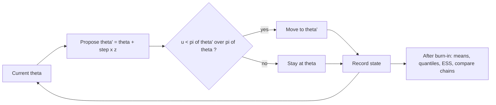

# Bayesian Inference

## TL;DR

- Posterior $\propto$ likelihood $\times$ prior; with a conjugate prior the posterior stays in the prior's family and the update is bookkeeping: Beta$(a,b)$ plus $k$ successes in $n$ gives Beta$(a+k, b+n-k)$, and the prior acts like $a+b$ pseudo-observations.
- Normal-normal: the posterior mean is a precision-weighted average, $\mu_n = (1-B)\bar x + B\mu_0$ with shrinkage $B = \frac{\sigma^2/n}{\sigma^2/n+\tau^2}$; noisy track records are shrunk hard toward the prior.
- The posterior predictive integrates over parameter uncertainty, so it is wider than the plug-in forecast; this is the Bayesian answer to "how many of my next 10 trades will win".
- MAP is the posterior mode (penalised MLE) and depends on the parametrisation; the posterior mean minimises squared loss. A Gaussian prior makes the MAP and mean equal to ridge with $\lambda = \sigma^2/\tau^2$; a Laplace prior makes the MAP the lasso.
- Empirical Bayes estimates the prior from the cross-section; James-Stein shows shrinking many noisy estimates toward their mean beats the raw estimates in total squared error, and it cures the winner's curse.
- When there is no conjugate form, sample with MCMC; a random-walk Metropolis sampler is twenty lines, and you validate it on a conjugate case before trusting it.

## Learning objectives

- Use conjugate priors (beta-binomial, normal-normal) and posterior predictive distributions.
- Distinguish the MAP, posterior mean and median, and credible from confidence intervals.
- Explain shrinkage and empirical Bayes, and apply them to noisy signal estimates.
- Show that ridge regression is a Bayesian posterior mean.
- Implement a Metropolis sampler and check it against a conjugate answer.
- Compare Bayesian and frequentist answers to the same trading question.

## Core concepts

### Bayes' rule for parameters

For data $D$ and parameter $\theta$,

$$
p(\theta\mid D) = \frac{p(D\mid\theta)\,p(\theta)}{p(D)} \propto p(D\mid\theta)\,p(\theta), \qquad p(D) = \int p(D\mid\theta)p(\theta)\,d\theta .
$$

The posterior is a full distribution: report its mean, spread, tail probabilities ("probability the edge is positive") and use it for decisions.
The evidence $p(D)$ is only needed to compare models (Bayes factors); MCMC avoids it altogether.
Sequential data update sequentially: today's posterior is tomorrow's prior, which is exactly the [Kalman filter](11-State-Space-Models-and-Kalman-Filter.md) for linear-Gaussian states.

### Conjugate families

| Likelihood | Prior | Posterior | Prior acts like |
| :--- | :--- | :--- | :--- |
| Binomial($n,p$) | Beta($a,b$) | Beta($a+k$, $b+n-k$) | $a$ successes and $b$ failures |
| Normal, known $\sigma^2$, mean $\mu$ | $N(\mu_0,\tau^2)$ | $N(\mu_n,\tau_n^2)$, precisions add | $\sigma^2/\tau^2$ observations |
| Poisson rate $\lambda$ | Gamma(shape $\alpha$, rate $\beta$) | Gamma($\alpha+\sum x$, $\beta+n$) | $\beta$ periods with $\alpha$ events |
| Normal, unknown $\mu,\sigma^2$ | Normal-inverse-gamma | Normal-inverse-gamma | marginal of $\mu$ is Student-$t$ |
| Multinomial | Dirichlet | Dirichlet | pseudo-counts per category |
| Multivariate normal covariance | Inverse-Wishart | Inverse-Wishart | prior scatter matrix |

Beta-binomial in detail: the posterior mean

$$
E[p\mid D] = \frac{a+k}{a+b+n} = \frac{a+b}{a+b+n}\cdot\frac{a}{a+b} + \frac{n}{a+b+n}\cdot\frac kn
$$

is a weighted average of the prior mean and the MLE, with weights proportional to prior pseudo-count $a+b$ and sample size $n$.
Laplace's rule of succession is the flat prior Beta(1,1): after $k$ successes in $n$, $P(\text{next success}) = (k+1)/(n+2)$, never exactly 0 or 1.

Normal-normal in detail: with $x_1,\dots,x_n\sim N(\mu,\sigma^2)$, $\sigma$ known, and prior $\mu\sim N(\mu_0,\tau^2)$,

$$
\frac{1}{\tau_n^2} = \frac1{\tau^2} + \frac{n}{\sigma^2}, \qquad \mu_n = \tau_n^2\Big(\frac{\mu_0}{\tau^2} + \frac{n\bar x}{\sigma^2}\Big) = (1-B)\,\bar x + B\,\mu_0, \qquad B = \frac{\sigma^2/n}{\sigma^2/n+\tau^2}.
$$

Precisions add and means are precision-weighted.
$B$ is large when the data are noisy relative to the spread of plausible truths, which is the normal state of affairs for alphas, Sharpe ratios and signal ICs.

### Posterior predictive

$$
p(\tilde x\mid D) = \int p(\tilde x\mid\theta)\,p(\theta\mid D)\,d\theta .
$$

For normal-normal it is $N(\mu_n, \sigma^2+\tau_n^2)$: observation noise plus parameter uncertainty.
For beta-binomial the number of successes in $m$ future trials is beta-binomial, with variance $m\bar p(1-\bar p)\frac{a'+b'+m}{a'+b'+1}$ where $a', b'$ are the posterior parameters and $\bar p$ the posterior mean; the extra factor is the price of not knowing $p$.
Plugging in a point estimate understates risk; for position sizing and VaR the predictive is the right object.

### Point estimates and intervals

| Loss | Bayes estimate |
| :--- | :--- |
| Squared error | posterior mean |
| Absolute error | posterior median |
| 0-1 (limit) | posterior mode (MAP) |

MAP equals maximising $\log p(D\mid\theta) + \log p(\theta)$, a penalised MLE; with a flat prior it is the MLE.
MAP is not invariant to reparametrisation, because densities pick up a Jacobian: for Beta$(a,b)$ the mode of $p$ is $(a-1)/(a+b-2)$, but the mode of $\text{logit}(p)$, mapped back, is $a/(a+b)$.
A 95% credible interval contains $\theta$ with posterior probability 0.95 given this data; a 95% confidence interval is a procedure that covers the fixed $\theta$ in 95% of repeated samples.
With flat priors and large samples the two often coincide numerically, which is why a one-sided $p$-value is close to the posterior probability of the opposite sign, but they answer different questions.
Uninformative priors: flat, or Jeffreys $p(\theta)\propto\sqrt{I(\theta)}$, which is Beta(1/2,1/2) for a binomial proportion and is invariant to reparametrisation.

### Shrinkage, empirical Bayes and James-Stein

With many units (managers, signals, stocks) each estimated with noise, $x_i\mid\theta_i\sim N(\theta_i,\sigma^2)$, and true values $\theta_i\sim N(\mu,\tau^2)$, the Bayes estimate is $\hat\theta_i = \mu + (1-B)(x_i-\mu)$.
Empirical Bayes estimates $\mu$ and $\tau^2$ from the cross-section: $\hat\mu = \bar x$ and $\hat\tau^2 = \max(0, s_x^2-\sigma^2)$, since the observed dispersion is true dispersion plus noise.
James and Stein (1961) proved that shrinking toward a fixed point, $\hat\theta^{JS} = \big(1-\frac{(k-2)\sigma^2}{\lVert x\rVert^2}\big)x$, has lower expected total squared error (risk) than the raw $x$ for every configuration of the $\theta_i$ when $k\ge3$, with no distributional assumption on the $\theta_i$.
The version that shrinks toward the grand mean (suggested by Lindley in 1962 and popularised by Efron and Morris),

$$
\hat\theta_i^{JS} = \bar x + \Big(1 - \frac{(k-3)\sigma^2}{\sum_j(x_j-\bar x)^2}\Big)(x_i-\bar x),
$$

dominates the raw estimates when $k\ge4$, and truncating the shrinkage factor at zero (the positive-part estimator, Baranchik 1964) dominates it again.
Finance uses this constantly:

- beta shrinkage toward the cross-sectional mean (Vasicek 1973);
- Bayes-Stein shrinkage of expected returns (Jorion 1986) and the Black-Litterman blend of equilibrium and views ([Black-Litterman, Risk Parity and HRP](../09-Alpha-Research-and-Portfolio/12-Black-Litterman-Risk-Parity-and-HRP.md));
- covariance shrinkage toward a structured target ([Covariance Estimation and Shrinkage](../09-Alpha-Research-and-Portfolio/11-Covariance-Estimation-and-Shrinkage.md));
- shrinking per-asset signal ICs or per-trader hit rates toward the desk average before allocating risk.

Winner's curse: selecting the best observed units selects positive noise, so their raw estimates are biased up; shrinkage is the correction.

### Regularisation as a prior

For $y = X\beta+\varepsilon$, $\varepsilon\sim N(0,\sigma^2I)$ and prior $\beta\sim N(0,\tau^2I)$,

$$
-\log p(\beta\mid y) = \frac{1}{2\sigma^2}\lVert y-X\beta\rVert^2 + \frac1{2\tau^2}\lVert\beta\rVert^2 + \text{const},
$$

so the MAP, which here equals the posterior mean because the posterior is Gaussian, is ridge with $\lambda = \sigma^2/\tau^2$: $\hat\beta = (X^\top X+\lambda I)^{-1}X^\top y$, with posterior covariance $\sigma^2(X^\top X+\lambda I)^{-1}$.
A Laplace prior gives the lasso penalty; the lasso solution is the MAP, while the posterior mean under a Laplace prior is never exactly sparse.
A tight prior (small $\tau$) means a large $\lambda$: you believe effects are small, which in return prediction you should ([Regularization](06-Regularization-Ridge-Lasso.md)).

### MCMC and the Metropolis algorithm

When the posterior has no closed form, construct a Markov chain whose stationary distribution is the posterior and average over its path.
Random-walk Metropolis:

1. From the current $\theta$, propose $\theta' = \theta + s\,z$ with $z\sim N(0,I)$ (symmetric proposal).
2. Accept with probability $\min\big(1, \pi(\theta')/\pi(\theta)\big)$, where $\pi$ is the unnormalised posterior; otherwise stay at $\theta$ (and record $\theta$ again).
3. Repeat; discard a burn-in; use the rest as dependent draws.

The acceptance rule satisfies detailed balance $\pi(\theta)q(\theta'\mid\theta)\alpha(\theta,\theta') = \pi(\theta')q(\theta\mid\theta')\alpha(\theta',\theta)$, so $\pi$ is stationary; only ratios of $\pi$ appear, so the evidence $p(D)$ cancels.
Metropolis-Hastings handles asymmetric proposals by multiplying the ratio by $q(\theta\mid\theta')/q(\theta'\mid\theta)$; Gibbs sampling updates one block at a time from its full conditional.
Tuning: too small a step gives high acceptance but a slow random walk, too large gives frequent rejections.
For Gaussian-like targets the optimal step is about $2.38/\sqrt d$ posterior standard deviations, with acceptance near 0.44 in one dimension (Gelman, Roberts and Gilks 1996, "Efficient Metropolis Jumping Rules", Bayesian Statistics 5) and 0.234 as $d\to\infty$ (Roberts, Gelman and Gilks 1997).
Draws are autocorrelated, so the effective sample size is $N/(1+2\sum_k\rho_k)$; report Monte Carlo error with it, run several chains from dispersed starts and check that they agree.
Modern practice uses Hamiltonian Monte Carlo (the No-U-Turn sampler in Stan) for many parameters; the validation discipline is the same.

### Bayesian versus frequentist on a trading question

| Question | Frequentist answer | Bayesian answer |
| :--- | :--- | :--- |
| Is the hit rate above 50%? | $p$-value of the data under $p = 0.5$ | $P(p > 0.5\mid D)$ under a stated prior |
| What hit rate should I plan on? | MLE $k/n$ with a confidence interval | Posterior mean, or the predictive for the next $m$ trades |
| Which of 200 managers is best? | Rank raw track records, correct for multiple testing | Shrink each toward the cross-section, then rank |
| How uncertain is my forecast? | Plug-in forecast error | Predictive distribution including parameter uncertainty |

The Bayesian view is natural when decisions are sequential and priors are real (most strategies do not work), and when many related quantities are estimated at once.
Its weakness is that results depend on the prior; state it and show sensitivity.

## Worked examples

### 1. A trader's hit rate: 60 wins in 100 trades

Frequentist: MLE 0.6, Wald 95% interval $[0.504, 0.696]$; under $p = 0.5$, $z = 2.0$, one-sided $p = 0.0228$, two-sided $p = 0.0455$.

Flat prior Beta(1,1): posterior Beta(61, 41).

- Mean $61/102 = 0.598$, MAP $0.600$, sd $0.0483$.
- 95% equal-tailed credible interval $[0.5017, 0.6907]$.
- $P(p\le0.5\mid D) = 0.0230$, almost the one-sided $p$-value, as expected with a flat prior. (Exact check: $P(\text{Beta}(61,41)\le0.5) = P(\text{Bin}(101,0.5)\ge61)$.)

Sceptical prior Beta(50,50) ("most traders are coin flips", worth 100 trades): posterior Beta(110, 90), mean 0.55, MAP 0.5505, sd 0.0351, and $P(p>0.5\mid D) = 0.922$.
Half the posterior mean comes from the prior because the prior and the data carry equal weight (100 pseudo-trades each).

### 2. Predicting the next 10 trades

With the flat-prior posterior Beta(61,41), the number of wins in the next 10 trades is beta-binomial: $P(\ge6) = 0.6238$ and variance 2.614.
Plugging in $\hat p = 0.6$ gives Binomial(10, 0.6): $P(\ge6) = 0.6331$ and variance 2.400.
The predictive is slightly less optimistic and wider because the hit rate itself is uncertain.

### 3. Shrinking a manager's alpha

"A manager shows 6% annual alpha over 3 years with 8% tracking error. Across managers, true alphas are roughly $N(0, 2\%^2)$. What alpha do you expect going forward?"

Sampling variance of the 3-year mean alpha: $64/3 = 21.33$ (sd 4.62%), so the raw $t$-stat is only 1.30.
Shrinkage $B = 21.33/(21.33+4) = 0.842$, posterior mean $0.158\times6\% = 0.947\%$, posterior sd $1.835\%$, and $P(\alpha>0\mid D) = 0.697$.
Next year's realised alpha has predictive sd $\sqrt{1.835^2+64} = 8.21\%$, dominated by tracking error.
To make $B = 0.5$ you need $\sigma^2/T = \tau^2$, that is $T = 64/4 = 16$ years of track record: this is why allocators weigh process over short track records.

### 4. Shrinking a backtest Sharpe ratio

"A strategy shows an annual Sharpe of 1.5 over 2 years. Your prior over strategies like it is $N(0, 0.5^2)$. What Sharpe do you expect?"

The sampling variance of an annual Sharpe estimate is about $1/T = 0.5$: for iid returns sampled $m$ times a year the variance of the annualised estimate is $(1+SR^2/2m)/T$ (Lo 2002), and with monthly or daily data the $SR^2/2m$ term is negligible.
$B = 0.5/(0.5+0.25) = 2/3$, posterior mean $1.5/3 = 0.50$, posterior sd $\sqrt{1/(4+2)} = 0.408$, $P(SR>0\mid D) = 0.890$.
The frequentist one-sided $p$-value against $SR = 0$ is $1-\Phi(1.5\sqrt2) = 0.0169$, which sounds far more convincing; the difference is the prior belief that most backtested Sharpe ratios are noise, which [Overfitting and Deflated Sharpe](../09-Alpha-Research-and-Portfolio/08-Overfitting-and-Deflated-Sharpe.md) makes formal.

### 5. Empirical Bayes across 200 managers

Simulate 200 managers with true alphas $N(0,2^2)$ observed with noise sd $4.62$ (500 repetitions, seed 42).

| Estimator | Mean squared error |
| :--- | ---: |
| Raw alphas (theory 21.33) | 21.42 |
| Empirical Bayes, $\hat\tau^2 = s_x^2-\sigma^2$ | 3.63 |
| James-Stein, positive part | 3.63 |
| Oracle Bayes (known $\tau$) | 3.37 |

The mean estimated $\tau$ is 1.92 against the true 2.
The 20 managers with the best raw alpha average 8.79% raw, but their true alphas average only 1.39%; the empirical Bayes estimates for them average 1.39%, so shrinkage removes the winner's curse almost exactly.

### 6. Ridge is a posterior mean

With $n = 60$, five regressors, $\sigma = 1$ and prior sd $\tau = 0.5$ (seed 7): $\lambda = \sigma^2/\tau^2 = 4$.
The posterior mean from the precision form $\big(X^\top X/\sigma^2 + I/\tau^2\big)^{-1}X^\top y/\sigma^2$ and the ridge solution computed by data augmentation (append $\sqrt\lambda I$ rows with zero targets) agree to $10^{-10}$, and ridge shrinks the coefficient vector to 0.933 of the OLS length.

### 7. Validating a Metropolis sampler on conjugate targets

Target 1, the hit-rate posterior Beta(61,41) through its unnormalised log density $60\log p + 40\log(1-p)$; step $2.4\times0.0483$; 60,000 iterations, 2000 burn-in (seed 2026):

| Quantity | MCMC | Exact |
| :--- | ---: | ---: |
| Acceptance rate | 0.446 | about 0.44 optimal in 1-D |
| Mean | 0.5985 | 0.5980 |
| sd | 0.0482 | 0.0483 |
| $P(p\le0.5)$ | 0.0220 | 0.0230 |

The effective sample size is about 12,168 out of 58,000 draws, so the Monte Carlo error of the mean is about $0.0483/\sqrt{12168}\approx0.0004$, consistent with the observed gap of 0.0004 between the MCMC and exact means.

Target 2, normal data with unknown mean and variance ($n = 30$, $\bar x = 0.1156$, $s^2 = 0.9094$) under the prior flat in $(\mu,\log\sigma)$, whose exact marginal for $\mu$ is Student-$t_{29}$ centred at $\bar x$ with sd $\sqrt{s^2/n\cdot(n-1)/(n-3)} = 0.1804$, and $E[\sigma^2\mid D] = (n-1)s^2/(n-3) = 0.9768$.
A two-dimensional Metropolis run (acceptance 0.305) gives a posterior mean of $\mu$ of 0.1174, sd 0.1813 and $E[\sigma^2]$ 0.9748.
Only after both checks pass would you point the same code at a posterior with no closed form, such as a Student-$t$ return model.

### 8. Zero losses in twelve months

"A strategy has had no losing month in 12. What probability do you assign to a loss next month?"

Not zero.
With a flat prior the rule of succession gives $1/14 = 0.0714$; with the Jeffreys prior Beta(1/2,1/2), $0.5/13 = 0.0385$.
The answer depends on the prior because 12 observations carry little information about a rare event; if you have a view from similar strategies, encode it.

## Pitfalls

- Treating the posterior from a flat prior as "objective"; flat on $p$ is not flat on $\log p$ or $\text{logit}(p)$.
- Reporting a MAP as if it were the posterior mean; they differ for skewed posteriors and the MAP moves under reparametrisation.
- Using the plug-in forecast for risk when the parameter is poorly known; the predictive is wider.
- Shrinking toward zero when the cross-section has a known non-zero centre (shrink betas toward 1, not 0).
- Empirical Bayes with a prior variance estimated from too few units or with the target unit's own data dominating it.
- Ignoring that shrinkage should be done on comparable units; pooling managers of different styles shrinks toward a meaningless average.
- Trusting MCMC output without convergence checks: a chain stuck in one mode, an unconverged burn-in or a tiny effective sample size all look fine in a trace mean.
- Forgetting the Jacobian when sampling in a transformed space (for example $\log\sigma$): the prior must be transformed too.

## Interview questions

> [!question]- stat-bayes-beta-binomial-update | Prior Beta(a, b) on a success probability, then k successes in n trials. What is the posterior and its mean?
> Beta$(a+k, b+n-k)$ with mean $(a+k)/(a+b+n)$.
> The mean is a weighted average of the prior mean $a/(a+b)$ and the MLE $k/n$, with weights $a+b$ and $n$.

> [!question]- stat-bayes-hit-rate-60-100 | A trader wins 60 of 100 trades. With a flat prior, what is the posterior mean and P(p <= 0.5)?
> Mean $61/102 = 0.598$, $P(p\le0.5) = 0.0230$.
> Posterior Beta(61,41); the tail probability is close to the one-sided $p$-value 0.0228 because the prior is flat.

> [!question]- stat-bayes-sceptical-prior | Same 60 of 100 wins, but with a Beta(50,50) prior. Posterior mean and P(p > 0.5)?
> Mean 0.55, $P(p>0.5) = 0.922$.
> Posterior Beta(110,90): the prior is worth 100 trades, so it gets half the weight.

> [!question]- stat-bayes-normal-normal-shrinkage | State the normal-normal posterior mean and the shrinkage factor.
> $\mu_n = (1-B)\bar x + B\mu_0$ with $B = \frac{\sigma^2/n}{\sigma^2/n+\tau^2}$, and posterior variance $(1/\tau^2+n/\sigma^2)^{-1}$.
> Precisions add and the mean is precision-weighted.

> [!question]- stat-bayes-manager-alpha | Alpha 6% over 3 years with 8% tracking error; prior N(0, 2%^2). Posterior mean alpha?
> About 0.95%.
> Sampling variance $64/3 = 21.3$, $B = 21.3/25.3 = 0.842$, so the estimate keeps only 15.8% of the observed 6%.

> [!question]- stat-bayes-years-for-half-shrinkage | With 8% tracking error and a prior sd of true alpha of 2%, how many years until the data and the prior get equal weight?
> 16 years.
> $B = 0.5$ when $\sigma^2/T = \tau^2$, so $T = 64/4$.

> [!question]- stat-bayes-sharpe-shrinkage | Backtest Sharpe 1.5 over 2 years, prior N(0, 0.5^2), sampling variance about 1/T. Posterior mean Sharpe?
> 0.5, with posterior sd 0.41 and $P(SR>0) = 0.89$.
> $B = 0.5/(0.5+0.25) = 2/3$; the frequentist one-sided $p$-value 0.017 sounds much stronger because it ignores the prior that most backtests are noise.

> [!question]- stat-bayes-posterior-predictive | What is the posterior predictive distribution and why is it wider than the plug-in forecast?
> $p(\tilde x\mid D) = \int p(\tilde x\mid\theta)p(\theta\mid D)d\theta$; it averages over parameter uncertainty.
> Normal-normal: variance $\sigma^2+\tau_n^2$ versus $\sigma^2$; for 10 future trades after 60/100 wins the predictive variance is 2.61 versus the plug-in 2.40.

> [!question]- stat-bayes-map-vs-mean | Which Bayes estimate minimises squared, absolute and 0-1 loss?
> Posterior mean, posterior median and posterior mode (MAP, in the limit) respectively.
> For Beta(61,41) the mean is 0.598 and the MAP 0.600.

> [!question]- stat-bayes-map-not-invariant | Why is the MAP not invariant to reparametrisation?
> Densities transform with a Jacobian, so the mode moves: for Beta$(a,b)$ the mode of $p$ is $(a-1)/(a+b-2)$, but the mode of $\text{logit}(p)$ maps back to $a/(a+b)$.
> The posterior median and quantiles are invariant to monotone maps; the mean and mode are not.

> [!question]- stat-bayes-ridge-prior | Show that ridge regression is a Bayesian estimator. What is lambda?
> With $\varepsilon\sim N(0,\sigma^2I)$ and prior $\beta\sim N(0,\tau^2I)$ the negative log posterior is the ridge objective, so ridge is the MAP and posterior mean with $\lambda = \sigma^2/\tau^2$.
> A Laplace prior gives the lasso as the MAP, but its posterior mean is not sparse.

> [!question]- stat-bayes-james-stein | State the James-Stein result and why it is surprising.
> For $k\ge3$ normal means with known variance, shrinking toward a fixed point (or toward the grand mean for $k\ge4$) has lower expected total squared error than the raw estimates, for every configuration of the true means.
> The raw MLE is inadmissible in three or more dimensions even though the units are unrelated; the gain is largest when true dispersion is small relative to noise.

> [!question]- stat-bayes-empirical-bayes-tau | How do you estimate the prior variance in empirical Bayes from a cross-section of noisy estimates?
> $\hat\tau^2 = \max(0, s_x^2-\sigma^2)$: observed dispersion equals true dispersion plus noise variance.
> Then shrink each unit by $\hat B = \sigma^2/(\sigma^2+\hat\tau^2)$ toward the cross-sectional mean.

> [!question]- stat-bayes-winners-curse | You pick the top 20 of 200 managers by raw alpha. Why will they disappoint, and what fixes it?
> Selection on noisy estimates picks positive noise: in simulation their raw alpha averaged 8.79% but their true alpha 1.39%.
> Empirical Bayes shrinkage estimated 1.39%, removing the bias; rank on shrunk estimates and size on them.

> [!question]- stat-bayes-metropolis-acceptance | Write the Metropolis acceptance probability and explain why the normalising constant is not needed.
> $\min\big(1,\pi(\theta')/\pi(\theta)\big)$ for a symmetric proposal; Hastings multiplies by $q(\theta\mid\theta')/q(\theta'\mid\theta)$.
> Only ratios of the posterior appear, so $p(D)$ cancels; detailed balance makes the posterior stationary.

> [!question]- stat-bayes-metropolis-tuning | What acceptance rate should you target for random-walk Metropolis?
> About 0.44 in one dimension (Gelman, Roberts and Gilks 1996) and 0.234 in high dimension (Roberts, Gelman and Gilks 1997), with step about $2.38/\sqrt d$ posterior sds.
> A step of 2.4 posterior sds on a one-dimensional beta posterior gave acceptance 0.446.

> [!question]- stat-bayes-mcmc-validation | How do you convince yourself an MCMC sampler is correct before using it on a real model?
> Run it on a target with a known answer (a conjugate posterior) and compare mean, sd and tail probabilities within Monte Carlo error based on the effective sample size; then run several chains from dispersed starts.
> A Beta(61,41) check gave mean 0.5985 versus 0.5980 with ESS about 12,000 of 58,000 draws.

> [!question]- stat-bayes-ess | What is the effective sample size of an MCMC chain?
> $N/(1+2\sum_{k\ge1}\rho_k)$, the number of independent draws with the same Monte Carlo variance of the mean.
> Autocorrelated chains can have ESS far below $N$; Monte Carlo standard error is posterior sd over $\sqrt{\text{ESS}}$.

> [!question]- stat-bayes-credible-vs-confidence | What is the difference between a 95% credible interval and a 95% confidence interval?
> Credible: given this data, $\theta$ lies inside with posterior probability 0.95 under the prior.
> Confidence: the procedure covers the fixed true $\theta$ in 95% of repeated samples; the two often agree numerically under flat priors and large samples.

> [!question]- stat-bayes-rule-of-succession | A strategy has 0 losing months out of 12. Probability of a loss next month?
> $1/14 = 0.071$ under a flat prior (Laplace's rule of succession), 0.038 under Jeffreys' Beta(1/2,1/2).
> Never 0: posterior mean $(k+1)/(n+2)$; with so little data the prior matters, so use one from comparable strategies.

## In this repo and SDE-Interview-Prep

- Code: [bayesian_inference.py](code/bayesian_inference.py) computes and asserts every number in this note (beta and normal conjugate updates, predictive distributions, empirical Bayes and James-Stein simulation, ridge as a posterior mean, Metropolis samplers checked against exact answers).
- [Conditional Probability and Bayes](../01-Probability/02-Conditional-Probability-and-Bayes.md) for Bayes' rule on events.
- [Estimation: MLE and Method of Moments](01-Estimation-MLE-and-Method-of-Moments.md) for the likelihood the prior multiplies.
- [Regularization: Ridge, Lasso and Elastic Net](06-Regularization-Ridge-Lasso.md) for the penalised view of the same estimators.
- [State-Space Models and the Kalman Filter](11-State-Space-Models-and-Kalman-Filter.md) for sequential Gaussian updating.
- [Markov Chains](../01-Probability/10-Markov-Chains.md) for stationarity and detailed balance behind MCMC.

## Further reading

- Andrew Gelman, John Carlin, Hal Stern, David Dunson, Aki Vehtari and Donald Rubin, *Bayesian Data Analysis* (3rd ed.), chapters 2 and 3 (conjugate models), 5 (hierarchical models), 11 and 12 (MCMC).
- Kevin Murphy, *Machine Learning: A Probabilistic Perspective*, chapters 3, 4, 7 (Bayesian linear regression) and 24 (MCMC).
- Christopher Bishop, *Pattern Recognition and Machine Learning*, chapters 2, 3 and 11.
- W. James and C. Stein, "Estimation with Quadratic Loss", *Proceedings of the Fourth Berkeley Symposium* 1, 1961.
- Bradley Efron and Carl Morris, "Data Analysis Using Stein's Estimator and its Generalizations", *JASA* 70(350), 1975.
- Dennis Lindley, discussion of Charles Stein, "Confidence Sets for the Mean of a Multivariate Normal Distribution", *Journal of the Royal Statistical Society B* 24(2), 1962 (the grand-mean version of the estimator).
- Andrew Lo, "The Statistics of Sharpe Ratios", *Financial Analysts Journal* 58(4), 2002.
- N. Metropolis, A. Rosenbluth, M. Rosenbluth, A. Teller and E. Teller, "Equation of State Calculations by Fast Computing Machines", *Journal of Chemical Physics* 21(6), 1953; W. K. Hastings, "Monte Carlo Sampling Methods Using Markov Chains and their Applications", *Biometrika* 57(1), 1970.
- G. Roberts, A. Gelman and W. Gilks, "Weak Convergence and Optimal Scaling of Random Walk Metropolis Algorithms", *Annals of Applied Probability* 7(1), 1997.
- Oldrich Vasicek, "A Note on Using Cross-Sectional Information in Bayesian Estimation of Security Betas", *Journal of Finance* 28(5), 1973.
- Philippe Jorion, "Bayes-Stein Estimation for Portfolio Analysis", *Journal of Financial and Quantitative Analysis* 21(3), 1986.
