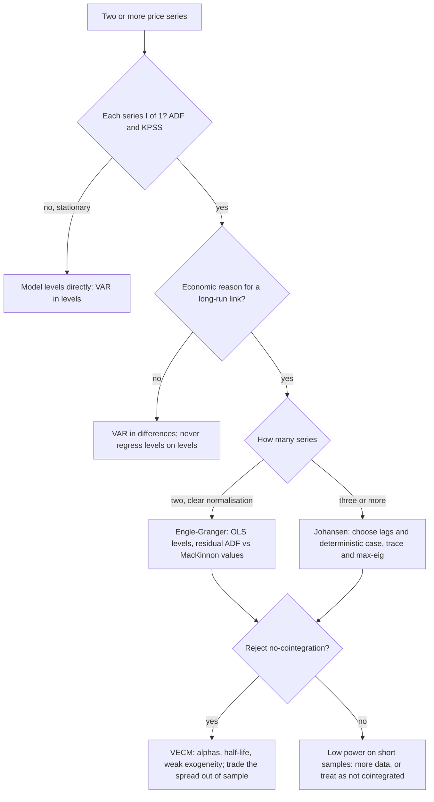

# Cointegration and VAR Models

## TL;DR

- Two I(1) series are cointegrated if some combination $y_t-\beta x_t$ is stationary; that spread is what a pairs trade, a basis trade or an index arbitrage actually trades.
- Regressing one random walk on an independent one gives "significant" $t$-stats most of the time (84% at $T = 250$ in simulation) and $t$ grows like $\sqrt T$: never trust a levels regression without a cointegration test.
- Engle-Granger: OLS in levels, then a unit-root test on the residuals with Engle-Granger critical values (5%: $-3.34$ for two variables with a constant, MacKinnon 2010), not Dickey-Fuller's $-2.86$, which rejects a true null 15% of the time.
- Cointegration implies an error-correction model $\Delta y_t = \alpha(y_{t-1}-\beta x_{t-1}) + \dots$ (Granger representation theorem); $\alpha < 0$ is the speed of reversion and gives the half-life.
- Johansen tests the rank of $\Pi$ in the VECM with trace and max-eigenvalue statistics from a reduced-rank regression; critical values depend on $n-r$ and on the deterministic terms, and using the wrong case gives wrong ranks.
- A VAR is estimated by OLS equation by equation; Granger causality is a Wald test on lag blocks (predictive, not causal); orthogonalised impulse responses depend on the Cholesky ordering.

## Learning objectives

- Test for cointegration (Engle-Granger, Johansen) and build error-correction models.
- Fit VAR models and interpret Granger causality and impulse responses.
- Avoid spurious regression between trending series.
- Choose deterministic terms and critical values correctly, and judge test power on short samples.

## Core concepts

### Integration, cointegration and spurious regression

A series is I(1) if it is non-stationary but its first difference is stationary; log prices are the canonical example ([Stationarity and ARMA](08-Time-Series-Stationarity-and-ARMA.md)).
$y_t$ and $x_t$, both I(1), are cointegrated with vector $(1,-\beta)$ if $u_t = y_t-\beta x_t$ is I(0).
Then the two share one common stochastic trend and cannot drift apart permanently.
Examples: an ETF and its basket, futures and spot (net of carry), dual listings, on-the-run and off-the-run bonds, an FX cross and the product of its two legs, and, more loosely, two stocks with the same economic exposure.

Correlation and cointegration are different things.
Two price series can have highly correlated daily returns and still wander apart (no cointegration), or have weakly correlated returns and a tightly mean-reverting spread.
Cointegration is about levels, correlation about increments.

Spurious regression (Granger and Newbold 1974; theory in Phillips 1986): if $y$ and $x$ are independent random walks, OLS of $y$ on $x$

- has a slope that does not converge to 0 but to a random variable;
- has a $t$-stat that diverges at rate $\sqrt T$, so rejection rates rise toward 1 as the sample grows;
- has an $R^2$ with a non-degenerate limiting distribution (mean about 0.24 in the simulation below, at every sample size);
- has residuals that are themselves I(1), which is the tell-tale sign (Durbin-Watson near 0).

Differencing both series gives a valid regression of returns on returns, but discards the long-run relation if one exists; cointegration analysis keeps both.

### Engle-Granger two-step

1. Estimate $y_t = c + \beta x_t + u_t$ by OLS.
   If the series are cointegrated, $\hat\beta$ is superconsistent: its error shrinks like $1/T$ instead of $1/\sqrt T$.
   Its distribution is non-normal and its OLS $t$-stat is meaningless; for inference on $\beta$ use dynamic OLS or Johansen.
2. Run a Dickey-Fuller regression on the residuals, $\Delta\hat u_t = \gamma\hat u_{t-1} + \sum_j\delta_j\Delta\hat u_{t-j} + e_t$, and reject "no cointegration" if the $t$-stat on $\gamma$ is below the Engle-Granger critical value.

The critical values are more negative than Dickey-Fuller's because OLS chooses $\hat\beta$ to minimise the residual variance, which makes even a non-cointegrated residual look stationary.
From MacKinnon (2010), Table 2 ($\tau_c$: constant in the cointegrating regression), asymptotic values:

| Variables $N$ | 1% | 5% | 10% |
| ---: | ---: | ---: | ---: |
| 1 (plain Dickey-Fuller with constant) | $-3.43$ | $-2.86$ | $-2.57$ |
| 2 | $-3.90$ | $-3.34$ | $-3.04$ |

Finite-sample values follow MacKinnon's response surface $C(T) = \beta_\infty + \beta_1/T + \beta_2/T^2 + \beta_3/T^3$, with $T$ the number of observations in the unit-root regression; for $N = 2$ at 5% the coefficients are $(-3.33613, -6.1101, -6.823, 0)$, giving $-3.3484$ at $T = 499$.
MacKinnon also warns that the constant-only tables assume no drift in the data; for trending series add a time trend to the cointegrating regression and use the $\tau_{ct}$ values ($N = 2$, 5%: $-3.78$).
The test is not invariant to which variable is the regressand; when the result is borderline, run it both ways.

### Error correction and the Granger representation theorem

Engle and Granger (1987) show that cointegrated series have an error-correction representation

$$
\Delta y_t = c + \alpha\,(y_{t-1}-\beta x_{t-1}) + \sum_{j}\gamma_j\Delta x_{t-j} + \sum_j\delta_j\Delta y_{t-j} + \varepsilon_t ,
$$

and conversely.
$\alpha < 0$ pulls $y$ back when the spread is positive; the implied spread AR(1) coefficient is about $1+\alpha$ and the half-life $\ln0.5/\ln(1+\alpha)$.
In a two-variable system each leg has its own $\alpha$; a leg with $\alpha = 0$ is weakly exogenous (it leads, the other follows), which is how price-discovery shares between venues or between futures and spot are framed.

### Johansen: the rank of the long-run matrix

Write a VAR($k$) in levels as a vector error-correction model

$$
\Delta y_t = \mu + \Pi y_{t-1} + \sum_{i=1}^{k-1}\Gamma_i\Delta y_{t-i} + \varepsilon_t, \qquad \Pi = \alpha\beta^\top .
$$

If $y_t$ is $n$-dimensional and I(1), the rank $r$ of $\Pi$ is the number of cointegrating relations: $r = 0$ means no cointegration (a VAR in differences), $r = n$ means $y_t$ is stationary, and $0<r<n$ gives $r$ stationary combinations $\beta^\top y_t$ and $n-r$ common trends.
Johansen's maximum likelihood is a reduced-rank regression:

1. Regress $\Delta y_t$ and $y_{t-1}$ on the constant and lagged differences; call the residuals $R_{0t}$ and $R_{1t}$.
2. Form $S_{ij} = T^{-1}\sum_t R_{it}R_{jt}^\top$.
3. Solve $\lvert\lambda S_{11} - S_{10}S_{00}^{-1}S_{01}\rvert = 0$ for eigenvalues $\hat\lambda_1>\dots>\hat\lambda_n$ (squared canonical correlations between the two residual sets); the eigenvectors are the estimated $\beta$ columns.
4. Test sequentially from $r = 0$ upward:

$$
\text{trace}(r) = -T\sum_{i=r+1}^{n}\ln(1-\hat\lambda_i) \quad (H_0: \text{rank}\le r), \qquad \lambda_{\max}(r) = -T\ln(1-\hat\lambda_{r+1}) \quad (H_0: r \text{ against } r+1).
$$

The first $r$ at which you fail to reject is the estimated rank.
$\beta$ is identified only up to its span; normalise one coefficient to 1 to read it as a hedge ratio, and $\alpha = S_{01}\hat\beta(\hat\beta^\top S_{11}\hat\beta)^{-1}$.

The null distributions are non-standard and depend on $n-r$ and on how deterministic terms enter: no constant, constant restricted to the cointegrating relation (no trend in the data), unrestricted constant (linear trends in the levels), restricted trend, or unrestricted trend.
For the unrestricted-constant case, MacKinnon, Haug and Michelis (1999) give 95% critical values of 15.49 (trace) and 14.26 (max-eigenvalue) for $n-r = 2$, and 3.84 for $n-r = 1$ (as tabulated in statsmodels' `coint_tables.py`).
The 3.84 for $n-r = 1$ is the $\chi^2_1$ quantile and is valid only if the data really trend; with driftless prices use the restricted-constant case.

Engle-Granger versus Johansen in practice: Engle-Granger is simple and fine for one pair with an obvious normalisation; Johansen handles three or more series (a butterfly, a basket against an ETF), finds several relations and tests restrictions on $\alpha$ and $\beta$, but is sensitive to lag length and deterministic specification.

### VAR models

A VAR($p$) is $y_t = c + A_1y_{t-1} + \dots + A_py_{t-p} + \varepsilon_t$ with $\text{Var}(\varepsilon_t) = \Sigma$.

- Estimation: OLS equation by equation is the Gaussian MLE, because every equation has the same regressors.
- Stationarity: all eigenvalues of the companion matrix inside the unit circle; for a VAR(1), the eigenvalues of $A$.
- Stationary covariance of a VAR(1): $\text{vec}(\Gamma_0) = (I - A\otimes A)^{-1}\text{vec}(\Sigma)$.
- Lag length by AIC or BIC; the parameter count $n^2p$ grows fast, so shrinkage (Bayesian VARs) is standard beyond a handful of variables.
- With I(1) variables, a VAR in levels is still consistent, but some Wald tests have non-standard limits (Sims, Stock and Watson 1990); a VAR in differences is misspecified if the series are cointegrated, because it omits the error-correction term.

Granger causality: $x$ Granger-causes $y$ if lags of $x$ improve the forecast of $y$ given lags of $y$; test with a Wald or $F$ test that the block of $x$-lag coefficients in the $y$ equation is zero.
It is a statement about incremental predictability, not about economic causation: a common driver observed earlier in $x$ produces Granger causality without any causal link.
With possibly integrated series, lag-augment the VAR (Toda and Yamamoto 1995) or test inside the VECM.

Impulse responses: the VAR(1) moving-average form $y_t = \sum_h A^h\varepsilon_{t-h}$ gives the response at horizon $h$ to a unit shock in $\varepsilon$ as $A^h$.
Because the shocks are correlated, one usually orthogonalises with the Cholesky factor $\Sigma = PP^\top$ and reports $A^hP$; the first variable in the ordering receives no contemporaneous effect from the others, so the ordering is an identifying assumption.
Generalised impulse responses (Pesaran and Shin 1998) do not depend on ordering but are not orthogonal.
Forecast-error variance decompositions attribute the $h$-step forecast variance of each variable to each orthogonal shock.
In microstructure, Hasbrouck (1991) fits a VAR of trades and quote revisions and reads the permanent price impact of a trade from the cumulative impulse response.

## Worked examples

### 1. How spurious regressions look

Regress one simulated random walk on another, independent one (4000 pairs per sample size, seed 1974):

| $T$ | Share with $\lvert t\rvert > 1.96$, levels | Mean $R^2$, levels | Share with $\lvert t\rvert>1.96$, differences |
| ---: | ---: | ---: | ---: |
| 100 | 75.2% | 0.238 | 6.1% |
| 250 | 83.8% | 0.237 | 5.5% |
| 1000 | 92.7% | 0.234 | 4.8% |

At $T = 250$ the median $\lvert t\rvert$ is 6.8.
More data makes the false conclusion more confident: the rejection rate rises with $T$ while $R^2$ stays put, the signature of $t = O_p(\sqrt T)$.

### 2. Why the Engle-Granger table, not Dickey-Fuller

"You regress one price on another, test the residual with ADF and get $t = -3.1$. Cointegrated at 5%?"

Not with two variables: the 5% Engle-Granger value is $-3.34$ asymptotically ($-3.348$ at $T = 499$), and $-3.1$ does not clear it.
To check the table, simulate 40,000 independent random-walk pairs of length 500 (seed 1987) and compute the residual Dickey-Fuller statistic: its 5% and 1% quantiles are $-3.36$ and $-3.93$, against MacKinnon's $-3.348$ and $-3.918$.
Using Dickey-Fuller's $-2.86$ would declare 15.1% of these unrelated pairs cointegrated, three times the nominal rate.

### 3. Engle-Granger and an error-correction model on a simulated pair

$x$ is a random walk, $y_t = 2 + 1.5x_t + u_t$, $u_t = 0.9u_{t-1}+\varepsilon_t$, $T = 1000$ (seed 7).

- Step 1: intercept 1.497, hedge ratio 1.492; the reverse regression gives $1/\hat\beta_{x\mid y} = 1.498$, the closeness superconsistency predicts (in a stationary regression the product of the two slopes is $R^2$, so they would not be reciprocals).
- Step 2: residual Dickey-Fuller $t = -6.88$, far below the 5% value $-3.342$ at $T = 999$: cointegrated.
- ECM: $\Delta y_t$ on $\hat u_{t-1}$ and $\Delta x_t$ gives $\hat\alpha = -0.091$ ($t = -6.88$) and short-run coefficient 1.516.
- Implied half-life $\ln0.5/\ln(1-0.091) = 7.29$ days against the true $\ln0.5/\ln0.9 = 6.58$.

A trader would size entries in units of the spread's standard deviation and expect a round trip over a few half-lives ([Statistical Arbitrage and Pairs Trading](../09-Alpha-Research-and-Portfolio/06-Statistical-Arbitrage-and-Pairs-Trading.md)).

### 4. Power on one year of data

Rejection rate of the 5% Engle-Granger test with $T = 250$ (2000 cointegrated pairs per row):

| Spread AR(1) coefficient | Half-life (days) | Power |
| ---: | ---: | ---: |
| 0.90 | 6.6 | 85.9% |
| 0.95 | 13.5 | 30.0% |
| 0.98 | 34.3 | 9.4% |

A pair with a five-week half-life is detected one time in ten with one year of data.
"Not cointegrated" from a short sample means "not shown", which is why desks combine the test with economics, longer histories and out-of-sample spread behaviour.

### 5. Johansen on the same kind of pair, with trending data

Same design, but $x$ drifts by 0.1 per step so the unrestricted-constant case applies ($T = 1000$, $k = 1$):

| $H_0$ | Eigenvalue | Trace | 95% cv | Max-eig | 95% cv |
| :--- | ---: | ---: | ---: | ---: | ---: |
| $r = 0$ | 0.0456 | 46.66 | 15.49 | 46.59 | 14.26 |
| $r\le1$ | 0.0001 | 0.07 | 3.84 | 0.07 | 3.84 |

Reject $r = 0$, do not reject $r\le1$: one cointegrating relation.
The normalised vector is $(1, -1.495)$, the adjustment coefficients are $\alpha_y = -0.076$ ($t = -3.37$) and $\alpha_x = 0.009$ ($t = 0.77$), so $x$ is weakly exogenous and $y$ does the correcting, as in the data-generating process.
A simulation of the null (3000 runs, $T = 500$) gives 95% quantiles of 15.76 for the trace and 14.39 for max-eigenvalue with $n-r = 2$, slightly above the asymptotic 15.49 and 14.26, as expected in finite samples.

### 6. The wrong deterministic case

Simulate a truly cointegrated pair ($r = 1$) and test $H_0$: $r\le1$ with the unrestricted-constant critical value 3.84 (3000 runs, $T = 500$).
When the common trend drifts, the 95% quantile of the trace statistic is 4.35 and the true null is rejected 6.7% of the time.
When the prices do not drift, the 95% quantile is 8.26 and the true null is rejected 29.8% of the time: you would conclude that both prices are stationary.
For driftless data, use the restricted-constant case, whose critical values are larger.

### 7. Impulse responses by hand, and the ordering problem

VAR(1) with $A = \begin{pmatrix}0.5&0.2\\0&0.6\end{pmatrix}$ and $\Sigma = \begin{pmatrix}1&0.5\\0.5&1\end{pmatrix}$.

- Eigenvalues 0.5 and 0.6: stationary.
- $A^2 = \begin{pmatrix}0.25&0.22\\0&0.36\end{pmatrix}$: a unit $\varepsilon_2$ shock moves $y_1$ by 0.2 after one step and 0.22 after two.
- Stationary covariance: $\text{Var}(y_1) = 1.6786$, $\text{Cov}(y_1,y_2) = 0.9821$, $\text{Var}(y_2) = 1/(1-0.36) = 1.5625$.
- Ordering $(y_1,y_2)$: $P = \begin{pmatrix}1&0\\0.5&0.866\end{pmatrix}$; an orthogonal $y_2$ shock has impact 0 on $y_1$ and 0.866 on $y_2$, and moves $y_1$ by 0.173 after one step.
- Ordering $(y_2,y_1)$: the same shock has impact 0.5 on $y_1$ and 1 on $y_2$, and moves $y_1$ by 0.45 after one step.

Same data, same VAR, very different story: say which ordering you used and why (for example, trades before quotes within the interval).

### 8. Estimating the VAR and testing Granger causality

Simulate 1000 observations from the VAR above (seed 11) and run OLS equation by equation: $\hat A = \begin{pmatrix}0.468&0.216\\-0.007&0.600\end{pmatrix}$ and residual correlation 0.504.
Wald test that $y_2$ does not Granger-cause $y_1$: 43.75, far above the $\chi^2_1$ 5% value 3.841.
Wald test that $y_1$ does not Granger-cause $y_2$: 0.05.
So $y_2$ leads $y_1$ in the predictive sense, which matches the true $A$; whether $y_2$ causes $y_1$ is a separate, economic question.

## Pitfalls

- Regressing price levels on price levels and reading the $t$-stat or $R^2$.
- Using Dickey-Fuller critical values on Engle-Granger residuals.
- Quoting OLS standard errors for the cointegrating $\beta$ from step 1; they are invalid.
- Treating "fail to reject no cointegration" on a year of data as evidence that a slow spread does not mean-revert, or treating an in-sample rejection after scanning thousands of pairs as evidence that it does (multiple testing: [Hypothesis Testing](03-Hypothesis-Testing-and-Multiple-Comparisons.md)).
- Picking the Johansen deterministic case by habit; the case must match whether the data trend and whether the spread has a mean.
- Estimating a hedge ratio once and trading it for years; relations drift, which motivates rolling or [Kalman-filtered](11-State-Space-Models-and-Kalman-Filter.md) hedge ratios and break tests.
- Running a VAR in differences on cointegrated series and losing the error-correction term.
- Reporting Cholesky impulse responses without stating the ordering, or reading Granger causality as economic causation.
- Overfitting a large VAR: $n^2p$ parameters from a few hundred observations.

## Interview questions

> [!question]- stat-coint-definition | Define cointegration and give a market example.
> Two I(1) series are cointegrated if a linear combination $y_t-\beta x_t$ is I(0).
> Examples: an ETF and its creation basket, futures and spot net of carry, a dual-listed stock in two currencies.

> [!question]- stat-coint-correlation-vs-cointegration | Can two stocks have highly correlated returns but not be cointegrated?
> Yes: correlation is about increments, cointegration about levels.
> Small persistent differences in drift or idiosyncratic random-walk components let the prices diverge without bound even with return correlation 0.9; conversely a stationary spread can coexist with modest return correlation.

> [!question]- stat-coint-spurious-symptoms | You regress one random walk on an independent one. What do you see?
> Large $|t|$ most of the time, a sizeable $R^2$ and I(1) residuals (Durbin-Watson near 0).
> In simulation 83.8% of pairs had $|t| > 1.96$ at $T = 250$, with mean $R^2$ 0.24.

> [!question]- stat-coint-spurious-t-growth | In a spurious regression, what happens to the t-stat as the sample grows?
> It diverges at rate $\sqrt T$, so rejection rates rise toward 1 (75% at $T = 100$, 93% at $T = 1000$ in simulation).
> The slope converges to a random variable, not to 0 (Phillips 1986).

> [!question]- stat-coint-eg-steps | Describe the Engle-Granger procedure.
> OLS $y_t = c+\beta x_t+u_t$, then an (augmented) Dickey-Fuller test on $\hat u_t$ using Engle-Granger critical values.
> If cointegrated, fit the ECM $\Delta y_t = \alpha\hat u_{t-1}+\dots$ to get the adjustment speed.

> [!question]- stat-coint-eg-critical-value | What is the 5% critical value for a two-variable Engle-Granger test with a constant, and why is it below -2.86?
> About $-3.34$ (MacKinnon 2010: $-3.33613$ asymptotically).
> OLS picks $\hat\beta$ to minimise residual variance, which makes residuals look more stationary than they are, so the null distribution shifts left.

> [!question]- stat-coint-eg-wrong-cv | What happens if you use the Dickey-Fuller -2.86 for Engle-Granger residuals?
> You reject a true "no cointegration" null about 15% of the time instead of 5%.
> A 40,000-pair simulation of independent random walks ($T = 500$) gave 15.1%.

> [!question]- stat-coint-superconsistency | What is superconsistency of the cointegrating regression, and what does it not give you?
> $\hat\beta$ converges at rate $T$ rather than $\sqrt T$, so the hedge ratio is precise even with endogenous regressors.
> It does not give valid OLS $t$-stats: the limit is non-normal; use dynamic OLS or Johansen for inference.

> [!question]- stat-coint-normalisation | Does the Engle-Granger result depend on which series is on the left?
> Yes, the statistic's value does (its null distribution does not); run it both ways when borderline.
> Johansen treats the series symmetrically and normalises afterwards.

> [!question]- stat-coint-ecm-alpha | In an ECM with adjustment coefficient -0.091, what is the implied half-life?
> About 7.3 periods: $\ln0.5/\ln(1-0.091)$.
> $\alpha$ is the fraction of the spread corrected per period; the sign must be negative for the leg that corrects.

> [!question]- stat-coint-granger-representation | State the Granger representation theorem informally.
> Cointegrated I(1) series admit an error-correction representation in which lagged deviations from equilibrium predict changes, and an ECM with a stationary error-correction term implies cointegration.
> Hence a VAR in differences is misspecified for cointegrated data: it drops $\alpha\beta^\top y_{t-1}$.

> [!question]- stat-coint-johansen-trace-maxeig | Write the Johansen trace and max-eigenvalue statistics.
> Trace for rank $\le r$: $-T\sum_{i>r}\ln(1-\hat\lambda_i)$; max-eigenvalue for $r$ against $r+1$: $-T\ln(1-\hat\lambda_{r+1})$.
> The $\hat\lambda_i$ are squared canonical correlations between $\Delta y_t$ and $y_{t-1}$ after removing short-run dynamics.

> [!question]- stat-coint-johansen-rank-meaning | In a three-series VECM, what do ranks 0, 1, 2 and 3 of Pi mean?
> 0: no cointegration (VAR in differences); 1 or 2: that many stationary combinations and $3-r$ common trends; 3: all series stationary.
> Test sequentially from $r = 0$ and stop at the first non-rejection.

> [!question]- stat-coint-deterministic-case | Why does the Johansen deterministic specification matter?
> Critical values change with it: the unrestricted-constant 3.84 for $n-r = 1$ assumes trending data.
> In simulation with driftless prices it rejected a true rank of 1 in 29.8% of samples (95% quantile 8.26), wrongly suggesting both prices are stationary.

> [!question]- stat-coint-power-short-sample | A spread has AR(1) coefficient 0.98 (half-life about a month). How often does a 5% Engle-Granger test detect cointegration with one year of daily data?
> About 9% of the time (simulation, $T = 250$).
> At 0.95 it is 30% and at 0.90 86%: short samples cannot distinguish slow mean reversion from a random walk.

> [!question]- stat-coint-weak-exogeneity | What does a zero adjustment coefficient on one leg of a cointegrated pair mean?
> That leg is weakly exogenous: it does not respond to the spread, so the other leg does all the correcting and the zero-alpha leg leads price discovery.
> Test it as a $t$- or likelihood-ratio test on $\alpha$ in the VECM.

> [!question]- stat-coint-var-ols | How do you estimate a reduced-form VAR, and why is that efficient?
> OLS equation by equation.
> Every equation has the same regressors, so OLS equals GLS (SUR) and the Gaussian MLE.

> [!question]- stat-coint-var-stationarity | When is a VAR(1) stationary, and what is its unconditional covariance?
> When all eigenvalues of $A$ lie inside the unit circle; $\text{vec}(\Gamma_0) = (I-A\otimes A)^{-1}\text{vec}(\Sigma)$.
> For a VAR($p$), use the eigenvalues of the companion matrix.

> [!question]- stat-coint-granger-causality | What does "x Granger-causes y" mean and how is it tested?
> Lags of $x$ improve the forecast of $y$ beyond $y$'s own lags; test the block of $x$-lag coefficients in the $y$ equation with a Wald or $F$ test.
> It is predictive precedence, not causation: a common driver seen first in $x$ produces it.

> [!question]- stat-coint-irf-ordering | Why do orthogonalised impulse responses depend on variable ordering?
> Cholesky identification assumes the first variable is not contemporaneously affected by shocks to later ones.
> In the worked VAR the one-step response of $y_1$ to a $y_2$ shock is 0.173 with ordering $(y_1,y_2)$ and 0.45 with $(y_2,y_1)$.

> [!question]- stat-coint-irf-var1 | For a VAR(1) y_t = A y_{t-1} + e_t, what is the response at horizon h to a unit shock in e?
> $A^h$ (column $j$ for a shock to variable $j$).
> For $A = \begin{pmatrix}0.5&0.2\\0&0.6\end{pmatrix}$ the two-step response of $y_1$ to an $\varepsilon_2$ shock is $(A^2)_{12} = 0.22$.

> [!question]- stat-coint-var-levels-vs-differences | You have cointegrated I(1) prices. Should you fit the VAR in levels, differences, or a VECM?
> A VECM is best: it imposes the cointegrating rank and keeps the long-run information.
> Levels are consistent but some tests are non-standard; differences are misspecified because they drop the error-correction term.

## In this repo and SDE-Interview-Prep

- Code: [cointegration_var.py](code/cointegration_var.py) computes and asserts every number in this note (spurious regression, Engle-Granger with MacKinnon critical values and a simulation check, ECM, power, Johansen trace and max-eigenvalue with simulated null quantiles, VAR estimation, Granger Wald tests, impulse responses).
- [Time Series: Stationarity and ARMA](08-Time-Series-Stationarity-and-ARMA.md) for unit roots, ADF and half-lives.
- [Statistical Arbitrage and Pairs Trading](../09-Alpha-Research-and-Portfolio/06-Statistical-Arbitrage-and-Pairs-Trading.md) for trading the spread.
- [State-Space Models and the Kalman Filter](11-State-Space-Models-and-Kalman-Filter.md) for time-varying hedge ratios.
- [ETFs and Index Arbitrage](../06-Fixed-Income-and-Asset-Classes/08-ETFs-and-Index-Arbitrage.md) for cointegration enforced by creation and redemption.

## Further reading

- Robert Engle and Clive Granger, "Co-integration and Error Correction: Representation, Estimation, and Testing", *Econometrica* 55(2), 1987.
- Soren Johansen, "Statistical Analysis of Cointegration Vectors", *Journal of Economic Dynamics and Control* 12, 1988, and *Likelihood-Based Inference in Cointegrated Vector Autoregressive Models*, Oxford University Press, 1995.
- James MacKinnon, "Critical Values for Cointegration Tests", Queen's Economics Department Working Paper 1227, 2010 (Tables 2 and 3 used here).
- James MacKinnon, Alfred Haug and Leo Michelis, "Numerical Distribution Functions of Likelihood Ratio Tests for Cointegration", *Journal of Applied Econometrics* 14(5), 1999.
- Peter Phillips, "Understanding Spurious Regressions in Econometrics", *Journal of Econometrics* 33(3), 1986.
- Christopher Sims, James Stock and Mark Watson, "Inference in Linear Time Series Models with Some Unit Roots", *Econometrica* 58(1), 1990.
- Hiro Toda and Taku Yamamoto, "Statistical Inference in Vector Autoregressions with Possibly Integrated Processes", *Journal of Econometrics* 66, 1995.
- Joel Hasbrouck, "Measuring the Information Content of Stock Trades", *Journal of Finance* 46(1), 1991.
- James Hamilton, *Time Series Analysis*, chapters 11 (VARs), 19 (cointegration) and 20 (Johansen).
- Helmut Lutkepohl, *New Introduction to Multiple Time Series Analysis*, Springer, 2005.
