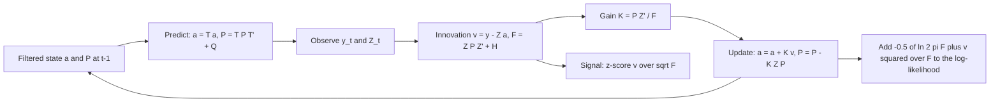

# State-Space Models and the Kalman Filter

## TL;DR

- A linear-Gaussian state-space model has a hidden state $a_t = Ta_{t-1}+\eta_t$ and an observation $y_t = Z_ta_t+\varepsilon_t$; the Kalman filter is recursive Bayesian updating of the state, and it is exact because everything stays Gaussian.
- Predict: $a_{t|t-1} = Ta_{t-1|t-1}$, $P_{t|t-1} = TP_{t-1|t-1}T^\top+Q$. Update: innovation $v_t = y_t-Z_ta_{t|t-1}$, $F_t = Z_tP_{t|t-1}Z_t^\top+H$, gain $K_t = P_{t|t-1}Z_t^\top F_t^{-1}$, $a_{t|t} = a_{t|t-1}+K_tv_t$, $P_{t|t} = (I-K_tZ_t)P_{t|t-1}$.
- The gain is "how much I trust the new observation relative to my prior": large state noise $Q$ or small observation noise $H$ means a large gain and a fast-adapting estimate.
- The local level model's steady-state filter is an EWMA with weight $K$ on the newest observation (equivalently an ARIMA(0,1,1) forecast); with $Q/H = 0.1$, $K = 0.270$.
- Parameters come from maximising the prediction-error-decomposition likelihood $-\tfrac12\sum_t(\ln 2\pi F_t + v_t^2/F_t)$; the RTS smoother uses future data and is for estimation, never for live signals.
- For a time-varying hedge ratio, treat $\beta_t$ as a random-walk state and $x_t$ as the time-varying $Z_t$; on simulated data with a known path the filter beats a 60-day rolling regression by a factor of about 3.5 in RMSE.

## Learning objectives

- Write the predict and update equations and explain the Kalman gain.
- Derive the update from Gaussian conditioning and write the likelihood by prediction error decomposition.
- Use a Kalman filter for a time-varying hedge ratio and test it on data with a known path.
- Relate the steady-state filter to exponential smoothing.
- Use the RTS smoother and know when it is not allowed.

## Core concepts

### The model

$$
\begin{aligned}
a_t &= T a_{t-1} + \eta_t, &\eta_t &\sim N(0, Q) &&\text{(state or transition equation)}\\
y_t &= Z_t a_t + \varepsilon_t, &\varepsilon_t &\sim N(0, H) &&\text{(observation or measurement equation)}
\end{aligned}
$$

with $\eta$, $\varepsilon$ and the initial state independent.
Many models fit this template:

| Model | State $a_t$ | $T$ | $Z_t$ |
| :--- | :--- | :--- | :--- |
| Local level (random walk plus noise) | level $\mu_t$ | 1 | 1 |
| Time-varying regression (hedge ratio, beta) | $(\alpha_t, \beta_t)$ | $I$ | $(1, x_t)$ |
| AR($p$), ARMA | lagged values | companion matrix | $(1,0,\dots,0)$ |
| Local linear trend | level and slope | $\begin{pmatrix}1&1\\0&1\end{pmatrix}$ | $(1,0)$ |
| Dynamic Nelson-Siegel yield curve (Diebold and Li 2006) | level, slope, curvature | VAR(1) | factor loadings by maturity |
| Efficient price behind noisy quotes | efficient price | 1 | 1 |

### Derivation of the filter

Suppose that after time $t-1$ the state is $a_{t-1}\mid\mathcal F_{t-1}\sim N(a_{t-1|t-1}, P_{t-1|t-1})$.

Predict.
The transition is linear, so $a_t\mid\mathcal F_{t-1}\sim N(a_{t|t-1}, P_{t|t-1})$ with

$$
a_{t|t-1} = Ta_{t-1|t-1}, \qquad P_{t|t-1} = TP_{t-1|t-1}T^\top + Q .
$$

Update.
Given $\mathcal F_{t-1}$, the pair $(a_t, y_t)$ is jointly Gaussian with

$$
\begin{pmatrix}a_t\\ y_t\end{pmatrix}\sim N\left(\begin{pmatrix}a_{t|t-1}\\ Z_ta_{t|t-1}\end{pmatrix}, \begin{pmatrix}P_{t|t-1} & P_{t|t-1}Z_t^\top\\ Z_tP_{t|t-1} & F_t\end{pmatrix}\right), \qquad F_t = Z_tP_{t|t-1}Z_t^\top + H .
$$

The Gaussian conditioning formula $E[a\mid y] = \mu_a + \Sigma_{ay}\Sigma_{yy}^{-1}(y-\mu_y)$, $\text{Var}(a\mid y) = \Sigma_{aa}-\Sigma_{ay}\Sigma_{yy}^{-1}\Sigma_{ya}$ gives

$$
K_t = P_{t|t-1}Z_t^\top F_t^{-1}, \qquad a_{t|t} = a_{t|t-1} + K_tv_t, \qquad P_{t|t} = P_{t|t-1} - K_tZ_tP_{t|t-1},
$$

with innovation $v_t = y_t - Z_ta_{t|t-1}$.
Without Gaussianity the same recursions give the best linear (minimum-MSE linear) estimator.
In the scalar local level case the update is the normal-normal conjugate update of [Bayesian Inference](07-Bayesian-Inference.md): precisions add, $1/P_{t|t} = 1/P_{t|t-1} + 1/H$, and the mean is precision-weighted.
For numerical robustness, production code uses the Joseph form $P_{t|t} = (I-K_tZ_t)P_{t|t-1}(I-K_tZ_t)^\top + K_tHK_t^\top$ or square-root filters, which keep $P$ symmetric positive definite.

What the gain means:

- $K\to0$ when $H\gg P_{t|t-1}$: noisy observations, keep the prior.
- $K\to Z^{-1}$ (scalar: $K\to1$) when $H\ll P_{t|t-1}$: trust the data, the estimate jumps to the observation.
- $Q$ controls how fast prior uncertainty is replenished; $Q = 0$ makes $P$ shrink forever and the filter becomes recursive least squares, so with a diffuse start its final estimate equals full-sample OLS.

### Likelihood by prediction error decomposition

The joint density factors as $p(y_1,\dots,y_n) = \prod_t p(y_t\mid\mathcal F_{t-1})$, and each factor is $N(Z_ta_{t|t-1}, F_t)$, so

$$
\ln L(\theta) = -\frac12\sum_{t}\Big(\ln(2\pi F_t) + \frac{v_t^2}{F_t}\Big)
$$

for scalar observations.
One filter pass evaluates the likelihood of any parameter vector $\theta$ (here $Q$ and $H$), which is then maximised numerically.
Initialise non-stationary states diffusely (a very large $P_0$, or the exact diffuse treatment of Durbin and Koopman) and drop the first innovation(s) from the likelihood.
Diagnostics come free: the standardised innovations $v_t/\sqrt{F_t}$ should be white noise with unit variance; serial correlation or excess variance means the model is misspecified.
Missing observations are handled by skipping the update step (predict only), a big practical advantage over rolling regressions.

### The RTS smoother

The filter gives $E[a_t\mid y_{1:t}]$; the Rauch-Tung-Striebel smoother gives $E[a_t\mid y_{1:n}]$ with a backward pass:

$$
C_t = P_{t|t}T^\top P_{t+1|t}^{-1}, \qquad a_{t|n} = a_{t|t} + C_t\big(a_{t+1|n} - a_{t+1|t}\big), \qquad P_{t|n} = P_{t|t} + C_t\big(P_{t+1|n}-P_{t+1|t}\big)C_t^\top .
$$

Smoothed estimates are more accurate because they use future data; that is exactly why using them in a backtest signal is look-ahead bias.
Use them for estimation (EM algorithms, historical decomposition, labelling regimes), not for trading decisions.

### Steady state, EWMA and ARIMA(0,1,1)

For a time-invariant model the predicted variance converges to the solution of the Riccati equation.
In the local level model with $q = Q/H$, the steady-state predicted variance and gain are

$$
\bar P = H\,\frac{q+\sqrt{q^2+4q}}{2}, \qquad K = \frac{\bar P}{\bar P + H},
$$

so the filter becomes $\hat\mu_t = \hat\mu_{t-1} + K(y_t-\hat\mu_{t-1})$: an exponentially weighted moving average with weight $1-K$ on the past (Muth 1960).
The signal-to-noise ratio $q$ alone sets the smoothing: $q = 0.1$ gives $K = 0.270$ (half-life 2.2 observations) and $q = 0.01$ gives $K = 0.095$.
Equivalently, $\Delta y_t$ is an MA(1) with lag-1 autocorrelation $-1/(q+2)$, an ARIMA(0,1,1) whose MA coefficient is $\theta = -(1-K)$.
So "choose the EWMA half-life" and "choose the noise ratio of a local level model" are the same decision, but the state-space version also gives a variance, a likelihood to estimate $q$, and a principled way to handle gaps.

### The time-varying hedge ratio

For a pair, observe $y_t$ (price of leg 1) and $x_t$ (price of leg 2) and posit

$$
y_t = \alpha_t + \beta_tx_t + \varepsilon_t, \qquad \beta_t = \beta_{t-1} + \eta_t ,
$$

so the state is $(\alpha_t,\beta_t)$ (or $\beta_t$ alone), $T = I$, $Z_t = (1, x_t)$.
The filtered $\beta_{t|t}$ is the hedge ratio; the innovation $v_t$ is the one-step spread forecast error, and $v_t/\sqrt{F_t}$ is a ready-made z-score for entries and exits (Chan 2013, chapter 3).
The ratio $Q/H$ is the key tuning choice: too small and the hedge ratio is stale, too large and it chases noise and the spread is mechanically mean-reverting.
Estimate it by maximum likelihood rather than by backtest P&L, which overfits.
With an intercept state, $\alpha_t$ and $\beta_t$ are nearly collinear whenever $x_t$ moves little relative to its level (prices far from zero), so the filter can trade one off against the other; use log prices, demean $x$, or drop the intercept when economics allows.

Beyond linear-Gaussian models: the extended Kalman filter linearises nonlinear transitions, the unscented filter propagates sigma points, and particle filters handle arbitrary noise at higher cost; stochastic volatility models are commonly filtered this way.

## Worked examples

### 1. One step by hand

"Local level model. Yesterday's filtered level is 100 with variance 4. State noise $Q = 1$, observation noise $H = 4$. Today you observe 103. Update."

Predict: mean 100, variance $4+1 = 5$.
Innovation variance $F = 5+4 = 9$, gain $K = 5/9 = 0.5556$.
Updated mean $100 + 0.5556\times3 = 101.667$, variance $(1-0.5556)\times5 = 2.222$; check with precisions, $1/(1/5+1/4) = 2.222$.
The observation moved the estimate a little over half way because the prior variance (5) exceeds the observation noise (4).

### 2. Steady state and the EWMA

"Local level with $Q/H = 0.1$. What does the filter converge to?"

$\bar P = (0.1+\sqrt{0.01+0.4})/2 = 0.3702$ (with $H = 1$), $K = 0.3702/1.3702 = 0.2702$.
So the filter is an EWMA with weight 0.7298 on the past, half-life $\ln0.5/\ln0.7298 = 2.20$ observations.
Started at the steady-state variance, the filtered level and the EWMA agree to machine precision on simulated data.
The differenced data have lag-1 autocorrelation $-1/2.1 = -0.4762$, and the ARIMA(0,1,1) coefficient $\theta = -0.7298$ reproduces it: $\theta/(1+\theta^2) = -0.4762$.
With $Q/H = 0.01$ the gain falls to 0.0951.

### 3. Estimating Q and H by maximum likelihood

Simulate 500 observations of a local level model with $Q = 0.1$, $H = 1$ (seed 500) and evaluate the prediction-error likelihood on a 161 by 161 grid.
The maximum is at about $\hat Q = 0.126$, $\hat H = 0.976$ with log-likelihood about $-792.15$, against about $-792.59$ at the truth: a likelihood-ratio statistic of about 0.89, well inside the $\chi^2_2$ 5% value 5.991, so the data cannot distinguish the estimate from the truth.
The generic filter and the vectorised grid give the same log-likelihood at the truth, a useful unit test.
RMSE of the level: filtered about 0.549 (theory for the steady-state filtered sd: $\sqrt{\bar P/(\bar P+1)} = 0.520$), smoothed about 0.402.

### 4. A time-varying hedge ratio with a known path

Simulate 1000 days: $x_t$ a geometric random walk from 50 with 1% daily volatility (it ranges from about 42.0 to 78.7), $\beta_t$ a random walk from 1 with step variance $10^{-4}$ (it ranges from about 0.896 to 1.271), and $y_t = \beta_tx_t+\varepsilon_t$ with $H = 1$ (seed 2013).
Run the filter with the true $Q$ and $H$ and a diffuse start, and score days 100 to 999:

*Seeded simulation output (seed 2013); the values change with the seed.*

| Estimator of $\beta_t$ | RMSE |
| :--- | ---: |
| Kalman filter (real time) | 0.0108 |
| RTS smoother (uses the future) | 0.0088 |
| Rolling OLS, 60 days | 0.0375 |
| Full-sample OLS (one number) | 0.0879 |

Calibration checks that a desk would run on live data:

- the true $\beta_t$ lies inside the filter's $\pm1.96\sqrt{P_{t|t}}$ band on about 97.0% of days (smoother about 96.2%);
- the standardised innovations have mean about 0.01, variance about 0.92 and lag-1 autocorrelation about $-0.01$;
- the filtered standard deviation of $\beta$ settles at about 0.0096.

Maximum likelihood on an 81 by 81 grid recovers $\hat q$ of about $0.79\times10^{-4}$ and $\hat H$ of about 0.97.
Adding an intercept state to the same data and changing nothing else raises the filtered $\beta$ RMSE to about 0.133, and the posterior correlation of intercept and slope at the end is about $-0.98$: the near-collinearity described in Core concepts.
Setting $Q = 0$ turns the filter into recursive least squares, and its final state matches full-sample OLS to within $10^{-4}$.

## Pitfalls

- Using the smoother, or parameters estimated on the full sample, in a backtest signal: look-ahead bias.
- Tuning $Q/H$ to maximise backtest P&L; estimate it by likelihood and check the innovations.
- A diffuse start whose first innovations enter the likelihood or the trading signal.
- Ignoring the intercept-slope collinearity in price-level hedge regressions; the filter will happily trade $\alpha$ against $\beta$.
- Forgetting that the filter is optimal only for the model you wrote: fat-tailed jumps produce huge innovations and over-react; robustify (cap the innovation, or use a heavy-tailed observation model).
- Covariance matrices losing symmetry or positive definiteness through rounding; use the Joseph form or a square-root filter.
- Treating the Kalman hedge ratio as cointegration evidence; a filter with large $Q$ will make any two series look like a mean-reverting spread ([Cointegration and VAR](10-Cointegration-and-VAR.md)).

## Interview questions

> [!question]- stat-kf-state-space-form | Write a linear-Gaussian state-space model.
> State $a_t = Ta_{t-1}+\eta_t$, $\eta_t\sim N(0,Q)$; observation $y_t = Z_ta_t+\varepsilon_t$, $\varepsilon_t\sim N(0,H)$, all noises independent.
> Local level, time-varying regression, ARMA and dynamic yield-curve factor models are all special cases.

> [!question]- stat-kf-predict-update | Write the Kalman filter predict and update equations.
> Predict $a_{t|t-1} = Ta_{t-1|t-1}$, $P_{t|t-1} = TPT^\top+Q$; update $v_t = y_t-Z_ta_{t|t-1}$, $F_t = Z_tP_{t|t-1}Z_t^\top+H$, $K_t = P_{t|t-1}Z_t^\top F_t^{-1}$, $a_{t|t} = a_{t|t-1}+K_tv_t$, $P_{t|t} = (I-K_tZ_t)P_{t|t-1}$.

> [!question]- stat-kf-gain-derivation | Derive the Kalman update from Gaussian conditioning.
> Given the past, $(a_t,y_t)$ is jointly normal with $\text{Cov}(a_t,y_t) = P_{t|t-1}Z_t^\top$ and $\text{Var}(y_t) = F_t$.
> Conditioning gives mean $a_{t|t-1}+P Z^\top F^{-1}v_t$ and variance $P - PZ^\top F^{-1}ZP$, so $K = PZ^\top F^{-1}$.

> [!question]- stat-kf-gain-intuition | What happens to the Kalman gain when observation noise H grows, and when state noise Q grows?
> Larger $H$ lowers the gain (trust the prior); larger $Q$ raises $P_{t|t-1}$ and the gain (trust new data, adapt faster).
> Only the ratio $Q/H$ matters for the steady-state filter.

> [!question]- stat-kf-one-step-numeric | Prior level 100 with variance 4, Q = 1, H = 4, observation 103. Updated level and variance?
> 101.67 and 2.22.
> $P^- = 5$, $F = 9$, $K = 5/9$; mean $100+3\times5/9$, variance $(1-5/9)\times5$.

> [!question]- stat-kf-conjugate-link | How is the scalar Kalman update related to Bayesian conjugate updating?
> It is the normal-normal update: prior $N(a_{t|t-1},P_{t|t-1})$, likelihood $N(y_t; a_t, H)$, posterior precision $1/P^-+1/H$ and a precision-weighted mean.
> The predict step then widens the posterior by $Q$ to form the next prior.

> [!question]- stat-kf-likelihood | How do you estimate the noise variances of a state-space model?
> Maximise the prediction error decomposition $\ln L = -\frac12\sum_t(\ln2\pi F_t + v_t^2/F_t)$, evaluated by one filter pass per parameter value.
> On 500 simulated local-level observations with $Q = 0.1$, $H = 1$ the MLE was about $(0.126, 0.976)$, LR about 0.89 against the truth.

> [!question]- stat-kf-innovations-check | How do you check that a fitted Kalman filter is well specified?
> Standardised innovations $v_t/\sqrt{F_t}$ should be white noise with mean 0 and variance 1, and states should fall inside their bands at the nominal rate.
> In the hedge-ratio example: innovation variance about 0.92, lag-1 autocorrelation about $-0.01$, about 97% band coverage.

> [!question]- stat-kf-steady-state-ewma | Show that the steady-state local level filter is an EWMA.
> With constant gain $K$, $\hat\mu_t = \hat\mu_{t-1}+K(y_t-\hat\mu_{t-1}) = Ky_t+(1-K)\hat\mu_{t-1}$, an EWMA with weight $1-K$ on the past.
> $K = \bar P/(\bar P+H)$ with $\bar P = H(q+\sqrt{q^2+4q})/2$, $q = Q/H$.

> [!question]- stat-kf-steady-state-gain-q01 | Local level model with Q/H = 0.1. Steady-state gain and EWMA half-life?
> $K = 0.270$, half-life about 2.2 observations.
> $\bar P = (0.1+\sqrt{0.41})/2 = 0.370$, $K = 0.370/1.370$, half-life $\ln0.5/\ln(1-K)$.

> [!question]- stat-kf-arima011 | What ARIMA model is the local level model equivalent to?
> ARIMA(0,1,1): $\Delta y_t$ is an MA(1) with lag-1 autocorrelation $-1/(q+2)$ and MA coefficient $-(1-K)$.
> With $q = 0.1$: $\rho_1 = -0.476$ and $\theta = -0.730$.

> [!question]- stat-kf-rts-smoother | What does the RTS smoother compute, and when must you not use it?
> $E[a_t\mid y_{1:n}]$ via a backward pass $a_{t|n} = a_{t|t}+C_t(a_{t+1|n}-a_{t+1|t})$, $C_t = P_{t|t}T^\top P_{t+1|t}^{-1}$.
> Never in a live or backtest signal: it uses future data (smoothed hedge-ratio RMSE about 0.0088 versus about 0.0108 filtered is look-ahead accuracy).

> [!question]- stat-kf-hedge-ratio-model | How do you set up a Kalman filter for a pairs hedge ratio?
> State $\beta_t$ (optionally $\alpha_t$) as a random walk, $T = I$; observation $y_t = \alpha_t+\beta_tx_t+\varepsilon_t$ so $Z_t = (1,x_t)$.
> Use the filtered $\beta_{t|t}$ as the hedge ratio and $v_t/\sqrt{F_t}$ as the spread z-score.

> [!question]- stat-kf-vs-rolling-ols | Why does a Kalman hedge ratio beat a rolling regression?
> It weights observations optimally given $Q/H$ instead of equally within an arbitrary window, has no window-edge jumps, gives an uncertainty band and handles missing data.
> On a simulated known path: RMSE about 0.0108 versus about 0.0375 for a 60-day rolling OLS.

> [!question]- stat-kf-q-tuning | How should you choose Q for a hedge-ratio filter, and what goes wrong if it is too large?
> By maximum likelihood (and innovation diagnostics), not by backtest P&L.
> Too large and $\beta_t$ chases noise so the spread mean-reverts by construction, producing fake backtest profits; too small and the ratio is stale.

> [!question]- stat-kf-rls | What does the Kalman filter reduce to when Q = 0?
> Recursive least squares: with a diffuse prior, the final filtered state equals the full-sample OLS estimate (verified to $10^{-4}$ in the hedge-ratio example).
> $P$ shrinks like $(X^\top X)^{-1}H$ and the gain decays, so new data matter less and less.

> [!question]- stat-kf-intercept-collinearity | Why can adding an intercept state ruin a price-level hedge-ratio filter?
> When $x_t$ varies little relative to its level, $\alpha$ and $\beta$ are nearly collinear and the filter trades one for the other.
> In the example the posterior correlation reached about $-0.98$ and the $\beta$ RMSE rose from about 0.0108 to about 0.133; use log prices, demean $x$ or drop $\alpha$.

> [!question]- stat-kf-missing-data | How does a Kalman filter handle a missing observation?
> Run the predict step and skip the update: the state mean carries forward and its variance grows by $Q$.
> The likelihood simply omits that term, which is why state-space models handle irregular and asynchronous data cleanly.

> [!question]- stat-kf-nonlinear | What do you use when the state-space model is nonlinear or non-Gaussian?
> Extended Kalman filter (linearise), unscented filter (sigma points) or particle filter (sequential Monte Carlo).
> The Kalman filter remains the best linear estimator without Gaussianity, but not the optimal one.

## In this repo and SDE-Interview-Prep

- Code: [kalman_filter.py](code/kalman_filter.py) computes and asserts every number in this note (generic filter, RTS smoother, vectorised grid likelihood, local level steady state, hedge-ratio simulation with a known path, recursive least squares check).
- [Bayesian Inference](07-Bayesian-Inference.md) for the conjugate update that each Kalman step performs.
- [Cointegration and VAR Models](10-Cointegration-and-VAR.md) for static hedge ratios and spread tests.
- [Volatility Models: EWMA and GARCH](09-Volatility-Models-GARCH.md) for EWMA as a filter of a variance.
- [Statistical Arbitrage and Pairs Trading](../09-Alpha-Research-and-Portfolio/06-Statistical-Arbitrage-and-Pairs-Trading.md) and [Order Book Imbalance and Microprice](../07-Market-Microstructure/11-Order-Book-Imbalance-and-Microprice.md) for trading applications.

## Further reading

- R. E. Kalman, "A New Approach to Linear Filtering and Prediction Problems", *Journal of Basic Engineering* 82(1), 1960.
- H. Rauch, F. Tung and C. Striebel, "Maximum Likelihood Estimates of Linear Dynamic Systems", *AIAA Journal* 3(8), 1965.
- John Muth, "Optimal Properties of Exponentially Weighted Forecasts", *JASA* 55(290), 1960.
- James Durbin and Siem Jan Koopman, *Time Series Analysis by State Space Methods* (2nd ed.), chapters 2 (local level), 4 (filtering and smoothing) and 7 (maximum likelihood).
- Andrew Harvey, *Forecasting, Structural Time Series Models and the Kalman Filter*, Cambridge University Press, 1989.
- James Hamilton, *Time Series Analysis*, chapter 13.
- Ruey Tsay, *Analysis of Financial Time Series* (3rd ed.), chapter 11.
- Ernest Chan, *Algorithmic Trading: Winning Strategies and Their Rationale*, Wiley, 2013, chapter 3 (Kalman filter hedge ratios).
- Francis Diebold and Canlin Li, "Forecasting the Term Structure of Government Bond Yields", *Journal of Econometrics* 130(2), 2006.
