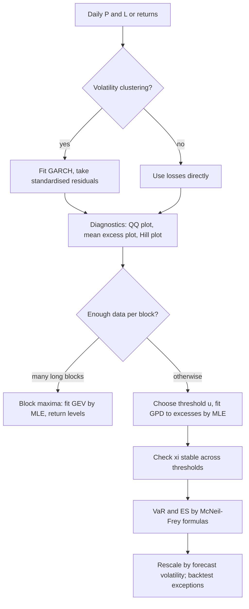

# Heavy Tails and Extreme Value Theory

## TL;DR

- A heavy (power-law) tail has $P(X>x)\approx L(x)\,x^{-\alpha}$; moments of order $\alpha$ and above are infinite, so a Student-$t_4$ has finite variance but infinite kurtosis, and sample kurtosis never settles (7.4 to 216 across ten blocks of 10,000 draws).
- Fisher-Tippett-Gnedenko: normalised maxima can only converge to a GEV law (Frechet $\xi>0$, Gumbel $\xi = 0$, Weibull $\xi<0$); Pickands-Balkema-de Haan: excesses over a high threshold converge to a generalised Pareto law with the same $\xi = 1/\alpha$.
- Peaks over threshold: fit a GPD to excesses over $u$ by maximum likelihood, then $\text{VaR}_q = u + \frac{\beta}{\xi}\big[\big(\frac{n}{N_u}(1-q)\big)^{-\xi}-1\big]$ and $\text{ES}_q = \frac{\text{VaR}_q}{1-\xi} + \frac{\beta-\xi u}{1-\xi}$ (McNeil and Frey 2000).
- At equal variance a fat tail is not "riskier everywhere": a unit-variance $t_4$ has a smaller 95% VaR than the normal (1.507 vs 1.645), about the same at 97.5%, and a much larger 99.9% VaR (5.07 vs 3.09); a 5-sd loss is a 1-in-948-day event instead of 1 in 3.5 million.
- The Hill estimator is simple but biased for Student-$t$ data and sensitive to $k$; GPD maximum likelihood with a stability check over thresholds is the working tool, applied to GARCH-standardised residuals for conditional risk.
- Fat tails barely move the standard error of a daily Sharpe ratio but matter for monthly Sharpe and a lot when combined with negative skew.

## Learning objectives

- Recognise heavy tails with QQ plots, mean excess plots and tail-index estimates.
- State the Fisher-Tippett-Gnedenko and Pickands-Balkema-de Haan theorems.
- Fit GEV to block maxima and GPD to peaks over threshold by maximum likelihood.
- Compute VaR and ES from a GPD fit and check them against known Student-$t$ answers.
- Explain the consequences for risk estimates and Sharpe ratios.

## Core concepts

### Heavy tails and the tail index

A distribution has a regularly varying (Pareto-type) right tail with index $\alpha>0$ if

$$
\bar F(x) = P(X>x) = L(x)\,x^{-\alpha},
$$

with $L$ slowly varying ($L(tx)/L(x)\to1$).
Consequences:

- $E|X|^k<\infty$ only for $k<\alpha$: Student-$t_\nu$ has $\alpha = \nu$, so $t_4$ has a variance ($\nu/(\nu-2) = 2$) but no fourth moment.
- The tail decays polynomially, not like $e^{-x^2/2}$: the ratio of tail probabilities between a fat-tailed and a normal model explodes in the far tail.
- Maxima grow like $n^{1/\alpha}$, not like $\sqrt{2\ln n}$ ([Order Statistics and Extremes](../01-Probability/08-Order-Statistics-and-Extremes.md)).

Daily returns of liquid assets have tail indices typically between about 2 and 5 (Cont 2001): finite variance, unreliable or infinite fourth moment.
Part of the fatness is volatility clustering (a mixture of normals is fat-tailed, see [Volatility Models](09-Volatility-Models-GARCH.md)); GARCH-standardised residuals are thinner-tailed but usually still not normal.

Diagnostics:

- QQ plot against the normal: points bending away at both ends signal heavy tails; against an exponential, an upward-curving upper tail signals a power law.
- Mean excess function $e(u) = E[X-u\mid X>u]$: for a GPD with $\xi<1$ it is linear, $e(u) = (\beta+\xi u)/(1-\xi)$, increasing for $\xi>0$; a sample mean excess plot that turns linear and upward-sloping marks where the GPD regime starts.
- Hill plot: the Hill estimate against the number of order statistics $k$; look for a stable region.

### The Hill estimator

With order statistics $X_{(1)}\ge X_{(2)}\ge\dots$ of the losses,

$$
\hat\alpha_k^{-1} = \hat\xi_k = \frac1k\sum_{i=1}^{k}\ln X_{(i)} - \ln X_{(k+1)} .
$$

It is the MLE of $\alpha$ if the data above $X_{(k+1)}$ are exactly Pareto, and under regular variation $\sqrt k(\hat\alpha_k-\alpha)\to N(0,\alpha^2)$ when $k\to\infty$, $k/n\to0$ and the second-order bias is controlled.
Choosing $k$ is a bias-variance trade-off: small $k$ is noisy (standard error about $\alpha/\sqrt k$), large $k$ reaches into the centre where the power law does not hold.
For the Student-$t$ the slowly varying part is far from constant, and Hill is biased downward even at moderate $k$; it is also not location invariant.

### Block maxima and the Fisher-Tippett-Gnedenko theorem

Let $M_n = \max(X_1,\dots,X_n)$ for iid $X_i\sim F$.
Fisher-Tippett-Gnedenko theorem: if there are constants $c_n>0$ and $d_n$ such that $(M_n-d_n)/c_n$ converges in distribution to a non-degenerate $H$, then $H$ is of generalised extreme value type,

$$
H_\xi(x) = \exp\big(-(1+\xi x)^{-1/\xi}\big) \text{ for } 1+\xi x>0, \qquad H_0(x) = \exp(-e^{-x}),
$$

up to location and scale.
$\xi>0$ is Frechet (power tails: Pareto, Student-$t$ with $\xi = 1/\nu$), $\xi = 0$ is Gumbel (normal, lognormal, exponential), $\xi<0$ is Weibull (finite right endpoint: uniform, beta).
$F$ is then said to be in the maximum domain of attraction of $H_\xi$.
Practice: split the data into blocks (for example 250 trading days), take each block maximum, and fit the three-parameter GEV $(\mu,\sigma,\xi)$ by maximum likelihood.
The $1$-in-$N$-block return level, exceeded by a block maximum with probability $p = 1/N$, is

$$
z_p = \mu + \frac{\sigma}{\xi}\Big[\big(-\ln(1-p)\big)^{-\xi}-1\Big].
$$

Block maxima waste data (one number per block) and need many blocks; peaks over threshold use every large observation.

### Peaks over threshold and the Pickands-Balkema-de Haan theorem

For a threshold $u$, the excess distribution is $F_u(y) = P(X-u\le y\mid X>u)$.
Pickands-Balkema-de Haan theorem: $F$ is in the maximum domain of attraction of $H_\xi$ if and only if there is a positive function $\beta(u)$ with

$$
\lim_{u\to x_F}\ \sup_{0\le y<x_F-u}\big|F_u(y) - G_{\xi,\beta(u)}(y)\big| = 0, \qquad G_{\xi,\beta}(y) = 1-\Big(1+\frac{\xi y}{\beta}\Big)^{-1/\xi},
$$

where $x_F$ is the right endpoint of $F$ (possibly $\infty$) and $G_{\xi,\beta}$ is the generalised Pareto distribution (GPD).
The same $\xi$ governs maxima and excesses, and for Pareto-type tails the scale grows linearly, $\beta(u)\approx\xi u$.
Combining $P(X>u)\approx N_u/n$ with the GPD for the excess gives the tail estimator

$$
\hat{\bar F}(x) = \frac{N_u}{n}\Big(1+\hat\xi\,\frac{x-u}{\hat\beta}\Big)^{-1/\hat\xi}, \qquad x>u,
$$

and inverting it yields the McNeil and Frey (2000) formulas

$$
\widehat{\text{VaR}}_q = u + \frac{\hat\beta}{\hat\xi}\Big[\Big(\frac{n}{N_u}(1-q)\Big)^{-\hat\xi}-1\Big], \qquad \widehat{\text{ES}}_q = \frac{\widehat{\text{VaR}}_q}{1-\hat\xi} + \frac{\hat\beta-\hat\xi u}{1-\hat\xi},
$$

valid for $q>1-N_u/n$; ES needs $\xi<1$ (a finite mean).
GPD maximum likelihood: the log-likelihood $-N_u\ln\beta-(1+1/\xi)\sum\ln(1+\xi y_i/\beta)$ reduces to one dimension in $\theta = \xi/\beta$, since for fixed $\theta$ the MLE is $\hat\xi(\theta) = \frac1{N_u}\sum\ln(1+\theta y_i)$ (Grimshaw 1993); the asymptotic standard error of $\hat\xi$ is about $(1+\xi)/\sqrt{N_u}$.

Threshold choice is the bias-variance trade-off again: pick the lowest $u$ above which the mean excess plot is roughly linear and the fitted $\xi$ is stable as $u$ rises; practitioners commonly try thresholds in the upper few percent of the sample and report sensitivity.

### Conditional EVT

EVT assumes iid data, but returns cluster in volatility.
McNeil and Frey (2000) proposed a two-step method: fit a GARCH-type model, apply POT to the standardised residuals $z_t = r_t/\hat\sigma_t$ (closer to iid), and scale back: $\text{VaR}_{t+1} = \hat\mu_{t+1} + \hat\sigma_{t+1}\,\widehat{\text{VaR}}_q(Z)$.
This gives risk numbers that react to the current volatility while keeping a fitted tail shape, and it backtests better than either unconditional EVT or GARCH with normal innovations.

### Consequences for risk and performance numbers

- Normal VaR fitted to the sample standard deviation understates far-tail quantiles badly but can overstate moderate ones; ES amplifies the difference.
- Historical simulation cannot go beyond the worst observation, and its far quantiles rest on a handful of points; POT extrapolates smoothly with a stated model.
- The square-root-of-time rule assumes iid and finite variance; with volatility clustering and fat tails, multi-day tail quantiles need simulation from a fitted model (see [VaR and Expected Shortfall](../11-Risk-and-Trading/03-VaR-and-Expected-Shortfall.md)).
- Sample kurtosis is meaningless as a summary when the fourth moment is infinite or nearly so; use tail-index or quantile-based measures.
- Sharpe ratio standard errors: for iid returns with skewness $\gamma_3$ and kurtosis $\gamma_4$, $\text{Var}(\widehat{SR})\approx\big(1-\gamma_3SR+\frac{\gamma_4-1}{4}SR^2\big)/T$ (Mertens 2002, see [Confidence Intervals](02-Confidence-Intervals-and-Sampling.md)), so fat tails matter in proportion to $SR^2$ per period: tiny for daily data, material for monthly, and negative skew (option selling, carry) matters more than kurtosis.

## Worked examples

### 1. Student-t(4) versus normal at the same variance

Exact Student-$t_4$ results from its closed-form CDF $F(t) = \frac12+\frac34s(1-\frac{s^2}3)$, $s = t/\sqrt{4+t^2}$, and the ES formula $\text{ES}_q = \frac{f(t_q)}{1-q}\cdot\frac{\nu+t_q^2}{\nu-1}$ (checked by numerical integration):

| Level $q$ | $t_4$ VaR | $t_4$ ES |
| ---: | ---: | ---: |
| 99% | 3.7469 | 5.2206 |
| 99.9% | 7.1732 | 9.6862 |
| 99.99% | 13.0337 | 17.4461 |

Rescaled to unit variance (divide by $\sqrt2 = 1.4142$) and compared with the normal:

| Level | Unit-variance $t_4$ VaR | Normal VaR |
| ---: | ---: | ---: |
| 95% | 1.5074 | 1.6449 |
| 97.5% | 1.9632 | 1.9600 |
| 99% | 2.6495 | 2.3263 |
| 99.9% | 5.0722 | 3.0902 |

At 99% the unit-variance ES is 3.6915 against the normal 2.6652.
A loss of 5 standard deviations has probability $1.0553\times10^{-3}$ under $t_4$ (once every 948 days) and $2.8665\times10^{-7}$ under the normal (once every 3.49 million days).
"Five-sigma events happen every few years" is a statement about tails, not about bad luck.

### 2. Estimating the tail index of simulated t(4) losses

100,000 draws of $t_4$ (seed 13), so the true tail index is 4.

| $k$ | Hill $\hat\alpha$ |
| ---: | ---: |
| 200 | 3.58 |
| 500 | 3.41 |
| 1000 | 3.38 |
| 2000 | 3.24 |
| 5000 | 2.83 |

With $k = 200$ the standard error is about $4/\sqrt{200} = 0.28$; every estimate is below 4 and the shortfall grows with $k$, consistent with the second-order (non-Pareto) bias of Hill for Student-$t$ tails described above.
Sample kurtosis over ten consecutive blocks of 10,000 draws ranges from 7.4 to 216.3: with an infinite fourth moment, one large draw dominates each block.

### 3. Peaks over threshold on the same data

Threshold $u$ = empirical 98% quantile of the losses, 3.019 (the true $t_4$ 98% quantile is 2.9985), leaving $N_u = 2000$ excesses.
GPD maximum likelihood gives $\hat\xi = 0.244$ (true $1/\nu = 0.25$, standard error 0.028) and $\hat\beta = 0.991$ ($\hat\beta/u = 0.328$).
The mean excess above $u$ is 1.321 in the data and $\hat\beta/(1-\hat\xi) = 1.312$ from the fit.

| Level $q$ | POT VaR | True VaR | Empirical quantile | POT ES | True ES |
| ---: | ---: | ---: | ---: | ---: | ---: |
| 99.9% | 7.40 | 7.17 | 7.46 | 10.12 | 9.69 |
| 99.99% | 13.77 | 13.03 | 12.87 | 18.56 | 17.45 |

The sample standard deviation is 1.446, so a normal model would put the 99.99% VaR at 5.38, less than half the truth.
In this sample the POT estimates are above the truth, and so is the empirical 99.9% quantile; the 99.99% empirical quantile rests on the 10 largest of 100,000 points, while the GPD uses 2000.

### 4. Block maxima and a return level

2000 blocks of 250 $t_4$ draws (seed 21), one maximum loss per "year".
GEV maximum likelihood gives $\hat\xi = 0.244$, $\hat\mu = 4.876$, $\hat\sigma = 1.378$.
The 1-in-10-year return level is $\hat z_{0.1} = 9.006$, against the exact $F^{-1}(0.9^{1/250}) = 9.003$.
The same fit on normal block maxima gives $\hat\xi = -0.10$, not 0, consistent with the well-known slow convergence of normal maxima to the Gumbel limit; let $\xi$ be estimated rather than imposed.

### 5. Does fat-tailedness change the Sharpe ratio's standard error?

Multiply the iid-normal standard error $1/\sqrt T$ by $\sqrt{1-\gamma_3SR+\frac{\gamma_4-1}{4}SR^2}$:

| Per-period Sharpe | Skew | Kurtosis | Factor |
| ---: | ---: | ---: | ---: |
| 0.1 (daily) | 0 | 3 | 1.0025 |
| 0.1 (daily) | 0 | 9 | 1.0100 |
| 0.3 (monthly) | 0 | 3 | 1.0223 |
| 0.3 (monthly) | 0 | 9 | 1.0863 |
| 0.3 (monthly) | $-1$ | 9 | 1.2166 |

A simulation of 20,000 ten-year monthly track records with unit-variance $t_5$ returns (kurtosis 9) and true Sharpe 0.3 gives a standard deviation of $\widehat{SR}\sqrt T$ of about 1.07 against the formula's 1.086.
Kurtosis alone adds under 10% to the monthly standard error; a short-volatility profile with negative skew adds over 20%.

## Pitfalls

- Fitting a normal to the whole sample and reading off 99.9% VaR; the centre of the distribution sets the variance and tells you nothing about the tail.
- Treating sample kurtosis as a stable statistic for return data.
- Choosing the Hill $k$ or the POT threshold once, without a stability plot; report how the answer moves.
- Applying EVT to raw returns with volatility clustering and calling the result unconditional VaR for today; filter with GARCH first or accept that the number is a long-run average.
- Using ES formulas when $\hat\xi\ge1$ (infinite mean): the risk measure does not exist in the model.
- Extrapolating a GPD fitted to two years of calm data to a 1-in-100-year loss; the parameter uncertainty is enormous and regime changes are not in the sample.
- Assuming fat tails always make every risk number larger; at moderate confidence levels a variance-matched fat-tailed model can give a smaller VaR.
- Ignoring the dependence in the tails across assets: correlations rise in sell-offs, so univariate EVT per asset is not portfolio EVT.

## Interview questions

> [!question]- stat-evt-tail-index-moments | A return distribution has tail index 4. Which moments exist?
> Moments of order below 4: mean, variance and skewness exist, the fourth moment (kurtosis) is infinite.
> $E|X|^k<\infty$ iff $k<\alpha$ for a regularly varying tail; Student-$t_4$ is the standard example.

> [!question]- stat-evt-t4-kurtosis | Why does sample kurtosis of Student-t(4) data jump around so much?
> The population kurtosis is infinite, so the sample estimate never converges and is dominated by the largest draw.
> Ten blocks of 10,000 $t_4$ draws gave sample kurtoses from 7.4 to 216.3.

> [!question]- stat-evt-hill-formula | Write the Hill estimator of the tail index.
> $1/\hat\alpha = \frac1k\sum_{i=1}^k\ln X_{(i)} - \ln X_{(k+1)}$ on the $k$ largest losses.
> It is the Pareto MLE above $X_{(k+1)}$, with standard error about $\alpha/\sqrt k$.

> [!question]- stat-evt-hill-k-tradeoff | How do you choose k in the Hill estimator, and what goes wrong for Student-t data?
> Bias-variance: small $k$ is noisy, large $k$ includes the non-Pareto body; look for a stable region in a Hill plot.
> For $t_4$ with $n = 100{,}000$ the estimate fell from 3.58 at $k = 200$ to 2.83 at $k = 5000$, against a true 4, the downward bias expected when the tail is not exactly Pareto.

> [!question]- stat-evt-fisher-tippett | State the Fisher-Tippett-Gnedenko theorem.
> If normalised maxima $(M_n-d_n)/c_n$ converge to a non-degenerate law, that law is GEV: $\exp(-(1+\xi x)^{-1/\xi})$, Gumbel when $\xi = 0$.
> $\xi>0$ Frechet (power tails), $\xi = 0$ Gumbel (normal, exponential), $\xi<0$ Weibull (bounded support).

> [!question]- stat-evt-pickands-balkema | State the Pickands-Balkema-de Haan theorem.
> $F$ is in the domain of attraction of $H_\xi$ iff, for some scale function $\beta(u)$, the excess distribution over $u$ converges uniformly to the GPD $1-(1+\xi y/\beta(u))^{-1/\xi}$ as $u$ tends to the right endpoint.
> It justifies fitting a GPD to excesses over a high threshold, with the same $\xi$ as for maxima.

> [!question]- stat-evt-gpd-xi-student-t | What GPD shape parameter should excesses of Student-t(nu) losses have?
> $\xi = 1/\nu$; for $t_4$, 0.25.
> A POT fit on 100,000 simulated $t_4$ draws with 2000 excesses gave 0.244 with standard error 0.028.

> [!question]- stat-evt-pot-var-formula | Give the peaks-over-threshold VaR formula.
> $\text{VaR}_q = u + \frac{\beta}{\xi}\big[\big(\frac{n}{N_u}(1-q)\big)^{-\xi}-1\big]$, from inverting $\bar F(x)\approx\frac{N_u}{n}(1+\xi\frac{x-u}{\beta})^{-1/\xi}$.
> Valid for $1-q < N_u/n$ (the quantile lies beyond the threshold).

> [!question]- stat-evt-pot-es-formula | Give the expected shortfall implied by a GPD tail, and its condition.
> $\text{ES}_q = \frac{\text{VaR}_q}{1-\xi}+\frac{\beta-\xi u}{1-\xi}$, requiring $\xi<1$.
> It follows from the linear GPD mean excess $e(v) = (\beta+\xi(v-u))/(1-\xi)$ at $v = \text{VaR}_q$.

> [!question]- stat-evt-mean-excess | What does a mean excess plot show, and what shape indicates a GPD tail with positive xi?
> $e(u) = E[X-u\mid X>u]$ against $u$; for a GPD it is linear with slope $\xi/(1-\xi)$, so an upward-sloping straight line indicates a heavy tail.
> Exponential tails give a flat line, bounded tails a downward slope; choose the threshold where linearity starts.

> [!question]- stat-evt-block-vs-pot | Block maxima or peaks over threshold: which and why?
> Usually POT: it uses every large observation rather than one per block, so it is more efficient with limited data.
> Block maxima suit naturally blocked data and return-level questions; both target the same $\xi$.

> [!question]- stat-evt-return-level | How do you compute a 1-in-10-year loss from a fitted GEV on annual maxima?
> $z_{0.1} = \mu+\frac\sigma\xi[(-\ln0.9)^{-\xi}-1]$, the level an annual maximum exceeds with probability 10%.
> On 2000 simulated $t_4$ "years" the GEV gave 9.006 against the exact 9.003.

> [!question]- stat-evt-normal-vs-t-var | At equal variance, is a Student-t(4) VaR always larger than the normal VaR?
> No: at 95% it is smaller (1.507 vs 1.645), at 97.5% about equal (1.963 vs 1.960), at 99.9% much larger (5.07 vs 3.09).
> Fat tails come with a more peaked centre at the same variance, so quantiles cross.

> [!question]- stat-evt-five-sigma | How often is a 5-standard-deviation daily loss under a normal versus a unit-variance t(4)?
> Normal: about once in 3.5 million days; $t_4$: about once in 948 days.
> Probabilities $2.87\times10^{-7}$ and $1.06\times10^{-3}$.

> [!question]- stat-evt-conditional-evt | Why do McNeil and Frey filter returns with GARCH before applying EVT?
> EVT assumes iid data while returns cluster in volatility; standardised residuals are closer to iid, and the risk estimate then scales with the current volatility forecast.
> $\text{VaR}_{t+1} = \mu_{t+1}+\sigma_{t+1}\text{VaR}_q(Z)$ with the GPD fitted to the residuals.

> [!question]- stat-evt-threshold-choice | How do you choose the POT threshold?
> The lowest $u$ above which the mean excess plot is linear and the fitted $\xi$ is stable as $u$ increases.
> Too low biases the shape toward the body of the distribution; too high leaves few excesses and a noisy fit.

> [!question]- stat-evt-normal-maxima-slow | You fit a GEV to annual maxima of normal data. Do you get xi = 0?
> Not in practice: 2000 blocks of 250 normal draws gave $\hat\xi = -0.10$.
> Convergence of normal maxima to the Gumbel limit is very slow, so let $\xi$ be estimated and do not over-read its sign near zero.

> [!question]- stat-evt-empirical-quantile-limits | Why not just use the empirical 99.99% quantile of 100,000 returns?
> It rests on about the 10 largest observations, is very noisy and cannot exceed the sample maximum.
> POT uses all excesses over a lower threshold (2000 in the worked example) and extrapolates with a fitted tail shape.

> [!question]- stat-evt-sharpe-fat-tails | Do fat tails matter for the standard error of a Sharpe ratio?
> Through the term $\frac{\gamma_4-1}{4}SR^2$, so only when the per-period Sharpe is sizeable: kurtosis 9 multiplies the SE by 1.010 for daily SR 0.1 but 1.086 for monthly SR 0.3.
> Negative skew matters more: skew $-1$ with kurtosis 9 gives 1.217 at monthly SR 0.3 (Mertens 2002).

> [!question]- stat-evt-normal-vs-sample-sd | Your 100,000-day loss sample has standard deviation 1.45. What 99.99% VaR does a normal model give, and what is wrong with it?
> About 5.38, versus a true 13.03 for the $t_4$ data that generated the sample.
> The variance is set by the body of the distribution; the far tail needs a tail model.

## In this repo and SDE-Interview-Prep

- Code: [extreme_value.py](code/extreme_value.py) computes and asserts every number in this note (exact Student-$t_4$ quantiles and ES with a numerical check, Hill estimator, GPD maximum likelihood by Grimshaw's profile, McNeil-Frey VaR and ES, GEV maximum likelihood by Nelder-Mead, Sharpe standard error simulation).
- [Order Statistics and Extremes](../01-Probability/08-Order-Statistics-and-Extremes.md) for the distribution of the maximum.
- [Inequalities and Limit Theorems](../01-Probability/06-Inequalities-and-Limit-Theorems.md) for when the CLT fails.
- [Volatility Models: EWMA and GARCH](09-Volatility-Models-GARCH.md) for the filtering step of conditional EVT.
- [VaR and Expected Shortfall](../11-Risk-and-Trading/03-VaR-and-Expected-Shortfall.md) and [FRTB Internal Model Approach](../17-Regulatory-Capital-Basel-and-FRTB/10-FRTB-Internal-Model-Approach-ES.md) for how tail measures are used in limits and capital.
- [Jump Processes and Levy Models](../04-Stochastic-Calculus/08-Jump-Processes-and-Levy-Models.md) for continuous-time heavy tails.

## Further reading

- Alexander McNeil, Rudiger Frey and Paul Embrechts, *Quantitative Risk Management* (revised ed.), Princeton, 2015, chapter 5 (extreme value theory).
- Paul Embrechts, Claudia Kluppelberg and Thomas Mikosch, *Modelling Extremal Events for Insurance and Finance*, Springer, 1997.
- Stuart Coles, *An Introduction to Statistical Modeling of Extreme Values*, Springer, 2001, chapters 3 and 4.
- Alexander McNeil and Rudiger Frey, "Estimation of Tail-Related Risk Measures for Heteroscedastic Financial Time Series: An Extreme Value Approach", *Journal of Empirical Finance* 7(3-4), 2000.
- Bruce Hill, "A Simple General Approach to Inference About the Tail of a Distribution", *Annals of Statistics* 3(5), 1975.
- James Pickands, "Statistical Inference Using Extreme Order Statistics", *Annals of Statistics* 3(1), 1975; A. Balkema and L. de Haan, "Residual Life Time at Great Age", *Annals of Probability* 2(5), 1974.
- Scott Grimshaw, "Computing Maximum Likelihood Estimates for the Generalized Pareto Distribution", *Technometrics* 35(2), 1993.
- Rama Cont, "Empirical Properties of Asset Returns: Stylized Facts and Statistical Issues", *Quantitative Finance* 1(2), 2001.
- Ruey Tsay, *Analysis of Financial Time Series* (3rd ed.), chapter 7.
- Philippe Jorion, *Value at Risk* (3rd ed.).
