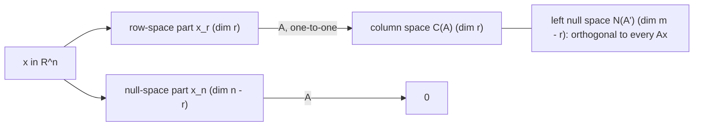

# Vectors, Matrices and Linear Maps

## TL;DR

- A matrix is a linear map; its rank is the dimension of its column space, and rank-nullity says $n = \text{rank}(A) + \dim N(A)$ for $A \in \mathbb{R}^{m \times n}$.
- $Ax = b$ is solvable iff $b \in C(A)$; in a one-period market a payoff is replicable iff it lies in the column space of the payoff matrix, and state prices solve the transposed system.
- Least squares is an orthogonal projection: $\hat{x} = (A^\top A)^{-1}A^\top b$, and $P = A(A^\top A)^{-1}A^\top$ is symmetric, idempotent, has eigenvalues 0 and 1, and trace equal to the rank.
- $\det$ is the signed volume scale factor and the product of the eigenvalues; $\text{tr}$ is the sum of the eigenvalues and is cyclic, $\text{tr}(AB) = \text{tr}(BA)$.
- Rank-one updates are cheap: Sherman-Morrison and the matrix determinant lemma invert and factor a one-factor covariance $\sigma_m^2\beta\beta^\top + D$ in $O(N)$.

## Learning objectives

- Reason about rank, null space, projections and orthogonality.
- Compute determinants, inverses and traces and know their properties.
- Express least squares as an orthogonal projection.
- Read replication, hedging and state prices as statements about column spaces and their orthogonal complements.
- Use Sherman-Morrison, Woodbury and Schur complements to invert structured matrices without forming a dense inverse.

## Core concepts

### Matrices are linear maps

A map $f: \mathbb{R}^n \to \mathbb{R}^m$ is linear if $f(ax + by) = af(x) + bf(y)$.
Every such map is $x \mapsto Ax$ for a unique $A \in \mathbb{R}^{m \times n}$, whose $j$-th column is $f(e_j)$.
Composition of maps is matrix multiplication, which is why $AB \ne BA$ in general and why $(AB)^{-1} = B^{-1}A^{-1}$ and $(AB)^\top = B^\top A^\top$.

Two readings of $Ax$ are worth keeping in your head:

- column picture: $Ax = \sum_j x_j a_j$, a combination of the columns (a portfolio of instruments, each column a payoff or a factor exposure);
- row picture: $(Ax)_i = r_i^\top x$, the inner product of row $i$ with $x$ (each row a state of the world or a constraint).

### Rank, null space and the four fundamental subspaces

For $A \in \mathbb{R}^{m \times n}$ of rank $r$:

| Subspace | Lives in | Dimension | Orthogonal complement |
| :--- | :--- | :---: | :--- |
| Column space $C(A)$ | $\mathbb{R}^m$ | $r$ | Left null space $N(A^\top)$, dimension $m - r$ |
| Row space $C(A^\top)$ | $\mathbb{R}^n$ | $r$ | Null space $N(A)$, dimension $n - r$ |

Rank-nullity, $n = r + \dim N(A)$, says each input direction either survives (row space) or is killed (null space).
$A$ maps the row space one-to-one onto the column space; everything else is the null space being sent to 0.

Useful rank facts:

- $\text{rank}(AB) \le \min(\text{rank}A, \text{rank}B)$; an outer product $uv^\top$ has rank 1.
- $\text{rank}(A^\top A) = \text{rank}(A)$, because $A^\top Ax = 0 \Rightarrow x^\top A^\top Ax = \lVert Ax\rVert^2 = 0 \Rightarrow Ax = 0$.
- A sample covariance of $T$ observations has rank at most $T - 1$ (demeaning removes one dimension), so with more assets than observations it is singular; see [Covariance Matrices and PSD](04-Covariance-Matrices-and-PSD.md).

Solvability of $Ax = b$:

| Situation | Solutions |
| :--- | :--- |
| $b \notin C(A)$ | none; least squares gives the closest $A\hat{x}$ |
| $b \in C(A)$, $N(A) = \{0\}$ | exactly one |
| $b \in C(A)$, $N(A) \ne \{0\}$ | an affine family $x_p + N(A)$; the pseudo-inverse picks the minimum-norm one ([SVD](03-SVD-and-Low-Rank-Approximation.md)) |

### Replication and state prices

Take $S$ states and $K$ traded instruments; the payoff matrix $X \in \mathbb{R}^{S \times K}$ has $X_{sk}$ = payoff of instrument $k$ in state $s$, and $p \in \mathbb{R}^K$ are today's prices.

- A payoff $y$ is replicable iff $y \in C(X)$; the replicating portfolio solves $X\theta = y$ and costs $p^\top\theta$.
- The market is complete iff $\text{rank}(X) = S$.
- A state-price vector $q$ solves $X^\top q = p$; in a finite one-period market, no arbitrage holds iff a strictly positive $q$ exists (the first fundamental theorem of asset pricing; Duffie, chapter 1).
- If the market is incomplete, the solutions of $X^\top q = p$ form $q_0 + N(X^\top)$, so state prices, and hence prices of non-replicable claims, are not unique.

This is the same geometry as the rest of the note: replicable payoffs are the column space, and the ambiguity in state prices is the left null space.

### Inner products, orthogonality and orthogonal matrices

$\langle x, y\rangle = x^\top y$, $\lVert x\rVert = \sqrt{x^\top x}$, and Cauchy-Schwarz $\lvert x^\top y\rvert \le \lVert x\rVert\lVert y\rVert$ (correlation is a cosine, which is why it lies in $[-1, 1]$).
Gram-Schmidt turns independent columns into an orthonormal basis, $A = QR$; numerically one uses Householder reflections instead ([Numerical Linear Algebra](06-Numerical-Linear-Algebra.md)).
An orthogonal matrix has $Q^\top Q = I$: it preserves lengths and angles, $Q^{-1} = Q^\top$, $\det Q = \pm 1$ and every eigenvalue has modulus 1.

### Projections and least squares

Project $b$ onto $C(A)$, $A$ of full column rank.
The residual $b - A\hat{x}$ must be orthogonal to every column, $A^\top(b - A\hat{x}) = 0$, which gives the normal equations

$$
A^\top A\,\hat{x} = A^\top b, \qquad \hat{x} = (A^\top A)^{-1}A^\top b, \qquad P = A(A^\top A)^{-1}A^\top.
$$

Properties of the projection ("hat") matrix $P$:

- $P^\top = P$ and $P^2 = P$; eigenvalues are 1 on $C(A)$ and 0 on its complement, so $\text{tr}P = \text{rank}A = p$;
- $I - P$ projects onto $N(A^\top)$ and produces the residuals; in OLS with $n$ observations the residual degrees of freedom are $\text{tr}(I - P) = n - p$;
- Pythagoras: $\lVert b\rVert^2 = \lVert Pb\rVert^2 + \lVert(I - P)b\rVert^2$; applied to demeaned $b$ with an intercept in $A$, it is the ANOVA identity behind $R^2$.

Frisch-Waugh-Lovell: the coefficient on $X_2$ in a regression on $[X_1, X_2]$ equals the coefficient from regressing the residualised $y$ on the residualised $X_2$, both residualised on $X_1$ with $I - P_1$.
That is why "beta-neutralise, then regress" gives the same signal loading as a joint regression.
Statistical properties are in [Linear Regression and OLS](../02-Statistics-and-Econometrics/04-Linear-Regression-OLS.md); never solve the normal equations by forming $A^\top A$ when $A$ is ill-conditioned (it squares the condition number; see [Numerical Linear Algebra](06-Numerical-Linear-Algebra.md)).

The minimum-variance hedge is the same projection in the space of random variables with inner product $\text{Cov}$: hedging asset $S$ with $h$ units of $F$ minimises $\text{Var}(S - hF)$ at

$$
h^\ast = \frac{\text{Cov}(S, F)}{\text{Var}(F)} = \rho\frac{\sigma_S}{\sigma_F}, \qquad \text{residual vol} = \sigma_S\sqrt{1 - \rho^2}.
$$

### Determinant, trace and inverse

| Property | Statement |
| :--- | :--- |
| Volume | $\lvert\det A\rvert$ is the factor by which $A$ scales volumes; $\det A = 0$ iff $A$ is singular |
| Products | $\det(AB) = \det A\det B$, $\det A^{-1} = 1/\det A$, $\det A^\top = \det A$ |
| Scaling | $\det(cA) = c^n\det A$ for $n \times n$ $A$ |
| Spectrum | $\det A = \prod_i\lambda_i$, $\text{tr}A = \sum_i\lambda_i$ |
| Trace | linear, $\text{tr}(AB) = \text{tr}(BA)$, $\text{tr}(ABC) = \text{tr}(CAB)$, $x^\top Ax = \text{tr}(Axx^\top)$ |
| 2 x 2 inverse | $\begin{pmatrix} a & b \\ c & d\end{pmatrix}^{-1} = \frac{1}{ad - bc}\begin{pmatrix} d & -b \\ -c & a\end{pmatrix}$ |

The trace trick $E[x^\top Ax] = \text{tr}(A\Sigma) + \mu^\top A\mu$ (with $E x = \mu$, $\text{Cov}\,x = \Sigma$) follows from linearity of trace and expectation and appears in every quadratic-form variance calculation.

Block inverse and the Schur complement: for $M = \begin{pmatrix} A & B \\ C & D\end{pmatrix}$ with $A$ invertible, $\det M = \det A\det(D - CA^{-1}B)$, and $S = D - CA^{-1}B$ is the Schur complement.
For a Gaussian vector split into $(x_1, x_2)$,

$$
E[x_1 \mid x_2] = \mu_1 + \Sigma_{12}\Sigma_{22}^{-1}(x_2 - \mu_2), \qquad \text{Cov}(x_1 \mid x_2) = \Sigma_{11} - \Sigma_{12}\Sigma_{22}^{-1}\Sigma_{21},
$$

so the conditional covariance is a Schur complement; it is PSD whenever $\Sigma$ is, and because $\Sigma_{12}\Sigma_{22}^{-1}\Sigma_{21} \succeq 0$ it satisfies $\text{Cov}(x_1 \mid x_2) \preceq \Sigma_{11}$: conditioning cannot increase variance.

### Rank-one updates: Sherman-Morrison, Woodbury, determinant lemma

$$
(A + uv^\top)^{-1} = A^{-1} - \frac{A^{-1}uv^\top A^{-1}}{1 + v^\top A^{-1}u}, \qquad \det(A + uv^\top) = (1 + v^\top A^{-1}u)\det A.
$$

Woodbury generalises to rank $k$: $(A + UCV)^{-1} = A^{-1} - A^{-1}U(C^{-1} + VA^{-1}U)^{-1}VA^{-1}$, with only a $k \times k$ inverse.
For a factor model $\Sigma = BFB^\top + D$ with $N$ assets and $K \ll N$ factors, this turns an $O(N^3)$ inversion into $O(NK^2)$, which is how risk systems compute minimum-variance and risk-parity portfolios on thousands of names.
It is also the recursive-least-squares update when one observation arrives.

## Worked examples

### Replicating an Arrow security in a complete market

"Three states: down, mid, up. The bond pays 1 everywhere and costs 1; the stock pays 80, 100, 120 and costs 100; a call struck at 100 pays 0, 0, 20 and costs 8. Price the security paying 1 in the mid state only."

"The payoff matrix has rank 3, so the market is complete and I can solve $X\theta = (0, 1, 0)$."
From the down and mid rows, $\theta_B + 80\theta_S = 0$ and $\theta_B + 100\theta_S = 1$, so $\theta_S = 0.05$ and $\theta_B = -4$.
The up row, $-4 + 6 + 20\theta_C = 0$, gives $\theta_C = -0.1$.
Price: $-4 \cdot 1 + 0.05 \cdot 100 - 0.1 \cdot 8 = 0.2$.
"Doing the same for every state is solving $X^\top q = p$: the state prices are $(0.4, 0.2, 0.4)$, all positive, so there is no arbitrage; they sum to the bond price 1, and $80(0.4) + 100(0.2) + 120(0.4) = 100$ reprices the stock."

### Least squares as projection in an incomplete market

"Remove the call. Can you still replicate the mid Arrow security? If not, what is the best hedge?"

Now $X = [\mathbf{1}, (80, 100, 120)^\top]$ has rank 2 in 3 states, and $(0, 1, 0)$ is not in its column space.
The least-squares hedge projects the payoff onto $C(X)$: $1/3$ of a bond and 0 shares (the target is symmetric around the middle state, so the stock, which is antisymmetric there after demeaning, has no projection).
Residual $(-1/3, 2/3, -1/3)$, with norm $\sqrt{6}/3 = 0.8165$, and $X^\top r = 0$ to machine precision: the residual is orthogonal to both instruments.
The hat matrix has trace 2, the number of instruments.
State prices now solve two equations in three unknowns: $X^\top q = (1, 100)$ has solutions $(t, 1 - 2t, t)$, the particular solution plus multiples of the left null vector $(1, -2, 1)$.
Positivity needs $0 < t < 1/2$, so any mid-Arrow price $1 - 2t$ strictly between 0 and 1 is arbitrage-free: incompleteness turns a price into an interval.

### Minimum-variance hedge ratio

"A portfolio has 20% vol, the hedge future has 25% vol and correlation 0.9. Hedge ratio and what is left?"
$h^\ast = 0.9 \times 0.20/0.25 = 0.72$ units of future per unit of portfolio.
Hedge effectiveness is $\rho^2 = 0.81$, and the residual vol is $0.20\sqrt{1 - 0.81} = 8.72\%$.
"Even a 0.9 correlation leaves 44% of the original volatility: residual vol falls like $\sqrt{1 - \rho^2}$, slowly."

### One-factor covariance in O(N) with Sherman-Morrison

"Three stocks with betas 0.8, 1.0, 1.2, market vol 20%, idiosyncratic vols 10%, 15%, 20%. Invert the covariance and find the minimum-variance portfolio without a dense inverse."

$\Sigma = \sigma_m^2\beta\beta^\top + D$ with $D = \text{diag}(0.01, 0.0225, 0.04)$.
$\beta^\top D^{-1}\beta = 64 + 44.44 + 36 = 144.44$, so the scalar $1 + \sigma_m^2\beta^\top D^{-1}\beta = 6.7778$.
Sherman-Morrison gives $\Sigma^{-1} = D^{-1} - \sigma_m^2 D^{-1}\beta\beta^\top D^{-1}/6.7778$, which matches a dense inverse to rounding error, and the determinant lemma gives $\det\Sigma = 9 \times 10^{-6} \times 6.7778 = 6.1 \times 10^{-5}$.
GMV weights $\Sigma^{-1}\mathbf{1}/(\mathbf{1}^\top\Sigma^{-1}\mathbf{1})$ come out as $(0.9445, 0.1372, -0.0818)$ with vol $18.68\%$.
"The high-beta name is shorted: with a common factor, the minimum-variance portfolio sells high-beta stocks to cut market exposure, and every operation was a vector operation."

## Pitfalls

- Treating "the system has a solution" and "the matrix is invertible" as the same; a non-square or rank-deficient $A$ can have infinitely many solutions or none.
- Forgetting that a projection matrix must be symmetric as well as idempotent; an oblique projection is idempotent but does not give least squares.
- Writing $\det(A + B) = \det A + \det B$ or $\det(cA) = c\det A$; both are false (the second is $c^n\det A$).
- Inverting $A^\top A$ to get regression coefficients on collinear data; use QR or the SVD.
- Reading a non-unique state-price vector as a model failure; in an incomplete market non-uniqueness is the point, and prices of non-replicable claims come as bounds.
- Computing a minimum-variance hedge from levels instead of returns or price changes; spurious correlation in trending levels gives a meaningless $h^\ast$.
- Forming $(D + \sigma^2\beta\beta^\top)^{-1}$ densely for thousands of names when the structure gives it in $O(N)$.

## Interview questions

> [!question]- la-vec-rank-nullity | State rank-nullity and use it: a $5 \times 8$ matrix has rank 3; what are the dimensions of its four fundamental subspaces?
> Column space 3 (in $\mathbb{R}^5$), left null space $5 - 3 = 2$, row space 3 (in $\mathbb{R}^8$), null space $8 - 3 = 5$. Rank-nullity: $n = \text{rank} + \dim N(A)$, here $8 = 3 + 5$.

> [!question]- la-vec-four-subspaces-orthogonality | Which fundamental subspaces are orthogonal complements, and why?
> Row space and null space in $\mathbb{R}^n$; column space and left null space in $\mathbb{R}^m$. $Ax = 0$ says $x$ is orthogonal to every row; $A^\top y = 0$ says $y$ is orthogonal to every column.

> [!question]- la-vec-solvability | When does $Ax = b$ have a solution, and when is it unique?
> A solution exists iff $b \in C(A)$ (equivalently $b \perp N(A^\top)$). It is unique iff additionally $N(A) = \{0\}$, i.e. the columns are independent; otherwise solutions form $x_p + N(A)$.

> [!question]- la-vec-replication-column-space | In a one-period market with payoff matrix $X$ (states by instruments), when is a payoff replicable and when is the market complete?
> A payoff $y$ is replicable iff $y \in C(X)$; the market is complete iff $\text{rank}X$ equals the number of states. The replicating portfolio solves $X\theta = y$ and its cost is the no-arbitrage price.

> [!question]- la-vec-state-prices | How do you get state prices from instrument prices, and what does no arbitrage require?
> Solve $X^\top q = p$. No arbitrage in a finite one-period market holds iff some solution is strictly positive. If $X^\top$ has a non-trivial null space (incomplete market) the solutions form a family and claims outside $C(X)$ get price bounds rather than a price.

> [!question]- la-vec-projection-properties | What are the defining properties of an orthogonal projection matrix and its eigenvalues and trace?
> $P = P^\top = P^2$. Eigenvalues are 1 (on the target subspace) and 0 (on its complement), so $\text{tr}P = \text{rank}P$. Idempotent but not symmetric means an oblique projection.

> [!question]- la-vec-normal-equations | Derive the normal equations for least squares.
> The residual must be orthogonal to $C(A)$: $A^\top(b - A\hat{x}) = 0$, so $A^\top A\hat{x} = A^\top b$. Equivalently set the gradient of $\lVert b - Ax\rVert^2$, which is $-2A^\top(b - Ax)$, to zero.

> [!question]- la-vec-hat-trace-dof | In OLS with $n = 100$ observations and $p = 5$ regressors (full rank), what is the trace of the hat matrix and why does it matter?
> $5$. It is the number of fitted parameters; $\text{tr}(I - P) = 95$ is the residual degrees of freedom, which is why the unbiased variance estimate divides the residual sum of squares by $n - p$.

> [!question]- la-vec-rank-ata | Prove $\text{rank}(A^\top A) = \text{rank}(A)$.
> $A^\top Ax = 0 \Rightarrow x^\top A^\top Ax = \lVert Ax\rVert^2 = 0 \Rightarrow Ax = 0$, and the converse is trivial, so the null spaces agree; rank-nullity then gives equal ranks.

> [!question]- la-vec-det-scaling | $A$ is $4 \times 4$ with $\det A = 3$. What are $\det(2A)$, $\det(A^{-1})$ and $\det(A^\top A)$?
> $2^4 \cdot 3 = 48$, $1/3$, and $9$. Determinant scales by $c^n$, inverts under inversion, and is multiplicative with $\det A^\top = \det A$.

> [!question]- la-vec-trace-cyclic | Show $E[x^\top Ax] = \text{tr}(A\Sigma) + \mu^\top A\mu$.
> $x^\top Ax = \text{tr}(Axx^\top)$; take expectations inside the trace and use $E[xx^\top] = \Sigma + \mu\mu^\top$. This gives, for example, the expected squared tracking error of a portfolio $w^\top\Sigma w$ plus the squared mean term.

> [!question]- la-vec-inverse-2x2 | Invert $\begin{pmatrix} 4 & 2 \\ 2 & 3\end{pmatrix}$.
> Determinant $12 - 4 = 8$, so the inverse is $\frac18\begin{pmatrix} 3 & -2 \\ -2 & 4\end{pmatrix}$: swap the diagonal, negate the off-diagonal, divide by the determinant.

> [!question]- la-vec-sherman-morrison | State Sherman-Morrison and give a finance use.
> $(A + uv^\top)^{-1} = A^{-1} - A^{-1}uv^\top A^{-1}/(1 + v^\top A^{-1}u)$, valid when the denominator is non-zero. It inverts a one-factor covariance $D + \sigma_m^2\beta\beta^\top$ in $O(N)$ and updates a regression or Kalman gain when one observation arrives.

> [!question]- la-vec-determinant-lemma | What is $\det(D + \sigma^2\beta\beta^\top)$ for diagonal $D$?
> $\det D\,(1 + \sigma^2\beta^\top D^{-1}\beta) = \prod_i d_i\,(1 + \sigma^2\sum_i\beta_i^2/d_i)$, by the matrix determinant lemma. It gives Gaussian log-likelihoods of factor models without an $O(N^3)$ factorisation.

> [!question]- la-vec-schur-conditional | How is the conditional covariance of a Gaussian a Schur complement, and what does that imply?
> $\text{Cov}(x_1 \mid x_2) = \Sigma_{11} - \Sigma_{12}\Sigma_{22}^{-1}\Sigma_{21}$, the Schur complement of $\Sigma_{22}$. It is PSD and $\preceq \Sigma_{11}$, so conditioning never increases variance; it is also the residual covariance of regressing $x_1$ on $x_2$.

> [!question]- la-vec-hedge-ratio | Portfolio vol 20%, hedge vol 25%, correlation 0.9: minimum-variance hedge ratio and residual vol?
> $h^\ast = \rho\sigma_S/\sigma_F = 0.72$; residual vol $\sigma_S\sqrt{1 - \rho^2} = 8.72\%$. It is the projection of $S$ onto $F$ under the covariance inner product.

> [!question]- la-vec-orthogonal-matrix | List the properties of an orthogonal matrix that matter numerically.
> $Q^\top Q = I$, so $Q^{-1} = Q^\top$, $\lVert Qx\rVert = \lVert x\rVert$, $\det Q = \pm1$, eigenvalues on the unit circle and condition number 1. Multiplying by $Q$ never amplifies rounding error, which is why QR and SVD are stable.

> [!question]- la-vec-fwl | What does the Frisch-Waugh-Lovell theorem say and where do quants use it?
> In $y = X_1b_1 + X_2b_2 + e$, $b_2$ equals the slope from regressing $(I - P_1)y$ on $(I - P_1)X_2$. Residualising a signal and returns on sector or beta exposures before a regression gives the same loading as including those exposures, which is the basis of neutralised factor tests.

> [!question]- la-vec-incomplete-price-bounds | Bond (1, 1, 1) priced 1 and stock (80, 100, 120) priced 100, three states. What prices for the claim paying 1 only in the middle state are arbitrage-free?
> Any price in $(0, 1)$. State prices solving $X^\top q = (1, 100)$ are $(t, 1 - 2t, t)$; positivity needs $0 < t < 1/2$, so the claim's price $1 - 2t$ ranges over $(0, 1)$.

## In this repo and SDE-Interview-Prep

- Code: [la_foundations.py](code/la_foundations.py) computes and asserts every number in the worked examples (replication, projection, hedge ratio, Sherman-Morrison); [problem_set.py](code/problem_set.py) asserts the hat-matrix trace card.
- Next: [Eigendecomposition and the Spectral Theorem](02-Eigendecomposition-and-Spectral-Theorem.md), [SVD and Low-Rank Approximation](03-SVD-and-Low-Rank-Approximation.md), [Linear Regression and OLS](../02-Statistics-and-Econometrics/04-Linear-Regression-OLS.md).

## Further reading

- Gilbert Strang, *Introduction to Linear Algebra*, 5th edition, chapters 1-5 (four fundamental subspaces, projections, determinants).
- Sheldon Axler, *Linear Algebra Done Right*, 3rd edition, chapters 3 and 6 (linear maps and inner product spaces).
- Lloyd N. Trefethen and David Bau, *Numerical Linear Algebra*, SIAM 1997, lectures 1-3 and 6 (projectors).
- Gene Golub and Charles Van Loan, *Matrix Computations*, 4th edition, chapter 2.
- William W. Hager, "Updating the Inverse of a Matrix", *SIAM Review* 31(2) (1989).
- Darrell Duffie, *Dynamic Asset Pricing Theory*, 3rd edition, chapter 1 (state prices and arbitrage in finite markets).
