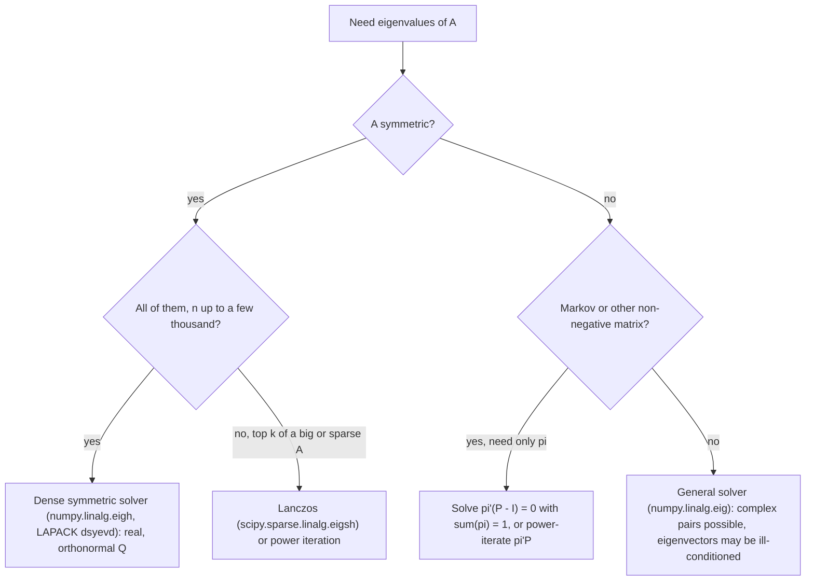

# Eigendecomposition and the Spectral Theorem

## TL;DR

- $Av = \lambda v$; eigenvalues are roots of $\det(A - \lambda I) = 0$, with $\sum\lambda_i = \text{tr}A$ and $\prod\lambda_i = \det A$.
- If $A = V\Lambda V^{-1}$ then $A^k = V\Lambda^kV^{-1}$ and $f(A) = Vf(\Lambda)V^{-1}$: matrix powers, recurrences, AR stationarity and Markov-chain mixing are all read off the spectrum.
- Spectral theorem: a real symmetric matrix has real eigenvalues and an orthonormal eigenbasis, $A = Q\Lambda Q^\top = \sum_i\lambda_iq_iq_i^\top$; it is PSD iff every $\lambda_i \ge 0$.
- Rayleigh quotient $x^\top Ax/x^\top x$ lies in $[\lambda_{\min}, \lambda_{\max}]$: the unit-norm portfolio of maximum variance is the top eigenvector of the covariance.
- Power iteration converges like $\lvert\lambda_2/\lambda_1\rvert^k$; Gershgorin discs bound every eigenvalue by row sums; a Markov chain's stationary law is the left eigenvector for eigenvalue 1, reached at rate $\lvert\lambda_2\rvert^k$.

## Learning objectives

- Compute eigenvalues and eigenvectors and use them for matrix powers and dynamics.
- State the spectral theorem for symmetric matrices.
- Use Rayleigh quotients for extremal problems.
- Run power iteration and bound eigenvalues with Gershgorin discs.
- Find stationary distributions and mixing rates of Markov chains, and stationarity conditions of AR processes, from eigenvalues.

## Core concepts

### Eigenvalues, eigenvectors and the characteristic polynomial

$\lambda$ is an eigenvalue of $A \in \mathbb{R}^{n \times n}$ iff $A - \lambda I$ is singular, i.e. $p(\lambda) = \det(A - \lambda I) = 0$.
For a $2 \times 2$ matrix, $\lambda^2 - (\text{tr}A)\lambda + \det A = 0$, which is the fastest way to answer "eigenvalues of $\begin{pmatrix} 4 & 1 \\ 2 & 3\end{pmatrix}$": trace 7, determinant 10, so 5 and 2.

Facts used constantly:

| Fact | Consequence |
| :--- | :--- |
| $\sum\lambda_i = \text{tr}A$, $\prod\lambda_i = \det A$ | singular iff some $\lambda_i = 0$ |
| eigenvalues of $f(A)$ are $f(\lambda_i)$ for polynomials and, for diagonalisable $A$, any $f$ | $A^{-1}$, $A^2 + I$, $e^{A}$, $A + cI$ (shift moves every eigenvalue by $c$) |
| $AB$ and $BA$ have the same non-zero eigenvalues | PCA with $T < N$: diagonalise the $T \times T$ Gram matrix instead of the $N \times N$ covariance |
| similar matrices $B = S^{-1}AS$ share eigenvalues | change of basis does not change dynamics |
| triangular matrices have eigenvalues on the diagonal | basis of the Schur form and the QR algorithm |

Algebraic multiplicity (as a root) can exceed geometric multiplicity (number of independent eigenvectors).
$\begin{pmatrix} 1 & 1 \\ 0 & 1\end{pmatrix}$ has eigenvalue 1 twice but one eigenvector: it is defective, not diagonalisable, and its powers grow linearly, $\begin{pmatrix} 1 & k \\ 0 & 1\end{pmatrix}$, rather than geometrically.

### Diagonalisation and dynamics

If $A$ has $n$ independent eigenvectors, $A = V\Lambda V^{-1}$ and

$$
A^k = V\Lambda^kV^{-1}, \qquad e^{At} = Ve^{\Lambda t}V^{-1}.
$$

So $x_{k+1} = Ax_k$ decays iff every $\lvert\lambda_i\rvert < 1$, and $\dot{x} = Ax$ decays iff every $\text{Re}\,\lambda_i < 0$; the slowest mode is the eigenvalue closest to the boundary.

Linear recurrences become first-order systems through the companion matrix.
An AR(2) $x_t = \phi_1x_{t-1} + \phi_2x_{t-2} + \varepsilon_t$ is

$$
\begin{pmatrix} x_t \\ x_{t-1}\end{pmatrix} = \begin{pmatrix} \phi_1 & \phi_2 \\ 1 & 0\end{pmatrix}\begin{pmatrix} x_{t-1} \\ x_{t-2}\end{pmatrix} + \begin{pmatrix} \varepsilon_t \\ 0\end{pmatrix},
$$

and it is covariance-stationary iff both eigenvalues (roots of $\lambda^2 - \phi_1\lambda - \phi_2$) lie strictly inside the unit circle; complex roots mean damped oscillation (a business-cycle or bid-ask bounce pattern in the autocorrelation function).
Fibonacci is the same with $\phi_1 = \phi_2 = 1$: eigenvalues $\varphi = (1 + \sqrt5)/2$ and $-1/\varphi$, so $F_n = (\varphi^n - (-1/\varphi)^n)/\sqrt5$, the nearest integer to $\varphi^n/\sqrt5$.
Time-series context: [Stationarity and ARMA](../02-Statistics-and-Econometrics/08-Time-Series-Stationarity-and-ARMA.md) and [Cointegration and VAR](../02-Statistics-and-Econometrics/10-Cointegration-and-VAR.md), where the rank of $\Pi$ in the VECM counts cointegrating vectors.

### The spectral theorem

For real symmetric $A$:

1. every eigenvalue is real: if $Av = \lambda v$ with $v$ complex, $\bar{v}^\top Av = \lambda\lVert v\rVert^2$ and the left side equals its own conjugate;
2. eigenvectors of distinct eigenvalues are orthogonal: $\lambda_1v_1^\top v_2 = (Av_1)^\top v_2 = v_1^\top Av_2 = \lambda_2v_1^\top v_2$, so $v_1^\top v_2 = 0$;
3. there is an orthonormal eigenbasis even with repeated eigenvalues (induct: $A$ maps the orthogonal complement of an eigenvector into itself).

Hence

$$
A = Q\Lambda Q^\top = \sum_{i=1}^n\lambda_iq_iq_i^\top, \qquad Q^\top Q = I.
$$

Consequences for covariance matrices:

- PSD iff all $\lambda_i \ge 0$, PD iff all $\lambda_i > 0$;
- matrix functions are defined eigenvalue by eigenvalue: $\Sigma^{1/2} = Q\Lambda^{1/2}Q^\top$ and the whitening transform $\Sigma^{-1/2}$, which turns correlated returns into uncorrelated unit-variance ones;
- $q_i^\top x$ are uncorrelated coordinates with variances $\lambda_i$, which is PCA ([PCA and Factor Structure](05-PCA-and-Factor-Structure.md)).

Equicorrelation is the example to know by heart: $C = (1 - \rho)I + \rho\mathbf{1}\mathbf{1}^\top$ has eigenvalue $1 + (n - 1)\rho$ on $\mathbf{1}$ (the "market mode") and $1 - \rho$ with multiplicity $n - 1$ on everything orthogonal to $\mathbf{1}$, so $\det C = (1 - \rho)^{n-1}(1 + (n - 1)\rho)$ and $C$ is PSD iff $-1/(n - 1) \le \rho \le 1$.

### Rayleigh quotients and Courant-Fischer

For symmetric $A$, writing $x = \sum c_iq_i$,

$$
R(x) = \frac{x^\top Ax}{x^\top x} = \frac{\sum_i\lambda_ic_i^2}{\sum_ic_i^2} \in [\lambda_{\min}, \lambda_{\max}],
$$

with the extremes attained at the corresponding eigenvectors.
Courant-Fischer extends this: $\lambda_k$ is the max over $k$-dimensional subspaces of the min of $R$ on that subspace.

Finance readings:

- the unit-norm ($\lVert w\rVert_2 = 1$) portfolio with the largest variance is $q_1$, with variance $\lambda_1$: the dominant risk direction;
- the unit-norm portfolio with the smallest variance is $q_n$; this is not the minimum-variance portfolio, which uses the budget constraint $\mathbf{1}^\top w = 1$ instead ([Convex Optimization and KKT](08-Convex-Optimization-and-KKT.md));
- the maximum Sharpe ratio $\max_w w^\top\mu/\sqrt{w^\top\Sigma w}$ is a generalised Rayleigh problem whose answer is $w \propto \Sigma^{-1}\mu$.

### Computing eigenvalues: power iteration and friends

Power iteration $x_{k+1} = Ax_k/\lVert Ax_k\rVert$ converges to $q_1$ when $\lvert\lambda_1\rvert > \lvert\lambda_2\rvert$ and $x_0$ has a component along $q_1$; the eigenvector error shrinks like $\lvert\lambda_2/\lambda_1\rvert^k$, and for symmetric $A$ the Rayleigh-quotient estimate of $\lambda_1$ converges twice as fast, like $\lvert\lambda_2/\lambda_1\rvert^{2k}$.

| Method | Finds | Cost per step | Use |
| :--- | :--- | :--- | :--- |
| Power iteration | top eigenpair | one mat-vec | PageRank, top PC of a huge sparse matrix |
| Inverse iteration with shift $s$ | eigenvalue nearest $s$ | one solve with a pre-factored $A - sI$ | refine an eigenvector |
| Lanczos (symmetric) or Arnoldi | a few extreme eigenpairs | mat-vecs plus orthogonalisation | top $k$ PCs of a large sparse matrix |
| QR algorithm or divide and conquer (LAPACK `dsyevd`) | all eigenpairs | $O(n^3)$ total | dense covariance matrices |

### Gershgorin discs

Every eigenvalue of $A$ lies in the union of discs centred at $a_{ii}$ with radius $\sum_{j \ne i}\lvert a_{ij}\rvert$.
Corollary: a symmetric matrix with positive diagonal that is strictly diagonally dominant is positive definite.
For a correlation matrix the discs are centred at 1, so $\lambda_{\min} \ge 1 - \max_i\sum_{j \ne i}\lvert\rho_{ij}\rvert$: a cheap sufficient check that a hand-built matrix is valid, useless when correlations are large (the bound then goes negative even for perfectly valid matrices).

### Markov chains as an eigenvalue problem

A row-stochastic $P$ ($P_{ij} = P(X_{t+1} = j \mid X_t = i)$) has $P\mathbf{1} = \mathbf{1}$, so 1 is an eigenvalue.
A stationary distribution solves $\pi^\top P = \pi^\top$: a left eigenvector for eigenvalue 1, normalised to sum to 1.
For an irreducible aperiodic finite chain, Perron-Frobenius gives a unique positive $\pi$ and all other $\lvert\lambda_i\rvert < 1$, and $P^k \to \mathbf{1}\pi^\top$ with error $O(\lvert\lambda_2\rvert^k)$.

Two-state chain $P = \begin{pmatrix} 1 - a & a \\ b & 1 - b\end{pmatrix}$: $\pi = (b, a)/(a + b)$, $\lambda_2 = 1 - a - b$, expected time in state $i$ per visit $1/a$ and $1/b$.
Regime-switching models (calm and stressed markets) and credit rating migration matrices are the finance instances.
Annual rating matrices are often turned into continuous-time generators $Q$ with $P = e^Q$; the matrix logarithm need not be a valid generator (negative off-diagonal rates), which is the embedding problem studied by Israel, Rosenthal and Wei (2001).
More on chains in [Markov Chains](../01-Probability/10-Markov-Chains.md).

## Worked examples

### Powers of a symmetric 2 x 2

"Compute $A^{10}$ for $A = \begin{pmatrix} 2 & 1 \\ 1 & 2\end{pmatrix}$."
Trace 4 and determinant 3 give eigenvalues 3 and 1, with eigenvectors $(1, 1)/\sqrt2$ and $(1, -1)/\sqrt2$.
$A^{10} = \frac{3^{10}}{2}\begin{pmatrix} 1 & 1 \\ 1 & 1\end{pmatrix} + \frac{1}{2}\begin{pmatrix} 1 & -1 \\ -1 & 1\end{pmatrix} = \begin{pmatrix} 29525 & 29524 \\ 29524 & 29525\end{pmatrix}$, since $3^{10} = 59049$.
"Every power is dominated by the top eigenvalue; the small one only fixes the diagonal by one."

### A calm-stressed regime chain

"Daily regimes: from calm, 10% chance of switching to stressed; from stressed, 20% chance of switching back. Long-run fraction of stressed days, and how fast does the chain forget today?"
$a = 0.1$, $b = 0.2$: $\pi = (0.2, 0.1)/0.3 = (2/3, 1/3)$, so one day in three is stressed.
$\lambda_2 = 1 - 0.1 - 0.2 = 0.7$: any deviation from $\pi$ shrinks by 0.7 per day, a factor $0.7^{10} = 0.0282$ after ten days, and $P^{10}(\text{calm} \to \text{calm}) = 2/3 + (1/3)(0.7)^{10} = 0.6761$.
Half-life of a deviation: $\ln 2/\ln(1/0.7) = 1.94$ days.
Mean spell lengths are $1/0.1 = 10$ calm days and $1/0.2 = 5$ stressed days, consistent with the 2:1 split.

### Eigenvalues, Gershgorin and power iteration on a correlation matrix

$C = \begin{pmatrix} 1 & 0.6 & 0.3 \\ 0.6 & 1 & 0.5 \\ 0.3 & 0.5 & 1\end{pmatrix}$.
Eigenvalues: $1.9438$, $0.7069$, $0.3493$; they sum to the trace 3 and multiply to $\det C = 0.48$.
Gershgorin: radii 0.9, 1.1 and 0.8 around 1, so every eigenvalue is in $[-0.1, 2.1]$; true, but too weak to certify PSD here.
The top eigenvector is about $(0.570, 0.637, 0.519)$, all positive: a market mode carrying $1.9438/3 = 64.8\%$ of the total variance.
Power iteration from $(1, 1, 1)$ with stopping rule "Rayleigh quotient changes by less than $10^{-10}$" takes 10 iterations: the ratio $\lambda_2/\lambda_1 = 0.3637$, squared to $0.13$ per step for the symmetric Rayleigh quotient.

### Equicorrelation: the market mode

"Ten stocks, all pairwise correlations 0.3. Eigenvalues of the correlation matrix?"
$1 + 9 \times 0.3 = 3.7$ on the equal-weight vector, which therefore explains $37\%$ of total variance, and $0.7$ nine times.
$\det C = 0.7^9 \times 3.7 = 0.1493$.
"In real equity data the top eigenvalue of a large correlation matrix is close to $1 + (N - 1)\bar\rho$ for the average correlation $\bar\rho$, and its eigenvector is roughly equal-weighted; that is the market factor."

### Stationarity of an AR(2)

"$x_t = 1.2x_{t-1} - 0.35x_{t-2} + \varepsilon_t$: stationary?"
Companion eigenvalues solve $\lambda^2 - 1.2\lambda + 0.35 = 0$: $\lambda = (1.2 \pm 0.2)/2 = 0.7$ and $0.5$.
Both inside the unit circle, so yes; the autocorrelation decays like a mix of $0.7^k$ and $0.5^k$, with no oscillation because the roots are real.

### Fibonacci from the spectrum

$\begin{pmatrix} 1 & 1 \\ 1 & 0\end{pmatrix}^{30}$ has $F_{30} = 832040$ off the diagonal, and $\varphi^{30}/\sqrt5$ with $\varphi = 1.618034$ rounds to the same integer: the $-1/\varphi$ mode has died out.

## Pitfalls

- Assuming every square matrix is diagonalisable; defective matrices exist and non-symmetric eigenvectors can be nearly parallel, which makes $V^{-1}$ ill-conditioned.
- Reading the smallest eigenvector of a covariance as the minimum-variance portfolio; that eigenvector has unit Euclidean norm, not unit budget, and usually has long and short legs that do not sum to one.
- Using right eigenvectors of $P$ for the stationary distribution; it is the left eigenvector ($P^\top\pi = \pi$), while the right eigenvector for eigenvalue 1 is just $\mathbf{1}$.
- Comparing eigenvectors across dates without fixing signs and order; numerical routines return eigenvectors with arbitrary sign, and nearly equal eigenvalues can swap.
- Trusting power iteration when $\lambda_1$ and $\lambda_2$ are close or $\lambda_2 = -\lambda_1$; it stalls or oscillates.
- Concluding "PSD" from Gershgorin failing, or "not PSD" from Gershgorin discs crossing zero; the test is one-sided.
- Taking a matrix logarithm of an empirical rating matrix and using it as a generator without checking for negative off-diagonal rates.

## Interview questions

> [!question]- la-eig-two-by-two | Eigenvalues of $\begin{pmatrix} 4 & 1 \\ 2 & 3\end{pmatrix}$ in your head?
> 5 and 2. For $2 \times 2$, $\lambda^2 - (\text{tr})\lambda + \det = 0$: trace 7, determinant 10, roots 5 and 2.

> [!question]- la-eig-trace-det | How are trace and determinant related to eigenvalues, and what does that give for a $3 \times 3$ $A$ with eigenvalues 1, 2, 3?
> Trace is the sum, determinant the product. Here $\text{tr}A = 6$, $\det A = 6$, $\det(A^2 + I) = 2 \cdot 5 \cdot 10 = 100$ and $\text{tr}(A^{-1}) = 11/6$, using that $f(A)$ has eigenvalues $f(\lambda_i)$.

> [!question]- la-eig-spectral-theorem | State the spectral theorem and prove eigenvectors of distinct eigenvalues are orthogonal.
> Real symmetric $A = Q\Lambda Q^\top$ with real $\Lambda$ and orthogonal $Q$. If $Av_i = \lambda_iv_i$ then $\lambda_1v_1^\top v_2 = (Av_1)^\top v_2 = v_1^\top Av_2 = \lambda_2v_1^\top v_2$, so $(\lambda_1 - \lambda_2)v_1^\top v_2 = 0$.

> [!question]- la-eig-real-eigenvalues | Why are eigenvalues of a real symmetric matrix real?
> If $Av = \lambda v$ with complex $v$, then $\bar{v}^\top Av = \lambda\bar{v}^\top v$. The left side is real because it equals its conjugate $(\overline{\bar{v}^\top Av})^\top = \bar{v}^\top A^\top v$ and $A^\top = A$; $\bar{v}^\top v > 0$, so $\lambda$ is real.

> [!question]- la-eig-defective | Give a matrix that is not diagonalisable and say what its powers look like.
> $\begin{pmatrix} 1 & 1 \\ 0 & 1\end{pmatrix}$: eigenvalue 1 twice, one eigenvector. Its $k$-th power is $\begin{pmatrix} 1 & k \\ 0 & 1\end{pmatrix}$, linear growth: a Jordan block makes polynomial factors multiply $\lambda^k$.

> [!question]- la-eig-psd-iff | Show a symmetric matrix is PSD iff all its eigenvalues are non-negative.
> $x^\top Ax = \sum_i\lambda_i(q_i^\top x)^2$ in the eigenbasis. If all $\lambda_i \ge 0$ this is non-negative; conversely $q_i^\top Aq_i = \lambda_i$ must be non-negative.

> [!question]- la-eig-rayleigh | What is $\max_{\lVert x\rVert = 1}x^\top Ax$ for $A = \begin{pmatrix} 2 & 1 \\ 1 & 2\end{pmatrix}$, and where is it attained?
> 3, at $x = (1, 1)/\sqrt2$, the top eigenvector; the minimum 1 is at $(1, -1)/\sqrt2$. The Rayleigh quotient is a weighted average of eigenvalues.

> [!question]- la-eig-min-eigvec-vs-gmv | Is the eigenvector of the smallest eigenvalue of $\Sigma$ the minimum-variance portfolio?
> No. It minimises variance subject to $\lVert w\rVert_2 = 1$; the minimum-variance portfolio minimises subject to $\mathbf{1}^\top w = 1$ and equals $\Sigma^{-1}\mathbf{1}/\mathbf{1}^\top\Sigma^{-1}\mathbf{1}$. The smallest eigenvector is usually a long-short spread whose weights sum to almost zero.

> [!question]- la-eig-power-iteration | How fast does power iteration converge, and when does it fail?
> The eigenvector error shrinks like $\lvert\lambda_2/\lambda_1\rvert^k$ (for symmetric $A$ the Rayleigh-quotient eigenvalue error like the square of that). It fails to converge if $\lvert\lambda_1\rvert = \lvert\lambda_2\rvert$ (for example $\lambda_2 = -\lambda_1$) and never finds $q_1$ if $x_0 \perp q_1$ in exact arithmetic.

> [!question]- la-eig-gershgorin | State Gershgorin's theorem and what it says for a correlation matrix.
> Each eigenvalue lies in some disc centred at $a_{ii}$ with radius $\sum_{j \ne i}\lvert a_{ij}\rvert$. For a correlation matrix, $\lambda_{\min} \ge 1 - \max_i\sum_{j \ne i}\lvert\rho_{ij}\rvert$, so strict diagonal dominance certifies positive definiteness; failing the test proves nothing.

> [!question]- la-eig-markov-stationary | How do you find the stationary distribution of a finite Markov chain with linear algebra?
> Solve $\pi^\top P = \pi^\top$ with $\sum\pi_i = 1$: the left eigenvector of $P$ for eigenvalue 1, i.e. an eigenvector of $P^\top$. Numerically, replace one equation of $(P^\top - I)\pi = 0$ by the normalisation and solve.

> [!question]- la-eig-two-state-chain | Regimes switch calm to stressed with probability 0.1 and back with 0.2 per day. Long-run stressed fraction and convergence rate?
> $1/3$ (from $\pi = (b, a)/(a + b)$) and $\lambda_2 = 1 - a - b = 0.7$ per day: deviations from the long-run mix shrink by $0.7^k$, half-life about 1.94 days.

> [!question]- la-eig-equicorrelation | Eigenvalues of the $n \times n$ equicorrelation matrix with correlation $\rho$, and for $n = 10$, $\rho = 0.3$?
> $1 + (n - 1)\rho$ once (eigenvector $\mathbf{1}$) and $1 - \rho$ with multiplicity $n - 1$. For $n = 10$, $\rho = 0.3$: 3.7 and 0.7, so the market mode explains 37% of variance.

> [!question]- la-eig-ab-ba | Why can you diagonalise a $T \times T$ matrix instead of an $N \times N$ covariance when $T < N$?
> $XX^\top$ and $X^\top X$ share their non-zero eigenvalues, and if $X^\top Xv = \lambda v$ then $XX^\top(Xv) = \lambda Xv$. With 500 stocks and 60 months, diagonalise the $60 \times 60$ Gram matrix and map eigenvectors back with $X^\top$.

> [!question]- la-eig-ar2-companion | When is $x_t = \phi_1x_{t-1} + \phi_2x_{t-2} + \varepsilon_t$ stationary? Check $\phi_1 = 1.2$, $\phi_2 = -0.35$.
> When both roots of $\lambda^2 - \phi_1\lambda - \phi_2 = 0$ (the companion-matrix eigenvalues) are inside the unit circle. Here the roots are 0.7 and 0.5, so it is stationary, with non-oscillating autocorrelations.

> [!question]- la-eig-fibonacci | Derive the growth rate of Fibonacci numbers with eigenvalues.
> $(F_{n+1}, F_n) = M(F_n, F_{n-1})$ with $M = \begin{pmatrix} 1 & 1 \\ 1 & 0\end{pmatrix}$, eigenvalues $\varphi = (1 + \sqrt5)/2$ and $-1/\varphi$. So $F_n = (\varphi^n - (-1/\varphi)^n)/\sqrt5$, the integer nearest $\varphi^n/\sqrt5$: growth rate $\varphi \approx 1.618$.

> [!question]- la-eig-whitening | How do you turn correlated returns into uncorrelated unit-variance ones, and which matrix square root should you use?
> Multiply by $\Sigma^{-1/2} = Q\Lambda^{-1/2}Q^\top$ (symmetric, PCA-based) or by $L^{-1}$ from Cholesky $\Sigma = LL^\top$. Both whiten; the symmetric root stays closest to the original coordinates, Cholesky depends on asset ordering but is cheaper. Both fail if $\Sigma$ is singular.

> [!question]- la-eig-rating-generator | You have an annual rating transition matrix and need monthly ones. What can go wrong with $P^{1/12}$ or $\log P$?
> The matrix root or logarithm may have negative entries or not be a valid generator (the embedding problem), because the empirical $P$ need not come from any continuous-time chain. Practitioners regularise, for example by setting negative rates to zero and rebalancing the diagonal, then check the fit to $P$.

## In this repo and SDE-Interview-Prep

- Code: [la_foundations.py](code/la_foundations.py) computes and asserts every number above (powers, regime chain, power iteration, Gershgorin, equicorrelation, AR(2), Fibonacci).
- SDE bridge: [matrix exponentiation in C++](https://github.com/shreejitverma/SDE-Interview-Prep/blob/main/03-Data-Structures-Algorithms/04-Gold-Standard-Cpp-Patterns/Math-and-Bit-Manipulation/matrix_exponentiation.cpp) computes linear recurrences in $O(\log n)$ multiplications by repeated squaring, the integer version of $A^k$.
- Related: [Markov Chains](../01-Probability/10-Markov-Chains.md), [PCA and Factor Structure](05-PCA-and-Factor-Structure.md), [Covariance Matrices and PSD](04-Covariance-Matrices-and-PSD.md).

## Further reading

- Gilbert Strang, *Introduction to Linear Algebra*, 5th edition, chapter 6.
- Roger Horn and Charles Johnson, *Matrix Analysis*, 2nd edition, chapters 1 and 4 (spectral theorem, Rayleigh quotient, Courant-Fischer), 6 (Gershgorin) and 8 (Perron-Frobenius).
- Lloyd N. Trefethen and David Bau, *Numerical Linear Algebra*, SIAM 1997, lectures 24-28 (eigenvalue algorithms).
- Gene Golub and Charles Van Loan, *Matrix Computations*, 4th edition, chapters 7-8.
- James Norris, *Markov Chains*, Cambridge University Press 1997, chapter 1.
- Robert Israel, Jeffrey Rosenthal and Jason Wei, "Finding Generators for Markov Chains via Empirical Transition Matrices, with Applications to Credit Ratings", *Mathematical Finance* 11(2) (2001).
