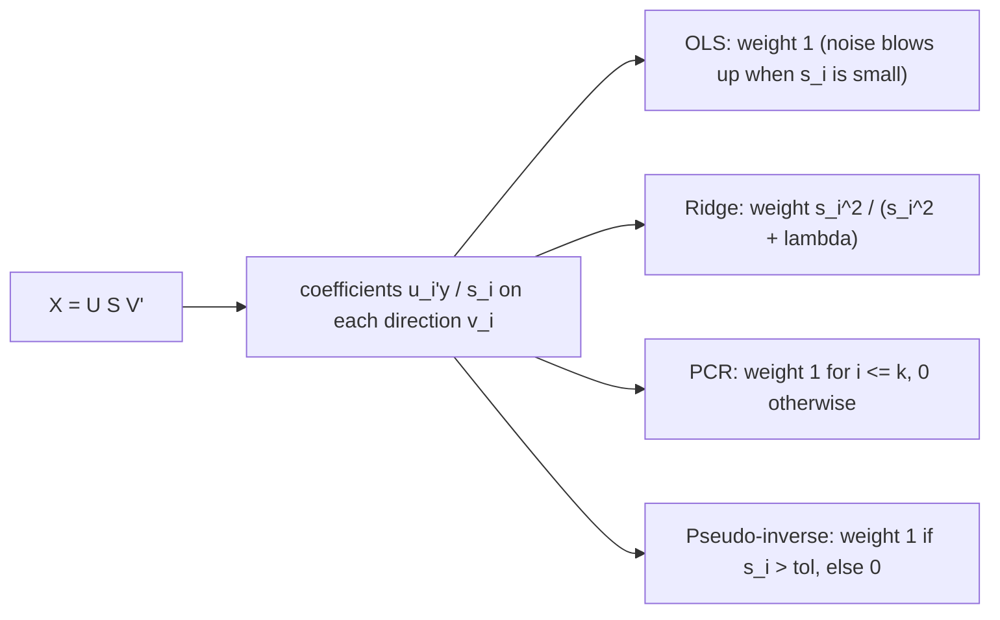

# SVD and Low-Rank Approximation

## TL;DR

- Every $A \in \mathbb{R}^{m \times n}$ factors as $A = U\Sigma V^\top = \sum_i\sigma_iu_iv_i^\top$ with orthonormal $U$, $V$ and $\sigma_1 \ge \sigma_2 \ge \dots \ge 0$; $\sigma_i^2$ are the eigenvalues of $A^\top A$ and $AA^\top$.
- $\lVert A\rVert_2 = \sigma_1$, $\lVert A\rVert_F = \sqrt{\sum\sigma_i^2}$, rank = number of non-zero $\sigma_i$, condition number $\kappa_2 = \sigma_1/\sigma_{\min(m,n)}$ for full-rank $A$ (infinite when $A$ is rank-deficient).
- Eckart-Young: the truncated SVD $A_k$ is the best rank-$k$ approximation in both the 2-norm (error $\sigma_{k+1}$) and the Frobenius norm (error $\sqrt{\sum_{i>k}\sigma_i^2}$).
- The pseudo-inverse $A^+ = V\Sigma^+U^\top$ gives the minimum-norm least-squares solution, the right answer for collinear regressors.
- Ridge regression shrinks each SVD direction by $\sigma_i^2/(\sigma_i^2 + \lambda)$; principal-component regression keeps or drops directions outright.

## Learning objectives

- Relate the SVD to eigendecompositions of $X^\top X$ and $XX^\top$.
- Use the Eckart-Young theorem for low-rank approximation.
- Compute pseudo-inverses and explain their role in least squares.
- Read ridge and principal-component regression as filters on singular values.
- Recognise the low-rank structure of yield-curve and return matrices and use it.

## Core concepts

### Definition and the geometric picture

The full SVD is $A = U\Sigma V^\top$ with $U \in \mathbb{R}^{m \times m}$, $V \in \mathbb{R}^{n \times n}$ orthogonal and $\Sigma$ diagonal ($m \times n$) with non-negative entries in decreasing order.
The thin SVD keeps only the first $\min(m, n)$ columns of $U$; the compact SVD keeps the $r$ non-zero singular values.

Existence follows from the spectral theorem: $A^\top A = V\Lambda V^\top$ is symmetric PSD, set $\sigma_i = \sqrt{\lambda_i}$ and $u_i = Av_i/\sigma_i$ for $\sigma_i > 0$, which are orthonormal because $u_i^\top u_j = v_i^\top A^\top Av_j/(\sigma_i\sigma_j) = \delta_{ij}$.
So $V$ diagonalises $A^\top A$, $U$ diagonalises $AA^\top$, and both have eigenvalues $\sigma_i^2$.

Geometrically, $A$ maps the unit sphere to an ellipsoid: rotate by $V^\top$, stretch the axes by $\sigma_i$, rotate by $U$.
$\sigma_1$ is the longest semi-axis (the maximum gain), $\sigma_n$ the shortest.

| Matrix | SVD vs eigendecomposition |
| :--- | :--- |
| Symmetric PSD (covariance) | identical: $U = V = Q$, $\sigma_i = \lambda_i$ |
| Symmetric indefinite | $\sigma_i = \lvert\lambda_i\rvert$, signs move into $U$ |
| General square | unrelated in general; eigenvectors need not be orthogonal, singular vectors always are |
| Rectangular | only the SVD exists |

### Norms, rank and conditioning

- $\lVert A\rVert_2 = \max_{\lVert x\rVert = 1}\lVert Ax\rVert = \sigma_1$.
- $\lVert A\rVert_F^2 = \sum_{ij}a_{ij}^2 = \text{tr}(A^\top A) = \sum_i\sigma_i^2$.
- $\text{rank}A$ is the number of non-zero $\sigma_i$; numerically, the number above a tolerance such as $\max(m, n)\,\sigma_1\,\varepsilon_{\text{mach}}$ (what `numpy.linalg.matrix_rank` uses).
- $\kappa_2(A) = \sigma_1/\sigma_n$ for square invertible $A$; it measures how much relative input error can be amplified ([Numerical Linear Algebra](06-Numerical-Linear-Algebra.md)).
- For square $A$, $\lvert\det A\rvert = \prod_i\sigma_i$.

### Eckart-Young-Mirsky

Let $A_k = \sum_{i=1}^k\sigma_iu_iv_i^\top$.
For every matrix $B$ of rank at most $k$,

$$
\lVert A - A_k\rVert_2 = \sigma_{k+1} \le \lVert A - B\rVert_2, \qquad \lVert A - A_k\rVert_F = \Big(\sum_{i>k}\sigma_i^2\Big)^{1/2} \le \lVert A - B\rVert_F.
$$

Proof idea for the 2-norm: $B$ has a null space of dimension at least $n - k$, which must intersect the $(k + 1)$-dimensional span of $v_1, \dots, v_{k+1}$; on a unit vector $x$ in that intersection, $\lVert(A - B)x\rVert = \lVert Ax\rVert \ge \sigma_{k+1}$.

Proof for the Frobenius norm, from Weyl's inequality for singular values, $\sigma_{i+j-1}(X + Y) \le \sigma_i(X) + \sigma_j(Y)$.
Take $X = A - B$, $Y = B$ and $j = k + 1$: since $\text{rank}\,B \le k$, $\sigma_{k+1}(B) = 0$, so $\sigma_{i+k}(A) \le \sigma_i(A - B)$ for every $i$.
Squaring and summing, $\lVert A - B\rVert_F^2 = \sum_i\sigma_i(A - B)^2 \ge \sum_i\sigma_{i+k}(A)^2 = \lVert A - A_k\rVert_F^2$.
Eckart and Young (1936) proved the Frobenius case; Mirsky (1960) extended it to every unitarily invariant norm, which is why the theorem carries both names.

The ratio $\sum_{i \le k}\sigma_i^2/\sum_i\sigma_i^2$ is the share of "energy" (for a demeaned data matrix, of total variance) captured by rank $k$; on a returns matrix it is exactly the PCA explained-variance ratio ([PCA and Factor Structure](05-PCA-and-Factor-Structure.md)).

### The pseudo-inverse and least squares

$A^+ = V\Sigma^+U^\top$, where $\Sigma^+$ inverts the non-zero singular values and leaves zeros.
It is the unique matrix satisfying the four Penrose conditions $AA^+A = A$, $A^+AA^+ = A^+$, $(AA^+)^\top = AA^+$, $(A^+A)^\top = A^+A$.

$x^+ = A^+b$ is the least-squares solution of minimum Euclidean norm:

- $AA^+ = U_rU_r^\top$ is the orthogonal projector onto $C(A)$, so $Ax^+$ is the projection of $b$;
- $x^+ \in C(A^\top)$ has no component in $N(A)$, and adding any null-space vector leaves the fit unchanged but increases the norm.

With full column rank, $A^+ = (A^\top A)^{-1}A^\top$; with exact collinearity, $(A^\top A)^{-1}$ does not exist but $A^+$ still does.
Small but non-zero $\sigma_i$ are the danger: $1/\sigma_i$ amplifies noise in $u_i^\top b$, which is why one truncates or regularises.

### Ridge and principal-component regression as spectral filters

Write the data matrix $X = U\Sigma V^\top$.
OLS is $\hat\beta = \sum_i\frac{u_i^\top y}{\sigma_i}v_i$, and the two standard regularisers just change the weight on each term:

$$
\hat\beta_{\text{ridge}} = (X^\top X + \lambda I)^{-1}X^\top y = \sum_i\frac{\sigma_i^2}{\sigma_i^2 + \lambda}\cdot\frac{u_i^\top y}{\sigma_i}v_i, \qquad \hat\beta_{\text{PCR}} = \sum_{i \le k}\frac{u_i^\top y}{\sigma_i}v_i.
$$

- Ridge shrinks smoothly: strong directions ($\sigma_i^2 \gg \lambda$) are almost untouched, weak ones are crushed.
- PCR is a hard threshold: keep the first $k$ directions exactly, drop the rest.
- Effective degrees of freedom of ridge: $\text{df}(\lambda) = \sum_i\sigma_i^2/(\sigma_i^2 + \lambda)$, the trace of the ridge hat matrix, falling from $\text{rank}\,X$ ($p$ for full column rank) at $\lambda = 0$ to 0 as $\lambda \to \infty$.

The same filter view covers shrinking a covariance before inversion in a portfolio optimiser and the Tikhonov regularisation used in calibrating local-volatility surfaces.
Statistical side: [Regularization: Ridge and Lasso](../02-Statistics-and-Econometrics/06-Regularization-Ridge-Lasso.md).

### Low-rank structure in market data

- Yield-curve histories: a $T \times (\text{tenors})$ matrix of daily changes is close to rank 3 (level, slope, curvature), so curve risk, scenario generation and curve interpolation can work in three dimensions.
- Equity returns: a $T \times N$ matrix has a few large singular values (market, sectors, styles) and a bulk that random-matrix theory says is mostly noise ([PCA and Factor Structure](05-PCA-and-Factor-Structure.md)).
- Volatility surfaces and correlation matrices are routinely compressed to low rank before storage, interpolation or optimisation.

Cost: the thin SVD of an $m \times n$ matrix ($m \ge n$) is $O(mn^2)$ via Golub-Kahan bidiagonalisation.
For the top $k$ components of a very large matrix, randomised SVD (Halko, Martinsson and Tropp, 2011) multiplies by a random $n \times (k + p)$ matrix, orthonormalises, and does a small SVD, for $O(mnk)$ work.
Do not compute an SVD as the eigendecomposition of $A^\top A$ when small singular values matter: forming $A^\top A$ squares the condition number and loses them.

## Worked examples

### An SVD by hand

"Find the SVD of $A = \begin{pmatrix} 3 & 0 \\ 4 & 5\end{pmatrix}$ and its best rank-one approximation."
$A^\top A = \begin{pmatrix} 25 & 20 \\ 20 & 25\end{pmatrix}$ has eigenvalues 45 and 5, so $\sigma_1 = \sqrt{45} = 6.7082$ and $\sigma_2 = \sqrt5 = 2.2361$, with $v_1 = (1, 1)/\sqrt2$, $v_2 = (1, -1)/\sqrt2$.
$u_1 = Av_1/\sigma_1 = (1, 3)/\sqrt{10}$.
Checks: $\sigma_1\sigma_2 = 15 = \lvert\det A\rvert$, $\sigma_1^2 + \sigma_2^2 = 50 = \lVert A\rVert_F^2$ (so $\lVert A\rVert_F = 7.0711$), and $\kappa_2 = 3$.
Rank one: $A_1 = \sigma_1u_1v_1^\top = \begin{pmatrix} 1.5 & 1.5 \\ 4.5 & 4.5\end{pmatrix}$, with error $\sigma_2 = 2.2361$ in both the 2-norm and the Frobenius norm (only one discarded singular value).

### Eckart-Young is unbeatable

On a $50 \times 30$ Gaussian matrix (seed 7), the rank-5 truncated SVD has Frobenius error $29.76$, equal to $\sqrt{\sum_{i>5}\sigma_i^2}$, and 2-norm error $9.33 = \sigma_6$; it keeps $38.8\%$ of the energy, since an isotropic random matrix has no dominant directions.
Projecting onto 200 random 5-dimensional subspaces does no better than about $35.25$: the theorem is a guarantee, not a heuristic.

### Collinear regressors and the pseudo-inverse

"You regress $y = (2, 4, 6.3)$ on two identical columns $x = (1, 2, 3)$. What does the pseudo-inverse return?"
The design has rank 1, so $X^\top X$ is singular and OLS has a line of solutions $\beta_1 + \beta_2 = c$.
The single-regressor slope is $c = x^\top y/x^\top x = 28.9/14 = 2.0643$.
$X^+y$ picks the minimum-norm point on the line, $\beta_1 = \beta_2 = 1.0321$: it splits the loading equally, which is the natural answer for duplicated signals and the limit of ridge as $\lambda \to 0^+$.
All four Penrose conditions hold to rounding error.

### Ridge shrinkage factors

"Singular values 10, 1 and 0.1, ridge penalty $\lambda = 1$. How is each direction shrunk, and what are the effective degrees of freedom?"
Factors $\sigma^2/(\sigma^2 + 1)$: $100/101 = 0.9901$, $1/2 = 0.5$, $0.01/1.01 = 0.0099$.
$\text{df} = 1.5$ exactly (the first and third factors sum to 1).
"The weakest direction, which OLS would multiply by $1/0.1 = 10$, is cut by a factor of 101; the strongest is almost untouched."
On a design built with these singular values, the normal-equation ridge and the SVD-filter formula agree to rounding error.

### Low-rank yield-curve history

Simulate 750 days of yield changes on 10 tenors from the curve covariance built in [PCA and Factor Structure](05-PCA-and-Factor-Structure.md) (seed 11) and take the SVD of the demeaned matrix.
Rank 1 captures about $86.5\%$ of the energy, rank 2 about $95.6\%$ and rank 3 about $97.8\%$; the rank-3 reconstruction misses each daily yield change by about $0.91$ bp root-mean-square.
"Three numbers a day describe the curve; the rest is tenor-specific noise that a curve trader treats as relative-value opportunity or as model error."

## Pitfalls

- Computing singular values as square roots of eigenvalues of $A^\top A$ in floating point; singular values below $\sqrt{\varepsilon_{\text{mach}}}\,\sigma_1$ are destroyed.
- Treating tiny singular values as signal: $1/\sigma_i$ multiplies noise, so an unregularised pseudo-inverse on noisy data can be worse than useless; truncate with a tolerance or shrink.
- Forgetting to demean before an SVD meant as PCA; the first singular vector then mostly captures the mean.
- Comparing singular vectors across samples without fixing sign and order; each $(u_i, v_i)$ pair is defined only up to a joint sign flip, and nearly equal $\sigma_i$ can rotate into each other.
- Using the 2-norm Eckart-Young error to describe how much variance is kept; explained variance is a Frobenius (sum of squares) statement.
- Running PCR with the components chosen by their variance in $X$ alone; the directions that predict $y$ may be the small ones, which is why ridge or partial least squares can beat PCR.

## Interview questions

> [!question]- la-svd-relation-to-eig | How is the SVD of $A$ related to the eigendecompositions of $A^\top A$ and $AA^\top$?
> $A^\top A = V\Sigma^\top\Sigma V^\top$ and $AA^\top = U\Sigma\Sigma^\top U^\top$: right singular vectors diagonalise $A^\top A$, left ones $AA^\top$, and both have eigenvalues $\sigma_i^2$ (plus zeros). Also $Av_i = \sigma_iu_i$.

> [!question]- la-svd-by-hand | Singular values of $\begin{pmatrix} 3 & 0 \\ 4 & 5\end{pmatrix}$?
> $\sqrt{45} = 6.7082$ and $\sqrt5 = 2.2361$. $A^\top A = \begin{pmatrix} 25 & 20 \\ 20 & 25\end{pmatrix}$ has eigenvalues $25 \pm 20$; check: product 15 equals $\lvert\det A\rvert$.

> [!question]- la-svd-norms | Express $\lVert A\rVert_2$, $\lVert A\rVert_F$ and $\kappa_2(A)$ in singular values.
> $\lVert A\rVert_2 = \sigma_1$, $\lVert A\rVert_F = \sqrt{\sum_i\sigma_i^2}$, $\kappa_2 = \sigma_1/\sigma_n$ (square invertible $A$). So $\lVert A\rVert_2 \le \lVert A\rVert_F \le \sqrt{r}\lVert A\rVert_2$.

> [!question]- la-svd-eckart-young | State the Eckart-Young theorem with both error formulas.
> The truncated SVD $A_k$ minimises $\lVert A - B\rVert$ over rank-$\le k$ matrices $B$, in both the 2-norm and the Frobenius norm, with errors $\sigma_{k+1}$ and $\sqrt{\sum_{i>k}\sigma_i^2}$. Proof sketch: any rank-$k$ $B$ has a null space meeting $\text{span}(v_1, \dots, v_{k+1})$, where $\lVert Ax\rVert \ge \sigma_{k+1}$ (2-norm); Weyl's inequality gives $\sigma_i(A - B) \ge \sigma_{i+k}(A)$, then sum the squares (Frobenius).

> [!question]- la-svd-rank-one-error | What is the best rank-one approximation of $\begin{pmatrix} 3 & 0 \\ 4 & 5\end{pmatrix}$ and its error?
> $\begin{pmatrix} 1.5 & 1.5 \\ 4.5 & 4.5\end{pmatrix} = \sigma_1u_1v_1^\top$ with $u_1 = (1, 3)/\sqrt{10}$, $v_1 = (1, 1)/\sqrt2$; the error is $\sigma_2 = \sqrt5 = 2.2361$ in both norms.

> [!question]- la-svd-pseudo-inverse | Define the pseudo-inverse via the SVD and say what $A^+b$ solves.
> $A^+ = V\Sigma^+U^\top$, inverting non-zero singular values only. $A^+b$ is the least-squares solution of minimum norm: it minimises $\lVert Ax - b\rVert$, and among minimisers it has no component in $N(A)$.

> [!question]- la-svd-penrose | What are the Penrose conditions?
> $AA^+A = A$, $A^+AA^+ = A^+$, and both $AA^+$ and $A^+A$ symmetric. They define $A^+$ uniquely; $AA^+$ is the orthogonal projector onto $C(A)$ and $A^+A$ onto the row space.

> [!question]- la-svd-collinear | Two regressors are identical. What does OLS give, and what does the pseudo-inverse give?
> OLS is not identified: any $\beta_1 + \beta_2 = c$ fits equally and $X^\top X$ is singular. The pseudo-inverse returns the minimum-norm split $\beta_1 = \beta_2 = c/2$, the ridge limit as $\lambda \to 0^+$.

> [!question]- la-svd-ridge-filter | Write ridge regression in terms of the SVD of $X$.
> $\hat\beta = \sum_i\frac{\sigma_i}{\sigma_i^2 + \lambda}(u_i^\top y)v_i$: OLS coefficients along each $v_i$ multiplied by $\sigma_i^2/(\sigma_i^2 + \lambda)$, so weak directions are shrunk most.

> [!question]- la-svd-ridge-dof | Singular values 10, 1, 0.1 and $\lambda = 1$: ridge effective degrees of freedom?
> $\sum\sigma_i^2/(\sigma_i^2 + \lambda) = 100/101 + 1/2 + 1/101 = 1.5$. The middle direction is halved, the weak one nearly removed.

> [!question]- la-svd-pcr-vs-ridge | Compare principal-component regression and ridge.
> Both act on the SVD directions of $X$. PCR keeps the top $k$ unchanged and drops the rest (hard threshold); ridge shrinks continuously by $\sigma^2/(\sigma^2 + \lambda)$. Ridge is smoother in $\lambda$ and never discards a direction entirely, which helps when a low-variance direction predicts $y$.

> [!question]- la-svd-symmetric-indefinite | How do the SVD and eigendecomposition differ for a symmetric matrix with a negative eigenvalue?
> Singular values are $\lvert\lambda_i\rvert$ and the sign goes into $U$ (so $u_i = -v_i$ for negative $\lambda_i$). For a PSD matrix such as a covariance they coincide.

> [!question]- la-svd-dont-form-ata | Why not compute singular values as square roots of eigenvalues of $A^\top A$?
> Forming $A^\top A$ squares the condition number, so singular values below about $\sqrt{\varepsilon_{\text{mach}}}\,\sigma_1$ (around $10^{-8}\sigma_1$ in double precision) are lost to rounding. Golub-Kahan bidiagonalisation works on $A$ directly.

> [!question]- la-svd-energy-share | What fraction of a demeaned returns matrix is captured by its rank-$k$ SVD, and what is that number in PCA terms?
> $\sum_{i \le k}\sigma_i^2/\sum_i\sigma_i^2$, the explained-variance ratio of the first $k$ principal components, because $\sigma_i^2/(T - 1)$ are the eigenvalues of the sample covariance.

> [!question]- la-svd-yield-low-rank | Why is a matrix of daily yield-curve changes nearly low rank, and how is that used?
> Moves across tenors are driven by a few smooth factors (level, slope, curvature), so the top three singular values carry nearly all of the energy (about 97.8% in this note's simulated example). Risk systems use the rank-3 representation for scenarios, hedging (PC-neutral trades) and noise filtering.

> [!question]- la-svd-randomized | How do you get the top 10 singular vectors of a $10^6 \times 10^4$ matrix?
> Randomised SVD: multiply by a random $10^4 \times (10 + p)$ matrix (oversampling $p$ around 10), orthonormalise the product with QR, project $A$ onto that basis and take a small SVD; a couple of power iterations sharpen the spectrum. Cost $O(mnk)$, versus $O(mn^2)$ for a full thin SVD.

## In this repo and SDE-Interview-Prep

- Code: [la_foundations.py](code/la_foundations.py) (SVD by hand, Eckart-Young check, pseudo-inverse, ridge filter) and [covariance_pca.py](code/covariance_pca.py) (low-rank yield-curve history) compute and assert every number above.
- Related: [Regularization: Ridge and Lasso](../02-Statistics-and-Econometrics/06-Regularization-Ridge-Lasso.md), [Numerical Linear Algebra](06-Numerical-Linear-Algebra.md).

## Further reading

- Gilbert Strang, *Introduction to Linear Algebra*, 5th edition, chapter 7.
- Lloyd N. Trefethen and David Bau, *Numerical Linear Algebra*, SIAM 1997, lectures 4-5 (SVD) and 11 (least squares).
- Gene Golub and Charles Van Loan, *Matrix Computations*, 4th edition, chapters 2, 5 and 8.
- Carl Eckart and Gale Young, "The Approximation of One Matrix by Another of Lower Rank", *Psychometrika* 1(3) (1936).
- Leon Mirsky, "Symmetric Gauge Functions and Unitarily-Invariant Norms", *Quarterly Journal of Mathematics* 11(1) (1960).
- Trevor Hastie, Robert Tibshirani and Jerome Friedman, *The Elements of Statistical Learning*, 2nd edition, sections 3.4 (ridge and the SVD) and 3.5 (principal-component regression).
- Nathan Halko, Per-Gunnar Martinsson and Joel Tropp, "Finding Structure with Randomness: Probabilistic Algorithms for Constructing Approximate Matrix Decompositions", *SIAM Review* 53(2) (2011).
