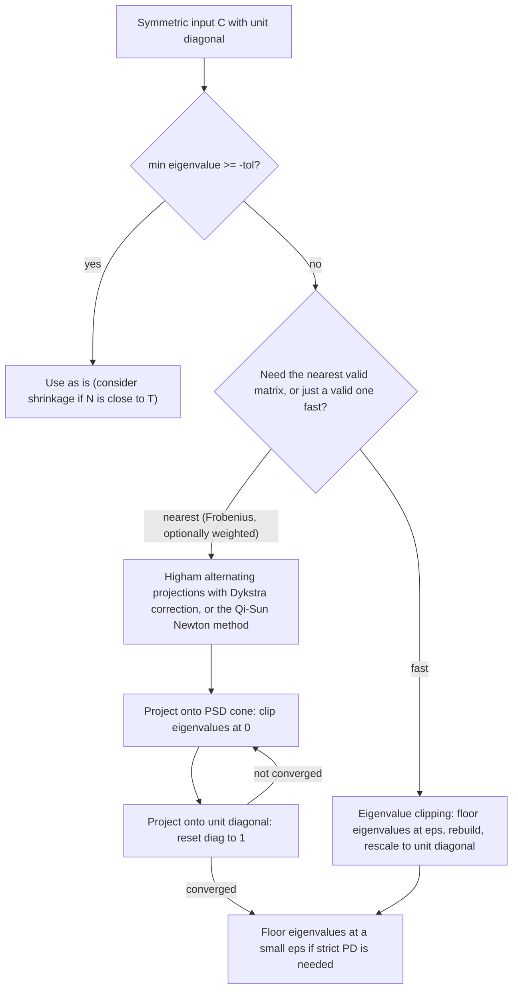

# Covariance Matrices and Positive Semi-Definiteness

## TL;DR

- $w^\top\Sigma w = \text{Var}(w^\top X) \ge 0$, so every covariance matrix, and every sample covariance, is PSD; it is PD iff no non-zero portfolio is riskless.
- Cholesky $\Sigma = LL^\top$ turns independent normals into correlated ones, $X = \mu + LZ$; for two variables $X_2 = \rho Z_1 + \sqrt{1 - \rho^2}Z_2$.
- Given $\rho_{12}$ and $\rho_{13}$, a valid $\rho_{23}$ lies in $\rho_{12}\rho_{13} \pm \sqrt{(1 - \rho_{12}^2)(1 - \rho_{13}^2)}$; an $n$-asset equicorrelation must be at least $-1/(n - 1)$.
- Non-PSD "correlation" matrices come from pairwise estimation, stressing single entries, expert or regulatory specification and entrywise caps; even the Basel FRTB credit-spread inter-bucket matrix fails the test.
- Repair with eigenvalue clipping (fast, not nearest) or Higham's alternating projections (nearest in Frobenius norm); a sample covariance with $N \ge T$ is PSD but singular.

## Learning objectives

- Prove a covariance matrix is PSD and use Cholesky to simulate correlated variables.
- Find the feasible range of a third correlation given two others.
- Repair a non-PSD correlation matrix (nearest correlation matrix).
- Test a matrix for PSD and PD correctly and cheaply, and know which minor tests are valid.
- Explain where invalid correlation matrices come from in practice and what breaks when one is used.

## Core concepts

### Why covariance matrices are PSD

For a random vector $X$ with covariance $\Sigma$ and any weights $w$,

$$
w^\top\Sigma w = \sum_{ij}w_iw_j\text{Cov}(X_i, X_j) = \text{Var}\Big(\sum_iw_iX_i\Big) \ge 0.
$$

$\Sigma$ is positive definite unless some portfolio $w \ne 0$ has zero variance, i.e. the assets are linearly dependent (a redundant instrument, or a spread that is constant).
The sample covariance $S = \frac{1}{T - 1}\tilde{X}^\top\tilde{X}$ of demeaned data $\tilde{X} \in \mathbb{R}^{T \times N}$ is PSD for the same reason, $w^\top Sw = \lVert\tilde{X}w\rVert^2/(T - 1)$, and has rank at most $T - 1$: with more assets than observations it is singular and cannot be inverted in a mean-variance optimiser.

The correlation matrix is $C = D^{-1/2}\Sigma D^{-1/2}$ with $D = \text{diag}(\Sigma)$; it is PSD with unit diagonal, and every such matrix is a valid correlation matrix (of a Gaussian vector).

### Testing PSD and PD

| Test | Valid for | Cost | Notes |
| :--- | :--- | :--- | :--- |
| All eigenvalues $\ge 0$ (or $> 0$) | PSD (PD) | $O(n^3)$, several times a Cholesky | gives the size of the violation |
| Cholesky succeeds | PD | $n^3/3$ flops | cheapest test; fails at the first non-positive pivot |
| Leading principal minors $> 0$ (Sylvester) | PD only | | |
| All principal minors $\ge 0$ | PSD | exponential | leading minors are not enough: $\text{diag}(0, -1)$ has leading minors 0 and 0 |
| Gershgorin diagonal dominance | sufficient for PD | $O(n^2)$ | one-sided; see [Eigendecomposition](02-Eigendecomposition-and-Spectral-Theorem.md) |

For a $3 \times 3$ correlation matrix the determinant is

$$
\det C = 1 - \rho_{12}^2 - \rho_{13}^2 - \rho_{23}^2 + 2\rho_{12}\rho_{13}\rho_{23},
$$

and with all $\lvert\rho\rvert < 1$ the $2 \times 2$ minors are positive, so $C$ is PSD iff $\det C \ge 0$.

### The feasible third correlation

Treat $\det C \ge 0$ as a quadratic in $\rho_{23}$: $-\rho_{23}^2 + 2\rho_{12}\rho_{13}\rho_{23} + (1 - \rho_{12}^2 - \rho_{13}^2) \ge 0$.
Its roots are

$$
\rho_{23} = \rho_{12}\rho_{13} \pm \sqrt{(1 - \rho_{12}^2)(1 - \rho_{13}^2)}.
$$

Geometric reading: correlations are cosines of angles between unit vectors ($\rho_{ij} = \cos\theta_{ij}$), and the angle between 2 and 3 must lie between $\lvert\theta_{12} - \theta_{13}\rvert$ and $\theta_{12} + \theta_{13}$, so $\rho_{23} \in [\cos(\theta_{12} + \theta_{13}), \cos(\theta_{12} - \theta_{13})]$, which is the same interval.
Regression reading: write $X_2 = \rho_{12}X_1 + \sqrt{1 - \rho_{12}^2}\,\varepsilon_2$ and similarly for $X_3$; then $\rho_{23} = \rho_{12}\rho_{13} + \sqrt{(1 - \rho_{12}^2)(1 - \rho_{13}^2)}\,\text{corr}(\varepsilon_2, \varepsilon_3)$, and the residual correlation ranges over $[-1, 1]$.

For $n$ variables, $\mathbf{1}^\top C\mathbf{1} = n + n(n - 1)\bar\rho \ge 0$ forces the average off-diagonal correlation $\bar\rho \ge -1/(n - 1)$; equicorrelation attains the bound with a zero eigenvalue on $\mathbf{1}$.
Many assets cannot all be strongly negatively correlated with each other.

### Cholesky and simulating correlated variables

If $\Sigma = LL^\top$ with $L$ lower triangular and $Z \sim N(0, I)$, then $X = \mu + LZ$ has covariance $LE[ZZ^\top]L^\top = \Sigma$.
The recursion is

$$
L_{jj} = \sqrt{\Sigma_{jj} - \sum_{k<j}L_{jk}^2}, \qquad L_{ij} = \frac{1}{L_{jj}}\Big(\Sigma_{ij} - \sum_{k<j}L_{ik}L_{jk}\Big), \quad i > j.
$$

For two variables, $L = \begin{pmatrix} 1 & 0 \\ \rho & \sqrt{1 - \rho^2}\end{pmatrix}$, the familiar $X_2 = \rho Z_1 + \sqrt{1 - \rho^2}Z_2$.
A non-positive pivot means the matrix is not PD; for a PSD but singular matrix use the symmetric root $Q\Lambda^{1/2}Q^\top$ or a pivoted Cholesky instead.
Any $A$ with $AA^\top = \Sigma$ works: Cholesky is cheapest, the PCA root lets you truncate to the top factors.
Gaussian copulas, basket and spread options, CVA exposure simulation and multi-asset VaR all start here ([Monte Carlo Pricing](../05-Derivatives-and-Volatility/10-Monte-Carlo-Pricing-and-Variance-Reduction.md), [Scenario Generation](../11-Risk-and-Trading/11-Scenario-Generation.md)).

### Where invalid correlation matrices come from

- Pairwise estimation with missing or asynchronous data: each $\rho_{ij}$ uses a different sample, so the matrix is not the Gram matrix of one data set.
- Stress testing that overrides some entries ("set equity-credit correlation to 0.9") without adjusting the rest.
- Expert or regulatory specification of entries one at a time.
- Entrywise transforms such as caps, floors and scalings.
- Rounding a large matrix to two decimals.

The Basel FRTB standardised approach is an instructive case.
It prescribes inter-bucket correlations $\gamma_{bc}$ entry by entry and aggregates bucket risks as $\sqrt{\sum_bK_b^2 + \sum_b\sum_{c \ne b}\gamma_{bc}S_bS_c}$, with an alternative specification in MAR21.4(5)(b) for when the quantity under the root is negative, and it also requires the calculation under scaled-up and scaled-down correlation scenarios.
The quantity under the root is a quadratic form in $\Gamma$, so it can only be guaranteed non-negative when $\Gamma$ is PSD; this repo's FRTB engine found that the credit-spread (non-securitisation) inter-bucket matrix is not PSD, so a production engine must still guard the square root ([FRTB Sensitivities-Based Method: Delta](../17-Regulatory-Capital-Basel-and-FRTB/07-FRTB-Sensitivities-Based-Method-Delta.md)).

Entrywise transforms are the subtle part.
The Schur product theorem says the Hadamard (entrywise) product of two PSD matrices is PSD, so $C \circ C$ is always valid; but a cap such as $\min(1.25\rho, 1)$ is not a Hadamard product and can break PSD (worked example below).

What goes wrong with a non-PSD matrix: Cholesky fails, simulated "variances" of some portfolios come out negative, a mean-variance optimiser finds a portfolio with negative risk and levers it without bound, and VaR or capital formulas take square roots of negative numbers.

### Repairing a correlation matrix



- Eigenvalue clipping: $C = Q\Lambda Q^\top \to Q\max(\Lambda, \varepsilon)Q^\top$, then rescale rows and columns to restore the unit diagonal.
  Fast and simple, valid by construction, but not the closest matrix, and the rescaling moves every entry.
- Higham (2002): find $\min\lVert C - X\rVert_F$ over the intersection of the PSD cone $\mathcal{S}$ and the unit-diagonal set $\mathcal{U}$ by alternating projections.
  Projection onto $\mathcal{S}$ clips negative eigenvalues; projection onto $\mathcal{U}$ resets the diagonal.
  Plain alternation converges to a point in the intersection but not the nearest one; Dykstra's correction (subtract the previous PSD-step increment before projecting) makes it converge to the nearest.
  Weighted norms $\lVert W^{1/2}(C - X)W^{1/2}\rVert_F$ keep trusted entries closer to their inputs.
- Qi and Sun (2006) solve the dual with a Newton method that converges quadratically; it is the method of choice for large matrices.
- Shrinkage towards a structured target, $\delta F + (1 - \delta)S$ with $\delta$ chosen as in Ledoit and Wolf, gives a PD estimate when the problem is noise rather than inconsistency ([Covariance Estimation and Shrinkage](../09-Alpha-Research-and-Portfolio/11-Covariance-Estimation-and-Shrinkage.md)).

The core loop of [covariance_pca.py](code/covariance_pca.py):

```python
y, ds = a.copy(), np.zeros_like(a)
while True:
    r = y - ds                 # Dykstra correction
    x = project_psd(r)         # clip negative eigenvalues
    ds = x - r
    y = x.copy(); np.fill_diagonal(y, 1.0)   # unit diagonal
    if converged(x, y): break
```

## Worked examples

### Feasible range of a third correlation

"Two stocks each have correlation 0.9 with the index. How low can their correlation with each other be?"
$\rho_{23} \ge 0.9 \times 0.9 - \sqrt{0.19 \times 0.19} = 0.81 - 0.19 = 0.62$, and the upper bound is 1.
Angle check: $\arccos 0.9 = 25.84^\circ$, so the stocks are at most $51.7^\circ$ apart and $\cos(2\arccos 0.9) = 0.62$.
Other cases from the same formula: $(0.8, 0.6)$ gives $[0, 0.96]$, $(0.5, 0.5)$ gives $[-0.5, 1]$, and $(0.6, -0.6)$ gives $[-1, 0.28]$.
"High correlation with a common factor forces correlation with each other: that is why a market factor makes cross-sectional diversification hard."

### Cholesky by hand and a simulation check

"Factor $C = \begin{pmatrix} 1 & 0.5 & 0.3 \\ 0.5 & 1 & 0.2 \\ 0.3 & 0.2 & 1\end{pmatrix}$."
Column 1 is $(1, 0.5, 0.3)$.
$L_{22} = \sqrt{1 - 0.25} = 0.866025$, $L_{32} = (0.2 - 0.3 \times 0.5)/0.866025 = 0.057735$, $L_{33} = \sqrt{1 - 0.09 - 0.057735^2} = 0.952190$.
Simulating $200{,}000$ draws of $LZ$ (seed 42) gives sample correlations of about $0.5027$, $0.3019$ and $0.2015$, consistent with sampling noise of order $1/\sqrt{200{,}000} = 0.0022$.

### An impossible matrix, clipped and repaired

"Risk asks for $\rho_{12} = \rho_{13} = 0.9$ and $\rho_{23} = 0$."
From the first example, $\rho_{23}$ must be at least 0.62, so this is infeasible.
Eigenvalues: $1 - 0.9\sqrt2 = -0.2728$, $1$ and $2.2728$.
Cholesky gets $L_{22} = \sqrt{0.19} = 0.43589$, $L_{32} = -0.81/0.43589 = -1.8583$ and then a third pivot $1 - 0.81 - 1.8583^2 = -3.2632 < 0$: it fails.

| Method | $\rho_{12} = \rho_{13}$ | $\rho_{23}$ | Frobenius distance |
| :--- | ---: | ---: | ---: |
| Input | 0.9 | 0 | 0 |
| Eigenvalue clipping at 0, rescaled | 0.7293 | 0.0638 | 0.3531 |
| Higham (Dykstra), 30 iterations to $10^{-12}$ | 0.7434 | 0.1053 | 0.3468 |

Higham's answer is closer, and it sits exactly on the PSD boundary: its smallest eigenvalue is 0 to $10^{-12}$ and $\rho_{23}$ equals the lower bound implied by its own $\rho_{12}$ and $\rho_{13}$.
"Both methods lower the two big correlations and raise the small one; neither can keep the 0.9s, because those entries are what makes the input infeasible."

### A correlation cap that breaks PSD

Take the valid matrix $\rho_{12} = \rho_{13} = 0.8$, $\rho_{23} = 0.3$ (smallest eigenvalue $0.0087$, just inside the boundary).
Apply an FRTB-style high scenario $\min(1.25\rho, 1)$: $\rho_{12} = \rho_{13} = 1$ but $\rho_{23} = 0.375$.
That is impossible (if $X_1 = X_2$ and $X_1 = X_3$ then $X_2 = X_3$), and indeed the smallest eigenvalue is $-0.2391$.
The low scenario $\max(2\rho - 1, 0.75\rho)$ gives $(0.6, 0.6, 0.225)$, smallest eigenvalue $0.2565$, which is fine here.
By contrast the entrywise square $C \circ C$ has smallest eigenvalue $0.1388$: Hadamard products of PSD matrices are always PSD.

### Too few observations

Fifty assets, thirty daily returns: the sample covariance has rank $29 = T - 1$ and 21 eigenvalues that are zero to machine precision.
It is a valid PSD covariance, but the minimum-variance optimiser will find 21 directions of apparently zero risk and put weight on them; shrink, use a factor model, or get more data.

### Equicorrelation lower bound

For five assets, $\rho \ge -1/4 = -0.25$.
The eigenvalue on $\mathbf{1}$ is $1 + 4\rho$: exactly 0 at $\rho = -0.25$ (the equal-weight portfolio is riskless) and $-0.2$ at $\rho = -0.3$, so that matrix is invalid.

## Pitfalls

- Checking only the leading principal minors to establish PSD; that is Sylvester's test for PD, and for PSD all principal minors are needed.
- Overriding one correlation in a stress scenario without checking feasibility; the stressed matrix is often not PSD.
- Assuming a repaired matrix keeps your hand-picked entries; repair moves them, so pin trusted entries with weights.
- Repairing with clipping at exactly 0 and then calling Cholesky; the result is singular, so floor at a small $\varepsilon$ or use an eigen root.
- Using a pairwise-complete correlation matrix from data with gaps in an optimiser; check eigenvalues first.
- Feeding a sample covariance with $N$ close to $T$ to an optimiser; it is invertible but its smallest eigenvalues are far too small, and the optimiser loads on them ([PCA and Factor Structure](05-PCA-and-Factor-Structure.md)).
- Believing that a regulator-prescribed or vendor-supplied matrix must be PSD; test it.

## Interview questions

> [!question]- la-cov-psd-proof | Prove that a covariance matrix is positive semi-definite.
> For any $w$, $w^\top\Sigma w = \text{Var}(w^\top X) \ge 0$. The same argument with $w^\top Sw = \lVert\tilde{X}w\rVert^2/(T - 1)$ shows every sample covariance is PSD.

> [!question]- la-cov-pd-meaning | When is a covariance matrix positive definite rather than only semi-definite?
> When no non-zero portfolio has zero variance, i.e. the assets are linearly independent as random variables. A redundant instrument (an ETF and its basket, a bond and its strip replication) makes it singular.

> [!question]- la-cov-sample-rank | 500 stocks, 250 daily returns: properties of the sample covariance?
> PSD with rank at most 249, so at least 251 zero eigenvalues and no inverse. A mean-variance optimiser would find riskless-looking portfolios; use a factor model or shrinkage.

> [!question]- la-cov-third-correlation | $\rho_{12} = \rho_{13} = 0.9$. What values can $\rho_{23}$ take?
> $[0.62, 1]$, from $\rho_{12}\rho_{13} \pm \sqrt{(1 - \rho_{12}^2)(1 - \rho_{13}^2)} = 0.81 \pm 0.19$. Equivalently the angles add: $\cos(2\arccos 0.9) = 0.62$.

> [!question]- la-cov-third-correlation-derive | Derive the feasible range of $\rho_{23}$ given $\rho_{12}$ and $\rho_{13}$.
> PSD of the $3 \times 3$ correlation matrix reduces to $\det C = 1 - \rho_{12}^2 - \rho_{13}^2 - \rho_{23}^2 + 2\rho_{12}\rho_{13}\rho_{23} \ge 0$, a downward quadratic in $\rho_{23}$ with roots $\rho_{12}\rho_{13} \pm \sqrt{(1 - \rho_{12}^2)(1 - \rho_{13}^2)}$. Or regress 2 and 3 on 1 and let the residual correlation range over $[-1, 1]$.

> [!question]- la-cov-zero-third-correlation | Given $\rho_{12} = 0.8$ and $\rho_{13} = 0.6$, can assets 2 and 3 be uncorrelated?
> Yes, just: the range is $[0, 0.96]$, and 0 is the lower endpoint, where the matrix is singular ($X_1$ is an exact combination $0.8X_2 + 0.6X_3$ of the other two).

> [!question]- la-cov-equicorrelation-bound | What is the most negative common correlation $n$ assets can share?
> $-1/(n - 1)$. The equal-weight portfolio has variance proportional to $n + n(n - 1)\rho \ge 0$; for 5 assets the bound is $-0.25$, and for 101 it is $-0.01$.

> [!question]- la-cov-cholesky-two | How do you simulate two standard normals with correlation $\rho$?
> $X_1 = Z_1$, $X_2 = \rho Z_1 + \sqrt{1 - \rho^2}Z_2$ with independent $Z_1, Z_2$: the Cholesky factor of $\begin{pmatrix} 1 & \rho \\ \rho & 1\end{pmatrix}$. Check: $\text{Var}(X_2) = \rho^2 + 1 - \rho^2 = 1$ and $\text{Cov}(X_1, X_2) = \rho$.

> [!question]- la-cov-cholesky-3x3 | Cholesky factor of the correlation matrix with $\rho_{12} = 0.5$, $\rho_{13} = 0.3$, $\rho_{23} = 0.2$?
> First column $(1, 0.5, 0.3)$; $L_{22} = \sqrt{0.75} = 0.8660$, $L_{32} = (0.2 - 0.15)/0.8660 = 0.0577$, $L_{33} = \sqrt{1 - 0.09 - 0.0577^2} = 0.9522$.

> [!question]- la-cov-sylvester-trap | Is a symmetric matrix with all leading principal minors non-negative PSD?
> Not necessarily: $\text{diag}(0, -1)$ has leading minors 0 and 0 but eigenvalue $-1$. Sylvester's criterion (leading minors positive) characterises PD; PSD needs all principal minors non-negative.

> [!question]- la-cov-non-psd-sources | Name four ways a non-PSD correlation matrix arises in practice.
> Pairwise estimation on different samples (missing or asynchronous data), stress overrides of single entries, expert or regulatory entry-by-entry specification, and entrywise transforms or rounding. Fewer observations than assets gives a singular but still PSD matrix, a different problem.

> [!question]- la-cov-clipping | Describe eigenvalue clipping and its drawback.
> Diagonalise, floor eigenvalues at $\varepsilon \ge 0$, rebuild, and rescale to unit diagonal. It is fast and always valid, but it is not the nearest correlation matrix and the rescaling moves every entry, including trusted ones.

> [!question]- la-cov-higham | How does Higham's nearest-correlation-matrix algorithm work?
> Alternate projections onto the PSD cone (clip eigenvalues at 0) and the unit-diagonal set (reset the diagonal), with Dykstra's correction on the cone step so the iterates converge to the nearest point in Frobenius norm, not just some feasible point. Weights let trusted entries move less; Qi-Sun's Newton method is faster for large $n$.

> [!question]- la-cov-scenario-cap | Can scaling correlations by 1.25 and capping at 1 make a valid matrix invalid? Example?
> Yes. $\rho_{12} = \rho_{13} = 0.8$, $\rho_{23} = 0.3$ is valid, but the scenario gives $1, 1, 0.375$: if 1 equals 2 and 1 equals 3 then 2 must equal 3, and the smallest eigenvalue is $-0.2391$.

> [!question]- la-cov-schur-product | Is the entrywise square of a correlation matrix a correlation matrix?
> Yes, by the Schur product theorem: the Hadamard product of PSD matrices is PSD, and the diagonal stays 1. It is the correlation matrix of $X_iY_i$ for independent copies, but caps and floors are not Hadamard products and can break PSD.

> [!question]- la-cov-frtb-not-psd | Why must an FRTB standardised-approach engine guard the square root in the across-bucket aggregation?
> The radicand is a quadratic form in the prescribed inter-bucket correlation matrix, and the credit-spread (non-securitisation) matrix is not PSD, so even after the MAR21.4(5)(b) alternative specification the value is not guaranteed non-negative. Floor at zero and escalate rather than silently produce a NaN.

> [!question]- la-cov-what-breaks | You feed a non-PSD covariance to a mean-variance optimiser. What happens?
> Some portfolio has "negative variance", so the optimiser can lower risk without bound by scaling it up; with leverage limits it piles into that direction. Cholesky-based simulation fails outright. Always check the smallest eigenvalue first.

> [!question]- la-cov-singular-cholesky | A correlation matrix is PSD but singular. How do you simulate from it?
> Cholesky hits a zero pivot (and rounding can make it slightly negative). Use the eigen root $Q\Lambda^{1/2}$ with negatives clipped to 0, or pivoted Cholesky that stops at the numerical rank; both give $AA^\top = C$ with fewer factors than variables.

## In this repo and SDE-Interview-Prep

- Code: [covariance_pca.py](code/covariance_pca.py) implements Cholesky, eigenvalue clipping and Higham's algorithm and computes and asserts every number above.
- Related: [Covariance Estimation and Shrinkage](../09-Alpha-Research-and-Portfolio/11-Covariance-Estimation-and-Shrinkage.md), [Risk Factor Modelling](../11-Risk-and-Trading/10-Risk-Factor-Modelling.md), [Dispersion and Correlation Trading](../05-Derivatives-and-Volatility/15-Dispersion-and-Correlation-Trading.md), [FRTB Sensitivities-Based Method: Delta](../17-Regulatory-Capital-Basel-and-FRTB/07-FRTB-Sensitivities-Based-Method-Delta.md).

## Further reading

- Gilbert Strang, *Introduction to Linear Algebra*, 5th edition, section 6.5 (positive definite matrices).
- Roger Horn and Charles Johnson, *Matrix Analysis*, 2nd edition, chapter 7 (positive definite matrices, Schur product theorem).
- Paul Glasserman, *Monte Carlo Methods in Financial Engineering*, Springer 2003, section 2.3 (generating correlated normals, Cholesky and eigen roots).
- Nicholas J. Higham, "Computing the Nearest Correlation Matrix - a Problem from Finance", *IMA Journal of Numerical Analysis* 22(3) (2002).
- Houduo Qi and Defeng Sun, "A Quadratically Convergent Newton Method for Computing the Nearest Correlation Matrix", *SIAM Journal on Matrix Analysis and Applications* 28(2) (2006).
- Riccardo Rebonato and Peter Jaeckel, "The Most General Methodology to Create a Valid Correlation Matrix for Risk Management and Option Pricing Purposes", *Journal of Risk* 2(2) (1999).
- Olivier Ledoit and Michael Wolf, "Honey, I Shrunk the Sample Covariance Matrix", *Journal of Portfolio Management* 30(4) (2004).
- Basel Committee on Banking Supervision, *Basel Framework*, MAR21 (standardised approach: sensitivities-based method), consolidated text as of 2026-10.
