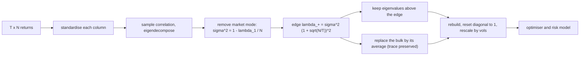

# PCA and Factor Structure

## TL;DR

- PCA is the eigendecomposition of a covariance (or correlation) matrix, equivalently the SVD of the demeaned data: the components are uncorrelated, component $k$ has variance $\lambda_k$, and $\lambda_k/\sum_j\lambda_j$ is its explained-variance share.
- For yield curves three components (level, slope, curvature, with 0, 1 and 2 sign changes in their loadings) explain almost all daily variance; on this note's realistic synthetic curve, 86.3%, 9.5% and 1.9%.
- PC-neutral trades size a butterfly or curve trade so its exposures to PC1 and PC2 are zero, leaving a bet on curvature and noise.
- A statistical factor model writes $\Sigma \approx BB^\top + D$; eigenportfolios are the tradeable factors, and stat-arb trades the residuals.
- Marchenko-Pastur: eigenvalues of a pure-noise sample correlation matrix fill $[(1 - \sqrt{q})^2, (1 + \sqrt{q})^2]$ with $q = N/T$; keep eigenvalues above the edge, flatten the rest, and out-of-sample portfolio risk improves.

## Learning objectives

- Run PCA on returns and interpret level, slope and curvature for yield curves.
- Build eigenportfolios and explain their use in statistical arbitrage.
- Use random matrix theory (Marchenko-Pastur) to separate signal from noise eigenvalues.
- Construct PC-neutral hedges and butterflies.
- Choose between covariance and correlation PCA and between statistical, fundamental and macro factor models.

## Core concepts

### Three equivalent definitions

1. Variance maximisation: the first component is $w_1 = \arg\max_{\lVert w\rVert = 1}w^\top\Sigma w$, the next maximises variance orthogonally to the earlier ones, and by the Rayleigh quotient these are the eigenvectors of $\Sigma$ ([Eigendecomposition](02-Eigendecomposition-and-Spectral-Theorem.md)).
2. Best low-rank reconstruction: the first $k$ components span the $k$-dimensional subspace minimising squared reconstruction error, which is Eckart-Young for the demeaned data matrix ([SVD](03-SVD-and-Low-Rank-Approximation.md)).
3. Decorrelation: $f = Q^\top(x - \mu)$ has $\text{Cov}(f) = \Lambda$, diagonal.

With demeaned data $\tilde{X} = U S V^\top$ ($T \times N$), the loadings are $V$, the scores are $US$, and the sample-covariance eigenvalues are $s_k^2/(T - 1)$.

### Covariance or correlation PCA

- Covariance PCA keeps units: right for yield changes all in basis points, where high-vol tenors should matter more.
- Correlation PCA standardises first: right for equities, where you do not want the most volatile stocks to dominate the first component.
- Results are not related by a simple rescaling, so state which one you ran.

Loadings have an arbitrary sign and, for nearly equal eigenvalues, an arbitrary rotation within their span; fix a sign convention (for example "30-year loading positive") before comparing across dates.

### Yield-curve PCA

Litterman and Scheinkman (1991) found that three factors explain most of the variation in US Treasury returns, and the shapes recur in every rates market:

| Component | Loading shape | Sign changes | Trade that isolates it |
| :--- | :--- | :---: | :--- |
| Level | same sign across the curve, often humped | 0 | duration (outright) |
| Slope | short end opposite to long end | 1 | steepener or flattener (2s10s) |
| Curvature | belly opposite to wings | 2 | butterfly (2s5s10s) |

These shapes are not an accident of the data: for a smooth, positively correlated kernel across maturities, eigenvectors behave like low-frequency cosine modes, which is why PCA of very different markets looks the same.

This note uses a synthetic but realistic covariance of daily changes on ten tenors from 3 months to 30 years.
Daily vols are humped (4 bp at 3 months, 7 bp at 3 to 5 years, 5.8 bp at 30 years), and correlations are

$$
\rho_{ij} = (1 - \eta)\Big[\rho_\infty + (1 - \rho_\infty)e^{-\beta(\ln t_i - \ln t_j)^2}\Big] + \eta\,\mathbf{1}_{i=j}, \qquad \rho_\infty = 0.3,\ \beta = 0.07,\ \eta = 0.03.
$$

It is PSD by construction: a constant matrix is rank-one PSD, the Gaussian kernel is positive definite (Bochner's theorem), $\eta I$ adds tenor-specific noise, and sums and positive multiples of PSD matrices are PSD.
It gives $\rho(2\text{y}, 10\text{y}) = 0.857$ and $\rho(3\text{m}, 30\text{y}) = 0.427$; the parameters are illustrative, chosen to resemble a developed-market swap curve, not estimated from data.

Practitioner uses:

- risk reporting in "PC space" and scenario generation by shocking components;
- PC-neutral relative-value trades (below) and hedging a book with a few liquid instruments matched to the first three components;
- curve-fitting residuals (actual minus PCA-reconstructed yield) as rich/cheap signals ([Fixed Income PnL and Relative Value](../06-Fixed-Income-and-Asset-Classes/24-Fixed-Income-PnL-and-Relative-Value.md)).

Run PCA on changes, not levels: yield levels are near-integrated, and PCA of levels mostly reports the trend.

### Statistical factor models and eigenportfolios

A $K$-factor model writes returns as $r = Bf + \varepsilon$ with $\text{Cov}(f) = F$ and diagonal $\text{Cov}(\varepsilon) = D$, so $\Sigma = BFB^\top + D$.
For $N = 500$ assets the full covariance has $N(N + 1)/2 = 125{,}250$ free parameters; a 10-factor model has $NK + K(K + 1)/2 + N = 5{,}555$, which is what makes the estimate stable and the inverse cheap (Woodbury, [Vectors, Matrices and Linear Maps](01-Vectors-Matrices-and-Linear-Maps.md)).

| Model | Factors | Exposures | Strength | Weakness |
| :--- | :--- | :--- | :--- | :--- |
| Statistical (PCA) | estimated | estimated | captures whatever drives the sample | unstable, hard to name, sign and rotation ambiguity |
| Fundamental (style and industry) | estimated by cross-sectional regression each day | observed characteristics | interpretable, stable | misses unmodelled structure |
| Macro | observed series (rates, oil, FX) | estimated by time-series regression | economic meaning | low explanatory power for single stocks |

Eigenportfolios turn components into tradeable portfolios.
With correlation PCA, Avellaneda and Lee (2010) weight stock $i$ in eigenportfolio $k$ by $q_{ik}/\sigma_i$, so its return is the factor return.
The first eigenportfolio has all weights of one sign and tracks the market; later ones are long-short (sector or style tilts).
Their stat-arb strategy regresses each stock's returns on a handful of eigenportfolio returns, models the cumulative residual as an Ornstein-Uhlenbeck process ([SDEs](../04-Stochastic-Calculus/03-Stochastic-Differential-Equations.md)), and trades its standardised deviations; see [Statistical Arbitrage and Pairs Trading](../09-Alpha-Research-and-Portfolio/06-Statistical-Arbitrage-and-Pairs-Trading.md) and [Cross-Sectional Factor Models](../09-Alpha-Research-and-Portfolio/04-Cross-Sectional-Factor-Models.md).

### Random matrix theory: how much of the spectrum is noise

Take $T$ observations of $N$ independent unit-variance series and form the sample correlation matrix.
As $N, T \to \infty$ with $q = N/T \le 1$ fixed, its eigenvalue density converges to the Marchenko-Pastur law

$$
\rho(\lambda) = \frac{\sqrt{(\lambda_+ - \lambda)(\lambda - \lambda_-)}}{2\pi q\lambda}, \qquad \lambda_\pm = (1 \pm \sqrt{q})^2,
$$

even though every true eigenvalue is 1.
Sampling noise alone spreads the spectrum: with $q = 0.2$ the band is $[0.306, 2.094]$, and with $q = 1$ it is $[0, 4]$.

Laloux, Cizeau, Bouchaud and Potters (1999) and Plerou et al. (1999) found that for US equities most sample eigenvalues sit inside this band; only a market eigenvalue far above it and a few sector eigenvalues stand out.
Two practical refinements:

- remove the market mode before setting the edge: the bulk variance is about $1 - \lambda_1/N$, so $\lambda_+ \approx (1 - \lambda_1/N)(1 + \sqrt{q})^2$;
- the edge is soft at finite $N$ (fluctuations of order $N^{-2/3}$, the Tracy-Widom scale), so do not treat eigenvalues just above $\lambda_+$ as certain signal.

Cleaning by eigenvalue clipping: keep the eigenvalues above $\lambda_+$, replace those below by their average (which preserves the trace), rebuild, and reset the diagonal to 1.
The small eigenvalues are the dangerous ones: a minimum-variance optimiser loads on directions whose sample variance is underestimated, so it is promised a low risk that it does not get.
Better estimators shrink every eigenvalue optimally (rotationally invariant estimators, reviewed by Bun, Bouchaud and Potters, 2017) or shrink the whole matrix (Ledoit-Wolf, [Covariance Estimation and Shrinkage](../09-Alpha-Research-and-Portfolio/11-Covariance-Estimation-and-Shrinkage.md)).

## Worked examples

### PCA of the yield curve

Eigendecomposing the synthetic covariance above (total variance $364.88$ bp$^2$ per day):

| Component | Explained | Daily vol | Sign changes |
| :--- | ---: | ---: | :---: |
| PC1 (level) | 86.3% | 17.75 bp | 0 |
| PC2 (slope) | 9.5% | | 1 |
| PC3 (curvature) | 1.9% | | 2 |
| First three | 97.7% | | |

Loadings (sign fixed so the 30-year loading is positive):

| Tenor | 3m | 6m | 1y | 2y | 3y | 5y | 7y | 10y | 20y | 30y |
| :--- | ---: | ---: | ---: | ---: | ---: | ---: | ---: | ---: | ---: | ---: |
| PC1 | 0.162 | 0.206 | 0.277 | 0.349 | 0.384 | 0.387 | 0.374 | 0.351 | 0.305 | 0.281 |
| PC2 | -0.393 | -0.406 | -0.389 | -0.269 | -0.148 | 0.040 | 0.155 | 0.257 | 0.391 | 0.437 |
| PC3 | 0.529 | 0.332 | 0.081 | -0.204 | -0.319 | -0.301 | -0.202 | -0.050 | 0.292 | 0.491 |

"PC1 is humped because the 3-to-5-year sector is the most volatile, PC2 moves the short end against the long end, and PC3 moves the belly against both wings; three numbers a day describe the curve to 97.7%."

### A PC-neutral 2s5s10s butterfly

"Sell 1 unit of 5-year DV01 and buy 2-year and 10-year wings. How much of each, so the trade has no level or slope exposure?"
Require $a\,q_{2\text{y}} - q_{5\text{y}} + c\,q_{10\text{y}} = 0$ for the PC1 and PC2 loadings: two equations, two unknowns.
Solution: $0.462$ of 2-year DV01 and $0.643$ of 10-year DV01 per unit of 5-year (the wings do not sum to 1, because the loadings are not symmetric).
The textbook 50/50 fly has PC1 exposure $-0.0369$ and PC2 exposure $-0.0468$, and those carry $18.3\%$ of its daily variance; the PCA fly carries none.
Daily P&L vol per unit belly DV01 is $1.55$ for the PCA fly against $1.66$ for the 50/50 fly: what is left is curvature and tenor-specific noise, which is the bet.

### Marchenko-Pastur bounds for noise

"100 independent stocks, 500 days. Where do sample correlation eigenvalues fall?"
$q = 0.2$, $\sqrt{q} = 0.447$: $\lambda_- = 0.3056$ and $\lambda_+ = 2.0944$.
One simulated sample (seed 5) gives a smallest eigenvalue of about $0.326$ and a largest of about $2.012$, inside the band: every apparent "factor" up to twice the average variance is noise.

### Cleaning a correlation matrix and the payoff in risk

A market factor plus four 25-stock sectors on 100 stocks, $T = 250$ days ($q = 0.4$).
True eigenvalues: $27.06$, $3.94$, $3.72$, $3.50$, then a bulk starting at $0.81$.
Sample eigenvalues (seed 2024): $30.15$, $4.60$, $3.77$, $3.17$, then $1.58$, $1.52$, and so on: the bulk is spread by noise and the top is inflated.
The plain edge $(1 + \sqrt{0.4})^2 = 2.665$ is too high once the market takes its share; the market-adjusted edge $(1 - 30.15/100)(1 + \sqrt{0.4})^2 = 1.862$ leaves exactly 4 eigenvalues above it, the four true factors.
Build minimum-variance portfolios and measure their risk under the true correlation: the sample-based portfolio has $2.07$ times the optimal variance, the cleaned one $1.21$ times.
"Clipping does not find new information; it stops the optimiser from betting on the noise directions."

### The market eigenportfolio

In the same sample, all 100 weights of the first eigenvector have the same sign: the top eigenportfolio is a long-only, roughly equal-risk market portfolio, and later ones are long-short sector bets.

## Pitfalls

- Running PCA on levels of prices or yields instead of returns or changes; non-stationary trends dominate the first component.
- Mixing covariance and correlation PCA, or comparing loadings across dates without fixing signs and handling nearly equal eigenvalues that swap.
- Over-interpreting PC4 and beyond on a yield curve; they are small, unstable and often reflect a few illiquid points.
- Choosing the number of factors by "explains 90%"; use random-matrix edges, scree breaks and out-of-sample tests.
- Estimating PCA on the full sample and backtesting a strategy on the same sample; the factors and the residuals contain future information.
- Cleaning a correlation matrix with the plain MP edge when a large market mode is present; it overstates the noise level and discards real sector factors.
- Treating the first eigenportfolio's loadings as betas; they are weights of a normalised direction, not regression coefficients.

## Interview questions

> [!question]- la-pca-definition | Define PCA in two equivalent ways.
> Eigendecomposition of the covariance $\Sigma = Q\Lambda Q^\top$: components $Q^\top(x - \mu)$ are uncorrelated with variances $\lambda_k$. Equivalently the SVD of demeaned data $\tilde{X} = USV^\top$: loadings $V$, scores $US$, eigenvalues $s_k^2/(T - 1)$.

> [!question]- la-pca-variance-max | Why is the first principal component the top eigenvector?
> It maximises $w^\top\Sigma w$ subject to $\lVert w\rVert = 1$; that is a Rayleigh quotient, maximised by the top eigenvector with value $\lambda_1$. Later components repeat this orthogonally to the earlier ones.

> [!question]- la-pca-cov-vs-corr | Covariance or correlation PCA for (a) swap rate changes, (b) a stock universe?
> (a) Covariance: all in basis points, and volatile tenors should matter more. (b) Correlation: otherwise the most volatile stocks dominate PC1 whatever their co-movement.

> [!question]- la-pca-yield-three | Name the first three yield-curve components and how much they explain.
> Level, slope and curvature, with 0, 1 and 2 sign changes in their loadings. Typically well over 95% of daily variance together; on this note's synthetic curve 86.3%, 9.5% and 1.9%, 97.7% in total.

> [!question]- la-pca-why-shapes | Why do yield-curve PCs look like level, slope and curvature in every market?
> Correlation across maturities is a smooth, positive, decaying function of distance; eigenvectors of such kernels behave like low-frequency cosine modes ordered by the number of sign changes. The shapes come from smoothness, not from a specific economic story.

> [!question]- la-pca-butterfly | How do you size a PC-neutral 2s5s10s butterfly?
> Fix the belly at $-1$ DV01 and solve the $2 \times 2$ system that sets the PC1 and PC2 exposures of $(a, -1, c)$ to zero. On this note's curve, $a = 0.462$ and $c = 0.643$; a 50/50 fly instead keeps about 18% of its variance in level and slope.

> [!question]- la-pca-levels-vs-changes | Why run PCA on yield changes rather than levels?
> Levels are near unit-root; their sample covariance is dominated by trends and the components are unstable. Changes are closer to stationary, and hedging and risk are about changes anyway.

> [!question]- la-pca-factor-param-count | How many parameters in a full covariance of 500 stocks versus a 10-factor model?
> $500 \times 501/2 = 125{,}250$ versus $NK + K(K + 1)/2 + N = 5{,}555$. The factor model is far more stable to estimate and is inverted in $O(NK^2)$ with Woodbury.

> [!question]- la-pca-eigenportfolio | What is an eigenportfolio and what does the first one look like?
> A portfolio whose weights are a principal direction, scaled by $1/\sigma_i$ in correlation PCA so its return equals the factor return. The first has weights of one sign and tracks the market; later ones are long-short.

> [!question]- la-pca-avellaneda-lee | Sketch the Avellaneda-Lee statistical arbitrage strategy.
> Regress each stock's returns on a few eigenportfolio (or sector ETF) returns over a rolling window, integrate the residuals, fit an OU process to them, and trade when the standardised deviation (s-score) is large, closing as it reverts. It is market- and factor-neutral by construction.

> [!question]- la-pca-mp-bounds | State the Marchenko-Pastur bounds and evaluate them for 100 assets and 500 observations.
> $\lambda_\pm = (1 \pm \sqrt{N/T})^2$ for the eigenvalues of a pure-noise sample correlation matrix. With $q = 0.2$: $[0.306, 2.094]$, although every true eigenvalue is 1.

> [!question]- la-pca-mp-q-one | What happens to the noise spectrum when $N = T$?
> The band becomes $[0, 4]$: the smallest sample eigenvalues approach 0 and the matrix is nearly singular even though the truth is the identity. That is why an optimiser on such a matrix is badly behaved.

> [!question]- la-pca-market-mode | How do you adjust the MP edge when a large market eigenvalue is present?
> The market mode absorbs part of the variance, so the noise variance is about $1 - \lambda_1/N$ and $\lambda_+ \approx (1 - \lambda_1/N)(1 + \sqrt{q})^2$. In this note's example that moves the edge from 2.665 to 1.862 and keeps all four sector factors.

> [!question]- la-pca-clipping-rmt | Describe RMT eigenvalue clipping.
> Keep eigenvalues above the edge $\lambda_+$, replace all others by their average so the trace is unchanged, rebuild $Q\tilde\Lambda Q^\top$ and reset the diagonal to 1. Eigenvectors are kept; only the noisy spectrum is flattened.

> [!question]- la-pca-gmv-noise | Why does a minimum-variance portfolio built on a sample covariance realise more risk than it predicts?
> The smallest sample eigenvalues are biased down by noise, and the optimiser loads on exactly those directions. In this note's example its true variance is about 2.07 times the optimum; after clipping, about 1.21 times.

> [!question]- la-pca-number-of-factors | How do you choose the number of components?
> Compare eigenvalues with the (market-adjusted) MP edge, look for a scree break, check stability across sub-samples, and test out of sample (risk forecast accuracy or strategy performance). A fixed "explains 90%" rule ignores $N/T$.

> [!question]- la-pca-sign-indeterminacy | Your daily PCA flips the sign of PC2 on some days and swaps PC3 and PC4 on others. What do you do?
> Fix signs by a convention (for example a positive long-end loading) or by alignment with yesterday's vector, and match components across days by maximum absolute overlap; when two eigenvalues are close, track the subspace they span rather than individual vectors.

## In this repo and SDE-Interview-Prep

- Code: [covariance_pca.py](code/covariance_pca.py) builds the yield-curve covariance, runs the PCA, solves the butterfly, simulates the MP noise and the cleaning experiment, and asserts every number above.
- Related: [Covariance Matrices and PSD](04-Covariance-Matrices-and-PSD.md), [Curve Risk and Hedging](../06-Fixed-Income-and-Asset-Classes/15-Curve-Risk-and-Hedging.md), [Risk Factor Modelling](../11-Risk-and-Trading/10-Risk-Factor-Modelling.md), [Statistical Arbitrage and Pairs Trading](../09-Alpha-Research-and-Portfolio/06-Statistical-Arbitrage-and-Pairs-Trading.md).

## Further reading

- Trevor Hastie, Robert Tibshirani and Jerome Friedman, *The Elements of Statistical Learning*, 2nd edition, section 14.5.
- Ian Jolliffe, *Principal Component Analysis*, 2nd edition, Springer 2002.
- Robert Litterman and Jose Scheinkman, "Common Factors Affecting Bond Returns", *Journal of Fixed Income* 1(1) (1991).
- Marco Avellaneda and Jeong-Hyun Lee, "Statistical Arbitrage in the US Equities Market", *Quantitative Finance* 10(7) (2010).
- Vladimir Marchenko and Leonid Pastur, "Distribution of Eigenvalues for Some Sets of Random Matrices", *Mathematics of the USSR-Sbornik* 1(4) (1967).
- Laurent Laloux, Pierre Cizeau, Jean-Philippe Bouchaud and Marc Potters, "Noise Dressing of Financial Correlation Matrices", *Physical Review Letters* 83 (1999).
- Vasiliki Plerou, Parameswaran Gopikrishnan, Bernd Rosenow, Luis Amaral and H. Eugene Stanley, "Universal and Nonuniversal Properties of Cross Correlations in Financial Time Series", *Physical Review Letters* 83 (1999).
- Joel Bun, Jean-Philippe Bouchaud and Marc Potters, "Cleaning Large Correlation Matrices: Tools from Random Matrix Theory", *Physics Reports* 666 (2017).
- Marc Potters and Jean-Philippe Bouchaud, *A First Course in Random Matrix Theory: for Physicists, Engineers and Data Scientists*, Cambridge University Press 2020 (Marchenko-Pastur, eigenvalue cleaning).
