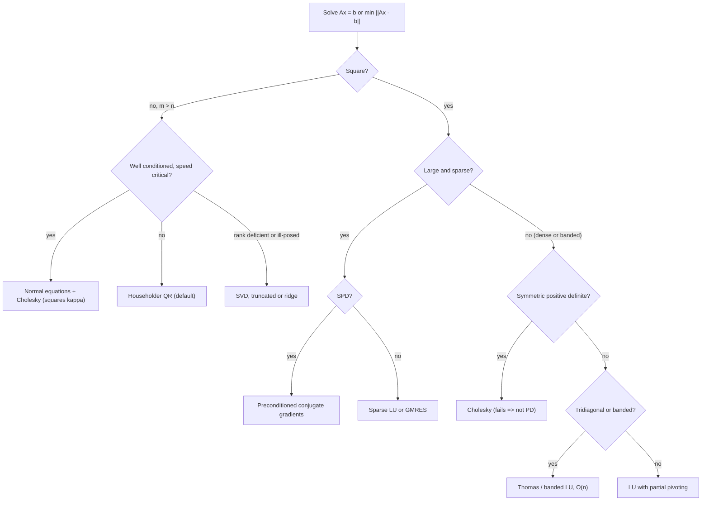

# Numerical Linear Algebra

## TL;DR

- Never form an explicit inverse: factor once (LU, Cholesky, QR) and solve; it costs $2n^3/3$ instead of $2n^3$ for one right-hand side and gives a far smaller residual.
- Match the factorisation to the structure: SPD means Cholesky ($n^3/3$), general square means LU with partial pivoting ($2n^3/3$), least squares means Householder QR, rank-deficient or ill-posed means SVD, tridiagonal means the $O(n)$ Thomas algorithm, large sparse SPD means conjugate gradients.
- Conditioning sets the floor: relative error is roughly $\kappa(A)\,\varepsilon_{\text{mach}}$ with $\varepsilon_{\text{mach}} = 2.2 \times 10^{-16}$, so you lose about $\log_{10}\kappa$ digits; the normal equations square $\kappa$.
- Stability is the algorithm's job: partial pivoting, Householder reflections and two-pass or Welford variance are stable; no pivoting, classical Gram-Schmidt and $E[X^2] - E[X]^2$ are not.
- BLAS level 3 (matrix-matrix) does $O(n^3)$ work on $O(n^2)$ data, which is why blocked LAPACK routines run near peak; use the library, and mind memory layout.

## Learning objectives

- Choose between LU, QR, Cholesky and SVD for a given problem.
- Explain conditioning, floating-point error and why you never form an explicit inverse.
- Know what BLAS and LAPACK provide and how memory layout affects speed.
- Recognise and fix catastrophic cancellation in everyday statistics code.
- Solve banded and sparse systems with the right method and estimate cost from flop counts.

## Core concepts

### Floating point in one page

IEEE 754 double precision has a 53-bit significand: machine epsilon (gap from 1 to the next double) is $\varepsilon_{\text{mach}} = 2^{-52} = 2.22 \times 10^{-16}$, unit roundoff $u = 2^{-53} = 1.11 \times 10^{-16}$, and the largest finite double is about $1.8 \times 10^{308}$.
Every basic operation is correctly rounded: $\text{fl}(x \circ y) = (x \circ y)(1 + \delta)$ with $\lvert\delta\rvert \le u$.

Consequences worth saying in an interview:

- $0.1 + 0.2 \ne 0.3$ (the difference is $5.55 \times 10^{-17}$), because none of the three is representable exactly; compare with a tolerance.
- Above $2^{53}$ not every integer is representable: $2^{53} + 1$ rounds to $2^{53}$, which matters for nanosecond timestamps and order ids stored as doubles.
- Subtracting nearly equal numbers is exact but reveals earlier rounding: catastrophic cancellation.
  The textbook variance $\big(\sum x^2 - (\sum x)^2/n\big)/(n - 1)$ fails for prices near $10^9$ or squared returns with a large mean; use two passes or Welford's update.
- Long sums accumulate error $O(nu)$; pairwise summation (numpy's default) gives $O(u\log n)$ and Kahan compensated summation $O(u)$ plus a second-order term.

### Conditioning versus stability

The condition number $\kappa(A) = \lVert A\rVert\lVert A^{-1}\rVert$ ($= \sigma_1/\sigma_n$ in the 2-norm) is a property of the problem: it bounds how much a relative perturbation of the data can move the solution.
Stability is a property of the algorithm.
A backward-stable algorithm returns the exact solution of a nearby problem, $(A + \delta A)\hat{x} = b$ with $\lVert\delta A\rVert/\lVert A\rVert = O(u)$, and then

$$
\frac{\lVert\hat{x} - x\rVert}{\lVert x\rVert} \lesssim \kappa(A)\,O(u).
$$

Rule of thumb: you lose about $\log_{10}\kappa(A)$ of your 16 digits.
The residual $\lVert b - A\hat{x}\rVert$ of a backward-stable solve is small even when the error is large; a small residual does not certify an accurate $x$ on an ill-conditioned problem.

### Direct methods: what to use when

| Factorisation | Applies to | Leading flops ($n \times n$) | Stability | Typical quant use |
| :--- | :--- | :--- | :--- | :--- |
| LU with partial pivoting, $PA = LU$ | general square | $2n^3/3$ | backward stable in practice (growth factor rarely large) | pricing PDE matrices, Jacobians |
| Cholesky, $A = LL^\top$ | symmetric positive definite | $n^3/3$ | unconditionally stable, no pivoting | covariance solves, correlated simulation, PD test |
| $LDL^\top$ with pivoting | symmetric indefinite | about $n^3/3$ | stable with Bunch-Kaufman pivoting | KKT systems of QPs |
| Householder QR | least squares, $m \times n$ | $2mn^2 - 2n^3/3$ | backward stable, error scales with $\kappa$ | regressions, curve fitting |
| SVD | rank-deficient or ill-posed | several times QR (Golub and Van Loan tabulate the variants) | most robust | pseudo-inverse, PCA, regularisation |
| Explicit inverse | almost never | $2n^3$ | larger residuals | only when you need its entries |

Once a factorisation exists, each extra right-hand side costs two triangular solves, $2n^2$ flops, which is why you factor a pricing or risk matrix once and reuse it.

Partial pivoting matters because Gaussian elimination divides by pivots: a tiny pivot creates a huge multiplier, and the subtraction that follows wipes out information (worked example below).
Cholesky never needs pivoting because the pivots of an SPD matrix are positive and bounded by the diagonal; its failure is the cheapest test that a matrix is not positive definite ([Covariance Matrices and PSD](04-Covariance-Matrices-and-PSD.md)).

### Why never invert

- Cost: computing $A^{-1}$ is $2n^3$ flops, against $2n^3/3$ for LU plus $2n^2$ for the solve.
- Accuracy: $x = \text{inv}(A)\,b$ is not backward stable; its residual scales with $\kappa(A)\,u$, while a solve gives a residual of order $u$.
- Structure: the inverse of a sparse or banded matrix is usually dense, so a tridiagonal $O(n)$ solve becomes $O(n^2)$ storage and work.
- Exceptions: when the entries themselves are the answer, such as the diagonal of $(X^\top X)^{-1}$ for OLS standard errors (compute it from $R^{-1}$ of the QR factor) or the precision matrix for partial correlations.

### Least squares three ways

For $\min\lVert Ax - b\rVert$ with $A \in \mathbb{R}^{m \times n}$, $m \gg n$:

| Method | Flops | Error scales with | Comment |
| :--- | :--- | :--- | :--- |
| Normal equations $A^\top Ax = A^\top b$ via Cholesky | $mn^2 + n^3/3$ | $\kappa(A)^2$ | fastest; fine when $\kappa$ is small and data well scaled |
| Householder QR, $Rx = Q^\top b$ | $2mn^2 - 2n^3/3$ | $\kappa(A)$ (plus a $\kappa^2$ term times the residual) | default |
| SVD | more | $\kappa(A)$, and truncation handles rank deficiency | collinear or ill-posed problems |

Forming $A^\top A$ is not just squaring $\kappa$ in theory: entries smaller than $\sqrt{u}$ relative to others can vanish when added, and the computed $A^\top A$ can become exactly singular.

Classical Gram-Schmidt computes a QR factorisation but loses orthogonality on ill-conditioned columns; modified Gram-Schmidt is better; Householder reflections give $Q$ orthogonal to machine precision regardless of $\kappa$.

### Structured and sparse systems

- Tridiagonal systems (Crank-Nicolson steps in [finite-difference pricing](../05-Derivatives-and-Volatility/11-Finite-Differences-and-Fourier-Pricing.md), cubic-spline curve interpolation in [Curve Construction Numerics](../06-Fixed-Income-and-Asset-Classes/14-Curve-Construction-Numerics.md)) are solved by the Thomas algorithm, LU without pivoting specialised to three diagonals: about $8n$ flops and stable for diagonally dominant matrices.
- Banded LU with bandwidth $p$ costs $O(np^2)$; general sparse direct solvers reorder rows and columns to limit fill-in.
- Iterative methods need only matrix-vector products.
  Conjugate gradients (CG) for SPD systems minimises the $A$-norm error over a growing Krylov space, terminates in at most $n$ steps in exact arithmetic (at most the number of distinct eigenvalues excited by $b$), and reduces the error by about $(\sqrt\kappa - 1)/(\sqrt\kappa + 1)$ per step.
  Preconditioning (incomplete Cholesky, multigrid) shrinks the effective $\kappa$; GMRES and BiCGSTAB handle non-symmetric systems.

### BLAS, LAPACK and memory

| Level | Example | Data moved | Flops | Flops per word |
| :--- | :--- | :--- | :--- | :--- |
| BLAS 1 | `daxpy` $y \leftarrow \alpha x + y$ | $O(n)$ | $O(n)$ | $O(1)$ |
| BLAS 2 | `dgemv` $y \leftarrow Ax + y$ | $O(n^2)$ | $O(n^2)$ | $O(1)$ |
| BLAS 3 | `dgemm` $C \leftarrow AB + C$ | $O(n^2)$ | $O(n^3)$ | $O(n)$ |

Only level 3 has enough arithmetic per memory access to keep a modern core busy, so LAPACK reorganises factorisations into blocks that call `dgemm`.
Routine names follow a pattern: `dgetrf`/`dgetrs` (LU factor and solve), `dpotrf`/`dpotrs` (Cholesky), `dgeqrf` (QR), `dgels` (least squares), `dgesdd` (SVD by divide and conquer), `dsyevd` (symmetric eigenproblem); `d` is double precision.
NumPy and SciPy call these through an optimised BLAS (OpenBLAS, Intel MKL or Apple Accelerate).

Memory layout: LAPACK is column-major (Fortran order); C, C++ and NumPy default to row-major.
Traversing a matrix against its layout strides through memory and misses cache, so the loop order of a hand-written multiply can change speed by an order of magnitude; libraries block for cache and vectorise, which is why a hand-rolled triple loop loses to `dgemm` by orders of magnitude.
See [Numerical Python](../12-Quant-Development/11-Numerical-Python-NumPy-and-Numba.md) and [Low-Latency Engineering](../12-Quant-Development/03-Low-Latency-Engineering.md).

## Worked examples

### Why partial pivoting

"Solve $\begin{pmatrix} 10^{-20} & 1 \\ 1 & 1\end{pmatrix}x = \begin{pmatrix} 1 \\ 2\end{pmatrix}$ by Gaussian elimination without pivoting."
The multiplier is $10^{20}$ and $u_{22} = 1 - 10^{20}$, which rounds to $-10^{20}$: the 1 is lost.
Back substitution gives $x_2 = 1$ and then $x_1 = (1 - 1)/10^{-20} = 0$, while the true solution is about $(1, 1)$.
Swapping the rows first makes the multiplier $10^{-20}$ and returns $(1, 1)$ to machine precision.
"The matrix is perfectly conditioned; the failure is entirely the algorithm's."

### Hilbert matrices: the limit of any algorithm

$H_{ij} = 1/(i + j - 1)$ has $\kappa_2(H_5) = 4.77 \times 10^5$ and $\kappa_2(H_{10}) = 1.60 \times 10^{13}$, so about 13.2 of 16 digits are at risk.
Solving $H_{10}x = H_{10}\mathbf{1}$ with LU gives a relative error in $x$ of order $10^{-4}$ while the relative residual is of order $10^{-16}$: a backward-stable solve, and still only about four correct digits, as $\kappa u$ predicts.
Computing $\text{inv}(H_{10})\,b$ instead leaves a relative residual of order $10^{-5}$, many orders of magnitude worse.
(The exact digits depend on the BLAS build, so the script asserts bounds: error between $10^{-6}$ and $10^{-2}$, solve residual below $10^{-14}$, inverse residual above $10^{-12}$ and more than ten times the solve residual.)

### Normal equations versus QR: the Lauchli matrix

$A = \begin{pmatrix} 1 & 1 \\ \delta & 0 \\ 0 & \delta\end{pmatrix}$ with $\delta = 10^{-8}$ and $b = (2, \delta, \delta)$, so the exact least-squares solution is $(1, 1)$.
$\kappa_2(A) = \sqrt{2 + \delta^2}/\delta = 1.41 \times 10^8$, large but harmless for QR, which recovers $(1, 1)$ within its $\kappa u = 1.6 \times 10^{-8}$ error bound (exactly, in the reference run).
But $A^\top A = \begin{pmatrix} 1 + \delta^2 & 1 \\ 1 & 1 + \delta^2\end{pmatrix}$ and $\text{fl}(1 + 10^{-16}) = 1$: the computed matrix is exactly singular (rank 1), and the normal equations have no answer at all.

### Losing orthogonality

On the ten columns of $H_{10}$, $\max\lvert Q^\top Q - I\rvert$ is of order 1 for classical Gram-Schmidt (orthogonality completely lost), of order $10^{-4}$ for modified Gram-Schmidt and of order $10^{-15}$ for Householder.

### Catastrophic cancellation in a variance

"Four prices: $10^9 + 4$, $10^9 + 7$, $10^9 + 13$, $10^9 + 16$. Sample variance?"
Exactly 30 (deviations $-6, -3, 3, 6$).
The textbook one-pass formula subtracts two numbers near $4 \times 10^{18}$ whose spacing is 512, and returns $-170.67$: a negative variance.
Two-pass (subtract the mean first) and Welford's running update both return 30.

### Tridiagonal systems and conjugate gradients

The $100 \times 100$ matrix with 2 on the diagonal and $-1$ off it (a discrete second derivative) with right-hand side $\mathbf{1}$ has solution $x_i = i(n + 1 - i)/2$, so $x_{50} = 1275$; the Thomas algorithm matches a dense solve to rounding error in $O(n)$ work.
Its condition number is $4133.6$.
CG converges to a $10^{-10}$ relative residual in exactly 50 iterations, not 100: the symmetric right-hand side excites only the 50 symmetric eigenvectors, and CG needs one step per distinct eigenvalue it sees.

### Flop counts at n = 1000

LU $6.67 \times 10^8$, Cholesky $3.33 \times 10^8$, Householder QR $1.33 \times 10^9$, explicit inverse $2.0 \times 10^9$, matrix-vector $2.0 \times 10^6$, triangular solve $1.0 \times 10^6$.
For least squares with $m = 10{,}000$ and $n = 100$: normal equations $1.0033 \times 10^8$ against Householder $1.9933 \times 10^8$, so QR costs about twice as much and buys a condition number of $\kappa$ instead of $\kappa^2$.

## Pitfalls

- `np.linalg.inv(A) @ b` instead of `np.linalg.solve(A, b)` (or `scipy.linalg.cho_solve` for SPD); slower, less accurate, and wasteful when $A$ is sparse.
- Trusting a small residual as proof of an accurate solution on an ill-conditioned problem.
- Computing regressions via normal equations on collinear or badly scaled regressors; standardise columns and use QR.
- One-pass variance and covariance formulas in streaming code; use Welford.
- Comparing floats with `==`, or storing integer ids and nanosecond timestamps above $2^{53}$ as doubles.
- Hand-written triple loops for matrix products in production code; call BLAS.
- Iterating over a row-major array column by column in a hot loop.
- Treating a failed Cholesky as a numerical glitch to be retried; it is information (the matrix is not PD).

## Interview questions

> [!question]- la-num-never-invert | Why should you not compute $A^{-1}b$ with an explicit inverse?
> It costs $2n^3$ flops against $2n^3/3$ for LU plus $2n^2$ per solve, it is not backward stable (residual grows with $\kappa u$), and it destroys sparsity. Factor once and solve; on $H_{10}$ the inverse leaves a residual many orders of magnitude larger.

> [!question]- la-num-choose-factorisation | Which factorisation for: a covariance solve, a regression, a PDE time step, a rank-deficient fit?
> Cholesky for SPD covariance, Householder QR for least squares, LU with pivoting (or Thomas for tridiagonal) for the PDE step, SVD (truncated or ridge) for rank deficiency.

> [!question]- la-num-flops | Leading flop counts of LU, Cholesky and Householder QR for $n \times n$, and of a triangular solve?
> LU $2n^3/3$, Cholesky $n^3/3$, QR $4n^3/3$, triangular solve $n^2$. At $n = 1000$: $6.67 \times 10^8$, $3.33 \times 10^8$, $1.33 \times 10^9$ and $10^6$.

> [!question]- la-num-machine-epsilon | What is machine epsilon for doubles and what does it imply for $0.1 + 0.2$?
> $2^{-52} \approx 2.22 \times 10^{-16}$ (unit roundoff $1.11 \times 10^{-16}$). $0.1 + 0.2$ differs from $0.3$ by $5.55 \times 10^{-17}$ because none of the three is exactly representable; compare with a relative tolerance.

> [!question]- la-num-condition-rule | What does a condition number of $10^{10}$ mean in double precision?
> Expect to lose about 10 of 16 significant digits even with a backward-stable algorithm: relative error up to about $\kappa u \approx 10^{-6}$. Better algorithms cannot fix it; rescaling or reformulating the problem can.

> [!question]- la-num-normal-equations | Why are normal equations dangerous for least squares?
> $\kappa(A^\top A) = \kappa(A)^2$, and forming $A^\top A$ can lose information outright: in the Lauchli example $1 + 10^{-16}$ rounds to 1 and the computed $A^\top A$ is exactly singular while QR solves the problem to within $\kappa u$.

> [!question]- la-num-pivoting | Why does Gaussian elimination need pivoting even on a well-conditioned matrix?
> A tiny pivot creates a huge multiplier, and the update $a_{22} - \ell a_{12}$ swamps the original entry. For $\begin{pmatrix} 10^{-20} & 1 \\ 1 & 1\end{pmatrix}$ elimination without pivoting returns $x_1 = 0$ instead of about 1; partial pivoting keeps all multipliers at most 1 in size.

> [!question]- la-num-cholesky-pd-test | What is the cheapest way to test that a symmetric matrix is positive definite?
> Attempt a Cholesky factorisation ($n^3/3$ flops): it succeeds iff the matrix is PD (up to rounding near the boundary). It is several times cheaper than computing eigenvalues, which you need only if you want the size of the violation.

> [!question]- la-num-gram-schmidt | Classical Gram-Schmidt, modified Gram-Schmidt or Householder for QR, and why?
> Householder: $Q$ is orthogonal to machine precision whatever $\kappa$. Classical GS loses orthogonality like $\kappa^2u$ (on $H_{10}$ completely), modified GS like $\kappa u$; both are fine only for well-conditioned columns.

> [!question]- la-num-variance-cancellation | Your risk system reports a negative variance for a price series. What happened and how do you fix it?
> The one-pass formula $\sum x^2 - (\sum x)^2/n$ cancels catastrophically when the mean is large relative to the spread (prices near $10^9$ with spread 6 give $-170.67$ instead of 30). Use two passes or Welford's online update, or subtract a reference value first.

> [!question]- la-num-thomas | How do you solve a tridiagonal system and what does it cost?
> Thomas algorithm: forward elimination along the sub-diagonal then back substitution, about $8n$ flops and $O(n)$ memory. Stable for diagonally dominant matrices such as implicit finite-difference steps and spline systems.

> [!question]- la-num-cg | How fast does conjugate gradients converge?
> At most $n$ steps in exact arithmetic (at most the number of distinct eigenvalues excited by $b$), and the $A$-norm error shrinks by about $(\sqrt\kappa - 1)/(\sqrt\kappa + 1)$ per step. On the $100 \times 100$ second-difference matrix with $b = \mathbf{1}$ it takes 50 steps because only 50 symmetric eigenvectors are excited.

> [!question]- la-num-blas-levels | What are BLAS levels 1, 2 and 3, and why does level 3 matter for speed?
> Vector-vector, matrix-vector and matrix-matrix operations. Level 3 performs $O(n^3)$ flops on $O(n^2)$ data, so blocks can be reused from cache and cores run near peak; levels 1 and 2 are memory-bound.

> [!question]- la-num-memory-layout | How does memory layout affect a matrix computation in C++ or NumPy?
> Row-major storage keeps a row contiguous; looping down columns strides through memory and misses cache. Loop order in a hand-written multiply can change runtime by an order of magnitude, and LAPACK expects column-major data, so wrappers transpose or pass the transposed problem.

> [!question]- la-num-lapack-routines | Name the LAPACK routines for LU, Cholesky, QR, least squares, SVD and the symmetric eigenproblem.
> `dgetrf`/`dgetrs`, `dpotrf`/`dpotrs`, `dgeqrf`, `dgels`, `dgesdd` (or `dgesvd`), `dsyevd` (or `dsyev`); the `d` prefix is double precision.

> [!question]- la-num-backward-stability | What does backward stable mean, and what does it guarantee?
> The computed answer is the exact answer for slightly perturbed data, with relative perturbation $O(u)$. Combined with conditioning it bounds the forward error by about $\kappa u$; it does not promise an accurate solution for an ill-conditioned problem.

> [!question]- la-num-large-integers | You store exchange order ids as doubles in a Python pipeline. What can go wrong?
> Integers above $2^{53} \approx 9 \times 10^{15}$ are not all representable: $2^{53} + 1$ rounds to $2^{53}$, so distinct ids collide silently. Keep ids and nanosecond timestamps as 64-bit integers.

> [!question]- la-num-kahan | When would you use Kahan summation?
> When summing many terms of mixed size in a long accumulation (P&L over millions of fills, a Monte Carlo average) and pairwise summation is not available, for example in a streaming loop. It carries a compensation term that recovers the low-order bits lost at each addition, making the error essentially independent of $n$.

## In this repo and SDE-Interview-Prep

- Code: [numerical_linear_algebra.py](code/numerical_linear_algebra.py) implements LU with and without pivoting, Householder QR, classical and modified Gram-Schmidt, Thomas and conjugate gradients, and asserts every number above (exact values tightly, rounding-error magnitudes by bounds).
- SDE bridge: [profiling guide](https://github.com/shreejitverma/SDE-Interview-Prep/blob/main/12-Performance-Engineering/02-Profiling/profiling_guide.md) for measuring where numerical code spends its time.
- Related: [Numerical Python: NumPy and Numba](../12-Quant-Development/11-Numerical-Python-NumPy-and-Numba.md), [Testing Trading and Numerical Code](../12-Quant-Development/14-Testing-Trading-and-Numerical-Code.md).

## Further reading

- Lloyd N. Trefethen and David Bau, *Numerical Linear Algebra*, SIAM 1997, lectures 7-8 and 10 (QR, Gram-Schmidt, Householder), 11-23 (least squares, conditioning, stability, LU, Cholesky) and 38 (conjugate gradients).
- Gene Golub and Charles Van Loan, *Matrix Computations*, 4th edition, chapters 1-5 and 11.
- Nicholas J. Higham, *Accuracy and Stability of Numerical Algorithms*, 2nd edition, SIAM 2002 (floating point, summation, LU, Cholesky, QR).
- David Goldberg, "What Every Computer Scientist Should Know About Floating-Point Arithmetic", *ACM Computing Surveys* 23(1) (1991).
- B. P. Welford, "Note on a Method for Calculating Corrected Sums of Squares and Products", *Technometrics* 4(3) (1962).
- E. Anderson et al., *LAPACK Users' Guide*, 3rd edition, SIAM 1999.
