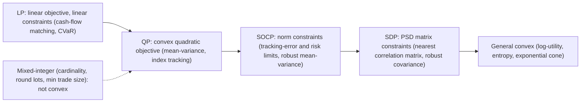

# Convex Optimization and KKT Conditions

## TL;DR

- A convex problem minimises a convex function over a convex set (convex inequality constraints, affine equalities); every local minimum is global, and strict convexity makes it unique.
- KKT conditions (stationarity, primal feasibility, dual feasibility $\lambda \ge 0$, complementary slackness $\lambda_ig_i = 0$) are sufficient for convex problems and necessary under Slater's condition.
- Multipliers are shadow prices: the derivative of the optimal value with respect to the constraint level, so a positive multiplier on $w_i \ge 0$ is the variance you would save per unit of shorting allowed.
- Mean-variance closed forms: $w_{\text{GMV}} = \Sigma^{-1}\mathbf{1}/A$ with variance $1/A$; the frontier is $\sigma^2(m) = (Am^2 - 2Bm + C)/D$; the tangency portfolio is $\propto \Sigma^{-1}(\mu - r\mathbf{1})$ with Sharpe ratio $\sqrt{(\mu - r\mathbf{1})^\top\Sigma^{-1}(\mu - r\mathbf{1})}$.
- Duality: the dual function $g(\lambda, \nu) = \inf_xL$ is a lower bound on the optimum (weak duality), tight under Slater (strong duality); solvers stop on the duality gap.

## Learning objectives

- Recognise convex problems and why local optima are global.
- Solve equality-constrained problems with Lagrange multipliers.
- State the KKT conditions and interpret multipliers as shadow prices.
- Use duality to bound and solve problems.
- Derive the minimum-variance, efficient-frontier and tangency portfolios in closed form and check them numerically.

## Core concepts

### Convex sets and functions

A set $C$ is convex if $\theta x + (1 - \theta)y \in C$ for all $x, y \in C$ and $\theta \in [0, 1]$.
A function $f$ is convex if $f(\theta x + (1 - \theta)y) \le \theta f(x) + (1 - \theta)f(y)$; for differentiable $f$ this is equivalent to $f(y) \ge f(x) + \nabla f(x)^\top(y - x)$ (the tangent plane is a global under-estimator), and for twice-differentiable $f$ to $\nabla^2f \succeq 0$ everywhere.

Operations that preserve convexity, which is how you prove most things in practice:

- non-negative sums, composition with an affine map ($f(Ax + b)$), pointwise maximum and supremum;
- norms, $x^\top Qx$ with $Q \succeq 0$, $\log\sum_ie^{x_i}$, $-\log\det X$ on PD matrices, $x^2/y$ for $y > 0$.

Finance examples:

| Quantity | Convex? | Consequence |
| :--- | :--- | :--- |
| Variance $w^\top\Sigma w$ | yes (since $\Sigma \succeq 0$) | mean-variance is a QP |
| Volatility $\sqrt{w^\top\Sigma w} = \lVert\Sigma^{1/2}w\rVert$ | yes (a norm) | tracking-error limits are second-order cone constraints |
| CVaR (expected shortfall) | yes, and has a linear-programming representation (Rockafellar and Uryasev, 2000) | scenario-based ES optimisation is an LP |
| VaR | no (not subadditive in general, Artzner et al., 1999) | VaR optimisation is non-convex and combinatorial |
| Sharpe ratio | not concave, but quasi-concave for positive excess return | reformulate as a QP (below) |
| Cardinality ("at most 30 names"), round lots | no | mixed-integer programming |

Why local is global: if $x^\ast$ is a local minimum and some feasible $y$ had $f(y) < f(x^\ast)$, then points $x^\ast + \theta(y - x^\ast)$ for small $\theta$ are feasible (convex set) and, by convexity, have $f \le (1 - \theta)f(x^\ast) + \theta f(y) < f(x^\ast)$, contradicting local optimality.

### Problem classes

Each class contains the previous one, and each has polynomial-time interior-point methods; modelling tools such as CVXPY check the convexity rules for you and pass the problem to a matching solver ([Quadratic Programming and Portfolio Solvers](09-Quadratic-Programming-and-Portfolio-Solvers.md)).

### Lagrangian and the KKT conditions

Standard form: minimise $f(x)$ subject to $g_i(x) \le 0$ and $h_j(x) = 0$.
The Lagrangian is $L(x, \lambda, \nu) = f(x) + \sum_i\lambda_ig_i(x) + \sum_j\nu_jh_j(x)$.

KKT conditions at $(x^\ast, \lambda^\ast, \nu^\ast)$:

1. stationarity: $\nabla f(x^\ast) + \sum_i\lambda_i^\ast\nabla g_i(x^\ast) + \sum_j\nu_j^\ast\nabla h_j(x^\ast) = 0$;
2. primal feasibility: $g_i(x^\ast) \le 0$, $h_j(x^\ast) = 0$;
3. dual feasibility: $\lambda_i^\ast \ge 0$;
4. complementary slackness: $\lambda_i^\ast g_i(x^\ast) = 0$, so a multiplier can be positive only on a binding constraint.

For a convex problem the KKT conditions are sufficient for optimality.
They are necessary when a constraint qualification holds; for convex problems the usual one is Slater's condition (some strictly feasible point exists, $g_i(x) < 0$ for the non-affine constraints).
Geometrically, stationarity says $-\nabla f$ is a non-negative combination of the gradients of the active constraints: you cannot move downhill without leaving the feasible set.

### Shadow prices

Perturb a constraint to $g_i(x) \le u_i$.
Under strong duality and differentiability, the optimal value $p^\ast(u)$ satisfies

$$
\frac{\partial p^\ast}{\partial u_i} = -\lambda_i^\ast,
$$

so $\lambda_i^\ast$ is what relaxing the constraint by one unit is worth.
In portfolio construction this prices every constraint in units of the objective: the multiplier on a long-only bound is the risk you would save per unit of shorting, the multiplier on a sector cap is the cost of the cap, and constraints with large multipliers are the ones to argue about with the investment committee.

### Mean-variance in closed form

Let $\Sigma \succ 0$ and define the scalars

$$
A = \mathbf{1}^\top\Sigma^{-1}\mathbf{1}, \quad B = \mathbf{1}^\top\Sigma^{-1}\mu, \quad C = \mu^\top\Sigma^{-1}\mu, \quad D = AC - B^2 > 0.
$$

Global minimum variance: minimise $w^\top\Sigma w$ subject to $\mathbf{1}^\top w = 1$.
Stationarity of $w^\top\Sigma w - \nu(\mathbf{1}^\top w - 1)$ gives $2\Sigma w = \nu\mathbf{1}$, so $w \propto \Sigma^{-1}\mathbf{1}$ and

$$
w_{\text{GMV}} = \frac{\Sigma^{-1}\mathbf{1}}{A}, \qquad \sigma^2_{\text{GMV}} = \frac1A, \qquad \mu_{\text{GMV}} = \frac BA.
$$

Frontier: add $\mu^\top w = m$ with multiplier $\lambda$.
Stationarity $2\Sigma w = \lambda\mu + \nu\mathbf{1}$ makes $w$ a combination of $\Sigma^{-1}\mu$ and $\Sigma^{-1}\mathbf{1}$ (the two-fund theorem: every frontier portfolio mixes any two frontier portfolios), and the two constraints give

$$
\lambda = \frac{2(Am - B)}{D}, \qquad \nu = \frac{2(C - Bm)}{D}, \qquad \sigma^2(m) = \frac{Am^2 - 2Bm + C}{D}.
$$

The frontier is a parabola in $(m, \sigma^2)$ and a hyperbola in $(\sigma, m)$, and the envelope theorem gives $d\sigma^2/dm = \lambda$, the shadow price of required return.

With a risk-free rate $r$: maximising the Sharpe ratio gives the tangency portfolio

$$
w_{\text{tan}} = \frac{\Sigma^{-1}(\mu - r\mathbf{1})}{\mathbf{1}^\top\Sigma^{-1}(\mu - r\mathbf{1})}, \qquad SR_{\max} = \sqrt{(\mu - r\mathbf{1})^\top\Sigma^{-1}(\mu - r\mathbf{1})},
$$

The normalisation needs $\mathbf{1}^\top\Sigma^{-1}(\mu - r\mathbf{1}) = B - rA > 0$, that is $r < \mu_{\text{GMV}} = B/A$; if $r$ exceeds the GMV mean, the normalised portfolio is the tangency point on the inefficient lower branch (it minimises the Sharpe ratio), while the Sharpe-maximising position, still a positive multiple of $\Sigma^{-1}(\mu - r\mathbf{1})$, is net short the risky assets with more than 100% in cash; at $r = B/A$ there is no tangency portfolio.
An investor maximising $w^\top(\mu - r\mathbf{1}) - \tfrac\gamma2w^\top\Sigma w$ holds $w = \Sigma^{-1}(\mu - r\mathbf{1})/\gamma$ in risky assets and the rest in cash.
Practical caveats (estimation error, error maximisation, shrinkage, Black-Litterman) are in [Mean-Variance Portfolio Construction](../09-Alpha-Research-and-Portfolio/10-Mean-Variance-Portfolio-Construction.md).

Maximising the Sharpe ratio directly is not a concave problem, but it is homogeneous: substitute $y = \kappa w$ with the normalisation $(\mu - r\mathbf{1})^\top y = 1$, minimise $y^\top\Sigma y$ (a QP, with any homogeneous constraints such as $y \ge 0$ kept), then rescale $w = y/\mathbf{1}^\top y$.

### Duality

The dual function $g(\lambda, \nu) = \inf_xL(x, \lambda, \nu)$ is concave (an infimum of affine functions of $(\lambda, \nu)$) even when the primal is not convex.
Weak duality: for $\lambda \ge 0$ and feasible $x$, $g(\lambda, \nu) \le L(x, \lambda, \nu) \le f(x)$, so every dual-feasible point certifies a lower bound.
Strong duality ($d^\ast = p^\ast$) holds for convex problems under Slater's condition.

Uses:

- certificates: a primal-dual pair with gap $f(x) - g(\lambda, \nu) \le \varepsilon$ proves $x$ is $\varepsilon$-optimal, which is how interior-point solvers decide to stop;
- the dual can be smaller or separable (one multiplier per constraint instead of one variable per asset), which is how large index-tracking and transport problems are solved;
- LP duality: $\min c^\top x$ s.t. $Ax = b$, $x \ge 0$ has dual $\max b^\top y$ s.t. $A^\top y \le c$; in asset pricing, the dual of the super-replication LP is the search over state prices ([Vectors, Matrices and Linear Maps](01-Vectors-Matrices-and-Linear-Maps.md)).

## Worked examples

### Three-asset closed forms

Vols $15\%$, $20\%$, $25\%$; correlations $\rho_{12} = 0.3$, $\rho_{13} = 0.2$, $\rho_{23} = 0.5$; expected returns $5\%$, $7\%$, $9\%$; risk-free $2\%$.

- Scalars: $A = 56.3137$, $B = 3.32706$, $C = 0.219592$, $D = 1.29673$.
- GMV: weights $(0.6616, 0.2228, 0.1156)$, vol $1/\sqrt{A} = 13.33\%$, mean $B/A = 5.91\%$.
- Frontier at $m = 8\%$: the $5 \times 5$ KKT system $\begin{pmatrix} 2\Sigma & -\mu & -\mathbf{1} \\ \mu^\top & 0 & 0 \\ \mathbf{1}^\top & 0 & 0\end{pmatrix}\begin{pmatrix} w \\ \lambda \\ \nu\end{pmatrix} = \begin{pmatrix} 0 \\ m \\ 1\end{pmatrix}$ gives weights $(0.1048, 0.2903, 0.6048)$ and vol $19.17\%$, matching $\sqrt{(Am^2 - 2Bm + C)/D}$.
- Shadow price: $\lambda = 2(Am - B)/D = 1.8169$; a finite difference of $\sigma^2(m)$ gives the same number, so raising the return target by 10 bp costs about $0.0018$ of variance.
- Tangency (valid because $r = 2\%$ is below the GMV mean $5.91\%$): weights $(0.3831, 0.2566, 0.3603)$, expected return $6.95\%$, vol $15.00\%$, Sharpe $0.3302$.
- Mean-variance investor with $\gamma = 4$: holds $55.02\%$ in the risky assets (in tangency proportions) and the rest in cash, with portfolio vol $8.26\%$.

### Long-only KKT by hand

"Two assets, vols 10% and 20%, correlation 0.8. Minimum-variance portfolio, with and without shorting?"
Unconstrained: $w_2 = (\sigma_1^2 - \rho\sigma_1\sigma_2)/(\sigma_1^2 + \sigma_2^2 - 2\rho\sigma_1\sigma_2) = (0.01 - 0.016)/0.018 = -1/3$, so $w = (4/3, -1/3)$ with variance $0.008$ (vol $8.94\%$): the high-vol asset is shorted as a hedge.
Long-only: guess $w = (1, 0)$ with $w_2 \ge 0$ binding, and check KKT for $\min w^\top\Sigma w$ s.t. $\mathbf{1}^\top w = 1$, $w \ge 0$.
Gradient $2\Sigma w = (0.02, 0.032)$.
Asset 1 is free, so $\nu = 0.02$; asset 2 is at its bound, so its multiplier is $0.032 - 0.02 = 0.012 \ge 0$: dual feasible, complementary slackness holds, and the guess is optimal with variance $0.01$.
Shadow price: allowing $w_2 \ge -\varepsilon$ lowers the variance by about $0.012\varepsilon$, which a finite difference confirms.

### Duality on a one-line problem

"Minimise $x^2$ subject to $x \ge 1$."
$L = x^2 + \lambda(1 - x)$ is minimised at $x = \lambda/2$, so $g(\lambda) = \lambda - \lambda^2/4$.
Maximising over $\lambda \ge 0$ gives $\lambda^\ast = 2$ and $d^\ast = 1$, equal to $p^\ast = 1$ at $x^\ast = 1$: strong duality, the constraint binds, and $\lambda^\ast = 2 = f'(1)$ is the rate at which the optimum rises as the bound is tightened.

## Pitfalls

- Applying KKT to a non-convex problem and calling the stationary point optimal; KKT points of non-convex problems can be saddles or local optima.
- Forgetting dual feasibility: a stationary point with a negative multiplier on an inequality is not optimal; release that constraint.
- Sign conventions: whether $\lambda$ is $+$ or $-$ the derivative of the optimum depends on how you wrote the Lagrangian; state it before quoting a shadow price.
- Using the closed-form GMV when weights must be long-only; the closed form shorts freely, and clipping negative weights to zero and renormalising is not the long-only optimum.
- Maximising the Sharpe ratio with a general NLP solver; use the homogeneous QP reformulation.
- Optimising VaR, cardinality or round-lot constraints as if they were convex; they need mixed-integer or heuristic methods, and the answer depends on the starting point.
- Inverting a nearly singular $\Sigma$ in the closed forms; the weights then mostly reflect noise ([PCA and Factor Structure](05-PCA-and-Factor-Structure.md)).

## Interview questions

> [!question]- la-cvx-local-global | Why is every local minimum of a convex problem global?
> If a feasible $y$ beat the local minimum $x^\ast$, every point on the segment from $x^\ast$ to $y$ is feasible and, by convexity, strictly better than $x^\ast$; points arbitrarily close to $x^\ast$ would beat it, contradicting local optimality.

> [!question]- la-cvx-convexity-tests | Three ways to show a twice-differentiable function is convex?
> The definition (chord above the graph), the first-order condition $f(y) \ge f(x) + \nabla f(x)^\top(y - x)$, or the Hessian PSD everywhere. In practice, build it from convexity-preserving operations (sums, affine composition, max, norms).

> [!question]- la-cvx-which-convex | Which are convex in the weights: variance, volatility, CVaR, VaR, Sharpe ratio?
> Variance, volatility (a norm) and CVaR are convex. VaR is not (it is not subadditive in general), and the Sharpe ratio is only quasi-concave, so it is maximised through a reformulation.

> [!question]- la-cvx-kkt | State the KKT conditions.
> For $\min f$ s.t. $g_i \le 0$, $h_j = 0$: stationarity $\nabla f + \sum\lambda_i\nabla g_i + \sum\nu_j\nabla h_j = 0$, primal feasibility, dual feasibility $\lambda_i \ge 0$, complementary slackness $\lambda_ig_i = 0$. Sufficient for convex problems; necessary under a constraint qualification such as Slater.

> [!question]- la-cvx-complementary-slackness | What does complementary slackness say and why is it intuitive?
> $\lambda_ig_i(x^\ast) = 0$: either the constraint binds or its multiplier is zero. A slack constraint can be relaxed for free, so its shadow price must be zero.

> [!question]- la-cvx-slater | What is Slater's condition and why does it matter?
> A convex problem has a strictly feasible point ($g_i(x) < 0$ for non-affine constraints). It guarantees strong duality and that KKT multipliers exist at the optimum, so KKT becomes necessary as well as sufficient.

> [!question]- la-cvx-shadow-price | Interpret a Lagrange multiplier economically.
> It is the derivative of the optimal value with respect to the constraint level: $\partial p^\ast/\partial u_i = -\lambda_i$ for $g_i \le u_i$. A multiplier of 0.012 on $w_2 \ge 0$ in a variance minimisation means each unit of allowed shorting saves 0.012 of variance.

> [!question]- la-cvx-gmv | Derive the global minimum-variance portfolio and its variance.
> Minimise $w^\top\Sigma w$ s.t. $\mathbf{1}^\top w = 1$: stationarity $2\Sigma w = \nu\mathbf{1}$ gives $w = \Sigma^{-1}\mathbf{1}/(\mathbf{1}^\top\Sigma^{-1}\mathbf{1})$, and substituting gives $\sigma^2 = 1/(\mathbf{1}^\top\Sigma^{-1}\mathbf{1})$.

> [!question]- la-cvx-two-asset-gmv | Two assets, vols 10% and 20%, correlation 0.8: minimum-variance weights?
> $w_2 = (0.01 - 0.016)/(0.01 + 0.04 - 0.032) = -1/3$, so $(4/3, -1/3)$, variance 0.008 (vol 8.94%). Shorting the volatile, highly correlated asset hedges the first one.

> [!question]- la-cvx-frontier | What shape is the mean-variance frontier and what is its formula?
> $\sigma^2(m) = (Am^2 - 2Bm + C)/D$ with $A = \mathbf{1}^\top\Sigma^{-1}\mathbf{1}$, $B = \mathbf{1}^\top\Sigma^{-1}\mu$, $C = \mu^\top\Sigma^{-1}\mu$, $D = AC - B^2$: a parabola in variance, a hyperbola in volatility, with vertex at the GMV portfolio $(B/A, 1/A)$.

> [!question]- la-cvx-two-fund | State the two-fund theorem.
> Every frontier portfolio is a linear combination of $\Sigma^{-1}\mathbf{1}$ and $\Sigma^{-1}\mu$, hence of any two distinct frontier portfolios, because stationarity forces $w \in \text{span}\{\Sigma^{-1}\mathbf{1}, \Sigma^{-1}\mu\}$.

> [!question]- la-cvx-tangency | Give the tangency portfolio and the maximum Sharpe ratio.
> $w \propto \Sigma^{-1}(\mu - r\mathbf{1})$, normalised to sum to 1, and $SR_{\max} = \sqrt{(\mu - r\mathbf{1})^\top\Sigma^{-1}(\mu - r\mathbf{1})}$. In this note's three-asset example: weights $(0.383, 0.257, 0.360)$, Sharpe 0.330.

> [!question]- la-cvx-utility-weights | An investor maximises $w^\top(\mu - r) - \tfrac\gamma2w^\top\Sigma w$ with a risk-free asset. What does she hold?
> $w = \Sigma^{-1}(\mu - r\mathbf{1})/\gamma$ in risky assets (tangency proportions, scaled by $1/\gamma$), the remainder in cash. Doubling risk aversion halves every risky position.

> [!question]- la-cvx-sharpe-reformulate | How do you maximise the Sharpe ratio with long-only constraints using a QP solver?
> The ratio is scale-invariant, so set $(\mu - r)^\top y = 1$ and minimise $y^\top\Sigma y$ subject to $y \ge 0$ (homogeneous constraints survive the scaling), then return $w = y/\mathbf{1}^\top y$. It works when some feasible portfolio has positive excess return.

> [!question]- la-cvx-long-only-kkt | How do you verify a long-only minimum-variance solution is optimal?
> Compute $g = 2\Sigma w$. The free assets must share one value $\nu$ (stationarity), and every asset at zero must have $g_i - \nu \ge 0$ (dual feasibility); that multiplier is the shadow price of its bound.

> [!question]- la-cvx-weak-duality | State weak duality and how solvers use it.
> For any $\lambda \ge 0$ and $\nu$, $g(\lambda, \nu) = \inf_xL \le p^\ast$. A primal feasible $x$ and dual feasible $(\lambda, \nu)$ bracket the optimum, and the gap $f(x) - g(\lambda, \nu)$ is the stopping criterion of interior-point methods.

> [!question]- la-cvx-dual-toy | Solve $\min x^2$ s.t. $x \ge 1$ via its dual.
> $L = x^2 + \lambda(1 - x)$, minimised at $x = \lambda/2$, so $g(\lambda) = \lambda - \lambda^2/4$, maximised at $\lambda = 2$ with value 1. Primal optimum $x = 1$, value 1: strong duality, binding constraint, positive multiplier.

> [!question]- la-cvx-problem-classes | Order LP, QP, SOCP and SDP and give a portfolio example of each.
> LP is in QP is in SOCP is in SDP. LP: CVaR minimisation over scenarios; QP: mean-variance; SOCP: a tracking-error or volatility limit $\lVert\Sigma^{1/2}(w - b)\rVert \le \tau$; SDP: finding the nearest valid correlation matrix or worst-case covariance.

> [!question]- la-cvx-clip-not-optimal | Can you get the long-only minimum-variance portfolio by zeroing the negative GMV weights and renormalising?
> No. Removing an asset changes the optimal weights of the others because of correlations; the correct answer satisfies KKT with a new free set, which an active-set or interior-point solver finds.

## In this repo and SDE-Interview-Prep

- Code: [portfolio_optimization.py](code/portfolio_optimization.py) computes and asserts every number above (closed forms, the KKT linear system, the shadow-price finite difference, the long-only multiplier and the dual toy).
- Next: [Quadratic Programming and Portfolio Solvers](09-Quadratic-Programming-and-Portfolio-Solvers.md); related: [Mean-Variance Portfolio Construction](../09-Alpha-Research-and-Portfolio/10-Mean-Variance-Portfolio-Construction.md), [Black-Litterman, Risk Parity and HRP](../09-Alpha-Research-and-Portfolio/12-Black-Litterman-Risk-Parity-and-HRP.md).

## Further reading

- Stephen Boyd and Lieven Vandenberghe, *Convex Optimization*, Cambridge University Press 2004, chapters 2-5 (convex sets and functions, problem classes, duality and KKT).
- Jorge Nocedal and Stephen Wright, *Numerical Optimization*, 2nd edition, chapter 12 (theory of constrained optimisation).
- Robert C. Merton, "An Analytic Derivation of the Efficient Portfolio Frontier", *Journal of Financial and Quantitative Analysis* 7(4) (1972).
- Gerard Cornuejols, Javier Pena and Reha Tutuncu, *Optimization Methods in Finance*, 2nd edition, Cambridge University Press 2018.
- R. Tyrrell Rockafellar and Stanislav Uryasev, "Optimization of Conditional Value-at-Risk", *Journal of Risk* 2(3) (2000).
- Philippe Artzner, Freddy Delbaen, Jean-Marc Eber and David Heath, "Coherent Measures of Risk", *Mathematical Finance* 9(3) (1999).
