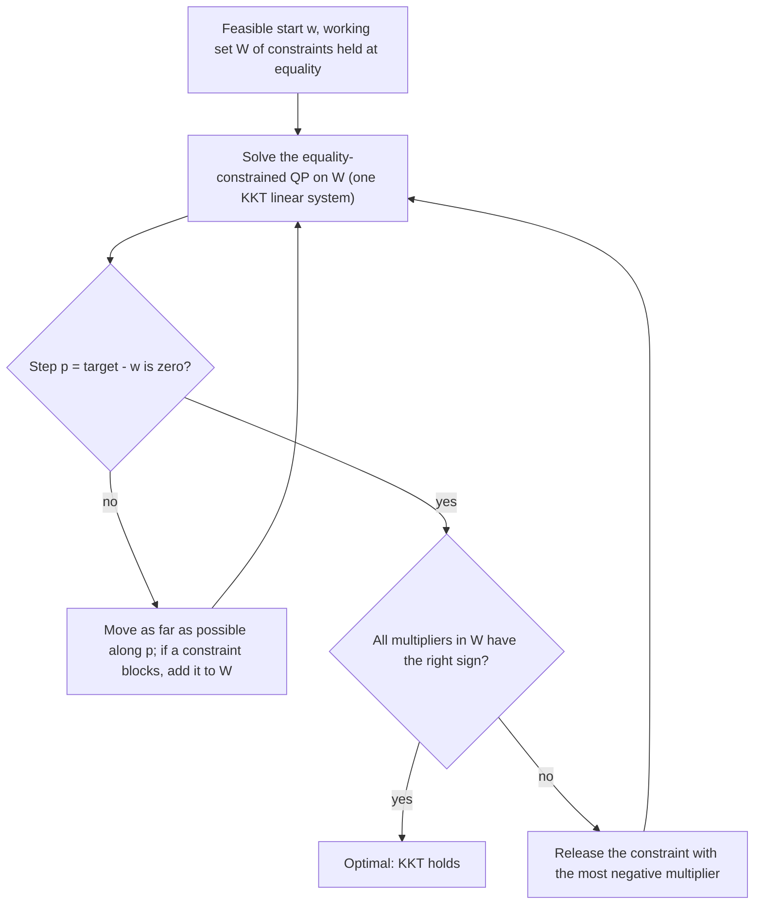

# Quadratic Programming and Portfolio Solvers

## TL;DR

- A portfolio QP is $\min\tfrac12w^\top Qw + c^\top w$ subject to linear equalities and inequalities; budget, long-only, box, sector and factor-neutrality constraints are linear, and turnover limits and linear costs become linear after splitting each trade into a buy and a sell.
- Active-set methods guess which constraints bind, solve an equality-constrained KKT system, then add a blocking constraint or release one with a wrong-signed multiplier; exact and warm-startable, ideal for small dense daily rebalances.
- Interior-point methods follow the central path with Newton steps on perturbed KKT conditions; tens of iterations almost independent of size, each one a sparse linear solve; they also handle cone constraints.
- First-order methods (projected gradient, ADMM as in OSQP) have cheap iterations and moderate accuracy, and shine on large, warm-started or embedded problems.
- Never trust a solver's status alone: check primal feasibility, the stationarity residual, multiplier signs and complementarity yourself.

## Learning objectives

- Formulate constrained mean-variance problems as QPs.
- Handle transaction costs, turnover and position limits in the optimizer.
- Know the practical solver landscape (active set, interior point, ADMM).
- Implement a small projected-gradient, active-set and interior-point solver and verify KKT residuals numerically.
- Explain no-trade regions, why clipping weights is not optimal, and how factor structure keeps large problems sparse.

## Core concepts

### The portfolio QP and how constraints are written

Mean-variance with risk aversion $\gamma$: minimise $\tfrac\gamma2w^\top\Sigma w - \alpha^\top w$, so $Q = \gamma\Sigma$ and $c = -\alpha$.

| Requirement | Linear form | Notes |
| :--- | :--- | :--- |
| Fully invested | $\mathbf{1}^\top w = 1$ | dollar-neutral: $\mathbf{1}^\top w = 0$ |
| Long-only, position limits | $0 \le w_i \le u_i$ | box constraints |
| Sector or country caps | $\sum_{i \in s}w_i \le c_s$ | |
| Factor or beta neutrality | $B^\top w = 0$ | |
| Gross leverage $\lVert w\rVert_1 \le L$ | $w = w^+ - w^-$, $w^\pm \ge 0$, $\mathbf{1}^\top(w^+ + w^-) \le L$ | |
| Turnover $\lVert w - w_0\rVert_1 \le \tau$ | $w = w_0 + b - s$, $b, s \ge 0$, $\mathbf{1}^\top(b + s) \le \tau$ | buys $b$, sells $s$ |
| Linear costs $\kappa^\top\lvert w - w_0\rvert$ | add $\kappa^\top(b + s)$ to the objective | spread and commission |
| Quadratic impact | add $(w - w_0)^\top\Lambda(w - w_0)$ | keeps it a QP |
| Power-law impact $\lvert\Delta w\rvert^{3/2}$, tracking-error or vol limits | cone constraints | SOCP or power cone |
| Cardinality, minimum trade size, round lots | integer variables | MIQP, not convex |

Why the buy-sell split is exact: if some $b_i > 0$ and $s_i > 0$ at an optimum with positive costs, reducing both by $\min(b_i, s_i)$ leaves $w$ unchanged, keeps all constraints satisfied and lowers cost, a contradiction.
So $b_is_i = 0$ automatically, and $b_i + s_i = \lvert w_i - w_{0,i}\rvert$.

Costs create a no-trade region.
For a name that is not traded, KKT only requires the marginal utility $\alpha_i - \gamma(\Sigma w)_i - \nu$ to lie within $[-\kappa_i - \lambda_\tau, \kappa_i + \lambda_\tau]$ (cost plus the turnover shadow price), so small alpha changes do not trigger trades: this is the mechanism that keeps turnover down, and [Transaction Costs and Turnover](../09-Alpha-Research-and-Portfolio/13-Transaction-Costs-and-Turnover.md) covers how to calibrate it.

### Active-set methods

- Each iteration solves a KKT system for the free variables; with updates of a factorisation the cost per iteration is $O(n^2)$.
- Termination is finite for non-degenerate strictly convex QPs (no working set repeats), and with a good warm start (yesterday's active set) a daily rebalance often needs only a handful of iterations.
- The number of iterations can grow with the number of constraints that change status, so very large problems with many active bounds favour interior point.
- Goldfarb and Idnani (1983) is the classic dual active-set method for strictly convex QPs and is what the widely used `quadprog` package implements.

### Interior-point methods

Write inequalities with slacks, $Gx + s = h$, $s \ge 0$, multipliers $z \ge 0$, and replace complementarity $s_iz_i = 0$ by $s_iz_i = \mu$.
As $\mu \downarrow 0$ the solutions trace the central path to the optimum.
Each iteration takes a damped Newton step on the perturbed KKT conditions; eliminating $s$ and $z$ leaves

$$
\begin{pmatrix} Q + G^\top\text{diag}(z/s)G & A^\top \\ A & 0\end{pmatrix}\begin{pmatrix}\Delta x \\ \Delta y\end{pmatrix} = \text{rhs},
$$

a sparse symmetric indefinite system ($LDL^\top$, [Numerical Linear Algebra](06-Numerical-Linear-Algebra.md)).
Practical solvers use Mehrotra's predictor-corrector and need roughly 10 to 50 iterations whatever the problem size; the cost is in the linear solves.
At a barrier level $\mu$, a variable at its bound with multiplier $z_i$ sits about $\mu/z_i$ inside it, so weakly binding constraints (small $z_i$) are the last to converge.

Keep the KKT system sparse with factor structure: for $\Sigma = BFB^\top + D$, introduce $y = B^\top w$ and write the risk as $w^\top Dw + y^\top Fy$; the Hessian becomes diagonal plus a small $K \times K$ block instead of a dense $N \times N$ matrix, which turns thousands of names from hard to easy.

### First-order methods

- Projected gradient: $w \leftarrow \Pi_{\mathcal{C}}(w - \eta\nabla f(w))$ with $\eta = 1/L$, $L = \lambda_{\max}(Q)$; for strongly convex $f$ the error contracts by about $1 - \lambda_{\min}/\lambda_{\max}$ per step.
  It needs a cheap projection: onto the simplex $\{w \ge 0, \mathbf{1}^\top w = 1\}$ by sorting in $O(n\log n)$ (the threshold rule of Held, Wolfe and Crowder, 1974, popularised by Duchi et al., 2008), onto budget plus box by bisection on a scalar shift $t$ in $w = \text{clip}(y - t, \ell, u)$.
- ADMM splits the problem into a linear-system step and a projection step; OSQP (Stellato et al., 2020) applies it to QPs, caches one sparse factorisation, warm-starts well and detects infeasibility, at the price of moderate accuracy.
- Accelerated (Nesterov) and coordinate-descent variants are common for very large risk-parity and index-tracking problems.

### The solver landscape

| Method | Example implementations | Strength | Weakness |
| :--- | :--- | :--- | :--- |
| Dual active set | `quadprog` (Goldfarb-Idnani) | exact, fast for small dense QPs | dense, many iterations if many constraints switch |
| Interior point | MOSEK, Gurobi, CPLEX, Clarabel, ECOS | robust, high accuracy, cones | each iteration a factorisation; warm start is hard |
| ADMM | OSQP, SCS | cheap iterations, warm start, embedded use | moderate accuracy, sensitive to scaling |
| Modelling layer | CVXPY | checks convexity, maps to any solver | overhead for tiny repeated problems |

Choice in practice: a daily rebalance of a few hundred names with yesterday's solution as warm start suits active set or OSQP; a large, sparse, factor-structured book with cone constraints suits an interior-point solver; anything with cardinality or lots needs a mixed-integer solver or a heuristic around a convex core.

### Verifying a solution

For $\min\tfrac12w^\top Qw + c^\top w$ s.t. $\mathbf{1}^\top w = 1$, $\ell \le w \le u$, with $g = Qw + c$:

- primal: $\lvert\mathbf{1}^\top w - 1\rvert$ and bound violations within tolerance;
- stationarity: all free variables share one value of $g_i$ (the budget multiplier $\nu$);
- dual feasibility: $g_i - \nu \ge 0$ at lower bounds and $\nu - g_i \ge 0$ at upper bounds;
- complementarity: multipliers vanish off the bounds (for interior point, $\max_is_iz_i$ small).

These residuals catch scaling problems, wrong signs in the model and silently infeasible solves; log them with every production rebalance ([Testing Trading and Numerical Code](../12-Quant-Development/14-Testing-Trading-and-Numerical-Code.md)).

Constraints are also regularisers: Jagannathan and Ma (2003) showed that imposing long-only constraints on a sample-covariance minimum-variance portfolio acts like shrinking the covariance, which is one reason "wrong" constraints often improve out-of-sample risk.

## Worked examples

### The test universe

Five assets with vols $12\%, 16\%, 20\%, 24\%, 30\%$, one-factor correlations $\rho_{ij} = a_ia_j$ with $a = (0.5, 0.6, 0.7, 0.6, 0.9)$, and expected returns $4\%, 6\%, 7\%, 8\%, 10\%$.
Unconstrained minimum variance: $(0.6477, 0.3190, 0.1501, 0.0778, -0.1946)$ with vol $9.97\%$; the most volatile, most market-exposed asset is shorted.

### Long-only minimum variance with three solvers

The optimum is $(0.6587, 0.2682, 0.0523, 0.0208, 0)$ with vol $10.79\%$.
Projected gradient (258 iterations to a $10^{-13}$ step), active set (3 iterations from equal weights) and interior point (14 iterations) agree to $10^{-8}$.
KKT check: the four free assets share one gradient value $\nu = 2\sigma^2$, the stationarity residual is zero to rounding, and asset 5's bound multiplier is $0.0175 > 0$.
"Clip and renormalise" would give $(0.5422, 0.2670, 0.1257, 0.0651, 0)$ with vol $10.99\%$: feasible but not optimal, because dropping asset 5 changes the best weights of all the others.

### Box-constrained mean-variance and a weakly binding bound

With $\gamma = 4$ and $0 \le w_i \le 0.35$: the optimum is $(0.35, 0.3256, 0.1721, 0.1524, 0)$, expected return $5.78\%$, vol $11.91\%$.
Asset 1 sits at its cap and asset 5 at zero; the smallest bound multiplier is only $0.00037$.
Projected gradient (178 iterations) and active set (4 iterations) agree to $10^{-9}$, but the interior-point solution, stopped at complementarity $10^{-10}$, agrees only to about $3 \times 10^{-7}$: with $z_5 = 0.00037$, $w_5 \approx \mu/z_5$ is still visibly positive.
"A weakly binding constraint is where interior-point answers are least precise; polish by fixing the identified active set and solving the KKT system exactly."

### Projecting onto the simplex

$y = (0.5, 0.4, -0.2, 0.6)$: sort, find the threshold $\theta = 1/6$ that makes $\sum\max(y_i - \theta, 0) = 1$, and get $(0.3333, 0.2333, 0, 0.4333)$.
The bisection projection used by the solvers gives the same point.

### Rebalancing with costs and a turnover cap

Start from equal weights $w_0 = 0.2$, charge 20 bp per unit traded on each side, cap total traded weight at $\lVert w - w_0\rVert_1 \le 0.2$, $\gamma = 4$, long-only.
With buys and sells as separate variables (15 variables, 6 equalities, 16 inequalities) the interior-point solver converges in 13 iterations to $(0.2787, 0.2213, 0.2, 0.2, 0.1)$.
The turnover cap binds exactly (turnover $0.2$) with shadow price $0.0165$ of utility per unit of extra turnover, assets 3 and 4 are not traded at all (inside their no-trade band), buys and sells are never both positive, and the stationarity and complementarity residuals are zero to $10^{-9}$.
"Without the cap the optimiser would sell asset 5 down to zero; the cap and the costs decide how far it gets today, and the multiplier tells the PM what a looser cap would be worth."

## Pitfalls

- Clipping negative weights and renormalising instead of solving the constrained problem.
- Modelling $\lVert w - w_0\rVert_1$ with an absolute value inside a QP solver; split into buys and sells.
- Feeding a dense $N \times N$ covariance for thousands of names to an interior-point solver; use the factor form to keep the KKT system sparse.
- Trusting "optimal" status without residual checks; badly scaled inputs (returns in percent, risk in decimals) make solvers stop early or wrongly.
- Expecting high-precision bounds from ADMM or a loosely converged interior point; polish on the identified active set.
- Ignoring infeasibility: a sector cap that contradicts a neutrality constraint makes the problem empty; read the solver's infeasibility certificate rather than relaxing at random.
- Treating cardinality or round lots as convex; rounding a continuous solution can violate constraints and lose most of the objective.
- Optimising point estimates of alpha and covariance with no turnover control; the optimiser trades on noise ([Mean-Variance Portfolio Construction](../09-Alpha-Research-and-Portfolio/10-Mean-Variance-Portfolio-Construction.md)).

## Interview questions

> [!question]- la-qp-standard-form | Write long-only mean-variance with a budget and position caps as a QP.
> Minimise $\tfrac12w^\top(\gamma\Sigma)w - \alpha^\top w$ subject to $\mathbf{1}^\top w = 1$ and $0 \le w \le u$. $Q = \gamma\Sigma \succeq 0$ makes it convex; all constraints are linear.

> [!question]- la-qp-turnover | How do you impose a turnover limit $\lVert w - w_0\rVert_1 \le \tau$ in a QP?
> Introduce buys and sells $b, s \ge 0$ with $w = w_0 + b - s$ and $\mathbf{1}^\top(b + s) \le \tau$. The same split turns linear transaction costs $\kappa^\top\lvert w - w_0\rvert$ into the linear term $\kappa^\top(b + s)$.

> [!question]- la-qp-buy-sell-both | Why will the optimiser never buy and sell the same asset in the split formulation?
> If $b_i, s_i > 0$, reducing both by $\min(b_i, s_i)$ leaves $w$ and all constraints unchanged and lowers cost (or turnover), so that point cannot be optimal when costs are positive.

> [!question]- la-qp-no-trade-region | What is a no-trade region and where does it come from?
> With linear costs, KKT for an untraded name only requires its marginal utility to lie within plus or minus (cost plus turnover shadow price) of the budget multiplier. Small alpha or risk changes stay inside that band, so the name is not traded; in this note's rebalance two of five names stay at 0.2.

> [!question]- la-qp-active-set | Describe the active-set method in four steps.
> Keep a working set of binding constraints; solve the equality-constrained QP on it; if the step is blocked, move to the blocking constraint and add it; if the step is zero, check multipliers and release one with the wrong sign, else stop. Each iteration is one KKT solve.

> [!question]- la-qp-warm-start | Why are active-set methods attractive for daily rebalancing?
> Yesterday's active set is usually almost right, so a warm start reaches today's optimum in a handful of iterations, each cheap with factorisation updates. Interior-point methods are hard to warm-start because they need strictly interior points.

> [!question]- la-qp-interior-point | Sketch a primal-dual interior-point iteration for a QP.
> Relax complementarity to $s_iz_i = \mu$, take a Newton step on the KKT conditions (a sparse symmetric system after eliminating $s$ and $z$), choose a step that keeps $s, z > 0$ (fraction to boundary), and reduce $\mu$. Mehrotra's predictor-corrector picks the centring adaptively.

> [!question]- la-qp-ipm-iterations | How many iterations does an interior-point QP solver need, and where does the time go?
> Typically 10 to 50 regardless of size (this note's small examples take 13 to 14); the time goes into factorising the KKT system each iteration, so sparsity of that system decides speed.

> [!question]- la-qp-weak-bound | Why can an interior-point answer be visibly off for a weakly binding bound?
> Near convergence $w_i \approx \mu/z_i$ for a variable at its bound; if the multiplier $z_i$ is tiny, the variable stays visibly above the bound at the stopping $\mu$ (here about $3 \times 10^{-7}$ off with $z = 0.00037$). Polish by solving the KKT system on the identified active set.

> [!question]- la-qp-projected-gradient | When is projected gradient a good QP method, and what step size do you use?
> When projection onto the feasible set is cheap (simplex, box, budget plus box) and moderate accuracy is fine. Use $\eta = 1/\lambda_{\max}(Q)$; convergence is linear with ratio about $1 - \lambda_{\min}/\lambda_{\max}$, slow when $Q$ is ill-conditioned.

> [!question]- la-qp-simplex-projection | Project $(0.5, 0.4, -0.2, 0.6)$ onto the probability simplex.
> Find $\theta$ with $\sum\max(y_i - \theta, 0) = 1$: with the three positive entries, $\theta = (1.5 - 1)/3 = 1/6$, giving $(0.3333, 0.2333, 0, 0.4333)$. Sorting makes this $O(n\log n)$.

> [!question]- la-qp-admm | What is OSQP and when would you choose it?
> An ADMM-based QP solver that caches one sparse factorisation, alternates a linear solve with a projection, warm-starts well and detects infeasibility. Choose it for large sparse or repeated problems needing moderate accuracy; polish or switch to interior point for high accuracy.

> [!question]- la-qp-kkt-check | How do you verify a long-only, fully invested QP solution yourself?
> Compute $g = Qw + c$: free assets must share one value $\nu$; assets at zero need $g_i \ge \nu$; assets at a cap need $g_i \le \nu$; check the budget and bounds. Report the maximum residual of each, not just the solver status.

> [!question]- la-qp-factor-sparsity | How do you keep a 3000-name optimisation with a factor risk model fast?
> Do not form $\Sigma = BFB^\top + D$. Add $y = B^\top w$ as variables and write risk as $w^\top Dw + y^\top Fy$; the KKT matrix is then diagonal plus a $K \times K$ block and $K$ coupling rows, so each interior-point iteration is close to linear in $N$.

> [!question]- la-qp-cardinality | The PM wants at most 40 names. Is the problem still a QP?
> No: cardinality needs binary variables ($w_i \le u_iz_i$, $\sum z_i \le 40$), giving a mixed-integer QP. Solve with a MIQP solver or heuristics (solve, keep the largest names, re-solve), and expect sensitivity to inputs.

> [!question]- la-qp-clip-vs-optimal | Unconstrained GMV is $(0.648, 0.319, 0.150, 0.078, -0.195)$. Is clipping to $(0.542, 0.267, 0.126, 0.065, 0)$ the long-only optimum?
> No. In this note's example the true long-only optimum is $(0.659, 0.268, 0.052, 0.021, 0)$ with vol 10.79% against 10.99% for the clipped weights: correlations shift weight among the survivors when one asset is removed.

> [!question]- la-qp-infeasible | Your optimiser reports infeasible after a new sector cap. What do you do?
> Read the infeasibility certificate (a combination of constraints that contradict each other, such as a cap below a required benchmark-relative exposure), report it, and decide which constraint is soft; convert soft constraints into penalties rather than relaxing at random.

> [!question]- la-qp-constraints-regularise | Why can long-only constraints improve out-of-sample minimum-variance performance?
> They stop the optimiser from shorting assets whose covariances are underestimated by noise; Jagannathan and Ma (2003) show the constraint is equivalent to shrinking the sample covariance of the constrained assets.

## In this repo and SDE-Interview-Prep

- Code: [portfolio_optimization.py](code/portfolio_optimization.py) implements projected gradient (with simplex and budget-box projections), a primal active-set method and a primal-dual interior-point method, and computes and asserts every number above, including KKT residuals.
- Related: [Convex Optimization and KKT](08-Convex-Optimization-and-KKT.md), [Transaction Costs and Turnover](../09-Alpha-Research-and-Portfolio/13-Transaction-Costs-and-Turnover.md), [Black-Litterman, Risk Parity and HRP](../09-Alpha-Research-and-Portfolio/12-Black-Litterman-Risk-Parity-and-HRP.md), [Risk Checks and Order Management](../12-Quant-Development/13-Risk-Checks-and-Order-Management.md).

## Further reading

- Stephen Boyd and Lieven Vandenberghe, *Convex Optimization*, Cambridge University Press 2004, chapters 4 (QP, SOCP, portfolio examples) and 9-11 (Newton and interior-point methods).
- Jorge Nocedal and Stephen Wright, *Numerical Optimization*, 2nd edition, chapters 16 (quadratic programming, active set) and 19 (interior-point methods for nonlinear programming).
- Michael Isichenko, *Quantitative Portfolio Management: The Art and Science of Statistical Arbitrage*, Wiley 2021, the chapters on risk, trading costs and portfolio construction.
- Donald Goldfarb and Ashok Idnani, "A Numerically Stable Dual Method for Solving Strictly Convex Quadratic Programs", *Mathematical Programming* 27 (1983).
- Bartolomeo Stellato, Goran Banjac, Paul Goulart, Alberto Bemporad and Stephen Boyd, "OSQP: An Operator Splitting Solver for Quadratic Programs", *Mathematical Programming Computation* 12 (2020).
- John Duchi, Shai Shalev-Shwartz, Yoram Singer and Tushar Chandra, "Efficient Projections onto the l1-Ball for Learning in High Dimensions", *ICML* (2008).
- Ravi Jagannathan and Tongshu Ma, "Risk Reduction in Large Portfolios: Why Imposing the Wrong Constraints Helps", *Journal of Finance* 58(4) (2003).
- Steven Diamond and Stephen Boyd, "CVXPY: A Python-Embedded Modeling Language for Convex Optimization", *Journal of Machine Learning Research* 17(83) (2016).
