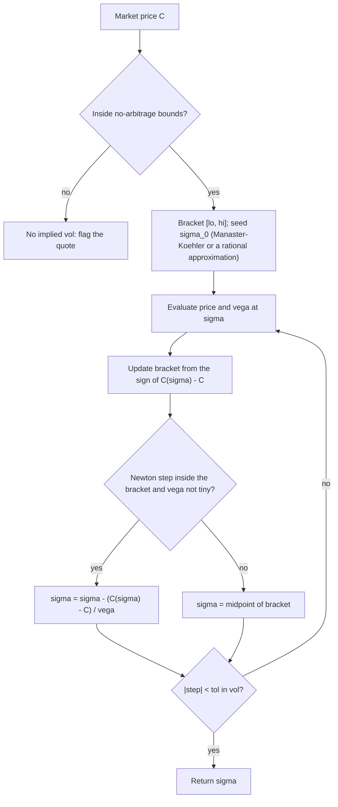

# Numerical Optimization and Root Finding

## TL;DR

- Bisection always converges and halves the bracket each step: $\lceil\log_2(\text{width}/\text{tol})\rceil$ iterations, 40 to shrink $[2, 3]$ to $10^{-12}$.
- Newton converges quadratically near a simple root, $e_{k+1} \approx \frac{f''(r)}{2f'(r)}e_k^2$, but needs a good start and a non-vanishing derivative; at a double root it is only linear (ratio 1/2); secant has order $\varphi \approx 1.618$ without derivatives, and Brent's bracketed hybrid is the safe default.
- Implied volatility: the call price is increasing in $\sigma$ (vega $> 0$), Newton with vega from the Manaster-Koehler seed converges in a few steps, and a bracket safeguard is mandatory because deep out-of-the-money vega underflows.
- On a quadratic with condition number $\kappa$, gradient descent contracts like $(\kappa - 1)/(\kappa + 1)$, heavy-ball momentum like $(\sqrt\kappa - 1)/(\sqrt\kappa + 1)$, and Newton finishes in one step; BFGS is superlinear with gradients only.
- Levenberg-Marquardt blends Gauss-Newton and gradient descent for least-squares calibration; non-convex calibrations have local minima that fit almost as well, so profile, multistart and check parameters, not just the fit.

## Learning objectives

- Implement bisection, Newton and Brent root finding; solve for implied volatility.
- Compare gradient descent, Newton and quasi-Newton (BFGS) methods.
- Diagnose non-convergence and choose tolerances sensibly.
- Calibrate a model by nonlinear least squares with Levenberg-Marquardt and recognise local minima.

## Core concepts

### Bisection

If $f$ is continuous and $f(a)f(b) < 0$, a root lies in $[a, b]$; evaluate at the midpoint and keep the half with the sign change.
After $k$ steps the bracket has width $(b - a)/2^k$: linear convergence with ratio $1/2$, one binary digit per evaluation, and no assumptions beyond continuity.
It is the fallback inside every robust root finder and the right tool when $f$ is noisy or only monotone.

### Newton's method

Linearise at $x_k$ (first-order Taylor, [Calculus and Taylor Expansions](07-Calculus-and-Taylor-Expansions.md)) and solve: $x_{k+1} = x_k - f(x_k)/f'(x_k)$.
Expanding $f$ to second order around the root $r$ gives

$$
e_{k+1} \approx \frac{f''(r)}{2f'(r)}e_k^2,
$$

so the number of correct digits roughly doubles per step once you are close.

Failure modes:

| Symptom | Cause | Fix |
| :--- | :--- | :--- |
| Huge jump | $f'(x_k) \approx 0$ (flat region, far wings) | bracket and fall back to bisection |
| Cycling | e.g. $f(x) = x^3 - 2x + 2$ from $x_0 = 0$ cycles between 0 and 1 | damping or bracketing |
| Slow, linear convergence | multiple root ($f'(r) = 0$) | the ratio is $1 - 1/m$ for multiplicity $m$; use $x - mf/f'$ |
| Divergence to infinity or out of the domain | bad start, function not convex near the root | better seed, safeguards |

Newton for $\sqrt{a}$ is $x \leftarrow (x + a/x)/2$ (Heron's method), which hardware and libraries use for square roots and reciprocals.

### Secant and Brent

The secant method replaces $f'$ by the slope through the last two iterates; its order is the golden ratio $1.618$, so it often beats Newton per function evaluation when $f'$ is expensive.
Brent's method (1973) keeps a bracket and at each step tries inverse quadratic interpolation through three points, falls back to the secant step, and falls back to bisection whenever the fast step would leave the bracket or not shrink it enough.
It inherits bisection's guarantee and the speed of interpolation, which is why `scipy.optimize.brentq` and most library root finders use it or a close variant.

### Implied volatility as the canonical root-finding problem

Find $\sigma$ with $C_{\text{BS}}(\sigma) = C_{\text{mkt}}$.

- A solution exists iff the price is within the no-arbitrage bounds $\max(S - Ke^{-rT}, 0) < C < S$ (for a non-dividend-paying stock), and it is unique because vega $= S\sqrt{T}\varphi(d_1) > 0$.
- Newton's step is $\sigma \leftarrow \sigma - (C(\sigma) - C_{\text{mkt}})/\mathcal{V}(\sigma)$.
- Seed: Manaster and Koehler (1982) start at $\sigma_0 = \sqrt{2\lvert\ln(S/K) + rT\rvert/T}$, the point where $d_1d_2 = 0$, so volga $= \mathcal{V}d_1d_2/\sigma = 0$: vega is maximal and $C(\sigma)$ has its inflection there, and Newton from the inflection converges monotonically.
- At the money, Brenner and Subrahmanyam (1988): $\sigma \approx \sqrt{2\pi/T}\,C/S$, from $C \approx S\sigma\sqrt{T}/\sqrt{2\pi}$.
- Safeguard: keep a bracket $[\sigma_{\text{lo}}, \sigma_{\text{hi}}]$ updated by the sign of $C(\sigma) - C_{\text{mkt}}$ and take a bisection step whenever Newton would leave it.
- Production libraries use rational approximations plus one or two Householder steps for machine precision everywhere (Jaeckel, "Let's Be Rational", 2015).
- Tolerance: a price error $\delta C$ becomes a vol error $\delta C/\mathcal{V}$, so a fixed price tolerance is meaningless in the wings; set tolerances in vol space or relative to vega ([Implied Volatility and the Smile](../05-Derivatives-and-Volatility/07-Implied-Volatility-and-the-Smile.md)).

### Unconstrained minimisation

| Method | Uses | Local rate | Cost per step | Notes |
| :--- | :--- | :--- | :--- | :--- |
| Gradient descent | $\nabla f$ | linear, $(\kappa - 1)/(\kappa + 1)$ on quadratics with the best fixed step | $O(n)$ plus a gradient | slow when ill-conditioned |
| Heavy ball (Polyak) / Nesterov | $\nabla f$ | linear, $(\sqrt\kappa - 1)/(\sqrt\kappa + 1)$ | same | the basis of momentum in ML |
| Newton | $\nabla f$, $\nabla^2f$ | quadratic | Hessian plus an $O(n^3)$ solve | affine invariant; modify the Hessian if not PD |
| BFGS | $\nabla f$ | superlinear | $O(n^2)$ | rank-two update of an inverse-Hessian estimate |
| L-BFGS | $\nabla f$ | superlinear in practice | $O(mn)$, memory $m$ around 5-20 | default for large smooth problems |
| Nonlinear CG | $\nabla f$ | superlinear-ish | $O(n)$ | very large problems |

Line searches make these globally convergent: the Armijo condition $f(x + tp) \le f(x) + c_1t\nabla f^\top p$ guarantees sufficient decrease, and the Wolfe curvature condition keeps BFGS updates positive definite ($s^\top y > 0$).
The BFGS update of the inverse Hessian approximation is

$$
H_{k+1} = (I - \rho sy^\top)H_k(I - \rho ys^\top) + \rho ss^\top, \qquad s = x_{k+1} - x_k,\ y = \nabla f_{k+1} - \nabla f_k,\ \rho = 1/(y^\top s).
$$

### Nonlinear least squares and Levenberg-Marquardt

Calibration minimises $\tfrac12\lVert r(p)\rVert^2$ where $r$ are model-minus-market residuals (yields, vols, prices).
Gauss-Newton drops second derivatives of $r$ and solves $J^\top J\,\delta = -J^\top r$; it converges fast when residuals are small but fails when $J^\top J$ is singular or the step is too long.
Levenberg-Marquardt solves

$$
(J^\top J + \lambda\,\text{diag}(J^\top J))\,\delta = -J^\top r,
$$

shrinking $\lambda$ after a successful step (towards Gauss-Newton) and growing it after a failed one (towards a short scaled gradient step); it is a trust-region method in disguise.
It is the workhorse for SABR, SVI, Heston and curve-model calibrations ([Volatility Surface Construction](../05-Derivatives-and-Volatility/08-Volatility-Surface-Construction.md), [Curve Construction Numerics](../06-Fixed-Income-and-Asset-Classes/14-Curve-Construction-Numerics.md)).

Calibration objectives are rarely convex.
Nelson-Siegel, $y(t) = \beta_0 + \beta_1\frac{1 - e^{-t/\tau}}{t/\tau} + \beta_2\Big(\frac{1 - e^{-t/\tau}}{t/\tau} - e^{-t/\tau}\Big)$, is linear in the $\beta$'s for fixed $\tau$ and badly behaved in $\tau$: profile it (grid over $\tau$, OLS for the $\beta$'s, then polish all four with LM).
Marquardt's diagonal scaling also has a trap: if a parameter has no effect at the starting point ($\tau$ when $\beta_1 = \beta_2 = 0$), its column of $J$ is zero, $J^\top J$ and its diagonal are singular, and the step is undefined.

### Diagnosing non-convergence

- Plot or log $\lvert f\rvert$, the step size and the gradient norm per iteration; quadratic, linear and stalled convergence look different.
- Scale variables and residuals so that a unit change means the same in each coordinate.
- Use tolerances on the quantity you care about (vol, not price; parameter change relative to its size) and combine absolute and relative terms, $\lvert\Delta x\rvert \le \text{atol} + \text{rtol}\lvert x\rvert$.
- Check finite-difference gradients against analytic ones; most "optimiser bugs" are gradient bugs.
- Never return a silent best guess: report converged or not, iterations used and the final residual ([Testing Trading and Numerical Code](../12-Quant-Development/14-Testing-Trading-and-Numerical-Code.md)).

## Worked examples

### One equation, four methods

$x^3 - 2x - 5 = 0$ (Wallis's example) has its real root at $2.09455148$.

- Bisection on $[2, 3]$ needs $\lceil\log_2 10^{12}\rceil = 40$ halvings to reach width $10^{-12}$.
- Newton from $x_0 = 2$ has errors $9.455 \times 10^{-2}$, $5.449 \times 10^{-3}$, $1.664 \times 10^{-5}$, $1.559 \times 10^{-10}$, and stops after 5 iterations: $e_2/e_1^2 = 0.5605$ against the predicted $f''(r)/(2f'(r)) = 0.5630$.
- Secant from $(2, 3)$ and Brent on $[2, 3]$ each take 7 iterations to $10^{-14}$.

At the double root of $(x - 1)^2$, Newton's error ratio is exactly $0.5$ per step and it needs 34 steps before the step size drops below $10^{-10}$.

### Implied volatility by Newton

Call with $S = 100$, $K = 110$, $T = 0.5$, $r = 3\%$, true $\sigma = 25\%$: price $3.8986$.
The Manaster-Koehler seed is $\sqrt{2\lvert\ln(100/110) + 0.015\rvert/0.5} = 0.5668$, where $d_1d_2 = 0$ and vega peaks.
Newton goes $0.5668 \to 0.2551 \to 0.25001 \to 0.25$ and stops after 5 iterations with a step below $10^{-12}$: errors $0.3168$, $0.0051$, $0.0000098$.
Bisection on $[0.01, 3]$ needs 35 halvings for $10^{-10}$, and the safeguarded Newton needs 5 iterations.

### When plain Newton breaks

Deep out-of-the-money call: $S = 100$, $K = 150$, $T = 0.25$, $r = 0$, true $\sigma = 30\%$, price $0.019233$.
Starting plain Newton at $10\%$, where vega is $1.28 \times 10^{-13}$, the first step lands at $\sigma \approx 1.5 \times 10^{11}$, after which vega underflows to zero and the method is dead.
The safeguarded version (Manaster-Koehler seed, bracket, bisection fallback) converges to $0.30$ in 10 iterations.
Vega at the solution is only $0.631$, so a price error of $10^{-8}$ is a vol error of $1.6 \times 10^{-8}$; for options further out it is far worse, which is why price-space tolerances fail in the wings.

### A quick ATM estimate

ATM call with $S = K = 100$, $T = 0.5$, $r = 0$, $\sigma = 20\%$ prices at $5.6372$; Brenner-Subrahmanyam gives $\sqrt{2\pi/0.5} \times 5.6372/100 = 0.19983$, good to two decimal places of vol.

### Conditioning and descent rates

$f(x) = \tfrac12x^\top\text{diag}(1, 100)x$ from $(1, 1)$, stopping at $\lVert x\rVert < 10^{-8}$:

| Method | Contraction per step | Iterations |
| :--- | :--- | ---: |
| Gradient descent, step $2/(L + \mu)$ | $(\kappa - 1)/(\kappa + 1) = 0.9802$ | 939 |
| Heavy ball with optimal parameters | $(\sqrt\kappa - 1)/(\sqrt\kappa + 1) = 0.8182$ | 119 |
| Newton | exact on a quadratic | 1 |

The heavy ball needs more than the $\log(\sqrt2 \times 10^8)/\log(1/0.8182) = 93.5$ steps the contraction alone suggests, because its optimal tuning gives the iteration matrix a repeated eigenvalue, which adds a polynomial factor.

On Rosenbrock's function from $(-1.2, 1)$ with Armijo backtracking and a gradient tolerance of $10^{-8}$: gradient descent needs 19,435 iterations, Newton 21 and BFGS 35, all ending within $10^{-6}$ of $(1, 1)$.

### Levenberg-Marquardt on Nelson-Siegel

Generate yields from $\beta = (4\%, -2\%, 1\%)$, $\tau = 2$ on ten tenors (3-month yield $2.18\%$, 30-year $3.93\%$).

- From $(3.5\%, -1.5\%, 0.5\%, 1.5)$, LM recovers the parameters exactly in 12 iterations.
- From $(3\%, -1\%, 0\%, 1)$ it stops at $\tau = 0.811$, $\beta_2 = -0.0096$ with a 0.746 bp RMS error and $J^\top r$ zero to $10^{-14}$: a genuine local minimum with a sub-basis-point fit and the wrong sign on the curvature factor.
- Profiling $\tau$ on a grid from 0.25 to 10 picks $\tau = 2.0$, and LM from there recovers the truth.
- With 1 bp of noise added (seed 8), LM from the good start returns $\tau$ about $1.955$ and $\beta_2$ about $0.00906$ with about $0.596$ bp RMS error.

"A good fit does not mean the right parameters; for anything you will hedge or extrapolate with, check stability across starts and days."

## Pitfalls

- Running Newton without a bracket on a problem with flat regions (deep wings of an option smile, survival curves at long maturities).
- Tolerances in the wrong space: a price tolerance of $10^{-8}$ is a huge vol tolerance where vega is tiny, and a vol tolerance is unreachable when the price is within rounding of intrinsic.
- Trying to imply vol from a price outside the no-arbitrage bounds (stale or crossed quotes) and getting garbage or an exception; check bounds first.
- Using finite-difference gradients with a poor step and blaming the optimiser.
- Declaring convergence on a small step when the method has merely stalled (LM with $\lambda$ blown up, line search failing); check the gradient or $J^\top r$ too.
- Trusting a single calibration start on a non-convex objective.
- Using fixed-step gradient descent on an ill-conditioned problem; rescale, precondition or use a quasi-Newton method.

## Interview questions

> [!question]- la-opt-bisection-count | How many bisection steps reduce a bracket of width 1 to $10^{-6}$? To $10^{-12}$?
> 20 and 40: each step halves the width, so you need $\lceil\log_2(1/\text{tol})\rceil$, and $2^{10} \approx 10^3$.

> [!question]- la-opt-newton-derivation | Derive Newton's method and its convergence rate.
> Linearise $f(x) \approx f(x_k) + f'(x_k)(x - x_k)$ and solve for the zero: $x_{k+1} = x_k - f(x_k)/f'(x_k)$. A second-order expansion around the root gives $e_{k+1} \approx \frac{f''(r)}{2f'(r)}e_k^2$: quadratic convergence at a simple root.

> [!question]- la-opt-newton-sqrt2 | Run Newton's method for $\sqrt2$ from $x_0 = 1$.
> $x \leftarrow (x + 2/x)/2$: 1.5, 1.416667, 1.414216, 1.41421356, error about $1.6 \times 10^{-12}$ after four steps; the digits double each time.

> [!question]- la-opt-newton-failures | Name three ways Newton's method fails and a fix for each.
> Near-zero derivative causes a huge jump (bracket and bisect); cycling, e.g. $x^3 - 2x + 2$ from 0 (damping or bracketing); a multiple root makes convergence linear (use $x - mf/f'$ or deflate). Divergence from a bad start needs a better seed.

> [!question]- la-opt-double-root | How does Newton behave at a double root?
> Linearly, with error ratio $1/2$: for $(x - 1)^2$ each step halves the error, and reaching a $10^{-10}$ step takes 34 iterations. In general the ratio is $1 - 1/m$ for multiplicity $m$.

> [!question]- la-opt-secant | What is the order of the secant method and when would you prefer it to Newton?
> The golden ratio $\varphi \approx 1.618$. It needs one function value per step and no derivative, so when $f'$ costs as much as $f$ it is usually faster per unit of work.

> [!question]- la-opt-brent | What does Brent's method combine and why is it the default?
> Inverse quadratic interpolation, secant steps and bisection inside a maintained bracket. It is guaranteed to converge like bisection and is usually as fast as interpolation, without derivatives.

> [!question]- la-opt-iv-newton | Write the Newton iteration for implied volatility and say why it is well behaved.
> $\sigma \leftarrow \sigma - (C_{\text{BS}}(\sigma) - C_{\text{mkt}})/\mathcal{V}(\sigma)$. The price is strictly increasing in $\sigma$, so the root is unique, and from a good seed the iteration converges in a handful of steps (5 in this note's 110-strike example).

> [!question]- la-opt-iv-seed | What is the Manaster-Koehler starting point and why does it work?
> $\sigma_0 = \sqrt{2\lvert\ln(S/K) + rT\rvert/T}$, where $d_1d_2 = 0$: volga vanishes, vega is maximal and $C(\sigma)$ has its inflection point, so Newton iterates approach the root monotonically from there.

> [!question]- la-opt-iv-bounds | When does a call have no implied volatility?
> When its price is not strictly inside $(\max(S - Ke^{-rT}, 0), S)$ for a non-dividend stock: below intrinsic or at or above the stock price no $\sigma$ fits. Check bounds before solving; such quotes are stale, crossed or include dividends.

> [!question]- la-opt-iv-deep-otm | Why does plain Newton fail for deep out-of-the-money implied vols, and what do you do?
> Vega is astronomically small away from the solution ($1.28 \times 10^{-13}$ at 10% vol for a 150-strike 3-month call on 100), so the first step jumps to about $1.5 \times 10^{11}$. Keep a bracket, seed well and bisect when Newton leaves the bracket, or use a rational-approximation method such as Jaeckel's.

> [!question]- la-opt-iv-tolerance | Should an implied-vol solver use a price tolerance or a vol tolerance?
> A vol tolerance (or price tolerance scaled by vega), because $\delta\sigma \approx \delta C/\mathcal{V}$: with vega 0.63, a price error of $10^{-8}$ is a vol error of $1.6 \times 10^{-8}$, and in the far wings much more.

> [!question]- la-opt-brenner | Quick implied vol for an ATM 6-month option priced at 5.64 on a 100 stock?
> $\sigma \approx \sqrt{2\pi/T}\,C/S = \sqrt{4\pi} \times 0.0564 \approx 0.20$. It comes from $C \approx 0.4S\sigma\sqrt{T}$ at the money.

> [!question]- la-opt-gd-rate | What is the convergence rate of gradient descent on a quadratic with condition number 100?
> With the best fixed step $2/(L + \mu)$, the error contracts by $(\kappa - 1)/(\kappa + 1) = 0.98$ per step; from $(1, 1)$ to $10^{-8}$ takes 939 iterations in this note's example.

> [!question]- la-opt-momentum | What does momentum buy you, in numbers, for $\kappa = 100$?
> Heavy-ball with tuned parameters contracts by $(\sqrt\kappa - 1)/(\sqrt\kappa + 1) = 9/11 \approx 0.818$ instead of $0.98$: 119 iterations instead of 939 in the example. Dependence on $\kappa$ becomes $\sqrt\kappa$.

> [!question]- la-opt-newton-optimisation | Pros and cons of Newton's method for minimisation?
> Quadratic local convergence and affine invariance (one step on a quadratic); but it needs the Hessian, an $O(n^3)$ solve per step, and a modification when the Hessian is not positive definite, plus a line search or trust region for global convergence.

> [!question]- la-opt-bfgs | How does BFGS work and why is the curvature condition needed?
> It updates an inverse-Hessian approximation with a rank-two formula from $s = \Delta x$ and $y = \Delta\nabla f$, giving superlinear convergence with gradients only (35 iterations on Rosenbrock here, against 19,435 for gradient descent). The update stays positive definite only if $s^\top y > 0$, which a Wolfe line search ensures; otherwise skip the update.

> [!question]- la-opt-lbfgs | When do you use L-BFGS instead of BFGS?
> When $n$ is large: L-BFGS stores only the last $m$ pairs $(s, y)$ and applies the inverse-Hessian approximation in $O(mn)$, avoiding the $O(n^2)$ dense matrix. It is the default for large smooth problems such as ML model fitting.

> [!question]- la-opt-lm | Write the Levenberg-Marquardt step and explain the role of $\lambda$.
> $(J^\top J + \lambda\,\text{diag}(J^\top J))\delta = -J^\top r$. Small $\lambda$ gives Gauss-Newton (fast near a good fit), large $\lambda$ a short scaled gradient step (safe far away); $\lambda$ falls after successful steps and rises after failed ones.

> [!question]- la-opt-calibration-local-min | Your Nelson-Siegel calibration fits to 0.75 bp RMS. Are you done?
> Not necessarily: in this note's example that fit is a local minimum with $\tau = 0.81$ instead of 2 and the wrong-signed curvature factor. Profile over $\tau$ (the $\beta$'s are linear given $\tau$), multistart, and check parameter stability day to day.

> [!question]- la-opt-line-search | What are the Armijo and Wolfe conditions?
> Armijo: $f(x + tp) \le f(x) + c_1t\nabla f^\top p$ (sufficient decrease). Wolfe adds a curvature condition $\nabla f(x + tp)^\top p \ge c_2\nabla f^\top p$ (the step is not too short), which also keeps BFGS updates positive definite.

## In this repo and SDE-Interview-Prep

- Code: [root_finding_optimization.py](code/root_finding_optimization.py) implements bisection, Newton, secant, Brent, plain and safeguarded implied-vol solvers, gradient descent, heavy ball, Newton and BFGS with backtracking, and Levenberg-Marquardt, and computes and asserts every number above.
- SDE bridge: [binary search](https://github.com/shreejitverma/SDE-Interview-Prep/blob/main/03-Data-Structures-Algorithms/01-Topics/Searching/BinarySearch/README.md) is bisection on a sorted array; [Black-Scholes](https://github.com/shreejitverma/SDE-Interview-Prep/blob/main/05-Quantitative-Finance/01-Mathematics/Option-Pricing/black_scholes.py) gives the pricer an implied-vol solver inverts.
- Related: [Implied Volatility and the Smile](../05-Derivatives-and-Volatility/07-Implied-Volatility-and-the-Smile.md), [Volatility Surface Construction](../05-Derivatives-and-Volatility/08-Volatility-Surface-Construction.md), [Pricing Library Design](../12-Quant-Development/10-Pricing-Library-Design.md).

## Further reading

- Jorge Nocedal and Stephen Wright, *Numerical Optimization*, 2nd edition, chapters 2-3 (line searches), 5 (conjugate gradients), 6-7 (quasi-Newton, L-BFGS) and 10 (nonlinear least squares, Levenberg-Marquardt).
- Richard Brent, *Algorithms for Minimization without Derivatives*, Prentice-Hall 1973, chapter 4.
- William Press, Saul Teukolsky, William Vetterling and Brian Flannery, *Numerical Recipes*, 3rd edition, chapters 9 (root finding), 10 (minimisation) and section 15.5 (nonlinear least squares).
- Steven Manaster and Gary Koehler, "The Calculation of Implied Variances from the Black-Scholes Model: A Note", *Journal of Finance* 37(1) (1982).
- Menachem Brenner and Marti Subrahmanyam, "A Simple Formula to Compute the Implied Standard Deviation", *Financial Analysts Journal* 44(5) (1988).
- Peter Jaeckel, "Let's Be Rational", *Wilmott* (2015).
- Charles Nelson and Andrew Siegel, "Parsimonious Modeling of Yield Curves", *Journal of Business* 60(4) (1987).
- Boris Polyak, "Some Methods of Speeding up the Convergence of Iteration Methods", *USSR Computational Mathematics and Mathematical Physics* 4(5) (1964).
