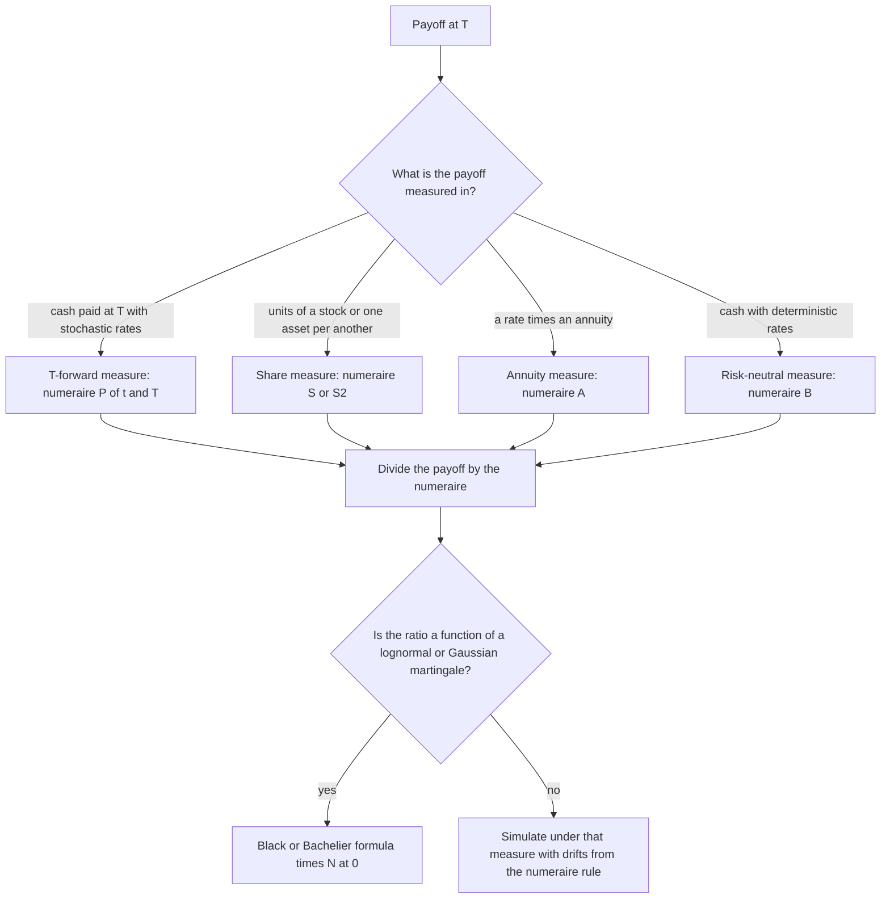

# Change of Measure and Girsanov

## TL;DR

- A change of measure reweights scenarios: $E^Q[X] = E^P[Z X]$ with $Z = dQ/dP > 0$ and $E^P[Z] = 1$; equivalent measures agree on which events are impossible.
- Girsanov: under $dQ/dP = \exp(-\int_0^T\theta\,dW - \tfrac12\int_0^T\theta^2\,dt)$, the process $W^Q_t = W_t + \int_0^t\theta_s\,ds$ is a $Q$-Brownian motion; drift changes, volatility (quadratic variation) never does.
- Change of numeraire: $dQ^N/dQ^M = (N_T/N_0)/(M_T/M_0)$, and under $Q^N$ the Brownian motion shifts by the volatility of $N/M$: $dW^N = dW^M - (\sigma_N - \sigma_M)\,dt$.
- Pick the numeraire that the payoff is measured in: the stock for asset-or-nothing and exchange options, the zero-coupon bond $P(t, T)$ for anything paid at $T$ under stochastic rates, the annuity for swaptions; each turns the price into a Black-type expectation of a martingale.
- Importance sampling is Girsanov run backwards: simulate under a tilted measure where the payoff lives and multiply by $dP/dQ$; the weights' variance $e^{\theta^2 T} - 1$ explodes for large shifts.

## Learning objectives

- Apply Girsanov's theorem to change the drift of a Brownian motion.
- Use the Radon-Nikodym derivative for numeraire changes (forward measure, stock measure).
- Apply change of measure to importance sampling.
- State and sketch the proof of Girsanov, including why the volatility cannot change.
- Price exchange options, zero-coupon bond options, swaptions and quanto forwards by choosing the numeraire.

## Core concepts

### Equivalent measures and the Radon-Nikodym derivative

Two probability measures $P$ and $Q$ on the same $\sigma$-algebra are equivalent ($Q \sim P$) if they have the same null sets.
Then (Radon-Nikodym) there is a random variable $Z = dQ/dP$ with $Z > 0$ almost surely, $E^P[Z] = 1$, and

$$
E^Q[X] = E^P[Z X], \qquad E^P[X] = E^Q\Big[\frac{X}{Z}\Big].
$$

On a finite space this is just $Z(\omega) = Q(\omega)/P(\omega)$, a per-scenario weight.
On a filtration, the density process $Z_t = E^P[Z \mid \mathcal{F}_t]$ is a positive $P$-martingale, and conditional expectations transform by Bayes' rule:

$$
E^Q[X \mid \mathcal{F}_s] = \frac{E^P[Z_t X \mid \mathcal{F}_s]}{Z_s}, \qquad X \in \mathcal{F}_t,\ s \le t.
$$

A process $M$ is therefore a $Q$-martingale iff $ZM$ is a $P$-martingale, the identity used in every proof below.

### The one-variable Gaussian shift

If $X \sim N(0, 1)$ under $P$ and $dQ/dP = e^{\theta X - \theta^2/2}$, then $X \sim N(\theta, 1)$ under $Q$:

$$
E^Q[e^{uX}] = E^P\big[e^{(u + \theta)X - \theta^2/2}\big] = e^{(u + \theta)^2/2 - \theta^2/2} = e^{u\theta + u^2/2}.
$$

Equivalently, the density ratio of $N(\theta, 1)$ to $N(0, 1)$ is $\varphi(x - \theta)/\varphi(x) = e^{\theta x - \theta^2/2}$.
Girsanov is this computation done independently on every Brownian increment.

### Girsanov's theorem

Let $W$ be a $P$-Brownian motion with filtration $(\mathcal{F}_t)$ and $\theta_t$ an adapted process with $\int_0^T\theta_t^2\,dt < \infty$.
Define

$$
Z_t = \exp\Big(-\int_0^t\theta_s\,dW_s - \frac12\int_0^t\theta_s^2\,ds\Big), \qquad dZ_t = -\theta_t Z_t\,dW_t.
$$

If $E^P[Z_T] = 1$ (guaranteed by Novikov's condition $E^P[\exp(\tfrac12\int_0^T\theta_t^2\,dt)] < \infty$), then under $dQ = Z_T\,dP$

$$
W^Q_t = W_t + \int_0^t\theta_s\,ds \quad \text{is a } Q\text{-Brownian motion on } [0, T].
$$

Proof sketch, the version interviewers want:

1. $Z$ is a positive local martingale (no $dt$ term in $dZ$); Novikov upgrades it to a true martingale, so $E^P[Z_T] = 1$ and $Q$ is a probability measure equivalent to $P$.
2. Itô's product rule: $d(W^Q Z) = W^Q\,dZ + Z\,dW^Q + d[W^Q, Z] = W^Q\,dZ + Z(dW + \theta\,dt) - \theta Z\,dt = (Z - \theta W^Q Z)\,dW$. The $dt$ terms cancel, so $W^Q Z$ is a $P$-martingale and, by the Bayes identity, $W^Q$ is a $Q$-martingale.
3. $[W^Q]_t = [W]_t = t$, because adding a finite-variation drift does not change quadratic variation, and quadratic variation is a pathwise limit, hence the same under any equivalent measure.
4. Levy's characterisation: a continuous martingale with $[M]_t = t$ is a Brownian motion.

In $d$ dimensions, $\theta$ is a vector, $Z_t = \exp(-\int\theta\cdot dW - \tfrac12\int\lvert\theta\rvert^2\,dt)$, and each component shifts by its own $\theta^i$.

### What a change of measure can and cannot do

- It changes drifts: any $dX = \mu\,dt + \sigma\,dW$ becomes $dX = (\mu - \sigma\theta)\,dt + \sigma\,dW^Q$.
- It cannot change volatility: if $X$ has quadratic variation $\sigma_1^2 T$ almost surely under $P$, it has the same under every $Q \sim P$; two models with different volatilities give mutually singular laws. This is why the option price depends on $\sigma$ and not on $\mu$.
- It needs the density to be a true martingale: if $Z$ is a strict local martingale ($E^P[Z_T] < 1$), $Q$ is not a probability measure.
  The share-measure density is the discounted stock price itself, so this fails exactly when the discounted price is a strict local martingale under $Q$, which can happen in some stochastic volatility models (Sin 1998) and is how the asset-bubble literature defines a bubble.
- It needs equivalence: a measure that puts zero weight on a $P$-possible scenario would price an arbitrage.

### From $P$ to $Q$: the market price of risk

With $dS = \mu S\,dt + \sigma S\,dW$ and bank account $B_t = e^{rt}$, take $\theta = (\mu - r)/\sigma$.
Then $dS = rS\,dt + \sigma S\,dW^Q$ and $S/B$ is a $Q$-martingale (see [Risk-Neutral Pricing and the FTAP](04-Risk-Neutral-Pricing-and-FTAP.md)).
With $n$ assets and $d$ Brownian motions, $Q$ requires a vector $\theta$ with $\Sigma\theta = \mu - r\mathbf{1}$ ($\Sigma$ the $n \times d$ volatility matrix): a solution exists iff there is no arbitrage, and it is unique iff $\Sigma$ has rank $d$, which is market completeness.

### Change of numeraire

A numeraire is any strictly positive traded price process $N$.
If $Q^M$ makes every traded price divided by $M$ a martingale, define

$$
\frac{dQ^N}{dQ^M}\Big|_{\mathcal{F}_T} = \frac{N_T/N_0}{M_T/M_0}.
$$

Then every traded price divided by $N$ is a $Q^N$-martingale, since for a traded $V$

$$
E^N\Big[\frac{V_T}{N_T}\Big] = E^M\Big[\frac{N_T M_0}{N_0 M_T}\cdot\frac{V_T}{N_T}\Big] = \frac{M_0}{N_0}E^M\Big[\frac{V_T}{M_T}\Big] = \frac{V_0}{N_0},
$$

so $V_0 = N_0\,E^N[V_T/N_T]$ for every numeraire (Geman, El Karoui and Rochet 1995).
The density process is $(N_t/M_t)/(N_0/M_0)$; if $N/M$ has volatility vector $\sigma_N - \sigma_M$ under $Q^M$, Girsanov gives

$$
dW^N_t = dW^M_t - (\sigma_N - \sigma_M)\,dt.
$$

Working rule: the drift of any process $X$ under $Q^N$ is its drift under $Q^M$ plus $d\langle X, \ln(N/M)\rangle_t/dt$.
For $N = S$, $M = B$ this gives $dS/S = (r + \sigma^2)\,dt + \sigma\,dW^S$, log-drift $r + \tfrac12\sigma^2$, which is why $N(d_1) = Q^S(S_T > K)$.

| Numeraire $N$ | Measure | Martingales under it | Prices |
| :--- | :--- | :--- | :--- |
| Bank account $B_t = e^{\int r}$ | risk-neutral $Q$ | discounted prices $V/B$ | equity, FX, short-rate models |
| Stock $S_t$ | share measure $Q^S$ | $V/S$, e.g. $K/S$ and $S'/S$ | asset-or-nothing, exchange options, $N(d_1)$ |
| Zero-coupon bond $P(t, T)$ | $T$-forward $Q^T$ | forward prices $V_t/P(t, T)$, FRA rates into $T$ | anything paid at $T$, caplets, bond options |
| Annuity $A_t = \sum\tau_iP(t, T_i)$ | swap (annuity) measure $Q^A$ | forward swap rate $S_t$ | swaptions, CMS replication |
| Foreign bank account in domestic units $X_tB^f_t$ | foreign risk-neutral $Q^f$ | foreign discounted prices | quantos, FX-linked payoffs |

### The $T$-forward measure

With $N_t = P(t, T)$, any payoff $V_T$ at $T$ has $V_0 = P(0, T)\,E^T[V_T]$: discounting comes out of the expectation even when rates are random.
Two consequences used daily on rates desks:

- The forward price $V_t/P(t, T)$ is a $Q^T$-martingale, so $E^T[V_T]$ is the forward price; the simply-compounded rate $L(t; T, T + \delta)$ is a $Q^{T + \delta}$-martingale, which is why a caplet is priced by Black's formula on the forward rate (see [Rates Options: Caps and Swaptions](../06-Fixed-Income-and-Asset-Classes/05-Rates-Options-Caps-and-Swaptions.md)).
- The instantaneous forward rate is the forward-measure expectation of the future short rate: $\partial_T P(0, T) = -E^Q[r_T e^{-\int_0^T r}]$, so $f(0, T) = -\partial_T\ln P(0, T) = E^T[r_T]$, not $E^Q[r_T]$.

In a Gaussian short-rate model (Vasicek, Hull-White) the bond price $P(T, S)$ is lognormal under $Q^T$ with forward $P(0, S)/P(0, T)$ and log-volatility

$$
\sigma_p = \frac{\sigma}{\kappa}\big(1 - e^{-\kappa(S - T)}\big)\sqrt{\frac{1 - e^{-2\kappa T}}{2\kappa}},
$$

so a call on it struck at $K$ is $P(0, S)N(h) - KP(0, T)N(h - \sigma_p)$ with $h = \ln\frac{P(0, S)}{KP(0, T)}/\sigma_p + \tfrac12\sigma_p$: Black's formula, discounted with $P(0, T)$.

### The annuity measure

A payer swaption exercised at $T_0$ into a swap paying fixed $K$ at $T_1, \dots, T_n$ pays $A_{T_0}(S_{T_0} - K)^+$, with annuity $A_t = \sum_i\tau_iP(t, T_i)$ and forward swap rate $S_t = (P(t, T_0) - P(t, T_n))/A_t$.
$S_t$ is a traded portfolio divided by $A_t$, hence a $Q^A$-martingale, and

$$
V_0 = A_0\,E^A\big[(S_{T_0} - K)^+\big].
$$

A lognormal or normal assumption for $S$ under $Q^A$ gives the Black or Bachelier swaption formula; SABR on $S$ under $Q^A$ gives the market smile (see [Rates Volatility and SABR](../06-Fixed-Income-and-Asset-Classes/18-Rates-Volatility-and-SABR.md)).
Under $Q$ the swap rate has a drift, so simulating it there with zero drift misprices.

### Quanto drift

An index $S$ quoted in a foreign currency, paid in domestic currency at a fixed conversion, needs $S$'s drift under the domestic measure.
With $X$ the domestic price of one unit of foreign currency and $\rho = \text{corr}(dS, dX)$, the numeraire rule from $Q^f$ (numeraire $XB^f$) to $Q^d$ (numeraire $B^d$) gives

$$
\frac{dS}{S} = (r_f - q - \rho\sigma_S\sigma_X)\,dt + \sigma_S\,dW^d.
$$

Positive correlation between the index and the foreign currency lowers the quanto forward: when the index is high, the foreign currency is strong, and a fixed-rate payout forgoes that conversion gain.

### Importance sampling

To estimate $E^P[f(X)]$, simulate under $Q$ and average $f(X)\,dP/dQ$.
For a Gaussian driver shifted by $\mu$, $dP/dQ = e^{-\mu x + \mu^2/2}$ evaluated at the shifted draw; choose $\mu$ to move paths into the region where $f$ is large.
Under a Girsanov shift $\theta$ the density $Z_T$ has $E^P[Z_T] = 1$ and $\text{Var}^P(Z_T) = e^{\theta^2T} - 1$: modest shifts are cheap, but large or high-dimensional shifts make a few paths carry all the weight and the estimator degenerates.
The desk use cases are deep out-of-the-money options, credit portfolio tail losses and VaR tails (see [Monte Carlo Pricing and Variance Reduction](../05-Derivatives-and-Volatility/10-Monte-Carlo-Pricing-and-Variance-Reduction.md)).

## Worked examples

Every number below is printed and asserted by [girsanov_numeraire.py](code/girsanov_numeraire.py).
Monte Carlo figures come from seed 20261016 and change with the seed, so they are quoted as "about", with the standard error where the script asserts one; closed forms are exact.

### Girsanov density in a simulation

"Take $\theta = 0.4$, $T = 1$. Check that $Z_T = e^{-\theta W_T - \theta^2T/2}$ is a density and that it shifts the drift."
With $2 \times 10^6$ draws, $E^P[Z_T]$ is about $0.9999$ (exact 1), and the sample variance of $Z_T$ is about $0.1735$ against $e^{0.16} - 1 = 0.1735$.
Weighting by $Z_T$: $E^Q[W_T]$ is about $-0.3999$ (exact $-\theta T = -0.4$), $E^Q[W_T + \theta T]$ about $0.0001$ and $E^Q[(W_T + \theta T)^2]$ about $1.0001$, consistent with $W_T + \theta T$ being standard normal under $Q$.
At $\theta = 3$ the variance of the weights is $e^9 - 1 = 8102.08$: a reweighting that aggressive is useless for pricing, which is the importance-sampling warning in one number.

### Importance sampling a three-in-a-hundred-thousand event

"Estimate $P(W_1 > 4)$."
Exact: $1 - N(4) = 3.167 \times 10^{-5}$.
Plain Monte Carlo with $10^5$ draws saw a single hit with this seed; the theoretical relative standard error is $\sqrt{(1 - p)/(np)} = 0.562$, so the answer is noise.
Shift to $N(4, 1)$ (half the samples now land in the event) and weight by $e^{-4x + 8}$: the estimate is about $3.157 \times 10^{-5}$ with a relative standard error of about $0.0067$, a variance reduction factor of about 7050 for the same number of draws.

### Exchange option with the second asset as numeraire

"Price the right to exchange asset 2 for asset 1 at $T = 1$: $S_1 = S_2 = 100$, $\sigma_1 = 30\%$, $\sigma_2 = 20\%$, $\rho = 0.5$, $r = 5\%$."
With $S_2$ as numeraire, $V_0 = S_{2,0}\,E^{S_2}[(S_{1,T}/S_{2,T} - 1)^+]$, and the ratio $R = S_1/S_2$ is a $Q^{S_2}$-martingale with volatility $\sqrt{\sigma_1^2 + \sigma_2^2 - 2\rho\sigma_1\sigma_2} = 0.2646$.
So $V_0$ is Black's formula with forward $R_0 = 1$, strike 1 and zero rate (Margrabe): $V_0 = 10.5243$.
The rate does not appear because both legs are assets; a $10^6$-path simulation under $Q$ gives about $10.563$ (standard error $0.018$) for $r = 5\%$, and the same paths with $r = 0$ give the same price to within $10^{-12}$ relative.
The same reweighting shows $N(d_1) = 0.4816$ is a probability: for $S_0 = 100$, $K = 105$, $T = 0.5$, $r = 5\%$, $\sigma = 25\%$, weighting $Q$-paths by $S_T/(S_0e^{rT})$ gives $Q^S(S_T > K)$ of about $0.4814$, and simulating with log-drift $r + \sigma^2/2$ gives about $0.4812$.

### Forward measure in Vasicek: bond option three ways

"Vasicek with $\kappa = 0.3$, $\theta = 5\%$, $\sigma = 1\%$, $r_0 = 3\%$. Price a one-year call on the five-year zero, strike 0.85."
Bond prices: $P(0, 1) = 0.967821$, $P(0, 5) = 0.820839$, forward bond price $P(0, 5)/P(0, 1) = 0.848131$.
Under $Q^1$ the bond price $P(1, 5)$ is lognormal with that forward, so the price is Black's formula discounted by $P(0, 1)$: $0.0057565$.
Check 1, under $Q$: $(r_1, \int_0^1 r\,ds)$ is jointly Gaussian and can be sampled exactly; $E^Q[e^{-\int r}(P(1, 5) - 0.85)^+]$ over $2 \times 10^6$ paths is about $0.0057584$ (standard error $0.0000065$).
Check 2, under $Q^1$: the density $e^{-\int_0^1 r}/P(0, 1)$ tilts the Gaussian $r_1$ by $-\text{Cov}(r_1, \int_0^1 r)$, so sample $r_1$ there, with no discounting inside: $E^1[P(1, 5)]$ is about $0.848149$ (the forward $0.848131$ up to sampling error) and $P(0, 1)E^1[(P(1, 5) - 0.85)^+]$ is about $0.0057683$ (standard error $0.0000065$).
The same tilt shows $E^Q[r_1] = 3.5184\%$ while $E^1[r_1] = f(0, 1) = 3.5146\%$: the gap is $\text{Cov}(r_1, \int_0^1 r) = 0.373$ bp, the covariance between the rate and the integrated rate (minus the log discount factor).

### Annuity measure: a 1y x 4y swaption

"Same Vasicek model. Price the one-year option to pay fixed at the forward swap rate on a four-year annual swap."
Annuity $A_0 = P(0, 2) + \dots + P(0, 5) = 3.50723$ and forward swap rate $S_0 = (P(0, 1) - P(0, 5))/A_0 = 4.1908\%$.
Jamshidian's trick (one-factor model: the swap value is monotone in $r_1$, so the payer swaption is a portfolio of zero-coupon puts struck at the bond prices at the critical rate $r^*$) gives $0.0074500$ per unit notional, 74.50 bp.
Monte Carlo of $E^Q[e^{-\int r}A_1(S_1 - K)^+]$ gives about $0.0074434$ (standard error $0.0000076$).
Reweighting the same paths by $dQ^A/dQ = e^{-\int_0^1 r}A_1/A_0$: the weights average about $1.0000$ and $E^A[S_1]$ is about $4.1906\%$, matching $S_0$; the unweighted $Q$-mean is about $4.2004\%$, about 0.96 bp too high.
Quoted in the market's units: Black volatility $12.71\%$ or normal volatility 53.25 bp, from $V_0 = A_0\,\text{Black}(S_0, K, \sigma, 1)$ and $V_0 = A_0\sigma_N\sqrt{T/2\pi}$ at the money.

### Quanto forward

"A foreign index at 100 with foreign rate $0.5\%$, dividend yield $2\%$, volatility $20\%$; the currency has volatility $10\%$ and correlation $0.3$ with the index. One-year quanto forward in domestic currency?"
Adjustment: $-\rho\sigma_S\sigma_X = -0.006$, so $F^{quanto} = 100e^{(0.005 - 0.02 - 0.006)} = 97.9219$ against the ordinary forward $98.5112$.
Simulating $(S, X)$ under $Q^f$ and weighting by $dQ^d/dQ^f = e^{(r_d - r_f)T}X_0/X_T$ (whose sample mean is about $1.0001$) gives about $97.919$.

## Pitfalls

- Shifting the Brownian motion with the wrong sign: with $dQ/dP = e^{-\theta W_T - \theta^2T/2}$, it is $W + \theta t$ that is $Q$-Brownian, and $W$ itself has $Q$-drift $-\theta$.
- Changing volatility by a change of measure; only drifts move, and models with different volatilities are not equivalent.
- Forgetting Novikov or another integrability check; a strict local martingale density does not define a probability measure.
- Pricing under $Q^T$ but discounting with $e^{-\int r}$ inside the expectation, or under $Q$ but pulling $P(0, T)$ out; each numeraire comes with its own discounting.
- Treating forward rates or swap rates as driftless under $Q$, or a swap rate as driftless under a forward measure; each is a martingale only under its own measure.
- Using $E^Q[r_T]$ as the forward rate; the forward rate is $E^T[r_T]$, and the two differ by a convexity term.
- Getting the quanto correlation sign backwards: define $X$ as domestic per foreign and $\rho$ as the correlation of the index with that $X$.
- Using an aggressive importance-sampling shift without checking the effective sample size; weight variance grows like $e^{\theta^2T}$.

## Interview questions

> [!question]- sc-girsanov-statement | State Girsanov's theorem for one Brownian motion.
> If $Z_T = \exp(-\int_0^T\theta\,dW - \tfrac12\int_0^T\theta^2\,dt)$ has $E^P[Z_T] = 1$ (Novikov suffices), then under $dQ = Z_T\,dP$ the process $W_t + \int_0^t\theta_s\,ds$ is a $Q$-Brownian motion.
> Drift changes by $-\sigma\theta$; volatility is unchanged.

> [!question]- sc-girsanov-gaussian-shift | $X \sim N(0, 1)$ under $P$ and $dQ/dP = e^{\theta X - \theta^2/2}$. What is the law of $X$ under $Q$?
> $N(\theta, 1)$.
> $E^Q[e^{uX}] = E^P[e^{(u + \theta)X - \theta^2/2}] = e^{u\theta + u^2/2}$, the MGF of $N(\theta, 1)$.

> [!question]- sc-girsanov-proof-sketch | Sketch the proof of Girsanov.
> $Z$ is a positive martingale, so $Q$ is an equivalent probability; Itô's product rule shows $Z(W + \int\theta)$ has no $dt$ term, so $W^Q$ is a $Q$-martingale by Bayes; $[W^Q]_t = t$ because quadratic variation ignores finite-variation drift; Levy's characterisation finishes.

> [!question]- sc-girsanov-no-vol-change | Why can a change of measure not change volatility?
> Quadratic variation is a pathwise limit, $\sum(\Delta X)^2 \to \sigma^2T$ almost surely, and equivalent measures agree on almost-sure events.
> Two diffusions with different $\sigma$ have mutually singular laws, so no density links them; this is why option prices depend on $\sigma$ but not on $\mu$.

> [!question]- sc-girsanov-novikov | What goes wrong if the Girsanov density is only a local martingale?
> $E^P[Z_T] < 1$ is possible (a strict local martingale), so $Z_T\,dP$ is not a probability measure and the theorem fails.
> Novikov's condition $E[\exp(\tfrac12\int\theta^2)] < \infty$ rules it out; bounded $\theta$ always satisfies it.

> [!question]- sc-girsanov-bayes-rule | How do you compute $E^Q[X \mid \mathcal{F}_s]$ from $P$-expectations?
> $E^Q[X \mid \mathcal{F}_s] = E^P[Z_tX \mid \mathcal{F}_s]/Z_s$ for $X \in \mathcal{F}_t$, with $Z_t = E^P[dQ/dP \mid \mathcal{F}_t]$.
> Corollary: $M$ is a $Q$-martingale iff $ZM$ is a $P$-martingale.

> [!question]- sc-girsanov-density-variance | What is the variance of the Girsanov density for a constant shift $\theta$ over $[0, T]$, and why does it matter?
> $e^{\theta^2T} - 1$, since $E[Z_T^2] = e^{\theta^2T}$.
> At $\theta = 0.4$ it is 0.1735; at $\theta = 3$ it is 8102, so a few paths carry all the weight and importance sampling or $P$-measure reweighting degenerates.

> [!question]- sc-girsanov-importance-sampling | Estimate $P(Z > 4)$ for standard normal $Z$ efficiently by simulation.
> Sample $X \sim N(4, 1)$ and average $\mathbf{1}_{X > 4}e^{-4X + 8}$; exact answer $3.167 \times 10^{-5}$.
> With $10^5$ draws the relative error falls from 56% (plain, in theory) to about 0.67% in the seeded run, a variance reduction of about 7050.

> [!question]- sc-girsanov-market-price-of-risk-multi | With $n$ assets driven by $d$ Brownian motions, when does a risk-neutral measure exist and when is it unique?
> It exists iff $\Sigma\theta = \mu - r\mathbf{1}$ has a solution $\theta$ (no arbitrage), and it is unique iff $\Sigma$ has rank $d$ (completeness).
> $\theta$ is the vector of market prices of risk and defines $Q$ through Girsanov.

> [!question]- sc-numeraire-theorem | State the change of numeraire theorem.
> If $Q^M$ makes prices over $M$ martingales, then $dQ^N/dQ^M = (N_T/N_0)/(M_T/M_0)$ makes prices over $N$ martingales, and $V_0 = N_0E^N[V_T/N_T]$.
> Proof: substitute the density and the $N_T$ cancels.

> [!question]- sc-numeraire-drift-rule | Under the share measure (stock as numeraire), what is the drift of $S$ in Black-Scholes?
> $dS/S = (r + \sigma^2)\,dt + \sigma\,dW^S$, log-drift $r + \sigma^2/2$.
> $dW^S = dW^Q - \sigma\,dt$ because $S/B$ has volatility $\sigma$; hence $N(d_1) = Q^S(S_T > K)$.

> [!question]- sc-numeraire-margrabe | Price an option to exchange asset 2 for asset 1. Does it depend on $r$?
> $S_1N(d_1) - S_2N(d_2)$ with $d_{1,2} = (\ln(S_1/S_2) \pm \tfrac12\sigma^2T)/(\sigma\sqrt{T})$, $\sigma^2 = \sigma_1^2 + \sigma_2^2 - 2\rho\sigma_1\sigma_2$; no $r$.
> With $S_2$ as numeraire, $S_1/S_2$ is a driftless lognormal; for $S_1 = S_2 = 100$, 30% and 20% vols, $\rho = 0.5$, $T = 1$: 10.52.

> [!question]- sc-numeraire-forward-rate-expectation | Is the forward rate $f(0, T)$ the risk-neutral expectation of $r_T$?
> No: $f(0, T) = E^T[r_T]$, the expectation under the $T$-forward measure, because $\partial_TP(0, T) = -E^Q[r_Te^{-\int_0^T r}]$.
> In the Vasicek example $E^Q[r_1] = 3.5184\%$ against $f(0, 1) = 3.5146\%$; the gap is $\text{Cov}(r_1, \int_0^1 r)$.

> [!question]- sc-numeraire-forward-measure-use | Why do rates desks price under the $T$-forward measure?
> With numeraire $P(t, T)$ the price of a payoff at $T$ is $P(0, T)E^T[V_T]$: stochastic discounting leaves the expectation, and forward prices and FRA rates into $T$ become martingales.
> A caplet or bond option becomes Black's formula on a forward with discount $P(0, T)$.

> [!question]- sc-numeraire-swaption-annuity | Why is a swaption priced with Black's formula times the annuity?
> The payer swaption pays $A_{T_0}(S_{T_0} - K)^+$; with the annuity as numeraire this is $A_0E^A[(S_{T_0} - K)^+]$, and $S = (P(\cdot, T_0) - P(\cdot, T_n))/A$ is a traded portfolio over $A$, hence a $Q^A$-martingale.
> Assume it lognormal (Black) or normal (Bachelier) under $Q^A$.

> [!question]- sc-numeraire-swap-rate-under-q | You simulate a model under $Q$. Is the forward swap rate driftless there?
> No; it is a martingale only under the annuity measure.
> In the Vasicek 1y x 4y example, a simulated $E^Q[S_1]$ is about 0.96 bp above $S_0 = 4.1908\%$, while reweighting by $e^{-\int r}A_1/A_0$ recovers $S_0$.

> [!question]- sc-numeraire-vasicek-bond-option | Price a call on a zero-coupon bond in Vasicek.
> Black's formula under the $T$-forward measure: $P(0, S)N(h) - KP(0, T)N(h - \sigma_p)$, $h = \ln\frac{P(0, S)}{KP(0, T)}/\sigma_p + \sigma_p/2$, $\sigma_p = \frac{\sigma}{\kappa}(1 - e^{-\kappa(S - T)})\sqrt{(1 - e^{-2\kappa T})/(2\kappa)}$.
> The bond price is lognormal under $Q^T$ with forward $P(0, S)/P(0, T)$.

> [!question]- sc-numeraire-quanto-drift | What is the risk-neutral drift of a foreign index in a quanto payoff, and which way does correlation move the quanto forward?
> $r_f - q - \rho\sigma_S\sigma_X$, with $X$ domestic per foreign and $\rho = \text{corr}(S, X)$.
> Positive $\rho$ lowers the quanto forward: in the example 97.92 against an ordinary forward of 98.51.

> [!question]- sc-numeraire-how-to-choose | How do you choose a numeraire for a new payoff?
> Use the asset the payoff is naturally measured in, so that payoff divided by numeraire is a simple function of one martingale: stock for asset-or-nothing and exchange legs, $P(t, T)$ for payments at $T$, annuity for swaptions.
> Then a Black or Bachelier formula, or a lower-dimensional simulation, follows.

## In this repo and SDE-Interview-Prep

- Code: [girsanov_numeraire.py](code/girsanov_numeraire.py) (Girsanov density, importance sampling, Margrabe, Vasicek forward and annuity measures, quanto).
- Prev: [Risk-Neutral Pricing and the FTAP](04-Risk-Neutral-Pricing-and-FTAP.md). Next: [Feynman-Kac and Pricing PDEs](06-Feynman-Kac-and-Pricing-PDEs.md).
- Used in: [Stochastic Volatility: Heston and SABR](../05-Derivatives-and-Volatility/09-Stochastic-Volatility-Heston-and-SABR.md), [Term Structure Models](../06-Fixed-Income-and-Asset-Classes/19-Term-Structure-Models-HJM-LGM-LMM.md).

## Further reading

- Steven Shreve, *Stochastic Calculus for Finance II: Continuous-Time Models*, section 5.2 (Girsanov) and chapter 9 (change of numeraire, forward measures, quantos).
- Bernt Oksendal, *Stochastic Differential Equations*, section 8.6.
- Ioannis Karatzas and Steven Shreve, *Brownian Motion and Stochastic Calculus*, section 3.5 (Girsanov and Novikov).
- H. Geman, N. El Karoui and J.-C. Rochet, "Changes of Numeraire, Changes of Probability Measure and Option Pricing", *Journal of Applied Probability* 32 (1995).
- W. Margrabe, "The Value of an Option to Exchange One Asset for Another", *Journal of Finance* 33 (1978).
- F. Jamshidian, "An Exact Bond Option Formula", *Journal of Finance* 44 (1989).
- O. Vasicek, "An Equilibrium Characterization of the Term Structure", *Journal of Financial Economics* 5 (1977).
- Damiano Brigo and Fabio Mercurio, *Interest Rate Models: Theory and Practice*, 2nd edition, chapter 2 (numeraires) and chapter 3 (Vasicek bond options).
- Paul Glasserman, *Monte Carlo Methods in Financial Engineering*, section 4.6 (importance sampling).
- C. Sin, "Complications with Stochastic Volatility Models", *Advances in Applied Probability* 30 (1998), on stock prices that are strict local martingales.
