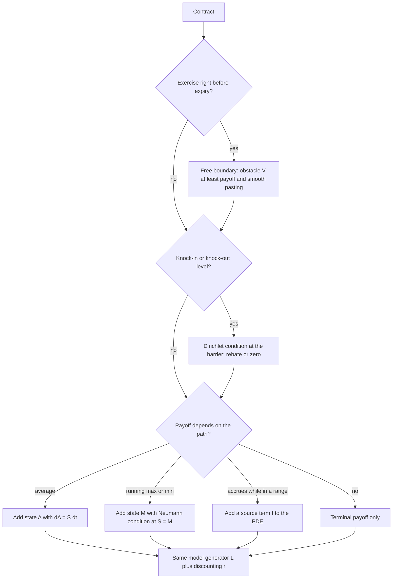

# Feynman-Kac and Pricing PDEs

## TL;DR

- Feynman-Kac: if $u$ solves $u_t + \mathcal{L}u - ru + f = 0$ with $u(T, x) = g(x)$, where $\mathcal{L} = \mu\partial_x + \tfrac12\sigma^2\partial_{xx}$ is the generator of $dX = \mu\,dt + \sigma\,dW$, then $u(t, x) = E\big[\int_t^T e^{-\int_t^s r}f\,ds + e^{-\int_t^T r}g(X_T) \mid X_t = x\big]$.
- The proof is one line of Itô: the discounted value plus accrued running payoff has zero drift exactly when the PDE holds, so it is a martingale and its expectation at $T$ is its value at $t$.
- A pricing PDE is "the discounted price is a $Q$-martingale" written locally; with a traded underlying $\mu$ drops out, with a non-traded factor (short rate, variance) a market price of risk enters as a drift adjustment.
- The PDE is the same for every payoff in a model; the product lives in the terminal condition (payoff), the boundaries (barriers are Dirichlet conditions, American exercise is a free boundary with smooth pasting) and extra state variables (averages, running maxima).
- Exponential-affine ansatz plus Feynman-Kac turns Vasicek, CIR and Heston into Riccati ODEs; time-independent problems (perpetual American puts, perpetual one-touches) are Euler ODEs with power solutions $S^p$.

## Learning objectives

- Derive a pricing PDE from a hedging argument and from Feynman-Kac.
- Identify boundary and terminal conditions for common payoffs.
- State and prove the Feynman-Kac theorem with discounting and a running payoff.
- Reduce affine short-rate PDEs to Riccati ODEs and solve them.
- Solve time-independent pricing problems (perpetual options) and method-of-images barrier problems.

## Core concepts

### Generator and the backward equation

For $dX_t = \mu(t, X_t)\,dt + \sigma(t, X_t)\,dW_t$ the generator acts on smooth $u$ as

$$
\mathcal{L}u = \mu\,u_x + \tfrac12\sigma^2u_{xx}, \qquad du(t, X_t) = (u_t + \mathcal{L}u)\,dt + \sigma u_x\,dW_t.
$$

In $d$ dimensions with $dX = \mu\,dt + \Sigma\,dW$, $\mathcal{L} = \sum_i\mu_i\partial_i + \tfrac12\sum_{i,j}(\Sigma\Sigma^\top)_{ij}\partial_{ij}$; correlation shows up as the cross term.
For GBM, $\mathcal{L} = rS\partial_S + \tfrac12\sigma^2S^2\partial_{SS}$ under $Q$; for OU, $\mathcal{L} = \kappa(\theta - x)\partial_x + \tfrac12\sigma^2\partial_{xx}$.

### The Feynman-Kac theorem

Let $u$ be $C^{1,2}$ with suitable growth and solve

$$
u_t + \mathcal{L}u - r(t, x)u + f(t, x) = 0, \qquad u(T, x) = g(x).
$$

Then

$$
u(t, x) = E\Big[\int_t^T e^{-\int_t^s r(v, X_v)\,dv}f(s, X_s)\,ds + e^{-\int_t^T r(v, X_v)\,dv}g(X_T)\ \Big|\ X_t = x\Big].
$$

Proof: set $D_s = e^{-\int_t^s r}$ and $M_s = D_su(s, X_s) + \int_t^s D_vf(v, X_v)\,dv$.
Itô and the product rule give

$$
dM_s = D_s\big(u_t + \mathcal{L}u - ru + f\big)\,ds + D_s\sigma u_x\,dW_s = D_s\sigma u_x\,dW_s,
$$

so $M$ is a local martingale, a true martingale under the growth conditions, and $u(t, x) = M_t = E[M_T \mid X_t = x]$, which is the formula because $u(T, \cdot) = g$.
The converse direction (if the expectation is smooth it solves the PDE) follows from the Markov property: the conditional expectation process is a martingale, so its $dt$ term must vanish.
Growth conditions matter: the heat equation with zero initial data has non-zero solutions that grow faster than $e^{cx^2}$ (Tychonoff's example), and Feynman-Kac selects the unique solution in the class of functions with at most that growth.

### Kolmogorov backward and forward equations

The transition density $p(t, x; T, y)$ solves the backward equation $p_t + \mathcal{L}_x p = 0$ in the starting point and the forward (Fokker-Planck) equation

$$
\partial_Tp = -\partial_y(\mu p) + \tfrac12\partial_{yy}(\sigma^2p)
$$

in the end point.
Prices use the backward equation (one PDE per payoff, all starting points at once); the forward equation propagates one starting point to all payoffs, which is how Dupire's local volatility is derived and how a desk prices a whole strip of European options in one sweep (see [Volatility Surface Construction](../05-Derivatives-and-Volatility/08-Volatility-Surface-Construction.md)).

### Two derivations of a pricing PDE

Hedging, traded underlying (Black-Scholes): hold the option, short $V_S$ shares; the $dW$ terms cancel, the portfolio is riskless and earns $r$, and $\mu$ cancels with the noise.
This gives $V_t + \tfrac12\sigma^2S^2V_{SS} + rSV_S - rV = 0$, derived in full in [Black-Scholes Derivation](07-Black-Scholes-Derivation.md).

Feynman-Kac route: under $Q$, $dS = rS\,dt + \sigma S\,dW^Q$ and $e^{-rt}V(t, S_t)$ must be a martingale.
Its drift is $e^{-rt}(V_t + \mathcal{L}V - rV)$, so the drift condition is the PDE, and Feynman-Kac reads it back as $V = E^Q[e^{-r(T - t)}g(S_T)]$.

Hedging, non-traded factor: a short rate $dr = a(r)\,dt + b(r)\,dW$ cannot be held, so hedge one bond $P_1$ with another $P_2$.
Writing $dP_i = \mu_iP_i\,dt + \sigma_iP_i\,dW$, a riskless combination exists only if $(\mu_1 - r)/\sigma_1 = (\mu_2 - r)/\sigma_2 = \lambda(t, r)$, a market price of risk common to all bonds.
With $\mu_iP_i = P_t + aP_r + \tfrac12b^2P_{rr}$ and $\sigma_iP_i = bP_r$, every bond satisfies

$$
P_t + (a - \lambda b)P_r + \tfrac12b^2P_{rr} - rP = 0, \qquad P(T, r) = 1.
$$

$a - \lambda b$ is the risk-neutral drift; it is not observable from the time series of $r$ and is fixed by calibrating to the curve.
Stochastic volatility is the same story with variance as the non-traded factor: hedge with the stock and a second option, and the Heston PDE in risk-neutral parameters is

$$
V_t + \tfrac12vS^2V_{SS} + \rho\xi vSV_{Sv} + \tfrac12\xi^2vV_{vv} + rSV_S + \kappa(\theta - v)V_v - rV = 0.
$$

### Terminal and boundary conditions

The PDE belongs to the model; the contract supplies the conditions.

| Product | Domain | Terminal condition | Boundary or extra condition |
| :--- | :--- | :--- | :--- |
| European call | $S > 0$ | $(S - K)^+$ | $V(t, 0) = 0$; $V \approx Se^{-q\tau} - Ke^{-r\tau}$ as $S \to \infty$ |
| European put | $S > 0$ | $(K - S)^+$ | $V(t, 0) = Ke^{-r\tau}$; $V \to 0$ as $S \to \infty$ |
| Cash digital call | $S > 0$ | $\mathbf{1}_{S > K}$ | $V(t, 0) = 0$; $V \to e^{-r\tau}$ |
| Down-and-out call | $S > H$ | $(S - K)^+$ | $V(t, H) = $ rebate (usually 0) |
| Up-and-out call | $S < U$ | $(S - K)^+\mathbf{1}_{S < U}$ | $V(t, U) = 0$ |
| American put | $S > S^*(t)$ | $(K - S)^+$ | $V(t, S^*) = K - S^*$, $V_S(t, S^*) = -1$ (smooth pasting) |
| Arithmetic Asian | $(S, A)$ | payoff of $A_T/T$ | extra term $SV_A$ from $dA = S\,dt$; no diffusion in $A$ |
| Floating lookback | $0 < S \le M$ | $M - S$ | $V_M = 0$ at $S = M$ (Neumann) |
| Range accrual | $S > 0$ | 0 | running payoff $f = c\,\mathbf{1}_{L < S < U}$ |

On a truncated numerical grid the far boundary is usually imposed as $V_{SS} = 0$ (the value becomes linear in $S$) rather than as an exact asymptote; see [Finite Differences and Fourier Pricing](../05-Derivatives-and-Volatility/11-Finite-Differences-and-Fourier-Pricing.md).
American exercise turns the PDE into a linear complementarity problem,

$$
\min\big(-V_t - \mathcal{L}V + rV,\ V - g\big) = 0,
$$

solved by PSOR, penalty or policy iteration; smooth pasting ($V$ and $V_S$ continuous across $S^*$) is what pins down the free boundary.

### Affine models: Feynman-Kac to Riccati

For Vasicek ($dr = \kappa(\theta - r)\,dt + \sigma\,dW$ under $Q$) try $P(\tau, r) = e^{A(\tau) - B(\tau)r}$ with $\tau = T - t$ in

$$
-P_\tau + \kappa(\theta - r)P_r + \tfrac12\sigma^2P_{rr} - rP = 0.
$$

Dividing by $P$ and collecting the terms in $r$ and the constants gives two ODEs that must hold separately:

$$
B' = 1 - \kappa B, \qquad A' = -\kappa\theta B + \tfrac12\sigma^2B^2, \qquad A(0) = B(0) = 0,
$$

so $B(\tau) = (1 - e^{-\kappa\tau})/\kappa$ and $A$ follows by integration.
CIR ($\sigma\sqrt{r}$) adds $\tfrac12\sigma^2rB^2$ to the $r$-terms, giving the Riccati equation $B' = 1 - \kappa B - \tfrac12\sigma^2B^2$, $A' = -\kappa\theta B$, with the closed form

$$
B(\tau) = \frac{2(e^{\gamma\tau} - 1)}{(\gamma + \kappa)(e^{\gamma\tau} - 1) + 2\gamma}, \qquad A(\tau) = \frac{2\kappa\theta}{\sigma^2}\ln\frac{2\gamma e^{(\kappa + \gamma)\tau/2}}{(\gamma + \kappa)(e^{\gamma\tau} - 1) + 2\gamma}, \qquad \gamma = \sqrt{\kappa^2 + 2\sigma^2}.
$$

The pattern (drift and squared volatility affine in the state, hence exponential-affine prices and characteristic functions) is the Duffie-Kan class; Heston's characteristic function is the same construction in $(\ln S, v)$ (see [Stochastic Volatility: Heston and SABR](../05-Derivatives-and-Volatility/09-Stochastic-Volatility-Heston-and-SABR.md)).

### Time-independent problems and the method of images

A perpetual claim has no $\tau$, so the PDE becomes the Euler ODE $\tfrac12\sigma^2S^2V'' + (r - q)SV' - rV = 0$, with solutions $S^p$ where

$$
\tfrac12\sigma^2p(p - 1) + (r - q)p - r = 0.
$$

There is one positive root $p_+$ and one negative root $p_-$; bounded-as-$S \to 0$ problems take $S^{p_+}$ and bounded-as-$S \to \infty$ problems take $S^{p_-}$.

- Perpetual American put: $V = (K - S^*)(S/S^*)^{p_-}$ above the exercise level, with smooth pasting giving $S^* = Kp_-/(p_- - 1)$; with $q = 0$, $p_- = -2r/\sigma^2$.
- Perpetual one-touch paying 1 when $S$ first rises to $H$: $V = (S/H)^{p_+}$; with $q = 0$, $p_+ = 1$ and $V = S/H$ exactly, the cost of $1/H$ shares, which are worth 1 at the hit.

If $V(S)$ solves the Black-Scholes PDE ($q = 0$), so does the image $(S/H)^{1 - 2r/\sigma^2}V(H^2/S)$, and the two agree at $S = H$.
Subtracting the image of the vanilla call therefore gives a solution that vanishes on the barrier: for $H \le K$,

$$
C_{do}(S) = C(S) - \Big(\frac{S}{H}\Big)^{1 - 2r/\sigma^2}C\Big(\frac{H^2}{S}\Big).
$$

### PDE or simulation?

PDE grids give all spot levels and Greeks at once, handle early exercise naturally, and converge fast in one or two state dimensions; the cost grows exponentially with dimension.
Monte Carlo is dimension-free but slow to converge and awkward for early exercise.
A desk rule of thumb: up to three state variables (spot, variance, a path statistic) use a PDE; baskets, multi-curve hybrids and long path-dependent payoffs use Monte Carlo (see [Monte Carlo Pricing and Variance Reduction](../05-Derivatives-and-Volatility/10-Monte-Carlo-Pricing-and-Variance-Reduction.md)).

## Worked examples

Every number below is printed and asserted by [feynman_kac_pdes.py](code/feynman_kac_pdes.py).
Monte Carlo figures come from seed 6 and change with the seed, so they are quoted as "about", with their standard errors; closed forms, ODE solutions, quadrature and the binomial tree are deterministic.

### The call satisfies the PDE and its boundaries

$S_0 = 100$, $K = 105$, $T = 0.5$, $r = 5\%$, $\sigma = 25\%$: the call is $5.9885$.
Central differences of the closed form at $(t, S) = (0.1, 100)$ give a PDE residual below $10^{-5}$, which is finite-difference noise.
At $S = 1$ the price is below $10^{-12}$ (the $S \to 0$ condition), and at $S = 250$ it exceeds $S - Ke^{-rT}$ by only $1.2 \times 10^{-6}$ (the $S \to \infty$ asymptote).

### Bond prices: PDE, ODE and expectation agree

"Vasicek with $\kappa = 0.3$, $\theta = 5\%$, $\sigma = 1\%$, $r_0 = 3\%$. Price the five-year zero."
$B(5) = (1 - e^{-1.5})/0.3 = 2.589566$ and $P(0, 5) = 0.820839$; integrating the Riccati system with RK4 reproduces it to within $10^{-10}$.
On the expectation side, $\int_0^5 r\,ds$ is Gaussian, and $10^6$ draws of $e^{-\int r}$ average about $0.820819$ (standard error $0.000032$).
For CIR with $\kappa = 1.5$, $\theta = 4\%$, $\sigma = 0.2$, $r_0 = 2\%$ (the Feller example in [SDEs](03-Stochastic-Differential-Equations.md)): $\gamma = 1.526434$, $B(5) = 0.660521$, $P(0, 5) = 0.830783$, again matched by RK4 to within $10^{-10}$, and a full-truncation Euler simulation with 1000 steps gives about $0.830722$ (standard error $0.000093$).

### A knock-out boundary by images

"Down-and-out call, $S_0 = K = 100$, $H = 90$, $T = 1$, $r = 5\%$, $\sigma = 25\%$."
Vanilla: $12.3360$.
Image exponent $1 - 2r/\sigma^2 = -0.6$, so $C_{do} = C(100) - (100/90)^{-0.6}C(81) = 9.1112$.
It is exactly 0 at $S = 90$, its PDE residual at $(\tau, S) = (0.6, 100)$ is below $10^{-5}$, and a 250-step simulation that kills paths through the Brownian-bridge crossing probability $\exp(-2\ln(S_i/H)\ln(S_{i+1}/H)/(\sigma^2\Delta t))$ gives about $9.112$ (standard error $0.040$).
The knock-out removes 26% of the vanilla's value for a barrier 10% away, because it kills exactly the paths that dip and recover.

### Perpetual American put

"$K = 100$, $r = 5\%$, $\sigma = 25\%$, no dividends. Value at $S = 100$ and the exercise level."
$p_- = -2r/\sigma^2 = -1.6$, so $S^* = 100 \times 1.6/2.6 = 61.538$ and $V(100) = 38.46 \times (100/61.538)^{-1.6} = 17.687$.
Smooth pasting holds (the one-sided slope at $S^*$ is $-1$ to within $10^{-4}$) and the ODE residual at $S = 100$ is below $10^{-5}$.
A 20,000-step binomial tree for a 100-year American put gives $17.682$, approaching from below as the finite maturity requires.

### Perpetual one-touch

"Pays 1 the first time $S$ reaches 120 from 100; $r = 5\%$, $q = 2\%$, $\sigma = 25\%$."
The positive root of $\tfrac12\sigma^2p(p - 1) + (r - q)p - r = 0$ is $p_+ = 1.28507$, so $V = (100/120)^{1.28507} = 0.7911$.
With $q = 0$ the answer would be $100/120 = 0.8333$: buy $1/120$ of a share; dividends make the stock drift up more slowly and the touch arrives later.
Simulating $E[e^{-r\tau_H}]$ with a bridge crossing check, a 40-year horizon and the exact conditional value for paths not yet hit gives about $0.7907$ (standard error $0.0010$).

### A running payoff: range accrual

"One year, pays $1/252$ for each daily fixing with $90 < S < 110$; $S_0 = 100$, $r = 5\%$, $\sigma = 20\%$."
Feynman-Kac with source term $f = \mathbf{1}_{90 < S < 110}$ makes the value a sum of discounted digital-range probabilities: $\sum_i\tfrac1{252}e^{-rt_i}Q(90 < S_{t_i} < 110) = 0.5648$.
The expected fraction of days in range is $0.5767$; a 100,000-path daily simulation gives about $0.5637$ (standard error $0.0008$).
Each day's contribution is a double digital, so the accrual's Greeks are those of a strip of digitals: short vega when spot sits inside the range.

## Pitfalls

- Writing the generator with the real-world drift $\mu$; prices use the risk-neutral drift, which for a traded asset is $r - q$ and for a non-traded factor includes $-\lambda b$.
- Dropping the $-rV$ term or the discount factor $e^{-\int r}$ when the rate is state dependent; Feynman-Kac needs the discount inside the expectation.
- Imposing the asymptote $V = S - Ke^{-r\tau}$ at a grid edge that is not far enough out; the linearity condition $V_{SS} = 0$ is more forgiving.
- Pricing a knock-out by the image formula when $H > K$ (that formula assumes $H \le K$) or with dividends without adjusting the exponent.
- Forgetting that path dependence needs a state variable: an Asian option is not a function of $(t, S)$ alone.
- Expecting a unique PDE solution without growth conditions; numerically this shows up as boundary conditions that leak into the interior.
- Treating American exercise as a boundary condition at a known level; the level is unknown and smooth pasting is what determines it.

## Interview questions

> [!question]- sc-fk-theorem | State the Feynman-Kac theorem with discounting and a running payoff.
> If $u_t + \mathcal{L}u - ru + f = 0$ with $u(T, \cdot) = g$, then $u(t, x) = E[\int_t^Te^{-\int_t^s r}f\,ds + e^{-\int_t^T r}g(X_T) \mid X_t = x]$, where $\mathcal{L}$ is the generator of $X$.
> It holds under growth and integrability conditions that make the stochastic integral a true martingale.

> [!question]- sc-fk-proof | Prove Feynman-Kac in one line.
> Let $M_s = D_su(s, X_s) + \int_t^sD_vf\,dv$ with $D_s = e^{-\int_t^s r}$; Itô gives $dM = D(u_t + \mathcal{L}u - ru + f)\,ds + D\sigma u_x\,dW = D\sigma u_x\,dW$.
> So $M$ is a martingale and $u(t, x) = M_t = E[M_T \mid X_t = x]$.

> [!question]- sc-fk-generator-gbm-ou | Write the generator of GBM under $Q$ and of an OU process.
> GBM: $rS\partial_S + \tfrac12\sigma^2S^2\partial_{SS}$; OU: $\kappa(\theta - x)\partial_x + \tfrac12\sigma^2\partial_{xx}$.
> In general $\mathcal{L} = \mu\partial_x + \tfrac12\sigma^2\partial_{xx}$, with a cross term $\rho\sigma_1\sigma_2\partial_{xy}$ in two dimensions.

> [!question]- sc-fk-bs-from-martingale | Derive the Black-Scholes PDE without a hedging argument.
> Under $Q$ the discounted price $e^{-rt}V(t, S_t)$ is a martingale; Itô gives its drift as $e^{-rt}(V_t + rSV_S + \tfrac12\sigma^2S^2V_{SS} - rV)$, which must vanish.
> Feynman-Kac then reads the solution back as $E^Q[e^{-r\tau}g(S_T)]$.

> [!question]- sc-fk-market-price-of-risk-pde | Why does a market price of risk appear in the short-rate PDE but not in Black-Scholes?
> The short rate is not traded, so you can only hedge one bond with another; no arbitrage forces $(\mu_i - r)/\sigma_i = \lambda$ across bonds, and the PDE drift becomes $a - \lambda b$.
> In Black-Scholes the underlying itself is the hedge, which pins its risk-neutral drift to $r$ and removes $\mu$.

> [!question]- sc-fk-call-put-boundaries | Give the spatial boundary conditions for a European call and put on a log or spot grid.
> Call: $V(t, 0) = 0$ and $V \approx Se^{-q\tau} - Ke^{-r\tau}$ for large $S$; put: $V(t, 0) = Ke^{-r\tau}$ and $V \to 0$ for large $S$.
> Numerically a linearity condition $V_{SS} = 0$ at the far edge is a robust alternative.

> [!question]- sc-fk-barrier-image | How do you get the down-and-out call price from the vanilla in Black-Scholes ($q = 0$, $H \le K$)?
> $C(S) - (S/H)^{1 - 2r/\sigma^2}C(H^2/S)$: the image term also solves the PDE and cancels the vanilla on $S = H$.
> For $S_0 = K = 100$, $H = 90$, $T = 1$, $r = 5\%$, $\sigma = 25\%$: 9.11 against a vanilla 12.34.

> [!question]- sc-fk-american-free-boundary | What conditions determine the American put price and exercise boundary in the PDE formulation?
> The linear complementarity problem $\min(-V_t - \mathcal{L}V + rV, V - (K - S)^+) = 0$, with value matching $V(S^*) = K - S^*$ and smooth pasting $V_S(S^*) = -1$ at the free boundary.
> Smooth pasting is the optimality condition; without it any level would give a solution.

> [!question]- sc-fk-perpetual-put | Price a perpetual American put with $K = 100$, $r = 5\%$, $\sigma = 25\%$, $q = 0$, at $S = 100$.
> About 17.69, with exercise at $S^* = 61.54$.
> $V = (K - S^*)(S/S^*)^{-2r/\sigma^2}$, $p = -1.6$, and smooth pasting gives $S^* = Kp/(p - 1)$.

> [!question]- sc-fk-perpetual-one-touch | A perpetual one-touch pays 1 when a non-dividend stock first rises to $H$. What is it worth?
> $S/H$ exactly: buy $1/H$ shares, worth 1 at the hit; equivalently the positive root of $\tfrac12\sigma^2p(p - 1) + rp - r = 0$ is $p = 1$.
> With a dividend yield the root exceeds 1 and the value falls (0.7911 against 0.8333 for $q = 2\%$, $H/S = 1.2$, $\sigma = 25\%$, $r = 5\%$).

> [!question]- sc-fk-vasicek-riccati | Derive the Vasicek bond price from the PDE.
> Ansatz $P = e^{A(\tau) - B(\tau)r}$; collecting terms in $r$ gives $B' = 1 - \kappa B$ and $A' = -\kappa\theta B + \tfrac12\sigma^2B^2$ with zero initial values.
> So $B = (1 - e^{-\kappa\tau})/\kappa$; with $\kappa = 0.3$, $\tau = 5$, $B = 2.5896$.

> [!question]- sc-fk-cir-riccati | Which ODE does $B(\tau)$ satisfy in CIR, and why is it nonlinear?
> $B' = 1 - \kappa B - \tfrac12\sigma^2B^2$, a Riccati equation.
> The variance $\sigma^2r$ is linear in the state, so the $\tfrac12\sigma^2rP_{rr} = \tfrac12\sigma^2rB^2P$ term lands in the coefficient of $r$.

> [!question]- sc-fk-running-payoff | How does a coupon that accrues while spot stays in a range enter the PDE?
> As a source term: $V_t + \mathcal{L}V - rV + c\,\mathbf{1}_{L < S < U} = 0$, by Feynman-Kac with running payoff.
> The value is the integral of discounted range probabilities, a strip of double digitals.

> [!question]- sc-fk-asian-state | Why does an arithmetic Asian option need a two-dimensional PDE, and what is special about it?
> The payoff depends on $A_t = \int_0^tS\,du$, so the state is $(S, A)$ with $dA = S\,dt$; the PDE gains $SV_A$ but no second derivative in $A$.
> The degenerate (convection-only) direction needs upwinding or a similarity reduction to one dimension.

> [!question]- sc-fk-lookback-condition | What boundary condition does a floating-strike lookback put satisfy in the $(S, M)$ formulation?
> $V_M = 0$ on $S = M$, where $M$ is the running maximum.
> Itô on $V(t, S, M)$ produces a term $V_M\,dM$, where $dM$ is increasing, of finite variation and active only when $S = M$; a discounted price must be a martingale, so that term has to vanish, which forces $V_M = 0$ on $S = M$.

> [!question]- sc-fk-forward-equation-use | What is the Kolmogorov forward equation and where do quants use it?
> $\partial_Tp = -\partial_y(\mu p) + \tfrac12\partial_{yy}(\sigma^2p)$ for the transition density in its end point.
> Dupire derives local volatility from it, and one forward sweep prices all strikes and maturities from today's spot.

> [!question]- sc-fk-uniqueness | Is the solution of a pricing PDE with a given terminal condition unique?
> Only within a growth class: the heat equation has non-zero solutions with zero initial data that grow faster than $e^{cx^2}$ (Tychonoff).
> Feynman-Kac picks the solution with controlled growth, which is the price.

> [!question]- sc-fk-heston-pde | Write the Heston pricing PDE.
> $V_t + \tfrac12vS^2V_{SS} + \rho\xi vSV_{Sv} + \tfrac12\xi^2vV_{vv} + rSV_S + \kappa(\theta - v)V_v - rV = 0$ in risk-neutral parameters.
> The cross term comes from spot-variance correlation; the market price of volatility risk is absorbed into $\kappa$ and $\theta$.

> [!question]- sc-fk-pde-or-mc | When would you price with a PDE rather than Monte Carlo?
> With up to about three state variables, early exercise, or when you need smooth Greeks across all spots: grids handle these directly and converge fast.
> Beyond that the grid cost explodes and Monte Carlo, dimension-free, wins.

## In this repo and SDE-Interview-Prep

- Code: [feynman_kac_pdes.py](code/feynman_kac_pdes.py) (PDE residuals, affine bond prices, images, perpetual options, range accrual).
- Prev: [Change of Measure and Girsanov](05-Change-of-Measure-and-Girsanov.md). Next: [Black-Scholes Derivation](07-Black-Scholes-Derivation.md).
- Solving these PDEs on a grid: [Finite Differences and Fourier Pricing](../05-Derivatives-and-Volatility/11-Finite-Differences-and-Fourier-Pricing.md).

## Further reading

- Steven Shreve, *Stochastic Calculus for Finance II: Continuous-Time Models*, sections 6.3-6.6 (Feynman-Kac, interest-rate PDEs) and 8.3 (perpetual American put).
- Ioannis Karatzas and Steven Shreve, *Brownian Motion and Stochastic Calculus*, section 5.7 (Feynman-Kac and uniqueness).
- Bernt Oksendal, *Stochastic Differential Equations*, section 8.2.
- Paul Wilmott, *Paul Wilmott Introduces Quantitative Finance*, chapters on the Black-Scholes PDE, barrier options and American options.
- O. Vasicek, "An Equilibrium Characterization of the Term Structure", *Journal of Financial Economics* 5 (1977).
- J. Cox, J. Ingersoll and S. Ross, "A Theory of the Term Structure of Interest Rates", *Econometrica* 53 (1985).
- D. Duffie and R. Kan, "A Yield-Factor Model of Interest Rates", *Mathematical Finance* 6 (1996).
- S. Heston, "A Closed-Form Solution for Options with Stochastic Volatility", *Review of Financial Studies* 6 (1993).
- R. Merton, "Theory of Rational Option Pricing", *Bell Journal of Economics and Management Science* 4 (1973), for the perpetual put and the image barrier formula.
