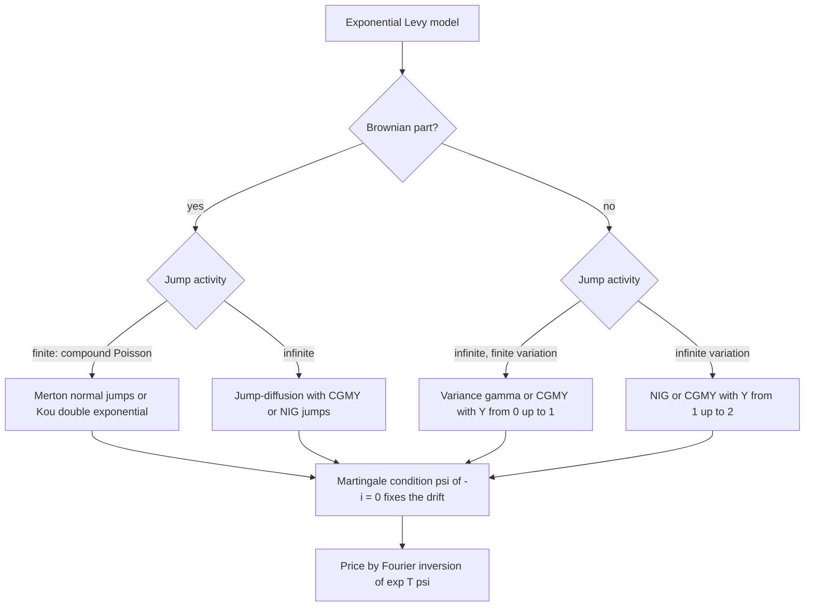

# Jump Processes and Levy Models

## TL;DR

- Merton jump-diffusion: $dS/S_{t-} = (r - q - \lambda\bar{k})\,dt + \sigma\,dW + (e^J - 1)\,dN$ with $J \sim N(m, \delta^2)$ and $\bar{k} = e^{m + \delta^2/2} - 1$; the $-\lambda\bar{k}$ compensator is what keeps the discounted price a martingale.
- Conditioning on the number of jumps gives Merton's series: a Poisson($\lambda(1 + \bar{k})T$) mixture of Black-Scholes prices with $\sigma_n^2 = \sigma^2 + n\delta^2/T$ and $r_n = r - \lambda\bar{k} + n\ln(1 + \bar{k})/T$.
- Jumps add skewness (sign of $m$) and excess kurtosis that decays like $1/T$, so jump smiles are steep at short maturities and flatten fast; that is why short-dated index skew needs jumps and long-dated skew needs stochastic volatility.
- A Levy process is pinned down by its Levy-Khintchine triplet $(\gamma, \sigma^2, \nu)$: $E[e^{iuX_t}] = e^{t\psi(u)}$ in closed form, so any European option prices by one Fourier integral (Lewis, Carr-Madan, COS).
- Jumps make the market incomplete: a delta hedge cannot cover a gap, the price depends on the risk-neutral jump law chosen by calibration, and the residual risk is hedged with out-of-the-money options.

## Learning objectives

- Price under Merton jump-diffusion and explain its effect on the smile.
- Use characteristic functions of Levy processes for pricing.
- State the Levy-Khintchine formula and the martingale condition for an exponential Levy model.
- Compare Merton, Kou and variance gamma, and explain finite versus infinite activity.
- Quantify the gap risk that makes jump markets incomplete.

## Core concepts

### Poisson building blocks

A Poisson process $N_t$ with intensity $\lambda$ has independent stationary increments and $N_t \sim \text{Poisson}(\lambda t)$ (see [Poisson Processes](../01-Probability/13-Poisson-Processes.md)).
It is not a martingale, but the compensated process $N_t - \lambda t$ is.
For a compound Poisson process $\sum_{i \le N_t}Y_i$ with iid jumps, the compensator is $\lambda E[Y]t$, and $E[e^{iu\sum Y}] = \exp(\lambda t(E[e^{iuY}] - 1))$.

Itô's formula for $dX = b\,dt + \sigma\,dW + dJ$, with $J$ a pure-jump process, adds a jump term to the continuous one:

$$
df(X_t) = f'(X_{t-})(b\,dt + \sigma\,dW_t) + \tfrac12 f''(X_{t-})\sigma^2\,dt + \big[f(X_{t-} + \Delta X_t) - f(X_{t-})\big].
$$

The jump term is the full change of $f$, not a Taylor expansion; that is where gap risk lives.

### Merton jump-diffusion

Under $Q$, with $N$ a Poisson($\lambda$) process and log-jumps $J_i \sim N(m, \delta^2)$,

$$
S_T = S_0\exp\Big(\big(r - q - \lambda\bar{k} - \tfrac12\sigma^2\big)T + \sigma W_T + \sum_{i=1}^{N_T}J_i\Big), \qquad \bar{k} = E[e^J - 1] = e^{m + \delta^2/2} - 1.
$$

The drift correction $-\lambda\bar{k}$ removes the expected jump return, so $E^Q[S_T] = S_0e^{(r - q)T}$.
Merton assumed jump risk is diversifiable, so its law is the same under $P$ and $Q$; in practice the $Q$ jump parameters are calibrated to option prices and embed a large crash premium.

Conditional on $N_T = n$, $\ln S_T$ is Gaussian with variance $\sigma^2T + n\delta^2$ and $E[S_T \mid n] = S_0e^{(r - q - \lambda\bar{k})T}(1 + \bar{k})^n$.
So the conditional price is Black-Scholes with $\sigma_n^2 = \sigma^2 + n\delta^2/T$ and an adjusted rate, and summing over $n$:

$$
C = \sum_{n = 0}^\infty\frac{e^{-\lambda'T}(\lambda'T)^n}{n!}\,C_{BS}(S_0, K, T, r_n, \sigma_n), \qquad \lambda' = \lambda(1 + \bar{k}), \qquad r_n = r - \lambda\bar{k} + \frac{n\ln(1 + \bar{k})}{T},
$$

where $C_{BS}$ uses $r_n$ both in the drift and in the discounting; the change of Poisson intensity from $\lambda$ to $\lambda'$ absorbs exactly the difference between discounting at $r_n$ and at $r$.
The series converges like a Poisson tail, so a few tens of terms reach machine precision.

### Moments, skew and kurtosis

The log return $X_T = \ln(S_T/S_0)$ has cumulants that are all linear in $T$:

$$
\kappa_2 = \big(\sigma^2 + \lambda(m^2 + \delta^2)\big)T, \qquad \kappa_3 = \lambda(m^3 + 3m\delta^2)T, \qquad \kappa_4 = \lambda(m^4 + 6m^2\delta^2 + 3\delta^4)T.
$$

Skewness $\kappa_3/\kappa_2^{3/2}$ scales like $T^{-1/2}$ and excess kurtosis $\kappa_4/\kappa_2^2$ like $T^{-1}$, the signature of every Levy model: by the central limit theorem the log return becomes Gaussian as $T$ grows.
In smile terms, $m < 0$ produces a downside skew, $\delta$ and $\lambda$ produce curvature, and both fade quickly with maturity.
Index smiles decay more slowly than this (roughly like $T^{-1/2}$ for the skew, see [Implied Volatility and the Smile](../05-Derivatives-and-Volatility/07-Implied-Volatility-and-the-Smile.md)), so production models combine jumps for the short end with stochastic volatility for the long end (Bates 1996: Heston plus Merton jumps).

### Levy processes and the Levy-Khintchine formula

A Levy process is a càdlàg process with $X_0 = 0$ and independent, stationary increments.
Every such process has $E[e^{iuX_t}] = e^{t\psi(u)}$ with characteristic exponent

$$
\psi(u) = i\gamma u - \tfrac12\sigma^2u^2 + \int_{\mathbb{R}}\big(e^{iux} - 1 - iux\mathbf{1}_{\lvert x\rvert < 1}\big)\,\nu(dx), \qquad \int\min(1, x^2)\,\nu(dx) < \infty.
$$

The triplet is drift $\gamma$, Brownian variance $\sigma^2$ and Levy measure $\nu$, where $\nu(A)$ is the expected number of jumps per unit time with size in $A$.

- Finite activity, $\nu(\mathbb{R}) < \infty$: finitely many jumps on any interval; the jump part is compound Poisson (Merton, Kou).
- Infinite activity, finite variation, $\int\min(1, \lvert x\rvert)\,\nu(dx) < \infty$: infinitely many small jumps but paths of bounded variation (variance gamma, CGMY with $0 \le Y < 1$).
- Infinite variation: small jumps so dense that they behave like a diffusion (NIG, CGMY with $1 \le Y < 2$).

For $S_t = S_0e^{(r - q)t + X_t}$ to have $e^{-(r - q)t}S_t$ a martingale you need $E[e^{X_t}] = 1$, that is $\psi(-i) = 0$; equivalently, with an uncorrected exponent $\psi_0$, the drift must be shifted by $\omega = -\psi_0(-i)$.
That one condition is the whole of "risk-neutral" for these models.

| Model | Levy measure $\nu(dx)$ | Exponent $\psi(u)$ excluding drift | Activity |
| :--- | :--- | :--- | :--- |
| Merton | $\lambda\,\varphi_{m,\delta}(x)\,dx$ | $-\tfrac12\sigma^2u^2 + \lambda(e^{ium - \delta^2u^2/2} - 1)$ | finite |
| Kou | $\lambda\big(p\eta_1e^{-\eta_1x}\mathbf{1}_{x > 0} + (1 - p)\eta_2e^{\eta_2x}\mathbf{1}_{x < 0}\big)dx$ | $-\tfrac12\sigma^2u^2 + \lambda\big(\tfrac{p\eta_1}{\eta_1 - iu} + \tfrac{(1 - p)\eta_2}{\eta_2 + iu} - 1\big)$ | finite |
| Variance gamma | $\frac{C}{\lvert x\rvert}\big(e^{Gx}\mathbf{1}_{x < 0} + e^{-Mx}\mathbf{1}_{x > 0}\big)dx$ | $-\frac1\nu\ln\big(1 - iu\theta\nu + \tfrac12\sigma^2\nu u^2\big)$ | infinite, finite variation |
| CGMY | $\frac{C}{\lvert x\rvert^{1 + Y}}\big(e^{Gx}\mathbf{1}_{x < 0} + e^{-Mx}\mathbf{1}_{x > 0}\big)dx$ | $C\Gamma(-Y)\big((M - iu)^Y - M^Y + (G + iu)^Y - G^Y\big)$ | finite iff $Y < 0$; finite variation iff $Y < 1$ |

### Kou double exponential

Kou replaces normal log-jumps by an asymmetric double exponential: up-jumps $\text{Exp}(\eta_1)$ with probability $p$, down-jumps $\text{Exp}(\eta_2)$ otherwise, so mean up and down jump sizes are $1/\eta_1$ and $1/\eta_2$.
$E[e^J]$ is finite only if $\eta_1 > 1$.
The exponential tails are memoryless, so the overshoot over a barrier is again exponential and independent of the path; this gives closed forms (via Laplace transforms) for barriers, lookbacks and first-passage times that Merton's normal jumps do not allow (Kou and Wang 2004).

### Variance gamma and time changes

Variance gamma runs a Brownian motion with drift on a random business clock: $X_t = \theta G_t + \sigma W_{G_t}$, with $G$ a gamma process of mean rate 1 and variance rate $\nu$.
$\theta$ controls skew, $\nu$ the kurtosis, $\sigma$ the scale; there is no separate diffusion, yet the infinitely many small jumps produce realistic short-dated smiles.
The same law is CGMY with $Y = 0$, $C = 1/\nu$ and

$$
G = \Big(\sqrt{\tfrac14\theta^2\nu^2 + \tfrac12\sigma^2\nu} - \tfrac12\theta\nu\Big)^{-1}, \qquad M = \Big(\sqrt{\tfrac14\theta^2\nu^2 + \tfrac12\sigma^2\nu} + \tfrac12\theta\nu\Big)^{-1},
$$

so $\theta < 0$ gives $G < M$: down-jumps decay more slowly, a fat left tail.
Replacing the gamma clock by an integrated CIR clock gives stochastic volatility for Levy processes (Carr, Geman, Madan and Yor 2003; Carr and Wu 2004), which fixes the too-fast smile decay of plain Levy models.

### Pricing by characteristic function

All of these models have $\phi_T(u) = E[e^{iu\ln(S_T/S_0)}]$ in closed form and no simple density, so prices come from Fourier inversion.
One robust form (Lewis 2001), with $F = S_0e^{(r - q)T}$ and $\phi_Y(u) = \phi_T(u)e^{-iu(r - q)T}$:

$$
C = e^{-rT}\Big(F - \frac{\sqrt{FK}}{\pi}\int_0^\infty\text{Re}\Big[e^{iu\ln(F/K)}\phi_Y\big(u - \tfrac{i}{2}\big)\Big]\frac{du}{u^2 + \tfrac14}\Big).
$$

Carr-Madan's FFT version prices a whole strike grid at once and the COS method converges exponentially for smooth densities; both are implemented in [Finite Differences and Fourier Pricing](../05-Derivatives-and-Volatility/11-Finite-Differences-and-Fourier-Pricing.md).
Calibration is then a least-squares fit of the triplet parameters to the smile, one integral per strike.

### Incompleteness and hedging

With a continuum of possible jump sizes, no finite set of instruments replicates every payoff, so there are many equivalent martingale measures (see [Risk-Neutral Pricing and the FTAP](04-Risk-Neutral-Pricing-and-FTAP.md)).
A delta hedge leaves, on a jump from $S$ to $S(1 + j)$, the residual $V(S(1 + j)) - V(S) - \Delta Sj$, which for a short option is a loss of the order of the option's convexity over the whole jump.
Desks respond by quadratic (variance-minimising) deltas, by hedging the gap with out-of-the-money options, and by limits on short-gamma exposure through events.
Jumps also break the log-contract replication of variance swaps, which is why single-stock variance is capped (see [Variance Swaps](../05-Derivatives-and-Volatility/14-Variance-Swaps-and-Volatility-Products.md)).

## Worked examples

Every number below is printed and asserted by [jump_levy_models.py](code/jump_levy_models.py).
Monte Carlo figures come from seed 1976 and change with the seed, so they are quoted as "about", with their standard errors; series, Fourier and cumulant results, including both tables below, are deterministic.

### Merton: three prices that must agree

"$S_0 = 100$, $r = 5\%$, $T = 1$, $\sigma = 20\%$, one jump a year on average with mean log-jump $-10\%$ and jump volatility $15\%$. Price the strikes 80 to 120."
$\bar{k} = e^{-0.1 + 0.01125} - 1 = -0.08493$, so the diffusion drift is raised to $r - \lambda\bar{k} = 13.49\%$ to pay for the expected crash.
The series (16 terms to reach a Poisson weight below $10^{-12}$) and Fourier inversion of the characteristic function agree to within $10^{-8}$:

| Strike | 80 | 90 | 100 | 110 | 120 |
| :--- | ---: | ---: | ---: | ---: | ---: |
| Merton call | 25.9555 | 18.6983 | 12.7613 | 8.2583 | 5.0906 |
| Implied vol | 27.70% | 26.82% | 26.12% | 25.58% | 25.18% |

Exact simulation ($2 \times 10^6$ paths: Poisson count, then a normal sum of jumps) gives about $12.741$ (standard error $0.013$) at the money, and $E[S_T]/(S_0e^{rT})$ is about $0.9997$, within four standard errors of 1, as the compensator requires.
The total volatility $\sqrt{\sigma^2 + \lambda(m^2 + \delta^2)} = 26.93\%$ sits inside the smile; downside strikes are richer because the mean jump is negative.

### Merton smile and its term structure

The one-year log return has skewness $-0.397$ and excess kurtosis $0.565$ from the cumulant formulas, and the simulated paths give about $-0.396$ and $0.562$.
At $T = 0.1$ the excess kurtosis is ten times larger, $5.648$.
The 90%-110% forward-moneyness skew (vol at $0.9F$ minus vol at $1.1F$) shows the decay:

| Maturity | 0.1 | 0.5 | 1 | 3 |
| :--- | ---: | ---: | ---: | ---: |
| Skew, vol points | 6.30 | 2.09 | 1.14 | 0.39 |

From 0.1 to 1 year the skew falls by a factor of about 5.5, between the $T^{-1/2}$ and $T^{-1}$ rates.
An index skew that decays closer to $T^{-1/2}$ cannot be matched at both ends by one parameter set: calibrated to the short end, the model's long-dated skew is too flat; calibrated to the long end, its short-dated skew is too steep.

### Kou and variance gamma by Fourier inversion

Kou with $\sigma = 16\%$, $\lambda = 1$, $p = 0.4$, $\eta_1 = 10$, $\eta_2 = 5$ (mean up-jump 10%, mean down-jump 20%): $E[e^J] - 1 = -0.05556$, ATM call $12.4325$ by Fourier and about $12.431$ (standard error $0.012$) by simulating exponential jumps; implied vols $29.20\%$ at 80 and $23.61\%$ at 120.
Variance gamma with $\sigma = 12\%$, $\nu = 0.2$, $\theta = -0.14$: martingale correction $\omega = \frac1\nu\ln(1 - \theta\nu - \tfrac12\sigma^2\nu) = 0.13107$, ATM call $8.0441$ by Fourier and about $8.045$ (standard error $0.0064$) by simulating Brownian motion in gamma time; implied vols $15.68\%$, $13.50\%$, $11.95\%$ at 80, 100, 120.
Its CGMY form has $G = 18.37$ and $M = 37.81$: the left tail decays at 0.49 times the rate of the right, and the two characteristic functions agree to within $10^{-15}$.
For all three models $\phi_1(-i) = e^{r}$ to within $10^{-12}$ relative (the martingale condition) and $\phi_2(u) = \phi_1(u)^2$ to within $10^{-12}$ on $u \in [-20, 20]$, a consistency check that each characteristic function scales its exponent linearly in $T$ (it holds by construction once $\phi_T = e^{T\psi}$ is coded, so it does not test stationary independent increments).

### The gap a delta hedge cannot cover

"You are short a three-month ATM call ($S = K = 100$, $r = 5\%$, $\sigma = 20\%$) and delta-hedged. Spot gaps to 80. What do you lose?"
Before: call $4.6150$, delta $0.5695$; after: call $0.0564$.
The short call gains $4.56$ but the $0.5695$ shares lose $11.39$: net loss $6.83$, 1.48 times the premium collected and about 237.5 times today's one-calendar-day theta, more than the option's whole remaining life of about 91 days.
No rebalancing frequency helps: the move happens between two hedge times, which is exactly the risk a jump model prices and Black-Scholes does not.

## Pitfalls

- Forgetting the compensator: without $-\lambda\bar{k}$ in the drift the discounted price is not a martingale and every price is wrong by a forward-level error.
- Using $\lambda$ instead of $\lambda' = \lambda(1 + \bar{k})$ for the Poisson weights while discounting each Black-Scholes term at $r_n$ (or mixing the two conventions); check the series against Fourier or simulation.
- Calibrating jumps to one long expiry and expecting the short end to fit: Levy smiles flatten like $T^{-1}$ in kurtosis, faster than markets.
- Treating $P$ and $Q$ jump intensities as equal; option-implied crash frequencies are much higher than historical ones.
- Evaluating complex logarithms in characteristic functions on the wrong branch; Heston's original form (and Bates, which builds on it) needs the "little trap" form for long maturities.
  The VG base $1 - iu\theta\nu + \tfrac12\sigma^2\nu u^2$ has positive real part, so its principal-branch power is safe.
- Truncating the Fourier integral too early for short maturities, where $\phi$ decays slowly; validate against Black-Scholes with the lognormal characteristic function.
- Claiming that hedging more often removes jump risk; it removes diffusive error only.

## Interview questions

> [!question]- sc-jump-merton-sde | Write the Merton jump-diffusion under $Q$ and explain each drift term.
> $dS/S_{t-} = (r - q - \lambda\bar{k})\,dt + \sigma\,dW + (e^J - 1)\,dN$, $J \sim N(m, \delta^2)$, $\bar{k} = e^{m + \delta^2/2} - 1$.
> $r - q$ is the risk-neutral growth, and $-\lambda\bar{k}$ subtracts the expected jump return so the discounted price stays a martingale.

> [!question]- sc-jump-merton-compensator | With one jump a year of mean log size $-10\%$ and jump vol $15\%$, how much is added to the drift and why?
> $-\lambda\bar{k} = 8.49\%$, since $\bar{k} = e^{-0.1 + 0.01125} - 1 = -0.0849$.
> Between jumps the stock must drift up faster to compensate for the expected crash, keeping $E^Q[S_T] = S_0e^{rT}$.

> [!question]- sc-jump-merton-series | Give Merton's option price formula.
> $\sum_n e^{-\lambda'T}(\lambda'T)^n/n!\;C_{BS}(r_n, \sigma_n)$ with $\lambda' = \lambda(1 + \bar{k})$, $\sigma_n^2 = \sigma^2 + n\delta^2/T$, $r_n = r - \lambda\bar{k} + n\ln(1 + \bar{k})/T$.
> Condition on $n$ jumps: the log price is Gaussian, so each term is Black-Scholes.

> [!question]- sc-jump-poisson-compensated | Which martingales does a Poisson process give you?
> $N_t - \lambda t$, and for a compound Poisson $\sum_{i \le N_t}Y_i - \lambda E[Y]t$.
> More generally $e^{iuX_t - t\psi(u)}$ is a martingale for any Levy process with exponent $\psi$.

> [!question]- sc-jump-ito-formula | How does Itô's formula change when $X$ can jump?
> Add the jump term $f(X_{t-} + \Delta X_t) - f(X_{t-})$ to the usual continuous terms, which use $X_{t-}$.
> The jump contribution is the full change in $f$, not $f'\Delta X$, which is why convexity matters on gaps.

> [!question]- sc-jump-cumulants | How do skewness and excess kurtosis of the log return scale with maturity in a Levy model?
> Skewness like $T^{-1/2}$, excess kurtosis like $T^{-1}$, because all cumulants are linear in $T$.
> In the Merton example the excess kurtosis is 0.565 at one year and 5.648 at 0.1 years.

> [!question]- sc-jump-smile-decay | Why does a jump model fit short-dated skew but struggle at long maturities?
> Jumps give a fat, skewed short-horizon distribution, but by the central limit theorem the effect washes out fast: in the example the 90-110 skew is 6.30 vol points at 0.1 years and 0.39 at 3 years.
> Market skew decays more slowly, so desks add stochastic volatility (Bates) or a stochastic clock.

> [!question]- sc-jump-hedging-gap | Short a three-month ATM call at 20% vol, delta-hedged, and spot gaps down 20%. What happens?
> You lose about 6.83: the call falls from 4.615 to 0.056 but the 0.57 delta of stock loses 11.39.
> That is 1.48 times the premium; no rebalancing frequency can prevent it.

> [!question]- sc-jump-incomplete | Why is a jump-diffusion market incomplete, and how do desks price and hedge in it anyway?
> A continuum of jump sizes cannot be spanned by the stock and bond, so many martingale measures exist and the hedge has residual risk.
> They calibrate the risk-neutral jump law to option prices and hedge gap risk with out-of-the-money options, using variance-minimising deltas.

> [!question]- sc-jump-merton-diversifiable | What was Merton's key assumption about jump risk, and is it realistic?
> That jump risk is idiosyncratic and diversifiable, so it carries no premium and the jump law is the same under $P$ and $Q$.
> For index crashes it fails: jumps are systematic, and option-implied crash intensities far exceed historical ones.

> [!question]- sc-levy-definition | Define a Levy process.
> A càdlàg process with $X_0 = 0$ and independent, stationary increments (continuous in probability).
> Brownian motion with drift, Poisson and compound Poisson processes, variance gamma and NIG are examples.

> [!question]- sc-levy-khintchine | State the Levy-Khintchine formula.
> $E[e^{iuX_t}] = e^{t\psi(u)}$, $\psi(u) = i\gamma u - \tfrac12\sigma^2u^2 + \int(e^{iux} - 1 - iux\mathbf{1}_{\lvert x\rvert < 1})\nu(dx)$, with $\int\min(1, x^2)\nu(dx) < \infty$.
> The triplet $(\gamma, \sigma^2, \nu)$ characterises the process; $\nu$ counts jumps per unit time by size.

> [!question]- sc-levy-martingale-condition | What condition makes $S_t = S_0e^{(r - q)t + X_t}$ a valid risk-neutral model when $X$ is Levy?
> $E[e^{X_t}] = 1$, i.e. $\psi(-i) = 0$; in practice add the drift correction $\omega = -\psi_0(-i)$.
> For variance gamma, $\omega = \frac1\nu\ln(1 - \theta\nu - \tfrac12\sigma^2\nu)$.

> [!question]- sc-levy-vg-time-change | What is the variance gamma process and what does each parameter do?
> Brownian motion with drift evaluated at a gamma clock: $X_t = \theta G_t + \sigma W_{G_t}$, $G$ with mean rate 1 and variance rate $\nu$.
> $\theta$ sets skew, $\nu$ sets kurtosis, $\sigma$ sets the scale.

> [!question]- sc-levy-infinite-activity | What does infinite activity mean, and why can a pure-jump model fit a smile without a diffusion?
> $\nu(\mathbb{R}) = \infty$: infinitely many small jumps in any interval, as in variance gamma, NIG and CGMY with $0 \le Y < 2$.
> The small jumps provide diffusion-like variability and the large ones the tails, so no Brownian part is needed.

> [!question]- sc-levy-kou | What is special about Kou's double exponential jumps?
> Exponential tails are memoryless, so barrier overshoots are again exponential, giving closed-form barrier, lookback and first-passage prices via Laplace transforms; up and down tails are asymmetric.
> $E[e^J]$ is finite only when the up-jump rate $\eta_1 > 1$.

> [!question]- sc-levy-fourier-pricing | Why are Levy models priced by Fourier inversion rather than by densities?
> Their characteristic function $e^{T\psi(u)}$ is closed form while the density usually is not.
> One integral (Lewis) or one FFT over strikes (Carr-Madan) prices Europeans, which makes calibration fast.

> [!question]- sc-levy-long-maturity-flaw | What is the main structural weakness of exponential Levy models for equity surfaces, and the standard fixes?
> Stationary independent increments force the smile to flatten too fast with maturity.
> Fix with stochastic volatility plus jumps (Bates), or by running the Levy process on a stochastic clock (Carr-Geman-Madan-Yor, Carr-Wu).

## In this repo and SDE-Interview-Prep

- Code: [jump_levy_models.py](code/jump_levy_models.py) (Merton series, Fourier and simulation; Kou; variance gamma; Levy-Khintchine checks; gap risk).
- Prev: [Black-Scholes Derivation](07-Black-Scholes-Derivation.md). Next: [Stochastic Calculus Problem Set](09-Stochastic-Calculus-Problem-Set.md).
- Fourier pricing machinery: [Finite Differences and Fourier Pricing](../05-Derivatives-and-Volatility/11-Finite-Differences-and-Fourier-Pricing.md); stochastic volatility: [Heston and SABR](../05-Derivatives-and-Volatility/09-Stochastic-Volatility-Heston-and-SABR.md).

## Further reading

- Robert Merton (1976), "Option Pricing when Underlying Stock Returns are Discontinuous", *Journal of Financial Economics* 3.
- Jim Gatheral, *The Volatility Surface: A Practitioner's Guide*, chapter on jumps and the short-dated smile.
- Rama Cont and Peter Tankov, *Financial Modelling with Jump Processes*, Chapman and Hall/CRC (2004).
- S. Kou (2002), "A Jump-Diffusion Model for Option Pricing", *Management Science* 48; S. Kou and H. Wang (2004), "Option Pricing under a Double Exponential Jump Diffusion Model", *Management Science* 50.
- D. Madan, P. Carr and E. Chang (1998), "The Variance Gamma Process and Option Pricing", *European Finance Review* 2.
- P. Carr, H. Geman, D. Madan and M. Yor (2002), "The Fine Structure of Asset Returns: An Empirical Investigation", *Journal of Business* 75.
- P. Carr, H. Geman, D. Madan and M. Yor (2003), "Stochastic Volatility for Levy Processes", *Mathematical Finance* 13.
- O. Barndorff-Nielsen (1997), "Normal Inverse Gaussian Distributions and Stochastic Volatility Modelling", *Scandinavian Journal of Statistics* 24.
- D. Bates (1996), "Jumps and Stochastic Volatility: Exchange Rate Processes Implicit in Deutsche Mark Options", *Review of Financial Studies* 9.
- P. Carr and L. Wu (2004), "Time-Changed Levy Processes and Option Pricing", *Journal of Financial Economics* 71.
- A. Lewis (2001), "A Simple Option Formula for General Jump-Diffusion and Other Exponential Levy Processes", working paper.
