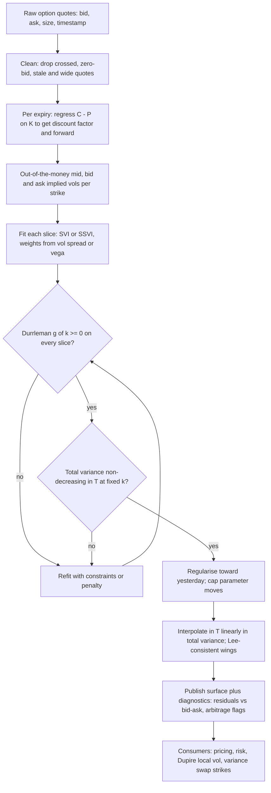

# Volatility Surface Construction and Arbitrage

## TL;DR

- Work in total implied variance $w(k, T) = \sigma^2(k, T)\,T$ against log forward moneyness $k = \ln(K/F_T)$: no calendar arbitrage means $w$ non-decreasing in $T$ at fixed $k$, and no butterfly arbitrage means Durrleman's $g(k) \ge 0$ on every slice.
- Raw SVI, $w(k) = a + b\big(\rho(k - m) + \sqrt{(k - m)^2 + \sigma^2}\big)$, has linear wings with slopes $b(1 \pm \rho)$ that respect Lee's bound when $b(1 + \lvert\rho\rvert) \le 2$; it fits a slice in five parameters and is linear in three of them, so calibration is fast and stable.
- A good fit is not an arbitrage-free fit: check $g(k)$ on a fine grid and total variance across expiries, or use SSVI, whose parameter conditions guarantee a surface free of static arbitrage.
- Dupire local variance is $\sigma_{loc}^2 = \partial_T w / g(k)$: calendar arbitrage makes the numerator negative, butterfly arbitrage the denominator, so a clean surface is a precondition for local vol.
- Local vol reprices every European by construction, but its local skew is about $2 - \alpha$ times the implied skew (2 for a flat skew term structure) and its forward smile flattens, which misprices forward-start and cliquet risk.

## Learning objectives

- Fit SVI slices and check for butterfly and calendar arbitrage.
- Derive Dupire local volatility and explain its forward-smile flaw.
- Engineer a production surface fitter: data cleaning, weighting, stability.
- Implement Dupire in both price form and total-variance form and verify it by Monte Carlo repricing.

## Core concepts

### Coordinates: total variance against forward moneyness

Fix an expiry $T$ with forward $F_T$ and discount factor $D_T$.
Quote everything in

$$
k = \ln\frac{K}{F_T}, \qquad w(k, T) = \sigma_{imp}^2(k, T)\,T.
$$

Total variance removes the trivial $\sqrt{T}$ scaling, and forward moneyness removes rates and dividends, so the two static no-arbitrage conditions take a clean form:

- Calendar: $\partial_T w(k, T) \ge 0$ at every fixed $k$ (with proportional dividends; with discrete cash dividends check prices, not vols).
- Butterfly: for each slice, call prices are convex in $K$, equivalently the risk-neutral density is non-negative.

A slice is a function of one variable, so the butterfly condition can be written directly in $w$ and its derivatives.

### Durrleman's condition

Write $w' = \partial_k w$ and $w'' = \partial_{kk}w$.
The Black-Scholes price as a function of $k$ and $w(k)$, differentiated twice in strike, gives the density of $k_T = \ln(S_T/F_T)$:

$$
p(k) = \frac{g(k)}{\sqrt{2\pi w(k)}}\exp\Big(-\frac{d_-(k)^2}{2}\Big), \qquad d_-(k) = -\frac{k}{\sqrt{w}} - \frac{\sqrt{w}}{2},
$$

$$
g(k) = \Big(1 - \frac{k w'}{2w}\Big)^2 - \frac{(w')^2}{4}\Big(\frac{1}{w} + \frac14\Big) + \frac{w''}{2}.
$$

A slice is free of butterfly arbitrage iff $g(k) \ge 0$ for all $k$ and $d_+(k) = -k/\sqrt{w} + \sqrt{w}/2 \to -\infty$ as $k \to \infty$ (Gatheral and Jacquier 2014, building on Durrleman).
The first term is the flat-smile density; a steep slope ($w'$ large) eats into it, and curvature ($w'' > 0$) adds back.
So a smile can be too steep for its level: a skew that falls faster than the density can support produces negative probabilities.

### Lee's wing bounds

Roger Lee's moment formula ties the wings to the moments of $S_T$: with $p^* = \sup\{p : E[S_T^{1 + p}] < \infty\}$,

$$
\limsup_{k \to \infty}\frac{w(k)}{k} = 2 - 4\big(\sqrt{p^{*2} + p^*} - p^*\big) \in [0, 2],
$$

and the analogous statement for negative moments on the left.
Practical reading: total variance can grow at most linearly in $\lvert k\rvert$ with slope at most 2, so implied vol grows at most like $\sqrt{2\lvert k\rvert/T}$.
Fat tails (few finite moments) push the slope toward 2; a slope above 2 is an arbitrage.

### Raw SVI

Gatheral's stochastic volatility inspired parameterisation (devised at Merrill Lynch in 1999, published in Gatheral 2004) for one slice:

$$
w(k) = a + b\Big(\rho(k - m) + \sqrt{(k - m)^2 + \sigma^2}\Big).
$$

| Parameter | Effect on the slice | Constraint |
| :--- | :--- | :--- |
| $a$ | vertical shift of total variance | $a + b\sigma\sqrt{1 - \rho^2} \ge 0$ (minimum variance non-negative) |
| $b$ | angle between the wings (overall wing steepness) | $b \ge 0$ |
| $\rho$ | rotation: skew; $\rho < 0$ steepens the left wing | $\lvert\rho\rvert < 1$ |
| $m$ | horizontal shift of the vertex | none |
| $\sigma$ | smoothness of the vertex (ATM curvature) | $\sigma > 0$ |

Asymptotically $w(k) \approx a - b(1 + \rho)m + b(1 + \rho)k$ on the right and $a + b(1 - \rho)m - b(1 - \rho)k$ on the left, so the wing slopes are $b(1 \pm \rho)$ and Lee's bound requires $b(1 + \lvert\rho\rvert) \le 2$.
The minimum of $w$ is $a + b\sigma\sqrt{1 - \rho^2}$, attained at $k = m - \rho\sigma/\sqrt{1 - \rho^2}$.
SVI is not arbitrage-free by construction: the five parameters can produce $g < 0$ with perfectly reasonable-looking smiles (the Vogt example below).
Gatheral and Jacquier (2011, Quantitative Finance) show SVI is the large-maturity limit of Heston's implied variance, which is one reason it fits equity slices well.

### Quasi-explicit calibration

Substitute $y = (k - m)/\sigma$:

$$
w = a + d\,y + c\sqrt{y^2 + 1}, \qquad c = b\sigma, \quad d = \rho b\sigma.
$$

For fixed $(m, \sigma)$ the slice is linear in $(a, d, c)$, so the inner problem is a weighted least squares solve (with the box $0 \le c \le 4\sigma$, $\lvert d\rvert \le c$, $\lvert d\rvert \le 4\sigma - c$ if it binds; the box encodes $b(1 + \lvert\rho\rvert) \le 4$, so impose Lee's tighter $b(1 + \lvert\rho\rvert) \le 2$ separately if you need it), and only a two-dimensional outer search over $(m, \sigma)$ remains (Zeliade 2009).
Recover $b = c/\sigma$ and $\rho = d/c$.
This is far more robust than a five-parameter Nelder-Mead from a random start, which routinely stalls in flat valleys.

### SSVI: a whole surface at once

Surface SVI (Gatheral and Jacquier 2014) parameterises every slice by the ATM total variance $\theta_t = w(0, t)$:

$$
w(k, \theta_t) = \frac{\theta_t}{2}\Big(1 + \rho\varphi(\theta_t)k + \sqrt{(\varphi(\theta_t)k + \rho)^2 + 1 - \rho^2}\Big).
$$

- No calendar arbitrage if $\partial_t\theta_t \ge 0$ and $0 \le \partial_\theta(\theta\varphi(\theta)) \le \frac{1}{\rho^2}\big(1 + \sqrt{1 - \rho^2}\big)\varphi(\theta)$.
- No butterfly arbitrage if $\theta\varphi(\theta)(1 + \lvert\rho\rvert) < 4$ and $\theta\varphi(\theta)^2(1 + \lvert\rho\rvert) \le 4$.

A popular choice is the power law $\varphi(\theta) = \eta\,\theta^{-\gamma}(1 + \theta)^{\gamma - 1}$ (Gatheral and Jacquier 2014, equation 4.5), which they show is free of static arbitrage provided $0 < \gamma \le 1/2$ and $\eta(1 + \lvert\rho\rvert) \le 2$ (for $\gamma > 1/2$ the butterfly term $\theta\varphi(\theta)^2(1 + \lvert\rho\rvert)$ grows like $\theta^{1 - 2\gamma}$ as $\theta \to 0$; with $\eta = 1$, $\rho = -0.7$ and $\gamma = 0.7$ it is 67.7 at $\theta = 10^{-4}$, far above 4): the ATM skew $\partial_k\sigma$ then scales like $\theta^{1/2 - \gamma}/\sqrt{t}$, about $t^{-\gamma}$ for short maturities, which matches the empirical decay of equity skew for $\gamma$ near $1/2$.
Desks typically fit SSVI first (three surface parameters plus the ATM term structure), then refine slice by slice with raw SVI under arbitrage constraints.

### Dupire local volatility

Dupire (1994), and Derman and Kani (1994) on trees, found the unique diffusion $dS/S = (r - q)\,dt + \sigma_{loc}(t, S)\,dW$ that reproduces every European price.
Derivation in three lines: by Tanaka, $d(S_t - K)^+ = \mathbf 1_{S_t > K}\,dS_t + \tfrac12\delta(S_t - K)\sigma_{loc}^2S_t^2\,dt$.
Take $Q$-expectations, use $\partial_K C = -e^{-rT}Q(S_T > K)$ and $\partial_{KK}C = e^{-rT}q_T(K)$, and account for discounting:

$$
\partial_T C = \tfrac12\sigma_{loc}^2(T, K)K^2\partial_{KK}C - (r - q)K\partial_K C - qC
\quad\Longrightarrow\quad
\sigma_{loc}^2(T, K) = \frac{\partial_T C + (r - q)K\partial_K C + qC}{\tfrac12K^2\partial_{KK}C}.
$$

Changing variables to $(k, w)$ (Gatheral 2006, chapter 1) gives the form desks implement, because $w$ is smooth and fitted analytically:

$$
\sigma_{loc}^2(k, T) = \frac{\partial_T w}{1 - \frac{k}{w}\partial_k w + \frac14\Big(-\frac14 - \frac1w + \frac{k^2}{w^2}\Big)(\partial_k w)^2 + \frac12\partial_{kk}w} = \frac{\partial_T w}{g(k)}.
$$

The denominator is exactly Durrleman's $g$.
So calendar arbitrage ($\partial_T w < 0$) and butterfly arbitrage ($g < 0$) are precisely the two ways local variance goes negative, and the price-form Dupire on raw, noisy quotes divides one noisy second difference by another: never compute it from raw prices.

Interpretation (Gyongy 1986): $\sigma_{loc}^2(t, K) = E^Q[\sigma_t^2 \mid S_t = K]$ for any stochastic-volatility model with the same Europeans.
Local vol is the Markovian projection of the true dynamics: right marginals, wrong transition law.

### Skew, smile dynamics and the forward smile

Implied vol is roughly the average of local vol along the most likely path from spot to strike.
At time $t$ that path sits at $k\,t/T$, so the implied ATM skew is a time-weighted average of the local skew $L(t) = \partial_k\sigma_{loc}(0, t)$:

$$
\partial_k\sigma_{imp}(0, T) \approx \frac{1}{T}\int_0^T\frac{t}{T}L(t)\,dt.
$$

For a constant local skew this gives the classical one-half rule.
If the implied skew decays like $T^{-\alpha}$, then $L(T) \approx (2 - \alpha)\,\partial_k\sigma_{imp}(0, T)$: local skew is twice the implied skew for a flat skew term structure and about 1.5 times for the empirical equity decay $\alpha \approx 1/2$.
The same heuristic gives the smile dynamics.
When log spot moves by $\delta x$, the new ATM implied vol averages the local vol along the flat path at the new spot, so it moves by $\delta x\,\frac1T\int_0^TL(t)\,dt$.
Dividing by the implied skew gives local vol's skew stickiness ratio

$$
R_T = \frac{\frac1T\int_0^TL(t)\,dt}{\partial_k\sigma_{imp}(0, T)} = 1 + \frac{\int_0^T\partial_k\sigma_{imp}(0, t)\,dt}{T\,\partial_k\sigma_{imp}(0, T)},
$$

which is 2 for a flat skew term structure (the short-maturity limit Bergomi derives for local vol) and $(2 - \alpha)/(1 - \alpha)$ for a $T^{-\alpha}$ decay: 3 at $\alpha = 1/2$.
So the ATM vol moves by more than the local-to-implied skew ratio $2 - \alpha$; compare the sticky-strike ($R = 1$) and sticky-delta ($R = 0$) regimes in [Implied Volatility and the Smile](07-Implied-Volatility-and-the-Smile.md).

Two consequences of the projection:

- Smile dynamics: when spot falls, local vol predicts the smile shifts the opposite way to the move (Hagan et al. 2002), so local-vol delta differs from the market's realised behaviour; desks often hedge with a skew-stickiness ratio estimated from history instead.
- Forward smile: local vol is a deterministic function whose skew decays with $t$ when the implied skew decays with $T$, so smiles seen from future dates are much flatter than today's.
  Forward-start options and cliquets, which are bets on future smiles, come out mispriced; stochastic vol (or local-stochastic vol) keeps the forward smile roughly stationary.

### Production surface engineering

- Forwards first: put-call parity $C - P = D_T(F_T - K)$ holds model-free, so regress $C - P$ on $K$ across strikes near the money; the slope is $-D_T$ and the intercept $D_TF_T$.
  This implied forward absorbs dividends and borrow, which is why a wrong forward shows up as a call-put vol mismatch.
- Use out-of-the-money options only (calls above the forward, puts below): they are the liquid ones, and for American single-stock options they carry almost no early-exercise premium; de-Americanise the rest with a tree before inverting.
- Weights: fit in vol with weights inversely proportional to the bid-ask width in vol, or fit vega-weighted price errors (which is the same to first order); never weight deep wings equal to ATM.
- Accept a fit when residuals sit inside the bid-ask, not when the RMSE is small: an inside-the-spread fit with a smooth shape beats a tighter fit that wiggles.
- Stability: penalise distance from yesterday's parameters, because Greeks and P&L explain move with the surface; a parameter jump with an unchanged market is a fitter bug that shows up as fake vega P&L.
- Time interpolation: linear in total variance at fixed $k$ preserves monotonicity in $T$; interpolating vol, or interpolating at fixed strike, can create calendar arbitrage.
  Event days (earnings, central banks) add a variance bump to the slices that span them.
- Extrapolation: beyond the last liquid strike continue with linear total variance whose slope respects Lee's bound; flat-vol extrapolation underprices wings and breaks variance swap strikes (see [Variance Swaps](14-Variance-Swaps-and-Volatility-Products.md)).
- The surface is shared infrastructure: [Curve and Surface Service](../18-Pricing-and-Risk-Systems/04-Curve-and-Surface-Service.md) covers dependency graphs, incremental rebuilds and Jacobians.

## Worked examples

All numbers come from [vol_surface_svi_dupire.py](code/vol_surface_svi_dupire.py).

### Example 1: reading an SVI slice

"Six-month slice, $(a, b, \rho, m, \sigma) = (0.012, 0.06, -0.7, 0.02, 0.12)$. Describe it."
ATM-forward total variance $w(0) = a + b(-\rho m + \sqrt{m^2 + \sigma^2})$ gives an ATM vol of 20.07%.
Minimum variance $a + b\sigma\sqrt{1 - \rho^2} = 0.017142 > 0$, so variance never goes negative.
Wing slopes: right $b(1 + \rho) = 0.018$, left $b(1 - \rho) = 0.102$, both far below Lee's 2; the much steeper left wing is an equity skew.
On a grid over $k \in [-1.5, 1.5]$ the minimum of $g$ is 0.2795, so the slice is butterfly-free.

### Example 2: fitting noisy quotes

Generate 27 quotes for $k \in [-0.4, 0.25]$ from that slice, add Gaussian noise of 0.2 vol points (seed 2024), weight by $e^{-k^2/(2 \cdot 0.2^2)}$, and run the quasi-explicit fit.
It returns $(a, b, \rho, m, \sigma) = (0.0125, 0.0590, -0.7100, 0.0238, 0.1065)$.
RMSE against the noisy quotes is 0.18 vol points (the noise level, as it should be), and the fitted slice is within 0.13 vol points of the true one everywhere on the quoted range.
The fitted slice has minimum $g = 0.2825$ and $b(1 + \lvert\rho\rvert) = 0.1009$: no butterfly arbitrage and wings well inside Lee.
Note $m$ and $\sigma$ moved more than the vols did: SVI parameters are weakly identified individually, which is why production fitters regularise them toward yesterday.

### Example 3: a good-looking slice with butterfly arbitrage

Gatheral and Jacquier (2014) reproduce a slice from Axel Vogt with $T = 1$ and $(a, b, \rho, m, \sigma) = (-0.0410, 0.1331, 0.3060, 0.3586, 0.4153)$.
The smile looks smooth, but on a fine grid $g(k)$ is negative from $k = 0.64$ to $k = 1.26$, with minimum $-0.0329$ at $k = 0.88$.
Translating to prices with $F = 1$ and zero rates: the density $\partial_{KK}C$ on a uniform strike grid reaches $-5.77 \times 10^{-5}$ at $K = 2.20$, and the butterfly long the 2.19 and 2.21 calls, short two 2.20 calls, costs $-5.77 \times 10^{-9}$ per unit.
Tiny, but a negative price for a non-negative payoff: an arbitrage, and a negative local variance under Dupire.
The lesson: never ship a slice without evaluating $g$ on a fine grid well beyond the quoted strikes.

### Example 4: calendar arbitrage between two slices

Slices $(0.010, 0.08, -0.6, 0, 0.10)$ at 3 months and $(0.022, 0.05, -0.2, 0, 0.10)$ at 6 months.
At the money the 6-month slice has more total variance ($w_2 - w_1 = 0.009$), so an ATM-only check passes.
But the 3-month slice has the steeper left wing: $w_2 - w_1$ turns negative for $k$ below $-0.16$ and reaches $-0.0290$ on $[-0.6, 0.6]$.
At matched forward moneyness below that point the 3-month put is worth more in total variance than the 6-month put: sell the short-dated, buy the long-dated, scaled by the forward ratio.
Calendar checks must run at every $k$, not only ATM.

### Example 5: an SSVI surface and Dupire two ways

SSVI with $\rho = -0.7$, $\eta = 1$, $\gamma = 0.4$ and ATM total variance $\theta_t = 0.05t + (0.03 - 0.05)(1 - e^{-t})$; spot 100, $r = 3\%$, $q = 1\%$.
ATM-forward vols rise from 17.97% at 3 months to 18.51%, 19.33% and 20.34% at 6 months, 1 year and 2 years.
Gatheral-Jacquier conditions: $\max_t \theta\varphi(1 + \lvert\rho\rvert) = 0.47 < 4$ and $\max_t \theta\varphi^2(1 + \lvert\rho\rvert) = 0.98 \le 4$; on a grid of $t \in [0.02, 3]$ and $k \in [-1.5, 1]$ the minimum $g$ is 0.2655 and the minimum $\partial_t w$ is 0.0143, so the surface is free of static arbitrage.

Local vol from the analytic $w$-form and from central finite differences of Black-Scholes prices (price form, with the $r$ and $q$ terms):

| $T$ | $K$ | Implied | Local ($w$-form) | Local (price form) |
| ---: | ---: | ---: | ---: | ---: |
| 0.25 | 80 | 26.85 | 35.01 | 35.01 |
| 0.25 | 90 | 22.55 | 27.03 | 27.03 |
| 0.25 | 100 | 18.19 | 18.92 | 18.92 |
| 0.25 | 110 | 14.42 | 12.93 | 12.93 |
| 0.25 | 120 | 12.90 | 12.43 | 12.43 |
| 1.00 | 80 | 25.05 | 31.74 | 31.74 |
| 1.00 | 90 | 22.37 | 26.52 | 26.52 |
| 1.00 | 100 | 19.82 | 21.57 | 21.57 |
| 1.00 | 110 | 17.50 | 17.30 | 17.30 |
| 1.00 | 120 | 15.63 | 14.44 | 14.44 |

The two forms agree to 0.0003 vol points.
Local vol is far steeper than implied (35.01 against 26.85 at the 3-month 80 strike): implied vol averages local vol between spot and strike.

### Example 6: local-vol Monte Carlo reprices the surface

Simulate $d\ln(S_t/F_t) = -\tfrac12\sigma_{loc}^2\,dt + \sigma_{loc}\,dW$ with 250 log-Euler steps per year and $2 \times 100{,}000$ antithetic paths (seed 7), evaluating $\sigma_{loc}$ from the $w$-form at each step.

| $T$ | | 80 | 90 | 100 | 110 | 120 |
| :--- | :--- | ---: | ---: | ---: | ---: | ---: |
| 0.5 | MC implied | 25.55 | 22.20 | 18.87 | 15.89 | 13.95 |
| 0.5 | Input | 25.61 | 22.19 | 18.84 | 15.83 | 13.89 |
| 1.0 | MC implied | 24.96 | 22.34 | 19.81 | 17.49 | 15.61 |
| 1.0 | Input | 25.05 | 22.37 | 19.82 | 17.50 | 15.63 |

The largest gap is about 0.08 vol points.
This is the acceptance test for any local-vol implementation: if the model does not give back the surface it was built from, the surface or the Dupire code is wrong.

### Example 7: skew ratio and the forward smile

Local skew over implied skew at the money, from the same code:

| Skew term structure | $T$ | Implied ATM skew $\partial_k\sigma$ | Local / implied |
| :--- | ---: | ---: | ---: |
| flat ($\gamma = 0$) | 0.001 | -0.0606 | 2.00 |
| flat ($\gamma = 0$) | 1 | -0.0652 | 2.11 |
| power law ($\gamma = 0.4$) | 0.0001 | -9.8125 | 1.63 |
| power law ($\gamma = 0.4$) | 0.01 | -1.5554 | 1.68 |
| power law ($\gamma = 0.4$) | 0.25 | -0.4303 | 1.79 |
| power law ($\gamma = 0.4$) | 1 | -0.2465 | 1.89 |

With a flat skew term structure the short-maturity ratio is the textbook 2; with skew decaying like $T^{-0.4}$ it tends to $2 - 0.4 = 1.6$.
Integrating the same local skews in time gives the heuristic skew stickiness ratio $R_T$: 2.00 for the flat skew at $T = 0.001$, and 2.68 for the power law at $T = 10^{-6}$, against the limit $(2 - 0.4)/(1 - 0.4) = 2.67$.

Forward smile: in the same simulation, a forward-start call on $S_1/S_{0.5}$ struck at 90%, 100% and 110% of the forward gives forward implied vols of about 23.46%, 20.93% and 19.52%, a 90-110 skew of about 3.94 vol points.
Today's 6-month smile at the same moneyness is 21.88%, 18.51% and 15.55%, a skew of 6.33.
Local vol predicts that in six months the 6-month skew will be about 38% flatter than it is today, although nothing in the market says so; a cliquet or forward-start priced on this model is priced off that flatter forward skew.

## Pitfalls

- Fitting in vol against strike rather than total variance against forward moneyness, then interpolating in vol across expiries; that is how calendar arbitrage enters a surface that was clean slice by slice.
- Checking Durrleman's $g$ only at quoted strikes; arbitrage often hides between or beyond them, as in the Vogt slice.
- Checking calendar arbitrage only at the money; wings cross first.
- Computing Dupire from raw prices with finite differences: the second strike derivative in the denominator amplifies noise into negative or infinite local variances.
- Flat-vol extrapolation of the wings: Lee allows it, but it imposes thin lognormal tails beyond the last quote, underprices the wings and biases variance swap strikes low.
- Weighting every quote equally: a wide, stale wing quote then drags the ATM fit.
- Re-fitting from scratch every day with a global optimiser: parameters jump between equivalent minima and the Greeks jump with them.
- Using a wrong forward (stale dividend, ignored borrow): calls and puts then imply different vols and the fitter "sees" skew that is not there.
- Trusting local vol for forward-starting or path-dependent smile risk; it matches today's Europeans only.

## Interview questions

> [!question]- deriv-svi-raw-params | Write raw SVI and say what each parameter does.
> $w(k) = a + b(\rho(k - m) + \sqrt{(k - m)^2 + \sigma^2})$ in total variance against $k = \ln(K/F)$.
> $a$ level, $b$ wing steepness, $\rho$ skew (rotation), $m$ horizontal shift, $\sigma$ ATM smoothness; constraints $b \ge 0$, $\lvert\rho\rvert < 1$, $\sigma > 0$, $a + b\sigma\sqrt{1 - \rho^2} \ge 0$.

> [!question]- deriv-svi-wing-slopes | What are the asymptotic wing slopes of an SVI slice and what bounds them?
> $b(1 + \rho)$ on the right and $b(1 - \rho)$ on the left, in total variance per unit of log-moneyness.
> Lee's moment formula caps total variance slopes at 2, so $b(1 + \lvert\rho\rvert) \le 2$; implied vol can grow at most like $\sqrt{2\lvert k\rvert/T}$.

> [!question]- deriv-svi-lee-moment | State Roger Lee's moment formula and its practical use.
> $\limsup_{k\to\infty} w(k)/k = 2 - 4(\sqrt{p^{*2} + p^*} - p^*)$ with $p^*$ the largest $p$ with $E[S_T^{1+p}] < \infty$; similarly on the left with negative moments.
> It bounds wing slopes in $[0, 2]$ and links them to tail heaviness, so it sets how you extrapolate beyond the last quoted strike.

> [!question]- deriv-svi-durrleman | What is Durrleman's condition, and why does it detect butterfly arbitrage?
> $g(k) = (1 - kw'/(2w))^2 - (w')^2/4\,(1/w + 1/4) + w''/2 \ge 0$.
> The density of $\ln(S_T/F)$ equals $g(k)/\sqrt{2\pi w}\,e^{-d_-^2/2}$, so $g < 0$ is a negative density, i.e. a butterfly with negative price.

> [!question]- deriv-svi-vogt | An SVI slice fits all quotes within the bid-ask. Can it still be arbitrageable? Give the check.
> Yes: Vogt's slice $(-0.0410, 0.1331, 0.3060, 0.3586, 0.4153)$ looks smooth but has $g < 0$ for $k$ in $(0.64, 1.26)$, minimum $-0.0329$.
> Evaluate $g$ on a fine grid well beyond the quoted strikes; in price terms the 2.19/2.20/2.21 butterfly there costs $-5.77 \times 10^{-9}$.

> [!question]- deriv-svi-quasi-explicit | Why is SVI calibration fast and stable when done the quasi-explicit way?
> With $y = (k - m)/\sigma$ the slice is $a + dy + c\sqrt{y^2 + 1}$, linear in $(a, d, c)$ for fixed $(m, \sigma)$.
> Solve that weighted least squares exactly and search only over $(m, \sigma)$ in two dimensions, instead of a five-dimensional non-convex search.

> [!question]- deriv-surface-coordinates | Why do surface builders work in total variance and forward log-moneyness?
> $w = \sigma^2T$ removes the $\sqrt{T}$ scaling and $k = \ln(K/F)$ removes carry, so calendar no-arbitrage is simply $\partial_T w \ge 0$ at fixed $k$ and butterfly is $g(k) \ge 0$.
> Interpolating total variance linearly in $T$ at fixed $k$ also preserves monotonicity.

> [!question]- deriv-surface-calendar-check | At-the-money total variance rises from 3m to 6m. Does that rule out calendar arbitrage?
> No: the condition is at every $k$.
> In the worked pair the ATM gap is $+0.009$ but the steeper 3-month left wing crosses below $k = -0.16$, reaching $w_2 - w_1 = -0.0290$.
> Sell the short-dated, buy the long-dated option at matched forward moneyness.

> [!question]- deriv-surface-forward-from-parity | How do you get the forward and discount factor for an expiry from listed options?
> Regress $C - P$ on $K$ over near-the-money strikes: $C - P = D_T(F_T - K)$, so the slope is $-D_T$ and the intercept $D_TF_T$.
> The implied forward includes dividends and borrow; a stale forward shows up as different call and put vols at one strike.

> [!question]- deriv-surface-weights-stability | How should a production fitter weight quotes, and how do you keep the surface stable day to day?
> Weight by inverse bid-ask width in vol (or vega-weight price errors), use out-of-the-money quotes, and accept fits inside the spread rather than minimising RMSE.
> Penalise distance from yesterday's parameters and cap moves, because a parameter jump with an unchanged market becomes fake vega P&L.

> [!question]- deriv-surface-ssvi | What is SSVI and why use it over independent SVI slices?
> $w(k, \theta_t) = \tfrac{\theta_t}{2}(1 + \rho\varphi k + \sqrt{(\varphi k + \rho)^2 + 1 - \rho^2})$ with $\theta_t$ the ATM total variance.
> Simple parameter conditions (e.g. $\theta\varphi(1 + \lvert\rho\rvert) < 4$, $\theta\varphi^2(1 + \lvert\rho\rvert) \le 4$, $\theta_t$ increasing) guarantee no static arbitrage across the whole surface.

> [!question]- deriv-dupire-formula | State Dupire's formula with rates and dividends.
> $\sigma_{loc}^2(T, K) = \dfrac{\partial_T C + (r - q)K\partial_K C + qC}{\tfrac12K^2\partial_{KK}C}$.
> It follows from the forward equation $\partial_T C = \tfrac12\sigma_{loc}^2K^2C_{KK} - (r - q)KC_K - qC$, derived with Tanaka's formula on $(S_T - K)^+$.

> [!question]- deriv-dupire-w-form | Write local variance in terms of total implied variance and interpret numerator and denominator.
> $\sigma_{loc}^2 = \partial_T w / g(k)$ with $g$ Durrleman's function.
> Calendar arbitrage makes the numerator negative and butterfly arbitrage the denominator, so local vol exists iff the surface is free of static arbitrage.

> [!question]- deriv-dupire-markovian-projection | What is the relation between local vol and a stochastic-vol model with the same European prices?
> $\sigma_{loc}^2(t, K) = E^Q[\sigma_t^2 \mid S_t = K]$ (Gyongy's Markovian projection).
> The two models share all one-dimensional marginals, so Europeans agree, but transition laws, forward smiles and path-dependent prices differ.

> [!question]- deriv-dupire-skew-ratio | How does the ATM local-vol skew compare with the implied skew?
> About twice the implied skew for a flat skew term structure; if implied skew decays like $T^{-\alpha}$ the ratio is about $2 - \alpha$.
> Implied skew at $T$ is a $t/T$-weighted average of local skew; the worked surface gives 2.00 with flat skew and 1.63 at short maturity with $\alpha = 0.4$.

> [!question]- deriv-dupire-forward-smile | What is local vol's forward-smile problem and which products does it hurt?
> Local skew decays with time, so smiles seen from future dates are flatter than today's: in the worked surface the 6-month skew in six months is about 3.94 vol points against 6.33 today.
> Forward-start options, cliquets and other forward-skew products are mispriced; stochastic or local-stochastic vol keeps the forward smile roughly stationary.

> [!question]- deriv-dupire-raw-prices | Why should you never compute Dupire local vol by finite differences on market prices?
> The denominator is a second strike derivative of noisy, discretely spaced quotes; noise and bid-ask make it tiny, negative or wildly oscillating.
> Fit an arbitrage-free parametric surface first, then differentiate it analytically (the $w$-form).

> [!question]- deriv-dupire-validation | You have built a local-vol model. What is the first test you run?
> Reprice the Europeans it was calibrated to by Monte Carlo or PDE and compare implied vols; errors should be at the discretisation level.
> In the worked example 250 steps per year and 200,000 paths reproduce the surface within about 0.08 vol points.

> [!question]- deriv-dupire-smile-dynamics | Under a local-vol model calibrated today, what happens to the smile when spot falls?
> The smile moves the opposite way to the spot move (Hagan et al. 2002), and the ATM vol moves by the time-averaged local skew: a skew stickiness ratio $R_T = 1 + \int_0^T\psi(t)\,dt/(T\psi(T))$ times the implied skew $\psi$ per unit of log spot.
> That is 2 for a flat skew term structure and $(2 - \alpha)/(1 - \alpha)$ for skew decaying like $T^{-\alpha}$ (2.68 computed for $\alpha = 0.4$ at $T = 10^{-6}$); desks compare it with the ratio estimated from history.

## In this repo and SDE-Interview-Prep

- Prev: [Implied Volatility and the Smile](07-Implied-Volatility-and-the-Smile.md). Next: [Stochastic Volatility: Heston and SABR](09-Stochastic-Volatility-Heston-and-SABR.md).
- Code: [vol_surface_svi_dupire.py](code/vol_surface_svi_dupire.py) (SVI fit, Durrleman and calendar checks, SSVI, Dupire both ways, local-vol Monte Carlo, forward smile), using [pricing_core.py](code/pricing_core.py).
- Monte Carlo technique for the repricing test: [Monte Carlo Pricing and Variance Reduction](10-Monte-Carlo-Pricing-and-Variance-Reduction.md); PDE pricing under local vol: [Finite Differences and Fourier Pricing](11-Finite-Differences-and-Fourier-Pricing.md).
- Why the wings matter for variance strikes: [Variance Swaps and Volatility Products](14-Variance-Swaps-and-Volatility-Products.md).
- Systems view of surface building: [Curve and Surface Service](../18-Pricing-and-Risk-Systems/04-Curve-and-Surface-Service.md).

## Further reading

- Jim Gatheral, *The Volatility Surface: A Practitioner's Guide* (Wiley 2006), chapter 1 (local volatility and the $w$-form of Dupire), chapter 2 (Heston) and chapter 3 (SVI and skew relations).
- J. Gatheral and A. Jacquier (2014), "Arbitrage-free SVI volatility surfaces", *Quantitative Finance* 14(1).
- B. Dupire (1994), "Pricing with a smile", *Risk* 7(1).
- E. Derman and I. Kani (1994), "Riding on a smile", *Risk* 7(2).
- V. Durrleman (2010), "From implied to spot volatilities", *Finance and Stochastics* 14(2).
- R. Lee (2004), "The moment formula for implied volatility at extreme strikes", *Mathematical Finance* 14(3).
- Zeliade Systems (2009), "Quasi-explicit calibration of Gatheral's SVI model", white paper.
- I. Gyongy (1986), "Mimicking the one-dimensional marginal distributions of processes having an Ito differential", *Probability Theory and Related Fields* 71.
- P. Hagan, D. Kumar, A. Lesniewski and D. Woodward (2002), "Managing smile risk", *Wilmott Magazine*, for the critique of local-vol smile dynamics.
- Lorenzo Bergomi, *Stochastic Volatility Modeling* (CRC 2016), chapter 2, on local volatility and its skew stickiness ratio.
