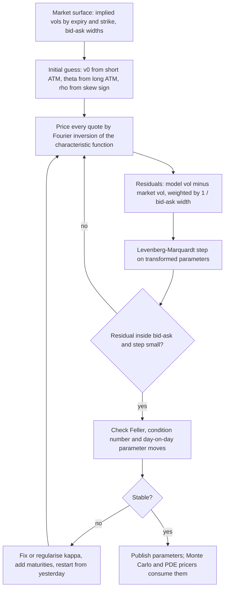

# Stochastic Volatility: Heston and SABR

## TL;DR

- Heston: $dS/S = (r - q)\,dt + \sqrt{v}\,dW_1$, $dv = \kappa(\theta - v)\,dt + \xi\sqrt{v}\,dW_2$, $d\langle W_1, W_2\rangle = \rho\,dt$; $\rho$ sets the skew, $\xi$ the smile curvature, $\kappa$ how fast both fade with maturity, $v_0$ and $\theta$ the short and long vol levels.
- Heston is affine, so its characteristic function is closed form (Riccati ODEs) and Europeans price by one Fourier integral; use the "little trap" form to stay on the right branch of the complex log.
- Calibrated equity parameters usually violate Feller ($2\kappa\theta < \xi^2$), so simulation needs full truncation or Andersen's QE scheme; Euler with too few steps is visibly biased.
- Heston's short-dated ATM skew tends to the constant $\rho\xi/(4\sqrt{v_0})$, while market skew keeps steepening as expiry shrinks: Heston cannot fit short and long expiries at once.
- SABR: $dF = \alpha F^\beta\,dW$, $d\alpha = \nu\alpha\,dZ$; Hagan's formula gives the implied vol in closed form; $\beta$ sets the backbone (how ATM vol moves with the forward), $\rho$ the skew, $\nu$ the curvature; it is accurate at short expiries, drifts at long ones, implies negative densities at low strikes, and needs a shift for negative rates.

## Learning objectives

- Write the Heston dynamics and explain each parameter's effect on the smile.
- Price Heston by characteristic function and calibrate it.
- Use Hagan's SABR approximation and its parameters for rates smiles.
- Verify a semi-closed-form price against Monte Carlo and know when each SABR approximation breaks.

## Core concepts

### Why stochastic volatility

Local vol (see [Volatility Surface Construction](08-Volatility-Surface-Construction.md)) fits today's Europeans exactly but gives the wrong dynamics: forward smiles flatten and the smile moves against the spot.
Stochastic volatility adds a second factor so that the smile is generated by a mechanism (spot-vol correlation for skew, vol-of-vol for curvature) and is roughly preserved through time.
The cost: the market is incomplete with only the stock, so you hedge vega with other options, and you get a price only after calibrating to them.

### Heston dynamics

Under the pricing measure $Q$:

$$
\frac{dS_t}{S_t} = (r - q)\,dt + \sqrt{v_t}\,dW_1, \qquad dv_t = \kappa(\theta - v_t)\,dt + \xi\sqrt{v_t}\,dW_2, \qquad d\langle W_1, W_2\rangle_t = \rho\,dt.
$$

The variance is a CIR process (see [Stochastic Differential Equations](../04-Stochastic-Calculus/03-Stochastic-Differential-Equations.md)): $E[v_t] = \theta + (v_0 - \theta)e^{-\kappa t}$, and it stays strictly positive iff the Feller condition $2\kappa\theta \ge \xi^2$ holds.
Equity calibrations typically need large $\xi$ to produce the observed curvature, and violate Feller; zero is then attainable but reflecting.
The variance swap strike is model-free given the smile and in Heston equals the average expected variance $\theta + (v_0 - \theta)(1 - e^{-\kappa T})/(\kappa T)$.

| Parameter | Smile effect |
| :--- | :--- |
| $v_0$ | level of short-dated vols |
| $\theta$ | level of long-dated vols |
| $\kappa$ | speed at which the term structure reverts and the smile flattens with maturity |
| $\xi$ | curvature (wings), and with $\rho \ne 0$ the steepness of the skew |
| $\rho$ | skew: $\rho < 0$ makes vol rise when spot falls, fattening the left tail |

The market price of volatility risk is absorbed in the $Q$-parameters: $\kappa$ and $\theta$ under $Q$ are not the historical ones (see [Change of Measure and Girsanov](../04-Stochastic-Calculus/05-Change-of-Measure-and-Girsanov.md)).

### The characteristic function

$(\ln S, v)$ is an affine process, so $\varphi(u) = E^Q[e^{iu\ln(S_T/S_0)}]$ is exponential-affine in $v_0$.
Guess $\varphi = \exp(iu(r - q)T + C(T) + D(T)v_0)$; by Feynman-Kac the generator gives the Riccati equations

$$
D' = -\tfrac12(u^2 + iu) - (\kappa - \rho\xi iu)D + \tfrac12\xi^2D^2, \qquad C' = \kappa\theta D, \qquad C(0) = D(0) = 0.
$$

With $b = \kappa - \rho\xi iu$, $d = \sqrt{b^2 + \xi^2(u^2 + iu)}$ and $g = (b - d)/(b + d)$:

$$
D(T) = \frac{b - d}{\xi^2}\,\frac{1 - e^{-dT}}{1 - ge^{-dT}}, \qquad C(T) = \frac{\kappa\theta}{\xi^2}\Big((b - d)T - 2\ln\frac{1 - ge^{-dT}}{1 - g}\Big).
$$

This is the "little trap" form of Albrecher et al. (2007); Heston's original form uses $1/g$ and $e^{+dT}$, and its complex logarithm jumps branches for long maturities, producing discontinuous prices unless you track the branch.

### From characteristic function to prices

Heston's original representation is a share-measure and a risk-neutral probability:

$$
C = S_0e^{-qT}P_1 - Ke^{-rT}P_2, \qquad P_j = \frac12 + \frac1\pi\int_0^\infty\text{Re}\Big[\frac{e^{-iu\ln K}f_j(u)}{iu}\Big]du,
$$

with $f_2(u) = E[e^{iu\ln S_T}]$ and $f_1(u) = f_2(u - i)/f_2(-i)$ (Gil-Pelaez inversion).
$P_2 = Q(S_T > K)$ and $P_1$ is the exercise probability with the stock as numeraire, the same $N(d_1)$ versus $N(d_2)$ split as Black-Scholes.
Lewis (2001) writes the call as a single integral, $C = e^{-rT}\big[F - \frac{\sqrt{FK}}{\pi}\int_0^\infty\text{Re}\big(e^{iu\ln(F/K)}\varphi_Y(u - i/2)\big)\frac{du}{u^2 + 1/4}\big]$ with $Y = \ln(S_T/F)$, which is better behaved and is what [pricing_core.py](code/pricing_core.py) uses; FFT and COS versions are in [Finite Differences and Fourier Pricing](11-Finite-Differences-and-Fourier-Pricing.md).

### Simulation

Euler on $v$ goes negative; the fixes, in increasing quality:

- Full truncation (Lord, Koekkoek and van Dijk 2010): use $v^+ = \max(v, 0)$ in drift and diffusion but keep $v$ itself; least biased of the simple fixes.
- Andersen's QE scheme (2008): match the first two moments of the exact non-central chi-squared transition with a quadratic-normal or exponential mixture; accurate with few steps and the production default.
- Broadie and Kaya (2006): exact sampling of $v_T$ and $\int v\,dt$; unbiased but slow.

Simulate $\ln S$, not $S$, and correlate the increments as $Z_v = \rho Z_1 + \sqrt{1 - \rho^2}Z_2$.

### Smile shape and its failures

- The skew comes from $\rho$: when $\rho < 0$, down moves coincide with rising variance, so the left tail is fat.
- The curvature comes from $\xi$: random variance makes returns a variance mixture of normals, which has excess kurtosis.
- Mean reversion averages variance shocks over the option's life, so smile effects decay with maturity; long-dated skew falls to zero, like $1/T$ asymptotically (Gatheral 2006, chapter 3).
- Short end: as $T \to 0$ the ATM skew tends to the constant $\partial_k\sigma = \rho\xi/(4\sqrt{v_0})$ (Gatheral 2006, chapter 3), whereas market skew keeps steepening, empirically closer to $T^{-1/2}$ (see [Implied Volatility and the Smile](07-Implied-Volatility-and-the-Smile.md)).
  Fixes: add jumps (Bates 1996) for the short end, time-dependent parameters, or rough volatility (Gatheral, Jaisson and Rosenbaum 2018), whose skew scales like $T^{H - 1/2}$.

### Calibration

- Optimise unconstrained transforms ($\ln\kappa$, $\ln\theta$, $\ln\xi$, $\ln v_0$, $\text{atanh}\,\rho$) so the step never leaves the domain.
- Fit vols (or vega-weighted prices), not raw prices, or the ITM and long-dated options dominate.
- $\kappa$, $\theta$ and $v_0$ trade off: a single expiry pins only a few smile features, so many parameter sets fit it; use several expiries and regularise toward yesterday.
- Five parameters cannot fit a whole equity surface within the bid-ask; desks use Heston for its dynamics and structure, or as the stochastic part of a local-stochastic-vol model whose leverage function restores the exact fit.

### SABR

Hagan, Kumar, Lesniewski and Woodward (2002) model a forward (swap rate, forward FX, forward price) under its own forward or annuity measure, where it is a martingale:

$$
dF_t = \alpha_tF_t^\beta\,dW_t, \qquad d\alpha_t = \nu\alpha_t\,dZ_t, \qquad d\langle W, Z\rangle_t = \rho\,dt.
$$

Singular perturbation gives the Black implied vol in closed form, with $z = \frac{\nu}{\alpha}(FK)^{(1 - \beta)/2}\ln\frac FK$ and $x(z) = \ln\frac{\sqrt{1 - 2\rho z + z^2} + z - \rho}{1 - \rho}$:

$$
\sigma_B(K) = \frac{\alpha}{(FK)^{\frac{1 - \beta}{2}}\Big[1 + \frac{(1 - \beta)^2}{24}\ln^2\frac FK + \frac{(1 - \beta)^4}{1920}\ln^4\frac FK\Big]}\,\frac{z}{x(z)}\,\Big[1 + \Big(\frac{(1 - \beta)^2\alpha^2}{24(FK)^{1 - \beta}} + \frac{\rho\beta\nu\alpha}{4(FK)^{\frac{1 - \beta}{2}}} + \frac{2 - 3\rho^2}{24}\nu^2\Big)T\Big].
$$

At the money $z/x(z) \to 1$ and

$$
\sigma_{ATM} = \frac{\alpha}{F^{1 - \beta}}\Big[1 + \Big(\frac{(1 - \beta)^2\alpha^2}{24F^{2 - 2\beta}} + \frac{\rho\beta\nu\alpha}{4F^{1 - \beta}} + \frac{2 - 3\rho^2}{24}\nu^2\Big)T\Big],
$$

a cubic in $\alpha$, so desks quote $(\beta, \rho, \nu)$ and back $\alpha$ out of the ATM vol.

- $\beta$ sets the backbone: to leading order $\sigma_{ATM} \approx \alpha/F^{1 - \beta}$, so with $\alpha$ fixed the ATM vol moves like $F^{\beta - 1}$ as the forward moves; $\beta = 1$ is a flat (sticky-delta-like) backbone, $\beta = 0$ a normal one with constant basis-point vol.
- $\beta$ and $\rho$ both make skew, so they are nearly redundant on one day's smile; fix $\beta$ from the historical backbone (or by convention) and calibrate $\alpha, \rho, \nu$.
- Delta: the backbone enters the hedge through $\partial\sigma/\partial F$; Bartlett (2006) adds the part of the $\alpha$ move correlated with $F$, which improves hedges materially.
- Weaknesses: the expansion is in $\nu^2T$, so it degrades at long expiries; it ignores the absorbing boundary at zero, so the implied density goes negative at low strikes; and $F^\beta$ needs $F > 0$.
- Negative rates: shifted SABR applies the model to $F + s$ and $K + s$ with a fixed shift $s$ and quotes shifted Black vols; alternatively use $\beta = 0$ (normal SABR) and Hagan's normal-vol expansion, which allows negative forwards.
  Rates conventions are in [Rates Volatility and SABR](../06-Fixed-Income-and-Asset-Classes/18-Rates-Volatility-and-SABR.md).
- Arbitrage-free SABR (Hagan et al. 2014) solves the effective one-dimensional forward equation for the density with the boundary at zero treated properly, removing the negative density.

| | Local vol | Heston | SABR |
| :--- | :--- | :--- | :--- |
| Fits today's Europeans | exactly | approximately (5 parameters) | per expiry, very well |
| Forward smile | flattens | roughly stationary | per expiry only, no term structure |
| Typical use | exotics needing exact vanilla fit | equity exotics, LSV base | rates and FX smiles per expiry |
| Pricing engine | PDE or MC | Fourier for Europeans, MC or PDE for exotics | closed-form implied vol |

## Worked examples

All numbers come from [heston_sabr.py](code/heston_sabr.py), using [pricing_core.py](code/pricing_core.py) for Black-Scholes, implied vols and the Lewis integral.
Heston base case: $S_0 = 100$, $r = 2\%$, $q = 0$, $\kappa = 1.5$, $\theta = 0.04$, $\xi = 0.6$, $\rho = -0.7$, $v_0 = 0.04$, $T = 1$.

### Example 1: price a Heston call two ways

Feller: $2\kappa\theta = 0.12 < \xi^2 = 0.36$, violated, as is typical.
Lewis single-integral prices for strikes 80, 90, 100, 110, 120: 23.2796, 15.0161, 7.9561, 3.0102, 0.8044.
Heston's $P_1$/$P_2$ form reproduces every price to better than $10^{-8}$; at $K = 100$, $P_1 = 0.6982$ and $P_2 = 0.6311$.
$P_1 > P_2$ for the same reason $N(d_1) > N(d_2)$: weighting paths by $S_T$ favours the ones that finish high.
Implied vols: 23.89%, 20.68%, 17.54%, 14.85%, 13.44%, a steep equity skew from $\rho = -0.7$.
Sanity limits: integrating the $1/K^2$ strip of these Heston prices gives a variance swap strike of 0.04000 (20.00 vol), equal to the closed-form average variance, while the ATM-forward vol is only 16.94%; and with $\xi = 0.001$, $\rho = 0$, $v_0 = 0.09$ the model collapses to Black-Scholes at the average-variance vol 25.67%, with a maximum price gap of $2.7 \times 10^{-6}$.

### Example 2: Monte Carlo check and discretisation bias

Full-truncation Euler in $\ln S$, $2 \times 100{,}000$ antithetic paths, seed 11:

| Steps | 80 | 90 | 100 | 110 | 120 |
| :--- | ---: | ---: | ---: | ---: | ---: |
| Fourier | 23.2796 | 15.0161 | 7.9561 | 3.0102 | 0.8044 |
| MC, 200 steps | 23.2944 | 15.0264 | 7.9594 | 3.0087 | 0.7987 |
| s.e. | 0.0231 | 0.0196 | 0.0160 | 0.0119 | 0.0073 |
| (MC - Fourier) / s.e. | 0.6 | 0.5 | 0.2 | -0.1 | -0.8 |
| MC, 25 steps | 23.2961 | 15.0613 | 8.0231 | 3.0849 | 0.8498 |
| (MC - Fourier) / s.e. | 0.7 | 2.2 | 4.0 | 6.0 | 6.0 |

With 200 steps the simulation agrees with the semi-closed form within one standard error at every strike.
With 25 steps the out-of-the-money calls are about 6 standard errors rich, and the simulated variance sat below zero (and was truncated) on about 18.5% of steps, against about 8.8% with 200 steps.
That bias, not the statistical error, is what a too-coarse grid costs; Andersen's QE scheme was built for exactly this coarse-step, Feller-violating regime.

### Example 3: what each parameter does to the smile

One-year implied vols (%) as one parameter moves from the base case:

| Change | 80 | 90 | 100 | 110 | 120 |
| :--- | ---: | ---: | ---: | ---: | ---: |
| base | 23.89 | 20.68 | 17.54 | 14.85 | 13.44 |
| $\rho = 0$ | 20.73 | 18.87 | 17.94 | 18.29 | 19.40 |
| $\rho = +0.5$ | 16.84 | 16.41 | 17.67 | 19.86 | 22.05 |
| $\xi = 0.3$ | 22.81 | 20.99 | 19.26 | 17.68 | 16.34 |
| $\xi = 0.9$ | 23.94 | 19.84 | 15.79 | 12.63 | 12.17 |
| $\kappa = 0.5$ | 24.28 | 20.22 | 16.03 | 12.77 | 12.55 |
| $\kappa = 5$ | 22.70 | 20.90 | 19.25 | 17.77 | 16.50 |
| $v_0 = 0.02$ | 21.55 | 18.26 | 14.99 | 12.26 | 11.36 |
| $v_0 = 0.08$ | 27.82 | 24.84 | 21.98 | 19.44 | 17.60 |
| $\theta = 0.08$ | 27.37 | 24.68 | 22.15 | 19.90 | 18.18 |

- $\rho$ rotates the smile: zero gives a symmetric smile around the money, positive an upside (commodity-like) skew.
- $\xi$ adds curvature and, with $\rho < 0$, steepens the skew; it also lowers the ATM vol (19.26 to 15.79) because more of the fixed variance budget sits in the wings.
- $\kappa$ averages the variance shocks away: at $\kappa = 5$ the smile is flatter and the ATM vol closer to the 20 vol implied by $\theta = v_0 = 0.04$.
- $v_0$ and $\theta$ shift the level; at one year both matter, and their split is what the term structure identifies.

### Example 4: Heston's short-dated skew

ATM-forward skew $\partial_k\sigma$ in the base case against the small-$T$ limit $\rho\xi/(4\sqrt{v_0}) = -0.525$:

| $T$ | 0.01 | 0.1 | 0.25 | 1 | 3 |
| :--- | ---: | ---: | ---: | ---: | ---: |
| $\partial_k\sigma$ | -0.526 | -0.530 | -0.499 | -0.300 | -0.148 |

The skew is flat for short expiries and decays at long ones, roughly halving from one to three years.
A market whose one-week skew is much steeper than its one-month skew (as under a $T^{-1/2}$ decay) cannot be matched: fit the long end and Heston underprices short-dated puts; fit the short end and $\xi$ becomes so large the long end is wrong.

### Example 5: calibration and identifiability

Generate implied vols from the base parameters at expiries 0.25, 0.5, 1, 2 and strikes 80 to 120, then calibrate by Levenberg-Marquardt from $(\kappa, \theta, \xi, \rho, v_0) = (3, 0.06, 0.3, -0.3, 0.06)$.
It recovers $(1.5000, 0.0400, 0.6000, -0.7000, 0.0400)$ in 11 iterations with RMSE below $10^{-8}$ vol points, and the Jacobian condition number is 16.
Calibrate to the one-year slice alone and it stops at $(1.5937, 0.0318, 0.5916, -0.6967, 0.0480)$ with RMSE $6.3 \times 10^{-4}$ vol points, a perfect fit with the wrong $\theta$ and $v_0$: the condition number is 3749.
One slice cannot separate the short-term level, the long-term level and the speed between them; add expiries, or fix $\kappa$.

### Example 6: SABR alpha, beta, rho and the backbone

Forward 3%, $T = 1$, $\beta = 0.5$, $\rho = -0.3$, $\nu = 0.4$, ATM vol 20%.
Solving the ATM cubic gives $\alpha = 0.03433$; the leading term $\alpha/F^{1 - \beta}$ alone is 19.82%, the $T$-correction supplies the rest, and the general formula at $K = F$ reproduces the ATM formula to below $10^{-15}$.

Vols (%) at strikes 2%, 2.5%, 3%, 3.5%, 4% with $\alpha$ re-solved each time for 20% ATM:

| $\beta$, $\rho$, $\nu$ | 2% | 2.5% | 3% | 3.5% | 4% |
| :--- | ---: | ---: | ---: | ---: | ---: |
| 0, 0, 0.4 | 25.99 | 22.29 | 20.00 | 18.84 | 18.42 |
| 0.5, 0, 0.4 | 23.88 | 21.35 | 20.00 | 19.57 | 19.70 |
| 1, 0, 0.4 | 21.93 | 20.44 | 20.00 | 20.32 | 21.04 |
| 0.5, -0.3, 0.4 | 25.77 | 22.35 | 20.00 | 18.63 | 18.05 |
| 0.5, -0.6, 0.4 | 27.42 | 23.25 | 20.00 | 17.59 | 16.06 |
| 0.5, +0.3, 0.4 | 21.65 | 20.24 | 20.00 | 20.43 | 21.13 |
| 0.5, -0.3, 0.8 | 30.77 | 24.33 | 20.00 | 18.73 | 19.70 |

$\beta = 0$ with zero correlation already produces a skew close to $\beta = 0.5$ with $\rho = -0.3$: the two parameters are nearly interchangeable on one smile, and only the backbone separates them.
Backbone, with $\alpha$ held fixed and $\rho = 0$: as the forward moves 2%, 3%, 4%, the ATM vol goes 30.06, 20.00, 14.99 for $\beta = 0$ (basis-point vol roughly constant), 24.50, 20.00, 17.32 for $\beta = 0.5$, and stays at 20.00 for $\beta = 1$.

### Example 7: where Hagan's formula breaks

Same parameters, Euler Monte Carlo in $F$ with absorption at zero and exact lognormal $\alpha$, $2 \times 100{,}000$ antithetic paths, seed 5:

| $T$ | | 2% | 2.5% | 3% | 3.5% | 4% | 5% |
| :--- | :--- | ---: | ---: | ---: | ---: | ---: | ---: |
| 1 | Hagan | 25.77 | 22.35 | 20.00 | 18.63 | 18.05 | 18.23 |
| 1 | Monte Carlo | 25.80 | 22.38 | 20.06 | 18.71 | 18.09 | 18.30 |
| 1 | MC s.e. | 0.16 | 0.06 | 0.05 | 0.05 | 0.05 | 0.14 |
| 10 | Hagan | 26.09 | 22.47 | 20.00 | 18.62 | 18.13 | 18.57 |
| 10 | Monte Carlo | 23.09 | 20.34 | 18.46 | 17.35 | 16.88 | 16.97 |
| 10 | MC s.e. | 0.15 | 0.12 | 0.10 | 0.09 | 0.09 | 0.10 |

At one year Hagan is below Monte Carlo by about 0.03 to 0.08 vol points, at most 1.8 standard errors, and no path hits zero.
At ten years the formula overstates every vol, by about 1.26 to 3.00 vol points (26.09 against 23.09 at the 2% strike, 13.5 to 19.7 standard errors), and about 8.46% of the simulated paths are absorbed at zero.
Differentiating the Black prices implied by Hagan's vols twice in strike: at one year the density is positive on $[0.05\%, 3\%]$ (minimum $5.26 \times 10^{-3}$), at ten years it is negative for every grid strike below 0.70%, with a negative mass of $-0.113$ on the grid $[0.05\%, 0.70\%]$.
The true process puts an atom at zero that a smooth implied-vol expansion cannot represent; long-dated low strikes (deep receiver swaptions, floors) need arbitrage-free SABR or a PDE.

### Example 8: shifted SABR for a negative forward

Forward $-0.2\%$: the unshifted formula returns nan because $F^\beta$ and $\ln(F/K)$ are undefined.
With shift $s = 2\%$, $\alpha = 0.03$, $\beta = 0.5$, $\rho = -0.2$, $\nu = 0.4$, $T = 1$, the shifted vols at strikes $-0.5\%$, $-0.2\%$, 0, 0.5%, 1% are 24.71%, 22.60%, 21.72%, 20.86%, 21.06%, and the shifted-Black call prices 35.41, 16.20, 8.32, 1.09 and 0.12 basis points of annuity.
Shifted vols are quotes in a different unit: they are not comparable with unshifted Black vols, and the shift must be part of the market data convention.

## Pitfalls

- Using Heston's original characteristic function for long maturities without branch tracking; prices jump discontinuously in $T$, so use the little-trap form.
- Simulating Heston with plain Euler or too few steps when Feller fails; variance goes negative or is truncated so often that the OTM smile is biased.
- Reading calibrated $\kappa$ and $\theta$ as forecasts; they are risk-neutral and poorly identified from one expiry.
- Calibrating to prices without weights; deep ITM and long-dated options dominate and the short-dated smile is ignored.
- Expecting Heston to fit short-dated equity skew; its ATM skew flattens to $\rho\xi/(4\sqrt{v_0})$ as $T \to 0$.
- Calibrating $\beta$ and $\rho$ together on one SABR smile; they are nearly collinear, so they flip day to day and the delta flips with them.
- Using Hagan's formula at long expiries and low strikes without checking the density; it can be negative even when every vol looks reasonable.
- Mixing shifted and unshifted vols, or changing the shift without converting the quotes.
- Hedging SABR with the Black delta at fixed implied vol; the backbone (and Bartlett's correction) changes the delta.

## Interview questions

> [!question]- deriv-heston-sde | Write the Heston model under the pricing measure and say what each parameter controls.
> $dS/S = (r - q)dt + \sqrt v\,dW_1$, $dv = \kappa(\theta - v)dt + \xi\sqrt v\,dW_2$, $d\langle W_1, W_2\rangle = \rho\,dt$.
> $v_0$ short vol level, $\theta$ long level, $\kappa$ reversion speed (how fast smile effects fade with maturity), $\xi$ vol-of-vol (curvature), $\rho$ spot-vol correlation (skew).

> [!question]- deriv-heston-feller | What is the Feller condition in Heston, and is it usually satisfied?
> $2\kappa\theta \ge \xi^2$, which keeps the variance strictly positive.
> Equity calibrations usually violate it because large $\xi$ is needed for the curvature; e.g. $\kappa = 1.5$, $\theta = 0.04$, $\xi = 0.6$ gives $0.12 < 0.36$.
> Zero is then reached and reflected, which matters for simulation.

> [!question]- deriv-heston-affine-cf | Why does Heston have a closed-form characteristic function?
> $(\ln S, v)$ is affine: drift and covariance are linear in $v$, so $E[e^{iu\ln S_T}] = \exp(iu(r - q)T + C + Dv_0)$.
> Feynman-Kac turns the expectation into Riccati ODEs for $C$ and $D$, which solve explicitly.

> [!question]- deriv-heston-little-trap | What is the "little Heston trap"?
> Heston's original formula contains a complex log that crosses its branch cut for long maturities, making prices discontinuous.
> The equivalent form with $g = (b - d)/(b + d)$ and $e^{-dT}$ (Albrecher et al. 2007) stays on the principal branch.

> [!question]- deriv-heston-p1-p2 | In $C = S_0e^{-qT}P_1 - Ke^{-rT}P_2$, what are $P_1$ and $P_2$?
> $P_2 = Q(S_T > K)$ and $P_1$ is the exercise probability under the share measure (stock as numeraire), both from Gil-Pelaez inversion of the characteristic function.
> In the base case at $K = 100$: $P_1 = 0.6982$, $P_2 = 0.6311$.

> [!question]- deriv-heston-mc-scheme | How do you simulate Heston, and what does a coarse grid cost?
> Simulate $\ln S$ and use full truncation ($v^+$ in drift and diffusion) or Andersen's QE scheme for $v$.
> With 25 Euler steps the one-year OTM calls came out about 6 standard errors rich, with variance truncated on about 18.5% of steps; 200 steps agree with Fourier within one standard error.

> [!question]- deriv-heston-rho-xi-effects | How do $\rho$ and $\xi$ change the Heston smile?
> $\rho$ rotates it: negative gives a downside skew, zero a symmetric smile, positive an upside skew.
> $\xi$ adds curvature and, with $\rho \ne 0$, steepens the skew.
> In the base case raising $\xi$ from 0.3 to 0.9 moves the 80-120 vols from 22.81/16.34 to 23.94/12.17 and lowers ATM from 19.26 to 15.79.

> [!question]- deriv-heston-kappa-effect | What does a higher mean-reversion speed do to the smile?
> It flattens it and pulls ATM vol toward $\sqrt\theta$, because variance shocks are averaged out over the option's life.
> One-year vols at 80/100/120 go from 24.28/16.03/12.55 at $\kappa = 0.5$ to 22.70/19.25/16.50 at $\kappa = 5$.

> [!question]- deriv-heston-atm-below-varswap | In Heston with $v_0 = \theta = 0.04$, the variance swap is 20 vol but the one-year ATM-forward vol is 16.94. Why?
> The variance swap strike is the $1/K^2$-weighted strip over all strikes, and with $\rho < 0$ and large $\xi$ much of the variance sits in the expensive left wing, so ATM vol is below the swap vol.
> Integrating the Heston strip numerically returns 0.04000, matching $\theta + (v_0 - \theta)(1 - e^{-\kappa T})/(\kappa T)$.

> [!question]- deriv-heston-short-skew | What happens to Heston's ATM skew as maturity goes to zero, and why is that a problem?
> It tends to the constant $\rho\xi/(4\sqrt{v_0})$ ($-0.525$ in the base case, $-0.526$ computed at $T = 0.01$), while market skew keeps steepening, roughly like $T^{-1/2}$.
> Heston cannot fit short and long expiries together; add jumps (Bates), time-dependent parameters or rough volatility.

> [!question]- deriv-heston-identifiability | You calibrate Heston to one expiry and get a perfect fit. Are the parameters right?
> Not necessarily: from the base model's one-year slice alone the calibrator found $\theta = 0.0318$, $v_0 = 0.0480$ (true 0.04, 0.04) with RMSE $6.3 \times 10^{-4}$ vol points and condition number 3749.
> With four expiries it recovers the true parameters (condition number 16); fix $\kappa$ or regularise when data are thin.

> [!question]- deriv-heston-xi-zero-limit | What does Heston reduce to when $\xi \to 0$?
> Black-Scholes with deterministic variance, priced at the average expected variance $\theta + (v_0 - \theta)(1 - e^{-\kappa T})/(\kappa T)$.
> With $v_0 = 0.09$, $\theta = 0.04$, $\kappa = 1.5$, $T = 1$ that is 25.67 vol, and Heston with $\xi = 0.001$, $\rho = 0$ matches it to $2.7 \times 10^{-6}$.

> [!question]- deriv-sabr-sde | Write the SABR model and say under which measure.
> $dF = \alpha F^\beta dW$, $d\alpha = \nu\alpha\,dZ$, $d\langle W, Z\rangle = \rho\,dt$, under the forward's own forward or annuity measure, where $F$ is a martingale.
> $\alpha$ level, $\beta$ backbone, $\rho$ skew, $\nu$ curvature.

> [!question]- deriv-sabr-atm-alpha | How do you get SABR's $\alpha$ from an ATM vol quote?
> Solve the ATM formula, a cubic in $\alpha$: $\sigma_{ATM} = \alpha F^{\beta - 1}[1 + (\frac{(1 - \beta)^2\alpha^2}{24F^{2 - 2\beta}} + \frac{\rho\beta\nu\alpha}{4F^{1 - \beta}} + \frac{2 - 3\rho^2}{24}\nu^2)T]$.
> For $F = 3\%$, $T = 1$, $\beta = 0.5$, $\rho = -0.3$, $\nu = 0.4$ and 20% ATM, $\alpha = 0.03433$.

> [!question]- deriv-sabr-backbone | What is the SABR backbone and how does $\beta$ set it?
> The path of ATM vol as the forward moves with $\alpha$ fixed: $\sigma_{ATM} \approx \alpha F^{\beta - 1}$.
> With 20% at a 3% forward, moving to 2% and 4% gives 30.06/14.99 for $\beta = 0$, 24.50/17.32 for $\beta = 0.5$ and a flat 20.00 for $\beta = 1$.

> [!question]- deriv-sabr-beta-rho | Why do desks fix $\beta$ rather than calibrate it with $\rho$?
> Both create skew on a single smile: $\beta = 0$, $\rho = 0$ gives 25.99/18.42 at 2%/4% while $\beta = 0.5$, $\rho = -0.3$ gives 25.77/18.05.
> Fitting both makes them flip between days and the delta with them; fix $\beta$ from the historical backbone and calibrate $\alpha, \rho, \nu$.

> [!question]- deriv-sabr-accuracy | How accurate is Hagan's formula?
> Good at short expiries: at one year it is within about 0.08 vol points (at most 1.8 standard errors) of Monte Carlo across 2% to 5% strikes on a 3% forward.
> At ten years it overstates by about 1.26 to 3.00 vol points, consistent with an expansion in $\nu^2T$ that ignores absorption at zero (about 8.46% of simulated paths are absorbed).

> [!question]- deriv-sabr-negative-density | What arbitrage problem does Hagan's formula have and how is it fixed?
> At long expiries and low strikes the Black prices it implies are not convex in strike: in the worked ten-year case the density is negative below 0.70% with total mass $-0.113$.
> Fixes: arbitrage-free SABR (solve the effective forward PDE with the zero boundary), or replace the low-strike wing with a controlled extrapolation.

> [!question]- deriv-sabr-shifted | How does shifted SABR handle negative rates, and what is the catch?
> Apply SABR to $F + s$ and $K + s$ with a fixed shift $s$ and price with shifted Black; strikes down to $-s$ are allowed.
> The resulting vols are only meaningful with their shift, so changing the shift changes every quote; normal SABR ($\beta = 0$, Bachelier vols) is the alternative.

> [!question]- deriv-sabr-delta | Why is the SABR delta not the Black delta at the quoted vol?
> When $F$ moves the implied vol moves along the backbone, so $\Delta = \Delta_{Black} + \text{vega}\,\partial\sigma_B/\partial F$.
> Bartlett's refinement also moves $\alpha$ by its expected change given $dF$ (through $\rho$), which reduces hedge P&L variance.

## In this repo and SDE-Interview-Prep

- Prev: [Volatility Surface Construction](08-Volatility-Surface-Construction.md). Next: [Monte Carlo Pricing and Variance Reduction](10-Monte-Carlo-Pricing-and-Variance-Reduction.md).
- Code: [heston_sabr.py](code/heston_sabr.py) asserts every number in this note (Heston Fourier and Monte Carlo, smile table, calibration, Hagan SABR, Monte Carlo SABR, density and shifted SABR); it imports [pricing_core.py](code/pricing_core.py) for Black-Scholes, implied vols, the Heston characteristic function and the Lewis integral.
- FFT and COS pricing of the same characteristic function: [Finite Differences and Fourier Pricing](11-Finite-Differences-and-Fourier-Pricing.md).
- Rates usage of SABR, the vol cube and calibration conventions: [Rates Volatility and SABR](../06-Fixed-Income-and-Asset-Classes/18-Rates-Volatility-and-SABR.md).
- CIR variance and the Feller condition: [Stochastic Differential Equations](../04-Stochastic-Calculus/03-Stochastic-Differential-Equations.md); share measure and numeraires: [Change of Measure and Girsanov](../04-Stochastic-Calculus/05-Change-of-Measure-and-Girsanov.md).

## Further reading

- S. Heston (1993), "A closed-form solution for options with stochastic volatility with applications to bond and currency options", *Review of Financial Studies* 6(2).
- P. Hagan, D. Kumar, A. Lesniewski and D. Woodward (2002), "Managing smile risk", *Wilmott Magazine*.
- Jim Gatheral, *The Volatility Surface: A Practitioner's Guide* (Wiley 2006), chapter 2 (Heston) and chapter 3 (skew asymptotics).
- H. Albrecher, P. Mayer, W. Schoutens and J. Tistaert (2007), "The little Heston trap", *Wilmott Magazine*.
- A. Lewis (2001), "A simple option formula for general jump-diffusion and other exponential Levy processes", working paper.
- R. Lord, R. Koekkoek and D. van Dijk (2010), "A comparison of biased simulation schemes for stochastic volatility models", *Quantitative Finance* 10(2).
- L. Andersen (2008), "Simple and efficient simulation of the Heston stochastic volatility model", *Journal of Computational Finance* 11(3).
- M. Broadie and O. Kaya (2006), "Exact simulation of stochastic volatility and other affine jump diffusion processes", *Operations Research* 54(2).
- B. Bartlett (2006), "Hedging under SABR model", *Wilmott Magazine*.
- P. Hagan, D. Kumar, A. Lesniewski and D. Woodward (2014), "Arbitrage-free SABR", *Wilmott Magazine*.
- D. Bates (1996), "Jumps and stochastic volatility: exchange rate processes implicit in Deutsche mark options", *Review of Financial Studies* 9(1).
- J. Gatheral, T. Jaisson and M. Rosenbaum (2018), "Volatility is rough", *Quantitative Finance* 18(6).
