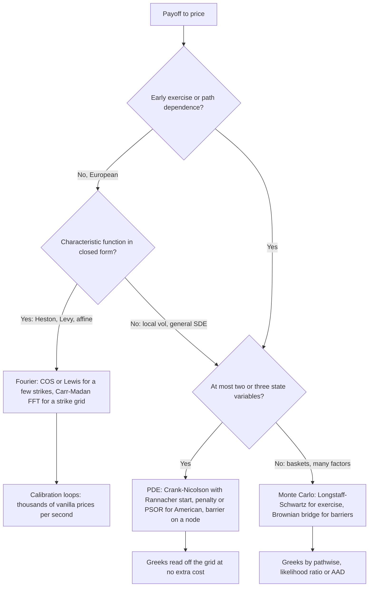

# Finite Differences and Fourier Pricing

## TL;DR

- Write the pricing PDE in log-spot, $V_\tau = \tfrac12\sigma^2V_{xx} + (r - q - \tfrac12\sigma^2)V_x - rV$, discretise space with central differences and time with the theta-scheme: $\theta = 0$ explicit, $\theta = 1$ implicit, $\theta = \tfrac12$ Crank-Nicolson; each step is one $O(n)$ tridiagonal solve.
- Explicit is stable only if $\sigma^2\Delta t/\Delta x^2 \le 1$ and blows up beyond it; implicit is first order in time and unconditionally damped; Crank-Nicolson is second order but only A-stable, so a kinked or discontinuous payoff leaves undamped sawtooth oscillations in gamma unless the first steps are implicit (Rannacher smoothing).
- American options are a linear complementarity problem: enforce $V \ge$ intrinsic with projected SOR or the penalty method; both give the same answer and converge to the tree price, and the grid gives the exercise boundary for free.
- Fourier methods price Europeans from the characteristic function: Carr-Madan damps the call by $e^{\alpha k}$ and FFTs a whole strike grid ($\eta\lambda = 2\pi/N$); COS expands the density in cosines and converges exponentially, pricing to $10^{-10}$ with a few hundred terms.
- Pick by problem shape: Fourier for European calibration, PDE for early exercise and barriers in one or two factors, Monte Carlo for high dimension and heavy path dependence.

## Learning objectives

- Implement explicit, implicit and Crank-Nicolson schemes and state their stability.
- Price with the Carr-Madan FFT and COS methods.
- Set boundary conditions and a domain, and read convergence orders off a refinement table.
- Diagnose Crank-Nicolson oscillations and fix them with Rannacher smoothing.
- Price an American put with PSOR and with the penalty method, and extract the exercise boundary.
- Choose between PDE, Fourier and Monte Carlo for a given product.

## Core concepts

### The PDE on a grid

By [Feynman-Kac](../04-Stochastic-Calculus/06-Feynman-Kac-and-Pricing-PDEs.md) a European price $V(t, S)$ solves the Black-Scholes PDE; in time to expiry $\tau = T - t$ and log-spot $x = \ln S$ it has constant coefficients:

$$
V_\tau = \tfrac12\sigma^2 V_{xx} + \nu V_x - rV, \qquad \nu = r - q - \tfrac12\sigma^2, \qquad V(0, x) = \text{payoff}(e^x).
$$

A uniform grid $x_i = x_0 + i\Delta x$ is a geometric grid in spot, fine in percentage terms everywhere, and centring it on $\ln S_0$ puts today's spot on a node so no interpolation is needed.
Central differences give, at each interior node,

$$
(LV)_i = a\,V_{i-1} + b\,V_i + c\,V_{i+1}, \quad a = \frac{\sigma^2}{2\Delta x^2} - \frac{\nu}{2\Delta x}, \quad b = -\frac{\sigma^2}{\Delta x^2} - r, \quad c = \frac{\sigma^2}{2\Delta x^2} + \frac{\nu}{2\Delta x}.
$$

The theta-scheme marches from the payoff at $\tau = 0$:

$$
\frac{V^{n+1} - V^n}{\Delta t} = \theta\,LV^{n+1} + (1 - \theta)\,LV^n.
$$

| $\theta$ | Scheme | Time order | Stability | Work per step |
| :--- | :--- | :---: | :--- | :--- |
| 0 | Explicit | 1 | needs $\sigma^2\Delta t/\Delta x^2 \le 1$ | matrix-vector product |
| 1 | Implicit (backward Euler) | 1 | unconditional, strongly damping | one tridiagonal solve |
| 1/2 | Crank-Nicolson | 2 | unconditional, but not damping at high frequency | one tridiagonal solve |

All three are second order in space with central differences.
The tridiagonal system $(I - \theta\Delta t L)V^{n+1} = (I + (1 - \theta)\Delta t L)V^n + \text{boundary terms}$ is solved by the Thomas algorithm (Gaussian elimination without pivoting, safe here because the matrix is diagonally dominant) in $O(n)$.
A whole price surface in spot then costs $O(nm)$ for $n$ space nodes and $m$ time steps, and delta and gamma come from neighbouring nodes at no extra cost.

### Stability: von Neumann analysis

Insert a Fourier mode $V^n_i = g^n e^{\mathrm{i}\xi i\Delta x}$ into the diffusion part.
The operator multiplies it by $-\tfrac{2\sigma^2}{\Delta x^2}\sin^2(\xi\Delta x/2)$, so with $\mu = \sigma^2\Delta t/\Delta x^2$ the sawtooth mode $\xi\Delta x = \pi$ is amplified per step by

$$
g_{\text{explicit}} = 1 - 2\mu, \qquad g_{\text{implicit}} = \frac{1}{1 + 2\mu}, \qquad g_{\text{CN}} = \frac{1 - \mu}{1 + \mu}.
$$

- Explicit: $\lvert g\rvert \le 1$ iff $\mu \le 1$, i.e. $\Delta t \le \Delta x^2/\sigma^2$; halving $\Delta x$ quarters the allowed step, so cost grows like $n^3$ for a fixed accuracy target.
  With the discount term the exact condition for non-negative weights is $\Delta t \le \Delta x^2/(\sigma^2 + r\Delta x^2)$, and the drift needs $\lvert\nu\rvert\Delta x \le \sigma^2$ so that $a, c \ge 0$.
- Implicit: $0 < g < 1$ for every $\mu$, and $g \to 0$ for large $\mu$: high frequencies die in one step (L-stable).
- Crank-Nicolson: $\lvert g\rvert \le 1$ for every $\mu$ (A-stable), but $g \to -1$ as $\mu \to \infty$, so a high-frequency error flips sign each step and barely decays.

Stability is not accuracy: an unconditionally stable scheme with a large $\Delta t$ is stable and wrong.
Lax equivalence says a consistent linear scheme converges iff it is stable.

### Boundary conditions and the domain

The PDE needs a condition at each end of a truncated domain, typically $\ln S_0 \pm 5\sigma\sqrt{T}$:

| Payoff | Lower boundary ($S \to 0$) | Upper boundary ($S \to \infty$) |
| :--- | :--- | :--- |
| Call | $V = 0$ | $V = Se^{-q\tau} - Ke^{-r\tau}$ (or $V_S = e^{-q\tau}$) |
| Put | $V = Ke^{-r\tau} - Se^{-q\tau}$ | $V = 0$ |
| Digital call | $V = 0$ | $V = e^{-r\tau}$ |
| American put | $V = K - S$ (exercised) | $V = 0$ |
| Knock-out | $V = $ rebate at the barrier node | as for the vanilla |

A generic choice that needs no payoff knowledge is linearity, $V_{SS} = 0$, at both ends.
A wrong boundary contaminates the interior through the diffusion, by an amount that decays like the Gaussian tail between boundary and spot; a barrier is the one case where the boundary is the contract, so put the barrier exactly on a node.

### Non-smooth payoffs and Rannacher smoothing

A call payoff has a kink and a digital a jump.
Their high-frequency content is large, and Crank-Nicolson with $\mu \gg 1$ carries it forward with factor $(1 - \mu)/(1 + \mu) \approx -1$ per step.
Prices at spot can look fine while gamma, a second difference, oscillates node to node around the strike.
Rannacher's fix: replace the first one or two Crank-Nicolson steps by pairs of implicit half-steps, which kill the high frequencies, then continue with Crank-Nicolson; Giles and Carter show this restores second-order convergence for prices and Greeks.
Complementary fixes: average the payoff over the cell containing the strike, and put the strike midway between nodes for a digital (or on a node with payoff $\tfrac12$).

### American options as a complementarity problem

An American put satisfies, at each node, either the PDE (continue) or $V = g = (K - S)^+$ (exercise), and never violates $V \ge g$:

$$
\big(V_\tau - LV\big) \ge 0, \qquad V - g \ge 0, \qquad \big(V_\tau - LV\big)\big(V - g\big) = 0.
$$

After time discretisation each step is a linear complementarity problem $AV \ge b$, $V \ge g$, $(AV - b)^\top(V - g) = 0$ with the tridiagonal $A = I - \theta\Delta t L$.

- PSOR (Cryer): Gauss-Seidel with over-relaxation $\omega \in (1, 2)$, projecting each update onto $V_i \ge g_i$.
  Simple and robust, but iteration count grows with grid size and the loop is sequential.
- Penalty (Forsyth-Vetzal): solve $(A + P)V = b + Pg$ with $P_{ii} = \rho$ (large, here $10^8$) where $V_i < g_i$, update the active set, repeat.
  Each iteration is one tridiagonal solve and it typically converges in a handful of iterations; stop on a small change in $V$, because a node sitting exactly at $V = g$ can flip in and out of the active set forever.
- Brennan-Schwartz: a single modified tridiagonal sweep that applies the constraint during back-substitution; exact for a put whose exercise region is one interval below the boundary, wrong in general.

Explicit schemes need only $V^{n+1} = \max(\text{continuation}, g)$ but inherit the explicit stability limit.
The exercise boundary $S^*(\tau)$ is the largest node where $V = g$; it starts at $K$ at expiry (for $r > 0$, no dividends), falls as time to expiry grows, and tends to the perpetual boundary $2rK/(2r + \sigma^2)$.

### Fourier pricing

Many models (Heston, Variance Gamma, CGMY, Merton and Kou jump-diffusions, affine models) have a closed-form characteristic function $\varphi(u) = E^Q[e^{\mathrm{i}u\ln(S_T/S_0)}]$ but no closed-form density.
European prices are then one-dimensional integrals; see [Stochastic Volatility: Heston and SABR](09-Stochastic-Volatility-Heston-and-SABR.md) and [Jump Processes and Levy Models](../04-Stochastic-Calculus/08-Jump-Processes-and-Levy-Models.md) for the transforms themselves.

Carr-Madan.
The call $C(k)$ as a function of log-strike $k = \ln(K/S_0)$ tends to $S_0$ as $k \to -\infty$, so it has no Fourier transform; the damped call $e^{\alpha k}C(k)$ with $\alpha > 0$ does, provided $E[S_T^{\alpha + 1}] < \infty$:

$$
C(k) = \frac{e^{-\alpha k}}{\pi}\int_0^\infty e^{-\mathrm{i}vk}\psi(v)\,dv, \qquad \psi(v) = \frac{e^{-rT}\varphi\big(v - (\alpha + 1)\mathrm{i}\big)}{\alpha^2 + \alpha - v^2 + \mathrm{i}(2\alpha + 1)v}.
$$

Discretise $v_j = j\eta$ and $k_u = -b + u\lambda$ for $j, u = 0, \dots, N - 1$; the sum becomes a discrete Fourier transform, computable for all $N$ strikes in $O(N\log N)$, exactly when

$$
\eta\lambda = \frac{2\pi}{N}, \qquad b = \frac{N\lambda}{2}.
$$

The constraint is the trade-off: a fine integration step $\eta$ forces a coarse strike grid $\lambda$.
Simpson weights $\tfrac{\eta}{3}(1, 4, 2, 4, \dots)$ replace the trapezoid rule.
Three error sources, each visible in the worked example: too small an $\alpha$ (the damped integrand is barely integrable and decays slowly), aliasing from the periodic image of the deep in-the-money calls, and linear interpolation between strike nodes.

Lewis's formula is the single-strike alternative: $C = e^{-rT}\big[F - \tfrac{\sqrt{FK}}{\pi}\int_0^\infty \text{Re}\big(e^{\mathrm{i}u\ln(F/K)}\varphi_Y(u - \tfrac{\mathrm{i}}{2})\big)\tfrac{du}{u^2 + 1/4}\big]$ with $Y = \ln(S_T/F)$, integrated by Gauss-Legendre quadrature; the repo's shared pricer uses it.

COS (Fang-Oosterlee).
Truncate the density of $y = \ln(S_T/K)$ to $[A, B]$ and expand it in cosines; the cosine coefficients are read directly off the characteristic function, and the payoff coefficients of $K(e^y - 1)^+$ are closed-form:

$$
V \approx e^{-rT}\sum_{k=0}^{N-1} w_k\,\text{Re}\Big[\varphi_y\Big(\frac{k\pi}{B - A}\Big)e^{-\mathrm{i}k\pi A/(B - A)}\Big]U_k,
$$

where $w_0 = \tfrac12$, $w_k = 1$ otherwise, and $U_k$ integrates the payoff against $\cos(k\pi(y - A)/(B - A))$.
The range is set from the cumulants, $[A, B] = c_1 \pm L\sqrt{c_2 + \sqrt{c_4}}$ with $L$ around 10.
For smooth densities the error decays exponentially in $N$, so 64 to 256 terms reach machine-level accuracy; the remaining error is truncation of the range, controlled by $L$.
For a wide range the call coefficients grow like $e^{B}$, so implementations price puts and use parity.

### Choosing a method

| Method | Strength | Weakness | Desk use |
| :--- | :--- | :--- | :--- |
| Fourier (FFT, COS, Lewis) | microseconds per European, exact to $10^{-10}$ | needs a characteristic function; Europeans only (Bermudans via COS with extra work) | calibrating Heston or Levy models to the whole surface |
| PDE (theta-scheme) | early exercise, barriers, smooth Greeks off the grid | cost explodes beyond two or three dimensions | American and barrier books under local vol, convertible bonds, one-factor rates |
| Binomial tree ([Binomial Trees](03-Binomial-Trees.md)) | simplest early exercise | first order, odd-even oscillation, a crude explicit scheme | benchmarks and interviews |
| Monte Carlo ([Monte Carlo Pricing](10-Monte-Carlo-Pricing-and-Variance-Reduction.md)) | any dimension and path dependence | $1/\sqrt{N}$ noise, early exercise needs regression | baskets, autocallables, XVA |

## Worked examples

Unless stated, $S_0 = K = 100$, $T = 1$, $r = 5\%$, $q = 0$, $\sigma = 20\%$, Black-Scholes call 10.4506 and put 5.5735.
Every number below is printed and asserted by [fd_fourier_pricing.py](code/fd_fourier_pricing.py).

### Example 1: explicit-scheme blow-up

"Your explicit solver returns garbage when you refine the space grid. Why?"
Take 200 cells over $\pm 5$ standard deviations, so $\Delta x = 2/200 = 0.01$.
The stability limit is $\Delta t \le \Delta x^2/(\sigma^2 + r\Delta x^2) = 0.0025$, i.e. at least 400 time steps for one year.
With 500 steps the price is 10.4504.
With 380 steps $\Delta t$ exceeds the limit by 5.3%, the sawtooth mode grows by a factor $\lvert 1 - 2\mu\rvert > 1$ every step, and after a year the largest node value is about $10^{14.26}$; the "price" at spot is $-1.79 \times 10^{14}$.
Halving $\Delta x$ would demand four times as many steps, which is why production code uses implicit or Crank-Nicolson.

### Example 2: convergence orders

Refine space and time together ($n$ cells and $n$ steps, half-width $5\sigma\sqrt{T}$):

| $n$ | Implicit error | Crank-Nicolson error |
| ---: | ---: | ---: |
| 50 | $-5.76 \times 10^{-2}$ | $-3.63 \times 10^{-2}$ |
| 100 | $-1.96 \times 10^{-2}$ | $-9.01 \times 10^{-3}$ |
| 200 | $-7.50 \times 10^{-3}$ | $-2.25 \times 10^{-3}$ |
| 400 | $-3.19 \times 10^{-3}$ | $-5.62 \times 10^{-4}$ |
| 800 | $-1.45 \times 10^{-3}$ | $-1.40 \times 10^{-4}$ |

From 400 to 800 the implicit error falls by 2.2 (heading to 2: the $O(\Delta t)$ term dominates) and the Crank-Nicolson error by 4.0 (second order in both $\Delta t$ and $\Delta x$).
At equal cost Crank-Nicolson is about ten times more accurate here.
Domain and boundary at $n = 400$:

| Half-width | Correct Dirichlet top | $V = 0$ at the top |
| :--- | ---: | ---: |
| $\pm 3$ sd | $-2.01 \times 10^{-4}$ | $-3.32 \times 10^{-1}$ |
| $\pm 5$ sd | $-5.62 \times 10^{-4}$ | $-7.60 \times 10^{-4}$ |
| $\pm 8$ sd | $-1.44 \times 10^{-3}$ | $-1.44 \times 10^{-3}$ |

A wrong boundary three standard deviations away costs 33 cents; at eight it is invisible, but the same 400 cells are spread wider, so the discretisation error grows.

### Example 3: Crank-Nicolson oscillations and Rannacher

A digital call paying 1, 400 cells ($\Delta x = 0.005$) and 25 time steps ($\Delta t = 0.04$), so $\mu = \sigma^2\Delta t/\Delta x^2 = 64$.
Exact price $e^{-rT}N(d_2) = 0.5323$.
The sawtooth amplification is $(1 - 64)/(1 + 64) = -0.9692$ per Crank-Nicolson step, so 0.458 of the initial jump's high-frequency content survives 25 steps; implicit gives $1/129 = 0.00775$ per step, and four implicit half-steps give $(1/65)^4 = 5.6 \times 10^{-8}$.

| Scheme | Price at spot | Max gamma error, spot 90 to 110 |
| :--- | ---: | ---: |
| Crank-Nicolson | 0.5326 | 0.414 |
| Crank-Nicolson with 2 Rannacher steps | 0.5323 | $6.9 \times 10^{-7}$ |
| Implicit | 0.5320 | $3.6 \times 10^{-5}$ |

The true gamma is at most $5.32 \times 10^{-4}$ in that range, so plain Crank-Nicolson's gamma is wrong by nearly 800 times its size while its price looks fine.
Rannacher keeps second-order accuracy and is 50 times better on gamma than fully implicit.

### Example 4: American put

| Method | Price |
| :--- | ---: |
| European (Black-Scholes) | 5.5735 |
| CRR binomial tree, 10,000 steps | 6.0903 |
| PSOR, Crank-Nicolson-Rannacher, 200 x 200 | 6.0874 |
| Penalty, Crank-Nicolson-Rannacher, 400 x 400 | 6.0895 |
| Penalty, Crank-Nicolson-Rannacher, 800 x 800 | 6.0901 |
| Penalty, implicit, 800 x 800 | 6.0884 |

PSOR and the penalty method agree to $10^{-9}$ on the same grid: they solve the same complementarity problem.
The early-exercise premium is $6.0903 - 5.5735 = 0.5168$.
Exercise boundary from the 800-node grid: $S^* = 90.26$ with 0.1 years left, 86.72 at 0.25, 83.95 at 0.5 and 80.86 at one year, falling toward the perpetual value $2rK/(2r + \sigma^2) = 71.43$.

### Example 5: Carr-Madan parameters

$N = 4096$ and $\eta = 0.25$ give $\lambda = 2\pi/(N\eta) = 0.006136$ in log strike, so $K = 100 = S_0$ is a node ($k = 0$) and 80 to 120 are interpolated.

| $\alpha$ | Max error, strikes 80-120 | Error at $K = 100$ |
| ---: | ---: | ---: |
| 0.1 | 1.5 | 1.5 |
| 0.5 | $6.2 \times 10^{-2}$ | $6.2 \times 10^{-2}$ |
| 1.5 | $7.4 \times 10^{-4}$ | $2.2 \times 10^{-7}$ |
| 5 | $7.4 \times 10^{-4}$ | below $10^{-12}$ |

| $\eta$ | $\lambda$ | Max error, 80-120 | Error at $K = 100$ |
| ---: | ---: | ---: | ---: |
| 0.05 | 0.0307 | $8.2 \times 10^{-3}$ | below $10^{-12}$ |
| 0.25 | 0.0061 | $7.4 \times 10^{-4}$ | $2.2 \times 10^{-7}$ |
| 1.0 | 0.0015 | $2.8 \times 10^{-1}$ | $2.8 \times 10^{-1}$ |

Read it like a desk quant:

- Off-node error $7.4 \times 10^{-4}$ is linear interpolation in log strike; it shrinks only with a finer $\lambda$, which costs a coarser $\eta$.
- On-node error is aliasing.
  The discrete sum is periodic in $k$, Simpson's alternating weights halve the period to $\pi/\eta$, and the image of the deep in-the-money calls (worth about $S_0$) leaks back with weight $e^{-\alpha\pi/\eta}/3$.
  The prediction $-S_0e^{-\alpha\pi/\eta}/3$ matches the observed error to three digits: $-1.16 \times 10^{-4}$ for $\alpha = 1$, $-2.17 \times 10^{-7}$ for $\alpha = 1.5$, $-4.05 \times 10^{-10}$ for $\alpha = 2$ or for $\alpha = 1$ with $\eta = 0.125$.
- $\eta = 1$ fails because the $v$-integrand is sampled too coarsely, not because of the strikes.

Heston ($\kappa = 2$, $\theta = 0.04$, $\xi = 0.5$, $\rho = -0.7$, $v_0 = 0.04$) by Lewis's formula gives 25.2368, 17.1401, 10.1546, 4.8662 and 1.7382 for strikes 80 to 120; the FFT reproduces them to $1.05 \times 10^{-3}$ (interpolation) and to $2.2 \times 10^{-7}$ at the node.

### Example 6: COS convergence

| $N$ | Max error vs Black-Scholes, 80-120 ($L = 10$) |
| ---: | ---: |
| 8 | 2.95 |
| 16 | $8.6 \times 10^{-2}$ |
| 32 | $1.8 \times 10^{-6}$ |
| 64 | below $10^{-12}$ |

Error falls by orders of magnitude per doubling: exponential convergence, because the lognormal density is smooth and its cosine coefficients decay faster than any power.
Truncation then dominates: with $N = 128$ the error is $6.25 \times 10^{-4}$ at $L = 4$, $2.74 \times 10^{-2}$ at $L = 3$ and 0.498 at $L = 2$.
Against Lewis on the Heston smile ($L = 12$): $3.5 \times 10^{-2}$ at $N = 32$, $4.3 \times 10^{-4}$ at 64, $9.2 \times 10^{-8}$ at 128 and $2.8 \times 10^{-10}$ at 256.
Two independent Fourier pricers agreeing to $10^{-10}$ is how you validate a characteristic function before calibrating to it.

## Pitfalls

- Refining $\Delta x$ in an explicit scheme without refining $\Delta t$ quadratically; the blow-up is silent until the numbers are astronomically wrong.
- Trusting a Crank-Nicolson price because it converges while its gamma oscillates; always plot gamma near strikes and barriers, and start with Rannacher steps.
- Boundaries too close to spot, or a boundary condition that contradicts the payoff ($V = 0$ at the top for a call).
- Barriers between nodes: the knock-out condition is then smeared by up to a cell and convergence drops to first order; align the grid so the barrier is a node.
- Using a time step coarser than the contract's event dates (dividends, monitoring dates, exercise dates); put grid times on every event.
- Iterating PSOR to a fixed iteration count instead of a tolerance, or a penalty loop whose stopping rule waits for the active set to stop changing exactly.
- Carr-Madan with $\alpha$ too small (slow decay), or too large for the model's moments ($E[S_T^{\alpha + 1}]$ must be finite; Heston moments explode for large powers and long maturities).
- Interpolating FFT prices linearly and then differentiating twice for a density; use COS or Lewis at the exact strikes.
- Calibrating to a characteristic function that was never checked against an independent pricer or Monte Carlo; a wrong branch of the complex log in Heston gives smooth, plausible and wrong prices at long maturities.

## Interview questions

> [!question]- deriv-fd-theta-scheme | Write the theta-scheme for the Black-Scholes PDE and name the three standard cases.
> $(V^{n+1} - V^n)/\Delta t = \theta LV^{n+1} + (1 - \theta)LV^n$ with $L$ the central-difference operator.
> $\theta = 0$ explicit, $\theta = 1$ implicit (backward Euler), $\theta = \tfrac12$ Crank-Nicolson; each implicit step is one tridiagonal solve.

> [!question]- deriv-fd-explicit-stability | What is the stability condition of the explicit scheme and why does it make explicit expensive?
> $\sigma^2\Delta t/\Delta x^2 \le 1$ (von Neumann: the sawtooth mode is multiplied by $1 - 2\mu$).
> Halving $\Delta x$ forces a quarter of the time step, so cost grows like the cube of the space resolution.

> [!question]- deriv-fd-explicit-numbers | 200 log-spot cells over plus or minus one unit, $\sigma = 20\%$. Smallest number of explicit steps for one year?
> About 400: $\Delta x = 0.01$ and $\Delta t \le \Delta x^2/\sigma^2 = 0.0025$.
> At 380 steps (5% over the limit) the solution reaches about $10^{14}$.

> [!question]- deriv-fd-orders | Convergence orders of implicit and Crank-Nicolson, and how you check them?
> Implicit $O(\Delta t + \Delta x^2)$, Crank-Nicolson $O(\Delta t^2 + \Delta x^2)$.
> Refine both together and watch error ratios: in the worked example they are 2.2 and 4.0 from $n = 400$ to 800.

> [!question]- deriv-fd-cn-oscillation | Why does Crank-Nicolson produce oscillating gamma near the strike?
> Its amplification of high-frequency modes is $(1 - \mu)/(1 + \mu) \to -1$ for large $\mu = \sigma^2\Delta t/\Delta x^2$, so the payoff's kink or jump is propagated with alternating sign and almost no damping.
> Prices at spot look fine; second differences do not.

> [!question]- deriv-fd-rannacher | What is Rannacher smoothing and why does it work?
> Replace the first one or two Crank-Nicolson steps by pairs of implicit half-steps.
> Implicit steps are L-stable ($g \to 0$ at high frequency), so they remove the non-smooth payoff's high frequencies; Crank-Nicolson then keeps second-order accuracy.
> In the digital example the gamma error falls from 0.414 to $6.9 \times 10^{-7}$.

> [!question]- deriv-fd-log-grid | Why solve in log-spot rather than spot?
> The PDE has constant coefficients in $x = \ln S$, so stability and accuracy are uniform; a uniform $x$ grid is geometric in $S$, giving constant percentage resolution.
> A spot grid needs $S$-dependent coefficients and over-resolves high spots; a spot grid is still preferred when a feature (strike, barrier, dividend) must sit on round spot values.

> [!question]- deriv-fd-boundaries | Boundary conditions for a call on a truncated grid?
> $V = 0$ at the bottom and $V = Se^{-q\tau} - Ke^{-r\tau}$ (or $V_S = e^{-q\tau}$, or $V_{SS} = 0$) at the top, with the domain about $\pm 5\sigma\sqrt{T}$ in log-spot.
> Using $V = 0$ at the top three standard deviations away costs 33 cents on a 10.45 option.

> [!question]- deriv-fd-barrier-node | How do you place the grid for a knock-out option, and why?
> Put the barrier exactly on a node and impose $V = $ rebate there; refine near it.
> Otherwise the barrier is effectively shifted by up to a cell, which biases the price and drops convergence to first order.

> [!question]- deriv-fd-american-lcp | State the American put as a linear complementarity problem and two ways to solve it.
> $V_\tau - LV \ge 0$, $V \ge (K - S)^+$, and their product is zero.
> PSOR (projected Gauss-Seidel with over-relaxation) or the penalty method (add $\rho$ on nodes where $V < g$ and re-solve); both give 6.0874 on the same 200 x 200 grid, against a tree value of 6.0903.

> [!question]- deriv-fd-penalty-vs-psor | Penalty method or PSOR in production?
> Penalty: each iteration is one $O(n)$ tridiagonal solve and it converges in a few iterations, independent of grid size; PSOR's iteration count grows with the grid and is sequential.
> PSOR is simpler and fine for small grids; both need a tolerance-based stopping rule.

> [!question]- deriv-fd-exercise-boundary | How does the American put exercise boundary behave in time, and what is its long-maturity limit?
> It starts at $K$ at expiry (for $r > 0$, no dividends) and falls as time to expiry grows: about 90.3 with 0.1 years left and 80.9 with one year, for $K = 100$, $r = 5\%$, $\sigma = 20\%$.
> It tends to the perpetual boundary $2rK/(2r + \sigma^2) = 71.43$.

> [!question]- deriv-fourier-carr-madan-damping | Why does Carr-Madan multiply the call by $e^{\alpha k}$, and what limits $\alpha$?
> As $k \to -\infty$ the call tends to $S_0$, so it is not integrable and has no Fourier transform; $e^{\alpha k}C(k)$ is.
> $\alpha$ must keep $E[S_T^{\alpha + 1}]$ finite; too small an $\alpha$ makes the transform decay slowly (error 1.5 at $\alpha = 0.1$ in the example).

> [!question]- deriv-fourier-grid-tradeoff | In the Carr-Madan FFT, what links the integration step and the strike spacing?
> $\eta\lambda = 2\pi/N$.
> A fine $\eta$ (accurate integral) forces a coarse log-strike grid; with $N = 4096$ and $\eta = 0.25$, $\lambda = 0.0061$, and the off-node error of $7.4 \times 10^{-4}$ is interpolation.

> [!question]- deriv-fourier-aliasing | Your FFT price at an exact grid strike is off by $10^{-4}$ and the error does not depend on the model. What is it?
> Aliasing: the discrete transform is periodic in log strike, and the deep in-the-money image (call worth about $S_0$) leaks back with weight about $e^{-\alpha\pi/\eta}/3$ under Simpson weights.
> Raise $\alpha$ or lower $\eta$: the error goes from $1.16 \times 10^{-4}$ at $\alpha = 1$ to $2.17 \times 10^{-7}$ at $\alpha = 1.5$.

> [!question]- deriv-fourier-cos | How does the COS method work and how fast does it converge?
> Truncate the log-price density to $[A, B]$, expand it in cosines whose coefficients come straight from the characteristic function, and integrate the payoff against each cosine in closed form.
> For smooth densities the error decays exponentially in the number of terms: $8.6 \times 10^{-2}$ at 16 terms, $1.8 \times 10^{-6}$ at 32 and machine precision at 64 for Black-Scholes; the remaining error is truncation of $[A, B]$.

> [!question]- deriv-fourier-when | When would you use Fourier pricing rather than a PDE or Monte Carlo?
> For European payoffs under models with a closed-form characteristic function, especially inside a calibration loop that prices the whole surface thousands of times.
> It cannot handle early exercise or path dependence directly and gives nothing for local vol, where a PDE or Monte Carlo is needed.

> [!question]- deriv-fourier-validate-cf | How do you validate a new characteristic-function pricer before calibrating?
> Feed it the Black-Scholes characteristic function and match the closed form; then price with two independent Fourier methods (COS and Lewis or Carr-Madan) and against Monte Carlo.
> COS and Lewis agree on Heston to $2.8 \times 10^{-10}$ here; branch-cut errors in the complex log show up as disagreement at long maturities.

> [!question]- deriv-fd-greeks-from-grid | Why is the PDE preferred for Greeks of barrier and American books?
> Delta and gamma come from neighbouring nodes of the same solve at every spot, smooth and free; Monte Carlo Greeks of discontinuous payoffs are noisy and need likelihood-ratio or smoothing.
> The price is that grid Greeks inherit any oscillation in the scheme, which is why Rannacher steps matter.

## In this repo and SDE-Interview-Prep

- Code: [fd_fourier_pricing.py](code/fd_fourier_pricing.py) (theta-scheme, PSOR, penalty, CRR tree, Carr-Madan, COS) asserts every number in this note; it imports Black-Scholes, Heston and Lewis from [pricing_core.py](code/pricing_core.py).
- PDE derivation and boundary intuition: [Feynman-Kac and Pricing PDEs](../04-Stochastic-Calculus/06-Feynman-Kac-and-Pricing-PDEs.md); trees as explicit schemes: [Binomial Trees](03-Binomial-Trees.md).
- Prev: [Monte Carlo Pricing and Variance Reduction](10-Monte-Carlo-Pricing-and-Variance-Reduction.md). Next: [Exotic Options](12-Exotic-Options.md).

## Further reading

- Paul Wilmott, *Paul Wilmott Introduces Quantitative Finance*, chapters on finite-difference methods for one-factor models.
- D. Tavella and C. Randall, *Pricing Financial Instruments: The Finite Difference Method* (Wiley 2000).
- D. Duffy, *Finite Difference Methods in Financial Engineering* (Wiley 2006), on Crank-Nicolson oscillations and their remedies.
- R. Rannacher (1984), "Finite element solution of diffusion problems with irregular data", *Numerische Mathematik* 43.
- M. Giles and R. Carter (2006), "Convergence analysis of Crank-Nicolson and Rannacher time-marching", *Journal of Computational Finance* 9(4).
- C. Cryer (1971), "The solution of a quadratic programming problem using systematic overrelaxation", *SIAM Journal on Control* 9(3).
- P. Forsyth and K. Vetzal (2002), "Quadratic convergence for valuing American options using a penalty method", *SIAM Journal on Scientific Computing* 23(6).
- P. Carr and D. Madan (1999), "Option valuation using the fast Fourier transform", *Journal of Computational Finance* 2(4).
- A. Lewis (2001), "A simple option formula for general jump-diffusion and other exponential Levy processes", working paper.
- F. Fang and C. Oosterlee (2008), "A novel pricing method for European options based on Fourier-cosine series expansions", *SIAM Journal on Scientific Computing* 31(2).
