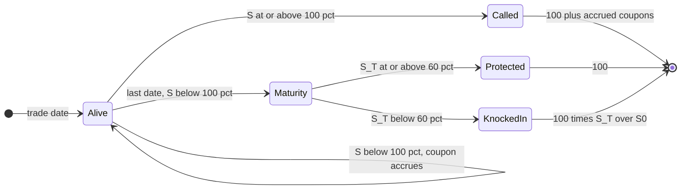

# Exotic Options

## TL;DR

- A digital is the limit of a call spread: price it with the skew term, $D = e^{-rT}N(d_2) - \text{vega}\,\partial\sigma/\partial K$, and hedge it as a slightly wide call spread that over-replicates; near expiry its delta at the strike grows like $1/\sqrt{T}$ (pin risk).
- Barriers: in plus out equals vanilla; Reiner-Rubinstein closed forms price all eight continuously monitored types; simulate them with a Brownian-bridge crossing probability, and price daily monitoring as a continuous barrier shifted by $e^{\pm 0.5826\sigma\sqrt{\Delta t}}$.
- Reverse knock-outs (barrier in the money) are short vega and mostly short gamma between strike and barrier, with a delta that flips sign and jumps at the barrier; they are where hedging and model risk concentrate.
- Asians and lookbacks: the geometric Asian has a lognormal closed form and is the control variate for the arithmetic one (variance cut by more than 1000x); floating-strike lookbacks have Goldman-Sosin-Gatto closed forms and can be simulated exactly with Brownian-bridge extremes.
- Autocallables and cliquets are sold as notes: the investor is short a knock-in put and short volatility, so the issuing dealer ends up long vega and long dividends, and cliquet value lives in the forward smile, which local volatility gets wrong.

## Learning objectives

- Price and risk-manage digitals as tight call spreads.
- Explain barriers, Asians, lookbacks and their Greeks near the barrier.
- Understand pin risk and hedging discontinuities.
- Price barriers, Asians and lookbacks in closed form and check them by simulation.
- Describe autocallables and cliquets accurately and say who is long which risk.

## Core concepts

### Digitals

A cash-or-nothing call pays 1 if $S_T > K$; an asset-or-nothing call pays $S_T$.
In Black-Scholes they are worth $e^{-rT}N(d_2)$ and $S_0e^{-qT}N(d_1)$, and a vanilla call is asset-or-nothing minus $K$ cash-or-nothing.
Because $\partial C/\partial K = -D$ for every model, the digital is the strike-derivative of the call price, and with a smile $\sigma(K)$:

$$
D(K) = e^{-rT}N(d_2) - \text{vega}\cdot\frac{\partial\sigma}{\partial K}.
$$

With equity skew ($\partial\sigma/\partial K < 0$) the digital call is worth more than its flat-vol price; the derivation and a one-year example are in [Implied Volatility and the Smile](07-Implied-Volatility-and-the-Smile.md).
Pricing a digital at a single implied volatility is the classic exotic-desk mistake.

Hedging.
A dealer short a digital paying 1 above $K$ buys $1/h$ calls struck at $K - h$ and sells $1/h$ struck at $K$.
That spread pays at least the digital in every state (it is 1 above $K$ and positive between $K - h$ and $K$), so it over-hedges; the dealer charges the spread price and the over-hedge is the reserve against the discontinuity.
The width $h$ is a risk choice: narrower is cheaper but has larger gamma and vega concentrated at one strike.

Greeks near expiry.
Delta of the cash digital is $e^{-rT}\varphi(d_2)/(S\sigma\sqrt{T})$, which at the strike grows like $1/\sqrt{T}$; gamma changes sign at the strike (positive below, negative above, for the call).
Pin risk is the consequence: with spot near the strike at expiry, a tiny move decides the whole payout, and the delta hedge required is many times the notional.
Desks cap it by over-hedging with a wider spread, by barrier-shifting the strike in the risk system, or by refusing to sell digitals struck near spot close to expiry.

### Barriers

A knock-out dies, and a knock-in comes alive, when spot touches $H$.
Up or down, in or out, call or put gives eight types; a knock-in plus the matching knock-out is the vanilla (in-out parity), because on every path exactly one of them pays.

| Type | Barrier vs spot | Comment |
| :--- | :--- | :--- |
| Down-and-out call, $H < K$ | below | regular; near the barrier behaves like a long call that can vanish, delta above vanilla |
| Up-and-out call, $H > K$ | above | reverse knock-out: dies in the money, value capped near $H - K$, short gamma and vega near $H$ |
| Down-and-in put, $H < K$ | below | the leg investors sell in autocallables and reverse convertibles |
| Up-and-out put, down-and-out put, up-and-in call, down-and-in call, up-and-in put | | each priced from the same four building blocks |

Reiner and Rubinstein (1991) give continuously monitored prices from four terms $A, B, C, D$ (and two rebate terms), using the reflection principle: the image of a path reflected at the barrier has density weighted by $(H/S)^{2\mu}$, $\mu = (r - q - \sigma^2/2)/\sigma^2$.
For example, with $K \ge H$ the down-and-out call is $A - C$, the vanilla minus a reflected call struck at the same $K$ on the mirror spot $H^2/S$:

$$
C_{do}(S) = C_{BS}(S, K) - \Big(\frac{H}{S}\Big)^{2\mu}C_{BS}\Big(\frac{H^2}{S}, K\Big),
$$

which for $r = q$ ($\mu = -\tfrac12$) is the classic $C_{BS}(S, K) - \tfrac{S}{H}C_{BS}(H^2/S, K)$; at $S = H$ the two terms cancel, as they must.

Simulation.
On a grid of step $\Delta t$ a path can cross between dates.
Conditional on log-prices $x_i, x_{i+1}$ above $h = \ln H$, the Brownian bridge crosses with probability $\exp\big(-2(x_i - h)(x_{i+1} - h)/(\sigma^2\Delta t)\big)$; multiplying the payoff by the product of the survival probabilities gives an unbiased continuous-monitoring estimator even on a coarse grid.
If the contract is monitored discretely (daily closes), the naive grid simulation is the right model, and Broadie-Glasserman-Kou show the discrete price is approximately the continuous formula at a barrier shifted away from spot by $e^{\pm\beta\sigma\sqrt{\Delta t}}$ (the error vanishes faster than $1/\sqrt{m}$ for $m$ monitoring dates), $\beta = 0.5826$; [Monte Carlo Pricing](10-Monte-Carlo-Pricing-and-Variance-Reduction.md) derives this.

Greeks and model risk.
A reverse knock-out (up-and-out call, down-and-out put) has a payoff that jumps from its maximum to zero at the barrier.
Approaching $H$ its delta turns negative (and becomes large close to expiry), its gamma is negative over most of the range between strike and barrier (it can turn slightly positive just below the barrier, as at spot 118 in Example 4), and its vega is negative everywhere near the money: more volatility means more chance to die.
The price is continuous at the barrier but the hedge is not: on the touch the dealer must unwind the entire delta at once, so desks shift the barrier in the risk system (bending the payoff into a call spread) and charge for it.
Barrier prices depend on the dynamics of the smile, not just today's surface: local volatility and stochastic volatility calibrated to the same vanillas give different knock-out prices because they imply different forward skews and different spot-vol correlation along the path; desks use local-stochastic volatility or mix the two and reserve the difference.

### Asians

An arithmetic Asian pays $(\bar{S} - K)^+$ with $\bar{S}$ the average of fixings; averaging lowers volatility, so it is cheaper than the vanilla and its delta rolls off as fixings set.
The arithmetic average of lognormals has no closed form, but the geometric average $G = (\prod_i S_{t_i})^{1/n}$ is lognormal.
With fixings $t_i = iT/n$:

$$
\ln G \sim N\Big(\ln S_0 + (r - q - \tfrac12\sigma^2)\bar{t},\ \frac{\sigma^2}{n^2}\sum_{i,j}\min(t_i, t_j)\Big), \qquad \bar{t} = \frac1n\sum_i t_i,
$$

and the geometric call is a Black-type formula on that lognormal (Kemna-Vorst for the continuous limit, where the variance is $\sigma^2T/3$).
Since $G \le \bar{S}$ and the two are almost perfectly correlated, the geometric Asian is the control variate for the arithmetic one.

### Lookbacks

A floating-strike lookback call pays $S_T - \min_{t \le T}S_t$ (buy at the low); the put pays $\max S_t - S_T$.
Goldman, Sosin and Gatto (1979) give closed forms; at inception with running minimum $m = S_0$ and $b = r - q \ne 0$:

$$
c = Se^{(b-r)T}N(a_1) - me^{-rT}N(a_2) + Se^{-rT}\frac{\sigma^2}{2b}\Big[\Big(\frac{S}{m}\Big)^{-2b/\sigma^2}N\Big(-a_1 + \frac{2b}{\sigma}\sqrt{T}\Big) - e^{bT}N(-a_1)\Big],
$$

with $a_1 = \frac{\ln(S/m) + (b + \sigma^2/2)T}{\sigma\sqrt{T}}$ and $a_2 = a_1 - \sigma\sqrt{T}$.
The minimum of a Brownian bridge between two log-prices $x_0, x_1$ over time $\tau$ has a closed-form law, so it can be sampled exactly: $x_{\min} = \tfrac12\big(x_0 + x_1 - \sqrt{(x_1 - x_0)^2 - 2\sigma^2\tau\ln U}\big)$ with $U$ uniform.
One step per path is then an exact simulation of a continuously monitored lookback.
A lookback is long volatility in two ways: the terminal spread and the extremes both widen with $\sigma$.

### Autocallables

An autocallable note (a widely sold retail structured note) works like this:

- On each observation date (quarterly here), if the underlying is at or above the autocall trigger (here 100% of the initial level), the note redeems at par plus the coupon.
- With a memory feature, missed coupons accrue and are paid in full on the call date.
- If the note is never called, at maturity the investor gets par if the underlying is above the knock-in level (here 60%), and otherwise takes the loss one-for-one: par times $S_T/S_0$.
  Knock-in is observed only at maturity (European) in this example; many notes use daily (American) observation, which is worse for the investor.

Economically the investor holds a bond, is short a down-and-in put, and receives a high conditional coupon that is the premium for that put plus the digital-like call feature.
The issuer (a bank) is the counterparty to all of it, and its trading desk holds the residual: it is long the put the investor sold.
The sign of each sensitivity is a computation, not folklore; the worked example below bumps volatility and dividend yield with common random numbers and finds the dealer long vega and long dividends.
One leg's sign is unambiguous: higher dividends lower the forward, which raises the value of the down-and-in put the dealer holds.
The autocall and coupon legs move too (fewer early calls means fewer coupons paid but a longer exposure), and their sign is not obvious, so the net exposure is the one the bump measures.
A dealer left long dividends could hedge with dividend futures or dividend swaps.
Other risks that matter in practice: the digital-like jump in value around the trigger on each observation date, correlation for worst-of baskets (the worst-of put gains value as correlation falls, so correlation is a first-order risk on both sides), and the issuer's own funding spread, which pays for part of the coupon.

### Cliquets and forward starts

A forward-start call, struck at $\alpha S_{t_1}$ at a future date $t_1$ and expiring at $T$, is by homogeneity of Black-Scholes worth (Rubinstein 1991)

$$
V_0 = S_0e^{-qt_1}\,C_{BS}(1, \alpha, T - t_1),
$$

independent of where spot will be at $t_1$: it is a pure bet on forward volatility.
A cliquet is a strip of forward-starting options on periodic returns $R_i = S_{t_i}/S_{t_{i-1}} - 1$.
The locally capped, globally floored cliquet pays notional times $\max\big(F, \sum_i \min(c, \max(f, R_i))\big)$.
Each clipped return is $R_i - (R_i - c)^+ + (f - R_i)^+$, a forward-start position, so without the global floor the price is a sum of one-period Black-Scholes prices; the global floor is a put on the sum and needs simulation.
Cliquets are the canonical forward-smile product: their value depends on the smile that will prevail at each reset, which today's vanillas do not pin down.
Local volatility produces forward smiles that flatten and lose their skew as time passes, so it typically misprices cliquets; stochastic volatility (Bergomi's models) keeps a realistic forward skew and is the standard tool.
The Black-Scholes vega of a capped cliquet can be negative while its exposure to forward skew and vol-of-vol dominates, so "vega" alone is the wrong risk measure for it.

## Worked examples

Unless stated, $S_0 = K = 100$, $T = 1$, $r = 5\%$, $q = 0$, $\sigma = 20\%$, Black-Scholes call 10.4506 and put 5.5735.
Every number below is printed and asserted by [exotic_options.py](code/exotic_options.py).

### Example 1: a digital, its replication and its skew

Cash digital $e^{-rT}N(d_2) = 0.5323$; asset digital $S_0N(d_1) = 63.68$; and $63.68 - 100 \times 0.5323 = 10.4506$, the call.
Over-hedging call spreads, per unit of payout:

| Spread | Price | Over-hedge cost |
| :--- | ---: | ---: |
| 98/100 (width 2) | 0.5511 | 0.0188 |
| 99/100 (width 1) | 0.5417 | 0.0094 |
| 99.5/100 (width 0.5) | 0.5370 | 0.0047 |

The cost is linear in width: about half the width times the discounted risk-neutral density at the strike, $e^{-rT}\varphi(d_2)/(K\sigma\sqrt{T}) = 0.01876$ per unit of strike.
With skew: a three-month digital, ATM vol 20% and skew $-0.004$ per strike point.
Flat-vol price 0.5233; vega 19.64 per unit vol; skew term $-19.64 \times (-0.004) = 0.0786$; digital 0.6019, confirmed by a 0.02-wide call spread priced on the smile.
Ignoring the skew undersells the digital by 8 points of payout.

### Example 2: pin risk

A dealer is short a digital paying 1,000,000 if the stock (at 100, $\sigma = 20\%$) finishes above 100.
At-the-strike delta of the hedge: 68,700 shares with a month left, 143,700 with a week and 316,600 with a day, that is about 31.66 million dollars of stock against a one-million payout.
One day out, gamma is $+145{,}800$ shares per point at 99 and $-145{,}300$ at 101: a one-point move flips the hedge by roughly 145,000 shares in opposite directions on either side of the strike.
No one can rebalance that through the close, which is why the risk is booked as a call spread rather than a digital.

### Example 3: barrier prices, parity and simulation

Barriers at 90 (down) and 120 (up), strike 100:

| Type | Price | Type | Price |
| :--- | ---: | :--- | ---: |
| Down-and-out call | 8.6655 | Down-and-in call | 1.7851 |
| Up-and-out call | 1.1761 | Up-and-in call | 9.2745 |
| Down-and-out put | 0.1512 | Down-and-in put | 5.4223 |
| Up-and-out put | 5.3601 | Up-and-in put | 0.2134 |

Each in-out pair adds to the vanilla call or put to $10^{-10}$.
Simulation with 200,000 paths (vanilla payoff as control variate for the down-and-out):

| Contract and method | Price (s.e.) |
| :--- | :--- |
| Down-and-out call, 252 steps, Brownian bridge | 8.6815 (0.0123) |
| Down-and-out call, 252 steps, barrier checked daily only | 8.9316 (0.0117) |
| Down-and-out call, 12 steps, barrier checked monthly only | 9.5789 (0.0087) |
| Up-and-out call, 252 steps, Brownian bridge | 1.1794 (0.0069) |
| Up-and-out call, 12 steps, Brownian bridge | 1.1813 (0.0063) |
| Up-and-out call, 252 steps, barrier checked daily only | 1.3314 (0.0076) |

The bridge reproduces the continuous formula even with 12 steps.
Checking only on the grid misses crossings and overprices knock-outs, by 0.27 daily and 0.91 monthly for the down-and-out (relative to the closed form 8.6655).
That naive daily number is the correct price of a daily-monitored contract, and Broadie-Glasserman-Kou predicts it without simulation: $\beta\sigma\sqrt{1/252} = 0.00734$, so price the continuous formula at $90e^{-0.00734} = 89.34$ to get 8.9139, and at $120e^{0.00734}$ to get 1.3321 for the up-and-out, both within two standard errors of the daily simulations.

### Example 4: Greeks of a reverse knock-out

Up-and-out call, $K = 100$, $H = 120$ (vanilla delta at 100 is 0.6368):

| Spot | Price | Delta | Gamma | Vega per vol point |
| ---: | ---: | ---: | ---: | ---: |
| 90 | 1.1323 | +0.0306 | $-0.0044$ | $-0.0821$ |
| 100 | 1.1761 | $-0.0237$ | $-0.0055$ | $-0.1326$ |
| 110 | 0.7033 | $-0.0654$ | $-0.0023$ | $-0.0903$ |
| 118 | 0.1402 | $-0.0711$ | $+0.0008$ | $-0.0179$ |

The option is worth 1.18 against 10.45 for the vanilla, already has negative delta at the money, and is short vega everywhere in the table.
At 120 the value drops to zero: the hedge (short about 0.07 deltas) must be bought back in one trade at the barrier, exactly when liquidity is worst.
Contrast the regular down-and-out call ($H = 90$): at spot 91 it is worth 0.9320 with delta 0.9202 (vanilla delta 0.4516), and at 95 it is worth 4.4688 with delta 0.8562 (vanilla 0.5373); near a regular barrier the option behaves like stock that can be knocked out, with delta far above the vanilla's.

### Example 5: arithmetic Asian with a geometric control variate

Twelve monthly fixings.
Geometric closed form 5.9402 (simulated 5.9472 on the same paths).
Arithmetic, 200,000 paths: plain 6.1624 with standard error 0.0190; with the geometric control ($b = 1.031$, payoff correlation 0.9996) 6.1552 with standard error 0.00053.
The variance falls by a factor of about 1300, worth 260 million plain paths.
The arithmetic Asian is worth 0.589 of the 10.45 vanilla: the log-variance of the twelve-fixing geometric average is 0.376 of the terminal log-variance (one third in the continuous limit).

### Example 6: lookbacks, exact and discrete

Goldman-Sosin-Gatto: floating-strike call 17.2168, put 14.2906, against 10.4506 and 5.5735 for the ATM vanillas.
Exact Brownian-bridge simulation with a single time step and 1,000,000 paths gives 17.2220 (s.e. 0.0146) and 14.2714 (s.e. 0.0098).
Monitoring the minimum only at daily closes gives 16.6653: 0.55 less, because the true minimum is lower than the lowest close; contracts specify their fixings, and the model must match them.

### Example 7: an autocallable, priced and risk-signed

Three years, quarterly observations, trigger 100%, memory coupon, European knock-in at 60%, $r = 3\%$, $q = 2\%$, $\sigma = 25\%$, 400,000 paths with fixed seed.

- Fair coupon (note worth par, ignoring the issuer's funding spread and fees): 3.8805% per quarter, 15.52% a year.
- Probability of being called at the first observation 0.4827, by the end of year one 0.7031; expected life 1.0328 years.
- Probability of a capital loss 0.0836, with an average loss of 52.62% of notional when it happens.
- Investor's note value per vol point: $-0.3982$ per 100 notional; per 1% of dividend yield: $-0.6843$.

The investor is short volatility and short dividends, so the dealer who sold the note is long both.
The headline coupon looks generous because it is paid only on early redemption, which is most likely exactly when the investor would have done well anyway, and because the investor is selling a put with a 52% average loss in the bad states.

### Example 8: forward start and a cliquet

A one-year ATM call starting in one year is worth $S_0C_{BS}(1, 1, 1) = 10.4506$ with $q = 0$, the same as today's one-year call; simulation with 1,000,000 paths gives 10.4368 (s.e. 0.0152).
With $q = 2\%$ it is $e^{-0.02}$ times the spot-start call on a 2% yield, 9.0443.
Cliquet: twelve monthly returns clipped to $[-3\%, +3\%]$, summed, globally floored at 2%, notional 100.
Without the floor the strip is worth 1.1971 in closed form (simulation 1.1976); with the floor 4.9459, so the floor alone is worth 3.7483.
Black-Scholes vega of the whole cliquet is $-0.0303$ per vol point: the capped strip has $-0.1299$ and the floor $+0.0996$.
The near-zero net vega hides two offsetting exposures to forward volatility, so Black-Scholes vega says little about the cliquet's risk; desks risk-manage it on forward skew and vol-of-vol.

## Pitfalls

- Pricing a digital or a barrier at the ATM implied vol; the skew term is first order for digitals and the whole smile path matters for barriers.
- Hedging a digital as a digital near expiry; book it as an over-hedging call spread and accept the reserve.
- Simulating a continuously monitored barrier on a grid without a bridge correction (knock-outs too expensive), or using the bridge on a contract that is monitored only at closes.
- Forgetting the barrier shift of the hedge for reverse knock-outs: the delta jump at the barrier is unhedgeable by delta trading.
- Quoting an autocallable's coupon as a yield; it is contingent and paid mostly in the states where the investor least needs it.
- Assuming the dealer's sign on vega, dividends or correlation from memory; compute it, because trigger levels, memory and knock-in type change the answer.
- Pricing cliquets or forward-starts with local volatility and trusting the forward skew it implies.
- Matching a lookback or Asian contract's fixings incorrectly (continuous versus daily versus monthly); the difference is many times the bid-ask.

## Interview questions

> [!question]- deriv-digital-skew-adjustment | Why is a digital call on an equity index worth more than $e^{-rT}N(d_2)$ at the ATM vol?
> $D = -\partial C/\partial K = e^{-rT}N(d_2) - \text{vega}\,\partial\sigma/\partial K$, and equity skew makes $\partial\sigma/\partial K < 0$.
> Three-month example: 0.5233 flat, plus $19.64 \times 0.004 = 0.0786$, gives 0.6019.

> [!question]- deriv-digital-overhedge | How does a dealer short a digital hedge it, and what does it cost?
> Buy $1/h$ calls at $K - h$ and sell $1/h$ at $K$: the spread pays at least the digital everywhere.
> The over-hedge cost is about $h$ times half the density at $K$: 0.0188 for $h = 2$ and 0.0094 for $h = 1$ on a one-year ATM digital worth 0.5323.

> [!question]- deriv-digital-pin-risk | What is pin risk on a short digital near expiry?
> At the strike the digital's delta grows like $1/\sqrt{T}$ and its gamma flips sign across the strike, so the hedge becomes enormous and flips with tiny moves.
> For a one-million payout at 20% vol: 68,700 shares a month out, 316,600 shares (about 31.66 million dollars) a day out.

> [!question]- deriv-digital-asset-cash | Decompose a vanilla call into digitals and price the pieces.
> $C = S_0N(d_1) - Ke^{-rT}N(d_2)$: an asset-or-nothing call minus $K$ cash-or-nothing calls.
> At $S = K = 100$, one year, 5%, 20%: $63.68 - 100 \times 0.5323 = 10.4506$.

> [!question]- deriv-barrier-in-out-parity | State in-out parity for barriers and why it holds.
> Knock-in plus knock-out with the same barrier, strike and expiry equals the vanilla: on every path exactly one of them is alive at expiry.
> Down-and-out 8.6655 plus down-and-in 1.7851 equals 10.4506 in the example.

> [!question]- deriv-barrier-bridge | How do you simulate a continuously monitored barrier without a fine grid?
> Multiply the payoff by the probability of not crossing between grid points, $1 - \exp\big(-2(x_i - h)(x_{i+1} - h)/(\sigma^2\Delta t)\big)$ per step, from the Brownian bridge.
> With 12 steps this gives 1.1813 for an up-and-out call worth 1.1761, while checking only on a daily grid gives 1.3314.

> [!question]- deriv-barrier-bgk | A barrier is monitored at daily closes. How do you price it with a continuous-barrier formula?
> Shift the barrier away from spot by $e^{\beta\sigma\sqrt{\Delta t}}$ with $\beta = 0.5826$ (Broadie-Glasserman-Kou).
> At 20% vol the daily shift is 0.734%: the down-and-out call at 90 becomes the continuous price at 89.34, 8.9139 against 8.6655 for continuous monitoring.

> [!question]- deriv-barrier-reverse-greeks | Describe the Greeks of an up-and-out call with the barrier above the strike.
> Price capped and falling to zero at the barrier, so delta turns negative as spot rises toward $H$, gamma is negative over most of the range (slightly positive just below $H$ with a year left: $+0.0008$ at 118), and vega is negative: more vol means more chance of knock-out.
> $K = 100$, $H = 120$: price 1.1761, delta $-0.0237$ and vega $-0.13$ per vol point at spot 100, against a vanilla delta of 0.6368.

> [!question]- deriv-barrier-delta-jump | Why is a reverse knock-out hard to hedge at the barrier, and what do desks do?
> The value drops from positive to zero on the touch, so the whole delta hedge must be unwound at once at the worst moment; the delta is discontinuous and gamma is unbounded near expiry.
> Desks shift the barrier in the risk system (pricing a slightly worse contract), charge a barrier-shift reserve, and limit concentrations at round barriers.

> [!question]- deriv-barrier-model-risk | Local vol and stochastic vol fit the same vanillas. Do they agree on a barrier price?
> No: barriers depend on the joint law of the path, which vanillas do not determine; the two models imply different forward skews and spot-vol dynamics, hence different knock-out probabilities.
> Desks use local-stochastic volatility calibrated to vanillas and reserve the model spread.

> [!question]- deriv-barrier-regular-delta | Near the barrier, how does a regular down-and-out call's delta compare with the vanilla's?
> Much higher: close to $H$ the option is worth roughly $(S - H)$ times a slope, so delta is close to 1 even out of the money.
> $K = 100$, $H = 90$, spot 91: price 0.9320, delta 0.9202 against a vanilla delta of 0.4516.

> [!question]- deriv-asian-control-variate | How do you price an arithmetic Asian efficiently, and how much does it help?
> Simulate it with the geometric Asian as control variate: the geometric average is lognormal, so its price is closed-form, and the two payoffs are almost perfectly correlated.
> Twelve monthly fixings: correlation 0.9996 and a variance reduction of about 1300, standard error 0.00053 instead of 0.0190.

> [!question]- deriv-asian-geometric-formula | Why does the geometric Asian have a closed form and what is its effective volatility?
> A geometric average of lognormals is lognormal: $\ln G$ is Gaussian with variance $\frac{\sigma^2}{n^2}\sum_{i,j}\min(t_i, t_j)$.
> In continuous monitoring that variance is $\sigma^2T/3$, an effective volatility of $\sigma/\sqrt3$ (Kemna-Vorst).

> [!question]- deriv-lookback-exact-sim | How can you simulate a continuously monitored lookback exactly?
> Sample the endpoint, then the minimum of the Brownian bridge in closed form: $x_{\min} = \tfrac12\big(x_0 + x_1 - \sqrt{(x_1 - x_0)^2 - 2\sigma^2\tau\ln U}\big)$.
> One step per path gives 17.2220 (s.e. 0.0146) against the Goldman-Sosin-Gatto 17.2168, while daily closes give 16.6653.

> [!question]- deriv-lookback-value | Why is a floating-strike lookback call worth much more than an ATM call?
> It buys at the realised minimum, so its strike is at or below the initial spot and the payoff $S_T - \min S$ is never negative (zero only if the final price is the low).
> One year, 20% vol: 17.2168 against 10.4506.

> [!question]- deriv-autocall-structure | Describe an autocallable note and what the investor is short.
> On each observation date it redeems at par plus coupon (with memory, all missed coupons) if the underlying is at or above the trigger; if never called, the investor gets par above the knock-in level and $S_T/S_0$ times par below it.
> The investor is long a bond and short a down-and-in put plus digital-like call features; the coupon is the premium.

> [!question]- deriv-autocall-dealer-risk | After selling autocallables, is the dealer long or short vega and dividends? How would you check?
> In the worked example the dealer is long both: the note value falls by 0.3982 per vol point and by 0.6843 per 1% of dividend yield for the investor.
> Check by bumping volatility and dividend yield in the pricer with common random numbers; trigger, memory and knock-in style can change magnitudes, so do not assume.

> [!question]- deriv-autocall-coupon-illusion | An autocallable pays 15.5% a year with 60% protection. Why is that not a 15.5% yield?
> The coupon is paid only on early call (expected life about one year in the example), and the investor bears losses averaging 52.62% of notional in the 8.36% of scenarios that knock in.
> At the fair coupon the note is worth par: the high coupon is the price of the put the investor sold.

> [!question]- deriv-cliquet-forward-start | Price an ATM forward-start call set in one year and expiring in two, with no dividends.
> $S_0C_{BS}(1, 1, 1)$: the same as a one-year ATM call today, 10.4506 at 5% rates and 20% vol.
> Homogeneity makes the option at $t_1$ worth $S_{t_1}C_{BS}(1, 1, T - t_1)$, and with $q = 0$ the discounted $S_{t_1}$ is a martingale.

> [!question]- deriv-cliquet-forward-skew | Why are cliquets called forward-smile products, and which model misprices them?
> Each period is a forward-starting option whose value depends on the smile at the reset date, which today's surface does not fix.
> Local volatility flattens the forward skew over time and misprices them; stochastic-volatility models are used, and Black-Scholes vega (here $-0.0303$ from $-0.1299$ and $+0.0996$ offsetting legs) hides the real exposure.

## In this repo and SDE-Interview-Prep

- Code: [exotic_options.py](code/exotic_options.py) asserts every number in this note (digitals, all eight barriers with simulations, Asians, lookbacks, the autocallable and the cliquet); it imports Black-Scholes from [pricing_core.py](code/pricing_core.py).
- Simulation techniques used here: [Monte Carlo Pricing and Variance Reduction](10-Monte-Carlo-Pricing-and-Variance-Reduction.md); barrier PDEs with the barrier on a node: [Finite Differences and Fourier Pricing](11-Finite-Differences-and-Fourier-Pricing.md).
- Prev: [Finite Differences and Fourier Pricing](11-Finite-Differences-and-Fourier-Pricing.md). Next: [Option Strategies and Volatility Trading](13-Option-Strategies-and-Volatility-Trading.md).

## Further reading

- John Hull, *Options, Futures, and Other Derivatives*, chapter on exotic options.
- Paul Wilmott, *Paul Wilmott Introduces Quantitative Finance*, chapters on barrier, Asian and lookback options.
- Espen Haug, *The Complete Guide to Option Pricing Formulas*, 2nd edition, for the barrier, lookback and Asian formulas in a common notation.
- E. Reiner and M. Rubinstein (1991), "Breaking down the barriers", *Risk* 4(8).
- M. Goldman, H. Sosin and M. Gatto (1979), "Path dependent options: buy at the low, sell at the high", *Journal of Finance* 34(5).
- A. Kemna and A. Vorst (1990), "A pricing method for options based on average asset values", *Journal of Banking and Finance* 14(1).
- M. Rubinstein (1991), "Pay now, choose later", *Risk* 4(2), on forward-start options.
- M. Broadie, P. Glasserman and S. Kou (1997), "A continuity correction for discrete barrier options", *Mathematical Finance* 7(4).
- Lorenzo Bergomi, *Stochastic Volatility Modeling*, chapters on forward smile and cliquets.
- Paul Glasserman, *Monte Carlo Methods in Financial Engineering*, on Brownian-bridge sampling of extremes and barrier crossings.
