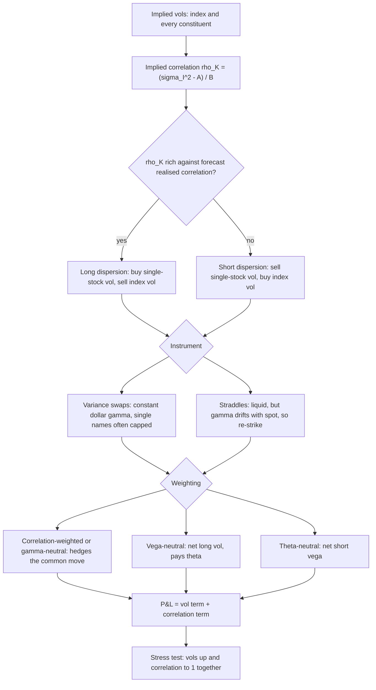

# Dispersion and Correlation Trading

## TL;DR

- Index variance is a weighted sum of covariances, $\sigma_I^2 = \sum_{i,j} w_iw_j\rho_{ij}\sigma_i\sigma_j$; solving for a single correlation gives implied correlation $\rho_K = (\sigma_I^2 - \sum_i w_i^2\sigma_i^2)/\sum_{i \ne j} w_iw_j\sigma_i\sigma_j$, and the quick proxy $\sigma_I^2/(\sum_i w_i\sigma_i)^2$ always overstates it.
- Long dispersion (buy single-stock vol, sell index vol) is short correlation: it wins when the names move apart and loses when they move together; it harvests the gap between implied and realised correlation that index option demand creates.
- The weighting decides what you own: vega-neutral straddles are net long vol and pay theta, theta-neutral are net short vega, gamma-neutral and correlation-weighted variance books are flat when every name moves together.
- With variance swaps the P&L splits exactly into a vol term and a correlation term, $-N_I(\rho_R - \rho_K)B_R$; correlation-weighted notionals make the vol term vanish for any proportional vol move (Euler's theorem).
- The correlation exposure of a variance dispersion is scaled by realised variance, so in a crash (vols up, correlation to 1) it loses far more than a correlation swap with the same initial sensitivity: four times more when vols double.

## Learning objectives

- Explain implied correlation and the index versus single-stock volatility spread.
- Structure and risk-manage a dispersion trade.
- Compute exact and proxy implied correlation, and read correlation at different strikes (correlation skew).
- Choose a weighting (vega-, theta-, gamma-neutral or correlation-weighted) and state what each leaves you exposed to.
- Decompose a dispersion P&L into a volatility term and a correlation term, and compare it with a correlation swap.

## Core concepts

### Index variance and implied correlation

Let the index return be $r_I = \sum_i w_ir_i$ with weights $w_i$ (fractions of index value) held fixed over the horizon.
Then

$$
\sigma_I^2 = \sum_{i}\sum_{j} w_iw_j\rho_{ij}\sigma_i\sigma_j = \underbrace{\sum_i w_i^2\sigma_i^2}_{A} + \sum_{i \ne j} w_iw_j\rho_{ij}\sigma_i\sigma_j .
$$

Replacing the $\binom{n}{2}$ pairwise correlations with one number $\rho$ gives $\sigma_I^2 = A + \rho B$ with $B = \sum_{i \ne j} w_iw_j\sigma_i\sigma_j = (\sum_i w_i\sigma_i)^2 - A$.
Feeding in implied vols defines the implied correlation

$$
\rho_K = \frac{\sigma_I^2 - \sum_i w_i^2\sigma_i^2}{\sum_{i \ne j} w_iw_j\sigma_i\sigma_j}.
$$

It is the single correlation that makes the market's index vol consistent with the market's single-stock vols.
Two bounds frame it: at $\rho = 1$ the index vol is the weighted average vol $\sum_i w_i\sigma_i$, at $\rho = 0$ it is $\sqrt{A}$.
The index vol is always below the weighted average vol unless every pair is perfectly correlated; that gap is what dispersion trades.

The desk proxy drops the own-variance term:

$$
\tilde\rho = \frac{\sigma_I^2}{(\sum_i w_i\sigma_i)^2}, \qquad \rho_K - \tilde\rho = \frac{A\big(\sigma_I^2 - (\sum_i w_i\sigma_i)^2\big)}{B\,(A + B)} \le 0 .
$$

So the proxy overstates implied correlation whenever $\rho_K < 1$, by an amount proportional to $A/B$, which is of order $1/n$ for an equally weighted index.
For a 500-name index the proxy is fine; for a concentrated basket (a sector, a five-stock worst-of) it is badly biased, so compute the exact formula.

Implied correlation is a strike-dependent object.
Read the index and single-stock vols at the same moneyness and you get a different $\rho$ at each strike: index skew is steeper than single-stock skew, so implied correlation is higher on the downside.
This correlation skew is the market pricing correlation rising in sell-offs.
Implied correlation read from variance-swap strikes integrates over the whole smile; when index skew is steeper than single-stock skew it sits above the ATM figure (Example 2).

### Why implied correlation trades rich

Index implied vol has on average exceeded subsequent realised vol, while the premium in single-stock options has been much smaller.
Driessen, Maenhout and Vilkov (2009) document this gap between index and individual option prices and attribute it to priced correlation risk: diversification fails exactly when it is needed, so investors pay to be long correlation.
The flows push the same way:

- demand: institutions buy index puts for portfolio protection, bidding index vol and index skew;
- supply: call overwriting and yield-enhancement products sell single-stock vol, cheapening the constituents;
- structured products: worst-of notes leave dealers with a correlation position they hedge in the listed market (below).

A premium is not an arbitrage.
Long dispersion collects it in calm markets and gives it back, with interest, when correlation spikes.

### Building the trade: straddles or variance swaps

Long dispersion buys vol on every constituent (or a liquid subset) and sells index vol.
Short dispersion is the reverse and is long correlation.

| Instrument | For | Against |
| :--- | :--- | :--- |
| ATM straddles | Listed, liquid, tight markets | Gamma and vega drift as spot moves away from the strike; P&L is path dependent and weighted by $\Gamma S^2$; needs re-striking |
| Variance swaps | Constant dollar gamma, so P&L accrues realised variance on any path; clean decomposition | Single-stock variance is less liquid and usually capped (see [Variance Swaps](14-Variance-Swaps-and-Volatility-Products.md)); jumps break the strip replication |
| Correlation swaps | Pure correlation, no vol exposure | OTC, illiquid, the dealer must hedge it with dispersion anyway |

The delta-hedged straddle book makes, per day,

$$
\sum_i h\,w_i\,\tfrac12\Gamma_iS_i^2\big(r_i^2 - \sigma_i^2\,dt\big) - \tfrac12\Gamma_IS_I^2\big(r_I^2 - \sigma_I^2\,dt\big), \qquad r_I^2 = \sum_i w_i^2r_i^2 + \sum_{i \ne j} w_iw_jr_ir_j,
$$

so the cross products $r_ir_j$, the realised co-movement, enter only through the short index leg (see [Delta Hedging and Gamma Scalping](06-Delta-Hedging-and-Gamma-Scalping.md)).

### Weighting schemes

Hold $h$ times the index-weighted basket of straddles (straddles on $w_i$ units of each stock per unit of index) against one index straddle.
For an ATM straddle at $r = 0$, vega is about $0.8S\sqrt{T}$ and independent of $\sigma$, theta is proportional to $\sigma$, and dollar gamma is proportional to $1/\sigma$.
Single stocks have higher vols than the index, so the three neutralities give very different $h$:

| Weighting | Condition | $h$ in the worked example | What is left |
| :--- | :--- | ---: | :--- |
| Vega-neutral | $h\sum_i w_i\nu_i = \nu_I$ | 1.0017 | pays theta (more theta on the high-vol legs), net long vol when vols rise together |
| Theta-neutral | $h\sum_i w_i\theta_i = \theta_I$ | 0.6635 | net short vega |
| Gamma-neutral | $h\sum_i w_i\Gamma^{\$}_i = \Gamma^{\$}_I$ | 1.4770 | flat when every name moves by the same percentage (that is, at correlation 1), net long vega |

Gamma-neutral is the straddle version of a correlation trade: if all names move together the index moves by the same percentage and the two legs' gamma P&L cancel; any dispersion of moves is profit.

With variance swaps the cleanest weighting differentiates the index variance at fixed implied correlation.
Since $\partial(A + \rho B)/\partial\sigma_i^2 = w_i^2 + \rho\,w_i\sum_{j \ne i} w_j\sigma_j/\sigma_i$, the correlation-weighted stock notionals are

$$
N_i = N_I\Big(w_i^2 + \rho_K\,w_i\sum_{j \ne i} w_j\frac{\sigma_j}{\sigma_i}\Big).
$$

At fixed correlation, index variance $A + \rho B$ is homogeneous of degree 1 in the variances $\sigma_i^2$, so by Euler's theorem $\sum_i \sigma_i^2\,\partial(\cdot)/\partial\sigma_i^2 = A + \rho B$: the correlation-weighted book costs nothing at inception and its vol P&L is exactly zero under any proportional move of all vols, and second order otherwise.

### The exact P&L decomposition

Long $N_i$ variance on each stock, short $N_I$ index variance, all in variance points (vol points squared), strikes $K_i = \sigma_i^2$, $K_I = \sigma_I^2 = A_K + \rho_K B_K$.
Define the realised implied-style correlation $\rho_R = (\sigma_{I,R}^2 - A_R)/B_R$ from realised variances.
Then the P&L $\sum_i N_i(\sigma_{i,R}^2 - K_i) - N_I(\sigma_{I,R}^2 - K_I)$ splits exactly into

$$
\underbrace{\sum_i N_i(\sigma_{i,R}^2 - K_i) - N_I\big[(A_R - A_K) + \rho_K(B_R - B_K)\big]}_{\text{vol term}} \;\underbrace{-\,N_I(\rho_R - \rho_K)B_R}_{\text{correlation term}} .
$$

The vol term is what you would have made had realised correlation equalled implied; the correlation term is the bet.
Two facts drive risk management:

- the correlation notional is $N_IB_R$, set by realised vols, not by the trade date;
- realised correlation and realised vol rise together in sell-offs, so the correlation loss is largest exactly when $B_R$ is largest.

A correlation swap pays $N_\rho(\rho_R^{\text{swap}} - K_\rho)$, where $\rho_R^{\text{swap}}$ is a (weighted) average of pairwise sample correlations of daily log returns, $\sum_{i<j} w_iw_j\hat\rho_{ij}/\sum_{i<j} w_iw_j$ in a common form.
It has no vol exposure, so it is the clean instrument, but its realised correlation is a different statistic from $\rho_R$ above, and the dealer who writes it hedges it with dispersion and keeps the basis.

### Residual risks of a dispersion book

- Single-stock vol and jumps: a takeover or an earnings gap moves one name's realised variance, and a capped single-stock variance swap or a straddle captures it imperfectly.
- Weight drift: a cap-weighted index's weights move with prices, so the index is not the fixed-weight basket in the identity; the hedge needs rebalancing.
- Correlation skew: implied correlation differs by strike, so the trade's correlation strike depends on the instruments; straddle books re-struck after a move trade correlation at new strikes.
- Crash correlation: in a sell-off pairwise correlations go toward 1 and vols jump together; a long-dispersion book is short both the correlation and, through $B_R$, its scale.
- Vega convexity: straddles lose vega as spot moves away from the strike, variance swaps keep it; a straddle dispersion that looked vega-neutral at inception is not after a large move.
- Liquidity and caps: the single-stock leg is wider and shallower than the index leg; caps on single-stock variance swaps truncate the long leg's upside in exactly the scenario where the long leg should pay.

### Who trades it

- Sell-side structured products: worst-of calls, worst-of autocallables and other basket payoffs leave the issuer with a correlation position (derived below) that it hedges in the listed market, often with dispersion.
- Hedge funds and volatility arbitrage desks run long dispersion to harvest the correlation premium, sized for the crash scenario.
- Risk managers treat implied correlation as a risk factor of its own: a book that is vega-flat can still carry large correlation risk, so stress tests move correlation and vol jointly.

The sign for worst-of payoffs follows from the payoff.
The minimum of two stocks is lower when they are less correlated, so a worst-of put $(K - \min_i S_i)^+$ is worth more at low correlation and a worst-of call $(\min_i S_i - K)^+$ is worth less; at correlation 1 both collapse to the single-stock option.
An autocallable investor is short a worst-of down-and-in put (the knock-in at maturity), so the issuer is long it; an issuer that sells a worst-of call is short it.
Either way the issuer's position loses value when correlation rises: its correlation sensitivity is negative.
Long dispersion has the same sign, so it adds to that risk; the offsetting trade buys correlation, for example short dispersion.
Market terminology for "long" and "short" correlation is not uniform, so state the sign of $\partial V/\partial\rho$ explicitly; worst-of payoffs are covered in [Exotic Options](12-Exotic-Options.md).

## Worked examples

All numbers come from [dispersion_correlation.py](code/dispersion_correlation.py), which prints and asserts each one at the rounding quoted here.
Monte Carlo figures (Examples 4, 5 and 7) come from fixed seeds and change with the seed, so prose quotes them as "about"; the closed-form and quadrature figures are exact to the digits shown.
The basket: five stocks with index weights 30%, 25%, 20%, 15%, 10% and three-month ATM implied vols 25%, 30%, 35%, 28%, 40%; index ATM vol 20%.

### Example 1: implied correlation of a basket

"Weighted average vol is $\sum_i w_i\sigma_i = 0.302$, so the index would trade at 30.2 vol if the names were perfectly correlated and at $\sqrt{A} = 13.97$ if uncorrelated.
The own-variance part is $A = 0.019514$ and the cross part $B = 0.07169$.
Exact implied correlation: $(0.04 - 0.019514)/0.07169 = 0.2858$.
The proxy $0.04/0.302^2 = 0.4386$ is 0.1528 too high because five names leave a large own-variance term."
Raising correlation by 0.10 lifts the fair index vol to 21.72%.
With 50 equally weighted names at 30% and the index at 18%, exact is 0.3469 and the proxy 0.36: the bias shrinks like $1/n$.

### Example 2: correlation skew and variance-swap correlation

One-year smiles with total variance $w(k) = \sigma_{ATM}^2 + b(\rho k + \sqrt{k^2 + 0.01} - 0.1)$: single stocks with $b = 0.04$, $\rho = -0.3$ (flatter), the index with $b = 0.1$, $\rho = -0.7$ (steeper).
The fair variance strike is the $1/K^2$ strip of out-of-the-money options (puts below the forward, calls above), $K_{var} = \frac{2e^{rT}}{T}\int_0^\infty\frac{\text{OTM}(K)}{K^2}\,dK$ (Demeterfi, Derman, Kamal and Zou 1999; see [Variance Swaps](14-Variance-Swaps-and-Volatility-Products.md)).
Integrated numerically (a flat 20% smile returns 20.00, as it must), it gives:

| | ATM vol | Variance strike | Strike minus ATM |
| :--- | ---: | ---: | ---: |
| Stock 1 | 25.00 | 26.31 | 1.31 |
| Index | 20.00 | 25.05 | 5.05 |

Implied correlation read at fixed moneyness: 0.4275 at the 90% strike, 0.2858 at the money, 0.2437 at 110%.
Implied correlation from variance strikes is 0.5283, far above the ATM figure, because the index strip loads on the steep downside.
"So when someone quotes implied correlation, ask which strikes or which instrument: a variance dispersion struck at the ATM correlation is mispriced by 0.2425 of correlation."

### Example 3: straddle hedge ratios

Three-month ATM straddles, all spots 100, $r = 0$.
Index straddle: price 7.98, vega 0.3984 per vol point, theta $-0.04367$ per day, gamma P&L 0.03984 for a 1% move.

| Weighting | $h$ | Net residual per index straddle |
| :--- | ---: | :--- |
| Vega-neutral | 1.0017 | theta $-0.02226$ per day |
| Theta-neutral | 0.6635 | vega $-0.1345$ per vol point |
| Gamma-neutral | 1.4770 | vega $+0.1891$ per vol point |

Vega-neutral holds about one unit of basket per index unit and pays theta, because theta scales with vol and the stocks carry more vol.
Theta-neutral buys only two thirds of the basket and is short vega: a parallel rise in implied vols costs money.
Gamma-neutral buys half as much again and is long vega; it is the one that is flat when all names move together.

### Example 4: a simulated year of correlation-weighted variance dispersion

Index vega notional 100,000 at 20 vol, so $N_I = 100{,}000/(2 \times 20) = 2{,}500$ per variance point.
Correlation-weighted stock notionals: 419.6, 291.4, 194.7, 155.8, 71.8.
Their total vega notional is 66,559 against 100,000 on the index, yet the book is vol-neutral to proportional moves because single-stock vols move more vol points.
A naive hedge that spreads 100,000 of vega by index weight would put 600 variance notional on stock 1 alone, against 419.6.

One simulated year with true vols 20%, 24%, 40%, 30%, 45%, true pairwise correlation 0.15 and a constant-weight index.

One path from seed 11; every value in this table changes with the seed.

| | Value |
| :--- | ---: |
| Realised stock vols | 20.24, 24.83, 40.76, 30.55, 45.53 |
| Realised index vol | 17.99 |
| Realised implied-style correlation $\rho_R$ | 0.2026 |
| Total P&L | 160,406 |
| Vol term | 16,865 |
| Correlation term | 143,541 |

The decomposition is an identity: total minus the two terms is asserted to be within $10^{-6}$.
"Correlation came in at about 0.20 against 0.29 implied, worth about 143,541; the vol term, about 16,865, is about a tenth of the total even though every stock's realised vol missed its implied by at least 2.5 vol points (table above)."
The correlation-swap estimator on the same path is about 0.2072 with pair weights $w_iw_j$ and about 0.2181 equally weighted: a correlation swap and a dispersion trade settle on different numbers.
And a year of daily data measured about 0.20 when the true correlation was 0.15: realised correlation is a noisy statistic.

### Example 5: the P&L distribution and the choice of weights

Over 4,000 simulated years.

Simulated with seed 12 (both rows, drawn in sequence); every value in this table changes with the seed.

| World | Mean P&L | s.d. P&L | Note |
| :--- | ---: | ---: | :--- |
| Vols and correlation at implied | $-767$ | 55,743 | standard error 881, so fair; vol term s.d. 668, correlation term s.d. 55,753 |
| Vols at implied, correlation 0.15 | 243,290 | 48,262 | mean correlation term 242,290 against the first-order $N_I(\rho_K - 0.15)B_K = 243{,}312.5$ |

At implied correlation but with random vol shocks (common factor 30%, idiosyncratic 15% in log vol, seed 13), the correlation-weighted book has P&L s.d. about 16,183; the vega-notional-by-index-weight book has mean about 150,822 and s.d. about 446,310.
The second is a vol trade dressed as a correlation trade.

### Example 6: the crash, against a correlation swap

Realised vols double and realised correlation is 0.9.
Realised index vol is 57.98.
The correlation-weighted book loses 4,403,500, all of it correlation term; the vol term is zero by Euler (asserted within $10^{-6}$ in floating point).
A correlation swap with the same initial correlation sensitivity has notional $N_IB_K = 1{,}792{,}250$ per unit of correlation and loses 1,100,875.
The ratio is $B_R/B_K = 4$: the variance dispersion's correlation notional scaled with realised variance.
"So a long variance dispersion is short correlation with a notional that grows in the crash; size it for this scenario, not for the vega."

### Example 7: which way does a worst-of move with correlation?

Two stocks, $S = K = 100$, vol 25%, one year, $r = 0$, 400,000 paths; the correlation 1.0 row is the Black-Scholes closed form.

Simulated with seed 5 (correlations 0.2 to 0.8); those values change with the seed.

| Correlation | Worst-of put | Worst-of call |
| ---: | ---: | ---: |
| 0.2 | 15.73 | 3.19 |
| 0.5 | 14.48 | 4.55 |
| 0.8 | 12.79 | 6.50 |
| 1.0 (single-stock limit) | 9.95 | 9.95 |

The issuer who owns the worst-of put inside an autocallable, or who is short a worst-of call, loses as correlation rises.

## Pitfalls

- Using the proxy $\sigma_I^2/(\sum w_i\sigma_i)^2$ on a concentrated basket; it overstates implied correlation by a term of order $A/B$.
- Quoting one implied correlation without saying which strikes or instruments; in the worked example the 90% and variance-strike correlations sit 14 and 24 points above the ATM one.
- Calling a vega-neutral straddle dispersion a correlation trade; it is net long vol and pays theta.
- Sizing a long dispersion on its vega or its correlation sensitivity at inception; the correlation notional scales with realised variance and peaks in the crash.
- Treating realised correlation over a year as precise; with 252 daily returns a single pair's estimate has a standard error of about $(1 - \rho^2)/\sqrt{252}$, 0.062 at $\rho = 0.15$.
- Ignoring weight drift and index rebalancing; the identity holds for the weights actually used, and a cap-weighted index changes them.
- Forgetting caps and jumps: capped single-stock variance and straddles both under-deliver on a single-name blow-up, the scenario the long leg is supposed to monetise.
- Hedging a worst-of book's correlation with long dispersion; it has the same sign and doubles the risk.

## Interview questions

> [!question]- deriv-disp-index-variance | Write the variance of an index in terms of its constituents.
> $\sigma_I^2 = \sum_{i,j} w_iw_j\rho_{ij}\sigma_i\sigma_j$, with $w_i$ the index weights.
> With one common correlation it is $A + \rho B$, $A = \sum w_i^2\sigma_i^2$, $B = \sum_{i \ne j} w_iw_j\sigma_i\sigma_j$.

> [!question]- deriv-disp-implied-corr-formula | Give the exact implied correlation formula and the common proxy. Which is bigger?
> Exact $\rho_K = (\sigma_I^2 - \sum w_i^2\sigma_i^2)/\sum_{i \ne j} w_iw_j\sigma_i\sigma_j$; proxy $\sigma_I^2/(\sum w_i\sigma_i)^2$.
> The proxy is bigger whenever $\rho_K < 1$: $\rho_K - \tilde\rho = A(\sigma_I^2 - (\sum w\sigma)^2)/(B(A + B)) \le 0$, an error of order $1/n$.

> [!question]- deriv-disp-basket-number | Weights 30/25/20/15/10, vols 25/30/35/28/40, index vol 20. Implied correlation, exact and proxy?
> Exact 0.2858, proxy 0.4386.
> $A = 0.019514$, $B = 0.07169$, $\sum w\sigma = 0.302$; five names make the own-variance term large, so the proxy is badly biased.

> [!question]- deriv-disp-index-vol-bounds | What are the index vol bounds at correlation 0 and 1?
> $\sqrt{\sum w_i^2\sigma_i^2}$ at 0 and $\sum w_i\sigma_i$ at 1.
> For the five-stock basket: 13.97 and 30.2 vol, with the market's 20 implying 0.29.

> [!question]- deriv-disp-long-is-short-corr | What is a long dispersion trade and what is it exposed to?
> Long single-stock vol, short index vol: it gains when the names move apart and loses when they move together, so it is short correlation.
> It harvests implied correlation above realised, and loses in sell-offs when correlation goes to 1.

> [!question]- deriv-corr-why-rich | Why does implied correlation tend to exceed realised correlation?
> Investors pay for protection against diversification failing (Driessen, Maenhout and Vilkov 2009 find index options priced richly relative to single-stock options and attribute it to correlation risk).
> Flows add to it: index put buying lifts index vol, overwriting and yield products sell single-stock vol.

> [!question]- deriv-corr-skew | What is correlation skew, and which way does it slope in equities?
> Implied correlation computed from index and stock vols at the same moneyness varies with strike; it is higher on the downside because index skew is steeper than single-stock skew.
> In the worked smiles: 0.43 at 90%, 0.29 at the money, 0.24 at 110%.

> [!question]- deriv-corr-variance-strike-correlation | Why is implied correlation from variance-swap strikes above the ATM implied correlation?
> The $1/K^2$ strip loads on the downside, where index skew is steeper than stock skew, so the index variance strike rises more over ATM than the stocks' do.
> Example: index 20 ATM to 25.05 variance strike, stock 25 ATM to 26.31; correlation 0.53 from variance strikes against 0.29 at the money.

> [!question]- deriv-disp-weighting-schemes | Vega-, theta- and gamma-neutral straddle dispersion: what is left in each?
> Vega-neutral ($h \approx 1$) pays theta and is long vol when vols rise together; theta-neutral ($h \approx 0.66$) is short vega; gamma-neutral ($h \approx 1.48$) is long vega but flat when all names move together.
> ATM vega is roughly vol-independent, theta scales with $\sigma$ and dollar gamma with $1/\sigma$, and stocks carry more vol than the index.

> [!question]- deriv-disp-gamma-neutral-meaning | Why is the gamma-neutral straddle book the straddle version of a pure correlation trade?
> If every name moves by the same percentage, the index moves by it too, and equal dollar gamma on both legs cancels the P&L.
> Only dispersion of the moves (correlation below 1) pays, through the cross terms $r_ir_j$ in the index leg.

> [!question]- deriv-disp-corr-weighted-notional | Give the correlation-weighted variance notionals and why they hedge vol.
> $N_i = N_I(w_i^2 + \rho_K w_i\sum_{j \ne i} w_j\sigma_j/\sigma_i)$, the derivative of $A + \rho_K B$ with respect to $\sigma_i^2$.
> Index variance at fixed correlation is homogeneous of degree 1 in the variances, so by Euler the vol P&L is zero for any proportional vol move and second order otherwise.

> [!question]- deriv-disp-pnl-decomposition | Decompose the P&L of a variance dispersion trade.
> Vol term $\sum N_i(\sigma_{i,R}^2 - K_i) - N_I[(A_R - A_K) + \rho_K(B_R - B_K)]$ plus correlation term $-N_I(\rho_R - \rho_K)B_R$, with $\rho_R = (\sigma_{I,R}^2 - A_R)/B_R$.
> It is an identity; in the simulated year (seed 11) a total of about 160,406 splits into about 16,865 of vol term and about 143,541 of correlation term.

> [!question]- deriv-disp-crash | You are long a correlation-weighted variance dispersion. Vols double and correlation goes to 0.9. What happens?
> You lose $N_I(0.9 - \rho_K)B_R$ with $B_R = 4B_K$: 4.40 million on 2,500 index variance notional, all correlation term, zero vol term.
> A correlation swap with the same initial correlation sensitivity loses a quarter of that, 1.10 million.

> [!question]- deriv-corr-swap-vs-dispersion | Correlation swap or variance dispersion: what is the difference in risk?
> The correlation swap pays $N_\rho(\rho_R - K_\rho)$ with a fixed notional and no vol exposure; the dispersion's correlation notional is $N_IB_R$, set by realised variance.
> Since correlation and vol spike together, short correlation through variance dispersion is convex against you; the two also settle on different realised-correlation statistics.

> [!question]- deriv-corr-realised-noise | How precisely does a year of daily data measure correlation?
> Poorly: the sampling standard error of one pair's correlation is roughly $(1 - \rho^2)/\sqrt{n}$, 0.062 at $\rho = 0.15$ with $n = 252$.
> In the simulation (seed 11) the true correlation was 0.15 and one year realised about 0.20.

> [!question]- deriv-corr-worst-of-sign | An issuer sells worst-of autocallables. What is its correlation sensitivity, and does long dispersion hedge it?
> Negative: the investor is short a worst-of down-and-in put, so the issuer owns it, and a worst-of put loses value as correlation rises (about 15.73 at 0.2 to about 12.79 at 0.8 in the simulated two-stock example).
> Long dispersion also has negative correlation sensitivity, so it adds risk; the hedge buys correlation, for example short dispersion.

> [!question]- deriv-disp-straddle-vs-varswap | Straddles or variance swaps for a dispersion trade?
> Variance swaps give constant dollar gamma and an exact vol-correlation decomposition but single names are less liquid and capped; straddles are liquid but their gamma and vega decay as spot moves, so the weights drift and need re-striking.
> Most of the residual risk in a straddle book is path dependence, not correlation.

> [!question]- deriv-disp-senior-sizing | How would you size and risk-manage a long dispersion book?
> Size on the joint stress (vols up, correlation to 1), not on vega or inception correlation sensitivity; cap single-name concentration; monitor correlation exposure as $N_IB_R$ in real time; and hedge the tail with index puts or short-dated index variance.
> Report P&L split into vol and correlation terms so a vol trade is not mistaken for a correlation view.

## In this repo and SDE-Interview-Prep

- Prev: [Variance Swaps and Volatility Products](14-Variance-Swaps-and-Volatility-Products.md). Next: [Options Problem Set](16-Options-Problem-Set.md).
- Code: [dispersion_correlation.py](code/dispersion_correlation.py) prints and asserts every number in this note (it imports Black-Scholes helpers from [pricing_core.py](code/pricing_core.py)); run it with `uv run --no-project --with numpy python 05-Derivatives-and-Volatility/code/dispersion_correlation.py`.
- Related: [Option Strategies and Volatility Trading](13-Option-Strategies-and-Volatility-Trading.md), [Delta Hedging and Gamma Scalping](06-Delta-Hedging-and-Gamma-Scalping.md), [Exotic Options](12-Exotic-Options.md).

## Further reading

- J. Driessen, P. Maenhout and G. Vilkov (2009), "The Price of Correlation Risk: Evidence from Equity Options", *Journal of Finance* 64(3).
- K. Demeterfi, E. Derman, M. Kamal and J. Zou (1999), "A guide to volatility and variance swaps", *Journal of Derivatives* 6(4).
- P. Carr and D. Madan (1998), "Towards a theory of volatility trading", in *Volatility: New Estimation Techniques for Pricing Derivatives*, Risk Books.
- Euan Sinclair, *Volatility Trading*, Wiley.
- Mohamed Bouzoubaa and Adel Osseiran, *Exotic Options and Hybrids: A Guide to Structuring, Pricing and Trading*, Wiley (2010), on worst-of and correlation products.
