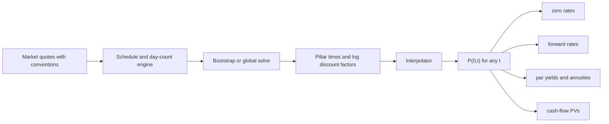

# Discounting and Yield Curves

## TL;DR

- A discount factor $P(0,T)$ is today's price of one unit paid at $T$; zero rates, forwards and par yields are all re-expressions of the same function $T \mapsto P(0,T)$.
- A quoted rate is meaningless without its compounding frequency and day count: 3% annual is 2.9559% continuous, and an ACT/360 rate read as ACT/365 misprices 100mm by 26,622 USD over six months.
- No arbitrage fixes the forward: $1 + F\tau = P(0,T_1)/P(0,T_2)$, replicated with two zero-coupon bonds; it is an expectation only under the $T_2$-forward measure, not a forecast.
- Par yields, zero rates and yield to maturity differ whenever the curve is not flat; on an upward sloping curve, par < zero and forwards > zeros.
- Interpolation and extrapolation are modelling choices that move forwards and PVs even when every input quote is matched: on the same three pillars the 5y discount factor is 0.821927 or 0.806234 depending on flat-zero versus flat-forward extrapolation.

## Learning objectives

- Convert between discount factors, zero rates (any compounding), forward rates and par yields.
- Derive forward rates from discount factors by no-arbitrage and explain why they are not forecasts.
- Price a fixed-rate bond off a zero curve and bootstrap a zero curve from par yields.
- Name the production failure modes: compounding mismatch, day-count mismatch, interpolation and extrapolation choices.
- Explain what a curve object must store and expose, and why every rate is derived from discount factors rather than stored beside them.

## Core concepts

### Discount factors and the law of one price

Let $P(0,T)$ be the price today of a default-free zero-coupon bond paying 1 at $T$.
Any deterministic cash-flow stream $\{(T_i, c_i)\}$ is a portfolio of such bonds, so absence of arbitrage forces its price to be
$$V = \sum_i c_i\, P(0,T_i).$$
Two streams with identical cash flows must have identical prices, so the single function $T \mapsto P(0,T)$ is all the state needed to value any deterministic stream in one currency and one collateral regime.
Positivity ($P > 0$) follows from no arbitrage; $P < 1$ does not, and fails whenever rates are negative.
Monotonicity ($P(0,T_2) \le P(0,T_1)$ for $T_2 > T_1$) holds only if the forward between them is non-negative.

### Rates are quoting conventions on $P$

| Quote | Definition | Link to $P(0,T)$ |
| :--- | :--- | :--- |
| Annual compounding | $z_1(T)$ | $P = (1+z_1)^{-T}$ |
| $m$ times a year | $z_m(T)$ | $P = (1+z_m/m)^{-mT}$ |
| Continuous | $z_c(T)$ | $P = e^{-z_c T}$ |
| Simple (money market) | $L$ with accrual $\tau$ | $P = 1/(1+L\tau)$ |

Equating discount factors gives every conversion: $z_c = m\ln(1+z_m/m)$ and $z_m = m(e^{z_c/m}-1)$.
A 5% annual rate is 4.9390% semiannual, 4.8889% monthly and 4.8790% continuous; all four reprice the same 10-year discount factor.
The accrual $\tau$ is a day-count fraction of two dates (ACT/360, ACT/365F, 30/360, ACT/ACT), and the time $T$ in the exponent is a separate model convention, usually ACT/365F.
SOFR, for example, accrues on actual days over a 360-day year (Federal Reserve Bank of New York, SOFR methodology, retrieved 2026-10-17).
The [day count note](11-Day-Counts-Calendars-and-Schedules.md) covers the conventions themselves.

### Forward rates by replication

Buy one zero maturing at $T_2$ and sell $P(0,T_2)/P(0,T_1)$ zeros maturing at $T_1$.
The cost today is $P(0,T_2) - \frac{P(0,T_2)}{P(0,T_1)}P(0,T_1) = 0$.
At $T_1$ the position pays $P(0,T_2)/P(0,T_1)$; at $T_2$ it receives 1.
That is a loan agreed today over $[T_1,T_2]$, so its simply compounded rate must be the forward:
$$F(0;T_1,T_2) = \frac{1}{\tau}\left(\frac{P(0,T_1)}{P(0,T_2)} - 1\right), \qquad \tau = \tau(T_1,T_2).$$
Any other quoted forward-rate agreement rate is an arbitrage against the two zeros.
The instantaneous forward is $f(0,T) = -\partial_T \ln P(0,T)$, so
$$P(0,T) = \exp\left(-\int_0^T f(0,u)\,du\right), \qquad z_c(T) = \frac1T\int_0^T f(0,u)\,du.$$
Differentiating $T z_c(T)$ gives $f(0,T) = z_c(T) + T z_c'(T)$: forwards sit above zeros exactly where the zero curve rises.

**Forwards are not forecasts.**
Under the $T_2$-forward measure (numeraire $P(t,T_2)$), $F(t;T_1,T_2)$ is a martingale, so $F(0;T_1,T_2) = \mathbb{E}^{T_2}[L(T_1,T_2)]$, the expectation of the future spot rate under that pricing measure ([change of numeraire](../04-Stochastic-Calculus/05-Change-of-Measure-and-Girsanov.md)).
Under the real-world measure the forward also contains term premia and convexity, so a forward above spot does not by itself mean the market expects rates to rise.

### Par yields, zero rates and yield to maturity

For an annual bond with coupon $c$ and maturity $n$, the price per unit face is $c\sum_{i=1}^{n}P(0,i) + P(0,n)$.
The par coupon makes this equal to 1:
$$c_n = \frac{1 - P(0,n)}{\sum_{i=1}^n P(0,i)}.$$
The par coupon is a discount-factor-weighted average of the one-period forwards, $c_n = \sum_i w_i F_{i-1,i}$ with $w_i = P(0,i)/\sum_j P(0,j)$, because $1 - P(0,n)$ telescopes into $\sum_i P(0,i)F_{i-1,i}$ with unit accruals.
Since the weights favour early periods, on an upward sloping curve the par yield lies below the zero rate of the same maturity.
The yield to maturity $y$ of one bond is the flat rate that discounts its own flows to its price.
It is a summary statistic of that bond, not a curve: two bonds with the same maturity and different coupons have different yields on the same curve, because they weight the same zero rates differently.

### Bootstrapping, first pass

Given annual par yields $c_1, c_2, \dots$, the par condition at each maturity has one new unknown:
$$P(0,1) = \frac{1}{1+c_1}, \qquad P(0,n) = \frac{1 - c_n\sum_{i=1}^{n-1}P(0,i)}{1 + c_n}.$$
The system is lower triangular, so each step uses only shorter discount factors.
With real instruments (deposits, futures, OIS swaps with real schedules) the steps need a one-dimensional root solve and an interpolation assumption between pillars; that is in [Swaps and Curve Building](03-Swaps-and-Curve-Building.md) and [Curve Construction Numerics](14-Curve-Construction-Numerics.md).

### Interpolation and extrapolation are part of the model

Between pillars something must be assumed.
Two common baselines, both treated in Hagan and West (2006):

| Method | What is linear | Instantaneous forward | Property |
| :--- | :--- | :--- | :--- |
| Log-linear discount factors | $\ln P(0,t)$ | constant on each segment, jumps at pillars | positive forwards whenever $P$ falls; bumping a pillar moves only its two adjacent segments |
| Linear zero rates | $z_c(t)$ | $z + t z'$, linear in $t$ inside a segment, jumps at pillars | smoother zero curve, saw-tooth forwards |

Beyond the last pillar, flat zero and flat forward extrapolation give different long discount factors whenever the curve is not flat; the choice is a hidden position in every long-dated trade.

### How it is implemented

- Inputs: quotes with their conventions, a valuation date, a calendar.
- State: pillar times and $\ln P$ at each pillar, plus the interpolation and extrapolation rule; zero, forward and par rates are derived on request, never stored beside $P$, so they cannot disagree.
- Evaluation: binary search for the segment, $O(\log n)$; a closed-form bootstrap is $O(n)$ overall, a root-solved one $O(n \cdot \text{iterations})$.
- Numerical pitfalls: extrapolation beyond the last pillar, negative forwards from a bad interpolator, and year fractions from different conventions mixed in one formula.
- System context: [the curve and surface service](../18-Pricing-and-Risk-Systems/04-Curve-and-Surface-Service.md).

## Worked examples

Every number below is computed, printed and asserted by `code/fi_discounting.py`.

### Example 1: zero curve to discount factors and forwards

Annual zero rates $z(1) = 3\%$, $z(2) = 3.5\%$, $z(3) = 4\%$.
"Discount each at its own rate":
$$P(0,1) = 1.03^{-1} = 0.970874, \quad P(0,2) = 1.035^{-2} = 0.933511, \quad P(0,3) = 1.04^{-3} = 0.888996.$$
"The forwards are ratios of adjacent discount factors": $F(1,2) = 0.970874/0.933511 - 1 = 4.0024\%$ and $F(2,3) = 0.933511/0.888996 - 1 = 5.0073\%$.
"Check by chaining": $1.03 \times 1.040024 \times 1.050073 = 1.124864 = 1.04^3$, so investing for one year at spot and rolling at the forwards equals the 3-year zero.

### Example 2: price a 3-year 4% annual bond on that curve

"Sum flows times discount factors": $4(0.970874) + 4(0.933511) + 104(0.888996) = 100.0732$.
The par coupon is $(1 - 0.888996)/(0.970874 + 0.933511 + 0.888996) = 3.974\%$ (3.973810% to six decimals), below the 4% coupon, which is why the bond trades above par.
Its yield to maturity is 3.9737%: neither the 3-year zero rate (4%) nor the par coupon, because a yield weights the zero rates by this bond's own flows.

### Example 3: bootstrap from par yields

Par yields $c_1 = 3\%$, $c_2 = 3.5\%$.
$P(0,1) = 1/1.03 = 0.970874$.
$P(0,2) = (1 - 0.035 \times 0.970874)/1.035 = 0.933352$, a 2-year annual zero of 3.5088%.
"Par is below zero because the first coupon is discounted at the lower 1-year rate."
The bootstrapped factors reprice both par bonds to exactly 100.

### Example 4: a money-market deposit and a day-count error

A 6-month deposit at 4.00% ACT/360 over 182 days has $P = 1/(1 + 0.04 \times 182/360) = 0.980179$, a continuous zero of 4.0151% on ACT/365F time.
Reading the same 4.00% as ACT/365 gives $P = 0.980445$.
"On 100mm paid in 182 days that is a PV error of 26,622 USD from one wrong denominator."

### Example 5: interpolation moves forwards, not pillars

Take Example 1's curve as continuous zeros 2.9559%, 3.4401%, 3.9221%.
Log-linear discount factors give constant forwards of 3.9244% on (1,2) and 4.8859% on (2,3): a jump of about 96 bp at the 2-year pillar.
Linear zeros give $f = z + t z'$: 4.4087% just below 2 years, 4.4040% just above, rising to 5.3679% at 3 years, a saw-tooth inside each segment.
Both match every pillar, yet $P(0,2.5)$ is 0.910982 (log-linear) against 0.912080 (linear zero).
"Same quotes, two curves; anything paying at 2.5 years has an interpolation position."

### Example 6: extrapolation to 5 years

Holding the 3-year zero flat gives $P(0,5) = e^{-0.039221 \times 5} = 0.821927$.
Holding the last forward (4.8859%) flat gives $P(0,5) = 0.888996 \times e^{-0.048859 \times 2} = 0.806234$.
"That is 1.5693mm of PV per 100mm paid at 5 years, purely from the extrapolation rule."
On an upward sloping curve, flat-zero extrapolation implies a forward that drops back to the zero rate at the last pillar.

### Example 7: negative rates

At a 2-year annual zero of -0.50%, $P(0,2) = 0.995^{-2} = 1.010076$: a legal discount factor above 1.
The ECB deposit facility rate was negative from 11 June 2014 (-0.10%) until 27 July 2022 (0.00%), at -0.50% from 18 September 2019 (ECB key interest rates table, retrieved 2026-10-17).
Log-linear interpolation still works because $P > 0$; what breaks is code that floors rates at zero, takes $\ln$ of a rate, or uses a model that needs positive rates (lognormal Black, CIR), covered in [Rates Options](05-Rates-Options-Caps-and-Swaptions.md) and [Short-Rate Models](04-Short-Rate-Models.md).

## Pitfalls

- Quoting or comparing rates without compounding and day count: 3% annual and 3% continuous differ by 4.41 bp of continuous rate.
- Mixing the accrual day count (ACT/360) with the model time (ACT/365F) inside one formula.
- Treating yield to maturity as the curve: it is a bond-specific average that hides shape.
- Calling a forward a forecast: it is a replication price and contains term premium and convexity.
- Storing zero rates, forwards and discount factors separately so they drift apart; derive everything from $P$.
- Extrapolating flat zero by default; it implies a forward discontinuity at the last pillar.
- Linear interpolation of zero rates and assuming smooth forwards: forwards are saw-tooth.
- Assuming $P < 1$ in validation code: it fails in negative-rate currencies.

## Interview questions

> [!question]- fi-discount-factor-definition | What is a discount factor and why can any deterministic cash-flow stream be priced from the discount curve alone?
> $P(0,T)$ is today's price of 1 paid at $T$.
> Any stream is a portfolio of zero-coupon bonds, so by the law of one price it is worth $\sum c_i P(0,T_i)$; any other price is an arbitrage against the replicating zeros.

> [!question]- fi-compounding-conversion | Convert a 3% annually compounded zero rate to continuous compounding.
> $z_c = \ln(1.03) = 2.9559\%$.
> Equate discount factors: $(1.03)^{-T} = e^{-z_c T}$ for all $T$.

> [!question]- fi-forward-from-discount | Given $P(0,1)=0.970874$ and $P(0,2)=0.933511$, what is the 1y1y forward rate (annual compounding)?
> $F = P(0,1)/P(0,2) - 1 = 4.0024\%$.
> Lock it in by buying the 2y zero and selling $0.933511/0.970874$ of the 1y zero: zero cost today, pay at 1y, receive 1 at 2y.

> [!question]- fi-forward-not-forecast | Are forward rates forecasts of future spot rates?
> No.
> $F(0;T_1,T_2)$ is the expectation of $L(T_1,T_2)$ under the $T_2$-forward measure, a pricing measure; under the real-world measure forwards also carry term premia and convexity, so they are break-even rates, not predictions.

> [!question]- fi-zero-forward-relation | Express the zero rate as an average of forwards and say what an upward sloping zero curve implies for forwards.
> $z_c(T) = \frac1T\int_0^T f(0,u)\,du$, so $f(0,T) = z_c(T) + T z_c'(T)$.
> Where $z_c$ rises, $z_c' > 0$ and forwards lie above zeros.

> [!question]- fi-par-coupon-formula | Derive the par coupon for an $n$-year annual bond from discount factors.
> Set the price to 1: $c\sum_{i=1}^n P(0,i) + P(0,n) = 1$, so $c = (1-P(0,n))/\sum_{i=1}^n P(0,i)$.
> Equivalently a discount-factor-weighted average of the one-year forwards.

> [!question]- fi-bootstrap-par-yields | Bootstrap the 2-year discount factor from annual par yields 3% (1y) and 3.5% (2y).
> $P(0,1) = 1/1.03 = 0.970874$.
> $P(0,2) = (1 - 0.035 \times 0.970874)/1.035 = 0.933352$, a 2y annual zero of 3.5088%.

> [!question]- fi-ytm-vs-curve | Why is yield to maturity not a curve and when does it mislead?
> It is the one flat rate that reprices a single bond, a weighted average of zero rates with that bond's PV weights.
> Two bonds of the same maturity and different coupons have different yields on the same curve, so ranking bonds by yield across coupons or durations mixes curve shape into "cheapness".

> [!question]- fi-log-linear-interp | What does log-linear interpolation of discount factors imply for forwards?
> Piecewise-constant instantaneous forwards: $\ln P$ linear in $t$ makes $f = -\partial_t \ln P$ constant on each segment, with jumps at pillars (96 bp at 2y on the note's example).
> In exchange, forwards stay positive wherever $P$ falls and a pillar bump only moves its two adjacent segments.

> [!question]- fi-negative-rates-impact | What breaks in a pricing library when rates go negative?
> Anything assuming positive rates: lognormal Black formulas (undefined for $F \le 0$), CIR, code that floors rates at zero or takes a log of a rate, and validation that rejects $P > 1$.
> Discount factors above 1 are fine mathematically and log-linear interpolation still works; options move to normal or shifted lognormal models.

> [!question]- fi-par-vs-zero | A 2y par rate is 3.5% and the 2y zero is 3.5088%. Why is the par rate lower?
> The par coupon is a weighted average of the 1y and 1y1y forwards, weighted toward the earlier, lower one; on an upward sloping curve that average sits below the 2y zero.

> [!question]- fi-dc-compounding-equivalents | Express 5% annually compounded as semiannual, monthly and continuous rates.
> 4.9390% semiannual, 4.8889% monthly, 4.8790% continuous.
> Each solves $(1+z_m/m)^m = 1.05$; more frequent compounding needs a lower nominal rate for the same growth.

> [!question]- fi-dc-day-count-mixing | A 182-day deposit is quoted at 4.00% ACT/360. What is the PV error on 100mm if a system reads it as ACT/365?
> 26,622 USD.
> The correct discount factor is $1/(1+0.04 \times 182/360) = 0.980179$, the wrong one $1/(1+0.04 \times 182/365) = 0.980445$; the difference times 100mm is the error.

> [!question]- fi-dc-ytm-of-curve-bond | On zeros of 3%, 3.5% and 4% (annual) a 3y 4% bond is worth 100.0732. What is its yield, and why is it not 4%?
> 3.9737%.
> The yield is a PV-weighted average of the 1y, 2y and 3y zeros, and the coupons give weight to the lower 1y and 2y rates.

> [!question]- fi-dc-interp-forward-jump | Two curves match the same 1y, 2y and 3y pillars, one log-linear in discount factors and one linear in zero rates. Do they agree at 2.5 years?
> No: $P(0,2.5)$ is 0.910982 versus 0.912080 on the note's example.
> Log-linear makes $t z(t)$ linear, linear-zero makes $z(t)$ linear; they agree only at pillars, so every off-pillar cash flow carries an interpolation choice.

> [!question]- fi-dc-flat-forward-extrap | Your last pillar is 3y. What changes between flat-zero and flat-forward extrapolation to 5y on an upward sloping curve?
> Flat forward gives a lower 5y discount factor (0.806234 versus 0.821927 in the note's example), worth 1.5693mm per 100mm paid at 5y.
> Flat zero implicitly drops the forward to the zero rate after the last pillar; flat forward continues the last forward, which is usually the more defensible default.

> [!question]- fi-dc-negative-df | What is the 2-year discount factor at a -0.50% annual zero rate, and is it an arbitrage?
> $0.995^{-2} = 1.010076$.
> No arbitrage requires $P > 0$, not $P < 1$: the argument that rates cannot go below zero assumes cash can be held in any size at no cost, and large cash holdings carry storage, custody and balance-sheet costs.

> [!question]- fi-dc-forward-replication-cashflows | Write the cash flows of the zero-coupon replication of a 1y1y forward loan on 1 unit.
> Today: buy one 2y zero for $P_2$, sell $P_2/P_1$ 1y zeros for $P_2$: net 0.
> At 1y: pay $P_2/P_1$; at 2y: receive 1; the implied rate is $P_1/P_2 - 1$.

> [!question]- fi-dc-term-premium-judgement | The 1y1y forward is 50 bp above the 1y spot. A trader says the market prices two hikes. What do you say?
> Not necessarily.
> The forward is a pricing-measure expectation, so relative to real-world expectations it also contains a term premium of unknown sign and size plus convexity; separating expected policy from premium needs a term-structure model or survey data, and the answer is model dependent.

## In this repo and SDE-Interview-Prep

- Code: [`code/fi_discounting.py`](code/fi_discounting.py) computes, prints and asserts every number on this page.
- Next: [Bonds, Duration and Convexity](02-Bonds-Duration-and-Convexity.md), [Swaps and Curve Building](03-Swaps-and-Curve-Building.md), [Day Counts, Calendars and Schedules](11-Day-Counts-Calendars-and-Schedules.md), [Curve Construction Numerics](14-Curve-Construction-Numerics.md).

## Further reading

- Bruce Tuckman and Angel Serrat, *Fixed Income Securities: Tools for Today's Markets*, 3rd edition (Wiley 2011), chapters 1 to 3 (prices, discount factors and arbitrage; spot, forward and par rates; returns, spreads and yields).
- Damiano Brigo and Fabio Mercurio, *Interest Rate Models: Theory and Practice*, 2nd edition (Springer 2006), chapter 1 (definitions and notation).
- Patrick Hagan and Graeme West, "Interpolation Methods for Curve Construction", *Applied Mathematical Finance* 13(2), 2006.
- European Central Bank, key ECB interest rates (deposit facility rate history), ecb.europa.eu, retrieved 2026-10-17.
- Federal Reserve Bank of New York, "Additional Information about Reference Rates Administered by the New York Fed" (SOFR methodology), retrieved 2026-10-17.
