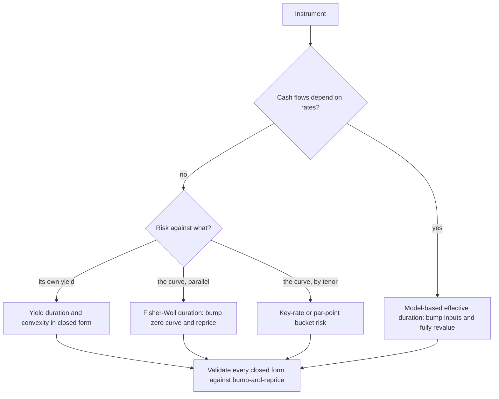

# Bonds, Duration and Convexity

## TL;DR

- Price is a decreasing, convex function of yield, $P(y) = \sum_i c_i (1+y/m)^{-m t_i}$; settlement cash is the dirty price, the quote is the clean price, and the difference is accrued interest on the security's own day count (actual days in the half-year for U.S. Treasuries).
- Modified duration $D_{mod} = -\frac{1}{P}\frac{dP}{dy} = D_{Mac}/(1+y/m)$; DV01 $= P\,D_{mod} \times 10^{-4}$; convexity $C = \frac1P\frac{d^2P}{dy^2}$ gives $\frac{\Delta P}{P} \approx -D_{mod}\Delta y + \frac12 C \Delta y^2$.
- Every analytic number should be checkable by bump-and-reprice; for anything with a curve, options or a non-flat shock, the bump number (effective duration) is the definition and the formula is the special case.
- A DV01 hedge neutralises one parallel move of one yield and nothing else: a 10y par bond hedged with 4.2396 of a 2y bond still loses 0.8071 per 100 if only the 10y yield rises 10 bp.
- Convexity is not free: a barbell beats a duration-matched bullet on every parallel move of a flat curve, so in an arbitrage-free market the convex position must yield less.

## Learning objectives

- Price a bond from yield and compute accrued interest, clean and dirty price on a real calendar.
- Reproduce the U.S. Treasury's own pricing formula (31 CFR Part 356 Appendix B) and explain the fractional-period convention.
- Derive Macaulay and modified duration and convexity, use the second-order approximation, and check each by bump-and-reprice.
- Distinguish yield duration, curve (Fisher-Weil) duration and effective duration.
- Compute DV01 and hedge ratios between two bonds and quantify what the hedge leaves.
- Know when duration breaks: large shocks, non-parallel moves, embedded options.

## Core concepts

### Price, yield, accrued interest

With $m$ coupons a year and a yield $y$ compounded $m$ times a year, on a coupon date
$$P = \sum_{i} c_i \left(1+\frac{y}{m}\right)^{-m t_i}.$$
Between coupons the buyer pays the seller the coupon earned so far, because the buyer will receive the whole next coupon.
Dirty (invoice) price = clean (quoted) price + accrued interest, and accrued = coupon $\times$ (days accrued / days in the period) under the bond's day count.
For U.S. Treasury notes and bonds the daily interest decimal is based on the actual number of calendar days in the half-year (31 CFR Part 356 Appendix B, section I.A.2), so a 184-day half-year and a 181-day half-year accrue at different daily rates; accrued is rounded to five decimals per 1,000 of par (section I.D.4).
At a constant yield the dirty price drifts up at the yield and drops by the coupon on the coupon date; the clean price is the smooth series, which is why it is the quote.

### The Treasury pricing formula

31 CFR Part 356 Appendix B section II.D prices a non-indexed security between coupon dates as
$$(P + A)\left[1 + \frac{r}{s}\frac{i}{2}\right] = \frac{C}{2} + \frac{C}{2}a_{n} + 100 v^n, \qquad A = \frac{s-r}{s}\frac{C}{2},$$
with $C$ the annual coupon per 100, $i$ the yield, $v = 1/(1+i/2)$, $a_n = v + \dots + v^n$, $n$ the full semiannual periods after the next coupon, $r$ the days from settlement to the next coupon and $s$ the days in the current half-year.
The fractional first period is discounted at simple interest, $1 + (r/s)(i/2)$.
Many analytics libraries instead discount it as $(1+i/2)^{r/s}$; the two agree on coupon dates and differ by a fraction of a cent between them, which matters when reconciling an invoice to the cent.
`code/fi_bonds.py` reproduces the Appendix B worked examples to every published decimal (II.A 99.057893, II.B 99.838183, II.C 99.805118, II.D $P$ = 99.730918 with $A$ = 0.367403), counting $r$ and $s$ from the calendar.

### Duration

Differentiate the price: $\dfrac{dP}{dy} = -\dfrac{1}{1+y/m}\sum_i t_i c_i (1+y/m)^{-m t_i}$.
So
$$D_{mod} = -\frac{1}{P}\frac{dP}{dy} = \frac{D_{Mac}}{1+y/m}, \qquad D_{Mac} = \sum_i t_i w_i, \quad w_i = \frac{c_i(1+y/m)^{-m t_i}}{P}.$$
Macaulay duration is the PV-weighted average time of the cash flows (weights sum to 1); a zero has $D_{Mac}$ equal to its maturity.
Modified duration is the percentage price sensitivity to the periodically compounded yield; DV01 is the price change for 1 bp, $DV01 \approx P\,D_{mod} \times 10^{-4}$, positive for a long bond by the usual sign convention.
With continuous compounding $D_{mod} = D_{Mac}$.

Three durations are in daily use and they answer different questions:

| Duration | Shock | Formula | Use |
| :--- | :--- | :--- | :--- |
| Yield (modified) | the bond's own yield | $D_{Mac}/(1+y/m)$ | quoting, bond-to-bond comparison |
| Fisher-Weil (curve) | parallel shift of continuous zero rates | $\sum_i t_i c_i P(0,t_i)/P$ | curve-consistent risk of fixed flows |
| Effective | any bump of model inputs, full revaluation | $\frac{P_- - P_+}{2P\,\Delta}$ | callables, mortgages, anything with options |

### Convexity

The second derivative is $\dfrac{d^2P}{dy^2} = \sum_i c_i t_i \left(t_i + \tfrac{1}{m}\right)\left(1+\tfrac{y}{m}\right)^{-m t_i - 2}$, so with $C = \frac1P\frac{d^2P}{dy^2}$ the Taylor expansion is
$$\frac{\Delta P}{P} \approx -D_{mod}\,\Delta y + \tfrac12 C\,(\Delta y)^2,$$
with an error of third order in $\Delta y$.
Every term of the sum is positive, so a bullet bond has positive convexity: for a symmetric move it gains more on the fall in yield than it loses on the rise.
For a zero, $C = T(T + 1/m)/(1+y/m)^2$, roughly $T^2$, so convexity grows about quadratically with maturity while duration grows linearly.
Hence a barbell (short plus long) carries more convexity than a bullet of the same duration and PV.
On a flat curve that only moves in parallel, the barbell would beat the bullet on every move, which is an arbitrage; in an arbitrage-free market the convex position must be paid for, through a lower yield (less carry).
Units matter: $C$ here is per unit of $y^2$, so $\frac12 C (0.01)^2$ is the 100 bp term; some systems report convexity per $(\text{bp})^2$ or per 100 bp.

### Limits of duration

- Large moves: the second-order expansion leaves a third-order error.
- Non-parallel moves: one yield or one parallel curve shift cannot represent a twist; use key-rate or bucketed risk ([Curve Risk and Hedging](15-Curve-Risk-and-Hedging.md)).
- Embedded options: callables and mortgages have cash flows that depend on rates and can show negative convexity; only a model-based effective duration is meaningful ([Callable and Bermudan Products](20-Callable-and-Bermudan-Products.md), [Mortgages](22-Mortgages-and-Securitized-Products.md)).
- Liquidity: a DV01-neutral book still carries the spread between the instruments it holds and the ones it hedges with.

### How it is implemented

- Inputs: the schedule from the conventions engine ([Day Counts, Calendars and Schedules](11-Day-Counts-Calendars-and-Schedules.md)), the settlement date, a yield or a curve.
- Outputs: clean and dirty price, accrued, durations, convexity, DV01.
- Yield from price: the price is strictly decreasing in $y$, so bisection on a bracket that includes negative yields always converges; Newton with DV01 as the slope is faster but needs a safeguard.
- Risk: closed forms for yield risk, bump-and-reprice for everything else, with the closed forms used as unit tests of the bump engine.
- System context: risk and P&L in the [front-to-back architecture](../18-Pricing-and-Risk-Systems/01-Front-to-Back-Architecture.md).

## Worked examples

Every number below is computed, printed and asserted by `code/fi_bonds.py`.

### Example 1: a Treasury-style note between coupons

A hypothetical 4.25% note maturing 15 November 2034 settles on Monday 19 October 2026 at a 4.10% yield.
"Last coupon 15 May 2026, next 15 November 2026: the half-year has $s$ = 184 days, 157 have accrued and $r$ = 27 remain."
Accrued $= 2.125 \times 157/184 = 1.813179$ per 100.
After the next coupon there are $n$ = 16 semiannual periods, so the Appendix B formula gives a dirty price of 102.829978 and a clean price of 101.016799.
Discounting the fraction as $(1.0205)^{-27/184}$ instead gives 102.832642: 0.27 cents per 100, or 2,664 USD on 100mm, from the convention alone.
Settling on Friday 13 November (before the coupon) and on Monday 16 November (after it) at the same yield: the dirty price goes from 103.116329 to 101.025519, a change of -2.090811, while the clean price moves by only -0.000649.

### Example 2: 2-year 5% annual bond at a 4% yield

$P = 5/1.04 + 105/1.04^2 = 101.886095$.
$D_{Mac} = (5/1.04 + 2 \times 105/1.04^2)/P = 1.952813$ years, $D_{mod} = 1.952813/1.04 = 1.877705$.
Convexity $= (5 \cdot 1 \cdot 2/1.04^3 + 105 \cdot 2 \cdot 3/1.04^4)/P = 5.372829$.
DV01 $= 101.886095 \times 1.877705 \times 10^{-4} = 0.019131$ per 100, matching a ±1 bp reprice.
"Shock +100 bp: full repricing gives -1.886095, duration plus convexity gives -1.885749; the error -0.000345 is almost exactly the third-order Taylor term -0.000349."

### Example 3: par 10-year 4% annual bond

At $y$ = 4% the price is 100.
$D_{mod}$ = 8.1109, $D_{Mac}$ = 8.4353, convexity 80.754, DV01 0.081109.
Reprice: at 5% the price is 92.2783 (-7.7217); at 3% it is 108.5302 (+8.5302).
Duration and convexity predict -7.707 and +8.515.
"The asymmetry is convexity: the gain from a 100 bp fall exceeds the loss from a 100 bp rise."
Bumping ±1 bp reproduces $D_{mod}$ = 8.1109 and $C$ = 80.754; bumping ±100 bp gives an effective duration of 8.1260 and convexity of 80.847, because a wide bump averages in higher-order terms.

### Example 4: zero versus coupon bond

A 10-year zero at 4% costs 67.5564, has $D_{Mac}$ = 10.0000 and convexity $10 \times 11/1.04^2$ = 101.70, against 8.4353 and 80.754 for the 10-year par bond.
All of the zero's value sits at the far end, so both its duration and its convexity are higher.
Raising the coupon to 8% at the same yield lowers the modified duration to 7.3435: more PV sits in early flows.

### Example 5: yield duration versus curve duration

The 3-year 4% bond from [note 01](01-Discounting-and-Yield-Curves.md) is worth 100.0732 on zeros of 3%, 3.5% and 4% (annual).
Shifting the continuous zero curve in parallel gives a Fisher-Weil duration of 2.8851.
Its yield is 3.9737%, where the Macaulay duration is 2.8861 and the modified (annual) duration 2.7758.
"Fisher-Weil weights each flow by its own discount factor and Macaulay by the single yield, so the weights differ and so do the durations, here by 0.0011; modified duration differs again because it measures sensitivity to an annually compounded rate, not a continuous one."

### Example 6: a DV01 hedge and what it leaves

Hedge 100 of the 10-year par bond with the 2-year 5% bond: ratio $= 0.081109/0.019131 = 4.2396$ face of the 2-year per 100 of the 10-year.
A parallel +10 bp move leaves a hedged P&L of +0.0029 per 100, the convexity mismatch.
A steepener with the 10-year yield +10 bp and the 2-year unchanged loses -0.8071 per 100: the hedge does nothing because its yield did not move.

### Example 7: barbell versus bullet

On a flat 4% annual curve, match a 5-year zero (the bullet) in PV and Macaulay duration with 2-year and 10-year zeros: PV weight 0.625 in the 2-year.
Convexities are 27.737 (bullet) and 41.605 (barbell).
Long barbell, short bullet gains 0.0651 per 100 at +100 bp and 0.0740 at -100 bp, and 6.9 USD per 100mm of PV for a 1 bp move.
"A flat curve that only moves in parallel would make this a free lunch, which is why real curves are not flat: the market charges for convexity through yield."

### Example 8: accrued on a corporate 30/360 bond

A 5% semiannual bond 60 days into a 180-day 30/360 period has accrued $2.5 \times 60/180 = 0.8333$ per 100, so a clean price of 99.50 settles at 100.3333.

### Example 9: market stress, March 2020

On 15 March 2020 the FOMC lowered the federal funds target range to 0 to 1/4 percent and said it would increase its holdings of Treasury securities by at least 500 billion USD and of agency MBS by at least 200 billion USD "to support the smooth functioning of markets for Treasury securities and agency mortgage-backed securities" (FOMC statement, 15 March 2020).
The risk lesson: duration hedges assume that both legs can be traded at model prices; when the central bank itself names market functioning as the problem, basis and liquidity risk between the bonds held and the hedges dominate the DV01 number.

## Pitfalls

- Using Macaulay duration as the price sensitivity: divide by $(1 + y/m)$ first.
- Comparing durations computed with different compounding (annual, semiannual, continuous).
- Pricing between coupons with the wrong fractional-period convention and failing to reconcile invoices.
- Using clean prices for P&L without carrying the accrued: P&L jumps at coupon dates.
- Hedging a long bond with a short one by DV01 and calling the book flat: it is flat to one parallel move only.
- Quoting a closed-form duration for a callable or mortgage bond.
- Reporting convexity per unit $y^2$ in one system and per bp$^2$ in another.
- A yield solver whose bracket excludes negative yields.

## Interview questions

> [!question]- fi-modified-duration-def | Define modified duration and relate it to Macaulay duration.
> $D_{mod} = -\frac{1}{P}\frac{dP}{dy} = D_{Mac}/(1+y/m)$.
> It is the percentage price change per unit change in the yield compounded $m$ times a year; with continuous compounding the two coincide.

> [!question]- fi-zero-duration | What is the Macaulay duration of a zero-coupon bond?
> Its maturity, since the whole PV sits at $T$ and the PV-weighted average time is $T$ (10.0000 for a 10-year zero).

> [!question]- fi-dv01-formula | A bond has price 101.886 and modified duration 1.8777. What is its DV01 per 100 face?
> 0.019131, from $P\,D_{mod} \times 10^{-4}$; a ±1 bp reprice of the 2-year 5% bond at 4% gives the same to six decimals.

> [!question]- fi-duration-convexity-approx | Write the second-order price approximation and compute it for a 10y 4% par bond at +100bp ($D_{mod}=8.1109$, $C=80.754$).
> $\Delta P/P \approx -D_{mod}\Delta y + \frac12 C\Delta y^2 = -0.081109 + 0.004038 = -7.707\%$.
> The exact repricing is -7.7217%; the residual is third order.

> [!question]- fi-convexity-positive | Why is convexity positive for a plain bullet bond and who pays for it?
> $d^2P/dy^2 = \sum c_i t_i (t_i + 1/m)(1+y/m)^{-m t_i - 2}$ has only positive terms.
> The holder gains on large moves either way; in an arbitrage-free market that is paid for through a lower yield than a less convex position of the same duration.

> [!question]- fi-barbell-bullet | A barbell and a bullet have the same duration. Which has higher convexity and what does the trade bet on?
> The barbell: convexity grows about with maturity squared (41.605 versus 27.737 for 2y/10y zeros against a 5y zero at 4%).
> Long barbell, short bullet is long convexity: it gains on large parallel moves (0.0651 per 100 at +100 bp, 0.0740 at -100 bp) and pays for it in yield; it also carries curve-shape risk.

> [!question]- fi-clean-dirty | Define clean price, dirty price and accrued interest. A 5% semiannual bond is 60 days into a 180-day 30/360 period; clean 99.50. Dirty?
> Dirty = clean + accrued; accrued $= 2.5 \times 60/180 = 0.8333$, so dirty = 100.3333.
> Settlement cash is the dirty price; the quote is clean because it does not jump at coupon dates.

> [!question]- fi-duration-hedge | How do you hedge a 10y bond with a 2y bond by DV01 and what risk remains?
> Short $DV01_{10}/DV01_2$ of the 2y per unit of the 10y: 4.2396 face of a 2y 5% bond per 100 of a 10y par bond at 4%.
> It is neutral only to a parallel move of both yields; slope moves, convexity mismatch and the basis between the two bonds remain.

> [!question]- fi-duration-limits | Name three situations where duration misprices the price move.
> Large yield changes (convexity and higher-order terms), non-parallel curve moves, and instruments whose cash flows depend on rates (callables, mortgages), where only a model-based effective duration means anything.

> [!question]- fi-par-bond-price | What is the price of a bond whose coupon equals its yield?
> 100 on a coupon date.
> Between coupons the clean price is slightly below 100: a 4% bond at 4% halfway through a 182-day half-year is 99.990099 under the Treasury's simple-interest fraction and 99.995049 with a compounded fraction, because accrued is linear while discounting is not.

> [!question]- fi-ytm-solve | How do you solve for yield from price and what bracket do you need?
> Root-find a strictly decreasing function: bisection always converges, Newton with DV01 as slope is faster but needs a safeguard.
> The bracket must allow negative yields: a 5-year zero at 102 yields -0.3953%.

> [!question]- fi-coupon-duration-effect | Why does a higher coupon reduce duration at the same maturity and yield?
> More PV weight sits in early coupons, pulling the weighted average time forward: a 10-year bond at 4% has modified duration 8.1109 with a 4% coupon and 7.3435 with an 8% coupon.

> [!question]- fi-bd-treasury-accrued | A 4.25% Treasury note last paid on 15 May and next pays on 15 November; settlement is 19 October. Compute accrued per 100.
> 1.813179.
> Treasury accrued uses actual days over actual days in the half-year: $2.125 \times 157/184$.

> [!question]- fi-bd-treasury-formula | How does the U.S. Treasury's own formula price a note between coupon dates?
> $(P + A)[1 + (r/s)(i/2)] = C/2 + (C/2)a_n + 100v^n$ (31 CFR 356 Appendix B II.D): discount the full-period flows to the next coupon date at the semiannual yield, then back to settlement at simple interest over the fraction $r/s$.
> It reproduces the published example $P$ = 99.730918 with $A$ = 0.367403.

> [!question]- fi-bd-fraction-convention | Two systems disagree on a Treasury's dirty price by about a quarter of a cent per 100 between coupons. What is the likely cause?
> The fractional-period convention: simple interest $1 + (r/s)(i/2)$ (Appendix B) versus compounded $(1+i/2)^{r/s}$.
> On the note's example the gap is 0.27 cents per 100, 2,664 USD on 100mm; it vanishes on coupon dates.

> [!question]- fi-bd-dirty-jump-coupon | At constant yield, what happens to clean and dirty prices across a coupon date?
> The dirty price falls by about the coupon (-2.090811 per 100 for a 4.25% note across the 15 November coupon), while the clean price barely moves (-0.000649).
> That is why quotes are clean and why P&L must carry accrued and coupons explicitly.

> [!question]- fi-bd-effective-duration-bump | You compute duration by bumping yield ±100 bp and get 8.1260 for a bond whose analytic modified duration is 8.1109. Which is wrong?
> Neither: the central difference has $O(\Delta y^2)$ error, so a wide bump averages in higher-order terms; ±1 bp reproduces 8.1109.
> Use small bumps for sensitivities and full repricing for scenario P&L.

> [!question]- fi-bd-fisher-weil | What is Fisher-Weil duration and how does it differ from Macaulay duration?
> The sensitivity to a parallel shift of the continuous zero curve, $\sum t_i c_i P(0,t_i)/P$: it weights each flow by its own discount factor rather than the flat yield.
> On the note's upward sloping curve it is 2.8851 against a Macaulay duration of 2.8861 for the same bond.

> [!question]- fi-bd-steepener-hedge-pnl | You are long a 10y par bond, DV01-hedged with 2y bonds. The 10y yield rises 10 bp and the 2y is unchanged. What is your P&L?
> About -0.8071 per 100 of 10y: the full 10y loss, because the hedge's yield did not move.
> A parallel +10 bp move would have left only +0.0029, the convexity mismatch.

> [!question]- fi-bd-zero-convexity-formula | Derive the convexity of a $T$-year zero with annual compounding.
> $P = (1+y)^{-T}$, $P'' = T(T+1)(1+y)^{-T-2}$, so $C = T(T+1)/(1+y)^2$: 101.70 for 10 years at 4%.

> [!question]- fi-bd-negative-convexity | Why can a callable bond have negative convexity, and what duration do you report?
> As yields fall the issuer's call becomes valuable, capping the price near the call price, so the price-yield curve bends down and $d^2P/dy^2 < 0$ in that region.
> Report effective duration and convexity from bumping the model's inputs and fully revaluing, with the option model stated.

## In this repo and SDE-Interview-Prep

- Code: [`code/fi_bonds.py`](code/fi_bonds.py) computes, prints and asserts every number on this page, including the Treasury's published examples.
- Related: [Discounting and Yield Curves](01-Discounting-and-Yield-Curves.md), [Day Counts, Calendars and Schedules](11-Day-Counts-Calendars-and-Schedules.md), [Curve Risk and Hedging](15-Curve-Risk-and-Hedging.md), [Treasury Futures and the Basis](16-Treasury-Futures-and-the-Basis.md).

## Further reading

- U.S. Department of the Treasury, 31 CFR Part 356 Appendix B, "Formulas and Tables", sections I (accrued interest) and II (non-indexed security prices), eCFR, retrieved 2026-10-17.
- Bruce Tuckman and Angel Serrat, *Fixed Income Securities: Tools for Today's Markets*, 3rd edition (Wiley 2011), chapter 3 (returns, spreads and yields) and chapter 4 (one-factor risk metrics and hedges).
- Frank J. Fabozzi (ed.), *The Handbook of Fixed Income Securities*, 8th edition (McGraw-Hill 2012).
- Board of Governors of the Federal Reserve System, FOMC statement, 15 March 2020, federalreserve.gov.
