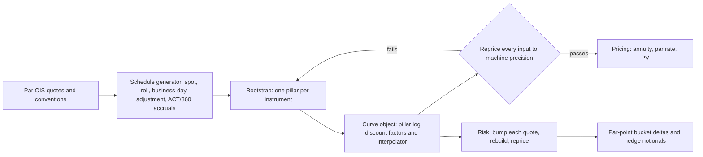

# Swaps and Curve Building

## TL;DR

- A fixed-for-floating swap exchanges a fixed coupon for a floating index on a notional that is never exchanged; a USD SOFR OIS pays annually on both legs, ACT/360, starts T+2 and pays 2 business days after each period end (CFTC, 7 July 2023).
- The floating leg pays SOFR compounded daily in arrears; investing 1 at $T_{i-1}$ overnight replicates it, so on one curve its PV is exactly $P(0,T_{i-1}) - P(0,T_i)$ and the whole leg telescopes to $P(0,T_0) - P(0,T_n)$.
- Par rate $S = \frac{P(0,T_0) - P(0,T_n)}{A}$ with annuity $A = \sum_i \tau_i P(0,T_i)$; a receiver at $K$ is worth $N(K - S)A$.
- "DV01" has several definitions that differ for off-market swaps: $N A \times 10^{-4}$ holds the curve fixed (45,800 USD on the note's 5y receiver), re-bootstrapping after a 1 bp par bump also moves the annuity (46,156 USD).
- Bootstrapping is triangular when each new instrument adds one pillar; with real dates and ACT/360 accruals every quote must reprice to machine precision, which is the first test of any curve build.

## Learning objectives

- Value a fixed-for-floating interest rate swap from discount factors and compute its mark-to-market.
- Derive the par swap rate and explain why the floating leg telescopes, and why for an OIS that is exact rather than an approximation.
- Compute compounded SOFR for a period with weekends and explain the SOFR Index.
- Calculate swap DV01 in its several definitions and explain how dealers hedge directional swap risk.
- Execute a sequential bootstrap on a real schedule with ACT/360 accruals and check it by repricing.
- Identify production breaks from conventions: day counts, payment lags, calendars and stale single-curve assumptions.

## Core concepts

### Anatomy and market conventions

A fixed-for-floating swap exchanges, on notional $N$, fixed coupons $K\tau_i$ for floating coupons $L_i\tau_i$ over periods $[T_{i-1}, T_i]$; the notional is not exchanged.
The payer swap pays fixed and receives floating (gains when rates rise); the receiver swap receives fixed (gains when rates fall).
The USD SOFR OIS contracts made subject to the CFTC trade execution requirement are specified as follows (CFTC press release 8745-23, 7 July 2023):

| Term | USD SOFR OIS | GBP SONIA OIS |
| :--- | :--- | :--- |
| Start | spot T+2, or IMM dates | spot T+0, or IMM dates |
| Payment frequency | annual, both legs | annual, both legs |
| Day count | ACT/360 | ACT/365 fixed |
| Payment lag | 2 days | 0 days |
| Fixing calendar | US Government Securities | London |

These are the terms of the standardised, exchange-traded contracts; bilateral swaps can deviate.
Interest rate swap terms are documented under the ISDA definitions; the 2021 ISDA Interest Rate Derivatives Definitions, published 14 June 2021 and implemented over the weekend of 2 to 3 October 2021, consolidated the 70-plus supplements to the 2006 Definitions (ISDA press release, 14 June 2021).

### Compounded SOFR

SOFR is a volume-weighted median of overnight Treasury repo transactions (tri-party, GCF and FICC-cleared bilateral DVP, with the lowest 20% of DVP volume trimmed), published one business day after its value date and rounded to the nearest basis point (Federal Reserve Bank of New York, retrieved 2026-10-17).
Over a period with business days $i$ and calendar-day weights $n_i$ (the days until the next business day), the compounded rate is
$$R = \left[\prod_i \left(1 + \frac{r_i n_i}{360}\right) - 1\right]\frac{360}{d_c},$$
where $d_c = \sum_i n_i$ is the number of calendar days: daily compounding on business days and simple interest at the prior business day's rate over weekends and holidays, as in the NY Fed's SOFR Averages methodology.
The NY Fed's SOFR Index starts at 1.00000000 on 2 April 2018 and compounds every SOFR since, so the compounded rate over any period is $(I_{end}/I_{start} - 1)\cdot 360/d_c$.
Because the last fixing of a period is published on the period end date, a payment on that date would be impossible to calculate in time; the standard USD OIS pays 2 days later.

### Why the OIS floating leg telescopes exactly

Invest 1 at $T_{i-1}$ in an overnight SOFR deposit and roll it: at $T_i$ it has grown to $\prod_j(1 + r_j n_j/360)$, which is exactly 1 plus the floating coupon.
So receiving the floating coupon at $T_i$ is worth having 1 at $T_{i-1}$ minus 1 at $T_i$:
$$PV_i^{float} = P(0,T_{i-1}) - P(0,T_i), \qquad PV^{float} = \sum_i \big[P(0,T_{i-1}) - P(0,T_i)\big] = P(0,T_0) - P(0,T_n).$$
This is model-free on a single curve, that is when cash flows are discounted at SOFR itself, as for cleared USD swaps since the October 2020 discounting transition.
With a forward-looking index fixed at $T_{i-1}$ (the old LIBOR swaps), the same identity needs the forwarding and discounting curves to be the same curve, which stopped being true in 2007 ([Multi-Curve and CSA Discounting](13-Multi-Curve-and-CSA-Discounting.md)).
With a payment lag the identity is no longer exact, because the coupon is paid at $T_i + 2$ days rather than at $T_i$.

### Par rate, annuity and mark-to-market

The fixed leg is worth $N K \sum_i \tau_i P(0,T_i) = N K A$, where $A$ is the annuity (the PV of 1 per year paid on the fixed schedule).
Setting fixed equal to floating gives the par rate
$$S = \frac{P(0,T_0) - P(0,T_n)}{A}.$$
A swap at coupon $K$ is then worth $V_{payer} = N(S - K)A$ and $V_{receiver} = N(K - S)A$.
$S$ is a weighted average of the period forwards, $S = \sum_i w_i F_i$ with $w_i = \tau_i P(0,T_i)/A$, which is why the swap rate is the natural underlying of a swaption ([Rates Options](05-Rates-Options-Caps-and-Swaptions.md)).

### DV01: four numbers with one name

| Definition | What is held fixed | Note's 5y receiver, USD per bp |
| :--- | :--- | ---: |
| Annuity DV01 $N A \times 10^{-4}$ | the curve and therefore $A$ | 45,800 |
| Parallel par-point DV01 | the build; all quotes bumped and the curve rebuilt | 46,156 |
| Bucketed par-point deltas | all quotes but one | 23, 46, 70, 95, 45,922 |
| Zero-rate DV01 | pillars bumped in zero space | depends on interpolation |

The annuity DV01 is exact only for a par swap.
Differentiating $V = N(K - S)A$ with respect to the swap rate gives $-dV/dS = NA - N(K - S)\,dA/dS$, and $dA/dS < 0$, so an in-the-money receiver ($K > S$) gains more than $NA$ per bp fall: the annuity it is long also rises.
Risk systems report par-point (bucketed) deltas because they map one to one onto hedge trades in the quoted par swaps; [Curve Risk and Hedging](15-Curve-Risk-and-Hedging.md) treats the Jacobian between zero and par risk.

### Bootstrapping

Each par OIS quote adds one unknown discount factor, at its maturity.
With annual pillars that coincide with the coupon dates, the par condition $S_n \sum_{i \le n}\tau_i P_i = 1 - P_n$ (discount factors measured from the spot date) solves in closed form:
$$P_n = \frac{1 - S_n \sum_{i<n}\tau_i P_i}{1 + S_n\tau_n}.$$
The system is lower triangular, so it is $O(n)$ and needs no solver.
Real builds are not that clean: short deposits and futures overlap, coupon dates fall between pillars, and each step needs a one-dimensional root solve with an interpolation rule; global methods fit all quotes at once with a smoothness penalty ([Curve Construction Numerics](14-Curve-Construction-Numerics.md)).
Whatever the method, the acceptance test is the same: every input instrument reprices to its quote at machine precision.

### How it is implemented

- Inputs: trade date, quotes with their full conventions (start lag, roll, calendar, day count, payment lag), fixings for the current period.
- Outputs: discount factors at any date, par rates, annuities, PVs, bucketed deltas.
- Complexity: $O(n)$ per bootstrap with closed forms; bucketed risk by rebuilding is $O(n)$ rebuilds, or one Jacobian solve.
- Reference implementation: [`code/fi_swaps_ois.py`](code/fi_swaps_ois.py).
- System context: [the curve and surface service](../18-Pricing-and-Risk-Systems/04-Curve-and-Surface-Service.md).

## Worked examples

Rates and quotes below are hypothetical; conventions are the sourced ones above.
Every number is computed, printed and asserted by `code/fi_swaps_ois.py`.

### Example 1: compounding one week of SOFR

Fixings for Monday 19 to Friday 23 October 2026 of 4.30%, 4.31%, 4.29%, 4.32% and 4.33%, with the Friday rate applying for 3 calendar days, give a compounded rate to Monday 26 October of 4.31704% ACT/360.
"The day-weighted simple average is 4.31571%, so compounding adds 0.13 bp over a week; treating Friday as one day instead of three understates the rate by -0.60 bp."
Interest on 100mm for the week is 83,942.51 USD.
Recovered from SOFR Index values rounded to 8 decimals, the average is 4.31705%: index rounding moves the fifth decimal, as the NY Fed warns.

### Example 2: bootstrapping a SOFR OIS curve on real dates

Trade on Monday 19 October 2026, spot Wednesday 21 October; par quotes 1y 3.60%, 2y 3.45%, 3y 3.40%, 4y 3.42%, 5y 3.48%.
"The anniversaries 21 October 2028 and 2029 fall on a Saturday and a Sunday, so modified following moves them to 23 and 22 October; the accruals are therefore 1.013889, 1.022222, 1.011111, 1.011111 and 1.013889 years on ACT/360."

| Pillar | $P(\text{spot},T)$ | Zero (cont., ACT/365F) | 1y forward starting here (ACT/360) |
| :--- | ---: | ---: | ---: |
| 2027-10-21 | 0.964785 | 3.5850% | 3.2962% |
| 2028-10-23 | 0.933337 | 3.4353% | 3.2942% |
| 2029-10-22 | 0.903251 | 3.3856% | 3.4845% |
| 2030-10-21 | 0.872511 | 3.4072% | 3.7424% |
| 2031-10-21 | 0.840614 | 3.4705% | |

Every quote reprices to within $10^{-14}$.
Discount factors here are from the spot date; to value at the trade date multiply by the two-day overnight factor, 0.999761 at 4.30%.
"Note the 1y forwards: a mildly humped par curve produces a forward curve that dips and then rises sharply, because forwards are differences of the zero curve."

### Example 3: what the payment lag costs

Paying both legs of the 5y swap 2 business days after each period end, the par rate becomes 3.4800% against the 3.48% quote, a difference of -0.0005 bp.
"The lag is a convention you must model to reconcile cash flows, but it is not where the risk is."

### Example 4: an off-market swap and its DV01s

A 5y receiver at 3.75% on 100mm against the 3.48% par rate: annuity 4.580045, PV $= 10^8 \times (0.0375 - 0.0348) \times 4.580045 = 1{,}236{,}612$ USD.
Annuity DV01 is 45,800 USD per bp.
Bumping all five par quotes ±1 bp and rebuilding gives 46,156 USD per bp, and the bucket deltas are 23, 46, 70, 95 and 45,922 USD per bp, summing to 46,156.
"The 5y bucket carries almost all the risk because the swap's own maturity is a quoted pillar."
The control isolates the rest: the same swap struck at par (3.48%) has zero 1y to 4y deltas and a rebuild DV01 of 45,800, equal to its annuity DV01, so the shorter buckets and the gap between 45,800 and 46,156 come from the off-market coupon, which makes the swap long an annuity that depends on the shorter discount factors.

### Example 5: the textbook annual bootstrap

Par swaps 3.00%, 3.50%, 4.00% at 1, 2, 3 years.
$P(0,1) = 1/1.03 = 0.970874$, continuous zero 2.9559%.
$P(0,2) = (1 - 0.035 \times 0.970874)/1.035 = 0.933352$, continuous zero 3.4486% (annual 3.5088%).
$P(0,3) = (1 - 0.04 \times 1.904226)/1.04 = 0.888299$, continuous zero 3.9482%.
Check: $A(0,3) = 2.792525$ and $(1 - 0.888299)/2.792525 = 4.0000\%$.

### Example 6: mark-to-market and why "exactly one annuity per bp" is wrong

A 3y payer on 100mm at 3.50% when the 3y par rate is 4.00%: $V = 10^8 \times 0.005 \times 2.792525 = 1{,}396{,}262.44$ USD, and the annuity DV01 is 27,925.25 USD.
If the 3y quote moves to 4.01% and the curve is rebuilt, the annuity falls to 2.792256 and the MTM becomes 1,424,050.76: a change of 27,788.32, not 27,925.25.
"Higher rates shrink the annuity the payer is short, so the gain per bp is smaller than the annuity DV01."

### Example 7: hedging 3y risk with 1y swaps

Long 100mm of a 3y receiver at 4.00%: annuity DV01 27,925.25 USD.
The 1y swap's annuity is 0.970874, so its DV01 is 9,708.74 USD per 100mm.
Hedge notional $= 10^8 \times 2.792525/0.970874 = 287{,}630{,}063$: pay fixed on 287.63mm of 1y swaps.
The position is flat to a parallel move and fully exposed to the 1y-3y slope: if 1y rates fall while 3y rates rise, both legs lose.

### Example 8: the single-curve breakdown and the SOFR discounting switch

Before August 2007 the 3-month LIBOR-OIS spread was around 10 bp; it reached 365 bp on 10 October 2008 after Lehman Brothers failed (Sengupta and Tam, St. Louis Fed Monetary Trends, November 2008).
Once the index rate and the rate earned on collateral diverge that much, discounting LIBOR cash flows at LIBOR misprices collateralised swaps; Piterbarg (2010) shows that a perfectly collateralised derivative is discounted at the collateral rate.
In USD, CME and LCH moved price alignment interest and discounting for cleared swaps from EFFR to SOFR after the close of business on 16 October 2020 (ARRC letter, 4 September 2020).

## Pitfalls

- Assuming the floating leg telescopes when forwarding and discounting curves differ (any non-OIS index, or an OIS discounted under a different collateral rate).
- Generating one schedule for both legs when frequencies or day counts differ.
- Treating a weekend fixing as one day: the Friday SOFR accrues for three.
- Forgetting the payment lag and getting cash flow dates, and therefore settlement breaks, wrong.
- Reporting annuity DV01 for an off-market swap as if it were the rebuild DV01.
- Sign conventions: a payer swap is short duration; its DV01 has the opposite sign to a long bond.
- Extrapolating beyond the last liquid pillar with flat zeros rather than flat forwards.
- Accepting a curve build without checking that every input reprices.

## Interview questions

> [!question]- fi-swap-par-rate-derivation | Derive the formula for the par swap rate $S$ of a spot-starting vanilla fixed-for-floating swap in a single-curve setting.
> Set $PV_{fixed} = PV_{float}$.
> $PV_{fixed} = S\sum_i \tau_i P(0,T_i)$ and $PV_{float} = \sum_i [P(0,T_{i-1}) - P(0,T_i)] = 1 - P(0,T_n)$, so $S = (1 - P(0,T_n))/\sum_i \tau_i P(0,T_i)$.

> [!question]- fi-floating-leg-par | Why is the floating leg of an interest rate swap worth par at every coupon reset date under single-curve pricing?
> Because a floating-rate note paying the curve's own rate is replicated by rolling a deposit: 1 invested at the reset grows to exactly 1 plus the coupon at the payment date.
> So the leg plus the final notional is worth 1 at each reset, and the leg alone is worth $P(0,T_0) - P(0,T_n)$.

> [!question]- fi-swap-annuity-def | Define the swap annuity and explain its relationship to swap DV01.
> $A = \sum_i \tau_i P(0,T_i)$, the PV of receiving 1 per year on the fixed schedule.
> $N A \times 10^{-4}$ is the PV change for a 1 bp change in the fixed rate or, holding the curve fixed, in the par rate; for an off-market swap the rebuild DV01 differs because $A$ moves with the curve.

> [!question]- fi-swap-payer-vs-receiver | Does a payer swap gain or lose value when interest rates rise? Explain why.
> It gains.
> It pays a fixed coupon and receives floating, so higher rates raise the floating leg's value while the fixed leg's obligations are unchanged; in PV terms $V = N(S - K)A$ rises with $S$.

> [!question]- fi-bootstrap-p3-calc | Given $P(0, 1) = 0.970874$, $P(0, 2) = 0.933352$, and 3-year par swap rate $s_3 = 4.00\%$, compute $P(0, 3)$.
> $P(0,3) = \frac{1 - 0.04 \times (0.970874 + 0.933352)}{1.04} = \frac{1 - 0.04 \times 1.904226}{1.04} = 0.888299$.

> [!question]- fi-swap-mtm-formula | An investor is long a $100\text{M}$ payer swap at fixed rate $3.50\%$. The current 3-year par swap rate is $4.00\%$ and the annuity is $2.7925$. What is its mark-to-market?
> $V_{payer} = N(S - K)A = 10^8 \times 0.005 \times 2.7925 = 1{,}396{,}250$ USD.
> With the unrounded annuity 2.792525 it is 1,396,262.44.

> [!question]- fi-swap-dv01-hedge-ratio | How do you hedge a 10-year swap with DV01 of $85{,}000$ using a 2-year swap with DV01 of $19{,}000$?
> Trade $85{,}000/19{,}000 = 4.474$ times the notional of the 2y swap in the opposite direction (DV01s per unit notional).
> The hedge is flat to a parallel move only; the 2s10s slope remains.

> [!question]- fi-single-curve-breakdown | Why did single-curve swap pricing break down during the 2008 financial crisis?
> The 3-month LIBOR-OIS spread went from around 10 bp before August 2007 to 365 bp on 10 October 2008 (St. Louis Fed), so LIBOR stopped being a proxy for the riskless collateral rate.
> Collateralised swaps are discounted at the collateral (overnight) rate while LIBOR coupons are projected on their own curve, so one curve could no longer do both jobs.

> [!question]- fi-bootstrap-triangular | Why is standard swap bootstrapping triangular rather than requiring an iterative multi-dimensional solver?
> Each instrument introduces one new discount factor, at its maturity, while all earlier coupon dates are already known pillars.
> When coupon dates fall between pillars, each step needs a one-dimensional root solve through the interpolator, still sequential.

> [!question]- fi-swap-daycount-friction | How does day count convention mismatch between fixed leg (30/360) and floating leg (ACT/360) affect par rate quoting?
> A 365-day year is 1.0000 on 30/360 and 365/360 = 1.0139 on ACT/360, so ignoring the mismatch misstates a year's accrual by 1.39%, about 5.56 bp of notional per year on a 4% coupon.
> USD SOFR OIS avoids it by using ACT/360 on both legs (CFTC 2023); the mismatch appears on bespoke and legacy trades and must be in the schedule generator, not patched into the rate.

> [!question]- fi-sw-sofr-compounding | SOFR is 4.33% on a Friday and you treat it as a one-day accrual. What goes wrong?
> Friday's rate applies until Monday, three calendar days, as simple interest; using one day understated the note's weekly compounded rate by 0.60 bp.
> The compounding formula weights each business-day rate by the calendar days to the next business day and divides by total calendar days.

> [!question]- fi-sw-sofr-index | How do you get compounded SOFR for an arbitrary period from the SOFR Index, and what precision issue arises?
> $(I_{end}/I_{start} - 1) \times 360/d_c$, with $d_c$ the calendar days.
> The index is published rounded to 8 decimals, so the result can differ in the fifth decimal of a percent from compounding the fixings (4.31705% versus 4.31704% in the note's example).

> [!question]- fi-sw-ois-conventions | State the conventions of a spot-starting USD SOFR OIS as specified for the CFTC trade execution requirement.
> Spot T+2 start, annual payments on both legs, ACT/360, 2-day payment lag, US Government Securities fixing calendar, New York business days (CFTC press release 8745-23, July 2023).

> [!question]- fi-sw-ois-replication | Prove that the PV of an OIS floating coupon on $[T_{i-1}, T_i]$ is $P(0,T_{i-1}) - P(0,T_i)$ when discounting is at the same overnight rate.
> Invest 1 at $T_{i-1}$ and roll it overnight: at $T_i$ you hold $\prod_j(1 + r_j n_j/360)$, exactly 1 plus the coupon.
> So coupon at $T_i$ = (1 at $T_{i-1}$) minus (1 at $T_i$), worth $P(0,T_{i-1}) - P(0,T_i)$ with no model for future rates.

> [!question]- fi-sw-payment-lag | Why does a USD SOFR OIS pay 2 days after the period end, and does it matter for pricing?
> SOFR for a value date is published the next business day, so the last fixing of a period is known only on the period end date; the lag gives time to calculate and settle.
> It breaks exact telescoping but moves the note's 5y par rate by only -0.0005 bp; it matters for cash-flow dates and reconciliation more than for value.

> [!question]- fi-sw-dv01-definitions | Your 5y receiver at 3.75% (par 3.48%) on 100mm shows DV01 of 45,800 in one system and 46,156 in another. Which is right?
> Both, for different definitions: $N A \times 10^{-4}$ holds the curve and annuity fixed; bumping every par quote and rebuilding also raises the annuity the in-the-money receiver is long.
> $-dV/dS = NA - N(K - S)\,dA/dS$ with $dA/dS < 0$, so the rebuild number is larger; agree the definition before comparing.

> [!question]- fi-sw-bucket-deltas | An off-market 5y swap has par-point deltas of 23, 46, 70, 95 and 45,922 USD per bp at 1y to 5y. Why are the short buckets not zero?
> A par 5y swap would have only a 5y delta.
> The off-market coupon makes the swap long an annuity of $N(K - S)$, and the annuity depends on every discount factor out to 5y, which in a bootstrapped curve depends on every shorter quote.

> [!question]- fi-sw-annuity-moves | A 3y payer worth $N(S-K)A$ has annuity DV01 27,925.25. The 3y quote rises 1 bp and you rebuild. Is the gain 27,925.25?
> No, 27,788.32 in the note's example.
> The rebuilt annuity falls from 2.792525 to 2.792256, and the payer with $S > K$ is short that annuity, so its gain per bp is below the annuity DV01.

> [!question]- fi-sw-discounting-switch | What happened to USD cleared swaps on 16 October 2020 and why would a desk care?
> CME and LCH switched price alignment interest and discounting from EFFR to SOFR after the close (ARRC, September 2020), with cash compensation for the value change.
> Every cleared swap's PV, its discounting risk, and hedges against EFFR-SOFR basis changed; a desk needed its curves, collateral rates and risk to switch the same day.

## In this repo and SDE-Interview-Prep

- Code: [`code/fi_swaps_ois.py`](code/fi_swaps_ois.py) computes, prints and asserts every number on this page.
- Related notes: [Discounting and Yield Curves](01-Discounting-and-Yield-Curves.md), [Money Markets, Repo and Overnight Rates](12-Money-Markets-Repo-and-Overnight-Rates.md), [Multi-Curve and CSA Discounting](13-Multi-Curve-and-CSA-Discounting.md), [Curve Construction Numerics](14-Curve-Construction-Numerics.md), [Curve Risk and Hedging](15-Curve-Risk-and-Hedging.md).

## Further reading

- Federal Reserve Bank of New York, "Additional Information about Reference Rates Administered by the New York Fed" (SOFR calculation, SOFR Averages and Index), retrieved 2026-10-17.
- Commodity Futures Trading Commission, press release 8745-23, trade execution requirement for SOFR and SONIA OIS, 7 July 2023.
- ISDA, "ISDA Publishes First Digital Definitions for Interest Rate Derivatives", press release, 14 June 2021.
- Alternative Reference Rates Committee, letter requesting guidance on the discounting transition, 4 September 2020.
- Rajdeep Sengupta and Yu Man Tam, "The LIBOR-OIS Spread as a Summary Indicator", Federal Reserve Bank of St. Louis, *Monetary Trends*, November 2008.
- Vladimir Piterbarg, "Funding beyond discounting: collateral agreements and derivatives pricing", *Risk*, February 2010.
- Ferdinando Ametrano and Marco Bianchetti, "Everything You Always Wanted to Know About Multiple Interest Rate Curve Bootstrapping but Were Afraid to Ask", SSRN working paper, 2013.
- Bruce Tuckman and Angel Serrat, *Fixed Income Securities: Tools for Today's Markets*, 3rd edition (Wiley 2011).
