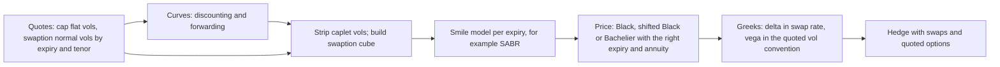

# Rates Options: Caps and Swaptions

## TL;DR

- A caplet is a call on one forward rate paid at the end of its period, so it is priced under the $T_i$-forward measure where that forward is a martingale; a swaption is a call on a forward swap rate, priced under the annuity measure where the swap rate is a martingale.
- Black's formula follows if the martingale is lognormal; Bachelier's if it is normal: $V = A[(F - K)\Phi(d) + \sigma_N\sqrt{T}\phi(d)]$, so an ATM normal option is $A\sigma_N\sqrt{T}/\sqrt{2\pi} \approx 0.4\,A\sigma_N\sqrt{T}$.
- Parity is model-free: payer minus receiver $= A(S - K)$, cap minus floor = a forward-starting payer swap.
- $\sigma_N \approx F\sigma_{LN}$ is a rule of thumb; the exact ATM conversion is lower and the gap grows with expiry (79.87 bp at 1 year, 76.17 bp at 30 years for $F$ = 4%, $\sigma_{LN}$ = 20%), and near zero a Black vol may not exist at all.
- SOFR caplets are backward-looking: the rate keeps fixing through the accrual period, so under a normal model the effective variance is $\sigma^2[T_s + (T_e - T_s)/3]$, not $\sigma^2 T_s$.

## Learning objectives

- Price interest rate caplets, floorlets, and caps using the Black-76 lognormal model.
- Price European payer and receiver swaptions using the annuity numeraire.
- Formulate the Bachelier normal model and evaluate option prices for zero and negative interest rates.
- Derive the conversion between normal volatility $\sigma_N$ and lognormal volatility $\sigma_{LN}$, and know when the approximation fails.
- Execute caplet stripping from flat market cap volatility curves.
- Distinguish swaption settlement conventions and price backward-looking (SOFR) caplets.

## Core concepts

### Caps, floors and timing

On a schedule $T_0 < T_1 < \dots < T_n$ with accruals $\tau_i$, the caplet on period $i$ pays at $T_i$
$$N\tau_i\,(L_i - K)^+,$$
where $L_i$ is the period's rate; a floorlet pays $N\tau_i(K - L_i)^+$, and a cap (floor) is the sum of its caplets (floorlets).
For a forward-looking term rate (the LIBOR model) $L_i$ fixes at $T_{i-1}$, so the option expires at $T_{i-1}$ but pays at $T_i$: discount with $P(0,T_i)$, put $T_{i-1}$ in $\sigma\sqrt{T}$.
For a spot-starting cap on such an index the first period's rate is already known, so that caplet has no optionality; check whether a quoted cap includes it.
For an overnight-compounded rate such as SOFR, $L_i$ is only known at $T_i$, which changes the volatility (below).

### Black-76 for caplets: the forward measure

Take the zero bond $P(t,T_i)$ as numeraire.
The forward $F_i(t) = \frac{1}{\tau_i}\left(\frac{P(t,T_{i-1})}{P(t,T_i)} - 1\right)$ is a traded portfolio divided by the numeraire, so it is a martingale under the $T_i$-forward measure $\mathbb{Q}^{T_i}$ ([change of numeraire](../04-Stochastic-Calculus/05-Change-of-Measure-and-Girsanov.md)).
The change of numeraire also removes the stochastic discounting: $V_0 = P(0,T_i)\,\mathbb{E}^{T_i}[\tau_i(L_i - K)^+]$.
If $dF_i = \sigma_i F_i\,dW^{T_i}$:
$$\text{Caplet}_i = \tau_i P(0,T_i)\left[F_i\Phi(d_1) - K\Phi(d_2)\right], \qquad d_{1,2} = \frac{\ln(F_i/K) \pm \frac12\sigma_i^2 T_{i-1}}{\sigma_i\sqrt{T_{i-1}}}.$$
Each caplet lives under its own measure; that is fine for caps, which are sums of single-forward payoffs, and is why caps carry no information about the correlation between forwards.

### Swaptions: the annuity measure

A payer swaption expiring at $T_0$ gives the right to pay $K$ on a swap over $[T_0, T_n]$; its payoff is
$$N\,A(T_0)\,(S(T_0) - K)^+, \qquad A(t) = \sum_{i=1}^n \tau_i P(t,T_i), \qquad S(t) = \frac{P(t,T_0) - P(t,T_n)}{A(t)}.$$
$A(t)$ is a positive traded portfolio, so it is a numeraire; $S(t)$ is a traded portfolio over $A(t)$, so it is a martingale under the annuity measure $\mathbb{Q}^A$, and $V_0 = N A(0)\,\mathbb{E}^A[(S(T_0) - K)^+]$.
With lognormal $S$:
$$\text{Payer} = N A(0)\left[S\Phi(d_1) - K\Phi(d_2)\right], \qquad \text{Receiver} = N A(0)\left[K\Phi(-d_2) - S\Phi(-d_1)\right].$$
A payer swaption is a call on the swap rate and a put on the underlying fixed-coupon bond; the delta is $A\Phi(d_1)$ per unit of swap rate and the vega $A S\sqrt{T}\phi(d_1)$.

### Parity

Payer minus receiver at the same strike pays $A(T_0)(S(T_0) - K)$ in every state: a forward-starting payer swap, worth $A(0)(S(0) - K)$ today with no model.
Cap minus floor at the same strike is $\sum_i \tau_i P(0,T_i)(F_i - K)$, the forward-starting payer swap on the cap's schedule.
An ATM-forward straddle (payer plus receiver at $K = S$) has zero delta at inception and is a pure volatility position.

### The Bachelier (normal) model

If $dF = \sigma_N\,dW$, $F_T \sim \mathcal{N}(F, \sigma_N^2 T)$ and
$$\text{Call} = A\left[(F - K)\Phi(d) + \sigma_N\sqrt{T}\phi(d)\right], \quad \text{Put} = A\left[(K - F)\Phi(-d) + \sigma_N\sqrt{T}\phi(d)\right], \quad d = \frac{F - K}{\sigma_N\sqrt{T}}.$$
It is defined for any sign of $F$ and $K$; $\sigma_N$ is in rate units per $\sqrt{\text{year}}$, quoted in bp.
At the money the price is $A\sigma_N\sqrt{T}\,\phi(0) = A\sigma_N\sqrt{T}/\sqrt{2\pi}$, with $1/\sqrt{2\pi} = 0.3989$.
Normal vega $A\sqrt{T}\phi(d)$ does not scale with the rate level, unlike Black vega $AF\sqrt{T}\phi(d_1)$.
When the ECB deposit facility rate was negative (11 June 2014 to 27 July 2022, ECB key interest rates table), Black's formula could not be applied to negative forwards or strikes at all; Bachelier and the shifted lognormal model, Black applied to $F + s$ and $K + s$ for a chosen shift $s$, can.

### Normal versus lognormal volatility

Matching ATM prices exactly: $F(2\Phi(\tfrac12\sigma_{LN}\sqrt{T}) - 1) = \sigma_N\sqrt{T}/\sqrt{2\pi}$, so
$$\sigma_N^{ATM} = F\sqrt{\frac{2\pi}{T}}\left(2\Phi\left(\tfrac12\sigma_{LN}\sqrt{T}\right) - 1\right) \approx F\sigma_{LN}\left(1 - \frac{\sigma_{LN}^2 T}{24}\right),$$
the second form from expanding $\Phi$ to third order.
So $\sigma_N \approx F\sigma_{LN}$ is first order only and overstates the normal vol for long expiries.
Away from the money, invert prices numerically; $\sigma_{LN}\sqrt{FK}$ is a closer heuristic than $F\sigma_{LN}$.
Near zero a Black vol may not exist: a Black call is worth less than $AF$ for every volatility, so any price above $AF$ (easy when $F$ is a few bp) has no Black implied vol.

### Caplet stripping

Cap quotes are a single flat volatility per cap maturity, applied to every caplet in that cap.
Each caplet has its own volatility, so stripping solves sequentially: the first cap gives the first caplet vol; each longer cap's price minus the already-stripped caplets gives one equation for the new caplet's vol.
Liquid cap maturities are sparse, so desks interpolate cap prices or caplet vols between them and must check the stripped vols stay positive and smooth.

### Backward-looking (SOFR) caplets

For an overnight-compounded rate over $[T_s, T_e]$, the rate keeps fixing until $T_e$.
In a normal model where the period's expected compounded rate moves like a Brownian motion until $T_s$ and is then progressively fixed by the daily rates, the payoff depends on an average of the path over the accrual period.
For the arithmetic average of a Brownian motion over $[T_s, T_e]$ the variance is $T_s + (T_e - T_s)/3$, so the caplet is a Bachelier option with effective expiry $T_s + (T_e - T_s)/3$, paid at $T_e$.
Equivalently, let the period's expected compounded rate $R(t) = \mathbb{E}_t[R]$ have normal volatility $\sigma$ up to $T_s$ and $\sigma (T_e - t)/(T_e - T_s)$ inside the period, decaying linearly to zero as the fixings are realised; then $\int_{T_s}^{T_e} \sigma^2 (T_e - t)^2/(T_e - T_s)^2\,dt = \sigma^2 (T_e - T_s)/3$, the same effective variance.
Lyashenko and Mercurio (2019) introduced the forward market model in which backward-looking rates keep diffusing through the accrual period with a decaying volatility of this kind; Willems (2020) uses $\psi(t) = \min\left(1, ((T_e - t)/(T_e - T_s))^q\right)$ as the scaling, a special case of their model, and $q = 1$ is the linear decay above.
The 1/3 depends on that linear-decay assumption, which a desk should treat as a modelling choice, not a market fact.

### How it is implemented

- Store volatilities in the convention they are quoted in and convert only at the boundary; record the shift for shifted lognormal vols.
- Implied-vol solvers must check no-arbitrage bounds first ($A(F - K)^+ < V < AF$ for a Black call) and fail loudly outside them.
- Smile and SABR are in [Rates Volatility and SABR](18-Rates-Volatility-and-SABR.md); Bermudans in [Callable and Bermudan Products](20-Callable-and-Bermudan-Products.md).

## Worked examples

Every number below is computed, printed and asserted by `code/fi_rates_options.py`.

### Example 1: a Black ATM payer swaption

2y into 5y, $S = K = 4\%$, $\sigma_{LN} = 25\%$, $T = 2$, $A = 3.80$.
"$\sigma\sqrt{T} = 0.353553$, at the money $d_1 = \frac12\sigma\sqrt{T} = 0.176777$, $\Phi(d_1) = 0.570158$, $\Phi(d_2) = 0.429842$."
Price $= 3.80 \times 0.04 \times (0.570158 - 0.429842) = 0.021328$ per unit notional, 213.28 bp.
A million lognormal draws (seed 2026) give about 0.02133.
Delta $A\Phi(d_1) = 2.1666$: 21,666 USD per bp of swap rate on 100mm; Black vega is 84,427 USD per vol point on 100mm.

### Example 2: Bachelier with a negative forward

$F = K = -0.20\%$, $\sigma_N = 80$ bp, $T = 2$, $A = 3.80$.
"$\sigma_N\sqrt{T} = 0.011314$; divided by $\sqrt{2\pi}$ that is 0.0045135; times the annuity, 0.017151."
That is 171.51 bp; a million normal draws (seed 2026) give about 0.01714.
The ATM straddle costs twice that, 0.034303, and normal vega is 21,439 USD per bp of normal vol on 100mm.
Black cannot price this option at all; a 2% shifted Black needs 45.20% to match it.

### Example 3: parity

With $S = 4\%$, $K = 4.5\%$, $\sigma_{LN} = 25\%$, payer minus receiver is $-0.019000 = 3.80 \times (0.04 - 0.045)$, to machine precision, and the same identity holds in Bachelier.

### Example 4: converting volatilities

$F = 4\%$, $\sigma_{LN} = 20\%$: the rule of thumb gives 80 bp.
Exact ATM normal vols are 79.87 bp at 1 year, 78.69 bp at 10 years and 76.17 bp at 30 years.
At 1 year, the normal vols that reproduce the Black prices are 69.41 bp at $K$ = 3% and 89.48 bp at $K$ = 5%, against 69.28 and 89.44 from $\sigma_{LN}\sqrt{FK}$ and a flat 80 from $F\sigma_{LN}$.

### Example 5: when no Black vol exists

$F = K = 0.10\%$, $\sigma_N = 80$ bp, $T = 2$: the Bachelier price per unit annuity is 0.0045135, more than $F$ itself.
A Black call is worth less than $AF$ for any volatility, so no Black vol reproduces this price; a 2% shifted Black vol of 38.57% does.

### Example 6: stripping one caplet

$P(0,1) = 0.9615$, $P(0,2) = 0.9200$, $K = 4\%$, $\tau = 1$; a 2-year cap whose only live caplet fixes at 1 year costs 0.0075.
Forward $F = 0.9615/0.9200 - 1 = 0.045109$; the caplet must satisfy $0.045109\Phi(d_1) - 0.04\Phi(d_2) = 0.0075/0.92 = 0.008152$ with expiry 1 year (the fixing, not the payment).
Solving gives $\sigma = 30.81\%$, with $d_1 = 0.544165$, $d_2 = 0.236060$, $\Phi(d_1) = 0.706836$, $\Phi(d_2) = 0.593307$.

### Example 7: a cap, a floor and stripping a strip

Hypothetical discount factors 0.9615, 0.9200, 0.8800, 0.8400 at 1 to 4 years give forwards 4.5109%, 4.5455%, 4.7619% for the three live caplets.
At a flat 25% vol and 4% strike the cap is 0.024699, the floor 0.008799, and cap minus floor equals the forward-starting payer swap, 0.015900.
If the flat cap vols are 30%, 28% and 26% for the 2-, 3- and 4-year caps, the stripped caplet vols are 30.00%, 26.56% and 23.04%: when flat cap vols fall with maturity, each new caplet's vol must lie below the flat vol of the cap that adds it.

### Example 8: a SOFR caplet versus a forward-looking caplet

Accrual period 1 to 1.25 years, $F = K = 4\%$, $\sigma_N = 100$ bp.
A forward-looking caplet expiring at 1 year is worth 39.89 bp per unit of $\tau P$; the backward-looking one, with effective expiry $1 + 0.25/3 = 1.0833$, is worth 41.52 bp.
Simulating the average of 63 daily values of the Brownian path over the period (seed 2026) gives about 41.6 bp, consistent with the discrete-average effective expiry of 1.0853 years.

## Pitfalls

- Using the payment date instead of the fixing date in $\sigma\sqrt{T}$ for a forward-looking caplet, or the fixing start instead of the period end for a SOFR caplet.
- Using flat cap vols to compute individual caplet Greeks.
- Applying Black to negative or near-zero forwards, or storing a shifted vol without its shift.
- Converting vols with $\sigma_N = F\sigma_{LN}$ for long expiries or away from the money.
- Quoting a payer swaption as a call on the bond: it is a call on the rate, a put on the bond.
- Ignoring the smile: one vol per expiry misprices out-of-the-money collars and wings.
- Treating physically and cash-settled swaptions as the same contract; their settlement amounts are computed differently and the cash method itself changed with the 2021 ISDA Definitions.

## Interview questions

> [!question]- fi-rates-options-black-numeraire | What numeraire makes the forward swap rate a martingale in Black-76?
> The annuity $A(t) = \sum_i \tau_i P(t,T_i)$.
> $S(t) = (P(t,T_0) - P(t,T_n))/A(t)$ is a traded portfolio divided by the numeraire, hence a martingale under $\mathbb{Q}^A$, and the swaption is $A(0)\mathbb{E}^A[(S_T - K)^+]$.

> [!question]- fi-rates-options-bachelier-vs-black | Why did the rates derivatives market switch from Black-76 to Bachelier?
> Black needs $F > 0$ and $K > 0$: with negative or near-zero rates it is undefined or has no implied vol (a Black call is worth less than $AF$).
> Bachelier's $dF = \sigma_N dW$ works for any sign of $F$ and $K$; the euro area deposit facility rate was negative from June 2014 to July 2022, so the problem was not hypothetical.

> [!question]- fi-rates-options-vol-conversion | How do you convert lognormal volatility to normal volatility approximately?
> $\sigma_N \approx F\sigma_{LN}$, from equating ATM prices to first order: 80 bp for $F$ = 4%, $\sigma_{LN}$ = 20%.
> The exact ATM conversion is lower by about a factor $1 - \sigma^2T/24$ (79.87 bp at 1 year, 76.17 bp at 30 years); away from the money, invert prices.

> [!question]- fi-rates-options-cap-floor-parity | State and prove cap-floor parity.
> Cap $-$ floor $=$ forward-starting payer swap on the cap's schedule.
> Per period $(L - K)^+ - (K - L)^+ = L - K$; multiply by $\tau_i$, discount at $P(0,T_i)$ and sum: $\sum \tau_i P(0,T_i)(F_i - K)$, which in the note's example is 0.024699 $-$ 0.008799 $=$ 0.015900.

> [!question]- fi-rates-options-caplet-stripping | What is caplet stripping and why is it necessary?
> Caps are quoted as one flat vol per cap maturity, but each caplet has its own; stripping recovers caplet vols sequentially, each new cap price minus the known caplets giving one equation.
> Flat vols 30%, 28%, 26% for 2y, 3y, 4y caps strip to caplet vols 30.00%, 26.56%, 23.04% in the note's example.

> [!question]- fi-rates-options-cash-vs-physical | What is the difference between physical and cash settlement for European swaptions?
> Physical settlement delivers the underlying swap, which then lives on (and is cleared or collateralised) like any swap.
> Cash settlement pays a lump sum computed by a contractual method instead of the swap; the 2021 ISDA Definitions replaced the cash settlement methodology "to align with current collateral and valuation practices" (ISDA, 14 June 2021), so the method, and the gap to a physical swaption, depends on which definitions the trade uses.

> [!question]- fi-rates-options-bachelier-atm-rule | What is the quick mental formula for the ATM price of a Bachelier swaption?
> $A\sigma_N\sqrt{T}/\sqrt{2\pi} \approx 0.4\,A\sigma_N\sqrt{T}$, since $1/\sqrt{2\pi} = 0.3989$.
> 80 bp normal vol, 2 years, annuity 3.80: $3.80 \times 0.011314 \times 0.3989 = 0.017151$.

> [!question]- fi-rates-options-payer-delta | What is the Black-76 delta of a payer swaption with respect to the forward swap rate?
> $A\Phi(d_1)$: 2.1666 for the note's ATM 2y5y at 25% vol, i.e. 21,666 USD per bp on 100mm.
> It is the swaption's equivalent position in the forward swap per unit of swap rate.

> [!question]- fi-rates-options-vega-black-vs-norm | How does the vega of an ATM option differ between Black-76 and Bachelier?
> Black: $AF\sqrt{T}\phi(d_1)$ per unit of lognormal vol, proportional to the rate level; Bachelier: $A\sqrt{T}\phi(d)$ per unit of normal vol, independent of it.
> On the note's 2y options on 100mm: 84,427 USD per lognormal vol point, 21,439 USD per bp of normal vol.

> [!question]- fi-rates-options-swaption-straddle | What is a swaption straddle and what risk does it isolate?
> Long a payer and a receiver at the same strike and expiry, usually ATM forward.
> Its delta is zero at inception (the parity forward cancels), so it is long gamma and vega: it profits if the swap rate moves more than implied.

> [!question]- fi-ro-straddle-price | Price an ATM-forward 2y straddle with 80 bp normal vol and annuity 3.80.
> 0.034303 per unit notional: twice the ATM option, $2A\sigma_N\sqrt{T}/\sqrt{2\pi} \approx 0.8\,A\sigma_N\sqrt{T}$.

> [!question]- fi-ro-payer-receiver-parity | Payer minus receiver at $K = 4.5\%$ with $S = 4\%$ and $A = 3.80$?
> $-0.019000 = A(S - K)$, independent of volatility and model: the combination is a forward-starting payer swap.

> [!question]- fi-ro-atm-conversion-exact | Derive the exact ATM normal vol equivalent to a Black vol, and say which way the rule of thumb errs.
> $\sigma_N = F\sqrt{2\pi/T}\,(2\Phi(\frac12\sigma_{LN}\sqrt{T}) - 1) \approx F\sigma_{LN}(1 - \sigma_{LN}^2T/24)$.
> The rule $F\sigma_{LN}$ overstates it, increasingly with expiry: 79.87 bp at 1 year and 76.17 bp at 30 years against 80 bp.

> [!question]- fi-ro-black-vol-nonexistence | A 2y ATM option on a 0.10% forward trades at the equivalent of 80 bp normal vol. What is its Black vol?
> None exists: the price per unit annuity, 0.0045135, exceeds the forward, and a Black call is bounded by $AF$ for every vol.
> Quote it in normal vol or shifted lognormal (38.57% with a 2% shift).

> [!question]- fi-ro-shifted-lognormal | What is a shifted lognormal model and what is the catch?
> Black applied to $F + s$ and $K + s$: rates are bounded below by $-s$ instead of 0.
> The vol depends on the shift (a 2% shift needs 45.20% to match the note's negative-rate example), so a vol without its shift is meaningless, and the lower bound $-s$ is a modelling choice that can be breached.

> [!question]- fi-ro-strip-calc | Strip the caplet vol: $P(0,1) = 0.9615$, $P(0,2) = 0.92$, $K = 4\%$, annual, cap price 0.0075 for a single live caplet fixing at 1y.
> $F = 0.045109$; solve $0.92[F\Phi(d_1) - K\Phi(d_2)] = 0.0075$ with expiry 1 year: $\sigma = 30.81\%$.

> [!question]- fi-ro-caplet-timing | A forward-looking caplet fixes at $T_{i-1}$ and pays at $T_i$. Which dates enter where?
> $T_{i-1}$ in the volatility term $\sigma\sqrt{T_{i-1}}$, $T_i$ in the discount factor $P(0,T_i)$ and the measure.
> No convexity adjustment is needed because the payment date matches the end of the forward's accrual period; paying at $T_{i-1}$ instead (in arrears) would need one ([Convexity Adjustments](17-Convexity-Adjustments.md)).

> [!question]- fi-ro-sofr-caplet-variance | Why is a SOFR caplet worth more than a forward-looking caplet with the same start, all else equal, and by how much in a normal model?
> Its rate keeps fixing during the accrual period, so uncertainty keeps accumulating until $T_e$; for an averaged Brownian path the variance is $\sigma^2(T_s + (T_e - T_s)/3)$.
> For a 1y to 1.25y period at 100 bp: 41.52 bp versus 39.89 bp per unit of $\tau P$.

> [!question]- fi-ro-annuity-measure-proof | Why can you price a swaption as $A(0)\mathbb{E}^A[(S_T - K)^+]$ without modelling discount factors?
> The payoff is $A(T)(S_T - K)^+$; dividing by the numeraire $A(T)$ leaves $(S_T - K)^+$, and under $\mathbb{Q}^A$ every traded price divided by $A$ is a martingale.
> All the stochastic discounting is absorbed into the numeraire, and only the distribution of $S_T$ under $\mathbb{Q}^A$ is needed.

## In this repo and SDE-Interview-Prep

- Code: [`code/fi_rates_options.py`](code/fi_rates_options.py) computes, prints and asserts every number on this page.
- Prereqs: [Short-Rate Models](04-Short-Rate-Models.md), [Black-Scholes Formula and Intuition](../05-Derivatives-and-Volatility/04-Black-Scholes-Formula-and-Intuition.md).
- Next: [Convexity Adjustments](17-Convexity-Adjustments.md), [Rates Volatility and SABR](18-Rates-Volatility-and-SABR.md), [Callable and Bermudan Products](20-Callable-and-Bermudan-Products.md).

## Further reading

- Fischer Black, "The Pricing of Commodity Contracts", *Journal of Financial Economics* 3(1-2), 1976.
- Louis Bachelier, "Théorie de la spéculation", *Annales scientifiques de l'École Normale Supérieure* 17, 1900.
- Damiano Brigo and Fabio Mercurio, *Interest Rate Models: Theory and Practice*, 2nd edition (Springer 2006), chapter 1 (definitions, caps and swaptions), chapter 2 (numeraire change) and chapter 6 (LIBOR and swap market models).
- John Hull, *Options, Futures, and Other Derivatives* (Pearson), the chapter on standard market models for interest rate derivatives.
- Andrei Lyashenko and Fabio Mercurio, "Looking Forward to Backward-Looking Rates: A Modeling Framework for Term Rates Replacing LIBOR", SSRN working paper, 2019.
- ISDA, "ISDA Publishes First Digital Definitions for Interest Rate Derivatives", press release, 14 June 2021.
- Sander Willems, "SABR smiles for RFR caplets", arXiv 2004.04501, 2020.
