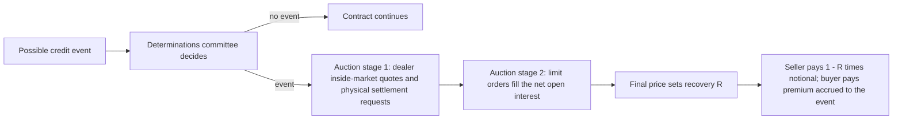

# Credit Basics: Hazard Rates and CDS

## TL;DR

- Reduced-form models make default the first jump of a process with intensity (hazard rate) $\lambda(t)$: survival is $Q(t) = e^{-\int_0^t \lambda}$, and a defaultable zero with zero recovery is worth $P(0,t)Q(t)$ when default is independent of rates.
- A CDS swaps a premium leg (coupon times the risky annuity RPV01, plus accrued premium on default) for a protection leg ($1 - R$ at default); the par spread equates them and the upfront on a standard contract is $(s - c) \times \text{RPV01}$.
- The credit triangle $s \approx \lambda(1 - R)$ is exact only for a continuously paid premium with accrual on default: at $\lambda$ = 2.5%, $R$ = 40% the exact quarterly par spread is 150.75 bp, not 150, and without accrual on default 151.23 bp.
- Standard North American contracts since 8 April 2009 trade a fixed 100 or 500 bp coupon plus upfront, with a full first coupon, quarterly payments on the 20th of March, June, September and December, ACT/360 coupons and auction settlement hardwired (Markit, March 2009; ISDA Standard CDS Examples).
- Quote conversion (conventional spread to upfront) uses one flat hazard rate; risk uses the full term structure, and the two give different numbers for the same quote (2.1244% against 2.1410% upfront in the note's example).

## Learning objectives

- Differentiate structural credit models (Merton) from reduced-form intensity models, and show why diffusion models give near-zero short spreads.
- Derive survival probabilities from constant and piecewise hazard rates.
- Derive the fair par spread of a single-name CDS from the premium and protection legs, with exact integrals under the ISDA assumptions.
- Calculate upfront, RPV01, CS01, IR01 and jump-to-default, and bootstrap a hazard curve.
- Apply the credit triangle and quantify its error.
- Explain the 2009 Big Bang standardisation, the standard coupon dates and accrual rebate, and auction settlement.

## Core concepts

### Structural versus reduced-form models

**Merton (1974).** Firm assets follow $dV = \mu V dt + \sigma_V V dW$; debt is one zero-coupon bond with face $D$ at $T$.
At $T$ equity holders get $(V_T - D)^+$, so equity is a call on the assets and debt is $V_0 - E_0 = D e^{-rT} - \text{Put}(V_0, D)$.
The risk-neutral default probability is $\Phi(-d_2)$ with $d_2 = \frac{\ln(V_0/D) + (r - \frac12\sigma_V^2)T}{\sigma_V\sqrt{T}}$, and the credit spread is $-\frac1T\ln\frac{\text{Debt}_0}{De^{-rT}}$.
Because asset values diffuse continuously, a firm with $V_0 > D$ cannot default in the next instant: short-maturity spreads go to zero, which real short-dated spreads do not do.

**Reduced form.** Default is the first jump of a counting process with intensity $\lambda(t)$, an unpredictable surprise (Jarrow and Turnbull 1995; Duffie and Singleton 1999).
Survival $Q(t) = \mathbb{P}(\tau > t)$ solves $Q' = -\lambda Q$, so
$$Q(t) = \exp\left(-\int_0^t \lambda(s)\,ds\right), \qquad \lambda(t) = \lim_{\Delta \to 0}\frac{\mathbb{P}(t < \tau \le t + \Delta \mid \tau > t)}{\Delta}.$$
With constant $\lambda$, $\tau$ is exponential with mean $1/\lambda$.
Intensity models calibrate directly to CDS quotes and are the market standard for pricing and hedging credit derivatives.

### CDS mechanics and settlement

The protection buyer pays a running coupon on the notional until maturity or default; the seller pays the loss $(1 - R)$ times notional on a credit event.
Under the 2009 changes, auction settlement was hardwired into the standard contract and determinations committees make binding decisions on whether a credit event occurred; the effective date for credit events became a rolling "today minus 60 calendar days" (90 for succession events), so trades on the same name and maturity offset regardless of trade date (Markit, March 2009).
The auction exists because deliverable bonds can be scarce relative to CDS notional: physical settlement would force protection buyers to scramble for bonds and drive their price up (Markit, March 2009).
The final auction price sets $R$ for every contract on that name and seniority.

### Pricing the legs

Let $P(0,t)$ be the discount curve, $Q(t)$ survival, $c$ the coupon, $t_i$ the payment dates and $\Delta_i$ the accruals.
**Premium leg.**
$$\text{PV}_{prem} = c\left[\sum_i \Delta_i P(0,t_i)Q(t_i) + \sum_i \int_{t_{i-1}}^{t_i} \Delta(t_{i-1},u)\,P(0,u)\,(-dQ(u))\right] = c \cdot \text{RPV01}.$$
The first sum pays the full coupon on survival; the integral pays the premium accrued since the last coupon date if default happens mid-period.
**Protection leg.**
$$\text{PV}_{prot} = (1 - R)\int_0^T P(0,u)\,(-dQ(u)).$$
The par spread is $s = \text{PV}_{prot}/\text{RPV01}$.

**Exact integrals.** The ISDA CDS Standard Model assumes hazard rates piecewise constant between credit-curve pillars and interest rates piecewise flat-forward between yield-curve pillars (QuantLib's `IsdaCdsEngine`, which cites OpenGamma Quantitative Research 2013 and Markit's 2012 numerical-fix note, accepts only log-linear discount or flat-forward rate curves and requires the accrued premium to be paid at default).
On any sub-interval of length $\delta$ where both are constant, with $\lambda = h + f$:
$$\int (1-R) h\,e^{-\lambda u}du = (1-R)\frac{h}{h+f}\left(1 - e^{-\lambda\delta}\right), \qquad \int (x_0 + u)h\,e^{-\lambda u}du = h\left[x_0\frac{1 - e^{-\lambda\delta}}{\lambda} + \frac{1 - e^{-\lambda\delta}(1 + \lambda\delta)}{\lambda^2}\right],$$
each times $P(0,a)Q(a)$ at the sub-interval start $a$.
The $h + f$ denominators are why the model needs a numerical fix when $h + f$ is near zero, possible with negative rates (Markit 2012 proposed a Taylor expansion when $h + f < 10^{-4}$, as implemented in QuantLib).

### The credit triangle, exactly

If the premium is paid continuously with accrual on default, $\text{RPV01} = \int_0^T P Q\,du$ and $\text{PV}_{prot} = (1-R)\int_0^T P\,\lambda Q\,du$, so with constant $\lambda$:
$$s = \lambda(1 - R) \quad \text{exactly, for any rates and maturity.}$$
Real contracts pay quarterly in arrears, which lowers the RPV01 slightly (coupons are discounted to the period end), so the par spread is a little above the triangle; without accrual on default the RPV01 loses the accrued premium and the spread is higher again.
The triangle is the right mental model and the wrong pricing formula, and the error grows with the spread level.

### Bootstrapping a hazard curve

Given par spreads at pillars $T_1 < T_2 < \dots$, solve for $h_1$ on $(0, T_1]$ so the first quote reprices, then $h_2$ on $(T_1, T_2]$ with $h_1$ fixed, and so on: one one-dimensional root per pillar.
A spread curve that falls too steeply would need a negative forward hazard; a production bootstrapper must reject it, not floor it.

### Standard contracts, quoting and upfront

**Fixed coupons.** From 8 April 2009 North American single names trade with a fixed coupon of 100 bp (expected for investment grade) or 500 bp (high yield) and an upfront payment (Markit, March 2009).
**Dates.** Standard maturities and coupon dates are the 20th of March, June, September and December, maturities unadjusted and coupon payment dates adjusted to the following business day; each coupon is annual coupon/360 times the days in the accrual period, which runs from the previous payment date to the day before this one, except that the last period includes the maturity date (ISDA Standard CDS Examples).
**Full first coupon.** The buyer pays a full first coupon and the seller rebates the accrued from the accrual start to the trade date, like bond accrued interest, so all contracts with the same coupon pay identical cash flows (Markit, March 2009).
**Upfront.** With par spread $s$ for the maturity, the upfront paid by the buyer is
$$U = \text{PV}_{prot} - c\cdot\text{RPV01} = (s - c)\,\text{RPV01}.$$
**Quoting.** Contracts on the 100 bp coupon (expected to be investment-grade names) were generally to be quoted in dealer runs as a conventional (quoted) spread, and 500 bp contracts in points upfront, with exceptions both ways (Markit, March 2009); the conventional spread is converted to an upfront through the ISDA Standard Model with standard inputs and a single flat hazard rate (ISDA Standard CDS Examples).
The standard converter treats days up to and including the trade date as riskless and the rest as risky (ISDA Standard CDS Examples).

### Risk measures

- **RPV01**: PV of 1 per year of premium, including accrual on default; the CS01 of a par contract is about RPV01 $\times$ 1 bp $\times$ notional.
- **CS01**: value change when the par spread curve moves 1 bp and the hazard curve is rebuilt; for an off-market contract it differs from RPV01 $\times$ 1 bp because the RPV01 itself moves.
- **IR01**: value change for a 1 bp move in the interest rate curve with hazards held.
- **Jump to default**: P&L if the name defaults now, $\text{JTD}_{buyer} = (1 - R)N - V_{buyer} - \text{accrued premium owed}$; this is the risk that spread hedges do not cover.
- **Recovery**: at fixed par spreads a lower recovery assumption bootstraps lower hazards, which nearly offsets the larger loss per default, so the upfront moves little while JTD moves one for one with $1 - R$ (Example 4).

### CDS-bond basis

Basis = CDS spread minus the bond's spread over the funding-rate curve (Z-spread or par asset-swap spread).
A negative basis means the bond is cheap relative to CDS: buy the bond on repo, buy protection, and earn bond spread minus CDS spread minus the repo spread.
The trade is not riskless: CDS protects par minus recovery while the bond was bought at a price, repo can be withdrawn or repriced, and the CDS has counterparty and documentation risk (the bond's restructuring may not trigger the contract).

## Worked examples

Every number below is computed, printed and asserted by `code/fi_cds.py`.
Unless stated, rates are a flat 4% continuously compounded, $R = 40\%$ and the schedule is quarterly with accrual equal to elapsed time.

### Example 1: the triangle against the exact par spread

$\lambda$ = 2.5%: the triangle gives 150 bp; the exact quarterly par spread with accrual on default is 150.75 bp, with monthly premiums 150.25 bp, and without accrual on default 151.23 bp.
$\lambda$ = 20%: 1200 bp by the triangle, 1205.97 bp exact, 1236.73 bp without accrual on default.
"The gap shrinks linearly with the payment interval, so it is premium timing, and accrual on default matters far more for a distressed name."
At $\lambda$ = 2.5%, 5-year survival is $e^{-0.125}$ = 88.25%, the one-year default probability 2.47%, and the expected default time 40 years.

### Example 2: bootstrapping and the upfront

Par spreads 100, 120 and 150 bp at 1, 3 and 5 years.
The bootstrapped hazards are 1.6584% on (0,1], 2.1714% on (1,3] and 3.3684% on (3,5]; $Q(5)$ = 88.04%.
The 5-year RPV01 is 4.2820 and the protection leg 0.064230, so the upfront on a 100 bp coupon is $(0.0150 - 0.0100) \times 4.2820 = 2.1410\%$: 214,101 USD on 10mm.
The textbook mid-point discretisation gives a 5-year hazard of 3.3684% and the same 2.1410% upfront to four decimals: at these spreads the discretisation is not where the risk is.

### Example 3: CS01 and IR01

For the buyer of that 5y contract on 10mm: CS01 = 4,196 USD per bp (all par spreads +1 bp, curve rebuilt), against RPV01 $\times$ 1 bp $\times$ notional = 4,282 USD; IR01 = -69 USD per bp of rates with hazards held.

### Example 4: jump to default

Right after trading, the buyer's position is worth the 214,101 USD upfront it paid, so if the name defaulted immediately the buyer would gain $0.6 \times 10\text{mm} - 214{,}101 = 5{,}785{,}899$ USD.
Rebuilding the curve from the same par spreads with $R$ = 30% gives a 5y hazard of 2.8801% instead of 3.3684% and an upfront of 215,677 USD, only 1,576 USD more, while JTD becomes 6,784,323 USD: the recovery assumption barely moves the mark and moves the default exposure by 998,424 USD.

### Example 5: standard coupon dates (ISDA Standard CDS Examples, Table 1)

A 1-year 100 bp standard CDS on 36mm traded in February 2009 and maturing Saturday 20 March 2010.
Payment dates 20 March 2009, 22 June 2009 (20 June was a Saturday), 21 September, 21 December 2009 and 22 March 2010; accrual periods of 88, 94, 91, 91 and 90 days (the last runs to and includes the maturity date), so coupons of 88,000, 94,000, 91,000, 91,000 and 90,000 USD over 454 coupon days.
Every 10mm 100 bp contract paid the same 2Q09 coupon of 26,111 USD, except those maturing 20 June 2009, which paid 25,833 USD.
Booked on 20 February 2009 at 2 points upfront: the buyer pays $2\% \times 36\text{mm} = 720{,}000$ and the seller rebates 61 riskless days of accrual, 61,000 USD, so the buyer pays 659,000 USD net.
The converter, following CDSW, treats that rebate as settlement-date money although it is actually paid on the next coupon date, 20 March 2009; discounted to settlement it is closer to 60.95k USD, an omission the document calls rarely significant (ISDA Standard CDS Examples).

### Example 6: conventional spread to upfront

With one flat hazard (the converter's assumption), a 5y quote of 198 bp on a 100 bp coupon is an upfront of 4.0864%, and 800 bp on a 500 bp coupon is 9.9968 points.
A flat 150 bp quote gives 2.1244%, against 2.1410% from Example 2's term structure with the same 5y par spread: the curve shape moves the RPV01.

### Example 7: hedging a distressed bond against jump to default

Long 50mm face of a bond at 70 with expected recovery 40: default loses $50 \times (0.70 - 0.40) = 15$mm.
CDS pays 60% of notional, so 25mm of protection hedges the jump: half the bond's face, because the bond already trades far below par.

### Example 8: a negative basis package

Bond spread 180 bp over the funding curve, 5y CDS 150 bp: basis $= -30$ bp.
Buy the bond on repo at a spread of 20 bp over the funding rate and buy protection: carry $= 180 - 150 - 20 = 10$ bp a year, before the price-versus-par, repo and documentation risks above.

### Example 9: Merton's short-spread problem

$V_0 = 100$, $D = 60$, $\sigma_V = 25\%$, $r = 4\%$, $T = 5$: equity 52.7205, debt 47.2795, risk-neutral default probability 16.06%, credit spread 77 bp.
The same firm's 1-year spread is 15.9 bp and its 3-month spread 0.022 bp.

## Pitfalls

- Using the credit triangle as a pricer: it ignores premium timing and accrual on default, and the error grows with the spread.
- Dropping accrual on default from the premium leg.
- Mixing model time (ACT/365F) and premium accrual (ACT/360) silently; standard coupons are ACT/360.
- Bootstrapping a hazard curve that needs negative forward hazards and flooring them instead of rejecting the quotes.
- Treating auction recovery as fundamental recovery, or assuming one recovery rate across seniorities and cycles.
- Comparing a conventional (flat-hazard) upfront with a term-structure valuation and calling the difference P&L.
- Assuming a CDS hedges a bond exactly: price versus par, seniority, restructuring clause and succession events can all differ.
- Using Merton-type diffusion models to explain short-dated spreads.

## Interview questions

> [!question]- fi-credit-cds-triangle | What is the credit triangle and what does it approximate?
> $s \approx \lambda(1 - R)$: the par spread is the default intensity times the loss given default.
> It is exact for a continuously paid premium with accrual on default and constant hazard; with quarterly premiums it is slightly low (150 versus 150.75 bp at $\lambda$ = 2.5%, $R$ = 40%).

> [!question]- fi-credit-cds-merton-shortcoming | Why does Merton's structural model fail to explain short-term credit spreads?
> Assets diffuse continuously, so a firm with $V_0 > D$ cannot reach the default boundary in an instant and the default probability vanishes faster than the horizon.
> In the note's example the spread is 77 bp at 5 years, 15.9 bp at 1 year and 0.022 bp at 3 months; jumps or uncertainty about $V$ or $D$ are needed to fix it.

> [!question]- fi-credit-cds-upfront-formula | How is the upfront fee of a standardized CDS calculated?
> $U = \text{PV}_{prot} - c\cdot\text{RPV01} = (s - c)\cdot\text{RPV01}$ with $s$ the par spread for that maturity.
> 150 bp par, 100 bp coupon, RPV01 4.2820: 2.1410% of notional, paid by the buyer.

> [!question]- fi-credit-cds-rpv01-definition | Define Risky PV01 (RPV01) in CDS contracts.
> The PV of paying 1 per year of premium until maturity or default, including the premium accrued up to a default: $\sum \Delta_i P(0,t_i)Q(t_i)$ plus the accrual-on-default integral.
> 4.2820 for the note's 5-year contract.

> [!question]- fi-credit-cds-cs01-vs-dv01 | Contrast CS01 and interest rate DV01 for a CDS contract.
> CS01: change in value when the credit spread curve moves 1 bp and the hazard curve is rebuilt (4,196 USD on the note's 10mm buyer); interest rate DV01 (IR01): change when the discount curve moves 1 bp with hazards held (-69 USD).
> A CDS is mostly credit risk; its rate risk comes only through discounting of both legs.

> [!question]- fi-credit-cds-negative-basis | What is the CDS-bond basis and what does a negative basis indicate?
> CDS spread minus the bond's spread over the funding curve; negative means the bond is cheap to CDS.
> The package (long bond on repo, long protection) carries bond spread minus CDS minus repo spread, 10 bp in the note's example, but bears price-versus-par, funding and documentation risk.

> [!question]- fi-credit-cds-restructuring-clauses | What are the common restructuring clauses in CDS documentation?
> Under the 2003 ISDA Credit Derivatives Definitions: Old (full) Restructuring, Modified Restructuring, Modified-Modified Restructuring and No Restructuring, differing in whether restructuring is a credit event and how long-dated the deliverables can be.
> Per Markit's March 2009 document: North American high yield already traded No Restructuring, North American investment grade mostly Modified Restructuring with the Big Bang moving the convention to No Restructuring, Europe used Modified-Modified Restructuring, and CDX indices traded mostly No Restructuring.

> [!question]- fi-credit-cds-auction-settlement | How does the ISDA credit event auction establish cash settlement?
> In a first stage dealers submit inside-market quotes and physical settlement requests, giving a midpoint and the net open interest; in a second stage limit orders fill that open interest, and the clearing price is the final price.
> Every hardwired contract then cash-settles at $(1 - R)$ times notional with $R$ the final price, avoiding a squeeze on scarce deliverable bonds.

> [!question]- fi-credit-cds-jtd-formula | Write the formula for Jump-to-Default for a protection buyer.
> $\text{JTD} = (1 - R)N - V_{buyer} - \text{accrued premium owed}$: the payout minus the value already on the books.
> Right after paying a 214,101 USD upfront on 10mm at $R$ = 40%, it is 5,785,899 USD.

> [!question]- fi-credit-cds-hazard-rate-shape | What does an inverted hazard rate curve indicate?
> Short-dated spreads above long-dated ones: the market prices a high near-term default intensity and, conditional on surviving it, a lower one later, typical of distressed names facing a specific maturity or liquidity event.

> [!question]- fi-cds-survival-math | With a constant 2.5% hazard rate, what are the 5-year survival probability, the 1-year default probability and the expected default time?
> $e^{-0.125}$ = 88.25%, $1 - e^{-0.025}$ = 2.47%, and $1/\lambda$ = 40 years.

> [!question]- fi-cds-triangle-exact | Prove that $s = \lambda(1 - R)$ exactly for a continuously paid premium, and say what breaks it.
> $\text{RPV01} = \int_0^T PQ\,du$ and $\text{PV}_{prot} = (1-R)\int_0^T P\lambda Q\,du$, so with constant $\lambda$ the ratio is $\lambda(1-R)$ for any rate curve and maturity.
> Discrete payment in arrears lowers the RPV01 (150.75 bp quarterly, 150.25 monthly), and dropping accrual on default lowers it more.

> [!question]- fi-cds-accrual-on-default | How much does accrual on default matter?
> Little for tight names, a lot for wide ones: at $\lambda$ = 2.5% the par spread is 150.75 bp with it and 151.23 without; at $\lambda$ = 20% it is 1205.97 versus 1236.73 bp.

> [!question]- fi-cds-bootstrap-calc | Par spreads are 100, 120, 150 bp at 1, 3, 5 years, $R$ = 40%, flat 4% rates. What hazards come out?
> 1.6584% on (0,1], 2.1714% on (1,3], 3.3684% on (3,5], with $Q(5)$ = 88.04%.
> Each forward hazard sits above the average because the later segments must make up for the lower earlier ones.

> [!question]- fi-cds-std-coupon-dates | What are the standard CDS coupon dates and how is each coupon computed?
> The 20th of March, June, September and December, adjusted to the following business day for payment; coupon = annual coupon/360 times the days from the previous payment date to the day before this one, the last period including the maturity date.
> So every 10mm 100 bp contract paid 26,111 USD for 2Q09 (94 days).

> [!question]- fi-cds-accrued-rebate | You buy 36mm of 100 bp protection at 2 points upfront 61 days into the coupon period. What cash changes hands at settlement?
> You pay 720,000 USD and receive a 61,000 USD accrued rebate, 659,000 net.
> The full first coupon convention makes you pay the whole next coupon, so the seller refunds the accrual you did not hold.

> [!question]- fi-cds-conventional-spread | A dealer quotes an investment-grade name at 198 bp conventional spread. What do you pay?
> The coupon is 100 bp; convert with the ISDA Standard Model using a single flat hazard: an upfront of 4.0864% on the note's flat 4% curve, plus 100 bp running.
> The conventional spread is a quoting device, not the par spread from a term-structure curve.

> [!question]- fi-cds-isda-model | What assumptions does the ISDA CDS Standard Model make, and why do they matter?
> Piecewise-constant hazards and piecewise-flat forward interest rates, so both legs integrate in closed form on each sub-interval; standard inputs (rates curve, recovery) make upfronts reproducible across firms.
> The closed forms divide by $h + f$, which needs a numerical fix when it is near zero.

> [!question]- fi-cds-jtd-bond-hedge | You hold 50mm of a bond at 70 with expected recovery 40. How much CDS hedges jump to default?
> 25mm: the jump loses $50 \times (0.70 - 0.40) = 15$mm and CDS pays 60% of notional.
> Hedging the full 50mm face would over-hedge by a factor of two because the bond is already far below par.

> [!question]- fi-cds-recovery-sensitivity | You hold 10mm of 5y protection bought at 150 bp par with a 100 bp coupon. Your recovery assumption changes from 40% to 30%. What happens to the mark and to jump to default?
> The mark barely moves: re-bootstrapping from the same par spreads lowers the hazards (3.3684% to 2.8801% at 5y) and the upfront rises only 1,576 USD.
> Jump to default rises by 998,424 USD to 6,784,323, because the payout $(1 - R)N$ is direct; recovery is a default-risk input far more than a mark-to-market input.

> [!question]- fi-cds-merton-numbers | In Merton with $V_0 = 100$, $D = 60$, $\sigma_V = 25\%$, $r = 4\%$, $T = 5$, what are equity, debt and the spread?
> Equity 52.7205 (a call on the assets), debt 47.2795, risk-neutral default probability 16.06%, credit spread 77 bp.

## In this repo and SDE-Interview-Prep

- Code: [`code/fi_cds.py`](code/fi_cds.py) computes, prints and asserts every number on this page.
- Prereq: [Discounting and Yield Curves](01-Discounting-and-Yield-Curves.md).
- Next: [Credit Advanced: CDS Indices and Tranches](23-Credit-Advanced-CDS-Indices-and-Tranches.md), [Counterparty Credit Risk Analytics](../11-Risk-and-Trading/14-Counterparty-Credit-Risk-Analytics.md), [XVA](../11-Risk-and-Trading/15-XVA.md).

## Further reading

- Markit, *The CDS Big Bang: Understanding the Changes to the Global CDS Contract and North American Conventions*, 13 March 2009.
- *Standard CDS Examples: Supporting Document for the Implementation of the ISDA CDS Standard Model*, cdsmodel.com, retrieved 2026-10-17.
- OpenGamma Quantitative Research, *The Pricing and Risk Management of Credit Default Swaps, with a Focus on the ISDA Model*, version of 15 October 2013, and Markit, *ISDA CDS Standard Model Proposed Numerical Fix*, 15 November 2012, both as cited by QuantLib's `IsdaCdsEngine`.
- Dominic O'Kane, *Modelling Single-name and Multi-name Credit Derivatives* (Wiley 2008), the CDS valuation and survival-curve calibration chapters.
- Philipp Schönbucher, *Credit Derivatives Pricing Models: Models, Pricing and Implementation* (Wiley 2003).
- Robert Merton, "On the Pricing of Corporate Debt: The Risk Structure of Interest Rates", *Journal of Finance* 29(2), 1974.
- Robert Jarrow and Stuart Turnbull, "Pricing Derivatives on Financial Securities Subject to Credit Risk", *Journal of Finance* 50(1), 1995.
- Darrell Duffie and Kenneth Singleton, "Modeling Term Structures of Defaultable Bonds", *Review of Financial Studies* 12(4), 1999.
