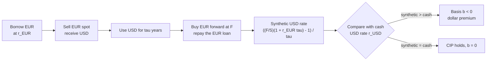

# FX Markets and Interest Rate Parity

## TL;DR

- A quote EURUSD $= 1.0850$ prices one unit of the base currency (EUR) in the quote currency (USD); a pip is $0.0001$ for most pairs and $0.01$ for JPY pairs.
- Covered interest parity (CIP) is a replication identity: $F = S\,\frac{1 + r_{\text{quote}}\tau_{\text{quote}}}{1 + r_{\text{base}}\tau_{\text{base}}}$ with each rate on its own money-market day count; forward points are $(F - S) \times 10^4$.
- Since 2008 CIP fails measurably: the cross-currency basis $b$ added to the non-USD rate makes $F$ consistent with quotes, and a negative basis means synthetic dollars via FX swaps cost more than cash dollars (Du, Tepper and Verdelhan 2018).
- Uncovered interest parity (UIP) is a forecast, not an arbitrage; it fails empirically (Fama 1984), which is why the carry trade earns a premium on average and crashes occasionally.
- FX options are quoted in volatility by delta: an ATM vol, 25-delta risk reversals (skew) and butterflies (convexity), priced with Garman-Kohlhagen, where the foreign rate plays the dividend yield.

## Learning objectives

- Price FX forwards with covered interest parity and explain cross-currency basis.
- Quote FX options by delta and understand risk reversals and butterflies.
- Read FX quoting conventions (base and quote currency, pips, forward points, spot dates) and detect a triangular arbitrage with bid and ask quotes.
- Distinguish covered from uncovered interest parity and explain the carry trade.

## Core concepts

### Market structure and quoting conventions

FX is an over-the-counter dealer market.
In the BIS 2025 Triennial Survey (preliminary, released 2025-09-30), global OTC FX turnover was 9.6 trillion USD per day in April 2025: FX swaps 42%, spot 31%, outright forwards 19% and options 7%, with the US dollar on one side of 89.2% of trades.
The dominance of FX swaps matters for this note: most FX volume is funding (swap one currency for another and back), not directional.

| Term | Meaning |
| :--- | :--- |
| Pair `BASEQUOTE` | Price of 1 unit of the base currency in units of the quote currency: EURUSD 1.0850 means 1 EUR = 1.0850 USD |
| Base priority | Common convention: EUR, then GBP, AUD, NZD, then USD before CAD, CHF and JPY (so USDJPY, not JPYUSD) |
| Pip | 0.0001 (fourth decimal), 0.01 for JPY pairs; "big figure" is the digits before the last two |
| Spot date | T+2 business days for most pairs, T+1 for USDCAD |
| Outright forward | Exchange at a fixed rate on a later date |
| Forward points | $(F - S) \times 10^4$ pips, quoted bid and ask and added to spot |
| FX swap | Spot exchange plus the reverse forward exchange; economically a collateralised loan in one currency against the other |
| NDF | Non-deliverable forward: cash-settled in USD against an official fixing, used for currencies with capital controls |

The quote currency is the "domestic" currency in pricing formulas, because prices are in its units.

### Covered interest parity

Two ways to turn 1 USD today into USD in $\tau$ years, with no risk:

1. Deposit it at the USD rate: $1 + r_{\$}\tau_{\$}$.
2. Sell it spot for $1/S$ EUR, deposit at the EUR rate, and sell the EUR proceeds forward today at $F$: $\frac{1}{S}(1 + r_{€}\tau_{€})F$.

Both are riskless, so they must be equal:

$$
F = S\,\frac{1 + r_{\$}\tau_{\$}}{1 + r_{€}\tau_{€}}.
$$

- Money-market conventions: USD, EUR, JPY and CHF deposits are ACT/360; GBP (and several Commonwealth currencies) are ACT/365, so $\tau_{\$} \neq \tau_£$ for the same dates.
- Continuous rates give $F = Se^{(r_d - r_f)T}$, the form in [Forwards, Futures and Carry](../05-Derivatives-and-Volatility/01-Forwards-Futures-and-Carry.md); desks use the simple-rate form above.
- The currency with the higher interest rate trades at a forward discount: its forward buys fewer units of the other currency.
  This is not a forecast that it will weaken; it is the interest differential made riskless.
- First-order: forward points $\approx S(r_{\text{quote}} - r_{\text{base}})\tau$.

### Cross-currency basis

After 2008 the two sides of the CIP identity stopped matching for major currencies, persistently and outside crisis periods (Du, Tepper and Verdelhan 2018; Borio, McCauley, McGuire and Sushko 2016).
The market prices the gap with a basis $b$ added to the non-USD leg:

$$
F = S\,\frac{1 + r_{\$}\tau}{1 + (r_{€} + b)\tau}.
$$

- $b < 0$ means borrowing dollars synthetically (borrow the other currency, swap into USD) costs more than borrowing dollars directly: there is excess demand for dollar funding through swaps.
- The forward moves the opposite way in the two quoting conventions: in EURUSD (USD is the quote currency) the basis is in the denominator and $b < 0$ puts the forward above CIP; in USDJPY (USD is the base currency) $F = S(1 + (r_¥ + b)\tau)/(1 + r_\$\tau)$, so $b < 0$ puts the forward below CIP.
- Why it is not arbitraged away: the trade (borrow USD, lend EUR, hedge with an FX swap) expands a bank's balance sheet, and since 2008 leverage-ratio and other balance-sheet charges make that expensive; Du, Tepper and Verdelhan document that deviations widen at quarter-ends, when banks report balance sheets.
- Who trades it: banks with spare balance sheet, supranationals and corporates issuing in one currency and swapping to another, and reserve managers.
- Cross-currency swaps (floating rates in two currencies plus the basis on one leg, notional exchanges at start and end) are the long-dated version; see [Multi-Curve and CSA Discounting](13-Multi-Curve-and-CSA-Discounting.md).

### Uncovered interest parity and carry

UIP says the expected future spot equals the forward: $E[S_T] = F$, so the high-yield currency is expected to depreciate by the rate differential.
It is not enforced by any arbitrage.
Fama (1984) regressed spot changes on the forward premium and found slopes below zero for major currencies: high-interest currencies tended, if anything, to appreciate.
The carry trade (borrow the low-yield currency, hold the high-yield one, unhedged) earns the differential if spot is unchanged and loses when the high-yield currency falls by more than the differential; its returns are negatively skewed, with sharp losses in risk-off episodes.

### Triangular arbitrage

For three currencies the cross rate is pinned by the two USD legs.
With bid and ask quotes, an EURJPY dealer must stay inside the synthetic market:

$$
\text{EURJPY}^{\text{bid}}_{\text{synth}} = \text{EURUSD}^{\text{bid}} \times \text{USDJPY}^{\text{bid}}, \qquad
\text{EURJPY}^{\text{ask}}_{\text{synth}} = \text{EURUSD}^{\text{ask}} \times \text{USDJPY}^{\text{ask}}.
$$

If the quoted EURJPY bid exceeds the synthetic ask (or the quoted ask is below the synthetic bid), there is a riskless round trip.
In practice these windows are milliseconds wide and are closed by electronic market makers who price crosses off the USD legs; the interview point is getting the bid and ask sides right.

### FX options: Garman-Kohlhagen and smile quotes

A European call on one unit of the base currency (price in quote currency) is Black-Scholes with the foreign rate as a dividend yield:

$$
C = e^{-r_d T}\big(F N(d_1) - K N(d_2)\big), \qquad d_{1,2} = \frac{\ln(F/K) \pm \tfrac12\sigma^2 T}{\sigma\sqrt{T}}, \qquad F = Se^{(r_d - r_f)T}.
$$

FX option markets quote volatility against delta rather than strike:

- **ATM** is usually the delta-neutral straddle (DNS): the strike where call and put deltas cancel, $K_{\text{ATM}} = Fe^{\sigma^2T/2}$ with unadjusted forward deltas.
- **25-delta risk reversal** $RR_{25} = \sigma_{25C} - \sigma_{25P}$: the skew; negative means base-currency puts are dearer than calls.
- **25-delta butterfly** $BF_{25} \approx \tfrac12(\sigma_{25C} + \sigma_{25P}) - \sigma_{\text{ATM}}$: the smile's convexity.
- Inverting gives $\sigma_{25C} = \sigma_{\text{ATM}} + BF_{25} + \tfrac12 RR_{25}$ and $\sigma_{25P} = \sigma_{\text{ATM}} + BF_{25} - \tfrac12 RR_{25}$.
  This is the "smile strangle" reading; the quoted market butterfly is a broker strangle priced at a single vol, and the two differ in skewed markets (Reiswich and Wystup 2010; Clark 2011, chapter 3).
- Delta conventions vary by pair and tenor: spot or forward delta, and premium-adjusted delta when the premium is paid in the base currency (USDJPY with a USD premium, for example).
  A 25-delta strike under one convention is not the same strike under another, so always ask which delta.

Desks build the surface from ATM, 25-delta and 10-delta RR and BF per tenor, then interpolate in delta; see [Volatility Surface Construction](../05-Derivatives-and-Volatility/08-Volatility-Surface-Construction.md).

## Worked examples

All market inputs below are hypothetical round numbers; every result is printed and asserted by [fx_parity.py](code/fx_parity.py).

### Example 1: a 3-month EURUSD forward

"Spot 1.0850, 3M USD deposit 4.30%, EUR 2.00%, both ACT/360, 91 days. Price the forward."
$\tau = 91/360$, so $F = 1.0850 \times (1 + 0.043\tau)/(1 + 0.020\tau) = 1.09128$, which is 62.76 forward points.
The rule of thumb $S(r_\$ - r_€)\tau$ gives 63.08 pips; the gap is the $1 + r_€\tau$ denominator.
EUR has the lower rate, so it trades at a forward premium of 2.29% annualised.
The script also checks the replication: 1 USD sent through EUR deposits and the forward returns exactly the USD deposit.

For GBPUSD 1Y at spot 1.2700, USD 4.30% (ACT/360) and GBP 4.00% (ACT/365) over 365 days: $F = 1.27439$, 43.93 points.
Putting GBP on ACT/360 by mistake gives 37.12 points, a pricing error worth several pips on every trade.

### Example 2: implied cross-currency basis and the arbitrage

"The 3M EURUSD forward trades at 69.50 points. What basis is the market implying?"
CIP gives 62.76 points, so the quote is 6.74 pips rich.
Solve $F = S(1 + r_\$\tau)/(1 + (r_€ + b)\tau)$ for $b$: $b = -24.53$ bp.
Equivalently, borrowing EUR at 2.00% and swapping into USD costs a synthetic 4.5469%, 24.69 bp over the 4.30% cash dollar rate.
The arbitrage runs the other way: borrow 100m USD at 4.30%, sell spot for EUR, deposit at 2.00% and sell the EUR proceeds forward at 1.09195.
At 3M that leaves 62,402 USD, about 24.69 bp annualised on the notional.
Whether a bank does it depends on whether 24.69 bp covers its balance-sheet cost for a quarter, which is the whole post-2008 story of the basis.

The same sign moves a USDJPY forward the other way, because USD is the base currency there.
With hypothetical spot 150.00, USD 4.30%, JPY 0.50%, both ACT/360 over 91 days, CIP gives $F = 150 \times (1 + 0.005\tau)/(1 + 0.043\tau) = 148.57466$, or $-142.53$ points of 0.01 JPY.
A basis of $-40$ bp on the JPY leg gives $F = 150 \times (1 + 0.001\tau)/(1 + 0.043\tau) = 148.42462$, 15.00 points below CIP, not above it.
Borrowing JPY at 0.50% and swapping into USD at that forward costs a synthetic 4.7042%, 40.42 bp over cash dollars: the same dollar premium as in EURUSD.

### Example 3: triangular arbitrage

"EURUSD 1.0848/1.0850, USDJPY 151.20/151.22, EURJPY 164.10/164.14. Is there an arbitrage?"
Synthetic EURJPY is $1.0848 \times 151.20 = 164.02$ bid and $1.0850 \times 151.22 = 164.07$ ask.
The quoted EURJPY bid 164.10 is above the synthetic ask 164.07, so buy EUR synthetically and sell it to the EURJPY bid.
On 1m EUR: sell EUR for 164.10m JPY; buy the 1m EUR for 1.085m USD at the EURUSD ask; buy that 1.085m USD for $1.085 \times 151.22 = 164.0737$m JPY at the USDJPY ask.
Profit 26,300 JPY, about 173.92 USD, a round-trip return of 1.60 bp before fees and credit costs.

### Example 4: the carry trade's break-even

"With the rates of Example 1, you borrow EUR, convert and hold USD for three months, unhedged. What do you earn if spot does not move, and how far can EUR rise before you lose?"
If spot is unchanged you earn 0.00631 USD per EUR borrowed.
Break-even is EURUSD at 1.09128 at maturity, the forward rate itself: an EUR appreciation of 0.58% wipes out the carry.
If spot ends exactly at the forward, P&L is zero, which is UIP holding; the carry trade bets that it does not.

### Example 5: smile quotes to strikes

"EURUSD 3M, $r_d = 4.30\%$, $r_f = 2.00\%$ continuous, ATM vol 7.50%, 25-delta RR $-0.60\%$, 25-delta BF $0.25\%$. Find the ATM and 25-delta strikes."
$F = 1.0850e^{0.023 \times 0.25} = 1.09126$ and $K_{\text{ATM}} = Fe^{\sigma^2T/2} = 1.09202$; at that strike the call and put deltas cancel.
The ATM call costs 157.79 USD pips per EUR, or 1.45% of the EUR notional, and put-call parity $C - P = e^{-r_dT}(F - K)$ holds to machine precision.
$\sigma_{25C} = 7.50 + 0.25 - 0.30 = 7.45\%$ and $\sigma_{25P} = 7.50 + 0.25 + 0.30 = 8.05\%$.
Inverting the forward delta, $K = F\exp(\mp\sigma\sqrt{T}N^{-1}(0.25) + \tfrac12\sigma^2T)$: the 25-delta call strike is 1.11980 and the 25-delta put strike is 1.06289, and recomputing the deltas at those strikes returns $0.25$ and $-0.25$.

## Pitfalls

- Inverting the pair: EURUSD is USD per EUR, so "EUR rates up" lowers the forward, not raises it.
- Using one day count for both legs; GBP deposits are ACT/365 while USD and EUR are ACT/360.
- Calling the forward a forecast; the forward discount of a high-yield currency is carry, and UIP is empirically rejected.
- Assuming a nonzero basis is free money; the arbitrage consumes balance sheet, counterparty lines and capital, and its cost moves at quarter-ends.
- Getting the bid and ask sides wrong in a cross: the synthetic bid multiplies bids, the synthetic ask multiplies asks.
- Mixing delta conventions (spot, forward, premium-adjusted) when converting a quoted 25-delta vol into a strike.
- Treating the quoted butterfly as $\tfrac12(\sigma_{25C} + \sigma_{25P}) - \sigma_{\text{ATM}}$ exactly; in skewed markets the broker-strangle definition gives a different number.
- Forgetting settlement: spot is T+2 for most pairs, and holidays in either currency (or USD for crosses) move value dates.

## Interview questions

> [!question]- fi-fx-quote-convention | EURUSD is quoted at 1.0850/1.0852. What does each number mean, and what is a pip here?
> The bid 1.0850 is the USD you receive for selling 1 EUR to the dealer, the ask 1.0852 is the USD you pay to buy 1 EUR.
> EUR is the base currency and USD the quote currency; a pip is 0.0001 USD per EUR, so the spread is 2 pips.

> [!question]- fi-fx-cip-derivation | Derive covered interest parity.
> $F = S(1 + r_{\text{quote}}\tau_{\text{quote}})/(1 + r_{\text{base}}\tau_{\text{base}})$.
> Depositing 1 unit of quote currency and converting it to base, depositing that and selling the proceeds forward are both riskless, so they must pay the same.

> [!question]- fi-fx-cip-forward-points | EURUSD spot 1.0850, USD 4.30%, EUR 2.00% (ACT/360), 91 days. Forward and forward points?
> $F = 1.09128$, 62.76 points.
> $1.0850 \times (1 + 0.043 \times 91/360)/(1 + 0.02 \times 91/360)$.

> [!question]- fi-fx-points-approx | Why does $S(r_d - r_f)\tau$ overstate the forward points in the previous question (63.08 vs 62.76 pips)?
> It ignores the $1 + r_f\tau$ denominator.
> Exact points are $S(r_d - r_f)\tau/(1 + r_f\tau)$, smaller by the foreign-rate discount factor.

> [!question]- fi-fx-day-count-gbp | Why do GBPUSD forward points change if you put the GBP rate on ACT/360?
> Sterling deposits are ACT/365, so ACT/360 overstates the GBP accrual by a factor 365/360 and understates the points.
> In the note's 1Y example the points fall from 43.93 to 37.12.

> [!question]- fi-fx-premium-discount | USD rates are above EUR rates. Is EUR at a forward premium or discount against USD, and is that a forecast?
> EUR is at a forward premium (the forward EURUSD is above spot).
> It is carry made riskless by CIP, not a forecast; the lower-yield currency must buy more of the other forward to offset its lower deposit rate.

> [!question]- fi-fx-basis-definition | What does a negative EURUSD cross-currency basis mean economically?
> Borrowing USD synthetically (borrow EUR, swap into USD) costs more than borrowing USD directly.
> With $F = S(1 + r_\$\tau)/(1 + (r_€ + b)\tau)$ and $b < 0$ the forward is above CIP, so the synthetic USD rate $((F/S)(1 + r_€\tau) - 1)/\tau$ exceeds $r_\$$.

> [!question]- fi-fx-basis-from-forward | Spot 1.0850, USD 4.30%, EUR 2.00%, 91 days, forward points quoted at 69.50. Implied basis?
> About $-24.53$ bp.
> Solve $1 + (r_€ + b)\tau = S(1 + r_\$\tau)/F$ with $F = 1.09195$; the quote is 6.74 pips above CIP.

> [!question]- fi-fx-basis-usdjpy | USDJPY spot 150.00, USD 4.30%, JPY 0.50%, 91 days ACT/360, basis $-40$ bp on the JPY leg. Is the forward above or below CIP, and by how much?
> Below, by 15.00 points of 0.01 JPY: 148.42462 against a CIP forward of 148.57466.
> USD is the base, so $F = S(1 + (r_¥ + b)\tau)/(1 + r_\$\tau)$ and a negative basis shrinks the numerator; the synthetic USD rate via JPY is 4.7042%, 40.42 bp over cash.

> [!question]- fi-fx-basis-arbitrage-limits | If the basis is $-25$ bp, why don't banks borrow dollars and lend them through FX swaps until it closes?
> The trade grows the balance sheet, and leverage-ratio and other capital charges since 2008 make that costly, especially at reporting dates.
> Du, Tepper and Verdelhan (2018) show CIP deviations are persistent and widen at quarter-ends, consistent with balance-sheet costs limiting arbitrage.

> [!question]- fi-fx-uip-vs-cip | What is the difference between covered and uncovered interest parity, and which holds?
> CIP uses a forward contract and is an arbitrage identity (up to the basis); UIP says $E[S_T] = F$ and is a forecast with no hedge.
> CIP holds closely net of the basis; UIP is rejected: Fama (1984) found negative slopes of spot changes on the forward premium.

> [!question]- fi-fx-uip-carry | With the 3M rates above, you borrow EUR and hold USD unhedged. Break-even EURUSD at maturity?
> 1.09128, the forward rate, an EUR rise of 0.58%.
> The carry earns $S(r_\$ - r_€)\tau$ per EUR borrowed if spot is flat (0.00631 USD), and is exactly zero if spot ends at the forward.

> [!question]- fi-fx-triangular-arb | EURUSD 1.0848/1.0850, USDJPY 151.20/151.22, EURJPY 164.10/164.14. Arbitrage and profit on 1m EUR?
> Yes: sell EUR at the EURJPY bid 164.10 and buy it synthetically at $1.0850 \times 151.22 = 164.07$.
> Profit 26,300 JPY: 164.10m JPY in, 164.0737m JPY out.

> [!question]- fi-fx-fx-swap | What is an FX swap, and why is it the largest FX instrument?
> A spot exchange plus the reverse forward exchange: a collateralised loan of one currency against another for the swap's term.
> Banks, funds and corporates use it to fund and hedge foreign-currency positions; it was 42% of April 2025 FX turnover in the BIS Triennial Survey.

> [!question]- fi-fx-gk-formula | How is a FX option priced, and what plays the role of the dividend yield?
> Garman-Kohlhagen: Black-Scholes on the forward $F = Se^{(r_d - r_f)T}$, discounted at $r_d$.
> The foreign interest rate is the yield earned by holding the base currency, exactly as a dividend yield in equity.

> [!question]- fi-fx-dns-atm | What is the delta-neutral straddle ATM strike, and why is it above the forward?
> $K = Fe^{\sigma^2T/2}$ with unadjusted forward delta; at that strike $N(d_1) = 1/2$ so call and put deltas cancel.
> $d_1 = 0$ needs $\ln(F/K) = -\tfrac12\sigma^2T$; in the note's example $K = 1.09202$ against $F = 1.09126$.

> [!question]- fi-fx-rr-bf-vols | ATM 7.50%, 25-delta RR $-0.60\%$, 25-delta BF 0.25%. What are the 25-delta call and put vols?
> 7.45% and 8.05%.
> $\sigma_{25C} = \sigma_{\text{ATM}} + BF + RR/2$ and $\sigma_{25P} = \sigma_{\text{ATM}} + BF - RR/2$ (smile-strangle reading).

> [!question]- fi-fx-rr-sign | A EURUSD 25-delta risk reversal is quoted at $-0.60\%$. What does the market fear?
> A fall in EUR against USD: EUR puts (USD calls) trade at higher vol than EUR calls of the same delta.
> The sign convention is call vol minus put vol on the base currency.

> [!question]- fi-fx-delta-conventions | Why does "25-delta" not identify a unique strike in FX?
> Delta can be spot or forward, and premium-adjusted when the premium is paid in the base currency (USDJPY with a USD premium).
> Each convention maps the same delta to a different strike, so the pair and tenor convention must be fixed before building a surface.

> [!question]- fi-fx-spot-settlement | When does an FX spot trade settle?
> T+2 business days for most pairs and T+1 for USDCAD, with holidays in either currency moving the value date.
> Forward points are quoted from the spot date, not the trade date.

## In this repo and SDE-Interview-Prep

- Code: [fx_parity.py](code/fx_parity.py) prints and asserts every number in the worked examples and cards.
- Prerequisite: [Forwards, Futures and Carry](../05-Derivatives-and-Volatility/01-Forwards-Futures-and-Carry.md) for cost of carry in continuous form.
- Related: [Multi-Curve and CSA Discounting](13-Multi-Curve-and-CSA-Discounting.md) for cross-currency swaps, [Money Markets, Repo and Overnight Rates](12-Money-Markets-Repo-and-Overnight-Rates.md) for deposit conventions, [Implied Volatility and the Smile](../05-Derivatives-and-Volatility/07-Implied-Volatility-and-the-Smile.md) and [Volatility Surface Construction](../05-Derivatives-and-Volatility/08-Volatility-Surface-Construction.md) for the smile.

## Further reading

- John Hull, *Options, Futures, and Other Derivatives*, 10th edition (2018), chapter 5 (forward prices of currencies) and chapter 17 (currency options).
- Uwe Wystup, *FX Options and Structured Products*, 2nd edition (Wiley, 2017).
- Iain Clark, *Foreign Exchange Option Pricing: A Practitioner's Guide* (Wiley, 2011), chapters 1 to 3 on conventions and smile quotes.
- D. Reiswich and U. Wystup, "A Guide to FX Options Quoting Conventions", *Journal of Derivatives* 18(2) (2010).
- M. Garman and S. Kohlhagen, "Foreign Currency Option Values", *Journal of International Money and Finance* 2(3) (1983).
- W. Du, A. Tepper and A. Verdelhan, "Deviations from Covered Interest Rate Parity", *Journal of Finance* 73(3) (2018).
- C. Borio, R. McCauley, P. McGuire and V. Sushko, "Covered interest parity lost: understanding the cross-currency basis", *BIS Quarterly Review*, September 2016.
- E. Fama, "Forward and Spot Exchange Rates", *Journal of Monetary Economics* 14(3) (1984).
- BIS, [OTC foreign exchange turnover in April 2025](https://www.bis.org/statistics/rpfx25_fx.htm), Triennial Central Bank Survey (preliminary, 2025-09-30).
