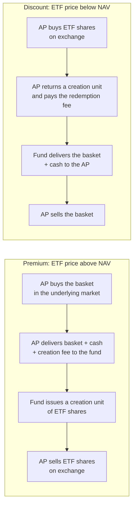

# ETFs and Index Arbitrage

## TL;DR

- An ETF trades near NAV because authorised participants (APs) can create shares by delivering the basket and redeem shares for the basket; when the premium exceeds the round-trip cost of doing so, they do it and the gap closes.
- The no-arbitrage band around NAV is set by creation and redemption fees, basket trading costs and the ETF spread; outside it, a premium or discount is free money for an AP, inside it, it is just noise.
- Index futures fair value is cost of carry with discrete dividends: $F = S(1 + r\,d/360) - \sum_i D_i(1 + r\,(d - t_i)/360)$; "fair value" on a desk screen is $F - S$.
- Index arbitrage sells the future and buys the basket (or the reverse) when the future is outside fair value plus costs; held to expiry the P&L is locked, unwound early it depends on the basis at exit and on the hedge ratio.
- Index reconstitutions create large predictable flows; the trade is sizing that demand against liquidity, not knowing that it exists.

## Learning objectives

- Explain ETF creation and redemption and why ETFs trade near NAV.
- Compute index fair value against futures and trade the basis.
- Understand index rebalancing and its predictable flows.
- Explain leveraged and inverse ETF path dependence and compute it.

## Core concepts

### Creation and redemption

US ETFs operate under SEC Rule 6c-11 (17 CFR 270.6c-11, adopted 2019).
Its definitions (paragraph (a)(1)): an **authorised participant** is a member or participant of a registered clearing agency with a written agreement with the fund to place creation and redemption orders; a **creation unit** is a specified number of ETF shares issued to or redeemed from an AP in exchange for a **basket** (the securities, assets or other positions exchanged) and any cash balancing amount.

- Creation adds shares and pushes the ETF price down toward NAV; redemption removes shares and pushes it up.
- The arbitrage is open only to APs, but any market maker can trade the ETF against the basket or futures and leave the creation or redemption to an AP later.
- In-kind exchange matters: the fund does not sell securities to meet redemptions, so it does not generate trading costs or (in the US) realised capital gains for the remaining holders.
- Rule 6c-11(c)(1) requires each business day, on a public website: portfolio holdings before the open of regular trading, the prior day's NAV, market price and premium or discount, a premium and discount history, the median bid-ask spread over the last 30 calendar days (from NBBO readings every 10 seconds), and a statement if the premium or discount exceeded 2% for more than seven consecutive trading days.

### NAV, premium and the arbitrage band

NAV per share $= (\text{basket value} + \text{cash})/\text{shares per unit}$, using closing prices for the official NAV and live prices for a trading fair value.
Premium $= P_{\text{ETF}}/\text{NAV} - 1$.
For an AP with basket cost $c$ (fraction of value per side), fee $f$ per unit and $n$ shares per unit, creation pays if the ETF bid exceeds

$$
\frac{B(1 + c) + \text{cash} + f}{n},
$$

and redemption pays if the ETF ask is below $\big(B(1 - c) + \text{cash} - f\big)/n$.
Inside that band the premium is not an arbitrage.

When the underlying market is closed (a US-listed ETF on Japanese equities during New York hours) or illiquid (corporate bonds), the "premium" is often the ETF doing price discovery against a stale NAV, not a mispricing.
Bond fund NAVs use evaluated prices that lag in stress, so a discount can say more about the NAV than about the ETF.

### Leveraged and inverse ETFs

A fund targeting $L$ times the daily index return rebalances every day, so over $n$ days its value is $\prod_i(1 + L r_i)$, not $1 + L\big(\prod_i(1 + r_i) - 1\big)$.
In choppy markets this loses relative to $L$ times the index (volatility decay); in trending markets it can gain.
The daily rebalance trade is mechanical: after an up day a levered long fund must buy, after a down day it must sell, always in the direction of the day's move (Cheng and Madhavan 2009).

### Index futures fair value

The cash-and-carry argument from [Forwards, Futures and Carry](../05-Derivatives-and-Volatility/01-Forwards-Futures-and-Carry.md), with discrete dividends and the money-market simple rate desks use:

$$
F^{\text{fair}} = S\Big(1 + r\frac{d}{360}\Big) - \sum_i D_i\Big(1 + r\frac{d - t_i}{360}\Big),
$$

where $D_i$ are the index dividend points paid on day $t_i$ before expiry on day $d$.

- The fair value basis $F - S$ is financing minus dividends; it shrinks to zero at expiry.
- Inverting the formula on a traded future gives the implied financing rate; compare it with your funding to see whether cash-and-carry pays you.
- Delta-one desks also read implied dividends from the same relation; long-dated index futures and dividend futures are mostly dividend trades.
- Quarterly E-mini S&P 500 futures are 50 USD times the index (CME Rulebook chapter 358) and cash-settle to a Special Opening Quotation (SOQ): a special calculation of the index from the opening prices of its component stocks on the third Friday of the contract month (CME final settlement procedures).
  An arbitrageur therefore unwinds the basket in the opening auctions to match the settlement price.
  The SOQ generally differs from the first index value published that morning, because the stocks do not all open at once and the published index carries stale prices until they do.

### Index arbitrage

- **Futures rich** (above fair value plus costs): sell futures, buy the basket financed at $r$, collect dividends, deliver at expiry.
- **Futures cheap**: buy futures, sell the basket (or, more often, sell inventory you already own), lend the cash.
- The band is the round-trip cost of the basket (half-spread, commissions, impact) plus the futures cost, plus a margin for financing and dividend uncertainty.
- Holding to expiry locks the P&L whatever the index does, because the future settles to the index level.
- Unwinding early realises the entry mispricing minus the exit mispricing, less a second set of costs, and exposes the position to the hedge ratio: before expiry $\partial F/\partial S = 1 + r\tau$, so one index unit per future leaves a small short delta.
- Who does it: delta-one desks at banks, ETF market makers and HFT firms that already hold the basket; in practice basket, ETF and futures are a single book and the cheapest leg is used.

### Index inclusions and rebalancing

When a stock is added to an index, funds that track it must buy it by the effective date, usually at the closing price that day.
Demand is roughly (share of the index's float owned by trackers) times (the stock's float-adjusted market cap).
Shleifer (1986) and Harris and Gurel (1986) documented abnormal returns around S&P 500 additions, consistent with downward-sloping demand for stocks.
Because the event is announced in advance, the price impact is shared between the announcement and the effective date, and part of it accrues to traders who pre-position and then sell to the index funds at the close.

## Worked examples

All prices, fees and sizes are hypothetical; numbers come from [etf_index_arb.py](code/etf_index_arb.py).

### Example 1: a creation trade

A creation unit is 50,000 shares against a basket of 12,000 A at 95.00, 6,000 B at 136.75 and 20,000 C at 26.25 plus 19,500 USD cash.
Basket value 2,485,500 USD, so NAV $= (2{,}485{,}500 + 19{,}500)/50{,}000 = 50.10$.
The ETF quotes 50.22/50.23, a mid premium of 24.95 bp.
"I buy the basket paying 3 bp, deliver it with the cash and a 500 USD creation fee, and sell 50,000 shares at the 50.22 bid."
Cost $2{,}485{,}500 \times 1.0003 + 19{,}500 + 500$, proceeds $2{,}511{,}000$: P&L 4,754.35 USD per unit.
Break-even: creation pays when the bid is above 50.1249 (4.97 bp over NAV); redemption pays when the ask is below 50.0751 (4.97 bp under NAV).
Between those, quotes can wander without any arbitrage.

### Example 2: leveraged ETF decay

The index goes 100 to 110 and back to 100.
A 2x fund goes 100 to 120, then falls $2 \times 9.09\%$ to 98.18; a $-2$x fund ends at 94.55.
Ten round trips of +5% and back leave the 2x fund at 95.34 with the index flat.
In a trend (ten days of +1%), the index gains 10.46% and the 2x fund 21.90%, more than twice the index.

### Example 3: index futures fair value and implied financing

Index 5000.00, $r = 4.30\%$ ACT/360, 60 days to expiry, dividends of 4.00 points on day 20 and 6.50 points on day 45.
Financing costs 35.83 points; dividends carried to expiry are worth 10.53 points; fair value is 5025.30 (5025.3026 to four decimals), a basis of 25.30 points.
"The future trades at 5031.00. What financing rate does that imply?"
Solve the fair-value formula for $r$: 4.9843%, 68.43 bp over our funding, so the future is rich for anyone funding at 4.30%.

### Example 4: index arbitrage P&L

Costs: 2.5 bp of the index per basket trade each way (2.50 points round trip) and 0.10 points per futures trade.
The band is fair value $\pm 2.60$: sell futures above 5027.90, buy below 5022.70.
At 5031.00 the future is $5031.00 - 5025.3026 = 5.6974$ points rich: sell 100 futures, buy the basket.
Held to expiry, P&L is $(5.6974 - 2.60) \times 50 = 154.87$ USD per contract (15,487 USD on 100), the same whether the index settles at 4600, 5000 or 5400.
"Twenty days later the future is only 1.20 points rich and you close."
The quick estimate, entry minus exit mispricing less a second set of costs, is $(5.6974 - 1.20 - 2.50 - 0.20) \times 50 = 89.87$ USD per contract.
With one index unit per future the actual P&L is 136.69 if the index has fallen to 4800 and 41.14 if it has risen to 5200: at day 20 the position has a residual delta of $-0.00478$ index units per future, because $\partial F/\partial S = 1 + r\tau$.
Holding $1 + r\tau$ index units per future (the only change) removes the dependence on the index level and gives 87.02 USD per contract in both scenarios.

### Example 5: sizing an index inclusion

A stock with a 40bn USD float-adjusted market cap is added; trackers own 25% of the index's float, the stock trades at 200 USD with 2.5m shares a day.
Tracker demand is 10.0bn USD, 50.0m shares, 20.0 days of average volume.
If the trackers buy in the closing auction of the effective date and that auction normally prints 8% of daily volume, the demand is 250 times a normal close.
That ratio, not the announcement itself, tells you the trade: someone must supply 50m shares at the close, and they will be paid for it.

## Pitfalls

- Calling any premium an arbitrage; inside the band set by fees and basket costs it is not.
- Reading a premium on an ETF whose underlying market is closed as mispricing; it is usually the ETF leading the stale NAV.
- Using $L$ times the index return for a leveraged ETF over more than a day.
- Ignoring dividends or using annual dividend yield for a short-dated future; discrete dividend timing dominates the near contracts.
- Using a 1:1 hedge ratio for an index arbitrage you may unwind early; before expiry the future's delta is $1 + r\tau$.
- Assuming you can trade the basket at the settlement price; the future settles to opening prices, so the unwind must be in the opening auctions.
- Treating an index inclusion as free money; pre-positioning is crowded and the impact can reverse after the effective date.

## Interview questions

> [!question]- fi-etf-creation-mechanics | Why does an ETF trade close to its NAV?
> Because authorised participants can create shares by delivering the basket and redeem shares for the basket.
> If the ETF trades above NAV plus costs they create and sell shares; below NAV minus costs they buy and redeem; either trade pushes the price back.

> [!question]- fi-etf-nav-premium | A creation unit of 50,000 shares holds a 2,485,500 USD basket and 19,500 USD cash; the ETF mid is 50.225. NAV and premium?
> NAV 50.10, premium 24.95 bp.
> $(2{,}485{,}500 + 19{,}500)/50{,}000 = 50.10$ and $50.225/50.10 - 1$.

> [!question]- fi-etf-creation-pnl | Same fund: basket costs 3 bp to buy, the creation fee is 500 USD, the ETF bid is 50.22. AP P&L per creation unit?
> 4,754.35 USD.
> Proceeds $50{,}000 \times 50.22 = 2{,}511{,}000$, cost $2{,}485{,}500 \times 1.0003 + 19{,}500 + 500 = 2{,}506{,}245.65$.

> [!question]- fi-etf-arb-band | In that example, what is the no-arbitrage band for the ETF around NAV?
> About $\pm 4.97$ bp: creation pays above a 50.1249 bid, redemption pays below a 50.0751 ask.
> Each edge is basket cost plus the fee spread over the unit.

> [!question]- fi-etf-in-kind-why | Why do ETFs prefer in-kind creation and redemption?
> The fund does not trade to meet flows, so remaining holders do not pay the trading costs, and in the US distributing securities in kind does not realise capital gains inside the fund.
> The AP bears the basket trading cost and prices it into the arbitrage band.

> [!question]- fi-etf-closed-market-premium | A US-listed Japan equity ETF trades 1.5% above NAV during New York hours after a big US rally. Arbitrage?
> Probably not: the NAV uses Tokyo closing prices from hours earlier, and the ETF is pricing the expected move at the next Tokyo open.
> Compare the ETF with a live fair value (futures or ADRs), not with the stale NAV.

> [!question]- fi-etf-6c11-disclosure | What does SEC Rule 6c-11 require an ETF to publish each business day?
> Holdings before the open, the prior day's NAV, market price and premium or discount, the premium and discount history, the 30-day median bid-ask spread, and a notice if the premium or discount exceeded 2% for more than seven consecutive trading days.
> These are paragraph (c)(1) website disclosures.

> [!question]- fi-etf-leveraged-decay | An index goes from 100 to 110 and back to 100. Where does a 2x daily ETF end?
> 98.18.
> $100 \times 1.2 \times (1 - 2 \times 10/110)$: the fund rebalances daily, so it compounds $1 + 2r_i$, which loses in a round trip.

> [!question]- fi-etf-inverse-decay | Same path, a $-2$x daily ETF?
> 94.55.
> $100 \times 0.8 \times (1 + 2 \times 10/110)$; inverse funds lose in both directions of a round trip.

> [!question]- fi-etf-index-fair-value | Index 5000, $r = 4.30\%$ ACT/360, 60 days, dividends 4.00 points on day 20 and 6.50 on day 45. Fair value?
> 5025.30.
> Financing $5000 \times 0.043 \times 60/360 = 35.83$ minus dividends carried to expiry 10.53.

> [!question]- fi-etf-implied-financing | In that setup the future trades at 5031.00. Implied financing rate, and what do you do if you fund at 4.30%?
> 4.9843%: the future is rich.
> Sell the future, buy the basket and fund it at 4.30%; you lock in the 68.43 bp difference over 60 days, less costs.

> [!question]- fi-etf-arb-band-futures | With 2.5 bp per basket trade each way and 0.10 points per futures trade, where are the index arbitrage bands around a 5025.30 fair value?
> 5022.70 and 5027.90.
> Round-trip basket cost is $2 \times 2.5\text{ bp} \times 5000 = 2.50$ points, plus 0.10 points of futures cost.

> [!question]- fi-etf-index-arb-pnl | The future is at 5031.00 and you sell it against the basket, holding to expiry. P&L per E-mini contract?
> 154.87 USD.
> $(5031.00 - 5025.3026 - 2.60) \times 50$, independent of where the index settles.

> [!question]- fi-etf-index-arb-hedge-ratio | Why does a 1:1 index arbitrage hedge leave risk if you might unwind early, and what ratio fixes it?
> Before expiry $\partial F/\partial S = 1 + r\tau$, so one index unit per short future leaves a short delta (about $-0.00478$ with 40 days to expiry in the note's example).
> Hold $1 + r\tau$ index units per future; in the note this makes the early-unwind P&L 87.02 USD per contract whether the index falls to 4800 or rises to 5200.

> [!question]- fi-etf-soq-settlement | E-mini S&P 500 futures settle to the Special Opening Quotation. What does that mean for an arbitrageur holding the basket into expiry?
> The settlement value is built from each stock's opening price on expiration day, so the basket must be sold (or bought) in the opening auctions to match it.
> Selling at the previous close or later in the day leaves an unhedged gap.

> [!question]- fi-etf-inclusion-demand | A stock with a 40bn USD float cap joins an index whose trackers own 25% of float; it trades 2.5m shares a day at 200 USD. How big is the inclusion trade?
> 50m shares, 20 days of volume.
> $0.25 \times 40\text{bn}/200$; concentrated in one closing auction it is 250 times a normal 8%-of-volume close.

> [!question]- fi-etf-index-effect | What is the index effect, and why is it a risky trade?
> Prices of added stocks rise around inclusion (Shleifer 1986; Harris and Gurel 1986), consistent with downward-sloping demand.
> The trade is crowded: pre-positioning moves the price before the effective date, and part of the gain can reverse after the index funds have bought.

> [!question]- fi-etf-tracking-difference | Distinguish tracking difference from tracking error.
> Tracking difference is the fund's return minus the index return over a period (fees, cash drag, sampling, securities lending); tracking error is the standard deviation of the periodic differences.
> A fund can have a steady negative tracking difference (its fee) with near-zero tracking error.

## In this repo and SDE-Interview-Prep

- Code: [etf_index_arb.py](code/etf_index_arb.py) prints and asserts every number in the worked examples and cards.
- Prerequisite: [Forwards, Futures and Carry](../05-Derivatives-and-Volatility/01-Forwards-Futures-and-Carry.md) for implied dividends and financing.
- Related: [ETF and Futures Market Making](../08-Market-Making/08-ETF-and-Futures-Market-Making.md), [Exchange Mechanics, Auctions and Fees](../07-Market-Microstructure/02-Exchange-Mechanics-Auctions-and-Fees.md) for opening and closing auctions, [Transaction Costs and Turnover](../09-Alpha-Research-and-Portfolio/13-Transaction-Costs-and-Turnover.md).

## Further reading

- SEC Rule 6c-11, [17 CFR 270.6c-11](https://www.law.cornell.edu/cfr/text/17/270.6c-11), Exchange-traded funds (read 2026-10).
- CME Group, [Equity index final settlement procedures](https://cmegroup.com/trading/equity-index/settlement.html) (Special Opening Quotation, read 2026-10).
- Larry Harris, *Trading and Exchanges: Market Microstructure for Practitioners* (Oxford, 2003), chapters on index markets and arbitrage.
- John Hull, *Options, Futures, and Other Derivatives*, 10th edition (2018), chapter 5.
- A. Shleifer, "Do Demand Curves for Stocks Slope Down?", *Journal of Finance* 41(3) (1986).
- L. Harris and E. Gurel, "Price and Volume Effects Associated with Changes in the S&P 500 List", *Journal of Finance* 41(4) (1986).
- M. Cheng and A. Madhavan, "The Dynamics of Leveraged and Inverse Exchange-Traded Funds", *Journal of Investment Management* 7(4) (2009).
