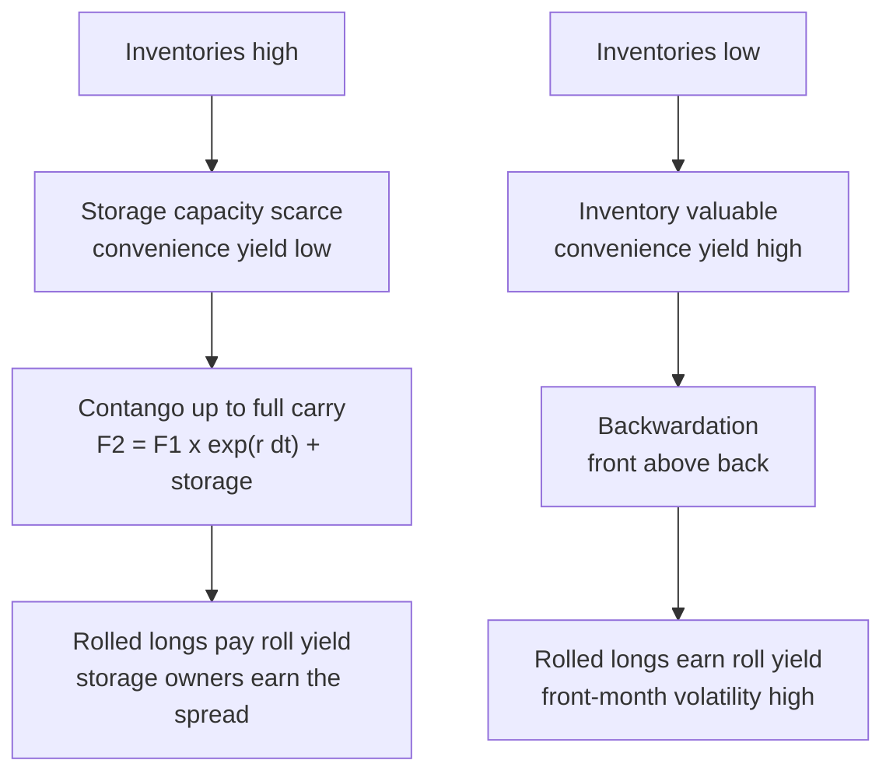

# Commodities and Futures Curves

## TL;DR

- Commodity futures obey cost of carry with storage $u$ and convenience yield $y$: $F(T) = S e^{(r + u - y)T}$; because physical inventory cannot be shorted freely, only the upper bound (full carry) is an arbitrage, and $y$ is whatever makes the curve fit.
- Contango (upward curve) means abundant inventory and low convenience yield; backwardation (downward curve) means scarce inventory and a high convenience yield (Working 1949; Kaldor 1939; Brennan 1958).
- A rolled long futures position earns spot return plus roll return; on an unchanged curve the roll return is $F_1/F_2 - 1$ per roll, positive in backwardation and negative in contango.
- Calendar spreads trade the curve's shape, not its level: a parallel shift leaves them unchanged, inventory news moves them.
- Seasonal curves (natural gas, grains) price storage economics; a storage owner is long calendar spreads and earns them only net of storage, financing and losses.

## Learning objectives

- Explain contango, backwardation, roll yield and storage economics.
- Know calendar spreads and seasonality in energy and agriculture.
- Compute implied convenience yield, roll yield and the full-carry bound from a curve.
- Decompose a rolled futures return into spot and roll.

## Core concepts

### Cost of carry for a physical commodity

Holding a barrel from today to $T$ costs financing $r$ and storage $u$, and earns a convenience yield $y$: the value of having inventory on hand when supply is tight (keeping a refinery running, meeting a delivery).
The forward relation from [Forwards, Futures and Carry](../05-Derivatives-and-Volatility/01-Forwards-Futures-and-Carry.md) is

$$
F(T) = S e^{(r + u - y)T}, \qquad y = r + u - \frac{\ln\big(F(T_2)/F(T_1)\big)}{T_2 - T_1}
$$

for adjacent contracts.

- **Full carry** is the upper bound: if $F(T_2) > F(T_1)e^{r(T_2 - T_1)} + \text{storage}$, buy the near contract, take delivery, store, and deliver into the far contract.
- There is no matching lower bound for consumption commodities: the reverse trade needs someone to lend you physical oil, which inventory holders will not do cheaply when it is scarce.
  That one-sidedness is why $y$ exists, and why gold (lendable, huge above-ground stocks) trades near full carry while crude oil and gas do not.
- Storage is not a constant: when tanks fill up, the marginal cost of storage rises steeply and full carry moves up with it.

### Theory of storage

Working (1949), Kaldor (1939) and Brennan (1958) link the spread between near and far futures to inventory: low stocks mean a high marginal convenience yield and an inverted curve, high stocks mean the spread approaches full carry.
Gorton, Hayashi and Rouwenhorst (2013) find the same pattern across commodities: the futures basis and subsequent futures risk premiums vary with inventory levels.
Keynes's (1930) normal backwardation is a separate idea: if producers are net short hedgers, speculators who take the long side must be paid a risk premium, so futures are below the expected future spot price.

### Roll yield and the spot-plus-roll decomposition

A long-only index cannot hold a front contract into delivery; it sells the expiring contract and buys the next one.
Holding $F_2$ for a month, after which it becomes the front contract, the return is

$$
\frac{F_1^{(t+1)}}{F_2^{(t)}} = \frac{S_{t+1}}{S_t} \times \frac{F_1^{(t+1)}/S_{t+1}}{F_2^{(t)}/S_t},
$$

and if the curve's shape relative to spot is unchanged, the second factor is $F_1/F_2$, the roll return.
In logs the decomposition is exact: futures return = spot return + roll return.

- Backwardation: $F_1 > F_2$, positive roll; contango: negative roll.
- Roll yield is not free money: if futures are unbiased forecasts of later spot prices, an inverted curve forecasts falling spot prices and the expected spot return offsets the roll.
  Long-run excess returns of commodity futures are an empirical question about risk premiums (Gorton and Rouwenhorst 2006; Erb and Harvey 2006), not an accounting identity.
- Samuelson (1965): near contracts respond more to shocks than distant ones, so front-month volatility is higher; a calendar spread is mostly front-month risk.

### Calendar spreads and seasonality

A calendar spread is long one maturity and short another of the same commodity.
It hedges the level and keeps the slope: inventory surprises, refinery outages, weather and storage capacity move it.

- **Energy**: natural gas is injected into storage in summer and withdrawn in winter, so the curve has a winter hump every year; heating oil and gasoline have their own seasonal peaks.
- **Agriculture**: grain curves step at harvest, when new-crop supply arrives; old-crop and new-crop contracts can trade very differently.
- **Storage as an option**: a storage owner can inject when spreads are wide and withdraw when they are tight, so storage capacity is valued as a strip of calendar-spread options; the curve today gives its intrinsic value, volatility gives the extrinsic part.

### The April 2020 negative WTI price

NYMEX WTI is physically delivered: 1,000 barrels per contract at Cushing, Oklahoma.
According to the CFTC interim staff report (2020-11-23), the May 2020 contract settled at $-37.63$ USD per barrel on April 20, 2020, the day before it expired, the first time the contract had traded at a negative price since it was listed 37 years earlier.
Its final settlement on April 21 was 10.01 USD (Commissioner Berkovitz's statement on the report, 2020-11-23).
The report describes an oversupplied market after the COVID-19 demand collapse, working storage at Cushing near capacity, and a long holder at expiry facing delivery with nowhere to put the oil.
In cost-of-carry terms, the marginal storage cost for the front month went toward infinity, and the full-carry bound stopped capping the spread.

## Worked examples

All curves, rates and costs are hypothetical; numbers come from [commodity_curves.py](code/commodity_curves.py).
Two monthly curves are used, with $r = 4.5\%$ and storage $u = 3.0\%$ (continuous yields):

| Month | 1 | 2 | 3 | 4 | 5 | 6 | 7 | 8 | 9 | 10 | 11 | 12 |
| :--- | ---: | ---: | ---: | ---: | ---: | ---: | ---: | ---: | ---: | ---: | ---: | ---: |
| Backwardated | 80.00 | 79.40 | 78.85 | 78.35 | 77.90 | 77.50 | 77.15 | 76.85 | 76.60 | 76.40 | 76.25 | 76.15 |
| Contango | 70.00 | 70.70 | 71.35 | 71.95 | 72.50 | 73.00 | 73.45 | 73.85 | 74.20 | 74.50 | 74.75 | 74.95 |

### Example 1: implied convenience yield

"Front month 80.00, second 79.40. Implied convenience yield?"
$y = r + u - 12\ln(79.40/80.00) = 16.53\%$ a year.
On the contango curve the same calculation gives $-4.44\%$: the M1-M2 spread is steeper than the assumed 7.5% a year of financing plus storage.
A negative implied $y$ means either that marginal storage costs more than the assumed 3% (tanks filling up) or that the spread is above full carry and a cash-and-carry pays; it is the residual that absorbs a misspecified storage cost.
Further out, between months 11 and 12 of the backwardated curve, $y = 9.07\%$: scarcity is priced mostly into the front.
Over the year the backwardated curve falls 4.81% and the contango curve rises 7.07%.

### Example 2: roll yield on an unchanged curve

"You hold the second contract for a month and the curve does not move. What do you earn?"
Backwardated: $80.00/79.40 - 1 = 0.756\%$ a month, 9.45% a year compounded.
Contango: $70.00/70.70 - 1 = -0.990\%$ a month, $-11.26\%$ a year.
A brute-force simulation that buys month 2, sells it as month 1 a month later and rolls, twelve times, with spot unchanged, reproduces both numbers: the entire P&L is roll.

### Example 3: spot up, futures down

On the contango shape, let the front month move 70, 74, 69, 72, 77, 75, 71 over six months.
Spot is up 1.43%, but the rolled futures position is down 4.45%, because the roll costs 5.80% over the six months.
The script checks that log futures return equals log spot return plus log roll return to machine precision.
This is the classic interview point about commodity ETFs and indices that lag "the price of oil".

### Example 4: full carry and a cash-and-carry

"M1 is 70.00, financing 4.5%, leased storage 0.50 per barrel per month. Where is full carry for M2, and what if M2 trades at 71.20?"
Full carry is $70.00e^{0.045/12} + 0.50 = 70.76$, a spread of 0.76.
At 71.20, buy M1, take delivery, store a month, sell M2: 0.44 per barrel, about 437 USD per 1,000-barrel contract.
If tanks are nearly full and the marginal storage cost is 2.00 per barrel-month, full carry is 72.26 and the same quote is no arbitrage; that is the April 2020 mechanism in miniature.

### Example 5: calendar spread P&L

The backwardated curve's M1-M2 spread is 0.60.
"You are long 10 M1-M2 spreads and an outage tightens the front so the spread goes to 1.10."
P&L $= (1.10 - 0.60) \times 1{,}000 \times 10 = 5{,}000$ USD.
A parallel 5 USD fall of the whole curve would have left the spread, and the P&L, unchanged.

### Example 6: seasonal gas storage

"April gas 2.80, January 3.90 per MMBtu. Storage costs 0.45 for the season, injection and withdrawal burn 1% of the gas, financing 4.5%. Is storing worth it?"
The spread is 1.10.
Financing April gas for nine months costs 0.096; revenue $3.90 \times 0.99$ minus cost $2.80 + 0.096 + 0.45$ leaves 0.515 per MMBtu.
The break-even spread is 0.580: below that, the curve is paying less than it costs to store.

## Pitfalls

- Treating the reverse cash-and-carry as available for oil or gas; only full carry is an arbitrage for consumption commodities.
- Treating roll yield as a guaranteed return; it is offset by expected spot moves if futures are unbiased.
- Computing roll yield as $F_2/F_1 - 1$ (the wrong sign) or over the wrong holding period.
- Ignoring the physical delivery calendar; a long front-month position near expiry can force delivery decisions.
- Assuming storage cost is constant; capacity constraints make it convex, and full carry moves with it.
- Reading a seasonal hump as a forecast of a price rise; it is storage economics priced in every year.
- Hedging a front-month exposure with a back-month contract and calling it riskless; the calendar spread is a large, volatile basis risk.

## Interview questions

> [!question]- fi-cmdty-cost-of-carry | Write the cost-of-carry relation for a commodity and say which side is an arbitrage.
> $F(T) = Se^{(r + u - y)T}$.
> Only the upper bound (full carry, $y = 0$) is enforced by arbitrage, because a consumption commodity cannot be borrowed and shorted cheaply; $y$ is backed out to fit the curve.

> [!question]- fi-cmdty-convenience-yield | M1 is 80.00 and M2 is 79.40; $r = 4.5\%$, storage 3.0% (continuous). Implied convenience yield?
> About 16.53% a year.
> $y = r + u - \ln(79.40/80.00)/(1/12)$.

> [!question]- fi-cmdty-contango-backwardation | What do contango and backwardation say about inventories?
> Contango: inventories ample, convenience yield low, spreads near full carry.
> Backwardation: inventories scarce, convenience yield high, front above back.
> This is the theory of storage of Working, Kaldor and Brennan.

> [!question]- fi-cmdty-roll-yield | You hold M2 at 79.40 for a month on an unchanged curve and it becomes M1 at 80.00. Roll yield?
> 0.756% for the month, 9.45% a year compounded.
> $80.00/79.40 - 1$; positive because the curve is backwardated.

> [!question]- fi-cmdty-roll-contango-index | A long-only index rolls monthly on an unchanged curve with M1 70.00 and M2 70.70. Annual return if spot stays at 70?
> About $-11.26\%$.
> Each roll loses $1 - 70.00/70.70 = 0.990\%$, compounded twelve times.

> [!question]- fi-cmdty-spot-plus-roll | Over six months spot oil rises 1.43% but a rolled futures position loses 4.45%. How?
> The contango curve cost 5.80% in roll over the period.
> In logs, rolled futures return = spot return + roll return exactly, when the curve's shape relative to spot is unchanged.

> [!question]- fi-cmdty-full-carry | M1 70.00, $r = 4.5\%$, storage 0.50 per barrel per month. Full-carry M2, and what do you do if M2 is 71.20?
> Full carry is 70.76.
> Buy M1, take delivery, store, sell M2 at 71.20: about 0.44 per barrel, 437 USD per 1,000-barrel contract, if you have storage at 0.50.

> [!question]- fi-cmdty-negative-wti | How could the May 2020 WTI contract settle at $-37.63$?
> It is physically delivered at Cushing, storage there was near capacity, and longs at expiry had nowhere to put oil, so they paid to exit.
> In carry terms, the marginal cost of storage exploded, so the front contract could fall far below the next one: the spread was no longer limited by ordinary storage costs (CFTC interim staff report, 2020-11-23).

> [!question]- fi-cmdty-calendar-spread | Long 10 M1-M2 crude spreads at 0.60; the spread moves to 1.10. P&L?
> 5,000 USD.
> $(1.10 - 0.60) \times 1{,}000$ barrels $\times 10$.

> [!question]- fi-cmdty-spread-vs-outright | What risk does a calendar spread remove and what does it keep?
> It removes the level (a parallel shift leaves it unchanged) and keeps the slope, which moves with inventory and storage news.
> Because front-month volatility is higher (Samuelson effect), the spread is still a sizeable risk.

> [!question]- fi-cmdty-gas-storage | April gas 2.80, January 3.90, storage 0.45, 1% fuel loss, financing 4.5% for nine months. Profit per MMBtu?
> About 0.515.
> Revenue $3.90 \times 0.99 = 3.861$ minus cost $2.80 + 0.096 + 0.45$; the break-even spread is 0.580.

> [!question]- fi-cmdty-storage-as-option | How is a gas storage facility valued?
> As a strip of calendar-spread options with injection, withdrawal and capacity constraints.
> The forward curve gives intrinsic value (lock in the spreads today); volatility of spreads adds extrinsic value from re-optimising later.

> [!question]- fi-cmdty-normal-backwardation | What is Keynes's normal backwardation?
> If hedgers are net short futures, speculators who go long must be paid a risk premium, so futures sit below the expected future spot.
> It is a statement about risk premiums, distinct from the inventory-driven backwardation of the theory of storage.

> [!question]- fi-cmdty-samuelson-effect | Why is front-month commodity volatility higher than back-month volatility?
> Shocks to supply and demand are partly transitory, and inventories and supply respond over time, so distant prices move less (Samuelson 1965).
> Calendar spreads and options desks model vol as a function of time to maturity, not one number per commodity.

> [!question]- fi-cmdty-consumption-vs-investment | Why does gold trade near full carry while crude oil often does not?
> Gold has large lendable above-ground stocks, so the reverse cash-and-carry works and both bounds bind.
> Crude oil is consumed and rarely lent, so only the upper bound binds and convenience yield can be large.

> [!question]- fi-cmdty-roll-yield-forecast | Is positive roll yield in a backwardated market a free return?
> No; if futures are unbiased forecasts, a downward curve forecasts falling spot prices that offset the roll.
> Whether rolled commodity futures earn a premium is an empirical risk-premium question (Gorton and Rouwenhorst 2006; Erb and Harvey 2006).

> [!question]- fi-cmdty-seasonality | Why does the natural gas curve have a hump every winter?
> Demand peaks in winter and gas is stored from summer to meet it, so winter contracts price above summer by roughly the cost of storage.
> The hump is storage economics priced in every year, not a forecast of a price rise.

## In this repo and SDE-Interview-Prep

- Code: [commodity_curves.py](code/commodity_curves.py) prints and asserts every number in the worked examples and cards.
- Prerequisite: [Forwards, Futures and Carry](../05-Derivatives-and-Volatility/01-Forwards-Futures-and-Carry.md).
- Related: [Momentum, Mean Reversion and Carry](../09-Alpha-Research-and-Portfolio/05-Momentum-Mean-Reversion-and-Carry.md) for carry as a cross-asset signal, [Macro and Market Awareness](../11-Risk-and-Trading/08-Macro-and-Market-Awareness.md).

## Further reading

- Helyette Geman, *Commodities and Commodity Derivatives* (Wiley, 2005).
- John Hull, *Options, Futures, and Other Derivatives*, 10th edition (2018), chapter 5 (commodity futures and convenience yield).
- H. Working, "The Theory of Price of Storage", *American Economic Review* 39(6) (1949).
- N. Kaldor, "Speculation and Economic Stability", *Review of Economic Studies* 7(1) (1939).
- M. Brennan, "The Supply of Storage", *American Economic Review* 48(1) (1958).
- P. Samuelson, "Proof That Properly Anticipated Prices Fluctuate Randomly", *Industrial Management Review* 6(2) (1965).
- G. Gorton and K. G. Rouwenhorst, "Facts and Fantasies about Commodity Futures", *Financial Analysts Journal* 62(2) (2006).
- C. Erb and C. Harvey, "The Strategic and Tactical Value of Commodity Futures", *Financial Analysts Journal* 62(2) (2006).
- G. Gorton, F. Hayashi and K. G. Rouwenhorst, "The Fundamentals of Commodity Futures Returns", *Review of Finance* 17(1) (2013).
- CFTC, [Interim Staff Report: Trading in NYMEX WTI Crude Oil Futures Contract Leading up to, on, and around April 20, 2020](https://www.cftc.gov/PressRoom/PressReleases/8315-20) (2020-11-23).
- Commissioner Dan M. Berkovitz, [Statement regarding the CFTC staff interim report](https://www.cftc.gov/PressRoom/SpeechesTestimony/berkovitzstatement112320) (2020-11-23).
