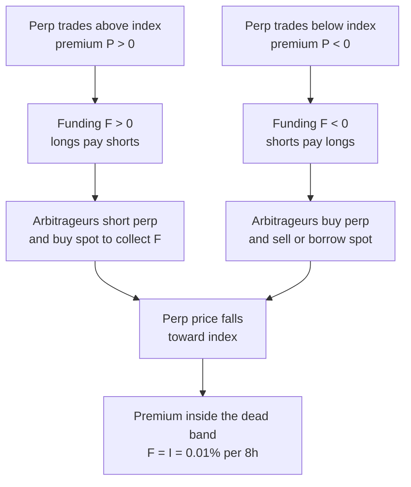

# Crypto Market Structure

## TL;DR

- A perpetual future never expires; a periodic funding payment between longs and shorts, driven by the perp's premium to the spot index, ties its price to spot.
- On Binance (as of 2026-10) funding is $F = P + \text{clamp}(I - P, -0.05\%, +0.05\%)$ every 8 hours with $I = 0.01\%$, so any premium between $-0.04\%$ and $+0.06\%$ gives exactly $0.01\%$, about 10.95% a year paid by longs to shorts.
- The basis trade (long spot, short perp or dated future) collects funding or basis with no price exposure, but it carries exchange, custody, liquidation and operational risk that does not exist in a regulated futures market with a clearing house.
- Centralised exchanges run limit order books with internal ledgers; automated market makers (AMMs) price from a curve such as $xy = k$, settle on-chain in blocks, and expose every pending trade in a public mempool.
- AMM liquidity providers lose to arbitrageurs at a rate of about $\sigma^2/8$ of pool value per year for a constant-product pool (loss-versus-rebalancing), which fees must cover.

## Learning objectives

- Explain perpetual futures and the funding rate mechanism.
- Compare centralized order books with automated market makers.
- Identify basis and cross-venue arbitrage opportunities and their risks.
- Compute funding payments, basis-trade carry, liquidation distance, AMM price impact and impermanent loss.

## Core concepts

### Venues and custody

| | Centralised exchange (CEX) | On-chain AMM |
| :--- | :--- | :--- |
| Matching | Central limit order book, price-time priority | Pricing curve, e.g. constant product $xy = k$ |
| Settlement | Internal ledger; on-chain only on deposit and withdrawal | On-chain, atomic, in each block |
| Custody | Exchange holds client assets | User's own wallet; pool contract holds liquidity |
| Ordering | Exchange matching engine, microseconds to milliseconds | Block builders order transactions; Ethereum mainnet slots are 12 seconds under proof of stake |
| Pre-trade transparency | Order book visible, orders private until posted | Pending transactions visible in the public mempool |
| Fees | Maker and taker fees | Pool fee (0.30% in Uniswap v2) plus gas |
| Main failure modes | Exchange insolvency or fraud, withdrawal halts, auto-deleveraging | Smart-contract bugs, front-running and sandwiches (MEV), oracle manipulation |

- Crypto trades around the clock with no consolidated tape and no official close, so "the price" is a venue-weighted index chosen by each exchange or benchmark.
- On a CEX your claim is against the exchange, not against a clearing house: FTX Trading Ltd. and affiliates filed for Chapter 11 in the US Bankruptcy Court for the District of Delaware on 2022-11-11 (Case No. 22-11068), and customer balances became claims in that bankruptcy.
- Prices for the same coin differ across venues more than in regulated markets; Makarov and Schoar (2020) document large and persistent cross-exchange deviations, largest across countries with capital controls.

### Perpetual futures and funding

A perpetual future (perp) is a futures contract with no expiry.
With no delivery date to force convergence, the exchange pays funding: at each funding time, longs pay shorts $\text{notional} \times F$ if $F > 0$, and shorts pay longs if $F < 0$.

Binance's rule (Binance Futures funding-rate FAQ, read 2026-10; the default interval is 8 hours at 00:00, 08:00 and 16:00 UTC):

$$
F = \bar{P} + \text{clamp}\big(I - \bar{P},\ -0.05\%,\ +0.05\%\big), \qquad
P = \frac{\max(0, \text{impact bid} - \text{index}) - \max(0, \text{index} - \text{impact ask})}{\text{index}},
$$

where $\bar{P}$ is the average premium index over the interval, the impact bid and ask are the average fill prices of a fixed-size market order, and $I$ is $0.01\%$ per interval (0.03% a day) for most contracts.
The funding amount is the position's notional at mark price times $F$, exchanged between traders; Binance states it charges no fee on it.
Other venues use variants of the same premium-plus-clamped-interest design, and some contracts have different intervals and caps, so read the contract page before trading.

Two consequences of the clamp:

- If $-0.04\% \le \bar{P} \le +0.06\%$, then $|I - \bar{P}| \le 0.05\%$ and $F = I$ exactly: a quiet market pays shorts $0.01\%$ per 8 hours.
- $0.01\% \times 3 \times 365 = 10.95\%$ a year, so a short perp hedged with spot earns that rate on notional whenever the premium sits in the band.

He, Manela, Ross and von Wachter (2022) derive no-arbitrage perp prices in frictionless markets and price bounds when trading is costly.

### The basis trade and its real risks

**Perp carry:** long spot, short the same notional of perp.
Price moves cancel; P&L is funding received minus fees.
**Dated futures:** quarterly futures trade at a premium (or discount) to spot; long spot and short the future locks the annualised basis $(F/S - 1) \times 365/d$ to expiry.

What can go wrong:

- **Liquidation of the short leg.** The spot leg usually sits in a different account or venue and does not margin the short perp, so a rally drains the perp margin even though the combined position is flat.
  If you cannot move collateral fast enough, the short is liquidated and you are left long spot.
- **Exchange default.** Both legs and the collateral sit with exchanges; there is no central counterparty, and offshore venues typically offer nothing like the customer-segregation rules of a regulated futures broker.
- **Auto-deleveraging.** If a liquidation cannot be filled above the bankrupt account's price and the venue's insurance fund cannot cover it, the venue reduces profitable opposite positions; your hedge can be closed for you.
- **Collateral risk.** Margin in a stablecoin or in the coin itself adds exposure to that asset.
- **Funding regime change.** Funding can turn negative; the carry is not locked unless you use dated futures.

### Inverse (coin-margined) contracts

An inverse contract has notional in USD and P&L and margin in the coin: a long with notional $N$ USD makes $N(1/P_0 - 1/P_1)$ coins.
With coin collateral, a long has double exposure (the collateral and the position both fall with the coin), while a short of notional equal to the collateral's USD value is a synthetic dollar: the account's USD value is constant.

### Automated market makers

A Uniswap v2 pool holds reserves $x$ and $y$ and only accepts trades that keep $xy$ from falling, after a 0.30% fee taken from the input (Adams, Zinsmeister and Robinson 2020).
Selling $\Delta y$ of token $y$ into the pool returns

$$
\Delta x = \frac{x\,\Delta y(1 - f)}{y + \Delta y(1 - f)},
$$

and the marginal price is $y/x$.

- **Price impact** is deterministic and grows with trade size relative to reserves.
- **Arbitrage** keeps the pool price near CEX prices: whenever they differ by more than fees, an arbitrageur trades the pool back.
- **Impermanent loss.** After a price ratio change $r$, the LP's position is worth $\frac{2\sqrt{r}}{1 + r}$ times holding the original tokens.
- **Loss-versus-rebalancing (LVR).** Milionis, Moallemi, Roughgarden and Zhang (2022) show that an LP loses, relative to a portfolio that rebalances to the pool's holdings at market prices, at a rate of $\frac{\sigma^2}{2}P^2|V''(P)|$; for constant product $V = 2\sqrt{kP}$ this is $\sigma^2V/8$ per unit time.
  Fees are what the LP earns against it.
- **MEV and sandwiches.** Pending transactions are public and block builders order them, so a searcher can buy before a victim's swap and sell after it (Daian et al. 2020); slippage limits bound the victim's loss.

## Worked examples

Prices, fees, leverage and pool sizes are hypothetical; the funding rule and AMM formula are the sourced ones above.
Every number comes from [crypto_perps.py](code/crypto_perps.py).

### Example 1: premium index and funding

"Index 60,000, impact bid 60,045, impact ask 60,060. Premium and funding?"
$P = 45/60{,}000 = 0.0750\%$; $I - P = -0.065\%$ is clamped to $-0.05\%$, so $F = 0.0250\%$: longs pay shorts.
At premium $0.03\%$ or $-0.02\%$ funding is $0.0100\%$ (inside the band); at $-0.10\%$ it is $-0.0500\%$ and shorts pay.
Scanning premiums from $-3\%$ to $+3\%$ confirms the dead band is exactly $[-0.04\%, +0.06\%]$.
A 2 BTC long at mark 60,000 pays $120{,}000 \times 0.01\% = 12.00$ USD per interval in the band.
The baseline annualises to 10.95% simple, 11.57% compounded.

### Example 2: perp cash-and-carry

"Long 10 BTC spot at 60,000, short 10 BTC perp, funding in the band for 30 days, taker fees 0.05% on each leg in and out."
Funding received: $600{,}000 \times 0.01\% \times 90 = 5{,}400$ USD; fees $4 \times 0.05\% \times 600{,}000 = 1{,}200$; net 4,200 USD, 8.52% annualised.
On a random price path (seed 7) the spot and perp P&L cancel exactly and funding on the moving mark notional comes to about 4,829 USD.
A 90-day quarterly future at 61,500 against spot 60,000 locks 10.14% annualised instead, with no funding regime risk.

### Example 3: how far can BTC rally before the short leg is liquidated?

Simplified isolated-margin model: collateral $P_0/L$ per coin, liquidation when equity falls to the maintenance rate $m$ times notional at mark, so $P_{\text{liq}} = P_0(1 + 1/L)/(1 + m)$ (venues use tiered rates and fees, so treat this as an estimate).
At 3x with $m = 0.5\%$: 79,602 USD, a 32.67% rally.
At 5x: 71,642 USD, a 19.40% rally, the kind of move crypto can make in days.

### Example 4: inverse contracts

"1 BTC collateral at 60,000, long 60,000 USD of inverse perp. BTC falls 25% to 45,000."
P&L is $60{,}000(1/60{,}000 - 1/45{,}000) = -0.3333$ BTC, so the account holds 0.6667 BTC worth 30,000 USD: a $-50.00\%$ USD return on a $-25\%$ move.
Rising to 75,000, the same long makes 0.2000 BTC.
The short version, 60,000 USD of inverse short against 1 BTC, keeps the account at exactly 60,000 USD at 45,000, 75,000 and 120,000: a synthetic dollar.

### Example 5: AMM execution and a sandwich

Pool: 1,000 ETH and 3,000,000 USDC (price 3,000), fee 0.30%.
"Buy ETH with 30,000 USDC."
You receive 9.8716 ETH, an average price of 3039.03, 1.30% above the pool price; the pool price moves to 3060.21.
If a searcher first buys with 60,000 USDC and sells right after you, you receive 9.4907 ETH (0.3809 ETH less) and the searcher makes 809.48 USDC before gas.

### Example 6: impermanent loss and LVR

A 2x price move leaves the LP 5.72% behind holding the tokens, and so does a halving; a 25% move costs 0.62%.
The script checks the closed form against re-arbitraging the pool to the new price.
At 60% annual volatility the LVR formula gives $0.36/8 = 4.50\%$ of pool value a year; a Monte Carlo with hourly arbitrage over 30 days (seed 11, 4,000 paths) gives about 4.50%.

### Example 7: cross-venue arbitrage

"BTC ask 60,000 on venue A, bid 60,150 on venue B, 0.05% taker fees on both."
With inventory pre-positioned on both venues: $150 - 0.05\% \times (60{,}000 + 60{,}150) = 89.925$ USD per BTC.
The break-even gap is about 60.03 USD.
Without pre-funded inventory the trade needs a blockchain transfer, and the gap can close (or the venue can halt withdrawals) before the coins arrive.

## Pitfalls

- Treating funding as fixed carry; it resets every interval and can turn negative.
- Assuming a hedged basis trade cannot be liquidated; the short leg is margined on its own.
- Ignoring venue default: there is no clearing house, and customer assets on an exchange are an unsecured claim if it fails.
- Using the mark price, last price and index price interchangeably; liquidation, funding and P&L may each use a different one.
- Computing inverse-contract P&L as if it were linear in USD; the coin-denominated P&L is convex.
- Quoting AMM liquidity as "depth" without the curve: impact on $xy = k$ is a formula of trade size over reserves.
- Treating fees earned by an LP as profit; they must exceed impermanent loss and LVR.
- Sending a large swap to a public mempool without a slippage limit.

## Interview questions

> [!question]- fi-crypto-perp-definition | What is a perpetual future and what keeps its price near spot?
> A futures contract with no expiry.
> Periodic funding payments between longs and shorts, increasing in the perp's premium to the index, make it costly to hold the side that pushes the price away from spot.

> [!question]- fi-crypto-funding-direction | Funding is +0.03% for the interval. Who pays whom, and how much on a 1m USD position?
> Longs pay shorts 300 USD.
> Payment is notional at mark times the funding rate, positive meaning longs pay.

> [!question]- fi-crypto-premium-index | Index 60,000, impact bid 60,045, impact ask 60,060. Premium index and Binance funding rate?
> Premium 0.0750%, funding 0.0250%.
> $45/60{,}000$; then $F = P + \text{clamp}(0.01\% - 0.075\%, \pm 0.05\%) = 0.075\% - 0.05\%$.

> [!question]- fi-crypto-funding-clamp | With $I = 0.01\%$ and a $\pm 0.05\%$ clamp, what is funding at premiums of $+0.03\%$, $-0.02\%$ and $-0.10\%$?
> $0.01\%$, $0.01\%$ and $-0.05\%$.
> The first two are inside the band where $F = I$; at $-0.10\%$, $I - P = 0.11\%$ is clamped to $0.05\%$.

> [!question]- fi-crypto-funding-dead-band | For which premiums does Binance-style funding equal the interest rate exactly?
> $-0.04\% \le \bar{P} \le +0.06\%$.
> $F = I$ whenever $|I - \bar{P}| \le 0.05\%$, with $I = 0.01\%$.

> [!question]- fi-crypto-baseline-funding-apr | What annual carry does a short perp hedged with spot earn when funding sits at 0.01% per 8 hours?
> 10.95% simple, 11.57% compounded.
> $0.01\% \times 3 \times 365$.

> [!question]- fi-crypto-perp-carry | Long 10 BTC spot and short 10 BTC perp at 60,000 for 30 days at 0.01% per 8h, 0.05% taker fees on both legs in and out. Net carry?
> 4,200 USD, 8.52% annualised.
> Funding $600{,}000 \times 0.01\% \times 90 = 5{,}400$, fees $4 \times 300 = 1{,}200$.

> [!question]- fi-crypto-dated-basis | Spot 60,000, a 90-day future at 61,500. Annualised basis?
> 10.14%.
> $(61{,}500/60{,}000 - 1) \times 365/90$; unlike perp funding it is locked to expiry.

> [!question]- fi-crypto-short-leg-liquidation | In a perp basis trade the short is 3x levered with 0.5% maintenance margin. How far can price rise before liquidation?
> About 32.67%, to 79,602 from 60,000 (simplified model).
> $P_0(1 + 1/L)/(1 + m)$; at 5x it is only 19.40%, and the spot leg elsewhere does not help.

> [!question]- fi-crypto-inverse-contract | You hold 1 BTC and go long 60,000 USD of an inverse BTC perp at 60,000. BTC falls 25%. Your USD return?
> $-50\%$.
> The position loses $60{,}000(1/60{,}000 - 1/45{,}000) = 0.3333$ BTC and the collateral is BTC too; a short of the same size would instead hold the account at 60,000 USD.

> [!question]- fi-crypto-amm-price-impact | A pool holds 1,000 ETH and 3,000,000 USDC, fee 0.30%. How much ETH do 30,000 USDC buy, and at what cost versus the pool price?
> 9.8716 ETH, 1.30% above 3,000.
> $\Delta x = 1000 \times 29{,}910/(3{,}000{,}000 + 29{,}910)$.

> [!question]- fi-crypto-sandwich | How does a sandwich attack work, and what does it cost the victim in the note's pool?
> A searcher sees the pending swap, buys first, lets the victim buy at a worse price and sells after; the victim gets 9.4907 instead of 9.8716 ETH and the searcher makes 809.48 USDC before gas.
> A tight slippage limit caps the victim's loss and makes the attack unprofitable.

> [!question]- fi-crypto-impermanent-loss | What is impermanent loss for a constant-product LP after the price doubles?
> About $-5.72\%$ against holding the tokens.
> LP value over hold value is $2\sqrt{r}/(1 + r) = 2\sqrt{2}/3$; a halving gives the same.

> [!question]- fi-crypto-lvr | What is loss-versus-rebalancing, and its rate for a constant-product pool at 60% volatility?
> The LP's loss to arbitrageurs relative to rebalancing at market prices; for $xy = k$ it accrues at $\sigma^2/8$ of pool value per year, 4.50% here.
> From $\tfrac12\sigma^2P^2|V''(P)|$ with $V = 2\sqrt{kP}$ (Milionis, Moallemi, Roughgarden and Zhang 2022).

> [!question]- fi-crypto-cross-venue | BTC is 60,000 ask on one venue and 60,150 bid on another, with 0.05% taker fees. Profit per BTC, and what makes it hard?
> 89.925 USD per BTC with inventory already on both venues.
> Doing it by transferring coins exposes you to transfer delays, withdrawal halts and the gap closing; keeping inventory on both venues means exchange credit risk.

> [!question]- fi-crypto-exchange-risk | Why is a crypto basis trade not riskless even when the price exposure is hedged?
> The legs and collateral sit with exchanges that have no clearing house, so venue default (FTX filed for Chapter 11 on 2022-11-11), withdrawal halts, liquidation of one leg and auto-deleveraging can break the hedge.
> The return is partly payment for bearing that risk.

> [!question]- fi-crypto-cex-vs-amm | Compare a CEX order book with an AMM for a market maker.
> CEX: you quote prices in a private, fast order book and bear exchange custody risk. AMM: you deposit into a curve that quotes for you, pay LVR to arbitrageurs, settle on-chain and face MEV.
> On an AMM you cannot cancel quotes when you are informed against, which is why LPs need fees to exceed LVR.

## In this repo and SDE-Interview-Prep

- Code: [crypto_perps.py](code/crypto_perps.py) prints and asserts every number in the worked examples and cards.
- Prerequisite: [Forwards, Futures and Carry](../05-Derivatives-and-Volatility/01-Forwards-Futures-and-Carry.md).
- Related: [Limit Order Books and Order Types](../07-Market-Microstructure/01-Limit-Order-Books-and-Order-Types.md), [Latency Arbitrage and Speed](../07-Market-Microstructure/10-Latency-Arbitrage-and-Speed.md), [Adverse Selection and Flow Toxicity](../07-Market-Microstructure/05-Adverse-Selection-and-Flow-Toxicity.md), [Liquidity and Model Risk](../11-Risk-and-Trading/16-Liquidity-and-Model-Risk.md).

## Further reading

- Binance, [Introduction to Binance Futures Funding Rates](https://www.binance.com/en/support/faq/introduction-to-binance-futures-funding-rates-360033525031) (read 2026-10; rules can change).
- H. Adams, N. Zinsmeister and D. Robinson, *Uniswap v2 Core* (whitepaper, March 2020).
- S. He, A. Manela, O. Ross and V. von Wachter, "Fundamentals of Perpetual Futures", arXiv:2212.06888 (2022).
- J. Milionis, C. Moallemi, T. Roughgarden and A. L. Zhang, "Automated Market Making and Loss-Versus-Rebalancing", arXiv:2208.06046 (2022).
- P. Daian et al., "Flash Boys 2.0: Frontrunning in Decentralized Exchanges, Miner Extractable Value, and Consensus Instability", IEEE Symposium on Security and Privacy (2020).
- I. Makarov and A. Schoar, "Trading and Arbitrage in Cryptocurrency Markets", *Journal of Financial Economics* 135(2) (2020).
- In re FTX Trading Ltd., Case No. 22-11068 (Bankr. D. Del., filed 2022-11-11).
