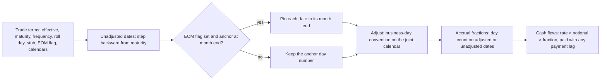

# Day Counts, Calendars and Schedules

## TL;DR

- A cash flow is an amount and a date: the date comes from a schedule generator, a business-day convention and a holiday calendar, the amount from a day count fraction applied to a rate.
- A rate is meaningless without its day count: 5% on 1mm over 182 days pays 25,277.78 USD on ACT/360 but 24,931.51 USD on ACT/365F; booking 5bn on ACT/360 instead of ACT/ACT ISDA misstates one coupon by 2,071,949 USD.
- The 30/360 family differs only in how it treats the 31st and the end of February: 28 Feb to 31 Aug 2025 is 183 days on 30/360 Bond Basis, 182 on 30E/360 and 180 on 30E/360 (ISDA) and on 30/360 US with the February rule.
- US Treasuries accrue ACT/ACT on the half-year (31 CFR Part 356 Appendix B); swaps generate schedules backward from maturity, so a short stub sits at the front; modified following stops a roll from crossing a month end.
- Compounded overnight rates add observation conventions: a 2-day lookback with and without observation shift weight the same fixings differently, 3.72 bp apart in the note's month-end example.

## Learning objectives

- Compute exact accrual fractions under ACT/360, ACT/365F, US 30/360 (Bond Basis), European 30E/360, and ACT/ACT (ISDA and ICMA).
- Formulate deterministic schedule generation algorithms incorporating stub conventions, end-of-month rules, and holiday calendars.
- Differentiate Following, Preceding, Modified Following, and Modified Preceding business-day conventions.
- Evaluate the monetary impact of leap-year splits on multi-year interest rate swap and bond cash flows.
- Contrast legacy term LIBOR single-period accruals with backward-looking compounded overnight SOFR schedules.
- Identify and mitigate the core operational pitfalls that trigger trade booking breaks across institutional trading systems.
- Compute US Treasury accrued interest from the Treasury's own rule and explain why it is not ACT/365.

## Core concepts

### 1. Day count fractions

A day count fraction $\tau(d_1, d_2)$ turns two dates into a year fraction, and simple interest is $N r \tau(d_1, d_2)$.
The definitions below are from the 2006 ISDA Definitions, Section 4.16, with ICMA Rule 251 for ACT/ACT (ICMA); the 2021 ISDA Interest Rate Derivatives Definitions consolidated the 2006 booklet and its 70-plus supplements (ISDA press release, 14 June 2021); the section numbers quoted here are the 2006 ones, so always check which edition a confirmation incorporates.

| Convention | Rule | Typical use |
| :--- | :--- | :--- |
| ACT/360 (4.16(e)) | actual days / 360 | USD and EUR money markets, SOFR and €STR OIS |
| ACT/365F (4.16(d)) | actual days / 365 | GBP money markets and SONIA OIS, JPY TONA OIS |
| ACT/ACT ISDA (4.16(b)) | days in a leap year / 366 plus days in other years / 365 | some swap legs |
| ACT/ACT ICMA (4.16(c), ICMA Rule 251) | days accrued / (frequency × days in the reference coupon period) | government bonds, US Treasuries, euro bonds |
| 30/360 Bond Basis (4.16(f)) | $D_1 = 31 \to 30$; $D_2 = 31 \to 30$ only if $D_1$ is now 30 | USD swap fixed legs (legacy), US corporates |
| 30/360 US (SIA/SIFMA) | Bond Basis plus: last day of Feb as $D_1$ becomes 30, and as $D_2$ too if $D_1$ was | US corporate and agency bonds |
| 30E/360 Eurobond Basis (4.16(g)) | any 31 becomes 30 | EUR fixed legs, eurobonds |
| 30E/360 (ISDA) (4.16(h)) | last day of any month becomes 30, except $D_2$ = last day of February at maturity | German-style EUR legs |

All 30/360 variants then use
$$\tau = \frac{360(Y_2 - Y_1) + 30(M_2 - M_1) + (D_2 - D_1)}{360}.$$
ACT/ACT ISDA splits a period at each 1 January; ACT/ACT ICMA instead divides by the length of the coupon period, so every full regular coupon period is exactly $1/f$ of a year whatever its length in days.
That is why a semiannual Treasury coupon is always exactly half the annual coupon, and why only partial periods (accrued interest, stubs) need the day count at all.

### 2. US Treasury accrued interest

The Treasury computes a daily interest decimal "based on the actual number of calendar days in the half-year" (31 CFR Part 356 Appendix B, Section I.A.2), with half-years of 181 to 184 days listed in its Table 1.
Accrued interest per 100 is therefore $\frac{c}{2} \times \frac{\text{days since last coupon}}{\text{days in the coupon half-year}}$: ACT/ACT on the coupon period, not ACT/365.

### 3. Holiday calendars and business-day conventions

A calendar marks business days: weekends plus the holidays of a financial centre (New York, London, TARGET2, Tokyo) or of a market (the US Government Securities calendar for SOFR fixings).
When an unadjusted date is not a business day:

| Convention | Rule |
| :--- | :--- |
| Following | next business day |
| Preceding | previous business day |
| Modified following | following, unless that crosses into the next month, then preceding |
| Modified preceding | preceding, unless that crosses into the previous month, then following |

Payment dates usually roll modified following; accrual dates either roll too (adjusted accrual, the swap default) or stay unadjusted (most bonds), and that choice changes every accrual fraction.
Joint calendars matter: a USD/GBP cross-currency swap pays only on days that are business days in both New York and London.
Calendars change at short notice: the Juneteenth federal holiday was signed into law on 17 June 2021 and observed the next day, when the Federal Reserve Board closed its offices but Federal Reserve Financial Services operated normally (Federal Reserve Board press release, 17 June 2021), so "is 18 June 2021 a holiday" depended on which calendar a system used.

### 4. Schedule generation, stubs and the end-of-month rule

A schedule generator takes effective date, maturity, frequency, roll convention, stub rule and calendar, and returns unadjusted dates, adjusted dates and accrual fractions.
Swaps conventionally generate backward from maturity, so any odd period (the stub) sits at the front; bonds and some loans generate forward from the first coupon.
A stub is short or long; front or back; four combinations in all.
The end-of-month rule: if the anchor date is the last day of its month, every generated date is pinned to the last day of its month before rolling, otherwise dates stay on the anchor's day number and drift away from month end once they pass through a short month.

### 5. Futures IMM dates and CDS roll dates

CME 3-month SOFR futures reference the quarter between IMM dates, the third Wednesday of March, June, September and December.
Standard CDS coupon dates are the 20th of those months, adjusted to a business day; the two are often both called "IMM dates", and confusing them is a classic booking error.

### 6. Compounded overnight rates: observation conventions

A term rate like LIBOR fixed once, at the start of a period, for the whole period.
A compounded RFR coupon is only known at the end, so contracts specify how far the observation window is pushed back to leave time to pay:

- Lookback without observation shift: each day of the accrual period uses the fixing from $p$ business days earlier, but the weight $n_i$ is the accrual-period day count.
- Observation shift: the whole window is shifted $p$ business days earlier and both fixings and weights come from that window.
- Lockout: the last few fixings of the period are frozen at an earlier value.
- Payment delay: the window is the accrual period itself, and payment is made a few days after period end (the USD OIS convention, see [Swaps and Curve Building](03-Swaps-and-Curve-Building.md)).

The NY Fed's SOFR Averages compound over calendar-day weights in the same way, published shortly after SOFR at about 8:00 a.m. ET (Federal Reserve Bank of New York, retrieved 2026-10-18).

## Worked examples

Rates and dates are hypothetical unless stated; every number below is computed, printed and asserted by [fi_day_counts.py](code/fi_day_counts.py).

### Example 1: one coupon period, four conventions

$1{,}000{,}000$ at $5\%$ from 15 Feb 2024 to 15 Aug 2024: 182 actual days, both dates in the leap year 2024.

| Convention | Fraction | Interest (USD) |
| :--- | ---: | ---: |
| ACT/360: $182/360$ | 0.505556 | 25,277.78 |
| ACT/365F: $182/365$ | 0.498630 | 24,931.51 |
| 30/360 Bond Basis: $180/360$ | 0.500000 | 25,000.00 |
| ACT/ACT ISDA: $182/366$ | 0.497268 | 24,863.39 |

ACT/ACT ICMA on a semiannual schedule gives exactly 0.500000, because this is a full regular period.
"The gap between the highest and lowest is $1{,}000{,}000 \times 0.05 \times (182/360 - 182/366) = 414.3898$ USD per million; on 5bn notional that is $5{,}000 \times 414.3898 = 2{,}071{,}949$ USD on a single coupon."

### Example 2: ACT/ACT ISDA across 1 January

1 Jul 2023 to 1 Jul 2024 is 366 days: 184 in 2023 and 182 in 2024.
$$\tau_{ISDA} = \frac{184}{365} + \frac{182}{366} = 0.504110 + 0.497268 = 1.001377, \qquad \tau_{365F} = \frac{366}{365} = 1.002740.$$
The gap is 0.001362 of a year (from unrounded terms), half a day of interest.
A day-by-day enumeration that adds $1/365$ or $1/366$ per calendar day gives the same fraction.

### Example 3: the 30/360 family on month-end dates

28 Feb 2025 (the last day of February) to 31 Aug 2025, 184 actual days:

| Convention | $(D_1, D_2)$ after adjustment | Days |
| :--- | :--- | ---: |
| 30/360 Bond Basis | (28, 31): $D_2$ stays 31 because $D_1 \ne 30$ | 183 |
| 30/360 US with February rule | (30, 30) | 180 |
| 30E/360 | (28, 30) | 182 |
| 30E/360 (ISDA), not at maturity | (30, 30) | 180 |
| ACT/ACT ICMA, semiannual | full period | 180 (in 360ths) |

31 Jan 2024 to 31 Mar 2024 is 60/360 on Bond Basis: $D_1 = 31 \to 30$, then $D_2 = 31 \to 30$.
Under 30E/360 (ISDA), 31 Aug 2025 to 28 Feb 2026 counts 180 days, but 178 when 28 Feb 2026 is the maturity date.

### Example 4: rolls and the end-of-month rule

Saturday 30 Nov 2024: following gives Monday 2 Dec, which is in December, so modified following gives Friday 29 Nov.
Saturday 31 May 2025 rolls modified following to Friday 30 May.
Sunday 1 Jun 2025: preceding gives Friday 30 May, which is in May, so modified preceding gives Monday 2 Jun.
Sunday 31 Aug 2025 with Monday 1 Sep (Labor Day) a holiday: following gives Tuesday 2 Sep, modified following gives Friday 29 Aug.
Six months after Friday 28 Feb 2025 is 28 Aug 2025 without the EOM rule (a business day, so it stays) and 31 Aug 2025 with it, which modified following rolls to 29 Aug: the schedule without EOM has left month end for good.

### Example 5: Treasury accrued interest

A 4% note with coupons on 15 Feb and 15 Aug 2026, settling 1 Apr 2026: the half-year has 181 days, matching Table 1 of 31 CFR Part 356 Appendix B (February to August, regular year), and 45 days have accrued.
$$AI = \frac{4}{2} \times \frac{45}{181} = 0.497238 \text{ per } 100.$$
ACT/365F would give 0.493151, a 0.0041 point error that shows up as a settlement break on every trade.

### Example 6: a backward schedule with a short front stub

Semiannual from 15 Jan 2026 to 15 Nov 2028, generated backward, weekends-only calendar: 6 periods; the first is a 120-day short stub to Friday 15 May 2026 (ACT/360 fraction 0.333333).
15 Nov 2026 is a Sunday and rolls to Monday 16 Nov; 15 May 2027 is a Saturday and rolls to Monday 17 May.
Generated forward instead, the regular dates run 15 Jul ... 15 Jul 2028 and the odd period becomes a 123-day back stub to maturity: same trade terms, different cash flows, a break if the two sides disagree.

### Example 7: lookback versus observation shift

Accrual period Monday 2 Nov to Monday 9 Nov 2026, 2-business-day convention, hypothetical SOFR fixings 4.30% (Thu 29 Oct), 4.45% (Fri 30 Oct, a month-end spike), 4.31%, 4.31%, 4.32% (2 to 4 Nov).
Lookback without shift: the Friday 6 Nov accrual day has weight 3 and uses the 4 Nov fixing, so the spike gets weight 1; compounded rate 4.33420%.
Observation shift: the window is Thursday 29 Oct to Thursday 5 Nov, so the Friday 30 Oct spike carries the weekend weight 3; compounded rate 4.37136%.
"Same fixings, same trade, 3.72 bp apart: the convention decides which day gets the weekend weight."

## Pitfalls

- Mixing ACT/360 and ACT/365F: ACT/360 interest is $365/360 - 1 = 1.39\%$ larger on the same rate.
- Dividing a multi-year period by one year length under ACT/ACT ISDA instead of splitting at 1 January.
- Treating ACT/ACT ICMA and ACT/ACT ISDA as the same convention: on a regular period ICMA gives exactly $1/f$, ISDA does not.
- Using the 30/360 Bond Basis rule where the bond is 30/360 US with the February end-of-month rule, or the reverse.
- Forgetting the EOM flag, so month-end schedules drift to the 28th after February.
- Adjusting accrual dates for a bond whose accruals are unadjusted, or not adjusting them for a swap whose are.
- Unversioned holiday calendars: a holiday added later silently changes historical schedules and valuations.
- Confusing futures IMM dates (third Wednesday) with CDS roll dates (the 20th).
- Treating a lookback without shift as an observation shift: the weights differ whenever a weekend or holiday falls differently in the two windows.

## Interview questions

> [!question]- fi-daycount-act360-vs-365 | What is the dollar interest difference on $1,000,000 at 5% over 182 days between ACT/360 and ACT/365F?
> $346.27$ USD.
> ACT/360 gives $1{,}000{,}000 \times 0.05 \times 182/360 = 25{,}277.78$ and ACT/365F gives $24{,}931.51$.
> In relative terms ACT/360 interest is $365/360 - 1 = 1.39\%$ larger.

> [!question]- fi-daycount-30360-rule | State the US 30/360 formula and calculate the accrual fraction from 31 January 2024 to 31 March 2024.
> $\tau = [360(Y_2 - Y_1) + 30(M_2 - M_1) + (D_2 - D_1)]/360$ with $D_1 = 31 \to 30$, then $D_2 = 31 \to 30$ if $D_1$ is 30.
> Here $D_1 = 30$, $D_2 = 30$, two months apart: $60/360 = 0.166667$.

> [!question]- fi-daycount-actact-split | How does ACT/ACT (ISDA) evaluate an accrual period spanning across a calendar year boundary?
> It splits the period at 1 January and divides the days in each year by that year's length (366 in a leap year, 365 otherwise).
> 1 Jul 2023 to 1 Jul 2024 gives $184/365 + 182/366 = 1.001377$, against $366/365 = 1.002740$ on ACT/365F.

> [!question]- fi-bdc-modified-following | What is the operational definition of the Modified Following business-day convention?
> Roll to the next business day unless that lands in the next calendar month, in which case roll to the previous business day.
> Saturday 30 Nov 2024 goes to Friday 29 Nov, not Monday 2 Dec.

> [!question]- fi-eom-rule | Why is the End-of-Month (EOM) convention necessary in schedule generation algorithms?
> Without it, a schedule anchored on a month end takes the day number of the anchor, so after a short month it sits on the 28th forever.
> With EOM, six months after 28 Feb 2025 is 31 Aug 2025 (rolled to Friday 29 Aug); without it, 28 Aug 2025.

> [!question]- fi-imm-dates | What are International Monetary Market (IMM) futures dates and what are the 2026 dates?
> The third Wednesday of March, June, September and December: 18 Mar, 17 Jun, 16 Sep and 16 Dec 2026.
> 3-month SOFR futures reference the quarter between consecutive IMM dates.

> [!question]- fi-stub-types | What is a stub period in an interest rate swap and what variants exist?
> An irregular first or last period, needed when the tenor is not a whole number of regular periods.
> Short or long, at the front or the back: four variants; backward generation from maturity (the swap default) puts the stub at the front.

> [!question]- fi-daycount-is-rate | Why must an interest rate quote always specify its underlying day-count convention?
> Because the cash flow is $N r \tau$, and $\tau$ for the same dates differs by convention: 182 days is 0.505556 on ACT/360 and 0.498630 on ACT/365F.
> The economic object is the pair (rate, convention), and converting between conventions changes the number.

> [!question]- fi-schedule-production-breaks | What are the primary causes of trade booking reconciliation breaks in production schedules?
> Different day counts or 30/360 variants, a missing EOM flag, forward versus backward generation (front versus back stub), adjusted versus unadjusted accruals, and different holiday calendar versions.
> For RFR legs add the observation convention (lookback, shift, lockout, payment delay).

> [!question]- fi-calendar-versioning | Why do enterprise trading platforms enforce immutable, versioned holiday calendars?
> Holidays are added at short notice (Juneteenth was signed into law on 17 June 2021 and observed on 18 June), so a calendar edited in place silently changes past schedules and reproductions of past valuations.
> Versioning by effective date lets a system rebuild any historical schedule exactly as it was booked.

> [!question]- fi-daycount-30-360-variants | Count the days from 28 Feb 2025 to 31 Aug 2025 under 30/360 Bond Basis, 30E/360 and 30E/360 (ISDA).
> $183$, $182$ and $180$.
> Bond Basis leaves $D_2 = 31$ because $D_1 = 28$; 30E/360 turns 31 into 30; 30E/360 (ISDA) also turns the last day of February into 30.

> [!question]- fi-actact-icma-treasury | Compute accrued interest per 100 on a 4% Treasury note, coupons 15 Feb and 15 Aug 2026, settling 1 Apr 2026.
> $0.497238$.
> 45 days accrued out of a 181-day half-year (31 CFR Part 356 Appendix B): $2 \times 45/181$.

> [!question]- fi-actact-isda-vs-icma | Why is a full semiannual coupon exactly half the annual coupon under ACT/ACT ICMA but not under ACT/ACT ISDA?
> ICMA divides the days accrued by frequency times the days in the reference period, so a full period is exactly $1/f$.
> ISDA divides by calendar-year length, so 15 Feb to 15 Aug 2024 is $182/366 = 0.497268$, not 0.5.

> [!question]- fi-schedule-backward-vs-forward | A semiannual swap runs from 15 Jan 2026 to 15 Nov 2028; where is the stub if you generate backward, and if forward?
> Backward: a 120-day short front stub to 15 May 2026.
> Forward: regular dates to 15 Jul 2028 and a 123-day short back stub to maturity.

> [!question]- fi-rfr-lookback-vs-shift | What is the difference between a lookback without observation shift and an observation shift for compounded SOFR?
> Without shift, each accrual day uses the fixing $p$ business days earlier but keeps the accrual-period weight; with shift, fixings and weights both come from the window moved $p$ business days earlier.
> In the note's example the month-end spike gets weight 1 versus 3, and the rates differ by 3.72 bp.

> [!question]- fi-cds-roll-dates | On what dates do standard CDS contracts pay coupons and roll, and how do they differ from futures IMM dates?
> The 20th of March, June, September and December, adjusted to a business day (20 Jun 2026, a Saturday, pays Monday 22 Jun).
> Futures IMM dates are the third Wednesday of the same months.

> [!question]- fi-bdc-modified-preceding | Sunday 1 June 2025 is a coupon date; where does it pay under preceding and under modified preceding?
> Preceding: Friday 30 May.
> Modified preceding: that crosses back into May, so it rolls forward to Monday 2 June.

> [!question]- fi-holiday-joint-calendar | Why does a cross-currency swap need a joint calendar, and what goes wrong without one?
> Each payment must settle in both currencies, so the payment date must be a business day in both centres.
> With one centre's calendar, a payment can land on the other centre's holiday and fail to settle, creating fails and late-payment claims.

## In this repo and SDE-Interview-Prep

- Code: [`code/fi_day_counts.py`](code/fi_day_counts.py) (day counts, calendars, schedules, Treasury accrual and RFR observation conventions).
- Related notes: [Discounting and Yield Curves](01-Discounting-and-Yield-Curves.md), [Swaps and Curve Building](03-Swaps-and-Curve-Building.md), [Money Markets, Repo and Overnight Rates](12-Money-Markets-Repo-and-Overnight-Rates.md).

## Further reading

- ISDA, *2006 ISDA Definitions*, Section 4.16 (Day Count Fraction); the subsection letters are cross-referenced in the OpenGamma Strata day count documentation, retrieved 2026-10-18.
- ISDA, "ISDA Publishes First Digital Definitions for Interest Rate Derivatives", press release, 14 June 2021.
- ICMA, Secondary Market Rules and Recommendations, Rule 251 (accrued interest calculation).
- 31 CFR Part 356, Appendix B, "Computation of Interest on Treasury Bonds and Notes" (eCFR).
- Federal Reserve Board, press release on Juneteenth operations, 17 June 2021.
- Federal Reserve Bank of New York, "Additional Information about Reference Rates Administered by the New York Fed", retrieved 2026-10-18.
- Bruce Tuckman and Angel Serrat, *Fixed Income Securities: Tools for Today's Markets*, 3rd edition (Wiley 2011).
- Luigi Ballabio, *Implementing QuantLib* (Leanpub), chapters on dates, calendars and schedules.
