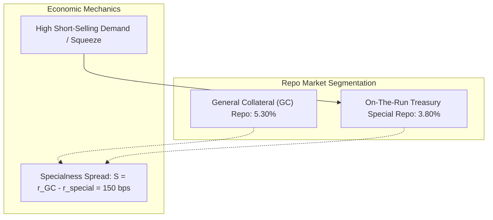

# Money Markets, Repo and Overnight Rates

## TL;DR

Repurchase agreements (repo) constitute the primary collateralized funding engine of the global financial system, providing liquidity where cash is exchanged for securities today and repurchased on a forward date at a negotiated rate.
Under USD standard conventions, repo interest accrues on an ACT/360 basis: pledging $\$100,000,000$ of Treasuries at a $2.0\%$ haircut for $7$ days at $5.30\%$ generates $\$98,000,000$ of cash and $\$100,994.44$ of interest.
The post-LIBOR benchmark regime centers on transaction-based overnight risk-free rates (SOFR in USD, SONIA in GBP, and €STR in EUR) compounded in arrears: $\frac{B}{\sum d_i} [\prod (1 + r_i d_i / B) - 1]$.
Securities in heavy borrowing demand trade "on special" below the general collateral (GC) repo rate, transferring economic rents to the collateral holder through reduced cash borrowing costs.
Legacy USD LIBOR contracts terminated on 30 June 2023, transitioning to compounded SOFR plus the permanent ISDA fallback spread of $0.26161\%$ ($26.161\text{ basis points}$).
All numerical models in this note are verified by [fi_money_markets.py](code/fi_money_markets.py).

## Learning objectives

- Calculate repo haircut cash, interest accrual, and termination settlement amounts.
- Derive the carry and roll-down of repo-financed bond inventory across discordant day-count conventions.
- Formulate the exact compounded-in-arrears overnight rate algorithm and contrast it with simple day-weighted averaging.
- Analyze the microeconomics of general collateral (GC) versus special repo rates and quantify collateralized funding advantages.
- Evaluate the institutional architecture of SOFR volume-weighted median transaction pools across tri-party, GCF, and bilateral DVP segments.
- Master ISDA IBOR fallback protocols, fixed spread adjustments, and backward-looking observation shift mechanics.

## Core concepts

### 1. Repurchase Agreements (Repo)

In a repurchase agreement (repo), a cash borrower sells eligible securities to a cash lender while simultaneously agreeing to repurchase the identical securities at a specified forward date $T$ at a predetermined price.
Economically, the transaction functions as a secured loan with bankruptcy-remote collateral:
- **Haircut ($h$):** To protect the cash lender against intra-period collateral price volatility and liquidation slippage, the cash lent is discounted by haircut $h \in [0, 1]$:
  $$\text{Cash Lent} = (1 - h) \times V_{\text{collateral}}$$
- **Repo Interest Accrual:**
  $$\text{Interest} = \text{Cash Lent} \times r_{\text{repo}} \times \frac{d}{360} \quad (\text{USD ACT/360})$$
- **Termination Cash Settlement:**
  $$\text{Repayment} = \text{Cash Lent} + \text{Interest}$$
- **Terminology:**
  The cash borrower executes a **repo** (sells collateral, receives cash).
  The cash lender executes a **reverse repo** (lends cash, receives collateral).

### 2. General Collateral (GC) versus Specials

- **General Collateral (GC):** The financing rate applied when the cash lender accepts any standard security within a broad asset basket (such as any US Treasury).
- **Special Repo:** When a specific security is in acute demand (often driven by market participants seeking to borrow the bond for short selling or relative-value delivery), its repo rate falls significantly below the GC rate.
- **The Specialness Spread:**
  $$S = r_{\text{GC}} - r_{\text{special}} > 0$$
- The borrower of the security (cash lender) accepts a depressed return on cash to secure the specific CUSIP.
- The holder of the security borrows cash at an exceptionally cheap rate $r_{\text{special}}$, pocketing an annualized funding subsidy equal to $S$.

### 3. Carry and Roll-Down of a Repo-Financed Bond

Holding a bond funded in repo generates carry governed by the mismatch between coupon income and financing expense:

$$\text{Carry} = \text{Coupon Accrual} - \text{Repo Financing Cost}$$

- For a Treasury bond paying coupon $c$ accrued on an ACT/365F basis and financed at repo rate $r_{\text{repo}}$ on an ACT/360 basis:
  $$\text{Net Carry per 100 Par} = 100 \times \left[ c \times \frac{d}{365} - r_{\text{repo}} \times \frac{d}{360} \right]$$
- **Positive Carry:** Occurs when coupon yield exceeds financing cost ($c > r_{\text{repo}}$).
- **Negative Carry (Negative Carry Trade):** When money market repo rates exceed bond yields (an inverted yield curve), the position bleeds cash each day.
- A long position in negative carry requires forward price appreciation or yield roll-down just to break even.

### 4. Overnight Rates: Compounding in Arrears vs. Simple Average

Post-2008 benchmark reform replaced forward-looking term interbank rates (LIBOR) with backward-looking overnight risk-free rates (RFRs):
- **SOFR (Secured Overnight Financing Rate):** Measures the cost of overnight borrowing collateralized by Treasuries.
- Published by the Federal Reserve Bank of New York at approximately 8:00 a.m. Eastern Time for the prior business day.
- Incorporates tri-party repo, FICC General Collateral Finance (GCF) repo, and FICC cleared bilateral Delivery-versus-Payment (DVP) repo.
- **Compounding in Arrears Formula:**
  $$R_{\text{comp}} = \frac{B}{\sum_{i=1}^n d_i} \left[ \prod_{i=1}^n \left(1 + \frac{r_i d_i}{B}\right) - 1 \right]$$
  where $r_i$ is the overnight fixing for business day $i$, $d_i$ is the number of calendar days the rate applies (typically $1$ for weekdays, $3$ over weekends), and $B$ is the year basis ($360$ for SOFR/€STR, $365$ for SONIA).
- **Simple Average Comparison:**
  $$\bar{r} = \frac{\sum_{i=1}^n r_i d_i}{\sum_{i=1}^n d_i}$$
- For positive fixings, compounding generally raises the annualized rate above the day-weighted simple average; with negative fixings, compounding can lower it, and mixed fixings make the difference depend on their levels and sequence.
- The spread between compounding and simple averaging expands with the square of the rate level ($O(r^2)$) and the tenor length.

### 5. LIBOR Cessation and ISDA IBOR Fallbacks

- **The Fallback Mechanism:**
  When USD LIBOR panel submissions ceased on 30 June 2023, legacy contracts fell back to:
  $$\text{Fallback Rate} = R_{\text{comp, SOFR}} + \text{Spread Adjustment}$$
- **The Fixed Spread Adjustment:**
  On 5 March 2021, the UK Financial Conduct Authority (FCA) announced the future cessation of all LIBOR settings.
  This announcement fixed the permanent ISDA fallback spreads, calculated as the five-year historical median spread between LIBOR and compounded RFRs.
- For 3-Month USD LIBOR, the permanent spread is **$0.26161\%$** ($26.161\text{ bps}$).

## Worked examples

### Example 1: Repurchase Agreement Haircut Cash and Interest

A prime broker finances $\$100,000,000$ market value of US Treasury collateral via a 7-day term repo at a rate of $r_{\text{repo}} = 5.30\%$ (ACT/360) subject to a $2.0\%$ haircut:
- **Cash Disbursed to Borrower:**
  $$\text{Cash Lent} = (1 - 0.02) \times \$100,000,000 = \$98,000,000.00$$
- **Repo Interest Accrued over 7 Days:**
  $$\text{Interest} = \$98,000,000 \times 0.0530 \times \frac{7}{360} = \$100,994.44$$
- **Total Repayment Amount at Maturity:**
  $$\text{Repayment} = \$98,000,000.00 + \$100,994.44 = \$98,100,994.44$$

The cash lender holds $\$100,000,000$ of collateral against a $\$98,000,000$ cash receivable, maintaining a $\$2,000,000$ equity cushion against collateral price depreciation.

### Example 2: Compounding in Arrears vs. Day-Weighted Simple Average

A 7-day SOFR accrual period features daily fixings:
- Monday: $5.00\%$ (applies for $d = 1$ day)
- Tuesday: $5.00\%$ (applies for $d = 1$ day)
- Wednesday: $5.00\%$ (applies for $d = 1$ day)
- Thursday: $5.10\%$ (applies for $d = 1$ day)
- Friday: $5.10\%$ (applies for $d = 3$ days over the weekend)
- Total calendar days: $1 + 1 + 1 + 1 + 3 = 7\text{ days}$.

#### 1. Day-Weighted Simple Average:
$$\bar{r} = \frac{1(0.050) + 1(0.050) + 1(0.050) + 1(0.051) + 3(0.051)}{7} = \frac{0.354}{7} = 5.0571\%$$

#### 2. Compounded Rate in Arrears (ACT/360):
$$\text{Growth} = \left(1 + \frac{0.050 \times 1}{360}\right)^3 \times \left(1 + \frac{0.051 \times 1}{360}\right) \times \left(1 + \frac{0.051 \times 3}{360}\right) = 1.000983688$$
$$R_{\text{comp}} = (1.000983688 - 1) \times \frac{360}{7} = 0.05058965 = 5.0590\%$$

#### 3. Compounding Differential:
$$\Delta = 5.0590\% - 5.0571\% = 0.0019\% = 0.18\text{ basis points}$$

Compounding adds $0.18\text{ bps}$ over just seven days at current rate levels, confirming why institutional valuation engines cannot substitute simple averages for true compounding.

### Example 3: Negative Carry on a Repo-Financed Bond Inventory

A proprietary desk purchases a $4.0\%$ annual-pay US Treasury bond trading at par ($100.00$) and finances the position in the overnight repo market at $5.0\%$ (ACT/360) over a $30$-day holding period:
- **Coupon Accrual (ACT/365F):**
  $$\text{Income} = 100.00 \times 0.040 \times \frac{30}{365} = 0.3288\text{ per } 100\text{ par}$$
- **Repo Financing Expense (ACT/360):**
  $$\text{Financing Cost} = 100.00 \times 0.050 \times \frac{30}{360} = 0.4167\text{ per } 100\text{ par}$$
- **Net Monthly Carry:**
  $$\text{Net Carry} = 0.3288 - 0.4167 = -0.0879\text{ per } 100\text{ par}$$
- Across a $\$100,000,000$ position:
  $$\text{Monthly Dollar Bleed} = 1,000,000 \times (-0.0879) = -\$87,900.00$$

To achieve economic break-even, the bond's clean market price must appreciate by at least $0.0879$ points over the month.

### Example 4: Specialness Valuation and Cash Savings

A dealer holds $\$100,000,000$ of an on-the-run 10-year Treasury bond that enters heavy short demand:
- General Collateral Repo Rate: $r_{\text{GC}} = 5.30\%$.
- Special Repo Rate for this CUSIP: $r_{\text{special}} = 3.80\%$.
- **Specialness Spread:**
  $$S = 5.30\% - 3.80\% = 1.50\% = 150\text{ basis points}$$
- **Monthly Financing Savings:**
  $$\text{Savings} = \$100,000,000 \times 0.0150 \times \frac{30}{360} = \$125,000.00$$

Holding the special collateral reduces the firm's monthly financing bill by $\$125,000.00$ relative to GC funding.

## Pitfalls

- **Applying ACT/360 Conventions to SONIA Contracts:** While SOFR and €STR accrue on an ACT/360 money market basis, UK SONIA strictly accrues on an ACT/365F basis.
- Mixing these conventions creates an immediate $1.39\%$ calculation error.
- **Treating Weekend Days as a Single Fixing:** Over a standard three-day weekend (Friday to Monday), Friday's rate applies for $3$ calendar days.
- Entering $d = 1$ understates weekend interest by two-thirds.
- **Ignoring Repo Haircuts in Carry Calculations:** Sizing cash borrowed equal to the gross market value of the bond ignores the haircut, underestimating the equity required to fund the position.
- **Conflating GC Funding with Specials:** Pricing relative-value bond positions assuming generic GC rates leads to incorrect PnL when funding on-the-run bonds trading on deep special.
- **Overlooking the ISDA Fallback Spread:** Valuing legacy converted LIBOR contracts solely on compounded SOFR without adding the $26.161\text{ bps}$ spread creates massive pricing reconciliations breaks against market quotes.

## Interview questions

> [!question]- fi-repo-interest | Calculate the repo interest on $98,000,000 cash at 5.30% for 7 days under ACT/360.
> Interest is calculated as $\$98,000,000 \times 0.0530 \times \frac{7}{360} = \$100,994.44$.
> Total cash returned at maturity is $\$98,100,994.44$.

> [!question]- fi-repo-haircut | Why do repo agreements require a collateral haircut and how is cash lent computed?
> Haircuts protect the cash lender against adverse price movements in the collateral between daily margin calls.
> For a $\$100,000,000$ bond subject to a $2.0\%$ haircut, cash lent is $(1 - 0.02) \times \$100,000,000 = \$98,000,000$.

> [!question]- fi-sofr-definition | What transactions comprise the Secured Overnight Financing Rate (SOFR)?
> SOFR is published by the NY Fed as a volume-weighted median of overnight Treasury-backed repo transactions.
> It aggregates three segments: tri-party repo, FICC General Collateral Finance (GCF) repo, and FICC cleared bilateral DVP repo.

> [!question]- fi-compound-arrears | What is the formula for compounding overnight rates in arrears and what does $d_i$ represent?
> The formula is $R_{\text{comp}} = \frac{B}{\sum d_i} \left[ \prod_{i=1}^n \left(1 + \frac{r_i d_i}{B}\right) - 1 \right]$.
> The variable $d_i$ is the number of calendar days rate $r_i$ applies (1 for weekdays, 3 over weekends).

> [!question]- fi-compound-vs-average | How does compounded SOFR compare with the simple day-weighted average of daily fixings?
> Compounding incorporates interest earned on prior accrued interest.
> For positive fixings the cross terms generally raise the annualized rate; negative or mixed fixings can make the compounded rate lower, depending on the rates and their sequence.
> At constant $5.0\%$ fixings, compounding adds roughly $0.18\text{ bps}$ over a week.

> [!question]- fi-gc-special | What does it mean for a bond to trade "on special" and who benefits economically?
> A bond trades special when heavy borrowing demand pushes its repo rate below the general collateral (GC) rate.
> The collateral holder benefits by borrowing cash at an exceptionally cheap rate, pocketing the specialness spread $S = r_{\text{GC}} - r_{\text{special}}$.

> [!question]- fi-negative-carry | What is negative carry on a bond position and what are its trading implications?
> Negative carry occurs when the coupon yield of a bond is lower than its repo financing rate.
> For a $4.0\%$ bond financed at $5.0\%$ repo, the position bleeds $-0.0879$ points per month, requiring price appreciation or roll-down to avoid losses.

> [!question]- fi-sonia-vs-sofr-basis | What day-count conventions govern SOFR and SONIA money market instruments?
> SOFR accrues on an ACT/360 basis.
> SONIA accrues on an ACT/365F basis.

> [!question]- fi-ibor-fallback-structure | What is the permanent ISDA fallback spread for 3-Month USD LIBOR?
> The permanent fallback spread is $0.26161\%$ ($26.161\text{ basis points}$).
> It is added to compounded SOFR in arrears to replace legacy 3-month USD LIBOR.

> [!question]- fi-libor-why-replaced | Why did global regulators mandate the replacement of LIBOR with overnight risk-free rates?
> LIBOR was an unsecured, panel-survey rate vulnerable to expert-judgment manipulation and underpinned by an increasingly illiquid interbank term market.
> Overnight RFRs are anchored in deep, observable, transaction-backed secured volumes exceeding one trillion dollars daily.

> [!question]- fi-repo-funding-risk | What is rollover risk when financing long bond positions via overnight repo?
> Financing a long bond with overnight repo subjects the desk to daily repricing and haircut volatility.
> A liquidity crunch or rate spike can increase financing costs or trigger forced collateral liquidation.

> [!question]- fi-forward-from-compounded | How do quantitative curve engines forecast forward compounded overnight rates from OIS curves?
> Over forward period $[T_1, T_2]$, the compounded growth factor equals the ratio of discount factors: $\frac{P(0, T_1)}{P(0, T_2)}$.
> The forward rate is $F(T_1, T_2) = \frac{B}{\sum d_i} \left[ \frac{P(0, T_1)}{P(0, T_2)} - 1 \right]$.

## Further reading

- Federal Reserve Bank of New York. *Secured Overnight Financing Rate Data and Methodology*. Federal Reserve Bank of New York, 2023.
- Alternative Reference Rates Committee. *ARRC Recommendations for Transition from USD LIBOR to SOFR*. Federal Reserve Bank of New York, 2021.
- International Swaps and Derivatives Association. *Amendments to the 2006 ISDA Definitions to Include New IBOR Fallbacks*. ISDA, 2020.
- Tuckman, Bruce and Serrat, Angel. *Fixed Income Securities: Tools for Today's Markets*. 3rd Edition, John Wiley & Sons, 2011.
- Duffie, Darrell. *Special Repo Rates*. The Journal of Finance, Vol. 51, No. 2, June 1996.
