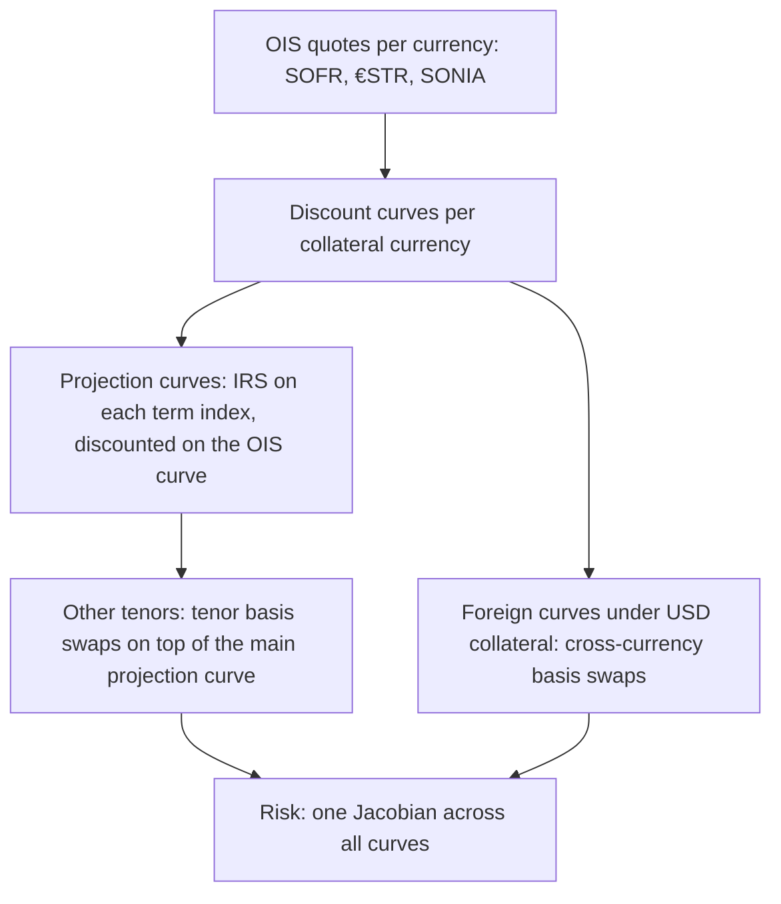

# Multi-Curve and CSA Discounting

## TL;DR

- A perfectly cash-collateralised derivative is discounted at the rate paid on the collateral (Piterbarg 2010); with no collateral it is discounted at the holder's funding rate, and partial collateral mixes the two.
- Discounting and forwarding are separate curves: the floating leg of a EURIBOR swap is projected on a EURIBOR curve and discounted on €STR; the leg no longer telescopes, so the par rate is $\sum \tau_i P_d(T_i) F_i / \sum \tau_j P_d(T_j)$.
- CCPs moved EUR discounting and price alignment from EONIA to €STR on 27 July 2020 and USD from EFFR to SOFR after the close on 16 October 2020; uncleared trades follow their CSA's collateral rate.
- Tenor and cross-currency bases are prices, not errors: a -25 bp EUR/USD basis moves the 1y forward by 27.39 pips against covered interest parity, and the basis can be read back from forwards.
- A CSA that lets the poster choose the collateral currency embeds an option: the effective discount rate is the maximum of the eligible rates, so collateral choice lowers the value of an asset by Jensen's inequality.

## Learning objectives

- Explain the theoretical derivation for OIS and collateral discounting formulated by Piterbarg (2010).
- Price interest rate swaps in a dual-curve framework where discounting and projection curves diverge.
- Value tenor basis swaps and explain why 3-month versus 6-month basis spreads widened historically.
- Derive the mark-to-market mechanics of cross-currency basis swaps and identify the structural causes of Covered Interest Parity violations.
- Price collateral currency choice as an embedded cheapest-to-deliver option in multi-currency CSAs.
- Establish the exact sequential bootstrapping hierarchy required across multi-curve pricing platforms.

## Core concepts

### 1. Why collateral sets the discount curve

Piterbarg (2010) replicates a derivative with the underlying financed in repo, the collateral $C$ earning the collateral rate $r_C$, and any remaining cash borrowed or lent unsecured at $r_F$, and obtains
$$V_t = \mathbb{E}_t\left[e^{-\int_t^T r_F(u)du}V_T\right] - \mathbb{E}_t\left[\int_t^T e^{-\int_t^u r_F(v)dv}\big(r_F(u) - r_C(u)\big)C(u)\,du\right].$$
With full cash collateral $C = V$ the value grows at $r_C$, so $V_t = \mathbb{E}_t[e^{-\int_t^T r_C}V_T]$: discount at the collateral rate.
With no collateral $C = 0$ it is discounted at the funding rate $r_F$, the starting point of funding valuation adjustments.
Standard CSAs and CCPs pay the overnight rate on cash collateral, so the OIS curve of the collateral currency is the discount curve for collateralised and cleared trades; the expectation is under the measure in which traded assets grow at their repo rates, not at a single "risk-free" rate.
The discount curve therefore follows the documentation: LCH replaced EONIA with €STR for price alignment interest and EUR discounting effective 27 July 2020 (LCH Circular 4102, 20 July 2020), with EONIA itself then defined as €STR plus 8.5 bp, and CME and LCH moved USD discounting and price alignment from EFFR to SOFR after the close on 16 October 2020 (ARRC letter, 4 September 2020).

### 2. Dual-curve swap valuation

For an index with a term (EURIBOR 3M or 6M, or historically LIBOR) the forward is read off its own projection curve:
$$F_i = \frac{1}{\tau_i}\left(\frac{P_p(0,T_{i-1})}{P_p(0,T_i)} - 1\right), \qquad PV_{float} = N\sum_i \tau_i P_d(0,T_i) F_i.$$
On one curve ($P_p = P_d$) each term is $P_d(T_{i-1}) - P_d(T_i)$ and the leg telescopes to $P_d(T_0) - P_d(T_n)$; with two curves it does not, and the par rate is
$$S = \frac{\sum_i \tau_i P_d(0,T_i) F_i}{\sum_j \tau_j P_d(0,T_j)},$$
a discount-weighted average of the projected forwards.
Changing the discount curve moves a par rate only through the weights, which is why the par rate barely changes while off-market PVs and risk move a lot.
An OIS itself is the exception: its compounded overnight leg is replicated by rolling a deposit, so on its own discount curve it telescopes exactly ([Swaps and Curve Building](03-Swaps-and-Curve-Building.md)).

### 3. Tenor basis

A tenor basis swap exchanges two floating legs of different tenors in one currency, the shorter leg typically paying a spread $\beta$:
$$\sum_i \tau^{(3)}_i P_d(T^{(3)}_i)\big(F^{(3)}_i + \beta\big) = \sum_j \tau^{(6)}_j P_d(T^{(6)}_j) F^{(6)}_j.$$
Lending unsecured for 6 months carries more bank credit and liquidity risk than lending for 3 months and rolling, so 6M term rates exceed compounded 3M rates and $\beta > 0$.
USD tenor basis on LIBOR disappeared with LIBOR; EURIBOR 3M versus 6M remains a live multi-curve market, alongside €STR discounting.

### 4. Cross-currency basis and covered interest parity

Covered interest parity says the forward is $F = S\frac{1 + r_d\tau}{1 + r_f\tau}$ (with $S$ in domestic per foreign); a cross-currency basis $\beta$ on the foreign leg replaces $r_f$ by $r_f + \beta$.
A cross-currency basis swap exchanges notionals at spot, pays floating in both currencies (USD SOFR flat against, for example, €STR plus $\beta$), and re-exchanges notionals at maturity; in the mark-to-market version the USD notional resets each period to current spot, with the difference paid, so FX exposure does not accumulate.
For EUR, JPY and other currencies against USD, $\beta$ has been persistently negative since 2008: swapping EUR into USD means receiving the EUR rate plus a negative spread, so synthetic dollars cost more than cash dollars.
Borio, McCauley, McGuire and Sushko (2016) attribute the basis to hedging demand for dollars meeting limits to arbitrage; Du, Tepper and Verdelhan (2018) document CIP deviations that are persistent, larger at quarter ends, and consistent with the balance-sheet costs that post-crisis regulation imposes on the banks that would arbitrage them.
Foreign-currency cash flows collateralised in USD are discounted on a curve built from cross-currency basis swaps, not on the foreign OIS curve.

### 5. Collateral choice

If the poster may deliver cash in any of several currencies, it delivers the one with the highest domestic-equivalent collateral rate $\tilde c_k(t)$ (the foreign OIS rate converted with the cross-currency basis), and the receiver's discount rate is $\max_k \tilde c_k(t)$:
$$P^{choice}(0,T) = \mathbb{E}\left[e^{-\int_0^T \max_k \tilde c_k(u)du}\right] \le \min_k P_k(0,T).$$
The inequality is Jensen's: the max of the rates is convex, so the option has value whenever the spreads are uncertain, even if each currency's forward curve is the same.
The option belongs to the poster and lowers the value of the receiver's asset.

### 6. Build order

Each layer depends on the ones above it, which is why curves are often bootstrapped in this order; production builds also solve all curves together with one Newton step over the full Jacobian, which gives the same answer when the dependency is triangular and handles circular dependencies when it is not ([Curve Construction Numerics](14-Curve-Construction-Numerics.md)).

## Worked examples

Quotes are hypothetical; every number is computed, printed and asserted by [fi_multi_curve_csa.py](code/fi_multi_curve_csa.py).

### Example 1: dual-curve versus single-curve par rate

OIS par quotes 3.00% (1y) and 3.50% (2y), annual: $P_d(1) = 1/1.03 = 0.970874$, $P_d(2) = (1 - 0.035 \times 0.970874)/1.035 = 0.933352$, annuity 1.904226; the 2y quote reprices to 3.5000% (the bootstrap acceptance test).
Projection curve with annual zero rates 3.20% and 3.70%, 20 bp over the OIS par quotes (the 2y OIS zero rate is 3.5088%): $P_p(1) = 0.968992$, $P_p(2) = 0.929913$, forwards 3.2000% and 4.2024%.
Floating leg $= 0.970874 \times 0.032 + 0.933352 \times 0.042024 = 0.031068 + 0.039223 = 0.070291$, par rate $0.070291/1.904226 = 3.6913\%$, 19.13 bp above the OIS rate; a bisection on the swap's NPV gives the same rate.
"Discounting the same projected flows on the projection curve gives 3.6909%: the projection curve sets the par rate, the discount curve only reweights it."

### Example 2: 3M versus 6M basis

OIS discounting at a flat 3% continuous rate: $P = 0.992528, 0.985112, 0.977751, 0.970446$ at 3, 6, 9, 12 months; quarterly annuity 0.981459.
3M forwards 3.20%, 3.30%, 3.40%, 3.50% give a 3M leg PV of 0.032870; 6M forwards 3.45% and 3.65% give 0.034704.
$\beta = (0.034704 - 0.032870)/0.981459 = 18.69$ bp on the 3M leg.
Two 3M periods compounded give 3.2632% as a 6-month rate, against 3.45% for the 6M forward: the basis is the price of that term premium.

### Example 3: reading the cross-currency basis from an FX forward

EUR/USD spot 1.1000, 1y (365 days, ACT/360) USD rate 5.00%, EUR rate 3.50%.
Covered interest parity gives $1.1 \times (1 + 0.05 \times 365/360)/(1 + 0.035 \times 365/360) = 1.116156$.
With a -25 bp basis on the EUR leg the forward is 1.118895, 27.39 pips higher; inverting the market forward by bisection returns -25.0 bp.
A borrower that funds EUR at the EUR rate and swaps into 100mm USD (90,909,090.91 EUR at spot) pays an all-in 5.25%: SOFR plus 25 bp.

### Example 4: the value of collateral choice

Currency 1 collateral earns a flat 4% over 5 years ($P = 0.818731$); currency 2's domestic-equivalent rate is 4% plus a spread drawn once from a normal distribution with mean -10 bp and standard deviation 30 bp (a hypothetical toy model).
With the choice, $P = e^{-0.2}\,\mathbb{E}[e^{-5\max(s,0)}] = 0.815635$ in closed form and about 0.81563 by Monte Carlo (seed 20261018, 400,000 draws).
The option costs the receiver 0.3096 per 100 received in 5 years, a running 7.58 bp, although at the mean spread currency 2 is never chosen: all of the value is optionality.

## Pitfalls

- Discounting uncollateralised trades at OIS: the funding rate and counterparty risk enter through FVA and CVA.
- Discounting a trade at a curve other than its CSA's collateral currency and rate.
- Ignoring the cross-currency basis when converting foreign cash flows or building FX forwards: tens of basis points a year.
- Assuming a par rate measures discounting: discount changes reweight par rates only slightly but change off-market PVs and risk.
- Treating sequential bootstrapping as the only correct method: global Newton solves give the same curves and handle circular dependencies.
- Ignoring MTM resets in a cross-currency swap, which overstates FX exposure and capital.
- Valuing a multi-currency CSA as if the collateral currency were fixed.

## Interview questions

> [!question]- fi-piterbarg-collateral-discount | Explain Piterbarg's (2010) core argument for why derivative cash flows must be discounted at the collateral rate.
> Replicating the derivative, the cash held as collateral earns (or costs) the collateral rate, and only the uncollateralised part is funded at the unsecured rate.
> With full cash collateral the replicating portfolio grows at the collateral rate, so $V_t = \mathbb{E}_t[e^{-\int r_C}V_T]$; with none it is discounted at the funding rate.

> [!question]- fi-dual-curve-par-swap-formula | Write the formula for the dual-curve par swap rate and identify why the floating leg fails to telescope.
> $S = \sum_i \tau_i P_d(T_i)F_i / \sum_j \tau_j P_d(T_j)$ with $F_i$ from the projection curve.
> $\tau_i P_d(T_i)F_i = P_d(T_i)[P_p(T_{i-1})/P_p(T_i) - 1]$, which equals $P_d(T_{i-1}) - P_d(T_i)$ only if the two curves coincide.

> [!question]- fi-tenor-basis-spread-causes | Why is the 6-month reference rate higher than compounded consecutive 3-month reference rates over the same half-year?
> Unsecured 6-month lending carries more bank credit and liquidity risk than 3-month lending that can be stopped at the roll.
> The difference is quoted as a tenor basis spread: 18.69 bp in the note's example.

> [!question]- fi-cip-failure-drivers | What economic factors explain the persistent breakdown of Covered Interest Parity since 2008?
> Persistent hedging demand for dollars meets limits to arbitrage.
> Du, Tepper and Verdelhan (2018) show deviations are larger at quarter ends, consistent with balance-sheet costs on the banks that would arbitrage them.

> [!question]- fi-cross-currency-basis-sign | If the 5-year EUR/USD cross-currency basis spread is $-25$ bps, what interest rate does a party borrowing USD against EUR collateral pay?
> It pays SOFR flat on the USD and receives the EUR rate minus 25 bp on its EUR.
> If it funds the EUR at the EUR rate, its all-in USD cost is SOFR plus 25 bp.

> [!question]- fi-cheapest-to-deliver-csa | How does an embedded collateral currency choice option affect the present value of a swap?
> The poster delivers the currency with the highest domestic-equivalent collateral rate, so the receiver discounts at the maximum of the rates.
> By Jensen's inequality that lowers the receiver's asset value even when expected rates are equal: 0.3096 per 100 over 5 years in the note's toy example.

> [!question]- fi-mtm-xccy-mechanism | What is a mark-to-market (MTM) cross-currency swap and why was it adopted?
> One leg's notional (the USD leg for EUR/USD) resets each period to current spot times the other notional, with the difference exchanged.
> FX moves are settled period by period rather than accumulating to maturity, cutting counterparty exposure and capital.

> [!question]- fi-dual-curve-spread-effect | If the forwarding zero rates sit 20 bps above the OIS par rates, how does the dual-curve par swap rate compare to the single-curve OIS swap rate?
> About 20 bp higher: 3.6913% against 3.5000% in the 2y example, 19.13 bp.
> The projected coupons are higher, so a higher fixed rate balances them; the discount curve only reweights.

> [!question]- fi-ois-discounting-numeraire | What is the change of numeraire associated with moving from unsecured Libor discounting to OIS discounting?
> From a bank account growing at the unsecured rate to one growing at the collateral (overnight) rate.
> Forwards remain martingales under their forward measures, now defined with OIS discount bonds as numeraires.

> [!question]- fi-curve-bootstrap-hierarchy | In what order must curves be bootstrapped in a modern multi-curve interest rate trading desk?
> $1$. OIS discount curves per collateral currency.
> $2$. Projection curves for each term index from its swaps, discounted on OIS, and other tenors via tenor basis.
> $3$. Foreign-currency curves under foreign collateral from cross-currency basis swaps; a simultaneous Newton solve gives the same result.

> [!question]- fi-ccp-discounting-switch | When did the main CCPs switch EUR and USD discounting, and to what?
> EUR: from EONIA to €STR on 27 July 2020 (LCH Circular 4102).
> USD: from EFFR to SOFR after the close on 16 October 2020.

> [!question]- fi-fx-forward-implied-basis | Spot EUR/USD is 1.1000, 1y rates are 5.00% USD and 3.50% EUR (ACT/360, 365 days), the forward is 1.118895. What basis is implied?
> $-25$ bp on the EUR leg.
> CIP alone gives 1.116156; solving $1.1(1 + 0.05\tau)/(1 + (0.035 + \beta)\tau) = 1.118895$ gives $\beta = -0.25\%$.

> [!question]- fi-uncollateralised-discounting | How should an uncollateralised swap with a corporate be discounted?
> At the bank's funding rate in Piterbarg's formula, in practice OIS discounting plus funding (FVA) and credit (CVA, DVA) adjustments.
> Discounting it at OIS alone overstates the value of an asset the bank must fund unsecured.

> [!question]- fi-par-rate-vs-pv-discounting | Why does switching from LIBOR to OIS discounting barely move par swap rates but move off-market swap values materially?
> The par rate is a discount-weighted average of forwards, so new weights barely change it (3.6913% versus 3.6909% in the note).
> An off-market swap's PV is $N(S - K)A$, and the annuity $A$ itself changes with the discount curve.

> [!question]- fi-collateral-choice-jensen | Why does the cheapest-to-deliver collateral option have value even when all currencies have the same expected rate?
> The discount rate is $\max_k \tilde c_k$, a convex function of the rates, so its expectation exceeds the max of expectations.
> Any uncertainty in the spreads gives the poster positive option value, as in the toy example where the option is never in the money at the mean spread.

## In this repo and SDE-Interview-Prep

- Code: [`code/fi_multi_curve_csa.py`](code/fi_multi_curve_csa.py) (dual-curve par rates, tenor basis, FX-forward basis, collateral choice).
- Related notes: [Swaps and Curve Building](03-Swaps-and-Curve-Building.md), [FX Markets and Interest Rate Parity](07-FX-Markets-and-Interest-Rate-Parity.md), [Curve Construction Numerics](14-Curve-Construction-Numerics.md).

## Further reading

- Vladimir Piterbarg, "Funding beyond discounting: collateral agreements and derivatives pricing", *Risk*, February 2010.
- Marco Bianchetti, "Two Curves, One Price", *Risk*, August 2010.
- Ferdinando Ametrano and Marco Bianchetti, "Everything You Always Wanted to Know About Multiple Interest Rate Curve Bootstrapping but Were Afraid to Ask", SSRN working paper, 2013.
- Claudio Borio, Robert McCauley, Patrick McGuire and Vladyslav Sushko, "Covered interest parity lost: understanding the cross-currency basis", *BIS Quarterly Review*, September 2016.
- Wenxin Du, Alexander Tepper and Adrien Verdelhan, "Deviations from Covered Interest Rate Parity", *Journal of Finance* 73(3), 2018.
- LCH, Circular 4102, "Euro Short Term Rate (€STR) rate change notice", 20 July 2020.
- Alternative Reference Rates Committee, letter on the SOFR discounting transition, 4 September 2020.
