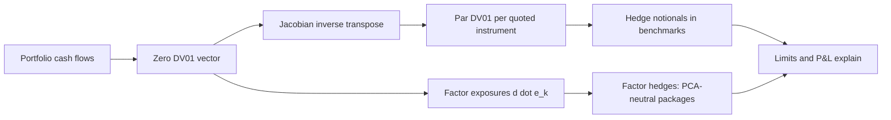

# Curve Risk and Hedging

## TL;DR

- One duration number assumes parallel moves; curve risk needs a vector: bucketed zero DV01s, key-rate durations, or par-quote DV01s, and they answer different questions.
- Zero DV01s are model coordinates; par DV01s are hedge tickets: a 3y par bond shows zero DV01s at 1y, 2y and 3y but par DV01 only at 3y (0.027925 per 100, which is $100A_3 \times 10^{-4}$, the 3y swap's DV01).
- Key-rate durations from triangular shifts add up to the parallel duration: 0.2597 + 0.7956 + 7.1809 = 8.2362 for a 10y par bond with keys at 2y, 5y and 10y.
- Curve trades are DV01-weighted: a 10,000 USD per bp 2s10s steepener makes about 100,000 USD on a 10 bp steepening and here carries +75,857 USD a year; whether a steepener carries depends on $(s - r)/A$ per leg, not on which fixed rate is higher.
- PCA on yield changes gives level, slope and curvature factors (Litterman and Scheinkman 1991); a PCA-weighted butterfly is neutral to the first two by construction, while a 50/50 fly is not.

## Learning objectives

- Distinguish between par sensitivities, zero sensitivities, and forward sensitivities, and convert between them using the Jacobian.
- Construct a key-rate duration profile for a bond or portfolio under triangular or localized bumps.
- Interpret the empirical findings of Litterman and Scheinkman (1991) and explain the economic drivers of Level, Slope, and Curvature.
- Construct duration-neutral and regression-weighted butterfly trades (e.g., 2s5s10s) and compute their carry and roll-down.
- Explain how leverage and collateral calls turned a jump in long gilt yields into a liquidity spiral during the 2022 UK gilt crisis.
- Build a PCA-neutral butterfly from a covariance matrix and quantify the residual risk.

## Core concepts

### 1. From one number to a risk vector

A book that is flat to a parallel shift ($\sum$ DV01 $= 0$) can still lose heavily on a steepening, a flattening or a twist.
Curve risk is reported as a vector of sensitivities, each to a chosen deformation of the curve; the choice of deformations is the choice of risk factors, and hedges are only as good as that choice.

| Measure | Bump | Use |
| :--- | :--- | :--- |
| Zero (bucketed) DV01 | one pillar zero rate, others fixed | model diagnostics, aggregation |
| Key-rate duration (Ho 1992) | triangular shift around a key tenor | bond portfolio risk |
| Par (quote) DV01 | one market quote, curve rebuilt | hedging with the quoted instruments |
| Forward DV01 | one forward period | forward-starting trades, futures strips |
| Factor exposure | PCA or other factor shape | macro hedges, relative value |

### 2. Key-rate durations

Ho (1992) shifts the spot curve by a triangle that is 1 at key tenor $T_k$ and falls linearly to 0 at the neighbouring keys (flat beyond the first and last key):
$$KRD_k = -\frac{1}{P}\frac{\partial P}{\partial \kappa_k}, \qquad \text{DV01}_k = -\frac{\partial P}{\partial \kappa_k} \times 10^{-4}.$$
Because the triangles sum to a parallel shift at every maturity, the key-rate durations sum to the parallel (effective) duration, to first order.

### 3. Zero risk versus par risk

Par risk is what you hedge: $\partial PV/\partial \mathbf{s} = J^{-T}\partial PV/\partial \mathbf{z}$ with $J = \partial\mathbf{s}/\partial\mathbf{z}$ ([Curve Construction Numerics](14-Curve-Construction-Numerics.md)), or equivalently bump each quote, rebuild, reprice.
The hedge in benchmark $i$ is $N_i = -v_{par,i}/h_i$ with $h_i = \partial V_i/\partial s_i$ per unit notional ($+A_i$ for a payer swap).
A yield DV01 (bumping the bond's own yield) is a third number again: it moves all of the bond's discount rates equally, which is neither a par-quote nor a zero bump.

### 4. Principal components

Litterman and Scheinkman (1991) found that three factors, which they called level, steepness and curvature, account for most of the variation in Treasury returns, with the level factor by far the largest.
PCA diagonalises the covariance matrix $C$ of yield changes: $C = \sum_k \lambda_k e_k e_k^\top$; $\lambda_k/\sum\lambda$ is the variance share of factor $k$.
A position with DV01 vector $d$ (receiver positive) loses $d \cdot \Delta y$, so its exposure to factor $k$ is $d \cdot e_k$, and it is neutral to factor $k$ when $d \cdot e_k = 0$.
The shares and loadings depend on the sample, the tenors and the period; estimate them over a window that includes both easing and tightening, and expect them to drift.

### 5. Curve trades

- Steepener: receive the short tenor, pay the long tenor, DV01-matched; gains when $s_{long} - s_{short}$ widens.
- Flattener: the reverse.
- Butterfly (2s5s10s): wings against the belly; weights decide what it is exposed to:

| Weighting | Wing DV01s per unit belly DV01 | Neutral to |
| :--- | :--- | :--- |
| 50/50 | 0.5 and 0.5 | parallel moves only |
| Regression | from regressing belly changes on wing changes | the historically typical wing co-movement |
| PCA | solve $d\cdot e_1 = d \cdot e_2 = 0$ | level and slope, by construction |

Carry matters: against a common floating rate $r$, a receiver earns $(s - r)$ per year on notional $N$, and its DV01 is $NA \times 10^{-4}$, so per unit of DV01 a receiver carries $(s - r)/A$.

### 6. Case: the 2022 gilt crisis

After the UK government's fiscal statement of 23 September 2022, long-dated gilt yields rose sharply.
Defined-benefit pension schemes using liability-driven investment (LDI) held leveraged gilt and swap positions that hedged the rate risk of their liabilities; on value the hedges worked, as liabilities fell with the assets.
The failure was liquidity: collateral and margin calls on the leveraged positions came faster than funds could raise cash, so they sold long gilts, pushing yields higher and triggering more calls.
The Bank of England announced temporary purchases of long-dated conventional gilts on 28 September 2022 to restore market functioning, extended them to index-linked gilts from 11 October, and ended them on 14 October 2022 (Bank of England Market Notice, 28 September 2022; *Financial Stability Report*, December 2022).
The risk lesson: a DV01-matched hedge still needs a liquidity buffer sized for a plausible jump in the hedged rates.

## Worked examples

Every number below is computed, printed and asserted by [fi_curve_risk.py](code/fi_curve_risk.py); curves are hypothetical, and the PCA covariance is a labelled hypothetical input.

### Example 1: zero DV01 versus par DV01 for a 3y par bond

Par curve 3.00%, 3.50%, 4.00%; continuous zeros 2.9559%, 3.4486%, 3.9482%; bond cash flows 4, 4, 104.
Zero DV01s per 100: 0.000388, 0.000747, 0.027715, summing to 0.028850.
Bumping each par quote by ±1 bp and rebuilding gives par DV01s 0.000000, 0.000000, 0.027925, and $100A_3 \times 10^{-4} = 0.027925$.
The bond's own yield DV01 is $100 \times (1 - 1.04^{-3})/0.04 \times 10^{-4} = 0.027751$ (for a par bond the modified duration equals the annuity factor at its yield), a third, different number.
Hedge: pay fixed on $0.027925/(2.792525 \times 10^{-4}) = 100$ notional of 3y swap per 100 face.

### Example 2: key-rate durations of a 10y bond

On the par curve 3.00, 3.50, 3.75, 3.90, 4.00, 4.10, 4.20, 4.30, 4.40, 4.50% (1y to 10y, annual), a 10y 4.5% annual bond prices at 100.0000.
Triangular key-rate shifts at 2y, 5y and 10y on the continuous zero curve give KRDs 0.2597, 0.7956 and 7.1809, summing to 8.2362, which equals the duration from a separate parallel shift.

### Example 3: a 2s10s steepener

Same curve: $A_2 = 1.9042$, $A_{10} = 8.0335$, so DV01 per 1mm is 190.42 and 803.35 USD.
For 10,000 USD per bp on each leg: pay fixed on 12.448mm 10y, receive fixed on 52.515mm 2y.
Shock the 2y quote down 5 bp and the 10y up 5 bp, rebuild, reprice: the receiver makes 50,024 USD and the payer 49,980 USD, total 100,004, against 100,000 from DV01s alone.
First-year carry with floating legs at 3.00%: $52.5148\text{mm} \times 0.50\% = 262{,}574$ USD on the receiver and $-12.4478\text{mm} \times 1.50\% = -186{,}717$ USD on the payer, net +75,857 USD.
"Per unit of DV01 the 2y receiver carries $(3.50\% - 3.00\%)/1.9042 = 0.26\%$, the 10y payer gives up $(4.50\% - 3.00\%)/8.0335 = 0.19\%$, so this steepener carries positively even though it pays the higher fixed rate."

### Example 4: a 50/50 butterfly

Pay fixed on 100mm 5y ($A_5 = 4.4775$): belly DV01 44,775.43 USD.
Each wing takes 22,387.71 USD: receive 117.569mm 2y and 27.868mm 10y.
On a 40,000 USD belly each wing would carry 20,000.

### Example 5: PCA and a PCA-neutral butterfly

Hypothetical daily yield-change covariance: volatilities 6.0, 7.0, 6.5 bp for 2y, 5y, 10y; correlations 0.90 (2y-5y), 0.75 (2y-10y), 0.93 (5y-10y).

| Factor | Variance share | 2y | 5y | 10y |
| :--- | ---: | ---: | ---: | ---: |
| PC1 level | 91.43% | 0.5104 | 0.6443 | 0.5695 |
| PC2 slope | 7.63% | -0.7509 | 0.0113 | 0.6603 |
| PC3 curvature | 0.94% | 0.4190 | -0.7647 | 0.4896 |

The eigenvalues match the roots of the characteristic polynomial and each pair satisfies $Cv = \lambda v$.
A 50/50 fly (receive 0.5 of 2y and 0.5 of 10y DV01, pay 1 of 5y) has exposures -0.1044 to level, -0.0566 to slope and 1.2190 to curvature.
Solving $d \cdot e_1 = d \cdot e_2 = 0$ with belly $-1$ gives wings 0.5479 (2y) and 0.6403 (10y): zero level and slope exposure, 1.3077 to curvature, and a net DV01 of +0.1882, so it is not DV01-neutral.
Daily P&L standard deviation per 1 USD of belly DV01 is 1.7529 USD for the 50/50 fly and 1.4290 for the PCA fly, all of which is curvature.

## Pitfalls

- Hedging long-dated risk with short-dated swaps on parallel DV01, leaving the book exposed to slope.
- Hedging with zero DV01s instead of par DV01s, or adding DV01s computed under different bump definitions.
- Assuming a DV01-neutral butterfly is curve-neutral: on the example covariance it still has level and slope exposure.
- Assuming a PCA-neutral butterfly is DV01-neutral: it is not, by design.
- Comparing fixed rates to judge carry instead of $(s - r)/A$ per leg.
- Estimating PCA on a short or one-regime window and treating loadings as constants.
- Matching DV01 without a liquidity plan for margin and collateral calls, as in 2022.

## Interview questions

> [!question]- fi-key-rate-duration-def | Define key-rate duration and explain how the sum of key-rate durations relates to aggregate effective duration.
> The percentage price sensitivity to a triangular shift of the spot curve centred on one key tenor and fading to zero at the neighbouring keys (Ho 1992).
> The triangles add up to a parallel shift, so the KRDs sum to the parallel duration: 8.2362 for the note's 10y bond.

> [!question]- fi-pca-three-factors | State the three principal components of yield curve movements identified by Litterman and Scheinkman (1991) and their variance contributions.
> Level, steepness (slope) and curvature, with level by far the largest.
> The shares depend on the sample and tenors; the note's hypothetical covariance gives 91.43%, 7.63% and 0.94%.

> [!question]- fi-par-vs-zero-dv01 | Why is par DV01 more practical for a trading desk than zero DV01?
> Each par DV01 is the sensitivity to a quote the desk can trade, so it maps one to one to a hedge notional.
> Zero DV01s are coordinates of the curve model: a 3y par bond shows zero risk at 1y and 2y that disappears in par terms.

> [!question]- fi-steepener-mechanics | What positions does a trader take to construct a 2s10s curve steepener?
> Receive fixed on the 2y and pay fixed on the 10y, DV01-matched.
> It gains when the 10y rate rises relative to the 2y: about 100,000 USD for 10 bp at 10,000 USD per bp a leg.

> [!question]- fi-butterfly-5050-weighting | In a 2s5s10s butterfly with $\$40{,}000$ DV01 on the 5-year belly, what DV01 is assigned to each wing under a 50/50 weighting?
> $20{,}000$ USD per bp on each wing.
> The package is neutral to parallel moves but not, in general, to slope.

> [!question]- fi-regression-butterfly-advantage | What advantage does a regression-weighted butterfly have over a 50/50 duration-neutral butterfly?
> Its wing weights reflect how the belly has actually co-moved with the wings, so typical level and slope moves cancel and the P&L is closer to pure curvature.
> A 50/50 fly can lose on a steepening alone; regression weights are only as stable as the regression.

> [!question]- fi-curve-trade-carry-cost | When does a DV01-neutral 2s10s steepener (receive 2y, pay 10y) carry negatively?
> When $(s_2 - r)/A_2 < (s_{10} - r)/A_{10}$: per unit of DV01 the receiver earns less than the payer gives up.
> On the note's curve it carries +75,857 USD a year, although it pays the higher fixed rate.

> [!question]- fi-ldi-crisis-collateral-spiral | Why did leveraged LDI hedges fail UK pension schemes during the 2022 gilt crisis even though they matched liability rate risk?
> The hedges worked on value; collateral calls on leveraged positions arrived faster than funds could raise cash.
> Forced gilt sales pushed yields up and triggered more calls until the Bank of England's temporary gilt purchases from 28 September to 14 October 2022.

> [!question]- fi-pca-belly-curvature | Why is the 5-year sector of the yield curve called the "belly" in curvature trades?
> It sits between the short wing (2y) and the long wing (10y), and the curvature factor moves it against both.
> In the note's PCA, PC3 loads -0.7647 on 5y against +0.4190 and +0.4896 on 2y and 10y.

> [!question]- fi-jacobian-hedge-solution | How do you calculate the exact notional of $K$ benchmark instruments required to immunize a portfolio against non-parallel curve shifts?
> Map zero risk to par risk, $\mathbf{v}_{par} = J^{-T}\mathbf{v}_{zero}$, then set $N_i = -v_{par,i}/h_i$ with $h_i$ the benchmark's own par sensitivity ($+A_i$ per unit notional for a payer).
> For the 3y par bond, $N_3 = 279.2525/2.792525 = 100$ notional of 3y payer per 100 face.

> [!question]- fi-pca-neutral-fly-weights | How do you weight a butterfly to be neutral to the first two principal components?
> Fix the belly DV01 at $-1$ and solve $d \cdot e_1 = 0$, $d \cdot e_2 = 0$ for the two wing DV01s.
> On the note's covariance the wings are 0.5479 (2y) and 0.6403 (10y), leaving only curvature exposure (1.3077) and a net DV01 of +0.1882.

> [!question]- fi-krd-sum-parallel | Why do key-rate durations sum to the parallel duration, and when does that fail?
> The triangular shifts sum to 1 at every maturity, so their sum is a parallel shift, and first derivatives add.
> It fails if the end keys are not extended flat, or for large shifts where second-order (convexity) terms matter.

> [!question]- fi-yield-dv01-vs-par-dv01 | A 3y 4% par bond has yield DV01 0.027751 and 3y par DV01 0.027925 per 100. Why do they differ?
> Yield DV01 shifts the bond's single flat yield; par DV01 shifts the 3y swap quote and rebuilds the curve, which reshapes the 3y discount factor only.
> They are different scenarios, so they give different numbers; hedging with swaps needs the par number.

> [!question]- fi-steepener-revaluation | Why does full revaluation of a DV01-matched steepener give slightly more than DV01 times the move?
> Convexity: the receiver gains on an annuity that grows as rates fall, the payer's annuity shrinks as rates rise, and the curve rebuild couples the legs.
> In the note's example 10 bp gives 100,004 USD against 100,000 from DV01s.

> [!question]- fi-pca-instability | What are the main risks of hedging with PCA factors?
> Loadings and variance shares are estimates that change with the sample and the regime, so yesterday's neutral fly can carry level or slope risk today.
> PCA also ignores carry, and a PCA-neutral fly is not DV01-neutral, so its parallel risk must be monitored separately.

## In this repo and SDE-Interview-Prep

- Code: [`code/fi_curve_risk.py`](code/fi_curve_risk.py) (zero versus par DV01, key rates, curve trades, PCA); [`code/curve_bootstrap.py`](code/curve_bootstrap.py) (`map_zero_risk_to_par_risk`).
- Related notes: [Curve Construction Numerics](14-Curve-Construction-Numerics.md), [Swaps and Curve Building](03-Swaps-and-Curve-Building.md), [Bonds, Duration and Convexity](02-Bonds-Duration-and-Convexity.md).
- System context: risk and P&L controls in the [front-to-back architecture](../18-Pricing-and-Risk-Systems/01-Front-to-Back-Architecture.md).

## Further reading

- Robert Litterman and José Scheinkman, "Common Factors Affecting Bond Returns", *Journal of Fixed Income* 1(1), 1991.
- Thomas S. Y. Ho, "Key Rate Durations: Measures of Interest Rate Risks", *Journal of Fixed Income* 2(2), 1992.
- Bruce Tuckman and Angel Serrat, *Fixed Income Securities: Tools for Today's Markets*, 3rd edition (Wiley 2011).
- Bank of England, Market Notice, "Gilt Market Operations", 28 September 2022.
- Bank of England, *Financial Stability Report*, December 2022.
