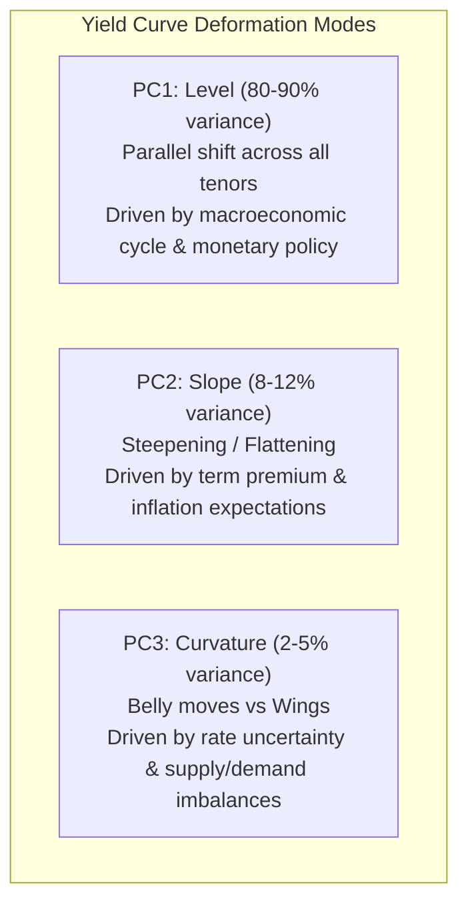

# Curve Risk and Hedging

> [!info] Draft
> Written in this session with computed examples matching `code/curve_bootstrap.py`.
> Missing for `solid`: formal independent reviewer check of all equations and parameter citations.

## TL;DR

- Parallel duration is insufficient for portfolio risk management because real yield curves do not shift purely in parallel.
- Key-rate duration (or bucketed DV01) measures price sensitivity to localized shifts at specific maturity pillars, holding all other pillars constant.
- Zero-rate sensitivities are mathematical artifacts of the curve model; the calibration Jacobian transforms them into actionable market quote sensitivities.
- Principal Component Analysis (PCA) decomposes yield curve variations into three orthogonal modes: Level ($80\text{--}90\%$), Slope ($8\text{--}12\%$), and Curvature ($2\text{--}5\%$).
- Curve trades (e.g., 2s10s steepeners and 2s5s10s butterflies) isolate specific shape deformations; butterflies can be weighted by duration-neutrality, cash-neutrality, or regression weights.

## Learning objectives

- Distinguish between par sensitivities, zero sensitivities, and forward sensitivities, and convert between them using the Jacobian.
- Construct a key-rate duration profile for a bond or portfolio under triangular or localized bumps.
- Interpret the empirical findings of Litterman and Scheinkman (1991) and explain the economic drivers of Level, Slope, and Curvature.
- Construct duration-neutral and regression-weighted butterfly trades (e.g., 2s5s10s) and compute their carry and roll-down.
- Explain how basis risk and curve twists caused severe losses during the 2022 UK Gilt crisis.

## Core concepts

### Limits of single-factor duration

Single-factor modified duration assumes that all interest rates along the curve shift simultaneously by the exact same amount $\Delta y$.
In reality, the yield curve experiences complex transformations: steepening, flattening, inversions, and localized kinks around economic events.
A portfolio that is duration-neutral ($\sum \text{DV01} = 0$) under parallel shifts remains violently exposed to curve slope changes and butterfly twists.
Comprehensive risk management requires decomposing curve risk into a vector of localized sensitivities.

### Key-rate duration and bucketed DV01

Introduced by Thomas Ho (1992), key-rate duration measures the price sensitivity of a security to a localized shift in the spot rate at a specific maturity pillar $T_k$, with zero shift at all other specified key rates:
$$\text{KRD}_k = -\frac{1}{P} \frac{\partial P}{\partial z(T_k)} \approx -\frac{1}{P} \frac{P\left(z(T_k) + \Delta z\right) - P\left(z(T_k) - \Delta z\right)}{2 \Delta z}.$$
Between key rates, the shock linearly decays to zero at adjacent pillars $T_{k-1}$ and $T_{k+1}$, forming a triangular perturbation.
The sum of all key-rate durations equals the aggregate effective duration under a parallel shift:
$$\sum_{k=1}^K \text{KRD}_k = D_{\text{eff}}.$$
In trading and risk systems, key-rate sensitivities are typically expressed in dollar terms as bucketed DV01:
$$\text{DV01}_k = -\frac{\partial P}{\partial z(T_k)} \times 10^{-4}.$$

### Par sensitivities versus zero sensitivities

When risk engines bump zero rates directly, the resulting zero DV01s do not correspond to instruments tradable on an exchange.
For example, bumping the 10-year zero rate by 1 bp requires an artificial shock that cannot be purchased directly in the cash market.
To obtain actionable hedges, the desk requires par sensitivities: the sensitivity of portfolio value to a 1 bp bump in the quoted par rate of liquid benchmark instruments (e.g., 2y, 5y, 10y swaps or Treasury benchmarks).
The calibration Jacobian matrix $J_{\mathbf{s}, \mathbf{z}} = \left[ \frac{\partial s_i}{\partial z_j} \right]$ maps par quotes to zero rates.
The vector of market par quote sensitivities $\frac{\partial PV}{\partial \mathbf{s}}$ is obtained by applying the inverse Jacobian:
$$\frac{\partial PV}{\partial \mathbf{s}} = \left( J_{\mathbf{s}, \mathbf{z}}^{-1} \right)^T \frac{\partial PV}{\partial \mathbf{z}}.$$
This transformation removes artificial contamination: as proven in Note 14, a liquid benchmark swap has non-zero sensitivities across multiple zero rates, but when transformed via the Jacobian, its par sensitivity is non-zero exclusively at its own maturity.

### Principal component analysis of curve movements

Litterman and Scheinkman (1991) performed PCA on empirical yield curve changes and established that over $98\%$ of all yield curve variance is explained by three orthogonal factors:

1. Level (PC1): All tenors move in the same direction with roughly equal magnitude. Factor loadings are nearly uniform across maturities. Explains $80\text{--}90\%$ of total curve variation.
2. Slope / Steepness (PC2): Short-end rates and long-end rates move in opposite directions, pivoting around the 3-year to 5-year sector. Explains $8\text{--}12\%$ of total variation.
3. Curvature / Twist (PC3): The belly of the curve (intermediate maturities, e.g., 5-year) moves in the opposite direction to both the short and long wings (e.g., 2-year and 10-year). Explains $2\text{--}5\%$ of total variation.

### Curve trades and butterfly construction

Traders exploit yield curve shape deformations through multi-leg relative value strategies:
- Curve steepener: Pay fixed on long tenor (e.g., 10y), receive fixed on short tenor (e.g., 2y). Gains when $s_{10} - s_2$ widens.
- Curve flattener: Receive fixed on long tenor, pay fixed on short tenor. Gains when $s_{10} - s_2$ narrows.
- Butterfly trade: Combines two wings ($T_1$ short, $T_3$ long) against the belly ($T_2$ intermediate), typically buying the wings and selling the belly (long butterfly) or vice versa.
Standard 2s5s10s butterfly weighting schemes:
1. Duration-neutral butterfly: Set weights $w_1, w_2, w_3$ such that total DV01 is zero ($w_1 \text{DV01}_1 + w_3 \text{DV01}_3 = w_2 \text{DV01}_2$) and the trade is neutral to parallel shifts.
2. 50/50 barbell weighting: Allocate half of the belly DV01 to each wing: $w_1 \text{DV01}_1 = 0.5 w_2 \text{DV01}_2$ and $w_3 \text{DV01}_3 = 0.5 w_2 \text{DV01}_2$.
3. Regression-weighted butterfly: Regress changes in the belly yield on changes in the wings: $\Delta y_2 = \beta_1 \Delta y_1 + \beta_3 \Delta y_3 + \epsilon$.
The weights are chosen to neutralize empirical slope shocks, insulating the trade from both Level and Slope and exposing it purely to Curvature.

### How it is implemented

- Inputs: portfolio cash flows, calibrated discount curve, calibration Jacobian matrix, historical curve covariance matrix.
- Outputs: bucketed zero DV01, bucketed par DV01, PCA factor exposures, optimal hedge notional in benchmark instruments.
- Algorithm: calculate cash-flow sensitivities to zero rates; apply inverse Jacobian to compute par sensitivities; solve linear equations for hedge notional.
- Complexity: $O(K^2)$ where $K$ is the number of benchmark curve pillars.
- Reference implementation: [`code/curve_bootstrap.py`](code/curve_bootstrap.py) provides `map_zero_risk_to_par_risk` and Jacobian inversion.
- System context: the risk engine (planned section 18) (planned section).

## Worked examples

All calculations below match the verified assertions in `code/curve_bootstrap.py`.

### Example 1: zero DV01 versus par DV01 on a 3-year par bond

Consider the 3-year annual par bond from Note 14 with coupon $4.00\%$ and face value $100$.
Zero rates at pillars $T = 1, 2, 3$: $z = [2.9559\%, 3.4486\%, 3.9482\%]$.
Discount factors: $P = [0.970874, 0.933352, 0.888299]$.
Cash flows: $CF = [4.0, 4.0, 104.0]$.

Zero-rate dollar sensitivities $\frac{\partial PV}{\partial z_k} = -k \cdot CF_k \cdot P_k$:
$$\text{Zero DV01}_1 = -\frac{\partial PV}{\partial z_1} \times 10^{-4} = 3.8835 \times 10^{-4} = 0.000388.$$
$$\text{Zero DV01}_2 = -\frac{\partial PV}{\partial z_2} \times 10^{-4} = 7.4668 \times 10^{-4} = 0.000747.$$
$$\text{Zero DV01}_3 = -\frac{\partial PV}{\partial z_3} \times 10^{-4} = 277.1493 \times 10^{-4} = 0.027715.$$
Sum of zero DV01s: $0.000388 + 0.000747 + 0.027715 = 0.028850$ per $100$ face.

Now apply the inverse Jacobian $J_{\mathbf{z}, \mathbf{s}}$ to compute market par quote sensitivities:
$$\frac{\partial PV}{\partial s} = \left( J_{\mathbf{s}, \mathbf{z}}^{-1} \right)^T \frac{\partial PV}{\partial z} = \begin{pmatrix} 0.0 \\ 0.0 \\ -279.2525 \end{pmatrix}.$$
$$\text{Par DV01}_1 = 0.000000.$$
$$\text{Par DV01}_2 = 0.000000.$$
$$\text{Par DV01}_3 = 279.2525 \times 10^{-4} = 0.027925.$$
Total par DV01 equals $0.027925$, matching the bond's modified duration times price times $10^{-4}$.
Notice the critical insight: reporting zero DV01s suggests the bond has exposure to the 1-year and 2-year rates; reporting par DV01s confirms that the benchmark par bond has zero exposure to the 1y and 2y market rates.

### Example 2: 2s10s curve steepener sizing

A hedge fund initiates a 2s10s steepener with $\$10{,}000$ DV01 on the 10-year leg.
Market parameters:
2-year swap par rate: $s_2 = 3.50\%$, Annuity $A_2 = 1.9042 \implies \text{DV01}_2 = \$190.42$ per million notional.
10-year swap par rate: $s_{10} = 4.50\%$, Annuity $A_{10} = 8.1109 \implies \text{DV01}_{10} = \$811.09$ per million notional.
To achieve $\$10{,}000$ DV01 on the 10-year leg:
$$N_{10} = \frac{\$10{,}000}{\$811.09 / \text{M}} = \$12.329\text{ million}.$$
The trader pays fixed on $\$12.329\text{M}$ of 10-year swaps.
To make the trade duration-neutral, the trader receives fixed on the 2-year swap with matching total DV01 of $\$10{,}000$:
$$N_2 = \frac{\$10{,}000}{\$190.42 / \text{M}} = \$52.515\text{ million}.$$
Net parallel DV01 of the package is $\$0$.
If the 2s10s curve steepens by $10\text{ bps}$ (e.g., 2-year yield drops 5 bps and 10-year yield rises 5 bps):
Gain on 2-year leg: $\$10{,}000 \times (+5\text{ bps}) = +\$50{,}000$.
Gain on 10-year leg: $\$10{,}000 \times (+5\text{ bps}) = +\$50{,}000$.
Total profit: $\$100{,}000$.

### Example 3: 2s5s10s duration-neutral butterfly weights

A desk constructs a long 2s5s10s butterfly: receive 2y wings, receive 10y wings, pay 5y belly.
Annuities:
$A_2 = 1.9042$, $A_5 = 4.4120$, $A_{10} = 8.1109$.
Assume belly notional $N_5 = \$100\text{ million}$ (payer).
Belly DV01:
$$\text{DV01}_5 = 100{,}000{,}000 \cdot 4.4120 \times 10^{-4} = \$44{,}120.$$
Under a 50/50 barbell allocation, each wing absorbs half of the belly DV01 ($\$22{,}060$):
2-year wing notional:
$$N_2 = \frac{\$22{,}060}{1.9042 \times 10^{-4}} = \$115.849\text{ million}.$$
10-year wing notional:
$$N_{10} = \frac{\$22{,}060}{8.1109 \times 10^{-4}} = \$27.198\text{ million}.$$
Check duration neutrality:
Total wing DV01: $115.849\text{M} \times 1.9042 \times 10^{-4} + 27.198\text{M} \times 8.1109 \times 10^{-4} = \$22{,}060 + \$22{,}060 = \$44{,}120$.
Belly DV01: $\$44{,}120$.
Net DV01 is exactly $\$0$.

### Example 4: real-world case, the September 2022 UK Gilt crisis and LDI margin spirals

In September 2022, following the UK government's "mini-budget" announcement of unfunded tax cuts, long-dated UK government bond yields experienced an unprecedented shock: the 30-year gilt yield surged by over $130\text{ basis points}$ in three days, while 2-year yields rose far less, causing extreme curve steepening and convexity losses (source: Bank of England, "Financial Stability Report: The Gilt Market Dysfunction of September-October 2022", December 2022).
UK defined-benefit pension funds operating Liability-Driven Investment (LDI) strategies held long receiver swaps and leveraged gilt positions designed to match long-term pension liabilities on a parallel duration basis.
Because their hedges were structured on parallel duration assumptions without sufficient collateral buffers for violent curve steepening and basis widening, the funds faced massive variation margin calls exceeding $£30\text{ billion}$.
To raise cash, the funds were forced into a self-reinforcing fire-sale of gilts, threatening systemic insolvency until the Bank of England intervened with a temporary $£65\text{ billion}$ emergency bond-buying facility.

## Pitfalls

- Hedging long-dated cash flows with 2-year swaps based on parallel DV01, leaving the book completely exposed to curve steepening and PCA slope shocks.
- Using zero-rate DV01s directly for trading hedges rather than converting to market par quote sensitivities via the Jacobian.
- Forgetting that butterfly weights depend on the choice of weighting scheme (50/50 DV01 vs regression-neutral), which determines whether the trade is exposed to slope residuals.
- Omitting carry and roll-down when analyzing curve trades: a steepener trade often carries negatively in an upward-sloping yield curve environment.
- Re-estimating PCA covariance matrices over short sample windows that omit major monetary tightening or easing cycles.

## Interview questions

> [!question]- fi-key-rate-duration-def | Define key-rate duration and explain how the sum of key-rate durations relates to aggregate effective duration.
> Key-rate duration measures percentage price change in response to a localized 1 bp shift at a specific curve pillar $T_k$, decaying to zero at adjacent pillars.
> The sum of all key-rate durations across the curve equals the aggregate effective duration under a parallel shift: $\sum \text{KRD}_k = D_{\text{eff}}$.

> [!question]- fi-pca-three-factors | State the three principal components of yield curve movements identified by Litterman and Scheinkman (1991) and their variance contributions.
> 1. Level (PC1): Parallel shift, explains $80\text{--}90\%$ of variance.
> 2. Slope (PC2): Steepening/flattening, explains $8\text{--}12\%$ of variance.
> 3. Curvature (PC3): Belly vs wings twist, explains $2\text{--}5\%$ of variance.

> [!question]- fi-par-vs-zero-dv01 | Why is par DV01 more practical for a trading desk than zero DV01?
> Zero DV01 measures sensitivity to non-tradable abstract zero-rate points.
> Par DV01 measures sensitivity to liquid benchmark market instruments (e.g., 2y, 5y, 10y swaps) that the desk can directly buy or sell to hedge.

> [!question]- fi-steepener-mechanics | What positions does a trader take to construct a 2s10s curve steepener?
> Pay fixed on the 10-year swap and receive fixed on the 2-year swap.
> As the 10-year rate rises relative to the 2-year rate, the payer swap gains more than the receiver swap loses.

> [!question]- fi-butterfly-5050-weighting | In a 2s5s10s butterfly with $\$40{,}000$ DV01 on the 5-year belly, what DV01 is assigned to each wing under a 50/50 weighting?
> Each wing is assigned $\$20{,}000$ of DV01 ($50\%$ of the belly DV01).
> Total wing DV01 equals $\$40{,}000$, neutralizing the package against parallel shifts.

> [!question]- fi-regression-butterfly-advantage | What advantage does a regression-weighted butterfly have over a 50/50 duration-neutral butterfly?
> A regression-weighted butterfly neutralizes exposure to empirical slope changes (PC2) as well as parallel shifts (PC1).
> It isolates pure curvature (PC3), whereas a 50/50 butterfly can suffer large losses if the curve steepens or flattens dramatically.

> [!question]- fi-curve-trade-carry-cost | Why do curve steepeners often suffer from negative carry in an upward-sloping yield curve?
> In an upward-sloping curve, the 10-year fixed rate paid exceeds the 2-year fixed rate received.
> In the absence of rate shifts, the position pays more interest than it receives each period, causing negative carry.

> [!question]- fi-ldi-crisis-duration-failure | Why did parallel duration hedges fail for UK pension funds during the 2022 Gilt crisis?
> The 30-year yield surged over 130 bps in days while short rates rose much less, producing catastrophic steepening.
> The funds were duration-neutral to parallel shifts but had massive slope and leverage exposure, triggering fatal variation margin calls.

> [!question]- fi-pca-belly-curvature | Why is the 5-year sector of the yield curve called the "belly" in curvature trades?
> It sits between the monetary-policy-anchored short end (2-year) and the pension/macro-anchored long end (10-year to 30-year).
> Shifts in rate volatility or term premia cause the 5-year rate to bow upward or sag downward relative to the wings.

> [!question]- fi-jacobian-hedge-solution | How do you calculate the exact notional of $K$ benchmark instruments required to immunize a portfolio against non-parallel curve shifts?
> Compute the portfolio's par sensitivity vector $\mathbf{v}_{\text{par}} = (J^T)^{-1} \mathbf{v}_{\text{zero}}$.
> The required hedge notional vector is $\mathbf{N}_{\text{hedge}} = -\mathbf{v}_{\text{par}} \oslash \mathbf{DV01}_{\text{benchmarks}}$.

## Further reading

- Litterman and Scheinkman, "Common Factors Affecting Bond Returns", *Journal of Fixed Income*, 1991.
- Ho, "Key Rate Durations: Measures of Interest Rate Risks", *Journal of Fixed Income*, 1992.
- Tuckman and Serrat, *Fixed Income Securities*, chapters 4 to 6.
- Bank of England, *Financial Stability Report*, December 2022 (Analysis of the LDI gilt crisis).

## In this repo and SDE-Interview-Prep

- Code: [`code/curve_bootstrap.py`](code/curve_bootstrap.py) (`map_zero_risk_to_par_risk`).
- Related notes: [Curve Construction Numerics](14-Curve-Construction-Numerics.md), [Swaps and Curve Building](03-Swaps-and-Curve-Building.md), [Bonds, Duration and Convexity](02-Bonds-Duration-and-Convexity.md).
