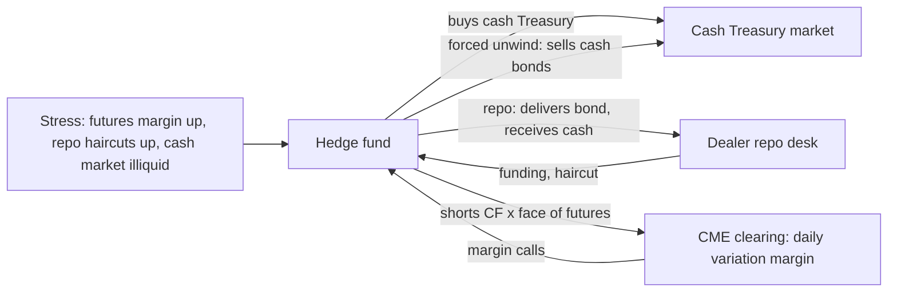

# Treasury Futures and the Basis

## TL;DR

- A Treasury future lets the short deliver any bond in a maturity basket; the invoice is $1000 \times F \times CF$ plus accrued interest per contract, where the conversion factor is the price of the bond at a 6% yield with its maturity rounded down (to the quarter for the 10-year, Ultra 10-year and bond contracts, to the month for the 2, 3 and 5-year), rounded to 4 decimals.
- The cheapest to deliver (CTD) minimises net basis $=$ gross basis $-$ carry, equivalently maximises the implied repo rate; below 6% yields it tends to be the shortest-duration bond, above 6% the longest (CME says the same in its 2022 filing).
- The futures price is about the CTD's forward price divided by its CF, less the value of the short's delivery options (quality, timing, end-of-month, wild card); that option value is the CTD's net basis.
- One contract moves about $1/CF$ times the CTD per unit face, so hedging $N$ face of the CTD takes $N \times CF$ of futures face: 89.37 contracts per 10mm in the note's example.
- The basis trade (long cash, short futures, financed in repo) is levered funding risk; it reached as much as half of hedge funds' Treasury positions before its March 2020 unwind (Barth and Kahn 2021).

## Learning objectives

- Identify CME Treasury futures contract specifications across the 2-year (TU), 5-year (FV), 10-year (TY), Ultra 10-year (TN), Treasury Bond (US), and Ultra Bond (UB) contracts.
- Calculate conversion factors using the CME formula and explain the mathematical rule determining which bond is cheapest to deliver.
- Compute gross basis, carry, net basis (basis net of carry), and the Implied Repo Rate (IRR).
- Describe the three delivery options: quality/switch option, timing option, and wild card option.
- Analyze the mechanics, leverage structure, and funding risk of the hedge fund basis trade during the March 2020 market dislocation.
- Size a futures hedge of a cash bond from its DV01 and conversion factor.

## Core concepts

### 1. Contracts and delivery baskets

Deliverable grades from the exchange's own documents (dated; grades change, so check the current CBOT rulebook):

| Contract (ticker, CME code) | Remaining term to maturity (as defined in each contract's rule) | Original term | Source |
| :--- | :--- | :--- | :--- |
| 2-Year (TU, ZT) | 1y9m to 2y0m | at most 5y3m | CME conversion factor brochure |
| 3-Year (3YR, Z3N) | 2y9m to 3y0m | at most 5y3m | CME conversion factor brochure |
| 5-Year (FV, ZF) | at least 4y2m | at most 5y3m | CME conversion factor brochure |
| 10-Year (TY, ZN) | 6y6m to 7y9m, rounded down to the quarter (from the September 2023 contract) | at most 10y | CBOT Submission 22-468, 6 Dec 2022 |
| Ultra 10-Year (TN) | at least 9y5m, rounded down to the quarter | at most 10y | CBOT Rule 26101.A as filed 22 Dec 2015 |
| Bond (US, ZB) | at least 15y | | CME conversion factor brochure |

The Ultra Bond (UB) and 20-year (TWE) contracts complete the curve.
Mechanics in CBOT Chapter 26 (Ultra 10-Year, as filed in 2015), which the other note and bond contracts mirror: face value 100,000 USD; no trading in the last 7 business days of the delivery month; delivery on any business day of the month; invoice amount $= 1000 \times P \times c$ (rounded to the cent) plus accrued interest, with $P$ the settlement price on the day the short gives notice of intention; notices are due by 6:00 p.m. Chicago time.

### 2. The conversion factor

CME's formula (brochure "Calculating U.S. Treasury Futures Conversion Factors"), with $n$ whole years and $z$ whole months from the first day of the delivery month to maturity ($z$ rounded down to the quarter for TY, TN, US, UB; to the month for TU, 3YR, FV), coupon $c$ rounded to the nearest 1/8%:
$$v = \begin{cases} z & z < 7 \\ 3 & z \ge 7 \text{ (quarter-rounded contracts)} \\ z - 6 & z \ge 7 \text{ (month-rounded contracts)}\end{cases}, \quad a = 1.03^{-v/6}, \quad b = \frac{c}{2}\cdot\frac{6 - v}{6},$$
$$c_n = \begin{cases}1.03^{-2n} & z < 7\\ 1.03^{-(2n+1)} & z \ge 7\end{cases}, \quad d = \frac{c}{0.06}(1 - c_n), \qquad CF = \text{round}_4\left(a\left[\frac{c}{2} + c_n + d\right] - b\right).$$
It is the clean price per 1 of par at a 6% semiannual yield: $a$ discounts to the first coupon $v$ months away, $c_n$ and $d$ are the principal and the remaining coupons, $b$ removes accrued interest.
Properties: $c = 6\% \Rightarrow CF = 1$; $c < 6\% \Rightarrow CF < 1$, falling with maturity; $c > 6\% \Rightarrow CF > 1$, rising with maturity.

### 3. Basis, carry, net basis and implied repo

With clean price $P$, dirty price $P^d = P + AI_0$, futures price $F$, repo rate $r$ (ACT/360) and $d$ days to delivery (no coupon in between):
$$\text{gross basis} = P - F \cdot CF, \qquad \text{carry} = (AI_d - AI_0) - P^d\, r\, \frac{d}{360},$$
$$\text{net basis} = \text{gross basis} - \text{carry} = P^d\left(1 + r\frac{d}{360}\right) - \big(F \cdot CF + AI_d\big), \qquad IRR = \frac{F\cdot CF + AI_d - P^d}{P^d}\cdot\frac{360}{d}.$$
Net basis is the repo-financed forward dirty price minus the invoice: what the long basis position (long bond, short $CF$ futures) gives up if it delivers.
The CTD is the bond with the smallest net basis, equivalently the largest IRR (they rank identically for a common repo rate); a negative CTD net basis, IRR above repo, would be a cash-and-carry arbitrage.
With a coupon before delivery, add the coupon (and its reinvestment) to the delivery-side cash flows.

### 4. Which bond is cheapest

The CTD minimises $P/CF$ (to first order, ignoring carry differences).
At a 6% flat yield every bond's $P/CF$ is 100 and nothing is cheapest; below 6%, long-duration bonds' prices rise further above their 6% factors, so the shortest-duration bond is cheapest; above 6% the longest-duration bond is.
CBOT's own filing for the 10-year contract says so: in an environment of yields above 6% the CTD tends toward the longest-duration security, and well below 6% futures track the shortest (CBOT Submission 22-468).
Yield-curve slope, specialness in repo and new issues also move the CTD, which is why the switch option has value.

### 5. Delivery options

The short chooses what and when to deliver, so the future trades below the CTD forward price divided by CF, by the value of these options:
1. Quality (switch) option: deliver whichever bond is cheapest at delivery, not the one that is cheapest today.
2. Timing option: deliver on any business day of the month; with positive carry the short waits, with negative carry it delivers early.
3. End-of-month option: trading stops 7 business days before month end, but delivery can continue; the price is fixed while the short still chooses the bond.
4. Wild card option: the invoice uses the day's settlement price, but notice can be given until 6:00 p.m. Chicago time, after the settlement price is set and while cash Treasuries still trade; if cash prices fall in that window, the short buys and delivers at the stale price (Burghardt et al. 2005).
The CTD's net basis is the market price of this bundle of options.

### 6. The basis trade

Long the cash CTD, short $CF$ futures per unit face, finance the bond in repo: it earns the net basis convergence plus carry and owns the delivery options, against repo and margin risk.
Because it needs little capital per unit of risk, it is run with leverage up to roughly one over the repo haircut, so its risk is funding: repo terms, futures margin and cash-market liquidity.
Barth and Kahn (2021) estimate from regulatory data that the trade grew after 2016 to as much as half of hedge funds' Treasury positions and about a quarter of dealers' repo lending.

## Worked examples

Bonds, yields, futures price and repo rate below are hypothetical; the conversion factor formula and contract grades are CME's.
Every number is computed, printed and asserted by [fi_treasury_futures.py](code/fi_treasury_futures.py).

### Example 1: conversion factors, checked against CME

The implementation reproduces all five worked examples in CME's brochure: 0.9229 (TU), 0.8747 (3YR), 0.8653 (FV), 0.8357 (TY) and 0.7943 (US).
For the TY example (3.75% of 15 Nov 2018, December 2008 delivery): from 1 Dec 2008 the maturity is 9y11m, rounded down to $n = 9$, $z = 9$, so $v = 3$; the unrounded factor is 0.835651 and CME publishes 0.8357.
Pricing the same bond cash flow by cash flow at 3% per half-year gives the same unrounded factor, and a 6% coupon gives exactly 1.0000.

### Example 2: a December 2026 10-year basket

Settle Thursday 1 Oct 2026, deliver Thursday 31 Dec 2026 (91 days), repo 4.00% ACT/360, three hypothetical deliverables with February/August coupons:

| | A: 4.000% 15 Aug 2033 | B: 4.500% 15 Feb 2034 | C: 3.750% 15 Aug 2034 |
| :--- | ---: | ---: | ---: |
| Yield (semiannual) | 4.05% | 4.12% | 4.15% |
| Conversion factor | 0.8937 | 0.9153 | 0.8657 |
| Clean price | 99.6989 | 102.3906 | 97.3334 |
| Accrued at settlement / delivery | 0.5109 / 1.5000 | 0.5747 / 1.6875 | 0.4789 / 1.4062 |
| Carry to delivery | -0.0241 | 0.0717 | -0.0617 |
| Gross basis | 0.0653 | 0.3490 | 0.8213 |
| Net basis | 0.0894 | 0.2773 | 0.8830 |
| Implied repo | 3.6472% | 2.9347% | 0.4286% |

The futures price is set at 111.484375 (111-15.5/32), 0.10 points below A's forward price divided by its CF and rounded down to 1/64.
A is the CTD by both tests (lowest net basis, highest IRR); its net basis divided by its CF is 0.1000 futures points, the option value built in,
 and its IRR is 35.28 bp below repo, so the cash-and-carry earns less than repo: you are paying for the short's options.
Invoice price for A is $111.484375 \times 0.8937 + 1.5000 = 101.1336$ per 100; per contract $1000 \times 111.484375 \times 0.8937$ rounded to the cent plus $1000 \times 1.5$ is 101,133.59 USD.
Each price re-solves to its input yield, which checks the price-yield code.

### Example 3: the 6% rule in numbers

Shift every yield by the same amount and compare $P/CF$ (lowest is cheapest).
At yields 200 bp lower: A 125.8124, B 126.9118, C 128.8307, so A, the shortest-duration bond, stays cheapest.
At yields 300 bp higher (about 7%): A 93.5485, B 93.0453, C 92.1721, so C, the longest-duration lowest-coupon bond, becomes cheapest.

### Example 4: hedging with futures

A's DV01 is 59.37 USD per bp per 100,000 face, so the futures DV01 per contract is about $59.37/0.8937 = 66.44$ USD.
Hedging 10mm face of A needs $100 \times 0.8937 = 89.37$ contracts: face times CF, not face divided by CF.

### Example 5: March 2020

In the March 2020 dash for cash, cash Treasuries cheapened against futures while repo and margin terms tightened and dealer balance sheets were constrained, so basis positions were unwound by selling cash bonds into a stressed market.
The FOMC announced purchases of at least 500 billion USD of Treasuries on 15 March 2020 and, on 23 March 2020, purchases "in the amounts needed to support smooth market functioning".
Barth and Kahn (2021) conclude the basis trade unwind was more a consequence of the market stress than its root cause, and that the Federal Reserve's intervention likely limited the damage.

## Pitfalls

- Using clean instead of dirty prices in carry and implied repo, or forgetting a coupon paid before delivery.
- Computing conversion factors with exact maturities or unrounded factors: CME rounds the maturity down (month or quarter by contract) and the factor to 4 decimals.
- Hedging a CTD with face divided by CF instead of face times CF, a factor of $1/CF^2$ wrong.
- Treating the CTD as fixed: yield level, curve shape, repo specialness and new issues switch it.
- Treating a positive CTD net basis as mispricing: it is the price of the delivery options.
- Running the basis trade on overnight repo and futures margin without a liquidity buffer.

## Interview questions

> [!question]- fi-cme-conversion-factor-concept | What is the purpose of the CME conversion factor in Treasury futures?
> It scales the futures price into an invoice price for each deliverable, as the clean price of 1 par at a 6% yield (maturity rounded down by CME's rule, factor rounded to 4 decimals).
> Invoice per contract $= 1000 \times F \times CF$ plus accrued interest, so bonds with different coupons and maturities are roughly comparable.

> [!question]- fi-cf-coupon-rule | If a bond's coupon is 4.00%, will its conversion factor be greater than, equal to, or less than 1.0? Explain why.
> Less than 1.0.
> At a 6% yield a 4% bond trades below par, and its factor falls further as maturity lengthens.

> [!question]- fi-implied-repo-rate-def | Define the Implied Repo Rate (IRR) of a deliverable Treasury bond.
> The return from buying the bond, shorting $CF$ futures per unit face and delivering: $IRR = \frac{F\cdot CF + AI_d - P^d}{P^d}\cdot\frac{360}{d}$ with no coupon before delivery.
> The CTD has the highest IRR, normally below repo because the short owns the delivery options (35.28 bp below in the note's example).

> [!question]- fi-ctd-selection-yield-rule | If prevailing Treasury yields are 3.00% (well below 6.00%), which bonds in the basket tend to be cheapest to deliver?
> The shortest-duration bonds.
> Below 6%, longer-duration bonds' prices rise further above their 6%-based factors, so their $P/CF$ is higher; CBOT's 2022 filing describes the same behaviour.

> [!question]- fi-gross-basis-vs-net-basis | What is the difference between gross basis and net basis?
> Gross basis is $P - F\cdot CF$; net basis subtracts carry to delivery (coupon accrual minus repo interest on the dirty price).
> The CTD's net basis is the value of the short's delivery options: 0.0894 for bond A in the note.

> [!question]- fi-futures-wild-card-option | Explain the wild card delivery option embedded in Treasury futures.
> The invoice uses the day's settlement price, but the short can give notice of intention until 6:00 p.m. Chicago time while cash bonds keep trading.
> If cash prices fall after the settlement, the short buys cheap bonds and delivers them at the already-fixed price.

> [!question]- fi-basis-trade-leverage-hazard | Why do cash-futures basis trades rely on high leverage and what makes this risky?
> The spread earned per unit of risk is small, so the trade is financed almost entirely in repo, with leverage up to about one over the haircut.
> Rising haircuts, repo rates or futures margin force unwinds into illiquid markets, as in March 2020.

> [!question]- fi-futures-hedge-ratio-cf | If you hold $\$10\text{M}$ of a cash bond with $\text{CF} = 0.85$, how many futures contracts (face value $\$100{,}000$) do you short to hedge?
> Face times CF: $100 \times CF$ contracts per 10mm, because one contract moves about $1/CF$ times the bond per unit face.
> In the note's example, CF 0.8937 gives 89.37 contracts; with CF 0.85 it would be 85.

> [!question]- fi-march-2020-basis-dislocation | What caused the Treasury basis trade to blow out in March 2020?
> In the dash for cash, cash Treasuries cheapened against futures while repo and margin terms tightened and dealer balance sheets were constrained, forcing unwinds that sold more cash bonds.
> Barth and Kahn (2021) find the unwind was more a consequence of the stress than its cause; the FOMC announced Treasury purchases on 15 March 2020 and made them open-ended on 23 March.

> [!question]- fi-ctd-switch-risk | What is switch risk for a trader running a cash-futures basis trade?
> The CTD can change when yields, curve shape or repo specialness move, so the futures start tracking another bond.
> In the note's basket, a 300 bp rise in yields switches the CTD from A to C.

> [!question]- fi-cf-formula-terms | In the CME conversion factor formula, what do $a$, $b$, $c$ and $d$ represent?
> $a$ discounts from the next coupon date (v months away) at 6%, $c$ is the discounted principal, $d$ the discounted remaining coupons, and $b$ the accrued interest removed to make it a clean price.
> For the TY example ($n = 9$, $z = 9$, $v = 3$) it gives 0.835651, published as 0.8357.

> [!question]- fi-fair-futures-price | How do you estimate the fair price of a Treasury future?
> CTD forward clean price divided by its conversion factor, minus the value of the delivery options: $F \approx [P^d(1 + rd/360) - AI_d]/CF - \text{options}$.
> Equivalently the CTD's net basis equals the option value; in the note the futures sits 0.10 points below A's forward over CF.

> [!question]- fi-end-of-month-option | What is the end-of-month option in Treasury futures?
> Trading stops 7 business days before month end, but deliveries continue to the last business day.
> The futures price is then fixed while the short still chooses which bond to deliver, so it can switch if relative prices move.

> [!question]- fi-negative-net-basis | What does a negative net basis on the CTD imply, and is it common?
> It means IRR above repo: buy the bond, finance it, short futures and deliver for a riskless profit, with the delivery options as a free bonus.
> Arbitrage keeps it rare; normally the CTD net basis is positive, the value of the options.

> [!question]- fi-futures-dv01 | How is the DV01 of a Treasury future related to its CTD?
> About $DV01_{CTD}/CF$ per contract, because the futures price moves like the CTD's forward price over its CF.
> For bond A, $59.37/0.8937 = 66.44$ USD per bp per contract; a CTD switch changes it.

## In this repo and SDE-Interview-Prep

- Code: [`code/fi_treasury_futures.py`](code/fi_treasury_futures.py) (CME conversion factors, basket basis, IRR, CTD, hedge).
- Related notes: [Bonds, Duration and Convexity](02-Bonds-Duration-and-Convexity.md), [Money Markets, Repo and Overnight Rates](12-Money-Markets-Repo-and-Overnight-Rates.md), [Curve Risk and Hedging](15-Curve-Risk-and-Hedging.md).
- System context: [pre-trade risk and limit checks](../18-Pricing-and-Risk-Systems/01-Front-to-Back-Architecture.md#front-office-execution-and-pricing).

## Further reading

- CME Group, "Calculating U.S. Treasury Futures Conversion Factors" (brochure IR232).
- CBOT, Submission 22-468 to the CFTC, amendments to Rule 19101.A (Contract Grade), 6 December 2022.
- CBOT, filing to the CFTC for the initial listing of Ultra 10-Year U.S. Treasury Note futures (Rulebook Chapter 26), 22 December 2015.
- Galen Burghardt, Terrence Belton, Morton Lane and John Papa, *The Treasury Bond Basis: An In-Depth Analysis for Hedgers, Speculators, and Arbitrageurs*, 3rd edition (McGraw-Hill 2005).
- Daniel Barth and R. Jay Kahn, "Hedge Funds and the Treasury Cash-Futures Disconnect", OFR Working Paper 21-01, April 2021.
- Federal Open Market Committee, statements of 15 March 2020 and 23 March 2020.
- Bruce Tuckman and Angel Serrat, *Fixed Income Securities: Tools for Today's Markets*, 3rd edition (Wiley 2011).
