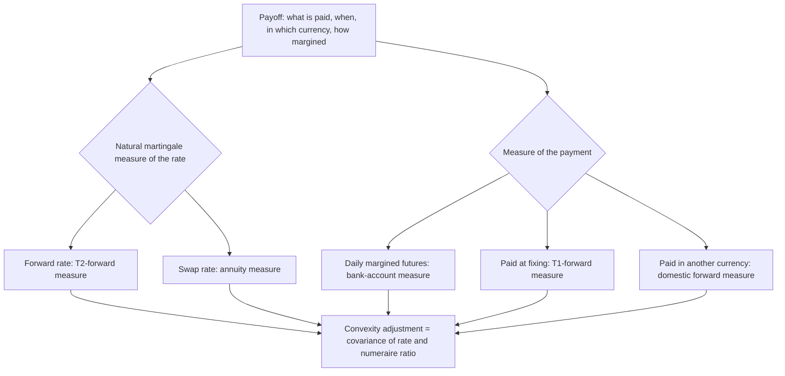

# Convexity Adjustments

## TL;DR

- A convexity adjustment is the gap between a rate's expectation under the measure its payoff is paid in and its forward under its own martingale measure; it appears whenever timing, margining or currency of payment differs from the rate's natural one.
- Futures rates exceed forward rates because the short futures position (which gains when rates rise) reinvests its gains at higher rates: Ho-Lee gives $\tfrac12\sigma^2T_1T_2$, 18.9 bp for a 5y-expiry 3-month rate at 1.2% normal short-rate volatility, and Hull-White with $a = 0.03$ gives 16.2 bp (confirmed by integrating the HJM drift directly).
- CMS pays a swap rate on a single date, so the annuity measure must be changed to a zero-coupon measure; the annuity falls as rates rise, the adjustment is positive, 15.93 bp to first order and 18.18 bp under a full lognormal model for a 10y rate fixing in 5y at 20% vol.
- CMS is priced by static replication with swaptions across all strikes (Hagan 2003, Carr-Madan); truncating strikes to within 100 bp of the forward cuts the adjustment to 9.84 bp in the example.
- In-arrears fixings and quanto payoffs are the same mechanism: $\tau\,\mathrm{Var}(L)/(1 + \tau L_0)$ for in-arrears, $S_0(e^{-\rho\sigma_S\sigma_X T} - 1)$ for a quanto rate.

## Learning objectives

- Explain the change-of-numeraire mechanism that generates convexity adjustments via Radon-Nikodym derivatives.
- Derive the Ho-Lee / Hull-White convexity adjustment between interest rate futures and forward rate agreements (FRAs).
- Formulate the CMS convexity adjustment via annuity duration approximations and Carr-Madan static swaption replication.
- Calculate the in-arrears rate adjustment for floating rates paid at non-standard settlement dates.
- Evaluate the quanto adjustment for domestic payoffs linked to foreign interest rates.
- Identify how improper convexity handling distorts curve bootstrapping and relative value trading.

## Core concepts

### 1. One mechanism: change of numeraire

If $X$ is a martingale under the measure $\mathbb{Q}^N$ of numeraire $N$, its expectation under the measure $\mathbb{Q}^M$ of numeraire $M$ is, by the abstract Bayes formula with density $\frac{d\mathbb{Q}^M}{d\mathbb{Q}^N}\big|_T = \frac{M(T)/M(0)}{N(T)/N(0)}$,
$$\mathbb{E}^M[X(T)] = \frac{\mathbb{E}^N[X(T)\,M(T)/N(T)]}{\mathbb{E}^N[M(T)/N(T)]} = X(0) + \frac{\mathrm{Cov}^N\big(X(T), M(T)/N(T)\big)}{\mathbb{E}^N[M(T)/N(T)]}.$$
The convexity adjustment is the covariance term: nonzero exactly when the numeraire ratio is correlated with the rate.

### 2. Futures versus forwards

An FRA paying at $T_2$ has the forward rate as a martingale under the $T_2$-forward measure; a future is marked to market daily, so its rate is an expectation under the risk-neutral (bank-account) measure.
The sign, said correctly: a future's price is $100$ minus the rate, so the short gains when rates rise; rates rising means its gains are reinvested at higher rates, and its losses come when rates fall and are financed cheaply.
That makes the short futures position better than the short FRA, so in equilibrium the futures rate is above the forward rate.
In the HJM framework with instantaneous forward volatility $\sigma_f(t,T)$, the risk-neutral drift of $f(t,T)$ is $\sigma_f(t,T)\int_t^T\sigma_f(t,s)ds$, so for a futures on the continuously compounded rate $R = \frac{1}{\tau}\int_{T_1}^{T_2}f(T_1,s)ds$ (continuous marking),
$$R_{fut} - R_{fwd} = \frac{1}{\tau}\int_{T_1}^{T_2}\int_0^{T_1}\sigma_f(u,s)\int_u^s\sigma_f(u,v)\,dv\,du\,ds.$$
With Hull-White volatility $\sigma_f(u,s) = \sigma e^{-a(s-u)}$ this integrates to Hull's closed form (Technical Note 1 of *Options, Futures, and Other Derivatives*),
$$R_{fut} - R_{fwd} = \frac{B(T_1,T_2)}{T_2 - T_1}\Big[B(T_1,T_2)\big(1 - e^{-2aT_1}\big) + 2aB(0,T_1)^2\Big]\frac{\sigma^2}{4a}, \qquad B(t,T) = \frac{1 - e^{-a(T-t)}}{a},$$
which tends to the Ho-Lee value $\tfrac12\sigma^2T_1T_2$ as $a \to 0$.
The adjustment grows roughly with the square of expiry, so it matters from about two years out; mean reversion reduces it.
CME's 3-month SOFR futures settle on SOFR compounded over the reference quarter, which adds an averaging effect on top of the margining effect; Mercurio (2018) gives a model for it.

### 3. CMS

A CMS coupon pays the swap rate $S(T_1)$ at (or near) $T_1$.
$S$ is a martingale under the annuity measure (numeraire $A(t) = \sum_i\tau_iP(t,T_i)$), but the payoff is valued under the $T_p$-forward measure, so with $G(S) = P(T_1,T_p)/A(T_1)$ written as a function of $S$ (a "swap-rate annuity mapping", for example the flat-yield annuity):
$$\mathbb{E}^{T_p}[S(T_1)] = \frac{\mathbb{E}^A[S\,G(S)]}{\mathbb{E}^A[G(S)]}.$$
As rates rise the annuity shrinks, $G$ rises, and the covariance is positive.
Expanding $G$ to first order around $S_0$ and using $\mathrm{Var}^A(S) \approx S_0^2\sigma^2T_1$ (lognormal) gives the linear approximation, for payment at the fixing date:
$$\text{Adj}_{CMS} \approx S_0^2\sigma^2T_1\left(-\frac{A'(S_0)}{A(S_0)}\right).$$
A payment delay ($T_p > T_1$) puts a factor $P(T_1,T_p)$ in $G$ that falls as rates rise and partly offsets the adjustment.

### 4. Static replication

Any smooth payoff of $S(T_1)$ can be written with the Carr-Madan identity as its value at $S_0$, a linear term, and a strip of puts below and calls above $S_0$ weighted by its second derivative; under the annuity measure those puts and calls are receiver and payer swaptions divided by $A(0)$.
Applied to $h(S) = S\,G(S)$ and to $G(S)$ (Hagan 2003),
$$\mathbb{E}^A[h(S)] = h(S_0) + \int_0^{S_0}h''(K)\,\frac{\text{Rec}(K)}{A(0)}dK + \int_{S_0}^{\infty}h''(K)\,\frac{\text{Pay}(K)}{A(0)}dK,$$
so the CMS rate is priced off the whole swaption smile; the far strikes matter because $h''$ does not vanish there, and the smile's wings set the answer.

### 5. In-arrears fixings

A rate $L$ for $[T_1, T_2]$ normally pays at $T_2$ and is a $T_2$-forward martingale; paid at $T_1$ instead, the numeraire ratio is $P(T_1,T_1)/P(T_1,T_2) = 1 + \tau L(T_1)$, and
$$\mathbb{E}^{T_1}[L(T_1)] = \frac{\mathbb{E}^{T_2}[L(1 + \tau L)]}{1 + \tau L_0} = L_0 + \frac{\tau\,\mathrm{Var}^{T_2}(L(T_1))}{1 + \tau L_0},$$
exact given the variance; lognormal gives $\mathrm{Var} = L_0^2(e^{\sigma^2T_1} - 1)$.
The adjustment is always positive.

### 6. Quanto

A foreign rate $S_f$ paid in domestic currency at a fixed conversion: with $X$ the FX rate in domestic per foreign and $Y = 1/X$, the density from the foreign to the domestic $T$-forward measure is $\frac{d\mathbb{Q}^{d,T}}{d\mathbb{Q}^{f,T}} = \frac{Y_T}{Y_{fwd}(0)}$ (the domestic zero bond in foreign units over the foreign numeraire).
With lognormal $S_f$ and $X$ of volatilities $\sigma_S$, $\sigma_X$ and correlation $\rho$, the domestic drift of $S_f$ gains $-\rho\sigma_S\sigma_X$, so
$$\mathbb{E}^{d}[S_f(T)] = S_f(0)e^{-\rho\sigma_S\sigma_XT}, \qquad \text{Adj}_{quanto} = S_f(0)\big(e^{-\rho\sigma_S\sigma_XT} - 1\big) \approx -\rho\sigma_S\sigma_XS_f(0)T.$$
With $\rho > 0$, high foreign rates come with a strong foreign currency, which is low $Y$; the density $Y_T/Y_{fwd}(0)$ down-weights those states, so the expected rate in domestic terms falls.

## Worked examples

Inputs are hypothetical; every number is computed, printed and asserted by [fi_convexity.py](code/fi_convexity.py).

### Example 1: futures convexity

A 3-month rate, $T_1 = 2$, $T_2 = 2.25$, short-rate volatility 1.2% (Ho-Lee): $\tfrac12 \times 0.012^2 \times 2 \times 2.25 = 3.24$ bp, so a 4.5000% futures rate implies a 4.4676% forward.
At $T_1 = 5$: Ho-Lee 18.9 bp, Hull-White with $a = 0.03$ 16.2 bp (16.2355 to four decimals, the same from the closed form and from numerically integrating the HJM drift).
At $T_1 = 10$: Ho-Lee 73.80 bp against Hull-White 54.88 bp; at $T_1 = 1$ Hull-White gives 0.87 bp.
"Below two years it is a rounding error, at ten years it is half a percent, and the model's mean reversion is a first-order input."

### Example 2: CMS, linear approximation versus the full model

10y annual swap rate fixing and paid in 5 years, forward 4%, lognormal volatility 20%.
$A(4\%) = (1 - 1.04^{-10})/0.04 = (1 - 0.675564)/0.04 = 8.110896$, $A'(4\%) = -\sum_i i\,1.04^{-(i+1)} = -40.37716$, so $-A'/A = 4.97814$.
Linear: $0.04^2 \times 0.2^2 \times 5 \times 4.97814 = 0.000320 \times 4.97814 = 15.93$ bp, an expected fixing of 4.1593%.
The same model priced fully, by replicating $S\,G(S)$ and $G(S)$ with Black swaptions across strikes, gives 18.18 bp, and integrating directly against the lognormal density gives the same 18.18 bp: the linear formula is 2.25 bp short.
Changing one thing at a time, the linear formula with the exact lognormal variance $S_0^2(e^{\sigma^2T} - 1)$ instead of $S_0^2\sigma^2T$ gives 17.63 bp, so 1.70 of the 2.25 bp is the variance approximation and the remaining 0.54 bp (from unrounded values) comes from the higher-order terms of $G$ that the linear expansion drops.

Keeping only strikes within 100 bp of the forward gives 9.84 bp.

### Example 3: in-arrears

A 12-month rate fixing in 5 years at a 4% forward and 20% volatility, paid at the fixing instead of a year later: exact adjustment $1 \times 0.04^2(e^{0.2} - 1)/1.04 = 3.41$ bp; first order 3.08 bp; a seeded Monte Carlo under the $T_2$ measure (2,000,000 draws, seed 20261018) gives about 3.4 bp.

### Example 4: a quanto rate

A EUR 10y swap rate fixing in 3 years at a 3.0% forward, paid in USD on a fixed notional; rate vol 18%, EUR/USD vol 12%, correlation 0.40.
Relative drift $-0.40 \times 0.18 \times 0.12 = -0.00864$ a year, about $-2.59$ bp a year in rate terms.
$\text{Adj} = 0.03(e^{-0.02592} - 1) = 0.03 \times (-0.025587) = -7.68$ bp (linear $-7.78$ bp), so the expected rate in USD terms is 2.9232%.
A Monte Carlo under the foreign forward measure that applies the density $Y_T/Y_{fwd}(0)$ explicitly (2,000,000 draws, seed 20261018) gives about $-7.7$ bp.
This ignores the CMS adjustment of the EUR swap rate itself, which a full quanto CMS price adds.

## Pitfalls

- Getting the futures sign backwards: the advantaged side is the short futures position, so futures rates are higher and must be adjusted down before entering a curve.
- Bootstrapping with raw futures rates beyond about two years, which biases forwards upward.
- Putting a normal volatility into a lognormal formula: 80 bp instead of 0.20 understates the variance by $(0.20/0.0080)^2 = 625$ times.
- Using the linear CMS formula for long expiries or high vols: here it misses 2.25 of 18.18 bp.
- Replicating CMS over a narrow strike range or with a smile that is wrong in the wings.
- Ignoring the payment delay, which partly offsets the CMS adjustment.
- Treating quanto correlation as known and stable: stress it.

## Interview questions

> [!question]- fi-convexity-definition | What is a convexity adjustment and why does it arise?
> The difference between a rate's expectation under the measure in which its payoff is paid and its value as a martingale under its own natural measure.
> It is the covariance of the rate with the numeraire ratio between the two measures, so it arises when payment timing, margining or currency differs.

> [!question]- fi-convexity-futures-vs-fra | Why is the futures rate higher than the forward rate for interest rates?
> The short futures position gains when rates rise and reinvests at the higher rates; its losses come when rates fall and are financed cheaply.
> That advantage to the short pushes the futures price down, so the futures rate sits above the FRA rate; the FRA settles once and has no such effect.

> [!question]- fi-convexity-ho-lee-formula | State the Ho-Lee formula for the futures convexity adjustment and define terms.
> $R_{fut} - R_{fwd} = \tfrac12\sigma^2T_1T_2$ (continuously compounded).
> $\sigma$ is the normal short-rate volatility, $T_1$ the futures expiry, $T_2$ the end of the rate period: 3.24 bp for $T_1 = 2$, $T_2 = 2.25$, $\sigma = 1.2\%$.

> [!question]- fi-convexity-cms-numeraire | What change of numeraire generates the CMS convexity adjustment?
> From the annuity measure, under which the swap rate is a martingale, to the payment-date zero-coupon measure.
> The ratio $P(T_1,T_p)/A(T_1)$ rises with the swap rate because the annuity falls, so the covariance and the adjustment are positive.

> [!question]- fi-convexity-cms-duration-approx | Give the linear duration approximation for the CMS convexity adjustment.
> $\text{Adj} \approx S_0^2\sigma^2T_1(-A'(S_0)/A(S_0))$ for payment at the fixing date.
> For a 10y rate at 4% fixing in 5y at 20% vol: $0.000320 \times 4.97814 = 15.93$ bp, against 18.18 bp from the full lognormal model.

> [!question]- fi-convexity-carr-madan-cms | Why is Carr-Madan static replication preferred over linear approximation for CMS derivatives?
> It prices the CMS payoff exactly from market swaption prices at all strikes, so it uses the actual smile instead of one volatility and a first-order expansion.
> The wings matter: in the example, dropping strikes more than 100 bp from the forward lowers the adjustment by 8.34 bp, from 18.18 to 9.84 bp.

> [!question]- fi-convexity-in-arrears-sign | Is the convexity adjustment for an in-arrears floating rate positive or negative?
> Positive: $\mathbb{E}^{T_1}[L] = L_0 + \tau\mathrm{Var}(L)/(1 + \tau L_0)$.
> Paying at $T_1$ removes the discount factor $1/(1 + \tau L)$, which is small exactly when $L$ is high; 3.41 bp for a 12-month rate fixing in 5y at 20% vol.

> [!question]- fi-convexity-quanto-drift | Write the drift adjustment for a quanto interest rate under the domestic measure.
> The relative drift gains $-\rho\sigma_S\sigma_X$ with $X$ in domestic per foreign currency, so $\mathbb{E}^d[S_f(T)] = S_f(0)e^{-\rho\sigma_S\sigma_XT}$.
> With $\rho = 0.4$, $\sigma_S = 18\%$, $\sigma_X = 12\%$, $T = 3$ and $S_f = 3\%$, that is $-7.68$ bp.

> [!question]- fi-convexity-curve-bootstrap-impact | What happens if a desk bootstraps a discount curve using futures quotes without convexity adjustments?
> Forwards in the futures strip come out too high, increasingly with expiry (about 16 bp at 5 years in the Hull-White example).
> Swaps priced off that curve are mispriced against the swap market and hedge ratios between futures and swaps are wrong.

> [!question]- fi-convexity-jensens-inequality | How is Jensen's inequality related to convexity adjustments?
> When a payoff is a convex function of a rate, its expectation exceeds the function at the expected rate; changing measure reweights states by a convex numeraire ratio.
> Every adjustment here is that Jensen gap made explicit through the covariance of the rate with the numeraire ratio.

> [!question]- fi-convexity-hw-mean-reversion | How does mean reversion change the futures convexity adjustment?
> It lowers it, because forward rates far from expiry move less: with $a = 0.03$ the 5y-expiry adjustment is 16.2 bp against 18.9 bp in Ho-Lee, and 54.88 against 73.80 bp at 10 years.
> The Hull-White closed form tends to Ho-Lee as $a \to 0$.

> [!question]- fi-convexity-hjm-derivation | Derive the futures-forward gap from the HJM drift.
> Under the risk-neutral measure $df(t,T) = \sigma_f(t,T)\int_t^T\sigma_f(t,s)ds\,dt + \sigma_f\,dW$, and the futures rate is the risk-neutral expectation of the rate at expiry.
> So the gap is the integrated drift, $\frac{1}{\tau}\int_{T_1}^{T_2}\int_0^{T_1}\sigma_f(u,s)\int_u^s\sigma_f(u,v)dv\,du\,ds$; with $\sigma_f = \sigma e^{-a(s-u)}$ it equals Hull's closed form (16.2355 bp in the example both ways).

> [!question]- fi-convexity-cms-payment-delay | What does a payment delay do to a CMS convexity adjustment?
> It reduces it: the factor $P(T_1,T_p)$ in the numeraire ratio falls as rates rise, partly offsetting the annuity effect.
> It is the same in-arrears mechanism with the opposite sign.

> [!question]- fi-convexity-sofr-futures | Why is the convexity of a 3-month SOFR future not just the old Eurodollar formula?
> The SOFR future settles on SOFR compounded over the reference quarter, known only at its end, so the rate is an average realised during the period rather than a term rate fixed at its start.
> Its convexity combines daily margining with that averaging; Mercurio (2018) gives a model for it.

> [!question]- fi-convexity-smile-truncation | A junior replicates a CMS coupon using only swaptions within 100 bp of the forward. What goes wrong?
> The far strikes carry a large share of the value, because the replication weight $h''(K)$ does not vanish there.
> In the example the adjustment falls from 18.18 to 9.84 bp; with a fat-tailed smile the error is larger.

## In this repo and SDE-Interview-Prep

- Code: [`code/fi_convexity.py`](code/fi_convexity.py) (futures, CMS, in-arrears and quanto adjustments with independent checks); [`code/rates_models.py`](code/rates_models.py) also has `futures_rate_convexity_adjustment` (Ho-Lee), `cms_rate_annuity_adjustment` (the linear approximation) and `in_arrears_convexity_adjustment` (first order).
- Prereqs: [Short-Rate Models](04-Short-Rate-Models.md), [Swaps and Curve Building](03-Swaps-and-Curve-Building.md).
- Next: [Rates Volatility and SABR](18-Rates-Volatility-and-SABR.md), [Term Structure Models: HJM, LGM, and LMM](19-Term-Structure-Models-HJM-LGM-LMM.md).

## Further reading

- Damiano Brigo and Fabio Mercurio, *Interest Rate Models: Theory and Practice*, 2nd edition (Springer 2006), Chapter 13 (in-arrears swaps, CMS and the convexity adjustment, Eurodollar futures) and Chapter 14 (quanto CMS and quanto market formulas).
- Patrick Hagan, "Convexity Conundrums: Pricing CMS Swaps, Caps, and Floors", *Wilmott Magazine*, March 2003.
- John Hull, *Options, Futures, and Other Derivatives*, and Technical Note 1, "Convexity Adjustments to Eurodollar Futures".
- Peter Carr and Dilip Madan, "Towards a Theory of Volatility Trading", in R. Jarrow (ed.), *Volatility*, Risk Books, 1998.
- Fabio Mercurio, "A simple multi-curve model for pricing SOFR futures and other derivatives", SSRN 3225872, 2018.
