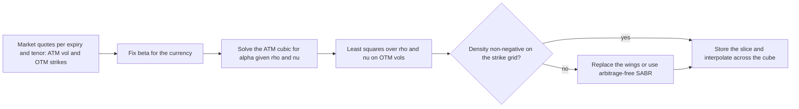

# Rates Volatility and SABR

## TL;DR

- Swaption volatility is a cube (expiry, swap tenor, strike); caps add a fourth axis once caplet vols are stripped.
- SABR (Hagan, Kumar, Lesniewski and Woodward 2002) is $dF = \alpha F^\beta dW_1$, $d\alpha = \nu \alpha dW_2$, $dW_1 dW_2 = \rho\, dt$: $\alpha$ sets the level, $\beta$ the backbone, $\rho$ the skew and $\nu$ the curvature.
- Hagan's closed-form expansion gives the implied Black vol in microseconds; it is an asymptotic approximation, and on the example parameters its implied density turns negative below a $0.90\%$ strike at 10 years.
- Negative rates are handled by shifting ($F + s$, $K + s$); a shifted lognormal vol is only meaningful together with its shift, so desks also quote the equivalent normal (Bachelier) vol.
- Production calibration fixes $\beta$, solves $\alpha$ from the ATM quote (a cubic), and fits $(\rho, \nu)$ to the out-of-the-money strikes.

## Learning objectives

- Map the structure of the fixed income volatility cube across strike, expiry, and tenor dimensions.
- Formulate the SABR stochastic differential equations and identify the role of each parameter ($\alpha, \beta, \rho, \nu$).
- Evaluate Hagan's asymptotic formula for implied Black (lognormal) volatility and Obloj's correction to its leading term.
- Convert between lognormal, shifted lognormal and normal (Bachelier) volatilities.
- Implement shifted SABR for negative and near-zero forward interest rates.
- Execute a production calibration workflow: fixing $\beta$, solving for $\alpha$ at ATM, and fitting $(\rho, \nu)$ to out-of-the-money quotes.
- Validate an implementation independently (Monte Carlo of the SDE) and diagnose negative densities in the Hagan expansion.

## Core concepts

### 1. The fixed income volatility cube

Equity and FX surfaces have two dimensions (strike and expiry); swaptions have three:
1. **Option expiry ($T$):** from one month to 30 years.
2. **Swap tenor:** the length of the swap delivered on exercise, from 1 to 30 years.
3. **Strike ($K$):** quoted as an offset from the ATM forward swap rate, for example ATM $\pm 25, 50, 100, 200$ bp.

Caps and floors are quoted per cap maturity and strike, and must be stripped into caplet volatilities before a smile model can be fitted.
The cube is the input for pricing callable bonds, Bermudan swaptions and CMS products and for calibrating term structure models ([Term Structure Models](19-Term-Structure-Models-HJM-LGM-LMM.md)).

### 2. The SABR model

Under the measure in which the forward $F$ is a martingale (the $T$-forward measure for a caplet, the annuity measure for a swaption):
$$dF(t) = \alpha(t) F(t)^\beta dW_1(t), \qquad d\alpha(t) = \nu \alpha(t) dW_2(t), \qquad dW_1 dW_2 = \rho\, dt,$$
with $F(0) = f > 0$ and $\alpha(0) = \alpha > 0$.

| Parameter | Role | Effect on the smile |
| :--- | :--- | :--- |
| $\alpha$ | volatility level | scales the whole smile; ATM vol is about $\alpha / F^{1-\beta}$ |
| $\beta \in [0, 1]$ | backbone (CEV exponent) | $\beta = 1$ lognormal, $\beta = 0$ normal, $\beta = 1/2$ square-root CEV; a lower $\beta$ adds skew on its own |
| $\rho \in (-1, 1)$ | spot-vol correlation | $\rho < 0$: vol rises when rates fall, so low strikes are bid |
| $\nu \ge 0$ | vol of vol | raises both wings (curvature) |

$\beta$ and $\rho$ both create skew: they are close substitutes in a single-day fit, which is why $\beta$ is fixed by convention or from a regression of log ATM vol on log forward (the backbone) rather than calibrated daily.

Hagan et al.'s central argument is about dynamics, not fit: they show that local volatility models predict that the smile moves in the opposite direction to the forward, against what is observed, so their deltas are wrong; in SABR the smile moves with the forward along the backbone, and the delta includes the vega times the change in implied vol along the backbone.

### 3. Hagan's asymptotic implied volatility

Singular perturbation in small $\alpha^2 T$ and $\nu^2 T$ gives Hagan et al.'s main result, for $F \ne K$:
$$\sigma_B(K, F) = \frac{\alpha}{(F K)^{(1-\beta)/2} \left[ 1 + \frac{(1-\beta)^2}{24} \ln^2\frac{F}{K} + \frac{(1-\beta)^4}{1920} \ln^4\frac{F}{K} \right]} \cdot \frac{z}{\chi(z)} \cdot \left[ 1 + \Gamma T \right],$$
$$z = \frac{\nu}{\alpha} (F K)^{(1-\beta)/2} \ln\frac{F}{K}, \qquad \chi(z) = \ln\left( \frac{\sqrt{1 - 2\rho z + z^2} + z - \rho}{1 - \rho} \right),$$
$$\Gamma = \frac{(1-\beta)^2}{24} \frac{\alpha^2}{(FK)^{1-\beta}} + \frac{1}{4} \frac{\rho \beta \nu \alpha}{(FK)^{(1-\beta)/2}} + \frac{2 - 3\rho^2}{24} \nu^2.$$

At the money $z \to 0$, $z/\chi(z) \to 1$ and
$$\sigma_{B, \text{ATM}} = \frac{\alpha}{F^{1-\beta}} \left[ 1 + \left( \frac{(1-\beta)^2}{24} \frac{\alpha^2}{F^{2(1-\beta)}} + \frac{1}{4} \frac{\rho \beta \nu \alpha}{F^{1-\beta}} + \frac{2 - 3\rho^2}{24} \nu^2 \right) T \right].$$
Multiplying by $F^{1-\beta}$ gives a cubic in $\alpha$; desks take its smallest positive root.

**Obloj's correction.**
Obloj (2008), using the large-deviation results of Berestycki, Busca and Florent, replaces the leading term by $\nu \ln(F/K) / \chi(z)$ with $z = \frac{\nu}{\alpha} \frac{F^{1-\beta} - K^{1-\beta}}{1 - \beta}$ and keeps Hagan's $1 + \Gamma T$.
As $\nu \to 0$ it reduces to $\alpha (1 - \beta) \ln(F/K) / (F^{1-\beta} - K^{1-\beta})$, the correct leading-order CEV vol; the two formulas agree at the money and differ by a few hundredths of a vol point near the money on our example (Example 4).

### 4. Normal volatility and shifted SABR

The Bachelier (normal) model $dF = \sigma_N dW$ prices a payer swaption at $A [(F - K)\Phi(d) + \sigma_N \sqrt{T} \phi(d)]$ with $d = (F - K)/(\sigma_N \sqrt{T})$.
Any lognormal vol converts exactly to a normal vol by equating the two prices and solving for $\sigma_N$ (prices are increasing in vol, so bisection is safe).
At the money there is a closed form to second order: Black gives $F (2\Phi(\sigma_B \sqrt{T}/2) - 1) \approx F \sigma_B \sqrt{T/(2\pi)} (1 - \sigma_B^2 T / 24)$ and Bachelier gives $\sigma_N \sqrt{T/(2\pi)}$, so
$$\sigma_N \approx \sigma_B F \left(1 - \frac{\sigma_B^2 T}{24}\right).$$

$F^\beta$ needs $F > 0$, so for negative rates the model is shifted:
$$d(F + s) = \alpha (F + s)^\beta dW_1, \qquad d\alpha = \nu \alpha dW_2,$$
and Hagan's formula is applied to $F' = F + s$, $K' = K + s$; the price uses the shifted Black formula $A[(F + s)\Phi(d_1) - (K + s)\Phi(d_2)]$.
The shift is a convention per currency and tenor, so a shifted lognormal vol means nothing without its shift; converting it to a normal vol removes the shift because the payoff depends only on $F - K$.

### 5. Calibration workflow

1. **Fix $\beta$.** With $\beta$ free, $\beta$ and $\rho$ trade off against each other and the fitted parameters jump from day to day while the fit barely changes.
2. **Solve $\alpha$ from the ATM vol.** For each expiry and tenor, the ATM quote pins $\alpha$ as a function of $(\rho, \nu)$, so the ATM point is always repriced exactly.
3. **Fit $(\rho, \nu)$** by weighted least squares on the out-of-the-money vols, $\min_{\rho, \nu} \sum_i w_i (\sigma_{\text{SABR}}(K_i; \alpha(\rho, \nu)) - \sigma_{\text{mkt}}(K_i))^2$ with $|\rho| < 1$ and $\nu \ge 0$; weights usually favour the liquid strikes near the money.

### 6. Wing arbitrage and negative densities

For a swaption the annuity-measure density of the swap rate is $q(K) = \frac{1}{A(0)} \frac{\partial^2 V_{\text{payer}}}{\partial K^2}$ (Breeden-Litzenberger); it must be non-negative, and call prices must decrease in strike.
Hagan's expansion is accurate when $\alpha^2 T$ and $\nu^2 T$ are small; for long expiries and low strikes it can imply $q(K) < 0$, which means a butterfly with a non-negative payoff has a negative price.
Example 6 shows this on our parameters: positive density at 1 year, negative density below a $0.90\%$ strike at 10 years.
The correction factor $1 + \Gamma T$ can also turn negative: $\Gamma$'s last term is negative when $\rho^2 > 2/3$ and its middle term is negative when $\rho < 0$.

Remedies used in practice:
- **Wing extrapolation:** keep SABR between liquid strikes and attach tails whose density is positive and that match price, slope and curvature at the join.
- **Arbitrage-free SABR:** Hagan, Kumar, Lesniewski and Woodward (Wilmott Magazine, January 2014) solve a one-dimensional effective forward equation for the density of $F$, which is non-negative by construction and puts the probability of hitting zero in a point mass.
- **Higher-order expansions** (Paulot 2015) reduce, but do not remove, the error at long expiries.

## Worked examples

### Example 1: Hagan SABR volatility
$F = 4.0\%$, $T = 1$ year, $\alpha = 0.035$, $\beta = 0.5$, $\rho = -0.25$, $\nu = 0.40$; find the vols at $K = 2\%, 4\%, 6\%$.

ATM: $F^{1-\beta} = \sqrt{0.04} = 0.20$, so $\alpha / F^{1-\beta} = 0.1750$.
$$\Gamma = \frac{0.25}{24}\frac{0.035^2}{0.04} + \frac{1}{4}\frac{(-0.25)(0.5)(0.40)(0.035)}{0.20} + \frac{2 - 3(0.0625)}{24}(0.16) = 0.0003190 - 0.0021875 + 0.0120833 = 0.010215$$
$$\sigma_{B, \text{ATM}} = 0.1750 \times 1.010215 = 17.68\%.$$
The full formula in [`code/fi_sabr.py`](code/fi_sabr.py) gives $\sigma_B(2\%) = 27.54\%$ and $\sigma_B(6\%) = 16.54\%$: a downward skew, with the 6% wing below the ATM vol.
Example 2 separates the contributions of $\rho$ and $\nu$.

Calibration step in reverse: if the market ATM vol were $18.00\%$ with $(\beta, \rho, \nu)$ unchanged, the ATM cubic gives $\alpha = 0.03564$.

### Example 2: parameter sensitivity
Same inputs, one change at a time ($T = 1$):
1. $\nu$ from $0.40$ to $0.80$: $2\%$ vol $27.54\% \to 36.76\%$, $6\%$ vol $16.54\% \to 20.69\%$, ATM only $17.68\% \to 18.27\%$ (through the $\nu^2$ and $\rho\nu$ terms of $\Gamma$).
2. $\rho = 0$: $25.47\%$ (2%), $17.74\%$ (ATM), $18.25\%$ (6%); still higher on the low side because $\beta = 0.5$ is itself a skew.
3. $\rho = +0.30$: $22.44\%$, $17.75\%$, $19.97\%$; at $\rho = +0.50$ the skew inverts, $19.94\%$ (2%) against $20.95\%$ (6%).

### Example 3: shifted SABR for a negative rate
A EUR forward swap rate of $F = -0.50\%$ with shift $s = 3\%$ gives $F' = 2.50\%$; the ATM strike $K = -0.50\%$ also maps to $2.50\%$.
With the Example 1 parameters, Hagan's formula on the shifted coordinates gives a shifted lognormal ATM vol of $22.35\%$ for a 1-year option ($22.57\%$ for 2 years).
Pricing that option in shifted Black and re-quoting it in Bachelier gives an ATM normal vol of $55.77$ bp, a number that does not depend on the shift convention.

### Example 4: an independent check of the formula by Monte Carlo
Simulating the SDEs directly (200,000 paths, 200 steps, Euler for $F$ absorbed at zero, exact lognormal steps for $\alpha$, seed 20020701) and inverting the simulated option prices gives implied vols of about $27.5\%$, $17.7\%$ and $16.6\%$ at $2\%$, $4\%$ and $6\%$.
These agree with Hagan's $27.54\%$, $17.68\%$ and $16.54\%$ to within $0.3$ vol points (the script asserts this), which a typo in $\chi$, $z$ or $\Gamma$ would not survive.
Obloj's corrected leading term gives $27.58\%$ and $16.55\%$ at the two wings, a few hundredths of a point from Hagan at $T = 1$.

### Example 5: lognormal to normal vol
Converting each Example 1 vol into the Bachelier vol with the same price: $79.23$ bp (2%), $70.62$ bp (ATM), $81.50$ bp (6%).
In normal terms most of the lognormal skew disappears: both wings sit above the ATM vol, the right one slightly higher.
ATM shortcut: $\sigma_B F = 70.715$ bp, and $70.715 \times (1 - 0.17679^2/24) = 70.62$ bp, matching the exact conversion.

### Example 6: when the expansion breaks
Differencing Black prices of the Hagan smile on a strike grid from $0.10\%$ to $12.00\%$ in $0.05\%$ steps: at $T = 1$ the density is positive everywhere; at $T = 10$ it is negative for strikes below $0.90\%$, where the formula's vol has climbed to $53.75\%$ at $K = 0.50\%$.
A risk system that differences these prices would report negative probabilities, and a static butterfly in that region would show a negative premium for a non-negative payoff.

## Pitfalls

- **Floating $\beta$ in daily recalibration:** $\beta$ and $\rho$ both generate skew, so a free $\beta$ produces unstable parameters and noisy hedge ratios for almost no improvement in fit.
- **Using the expansion far outside its regime:** at long expiries or low strikes the Hagan density can go negative (Example 6); check $\partial^2 V / \partial K^2 \ge 0$ on the whole strike grid used by risk and by CMS replication, which integrates over all strikes.
- **Calibrating to cash-settled swaption quotes as if physical:** cash-settled swaptions (common in EUR) pay with an annuity computed from the swap rate itself, so their prices differ from physically settled swaptions with the same vol; convert before mixing quotes.
- **Shift too small:** if forwards fall below $-s$ the shifted model cannot represent them; a shift change also changes every quoted shifted vol, so compare normal vols across dates and desks.
- **Mixing units:** a normal vol in bp and a lognormal vol in percent differ by roughly a factor $F$; feeding one into the other's formula misprices by orders of magnitude.
- **Ignoring smile dynamics in delta:** the SABR delta includes the change in implied vol along the backbone; a sticky-strike Black delta on a SABR-marked book is a different hedge.

## Interview questions

> [!question]- fi-rates-vol-sabr-sde | Write the SABR model stochastic differential equations and identify all parameters.
> $dF = \alpha F^\beta dW_1$, $d\alpha = \nu \alpha dW_2$, $dW_1 dW_2 = \rho\, dt$, under the measure that makes $F$ a martingale.
> $F$ is the forward (rate or swap rate), $\alpha$ the stochastic volatility level, $\beta$ the CEV backbone exponent, $\nu$ the vol of vol and $\rho$ the correlation between rate and volatility shocks.

> [!question]- fi-rates-vol-sabr-param-roles | What are the qualitative market roles of $\alpha, \beta, \rho,$ and $\nu$?
> $\alpha$ sets the overall level (ATM vol is about $\alpha / F^{1-\beta}$).
> $\beta$ sets the backbone, how ATM vol moves with the forward, and adds some skew.
> $\rho$ sets the skew (slope around ATM).
> $\nu$ sets the curvature (height of both wings).

> [!question]- fi-rates-vol-sabr-why-fix-beta | Why do quants fix $\beta$ instead of calibrating it from market prices?
> On a single day's smile $\beta$ and $\rho$ are near substitutes: both tilt the smile, so many $(\beta, \rho)$ pairs fit equally well.
> Letting $\beta$ float makes the parameters and the hedge ratios jump without improving the fit; it is fixed by convention or estimated from the backbone (log ATM vol against log forward over time).

> [!question]- fi-rates-vol-sabr-negative-rates | How does shifted SABR handle negative interest rates?
> It models $F + s$ with a fixed shift $s > 0$: $d(F + s) = \alpha (F + s)^\beta dW_1$, $d\alpha = \nu\alpha dW_2$, and applies Hagan's formula to $F + s$ and $K + s$.
> The resulting vol is a shifted lognormal vol, meaningful only together with $s$; in Example 3 the $22.35\%$ shifted vol with $s = 3\%$ is a $55.77$ bp normal vol.

> [!question]- fi-rates-vol-sabr-wing-arbitrage | What is wing arbitrage in Hagan's asymptotic formula?
> The formula is an expansion in small $\alpha^2 T$ and $\nu^2 T$; at long expiries and low strikes the prices it implies can be non-convex in strike, so the implied density $\partial^2 V / \partial K^2$ is negative and a butterfly with a non-negative payoff has a negative price.
> On $F = 4\%$, $\alpha = 0.035$, $\beta = 0.5$, $\rho = -0.25$, $\nu = 0.4$ the density is positive at 1 year but negative below a $0.90\%$ strike at 10 years.

> [!question]- fi-rates-vol-sabr-atm-alpha-solve | How is $\alpha$ determined during calibration once $(\beta, \rho, \nu)$ are specified?
> From the ATM quote: $\sigma_{\text{ATM}} F^{1-\beta} = \alpha [1 + \Gamma(\alpha) T]$, a cubic in $\alpha$ whose smallest positive root is taken (Newton or Cardano).
> With $F = 4\%$, $T = 1$, $\beta = 0.5$, $\rho = -0.25$, $\nu = 0.4$, an ATM vol of $18.00\%$ gives $\alpha = 0.03564$.

> [!question]- fi-rates-vol-sabr-cube-dims | What are the three dimensions of the fixed income swaption volatility cube?
> Option expiry, underlying swap tenor, and strike (usually as an offset from the ATM forward swap rate).

> [!question]- fi-rates-vol-sabr-rho-sign | If swaption volatility is higher for low strikes than for high strikes, what is the sign of $\rho$?
> Usually negative, but not necessarily: a $\beta < 1$ backbone alone also makes low strikes richer in lognormal terms.
> With $\beta = 0.5$ in Example 2, even $\rho = +0.30$ leaves the 2% strike above the 6% strike; only near $\rho = +0.5$ does the skew invert.

> [!question]- fi-rates-vol-sabr-breeden-litzenberger | How do you check if a calibrated SABR smile is arbitrage-free?
> Price payers across a dense strike grid and check that prices decrease in strike and are convex: the annuity-measure density $\frac{1}{A}\frac{\partial^2 V}{\partial K^2}$ must be non-negative everywhere (Breeden-Litzenberger).
> Also check calendar consistency across expiries, and that the density integrates to one including any mass at the lower boundary.

> [!question]- fi-rates-vol-sabr-normal-vs-lognormal | What is the difference between normal SABR and lognormal SABR?
> $\beta = 0$ (normal SABR) makes the local vol independent of the rate level, the natural choice when vols are quoted in bp and rates are near or below zero; $\beta = 1$ makes it proportional to the level, as in Black.
> Either way the option has one price, so a lognormal vol converts to a normal vol: $17.68\%$ at $F = 4\%$, $T = 1$ is $70.62$ bp, close to $\sigma_B F (1 - \sigma_B^2 T/24)$.

> [!question]- fi-rates-vol-sabr-backbone | What is the SABR backbone and what does it imply for delta?
> The backbone is the path of the ATM vol as the forward moves, roughly $\sigma_{\text{ATM}} \approx \alpha / F^{1-\beta}$: flat in lognormal terms for $\beta = 1$, flat in normal terms for $\beta = 0$.
> Because implied vol moves with $F$, the SABR delta is the Black delta plus vega times $\partial\sigma_B / \partial F$ along the backbone; Hagan et al. built SABR because local vol models predict smile moves in the wrong direction and so give wrong deltas.

> [!question]- fi-rates-vol-sabr-atm-normal-conversion | Convert a 17.68% lognormal ATM vol at a 4% forward and 1-year expiry into a normal vol in your head.
> About $70.6$ bp.
> $\sigma_B F = 0.17679 \times 400 = 70.715$ bp, and the second-order factor $1 - \sigma_B^2 T / 24$ (about $0.13\%$ lower) takes it to $70.62$ bp, which the exact price inversion confirms.

> [!question]- fi-rates-vol-sabr-independent-check | How would you test a Hagan SABR implementation independently of the formula?
> Simulate the SDEs (Euler for $F$ with absorption at zero, exact lognormal steps for $\alpha$), price options, and invert to implied vols.
> On the Example 1 parameters 200,000 paths give about $27.5\%$, $17.7\%$, $16.6\%$ against Hagan's $27.54\%$, $17.68\%$, $16.54\%$; agreement to a few tenths of a point catches any typo in $z$, $\chi(z)$ or $\Gamma$, while remaining gaps at long expiries measure the expansion error.

> [!question]- fi-rates-vol-sabr-obloj-correction | What does Obloj's correction change in Hagan's formula, and why?
> It replaces the leading-order term by $\nu \ln(F/K)/\chi(z)$ with $z = \frac{\nu}{\alpha}\frac{F^{1-\beta} - K^{1-\beta}}{1-\beta}$, derived from the short-time large-deviation limit.
> Unlike Hagan's term it reduces to the exact CEV leading term when $\nu \to 0$; at $T = 1$ on our example it moves the wings by only a few hundredths of a point ($27.58\%$ against $27.54\%$ at $K = 2\%$).

> [!question]- fi-rates-vol-sabr-shift-comparability | A colleague says EUR vols rose because the shifted lognormal vol went from 20% to 24% after the shift was cut. What do you check?
> Whether anything changed at all: the same price quoted with a smaller shift needs a higher shifted lognormal vol, because the vol multiplies $F + s$.
> Compare normal (bp) vols, which do not depend on the shift, before concluding the market moved.

## Further reading

- Patrick Hagan, Deep Kumar, Andrew Lesniewski, and Diana Woodward, *Managing Smile Risk*, Wilmott Magazine, July 2002, pp. 84-108.
- Patrick Hagan, Deep Kumar, Andrew Lesniewski, and Diana Woodward, *Arbitrage-Free SABR*, Wilmott Magazine, January 2014, pp. 60-75.
- Jan Obloj, *Fine-Tune Your Smile: Correction to Hagan et al.*, arXiv:0708.0998, 2008.
- Louis Paulot, *Asymptotic Implied Volatility at the Second Order with Application to the SABR Model*, in Large Deviations and Asymptotic Methods in Finance, Springer, 2015 (arXiv:0906.0658).
- Damiano Brigo and Fabio Mercurio, *Interest Rate Models - Theory and Practice*, 2nd edition, Springer, 2006, section 11.4 (the Hagan, Kumar, Lesniewski and Woodward model).

## In this repo and SDE-Interview-Prep

- Code: [`code/fi_sabr.py`](code/fi_sabr.py) asserts every number in this note: Hagan and Obloj vols, the ATM alpha solve, shifted and normal vols, the Monte Carlo check and the density scan.
- Prereq: [Rates Options: Caps and Swaptions](05-Rates-Options-Caps-and-Swaptions.md).
- Next: [Term Structure Models: HJM, LGM, and LMM](19-Term-Structure-Models-HJM-LGM-LMM.md).
