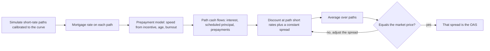

# Mortgages and Securitized Products

## TL;DR

- A US fixed-rate mortgage lets the borrower prepay at par at any time; pass-through investors are short that option, so agency MBS have negative convexity (contraction risk in rallies, extension risk in sell-offs).
- Speeds: SMM is the monthly fraction of balance prepaid, $\text{CPR} = 1 - (1 - \text{SMM})^{12}$, and the PSA benchmark ramps CPR by $0.2\%$ a month to $6\%$ at month 30.
- On a 6% WAC, 5.5% coupon 30-year pool the weighted average life is $11.36$ years at 100 PSA and $5.74$ years at 300 PSA; an IO strip at 300 PSA is worth $25.08$ against $41.80$ at 100 PSA.
- OAS simulates rate paths, runs a prepayment model on each, discounts at path rates plus a constant spread and solves for the market price; the option cost is the zero-volatility spread minus the OAS.
- Agency MBS trade mainly forward in the TBA market, where the seller chooses which pools to deliver; dollar rolls turn the TBA calendar into a financing trade.

## Learning objectives

- Differentiate Agency MBS from Non-Agency securitizations across credit, liquidity, and guarantee structures.
- Calculate prepayment metrics: Single Monthly Mortality (SMM), Constant Prepayment Rate (CPR), and PSA benchmark schedules.
- Project pool cash flows and weighted average life at a given speed.
- Formulate the core economic drivers of prepayment: refinancing incentive, turnover, curtailment, defaults and buyouts, and burnout.
- Analyze the negative convexity profile of mortgage pass-throughs and compute OAS, option cost, effective duration and convexity.
- Explain the trading mechanics of the TBA forward market, cheapest-to-deliver allocation, and dollar roll financing.
- Value structured tranches: Sequential pay, Planned Amortization Class (PAC), and Interest-Only (IO) / Principal-Only (PO) strips.

## Core concepts

### 1. Agency and non-agency MBS

- **Ginnie Mae (GNMA)** guarantees pools of government-insured loans (FHA, VA and others); its guarantee carries the full faith and credit of the United States.
- **Fannie Mae and Freddie Mac** (government-sponsored enterprises, in FHFA conservatorship since September 2008) guarantee pools of conforming conventional loans that meet their loan size and underwriting criteria.
- For agency MBS the investor's credit exposure is to the guarantor; defaulted loans are bought out of the pool at par, so defaults reach investors as prepayments, and the dominant risks are rates and prepayments.
- **Non-agency (private-label) MBS** have no agency guarantee; they protect senior bonds with subordination, overcollateralization and excess spread, so investors bear credit losses as well as prepayment risk.

### 2. Pass-through cash flows

Each month the servicer collects the borrowers' level payment, keeps the servicing and guarantee fees (the gap between the loans' note rate, WAC, and the pass-through coupon), and passes the rest through:
$$\text{Payment}_t = B_{t-1}\frac{r}{1 - (1 + r)^{-n_t}}, \qquad r = \frac{\text{WAC}}{12}, \qquad \text{Sched}_t = \text{Payment}_t - B_{t-1} r,$$
$$\text{Investor cash flow}_t = B_{t-1}\frac{c}{12} + \text{Sched}_t + \text{SMM}_t (B_{t-1} - \text{Sched}_t),$$
with $n_t$ the remaining term, $c$ the pass-through coupon and prepayments returned at par.
Scheduled principal grows over the life of a level-pay loan as interest on the shrinking balance falls.

### 3. Prepayment metrics

$$\text{SMM}_t = \frac{\text{Prepayment}_t}{B_{t-1} - \text{Sched}_t}, \qquad \text{CPR} = 1 - (1 - \text{SMM})^{12}, \qquad \text{SMM} = 1 - (1 - \text{CPR})^{1/12}.$$
The PSA benchmark (from the Public Securities Association, now SIFMA) is a seasoning ramp, not a forecast:
$$\text{CPR}_{100\% \text{ PSA}}(m) = 0.2\% \times \min(m, 30),$$
so $6\%$ CPR from month 30; $150\%$ PSA multiplies every month's CPR by 1.5.
Weighted average life (WAL) is the principal-weighted average time of principal payments, $\sum_t t \cdot P_t / \sum_t P_t$.

### 4. Drivers of prepayment

1. **Refinancing:** the main driver; it rises steeply as the borrower's rate exceeds current mortgage rates by enough to cover refinancing costs (an S-curve in the incentive).
2. **Turnover:** home sales repay the loan whatever the rate, though sales slow when moving would mean giving up a below-market rate.
3. **Curtailments:** partial prepayments.
4. **Defaults and buyouts:** in agency pools, delinquent loans bought out by the guarantor arrive as prepayments at par.
5. **Burnout:** after rate drops, the borrowers most able to refinance have left; the remaining pool responds less to the next drop.

Prepayment models (dealer and vendor models) combine these with loan-level data such as loan age, size, credit score and loan-to-value.

### 5. Negative convexity, OAS and effective risk

A pass-through is a bond minus the borrowers' prepayment option, a long-dated American call on the mortgage at par that borrowers exercise imperfectly.
In rallies prepayments speed up, the investor gets par back to reinvest at lower rates, and duration shortens (contraction); in sell-offs prepayments slow and duration lengthens (extension).

- **Zero-volatility spread:** the constant spread over the curve that reprices the cash flows projected along the zero-volatility path, on which rates follow the forwards implied by the curve; it ignores the option's time value.
- **OAS:** the same equation averaged over volatile rate paths with the prepayment model on each.
- **Option cost:** $\text{ZV spread} - \text{OAS}$, positive for a pass-through whose investors are short the prepayment option.
- **Effective duration and convexity:** bump the curve, keep the OAS, and reprice with the same random numbers.

All four are model outputs: they depend on the rate model, its volatility and the prepayment model.

### 6. TBA trading and dollar rolls

Most agency pass-through trading is in to-be-announced (TBA) forwards: the parties agree on agency, maturity, coupon, price, par amount and settlement date, but not which pools.
Under SIFMA's Uniform Practices (chapter 7, the "48-hour rule") the seller must pass pool information two business days before settlement, with cutoffs around 3 p.m. Eastern time that depend on the counterparties and how the information is sent.
Because the seller chooses, TBAs trade as cheapest-to-deliver: for premium coupons the cheapest pools are the fastest-paying, for discount coupons the slowest; pools with features that make them prepay slowly (for example low loan balances) trade as "specified pools" at a pay-up to TBA.

A dollar roll sells TBAs for the front settlement month and buys the same TBAs for a later month.
The roller gives up the month's coupon and principal paydowns and receives the drop, the price difference between the months:
$$\text{implied financing rate} = \frac{P_{\text{back}} + \text{carry given up} - P_{\text{front}}}{P_{\text{front}}} \times \frac{360}{\text{days}}.$$
A roll whose implied rate is below the repo rate for the same collateral is said to trade special: financing the position by rolling is cheaper than repo.

### 7. CMOs and strips

1. **Sequential pay:** all principal goes to tranche A until it is retired, then to B, then C; a Z (accrual) tranche accretes its interest into principal until earlier tranches are retired.
2. **PAC and support:** a PAC receives a fixed principal schedule that is met as long as speeds stay within a band (for example 100 to 250 PSA) and the support tranche has not been exhausted; the support tranche absorbs the variability.
3. **IO and PO:** the IO receives all interest, the PO all principal; at the pass-through rate their values sum to par.
Faster prepayments return PO principal sooner (PO value up) and shrink the balance on which IO interest accrues (IO value down), so a PO has long positive duration and an IO on premium collateral has negative duration.

## Worked examples

### Example 1: SMM to CPR
$\text{SMM} = 0.50\%$: $0.995^{12} = 0.941623$, so $\text{CPR} = 5.8377\%$; inverting gives back $0.5000\%$.
In reverse, 6% CPR is an SMM of $0.5143\%$.

### Example 2: PSA
At month 10 and 100 PSA: $0.2\% \times 10 = 2.00\%$ CPR.
At month 30 and 150 PSA: $1.5 \times 6\% = 9.00\%$ CPR.

### Example 3: one month of cash flow and the WAL
A new 30-year pool, $\$100$ balance, $6.0\%$ WAC, $5.5\%$ pass-through coupon, at 100 PSA:
- Level payment: $100 \times 0.005 / (1 - 1.005^{-360}) = 0.599551$.
- Interest to investors $100 \times 5.5\% / 12 = 0.458333$; servicing and guarantee fee $100 \times 0.5\% / 12 = 0.041667$.
- Scheduled principal $0.599551 - 0.500000 = 0.099551$.
- Month-1 CPR $0.2\%$, SMM $= 1 - 0.998^{1/12}$, prepayment $0.016665$.

WAL of the same pool: $19.31$ years with no prepayments, $14.53$ at 50 PSA, $11.36$ at 100 PSA and $5.74$ at 300 PSA.

### Example 4: IO and PO
Same pool, both strips discounted at the $5.5\%$ pass-through rate (monthly compounding):

| Speed | IO | PO |
| :--- | :--- | :--- |
| 100 PSA | $41.80$ | $58.20$ |
| 300 PSA | $25.08$ | $74.92$ |

Faster prepayments move $16.72$ of value from the IO to the PO; since rallies bring faster prepayments, the IO falls when rates fall.

### Example 5: dollar roll
Front-month price $101.50$, back-month $101.125$, so the drop is $0.375$ ($12$ thirty-seconds).
The roller estimates the month's carry given up (coupon net of the loss on paydowns returned at par below the $101.50$ price) at $0.480$ per 100.
$$\text{implied rate} = \frac{101.125 + 0.480 - 101.50}{101.50} \times \frac{360}{30} = 1.2414\%.$$
Against a $4.50\%$ repo rate the roll is $326$ bp cheaper financing, as long as the pools received back are no worse than those delivered.

### Example 6: sequential CMO
Tranche A $\$60$ million, tranche B $\$40$ million, month-1 principal $\$1.5$ million: A receives $\$1,500,000$ and ends at $\$58,500,000$; B receives $0$.

### Example 7: OAS on a toy model
Inputs (labelled illustrative, not a production prepayment model): Ho-Lee short rate fitted to a flat $4\%$ curve with $0.8\%$ normal volatility; mortgage rate equal to the Ho-Lee 10-year yield plus $1.5\%$; CPR $=$ PSA-style ramp $\times (6\% + 40\% / (1 + e^{-(I - 1\%)/0.25\%}))$ with $I$ the WAC minus the mortgage rate; pool as in Example 3; market price $101.00$; 4,000 antithetic monthly paths, seed 2026.

- The simulated discount factors reprice the curve: mean path discount factor to 10 years $0.670$, against $e^{-0.4} = 0.670$.
- Zero-volatility spread: $132$ bp; OAS: about $64$ bp; option cost: about $68$ bp.
- With the OAS held, $\pm 25$ bp curve shifts give an effective duration of about $4.2$ and an effective convexity of about $-122$.

Seeds 2026 to 2030 put the OAS between $62$ and $65$ bp and the effective convexity between $-130$ and $-120$, so quote these only to that precision.

## Pitfalls

- **Static duration for MBS:** duration changes sharply with rates (Example 7 has convexity around $-122$); use effective measures from a prepayment-aware model.
- **Ignoring burnout:** a seasoned pool that has already passed through rallies prepays less in the next one than a new pool with the same incentive.
- **Treating TBA as an average pool:** the seller delivers the least valuable eligible pools, so TBA prices reflect cheapest-to-deliver collateral.
- **Comparing OAS across models:** OAS, option cost and effective duration depend on the rate model, volatility and prepayment model; compare them only within one framework.
- **Hedging an IO with the wrong sign:** an IO on premium collateral gains when rates rise; hedging it as if it were a long-duration bond (shorting Treasuries) adds to the risk instead of offsetting it.
- **Agency is not risk-free:** guarantees remove most credit risk, but prepayment, extension and spread risk remain.

## Interview questions

> [!question]- fi-mbs-securitized-negative-convexity | Why do Agency MBS exhibit negative convexity?
> Borrowers can prepay at par at any time (agency-eligible loans generally carry no prepayment penalty), and they do so when rates fall, so the investor is short a call: rallies shorten duration and cap price gains, sell-offs extend it.
> On the toy model of Example 7 the effective convexity of a 101.00 pass-through is about $-122$.

> [!question]- fi-mbs-securitized-smm-to-cpr | How do you convert Single Monthly Mortality (SMM) to Constant Prepayment Rate (CPR)?
> $\text{CPR} = 1 - (1 - \text{SMM})^{12}$: the balance survives each month with probability $1 - \text{SMM}$.
> $\text{SMM} = 0.50\%$ gives $5.8377\%$; 6% CPR is an SMM of $0.5143\%$.

> [!question]- fi-mbs-securitized-psa-benchmark | Describe the 100% PSA prepayment benchmark.
> CPR starts at $0.2\%$ in month 1, rises $0.2\%$ a month to $6\%$ at month 30, and stays at $6\%$; other speeds scale every month, so 150 PSA is $9\%$ from month 30.
> It is a seasoning convention for quoting speeds, not a prepayment model.

> [!question]- fi-mbs-securitized-tba-48hr-rule | What is the TBA market and the 48-hour rule?
> TBAs are forward trades on agency, maturity, coupon, price, par and settlement date, with the pools chosen later by the seller.
> Under SIFMA's Uniform Practices the seller must give pool information two business days before settlement, with afternoon cutoffs (around 3 p.m. Eastern) that depend on the counterparties and the communication method.

> [!question]- fi-mbs-securitized-dollar-roll | What is a dollar roll and why is it used?
> Selling TBAs for one settlement month and buying them for a later month: the roller gives up a month of coupon and paydowns in exchange for the drop and the use of the cash.
> Its implied financing rate (Example 5: $1.2414\%$) is compared with repo; when it is lower, the roll is special and rolling is cheap financing, with the risk of getting worse pools back.

> [!question]- fi-mbs-securitized-burnout | What is pool burnout in mortgage prepayment?
> After a pool has been through one or more refinancing opportunities, the borrowers most able and willing to refinance have gone, so the next rally produces fewer prepayments than the incentive alone suggests.
> Models capture it with the pool's history of incentive, not just the current one.

> [!question]- fi-mbs-securitized-pac-vs-companion | How does a PAC tranche differ from a Companion tranche in a CMO?
> The PAC receives a fixed principal schedule that holds as long as speeds stay in its band and the support tranche still has balance.
> The support (companion) tranche takes the excess or shortfall, so it contracts sharply when speeds rise and extends when they fall.

> [!question]- fi-mbs-securitized-io-duration | Why do Interest-Only (IO) mortgage strips have negative duration?
> When rates rise, prepayments slow, the balance on which interest accrues survives longer, and IO cash flows rise; that can outweigh the higher discount rate.
> Example 4: the IO is worth $41.80$ at 100 PSA and $25.08$ at 300 PSA, so the speed-up that comes with a rally cuts its value.

> [!question]- fi-mbs-securitized-agency-vs-nonagency | Contrast Agency MBS with Non-Agency MBS regarding credit risk.
> Agency MBS carry a guarantee of timely payment (GNMA backed by the full faith and credit of the US; Fannie Mae and Freddie Mac by the GSEs themselves), and defaulted loans are bought out at par, so investors see defaults as prepayments.
> Non-agency MBS have no such guarantee and rely on subordination and other credit enhancement, so their investors take credit losses.

> [!question]- fi-mbs-securitized-contraction-extension | Distinguish between contraction risk and extension risk.
> Contraction: rates fall, prepayments speed up, principal comes back at par to be reinvested at lower rates, and duration shortens.
> Extension: rates rise, prepayments slow, the investor holds a below-market coupon longer, and duration lengthens just as prices fall.

> [!question]- fi-mbs-securitized-wal-psa | What is the weighted average life of a new 30-year 6% WAC pool at 100 PSA and at 300 PSA?
> About $11.36$ years at 100 PSA and $5.74$ years at 300 PSA, against $19.31$ years with no prepayments.
> WAL is $\sum t P_t / \sum P_t$ over principal payments only.

> [!question]- fi-mbs-securitized-oas-mechanics | Walk through how an OAS is computed for a pass-through.
> Simulate curve-calibrated rate paths, derive a mortgage rate on each, run the prepayment model to get path cash flows, discount at path short rates plus a constant spread, average, and solve for the spread that matches the market price.
> The zero-volatility spread does the same on the single zero-volatility path, where rates follow the curve's forwards; their difference is the option cost (Example 7: $132$ bp ZV, about $64$ bp OAS, about $68$ bp option cost).

> [!question]- fi-mbs-securitized-ctd-pools | In the TBA market, which pools are cheapest to deliver for a premium coupon, and which for a discount coupon?
> Premium coupons: the fastest-paying pools, because each prepayment returns par for a bond worth more than par.
> Discount coupons: the slowest-paying pools, because the investor waits longer to get par back on a bond worth less than par.

> [!question]- fi-mbs-securitized-io-po-par | Why do IO and PO values add up to par when both are discounted at the pass-through rate?
> Interest is the coupon rate times the outstanding balance and principal is returned at par, so at a discount rate equal to the coupon each dollar of balance is worth exactly one dollar, whatever the prepayment speed.
> Example 4: $41.80 + 58.20$ and $25.08 + 74.92$ both equal $100$.

> [!question]- fi-mbs-securitized-defaults-as-prepayments | How do borrower defaults show up for an agency MBS investor?
> As prepayments: the guarantor buys delinquent loans out of the pool at par, so the investor receives principal early and bears no credit loss.
> Rising delinquencies can therefore speed up agency pools while they cause losses in non-agency deals.

## Further reading

- SIFMA, *Uniform Practices for the Clearance and Settlement of Mortgage-Backed Securities and Other Related Securities*, chapter 7 (good delivery and allocation).
- Frank Fabozzi (editor), *The Handbook of Mortgage-Backed Securities*, 7th edition, Oxford University Press, 2016.
- Bruce Tuckman and Angel Serrat, *Fixed Income Securities: Tools for Today's Markets*, 3rd edition, Wiley, 2012, chapter 20 (Mortgages and Mortgage-Backed Securities).
- Andrew Davidson and Alexander Levin, *Mortgage Valuation Models: Embedded Options, Risk, and Uncertainty*, Oxford University Press, 2014.

## In this repo and SDE-Interview-Prep

- Code: [`code/fi_mortgages.py`](code/fi_mortgages.py) asserts every number here, including the pool projection, IO and PO, dollar roll, CMO waterfall and the Monte Carlo OAS.
- Prereq: [Callable and Bermudan Products](20-Callable-and-Bermudan-Products.md).
- Next: [Credit Advanced: CDS Indices and Tranches](23-Credit-Advanced-CDS-Indices-and-Tranches.md).
