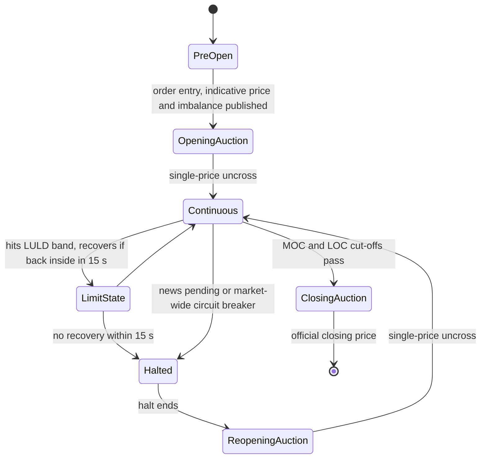

# Exchange Mechanics, Auctions and Fees

## TL;DR

- A trading day is a sequence of market states: opening call auction, continuous limit order book, possible volatility pauses, closing call auction; the rules and your queue position differ in each.
- A call auction picks one clearing price that maximises executed volume, then minimises the leftover imbalance, then sits closest to a reference price; everyone executes at that single price, and the published imbalance is a free signal of where it will land.
- Maker-taker venues pay a rebate to resting liquidity and charge takers; inverted venues do the reverse; the economic price of a quote is its displayed price plus or minus the fee, which is what routers and queue-joiners actually compare.
- In US equities the take fee on a protected quote is capped by Reg NMS Rule 610(c); a 2024 amendment cuts the cap from 30 mils to 10 mils and adds a half-penny tick for tightly quoted stocks, but as of 2026-10 compliance is exempted until the first business day of November 2027.
- Tick size relative to price decides whether a stock is queue-constrained (large tick) or price-competitive (small tick), which changes every market-making and execution decision.
- Price bands (LULD) and market-wide circuit breakers convert the continuous market back into halts and reopening auctions when prices move too far, too fast.

## Learning objectives

- Explain opening and closing auctions and indicative prices.
- Compare maker-taker and inverted fee models and their effect on routing.
- Know tick size regimes, trading halts and limit-up limit-down.
- Implement the uncross algorithm and compute the clearing price, volume, imbalance and allocation for a call auction.
- Compute the net capture and expected value of a resting order under different fee schedules.

## Core concepts

### The trading day as a state machine

Each state has its own order types, priority rules and fees.
A market maker's quoting engine and an execution algorithm both need an explicit model of which state the symbol is in, because an order valid in one state can be rejected, held or executed at a very different price in another.

### Continuous trading

Continuous trading is the limit order book of [Limit Order Books and Order Types](01-Limit-Order-Books-and-Order-Types.md): orders match on arrival under price-time priority (or pro-rata in some futures and options books).
Its strength is immediacy; its weakness is that it is a race.
Budish, Cramton and Shim argue that because the book processes messages one at a time, any public signal creates a winner-take-all speed race to pick off stale quotes, which is the subject of [Latency Arbitrage and Speed](10-Latency-Arbitrage-and-Speed.md).

### Call auctions and the uncross

A call auction collects orders over a period without matching them, then clears everything at one price.
Exchanges use them for the open, the close and reopening after halts, because they pool liquidity in time and are harder to manipulate than a single trade.

Given limit buys and sells plus market (at-the-open or at-the-close) orders, define at each candidate price $p$:

$$
D(p) = \text{market buys} + \sum_{\text{buy limits} \ge p} q_i, \qquad S(p) = \text{market sells} + \sum_{\text{sell limits} \le p} q_j .
$$

$D$ is non-increasing and $S$ non-decreasing in $p$, so executable volume $E(p) = \min(D(p), S(p))$ is single-peaked.
The uncross algorithm is a lexicographic search over the distinct limit prices:

1. maximise executable volume $E(p)$;
2. among ties, minimise the absolute imbalance $\lvert D(p) - S(p) \rvert$;
3. among ties, choose the price closest to a reference price (the previous close, the last sale, or the midpoint of the prevailing quote);
4. a final deterministic tie-break.

Venues differ in the details.
For example, Nasdaq Rule 4754, as quoted in SEC Release 34-85292 (2019), defines the closing cross Current Reference Price as the price at or within the Nasdaq best bid and offer at which the maximum number of MOC, LOC and imbalance-only shares can be paired, then the price that minimises the imbalance, then the price at which shares will remain unexecuted, then the price closest to the inside midpoint.

Allocation at the clearing price is by price priority first (market orders, then limits better than the clearing price, which all fill), then time priority among orders limited exactly at the clearing price on the heavy side.
Only the side with the imbalance is rationed.

### Indicative prices and imbalance publication

During the order-entry period exchanges disseminate the indicative clearing price, the paired volume and the imbalance (size and side), for example Nasdaq's Net Order Imbalance Indicator and the NYSE's imbalance messages.
This creates a feedback loop:

- a large buy imbalance attracts sell liquidity from market makers and arbitrageurs, who are paid by the imbalance moving the price toward them;
- traders who must trade at the close (index funds tracking a closing benchmark) use MOC orders, while price-sensitive liquidity providers use limit-on-close or imbalance-only orders that can only offset the published imbalance;
- the published imbalance is information, so cut-off times and restrictions on cancelling MOC orders near the close limit gaming.

### Fee models

| Model | Maker (resting) | Taker (aggressor) | Who prefers it |
| :--- | :--- | :--- | :--- |
| Maker-taker | receives a rebate | pays a fee | Liquidity providers who expect to be filled; routers avoid it when an equal price is available elsewhere |
| Inverted (taker-maker) | pays a fee | receives a rebate | Takers; makers accept paying to jump the effective queue |
| Flat or fee-free | small fee or none | small fee or none | Mixed |

The economic or net price of a quote is the displayed price adjusted for the fee the taker pays or receives.
On a maker-taker venue a displayed bid of 10.00 is worth $10.00 - f$ to a seller who pays fee $f$; on an inverted venue it is worth $10.00 + r$.
Routers fill on the best net price first when displayed prices tie, so at the same displayed price inverted venues trade first and their queues are long; maker-taker queues trade only once the inverted queues are gone.

The SEC's June 2026 proposing release on Rule 611 states that on a maker-taker exchange the liquidity-provider rebate is generally around 30 mils ($0.003 per share), funded by a taker fee also around $0.003, and that a one-cent spread then costs a liquidity demander about $0.005 + $0.003 = $0.008 per share all-in (Release 34-105655, as of 2026-06).

### Rule 610(c): the access fee cap

Rule 610(c) of Regulation NMS limits what a trading center may charge to execute against its protected quotations (and other exchange best bids and offers).
The text adopted in 2005 reads, in its operative part:

> (1) If the price of a protected quotation or other quotation is $1.00 or more, the fee or fees cannot exceed or accumulate to more than $0.003 per share; or
> (2) If the price of a protected quotation or other quotation is less than $1.00, the fee or fees cannot exceed or accumulate to more than 0.3% of the quotation price per share.

On 2024-09-18 the SEC adopted amendments (Release 34-101070) that set the caps to $0.001 per share at $1.00 or more and 0.1% below $1.00, and added Rule 610(d), which requires exchange fees and rebates to be determinable at the time of execution.
The eCFR text as of 2026-10-01 carries the amended $0.001 and 0.1% figures.
Compliance has been repeatedly exempted (status as of 2026-10):

- The D.C. Circuit denied the petitions for review on 2025-10-14 (Cboe Global Markets v. SEC, No. 24-1350).
- Release 34-104172 (2025-10-31) granted relief from amended Rules 610(c) and 612 until the first business day of November 2026 and from Rule 610(d) until the first business day of February 2026.
- Release 34-105656 (2026-06-11) extended the relief for amended Rules 600(b)(89)(i)(F), 610(c) and 612 until the first business day of November 2027.

So in practice, as of 2026-10, trading centers are not yet required to comply with the 10-mil cap, and the SEC's own 2026 economic analysis still uses 30 mils as the prevailing level.
Check sec.gov for later orders before relying on these dates.

### Tick size

Rule 612 forbids displaying, ranking or accepting orders in NMS stocks in increments smaller than $0.01 at prices of $1.00 or more, and $0.0001 below $1.00.
The 2024 amendment adds a second increment: $0.005 for a stock whose time-weighted average quoted spread (TWAQS) over an evaluation period (January to March, or July to September) was $0.015 or less, with the increment applying for the following six months.
Its compliance date is exempted to the first business day of November 2027 (as of 2026-10).

The economic tick is the tick relative to price and to the natural spread:

- a one-cent tick is 20 bp of a $5 stock but 0.2 bp of a $500 stock;
- when the tick is large relative to the spread the stock would otherwise have, the spread sits at one tick, queues are long, and competition moves to queue position and speed (large-tick stocks);
- when the tick is small, spreads are several ticks wide and participants compete on price (small-tick stocks).

Fees interact with ticks: a 30-mil rebate is 30% of a one-cent tick, so in a large-tick stock the rebate can be a large part of a market maker's edge; the 2024 amendments cut the tick and the cap together.

### Halts, price bands and circuit breakers

The SEC investor bulletin on the 2012 reforms describes two mechanisms; the LULD Plan has been amended since, so check the current plan text before relying on details:

- Limit Up-Limit Down (LULD): price bands of 5% (Tier 1 stocks, such as S&P 500 and Russell 1000 names, above $3.00), 10% (Tier 2 above $3.00), 20% ($0.75 to $3.00) or the lesser of $0.15 and 75% (below $0.75), around a reference price that is the average price over the preceding five minutes.
  The 2012 plan doubled the bands in the first 15 and last 25 minutes of trading; Amendment 18 to the plan (implemented in 2020) removed the doubling at the open for all stocks and at the close for Tier 2 stocks above $3.00, so today only Tier 1 stocks and Tier 2 stocks at or below $3.00 have doubled bands from 3:35 to 4:00 p.m.
  Trades outside the band are prevented; if the quote does not move back inside within 15 seconds, a five-minute trading pause follows, ended by a reopening auction.
- Market-wide circuit breakers: declines in the S&P 500 of 7% (Level 1) and 13% (Level 2) from the prior close halt all trading for 15 minutes if they occur before 3:25 p.m.; a 20% decline (Level 3) halts trading for the rest of the day.

Reg SHO Rule 201 adds a short-sale price test for a stock that falls 10% or more from its prior close; see [Fragmentation, Reg NMS and Routing](09-Fragmentation-Reg-NMS-and-Routing.md).

### How practitioners use this

- Market makers model each venue's net price, queue length and fill toxicity, not its displayed price; a rebate is only valuable if the fills that earn it are not adversely selected.
- Execution desks send large fractions of index-related flow to the close, and closing-auction imbalance feeds are an input to both execution and short-horizon trading signals.
- Quant developers implement the auction uncross in simulators and backtests: a backtest that fills MOC orders at the last continuous trade price, rather than at the uncross price with rationing, is wrong exactly when the imbalance is large.

## Worked examples

### Example 1: uncross an opening auction

Orders, in arrival order: buy at-the-open 1,000; buy limits B1 800 at 20.05, B2 1,200 at 20.03, B3 1,500 at 20.02, B4 2,000 at 20.00; sell at-the-open 800; sell limits S1 700 at 19.98, S2 1,000 at 20.00, S3 1,200 at 20.02, S4 1,500 at 20.04, S5 2,000 at 20.06; then a late buy B5 500 at 20.02.
The reference price is 20.01.

| Price | $D(p)$ | $S(p)$ | Executable | Imbalance $D - S$ |
| ---: | ---: | ---: | ---: | ---: |
| 19.98 | 7,000 | 1,500 | 1,500 | +5,500 |
| 20.00 | 7,000 | 2,500 | 2,500 | +4,500 |
| 20.02 | 5,000 | 3,700 | 3,700 | +1,300 |
| 20.03 | 3,000 | 3,700 | 3,000 | -700 |
| 20.04 | 1,800 | 5,200 | 1,800 | -3,400 |
| 20.05 | 1,800 | 5,200 | 1,800 | -3,400 |
| 20.06 | 1,000 | 7,200 | 1,000 | -6,200 |

"Executable volume peaks at 3,700 at 20.02, so that is the clearing price, with a 1,300-share buy imbalance."
Allocation: the market buy (1,000), B1 (800) and B2 (1,200) are better than 20.02 and fill fully, which is 3,000; the remaining 700 go to B3 because it arrived before B5 at the same price, and B5 gets nothing.
On the sell side all of S-market, S1, S2 and S3 fill: 800 + 700 + 1,000 + 1,200 = 3,700.

Two what-ifs:

- A late sell limit of 1,300 at 20.02 exactly offsets the imbalance: the price stays 20.02, volume rises to 5,000, imbalance 0.
  This is the trade an imbalance-only order is designed for.
- A late 3,000-share market sell instead moves the clearing price to 20.00, with 5,500 shares executing and a 1,500-share buy imbalance left.

### Example 2: net prices under two fee schedules

Hypothetical schedules: maker-taker venue MT pays makers 20 mils and charges takers 30 mils; inverted venue INV charges makers 10 mils and pays takers 5 mils.
Book 10.00 bid, 10.01 offer, mid 10.005.

- A taker buying at 10.01 pays the half-spread 0.005 plus the fee: 0.0080 all-in versus the mid on MT, 0.0045 on INV.
- To a seller, the 10.00 bid is worth 9.9970 on MT and 10.0005 on INV, so a fee-aware router sells on INV first.
- A maker who buys at the bid and sells at the offer earns 0.01 + 2 x 0.0020 = 0.0140 per share round trip on MT and 0.01 - 2 x 0.0010 = 0.0080 on INV.

### Example 3: where to rest a bid

Expected value per share of a resting bid is $P(\text{fill})\,(h + r - \mathbb{E}[\text{adverse move} \mid \text{fill}])$ with half-spread $h = 0.005$.
Suppose the bid fills with probability 0.25 on MT and 0.45 on INV (takers route there first), and the conditional adverse move is 0.0045 on both.

$$
V_{MT} = 0.25 \times (0.005 + 0.0020 - 0.0045) = 0.000625, \qquad V_{INV} = 0.45 \times (0.005 - 0.0010 - 0.0045) = -0.000225.
$$

The rebate venue wins despite the lower fill rate.
If instead INV fills are less toxic, with an adverse move of 0.0030, $V_{INV} = 0.45 \times 0.0010 = 0.00045$, still below MT's 0.000625.
The answer turns on measured fill probability and markouts per venue, which is why market makers estimate both.

### Example 4: fee caps and ticks in basis points

| Price | One-cent tick | 30-mil fee | 10-mil fee |
| ---: | ---: | ---: | ---: |
| $5 | 20.00 bp | 6.00 bp | 2.00 bp |
| $20 | 5.00 bp | 1.50 bp | 0.50 bp |
| $100 | 1.00 bp | 0.30 bp | 0.10 bp |
| $500 | 0.20 bp | | |

Below $1.00 the cap is a percentage: on a $0.50 quote, 0.3% is $0.0015 per share and 0.1% is $0.0005.

### Example 5: half-penny eligibility

A stock quoted one cent wide 70% of the time, two cents 25% and three cents 5% has a TWAQS of $0.7 \times 0.01 + 0.25 \times 0.02 + 0.05 \times 0.03 = 0.0135 \le 0.015$, so under amended Rule 612 it would quote in $0.005 increments.
At 50%, 40% and 10% the TWAQS is 0.016 and it stays at one cent.

### Example 6: bands and breakers

A Tier 1 stock (5% band) with a reference price of 40.00 has a band of 38.00 to 42.00, doubled to 36.00 to 44.00 from 3:35 p.m. (no doubling at the open since Amendment 18).
With the S&P 500 closing at 5,800 the day before, the Level 1, 2 and 3 thresholds are 5,394, 5,046 and 4,640.

## Pitfalls

- Filling backtest MOC or MOO orders at the last trade price; the auction price, rationing at the clearing price and imbalance all matter.
- Assuming every order at the clearing price fills: only the light side fills completely, and time priority rations the heavy side.
- Comparing venues by displayed price instead of net price after fees and rebates.
- Treating a rebate as free money: fills on rebate venues can be the most adversely selected, and long queues mean low fill probability.
- Quoting the 10-mil access fee cap or the half-penny tick as in force: as of 2026-10 compliance is exempted until November 2027.
- Forgetting that tick size is relative: the same one-cent tick is a huge friction for a $5 stock and negligible for a $500 stock.
- Ignoring state transitions: orders arriving during a LULD limit state or a halt are handled differently, and reopening auctions reset queue positions.

## Interview questions

> [!question]- ms-exch-uncross-rule | How does a call auction choose its clearing price?
> It maximises executable volume $\min(D(p), S(p))$, then minimises the absolute imbalance, then picks the price closest to a reference price.
> Volume is single-peaked because demand falls and supply rises with price.

> [!question]- ms-exch-uncross-numeric | In the opening auction example, demand and supply at 20.02 are 5,000 and 3,700 and at 20.03 are 3,000 and 3,700. What clears?
> 20.02 with 3,700 shares and a 1,300-share buy imbalance.
> Executable volume is 3,700 at 20.02 against 3,000 at 20.03.

> [!question]- ms-exch-allocation-heavy-side | At the clearing price, which orders are rationed?
> Only orders on the heavy (imbalanced) side limited exactly at the clearing price, by time priority.
> Market orders and limits better than the clearing price fill completely, and the light side fills completely.

> [!question]- ms-exch-imbalance-signal | Why do exchanges publish auction imbalances, and who trades on them?
> To attract offsetting liquidity before the uncross and improve the price.
> Market makers and arbitrageurs supply the light side, often with imbalance-only or limit-on-close orders, and are paid by the expected price move.

> [!question]- ms-exch-net-price | A 10.00 bid rests on a venue charging takers 30 mils and another paying takers 5 mils. Which does a seller hit first?
> The 5-mil rebate venue: its net price is 10.0005 against 9.9970.
> Routers rank equal displayed prices by net price after fees.

> [!question]- ms-exch-inverted-queue | Why are queues longer on inverted venues at the same displayed price?
> Makers pay to rest there because takers route there first, so a resting order there fills sooner.
> Paying the maker fee buys effective queue priority across venues.

> [!question]- ms-exch-taker-all-in | Spread one cent, taker fee 30 mils. What is the all-in cost of taking versus the mid?
> 0.008 per share: half-spread 0.005 plus fee 0.003.
> This is the SEC's own example in its 2026 Rule 611 proposal.

> [!question]- ms-exch-maker-round-trip | A maker earns a 20-mil rebate and captures a one-cent spread. Round-trip capture per share?
> 0.014: the spread 0.01 plus two rebates of 0.002.
> On a venue charging makers 10 mils it would be 0.008.

> [!question]- ms-exch-rebate-ev | Fill probability 0.25, rebate 20 mils, half-spread 0.005, adverse move 0.0045. Expected value per share of the bid?
> +0.000625: $0.25 \times (0.005 + 0.002 - 0.0045)$.
> Always weight edge by fill probability and conditional adverse selection.

> [!question]- ms-exch-610c-text | What does Rule 610(c) cap and at what level?
> Fees for executing against protected quotations and exchange best quotes: $0.003 per share at $1.00 or more and 0.3% of price below $1.00 as adopted in 2005.
> The 2024 amendment sets $0.001 and 0.1%, but as of 2026-10 compliance is exempted until the first business day of November 2027.

> [!question]- ms-exch-2024-amendments | What did the SEC's September 2024 Reg NMS amendments change?
> A $0.005 tick for stocks with TWAQS of $0.015 or less, access fee caps cut to 10 mils (0.1% below $1), fees determinable at execution (Rule 610(d)), and accelerated round-lot and odd-lot data rules.
> Release 34-101070; the tick and fee-cap compliance dates were later pushed to November 2027.

> [!question]- ms-exch-twaqs-numeric | A stock is quoted 1 cent wide 70% of the time, 2 cents 25% and 3 cents 5%. Does it qualify for a half-penny tick?
> Yes: TWAQS is 0.0135, at or below the 0.015 threshold.
> $0.7 \times 0.01 + 0.25 \times 0.02 + 0.05 \times 0.03$.

> [!question]- ms-exch-relative-tick | Why is a one-cent tick a different constraint for a $5 and a $500 stock?
> It is 20 bp of the first and 0.2 bp of the second.
> The $5 stock is large-tick (spread pinned at one tick, long queues, queue competition); the $500 stock is small-tick (price competition).

> [!question]- ms-exch-luld | Describe Limit Up-Limit Down.
> Bands (5%, 10% or 20%, or the lesser of $0.15 and 75%) around a five-minute average price; if the quote stays at a band for 15 seconds a five-minute pause follows, ended by a reopening auction.
> Since Amendment 18 (2020) bands are doubled only in the last 25 minutes and only for Tier 1 stocks and Tier 2 stocks at or below $3.00; the original 2012 plan also doubled them at the open.
> It replaced the earlier single-stock circuit breakers.

> [!question]- ms-exch-mwcb | What are the market-wide circuit breaker levels?
> S&P 500 declines of 7% and 13% from the prior close halt trading for 15 minutes if before 3:25 p.m.; 20% halts trading for the day.
> With a 5,800 prior close the thresholds are 5,394, 5,046 and 4,640.

> [!question]- ms-exch-auction-vs-continuous | Why do exchanges use call auctions at the open and close rather than continuous trading?
> They pool liquidity at one time and price, reduce the impact of individual orders, and give a robust reference price for benchmarks and derivatives.
> Continuous trading gives immediacy but turns every public signal into a speed race.

> [!question]- ms-exch-backtest-moc | Your backtest fills MOC orders at the 15:59:59 trade price. What goes wrong?
> It ignores the auction price, the published imbalance and rationing at the clearing price.
> The error is largest on days with big imbalances, which are exactly the days that drive P&L.

## In this repo and SDE-Interview-Prep

- Code: [exchange_auctions.py](code/exchange_auctions.py) reproduces every number above (`python exchange_auctions.py`).
- [Continuous trading vs auctions (SDE-Interview-Prep)](https://github.com/shreejitverma/SDE-Interview-Prep/blob/main/14-Low-Latency-Systems/01%20-%20Market%20%26%20Microstructure%20Fundamentals/Continuous%20Trading%20vs%20Discrete%20Auctions.md)
- [Maker-taker vs inverted fees (SDE-Interview-Prep)](https://github.com/shreejitverma/SDE-Interview-Prep/blob/main/14-Low-Latency-Systems/01%20-%20Market%20%26%20Microstructure%20Fundamentals/Maker-Taker%20vs%20Inverted%20Fee%20Models.md)

## Further reading

- Larry Harris, *Trading and Exchanges: Market Microstructure for Practitioners* (Oxford University Press, 2003), chapters 5 and 6 on order-driven markets and auctions.
- 17 CFR 242.610 and 242.612 (eCFR), and SEC Release 34-101070 (2024) with its fact sheet.
- SEC Releases 34-104172 (2025) and 34-105656 (2026) on the compliance-date exemptions.
- SEC Release 34-105655 (2026), proposed rescission of Rules 611 and 610(e).
- SEC Investor Bulletin, New Measures to Address Market Volatility (LULD and market-wide circuit breakers), and the Limit Up-Limit Down Plan as amended (Amendment 18 changed the doubling periods).
- Related notes: [Limit Order Books and Order Types](01-Limit-Order-Books-and-Order-Types.md), [Fragmentation, Reg NMS and Routing](09-Fragmentation-Reg-NMS-and-Routing.md), [Order Book and Matching Engine](../12-Quant-Development/07-Order-Book-and-Matching-Engine.md).
