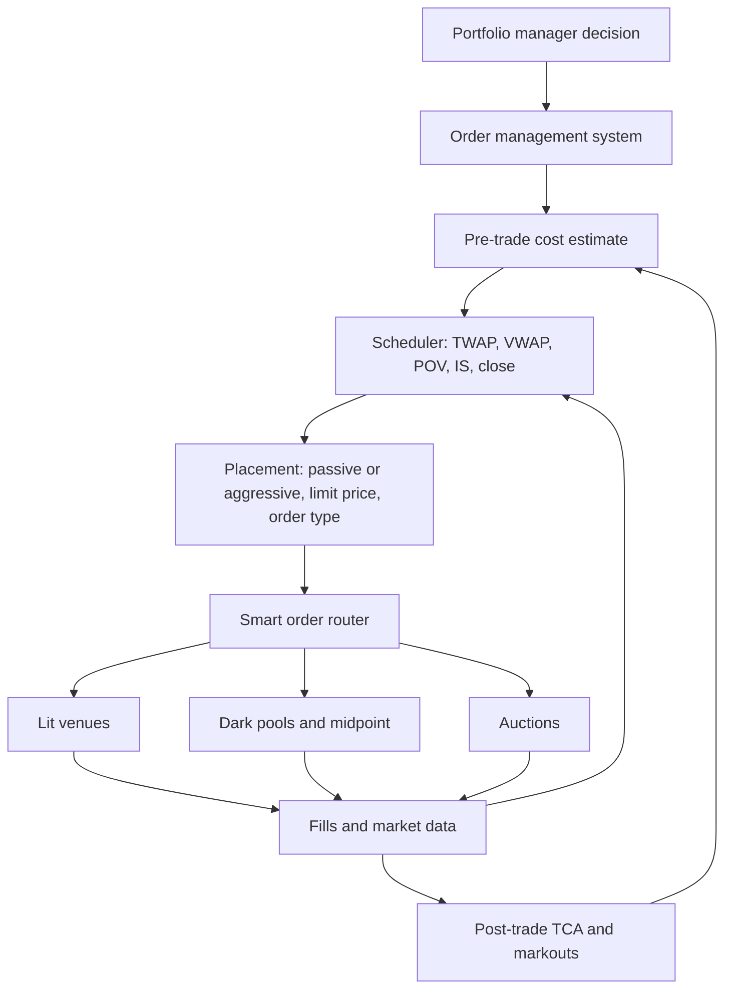

# Execution Algorithms and TCA

## TL;DR

- An execution algorithm has two layers: a scheduler that decides how much to trade in each interval (TWAP, VWAP, POV, implementation shortfall, close), and a placement layer that decides how each child order is priced and routed.
- TWAP slices evenly in time, VWAP follows the expected volume curve, POV trades a fixed fraction of realised volume, and implementation shortfall front-loads according to an urgency parameter (Almgren-Chriss).
- Transaction cost analysis measures execution against a benchmark: arrival price (implementation shortfall) captures the full cost of the decision, while interval VWAP mostly measures timing within the interval and can be gamed.
- Perold's implementation shortfall is the gap between a costless paper portfolio and the real one; the standard expanded breakdown (Kissell 2006) splits it into delay, execution (impact and spread), opportunity cost of unfilled shares, and fees.
- Single-order slippage is dominated by volatility (tens of basis points of noise), so TCA conclusions need hundreds to thousands of orders and markouts to tell impact from adverse price moves.

## Learning objectives

- Implement TWAP, VWAP, POV and implementation-shortfall algorithms.
- Measure execution with implementation shortfall, arrival slippage and markouts.
- Decompose implementation shortfall with Perold's method on a numeric example.
- Explain how each benchmark can be gamed and which one to use for which decision.

## Core concepts

### Architecture of an execution algorithm

The scheduler sets the target cumulative quantity over time; the placement layer tries to beat the schedule's implied cost by resting passively when it is ahead of schedule and crossing the spread when it falls behind; the router picks venues (see [Fragmentation, Reg NMS and Routing](09-Fragmentation-Reg-NMS-and-Routing.md)).
TCA results feed back into the pre-trade model, which is how impact coefficients are calibrated.

### The main schedules

| Algorithm | Schedule | Strength | Weakness |
| :--- | :--- | :--- | :--- |
| TWAP | Equal quantity per time bucket | Simple, predictable completion | Ignores volume pattern; predictable to others |
| VWAP | Quantity proportional to the expected volume curve | Tracks the VWAP benchmark; trades when liquidity is there | Profile forecast error; completes by the end regardless of price |
| POV (participation) | A fixed fraction of realised volume | Adapts to actual liquidity; caps market footprint | Completion time uncertain; chases volume spikes |
| Implementation shortfall | Front-loaded, urgency set by risk aversion | Minimises expected cost plus risk versus arrival | Higher impact early; needs a cost model |
| Target close | Trades into or at the closing auction | Matches a closing benchmark | Concentrated liquidity and imbalance risk |
| Liquidity seeking | Opportunistic, sweeps dark and lit liquidity when it appears | Low footprint for hard-to-trade names | Information leakage and adverse selection in dark venues |

POV with participation rate $p$ of total volume trades $\frac{p}{1 - p}$ times the volume everyone else trades, because its own fills count in the denominator.
The implementation-shortfall schedule is the Almgren-Chriss trajectory in [Optimal Execution: Almgren-Chriss](07-Optimal-Execution-Almgren-Chriss.md), and VWAP is its risk-neutral solution when impact scales with market volume.

### Benchmarks

- Decision price: the price when the portfolio manager decided; the start of the paper portfolio.
- Arrival price: the mid when the order reached the desk or algorithm; the standard benchmark for implementation shortfall algorithms.
- Interval VWAP: the volume-weighted price over the execution window; the benchmark for VWAP algorithms.
- Close (or open): for index and benchmark-tracking funds that are valued at the close.
- Markouts: the mid at fixed horizons after each fill or after completion, which separate temporary impact (reverts) from information (does not).

Signed arrival slippage for side $d$ ($+1$ buy) and average fill price $\bar p$ is $d(\bar p - P_{\text{arr}})/P_{\text{arr}}$, reported in basis points.

### Perold's implementation shortfall

Perold (1988) compares the real portfolio with a paper portfolio that trades the full target $Q$ at the decision price $P_d$ with no cost, and defines the implementation shortfall as the difference in their performance.
The four-way split below, with a separate delay term, is the practitioners' expanded implementation shortfall (Kissell 2006).
For a buy with fills $q_i$ at $p_i$, executed total $Q_e = \sum q_i$, arrival price $P_a$, end-of-horizon price $P_{\text{end}}$ and fees $F$:

$$
\text{IS} = \underbrace{Q_e (P_a - P_d)}_{\text{delay}} + \underbrace{\sum_i q_i (p_i - P_a)}_{\text{execution}} + \underbrace{(Q - Q_e)(P_{\text{end}} - P_d)}_{\text{opportunity}} + \underbrace{F}_{\text{fees}},
$$

which equals paper P&L minus real P&L.
The execution term contains spread and impact; the opportunity term is the cost of not completing, which a manager who cancels after an adverse move must count; the delay term measures the cost of the time between decision and arrival.

### How benchmarks get gamed

- Interval VWAP: if your order is a share $w$ of the interval's volume, your own prices are in the benchmark, $\text{VWAP} = w\,\bar p + (1 - w)\,\bar p_{\text{others}}$, so measured slippage is $(1 - w)$ times the slippage against everyone else.
  A large order can look neutral against VWAP while having moved the price a lot.
- VWAP also says nothing about the decision: a VWAP algorithm that completes on schedule in a rising market can beat VWAP and still have a large arrival shortfall.
- Close benchmarks reward trading at the close regardless of whether that is cheap, and auction imbalances can move the close itself.
- A broker who chooses the benchmark after the fact, or excludes unfilled shares, flatters results; opportunity cost belongs in the number.
- Predictable schedules (exact TWAP slices on the minute) are detectable by other participants, who trade ahead of them; randomised slice sizes and timing reduce leakage.

### Statistics of TCA

For a schedule that trades uniformly over a horizon $T$ in a market with daily volatility $\sigma$, the average fill price differs from the arrival price by a Brownian average with standard deviation $\sigma\sqrt{T/3}$, before any impact.
That noise is large compared with the costs being measured, so TCA compares averages over many orders, normalises by volatility and spread, controls for order difficulty (size relative to volume, urgency, market conditions), and, where possible, randomises the allocation of comparable orders across brokers or algorithms so that differences are not driven by order selection.

## Worked examples

### Example 1: schedules for 100,000 shares

A hypothetical U-shaped profile over 13 half-hour buckets: 12, 9, 7, 6, 6, 5, 5, 5, 6, 7, 8, 10 and 14% of the day.
TWAP trades 7,692.31 shares per bucket.
VWAP trades 12,000 in the first bucket, 5,000 at lunchtime and 14,000 in the last.
After one hour TWAP has done 15.38% of the order and VWAP 21%.

### Example 2: POV completion

Order 150,000 shares, 10% participation, in a stock that trades 2,000,000 shares a day with the profile above (others trade 90% of each bucket's volume).
In the first bucket the algorithm trades $\frac{0.10}{0.90} \times 216{,}000 = 24{,}000$ shares, exactly 10% of the bucket's total.
Cumulative fills reach 136,000 by the end of the tenth bucket, and the order completes in the eleventh bucket (14:30 to 15:00) with 14,000 shares, so it finishes at least an hour before the close.
On a quiet day at 60% of normal volume the same algorithm fills only 120,000 shares by the close: POV controls footprint, not completion.

### Example 3: Perold decomposition

"The PM decides to buy 100,000 shares at 50.00. The order reaches the desk at 50.10. The algorithm buys 20,000 at 50.20, 30,000 at 50.30 and 30,000 at 50.50, then the order is cancelled; the stock closes at 50.60. Commission is half a cent a share."
Executed 80,000 at an average of 50.35.

| Component | Calculation | Dollars | bp of $5,000,000 |
| :--- | :--- | ---: | ---: |
| Delay | $80{,}000 \times 0.10$ | 8,000 | 16.0 |
| Execution | $80{,}000 \times (50.35 - 50.10)$ | 20,000 | 40.0 |
| Opportunity | $20{,}000 \times (50.60 - 50.00)$ | 12,000 | 24.0 |
| Fees | $80{,}000 \times 0.005$ | 400 | 0.8 |
| Total | | 40,400 | 80.8 |

Check: the paper portfolio makes $100{,}000 \times 0.60 = 60{,}000$; the real one makes $80{,}000 \times (50.60 - 50.35) - 400 = 19{,}600$; the difference is 40,400.
The executed shares' arrival slippage alone is $(50.35 - 50.10)/50.10 = 49.90$ bp, which hides both the delay and the cost of the 20,000 unfilled shares.

### Example 4: the same fills against VWAP

The interval VWAP was 50.30, so the algorithm shows 5 cents (9.94 bp) of slippage.
If the order was 30% of interval volume, everyone else's VWAP was $(50.30 - 0.3 \times 50.35)/0.7 = 50.2786$, and the true slippage against the rest of the market was 7.14 cents; the benchmark absorbed 30% of it.

### Example 5: reversion after completion

The mid was 50.55 when the buying finished and 50.40 thirty minutes later.
Of the 0.45 move from arrival to completion, 0.15 (one third) reverted, which points to temporary impact; the remaining 0.30 is permanent impact plus whatever information or market move was under way.

### Example 6: how many orders before TCA means anything

With 2% daily volatility and a uniform half-day schedule, the standard deviation of arrival slippage from price noise alone is $2\% \times \sqrt{0.5/3} = 81.65$ bp (a 20,000-path simulation, seed 8, gives about 81.85).
Pinning a 5 bp average cost at 1.96 standard errors needs about $(1.96 \times 81.65/5)^2 \approx 1{,}024$ independent orders.
Comparing two algorithms is harder: a two-sample test at the 5% level with 80% power needs $2\,((1.96 + 0.84) \times 81.65/5)^2 \approx 4{,}186$ orders per algorithm, and more when orders are correlated through the market.

## Pitfalls

- Measuring only executed shares and ignoring the opportunity cost of cancelled or unfilled quantity.
- Judging an implementation-shortfall algorithm against VWAP, or a VWAP algorithm against arrival, without saying which decision each benchmark evaluates.
- Celebrating "beat VWAP" when the order was a large fraction of volume and set the VWAP.
- Reading one order's slippage as skill or failure; price noise is tens of basis points.
- Using POV with no completion constraint for an order that must finish today.
- Forgetting the $p/(1 - p)$ factor: participating at 20% of total volume means trading 25% of everyone else's volume.
- Letting the scheduler's slices be perfectly regular, which leaks the order to pattern-detecting participants.
- Confusing impact with alpha decay in post-trade analysis: prices that keep rising after your buy may be your signal working, not your impact.

## Interview questions

> [!question]- ms-tca-twap-vwap-pov | Compare TWAP, VWAP and POV in one line each.
> TWAP: equal slices in time; VWAP: slices proportional to the expected volume curve; POV: a fixed fraction of realised volume.
> TWAP and VWAP fix completion time, POV fixes footprint.

> [!question]- ms-tca-pov-factor | You participate at 20% of total volume and others trade 400,000 shares in an interval. How many do you trade?
> 100,000: $0.2/0.8 \times 400{,}000$.
> Your own fills are part of the total volume.

> [!question]- ms-tca-pov-quiet-day | POV at 10% for 150,000 shares in a 2,000,000-share-a-day stock. What happens on a day with 60% of normal volume?
> It fills only 120,000 by the close.
> POV adapts to liquidity but does not guarantee completion.

> [!question]- ms-tca-is-definition | Define implementation shortfall.
> Paper portfolio P&L (all shares at the decision price, no costs) minus real P&L.
> It captures delay, execution cost, opportunity cost of unfilled shares and fees.

> [!question]- ms-tca-perold-numeric | Decide to buy 100,000 at 50.00, arrival 50.10, fill 80,000 at an average 50.35, close 50.60, fees half a cent. Shortfall?
> 40,400 dollars, 80.8 bp: delay 8,000, execution 20,000, opportunity 12,000, fees 400.
> It equals paper P&L 60,000 minus real P&L 19,600.

> [!question]- ms-tca-opportunity-cost | Why must unfilled shares be in the shortfall?
> Because the decision was to own them; if the price ran away and the order was cancelled, that missed gain is a cost of the execution choice.
> Excluding it rewards algorithms that stop trading when prices move against them.

> [!question]- ms-tca-vwap-participation | Your order is 30% of interval volume and you show 5 cents slippage versus VWAP. What is your slippage versus everyone else?
> About 7.14 cents: measured slippage is $(1 - w)$ times true slippage, $0.05/0.7$.

> [!question]- ms-tca-vwap-gaming | How can an algorithm beat VWAP and still execute badly?
> By being a large share of volume (its prices set the benchmark), or by finishing on schedule in a trending market so that VWAP itself moved a lot from arrival.
> VWAP evaluates timing within the window, not the cost of the decision.

> [!question]- ms-tca-benchmark-choice | Which benchmark for an urgent alpha-driven order, and which for an index rebalance at the close?
> Arrival price (implementation shortfall) for the alpha trade; the closing price for the index rebalance, since the fund is valued at the close.

> [!question]- ms-tca-reversion | After a buy program the mid falls back 0.15 of a 0.45 move within 30 minutes. What does that say?
> One third of the move was temporary impact that reverted; the rest is permanent impact plus information or market drift.
> Markouts after completion are how TCA separates them.

> [!question]- ms-tca-noise | Daily vol 2%, uniform half-day schedule. Standard deviation of arrival slippage from noise alone?
> About 82 bp: $\sigma\sqrt{T/3} = 2\% \times \sqrt{0.5/3}$.
> So a single order says almost nothing about algorithm quality.

> [!question]- ms-tca-sample-size | How many orders to detect a 5 bp cost difference with 82 bp of noise per order?
> About 1,000 to put a single algorithm's 5 bp mean at 1.96 standard errors: $(1.96 \times 81.65/5)^2 \approx 1{,}024$.
> To compare two algorithms at 5% significance and 80% power, about 4,186 per algorithm: $2\,((1.96 + 0.84) \times 81.65/5)^2$; more if orders are correlated.

> [!question]- ms-tca-is-algo | How does an implementation-shortfall algorithm decide how fast to trade?
> It front-loads along an Almgren-Chriss style trajectory whose urgency $\kappa = \sqrt{\lambda\sigma^2/\eta}$ rises with risk aversion and volatility and falls with impact.
> It then adapts to fills, volume and price, often with participation caps.

> [!question]- ms-tca-placement | What does the placement layer do that the scheduler does not?
> It chooses order type, limit price and venue for each child order, resting passively when ahead of schedule to earn the spread and crossing when behind.
> The scheduler only sets the target quantity over time.

> [!question]- ms-tca-leakage | Why randomise slice sizes and timing?
> Regular slices are detectable; other participants can infer the parent order and trade ahead of it, raising your impact.

> [!question]- ms-tca-algo-comparison | How would you fairly compare two brokers' algorithms?
> Randomly allocate comparable orders between them, measure arrival shortfall including opportunity cost, normalise by spread and volatility, control for size relative to volume, and test with enough orders for the noise.
> Without randomisation, order selection biases the comparison.

## In this repo and SDE-Interview-Prep

- Code: [execution_algos.py](code/execution_algos.py) reproduces every number above (`python execution_algos.py`).
- Code: [almgren_chriss.py](code/almgren_chriss.py) for the implementation-shortfall schedule.
- [Smart order routing and execution algorithms (SDE-Interview-Prep)](https://github.com/shreejitverma/SDE-Interview-Prep/blob/main/14-Low-Latency-Systems/11%20-%20Participant-Side%20Systems/Smart%20Order%20Routing%20and%20Execution%20Algorithms.md)

## Further reading

- Andre Perold (1988), The Implementation Shortfall: Paper versus Reality, *Journal of Portfolio Management* 14(3).
- Larry Harris, *Trading and Exchanges: Market Microstructure for Practitioners* (Oxford University Press, 2003).
- Barry Johnson, *Algorithmic Trading and DMA* (4Myeloma Press, 2010).
- Robert Kissell, *The Science of Algorithmic Trading and Portfolio Management* (Academic Press, 2013).
- Robert Kissell (2006), The Expanded Implementation Shortfall: Understanding Transaction Cost Components, *Journal of Trading* 1(3).
- Cartea, Jaimungal and Penalva, *Algorithmic and High-Frequency Trading* (Cambridge University Press, 2015).
- Related notes: [Market Impact Models](06-Market-Impact-Models.md), [Optimal Execution: Almgren-Chriss](07-Optimal-Execution-Almgren-Chriss.md), [Transaction Costs and Turnover](../09-Alpha-Research-and-Portfolio/13-Transaction-Costs-and-Turnover.md).
