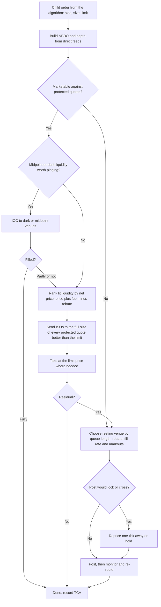

# Fragmentation, Reg NMS and Smart Order Routing

## TL;DR

- US equities trade on many exchanges, dark pools and off-exchange dealers at once; Regulation NMS stitches them together with a consolidated best bid and offer (NBBO), fair access and fee caps (Rule 610), order protection (Rule 611) and a minimum tick (Rule 612).
- Rule 611 requires trading centers to have policies that prevent trade-throughs of protected quotations (displayed, automated exchange best quotes); the intermarket sweep order (ISO) is the standard way to trade through legally, by simultaneously taking the full size of every better protected quote.
- In June 2026 the SEC proposed rescinding Rule 611 and the locked and crossed markets rule 610(e) (Release 34-105655); as of 2026-10 they remain in force.
- A smart order router ranks liquidity by net price after fees, fill probability and adverse selection, pings dark midpoint liquidity, sweeps protected quotes with ISOs and rests the residual, using direct feeds rather than the slower SIP.
- Reg SHO constrains short sales: marking (Rule 200), the 10% price test (Rule 201), locates with a bona fide market-making exception (Rule 203) and fail close-outs (Rule 204).
- The EU has no order protection rule; MiFID II Article 27 instead requires firms to take all sufficient steps to obtain the best possible result for clients.

## Learning objectives

- Explain the NBBO, protected quotes, trade-throughs and intermarket sweep orders.
- Design a smart order router across lit and dark venues.
- Explain Reg SHO short-sale constraints for a market maker.
- Quote the primary-source text of Rules 610, 611 and 612 and state their 2024 to 2026 changes with dates.

## Core concepts

### Fragmentation and consolidation

A US stock can trade on every registered exchange, on alternative trading systems (dark pools) and with broker-dealers off-exchange.
Competition between venues lowered fees and spreads but split liquidity, so a buyer looking only at one venue can miss better prices elsewhere.
Regulation NMS (adopted 2005) answers with four pieces: consolidated market data (Rule 603 and the national market system plans), access and fee caps (Rule 610), order protection (Rule 611) and a minimum pricing increment (Rule 612).

### Definitions from Rule 600(b)

- Protected bid or protected offer (600(b)(81)): "a quotation in an NMS stock that: (i) Is displayed by an automated trading center; (ii) Is disseminated pursuant to an effective national market system plan; and (iii) Is an automated quotation that is the best bid or best offer of a national securities exchange, or the best bid or best offer of a national securities association."
- Trade-through (600(b)(105)): "the purchase or sale of an NMS stock during regular trading hours, either as principal or agent, at a price that is lower than a protected bid or higher than a protected offer."
- Intermarket sweep order (600(b)(47)): a limit order marked as an ISO, sent while "one or more additional limit orders, as necessary, are routed to execute against the full displayed size of any protected bid, in the case of a limit order to sell, or the full displayed size of any protected offer, in the case of a limit order to buy, for the NMS stock with a price that is superior to the limit price of the limit order identified as an intermarket sweep order."
- Round lot (600(b)(93), first defined by the 2020 Market Data Infrastructure rules and revised in 2024, in effect since 2025-11-03): 100 shares for stocks with an average closing price of $250.00 or less, 40 shares from $250.01 to $1,000.00, 10 shares from $1,000.01 to $10,000.00 and 1 share above that.

The NBBO is the highest protected bid and lowest protected offer across venues.
Only an exchange's top-of-book is protected: depth below the best price and dark liquidity are not.

### Rule 611: order protection

Rule 611(a)(1): "A trading center shall establish, maintain, and enforce written policies and procedures that are reasonably designed to prevent trade-throughs on that trading center of protected quotations in NMS stocks that do not fall within an exception set forth in paragraph (b) of this section and, if relying on such an exception, that are reasonably designed to assure compliance with the terms of the exception."
Rule 611(a)(2) requires regular surveillance of those policies.

The exceptions in 611(b), paraphrased:

1. the displaying venue had a failure, material delay or malfunction;
2. the trade was not a regular-way contract;
3. a single-priced opening, reopening or closing transaction (auctions);
4. a crossed market (a protected bid above a protected offer);
5. the execution of an order identified as an intermarket sweep order;
6. the trading center itself simultaneously routed ISOs to take the full displayed size of every protected quote traded through;
7. a price not based on the quoted price at the time of execution and not reasonably determinable when committed;
8. the traded-through venue displayed, within one second before execution, a best quote at a price equal to or worse than the trade (the flickering-quote exception);
9. a stopped order for a customer, under stated conditions.

Rule 611 is a rule on trading centers, not on traders: the router or venue must not execute through a better protected quote unless an exception applies, which is why ISOs exist and why every SOR logs the protected-quote state it saw.

Status as of 2026-10: the SEC proposed on 2026-06-11 to rescind Rule 611 and the locked and crossed markets provision Rule 610(e), with comments due 2026-08-17 (Release 34-105655, File No. S7-2026-20).
The proposal argues that the 2005 rules raised costs and complexity, limited order-handling choice and contributed to fragmentation, and that Rule 611 is not needed as a backstop to best execution; it is a proposal, so both rules remain in force until a final rule is adopted and becomes effective.

### Rule 610: access, fees and locked markets

- 610(a) and (b): no unfairly discriminatory terms that prevent or inhibit efficient access to quotations.
- 610(c): the access fee cap, $0.003 per share at $1.00 or more as adopted in 2005, amended in 2024 to $0.001, with compliance exempted until the first business day of November 2027 (Release 34-105656); details in [Exchange Mechanics, Auctions and Fees](02-Exchange-Mechanics-Auctions-and-Fees.md).
- 610(e): exchange rules must "Require its members reasonably to avoid" "Displaying quotations that lock or cross any protected quotation in an NMS stock" (and manual quotations that lock or cross).
  A locked market (bid equals another venue's offer) is prohibited for displayed quotes, so a post-only bid that would lock is rejected or repriced one tick away.

Why the fee cap matters for order protection: if a venue could charge any fee, a protected quote could be economically worse than its displayed price, and forcing routers to take it would be unfair.
The cap bounds the gap between displayed and net prices.

### Rule 612 and Rule 603

Rule 612 forbids sub-penny quoting at $1.00 and above (and sub-$0.0001 below $1.00); the 2024 amendment's half-penny tick for tightly quoted stocks is exempted until November 2027.
Rule 603 and the NMS plans create consolidated data distributed by exclusive securities information processors (SIPs): the CTA and CQ plans for NYSE-listed and other non-Nasdaq stocks (Tapes A and B) and the UTP plan for Nasdaq-listed stocks (Tape C).
The 2020 Market Data Infrastructure rules define round lots by price (tiers revised in 2024, above) and add odd-lot information; the SEC's June 2026 proposing release notes that the SIPs began disseminating best odd-lot order information on 2026-04-27 while full odd-lot dissemination is delayed to May 2028.

### SIP versus direct feeds

- The SIP consolidates top-of-book quotes and trades from every venue and is the reference for many regulatory purposes and for retail displays.
- Direct proprietary feeds from each exchange carry depth of book and individual order events, and arrive earlier because they skip the consolidation hop.
- A router or market maker that uses only the SIP sees an NBBO that is stale by the consolidation delay; fast participants build their own NBBO from direct feeds, and trading against a quote the SIP still shows but the direct feed has already removed is a form of latency arbitrage; see [Latency Arbitrage and Speed](10-Latency-Arbitrage-and-Speed.md).
- Routers and trading centers commonly run their order-protection logic on direct feeds, which is why they record which feed and timestamp each decision used.

### Smart order routing

Design points interviewers look for:

- Net price, not displayed price: rank by price plus taker fee (or minus rebate), and for passive orders by expected value including fill probability and markouts.
- Simultaneity: when sweeping several venues, send so that orders arrive at nearly the same time, otherwise the first fill signals the order and liquidity on slower venues fades before the rest arrive.
- Dark first or lit first is an empirical trade-off: midpoint fills save the half-spread and fees, but pinging leaks information and delays the trade.
- Compliance: every routing decision logs the protected-quote snapshot, the ISO legs and the exception relied on, so it can be reconstructed.
- Venue analytics: maintain per-venue fill rates, fade rates, markouts and latency, and feed them back into the ranking.

### Reg SHO for a market maker

- Rule 200: every sale is marked long, short or short exempt.
- Rule 201(b)(1)(i): trading centers must have policies to "prevent the execution or display of a short sale order of a covered security at a price that is less than or equal to the current national best bid if the price of that covered security decreases by 10% or more from the covered security's closing price as determined by the listing market", for the rest of that day and the following day; a short sale displayed above the national best bid when first displayed may still execute.
- Rule 203(b)(1): a broker-dealer may not effect a short sale without having borrowed the security, arranged to borrow it, or having "reasonable grounds to believe that the security can be borrowed so that it can be delivered on the date delivery is due", and documenting it; 203(b)(2)(iii) exempts "short sales effected by a market maker in connection with bona-fide market making activities".
- Rule 204: a fail to deliver must be closed out by the beginning of regular trading hours on the settlement day following the settlement date; fails from long sales (as shown in the participant's books and records, Rule 204(a)(1)) and fails attributable to bona fide market making (Rule 204(a)(3)) get until the third consecutive settlement day following settlement date.

A market maker therefore needs a per-symbol Rule 201 state machine wired into quoting (once triggered, short offers must be above the NBB), a locate service for anything not covered by the market-making exception, and a fails monitor; see the practical deep dive [Reg NMS and SHO, practical](Regulation/Reg-NMS-SHO-Practical.md).

### MiFID II comparison

The EU has no consolidated order protection rule; each firm owes best execution.
Article 27(1) of Directive 2014/65/EU: "Member States shall require that investment firms take all sufficient steps to obtain, when executing orders, the best possible result for their clients taking into account price, costs, speed, likelihood of execution and settlement, size, nature or any other consideration relevant to the execution of the order."
For retail clients the best possible result is judged by total consideration, the price plus all execution-related costs including venue, clearing and settlement fees.
The US equivalent duty is FINRA Rule 5310(a)(1), which requires members to "use reasonable diligence to ascertain the best market for the subject security" so that the customer's price is as favourable as possible under prevailing market conditions.
The design difference: Reg NMS hard-codes a price priority across venues (protect the displayed best quote), while MiFID II leaves the weighting of price, cost, speed and likelihood of execution to the firm's execution policy.

## Worked examples

### Example 1: build the NBBO and sweep it

Hypothetical protected quotes (bid x size / offer x size, taker fee):

| Venue | Bid | Offer | Taker fee |
| :--- | :--- | :--- | ---: |
| A | 20.00 x 500 | 20.03 x 600 | 30 mils |
| B | 20.01 x 200 | 20.02 x 400 | 30 mils |
| C | 19.99 x 1,000 | 20.02 x 300 | 5-mil rebate |
| D | 20.01 x 300 | 20.04 x 2,000 | 29 mils |

NBB 20.01 for 500 shares (B and D), NBO 20.02 for 700 shares (B and C).
"Buy 2,000 with a limit of 20.03."
Executing at 20.03 on A alone would trade through the 20.02 offers on B and C.
The compliant sweep sends ISOs for the full displayed 300 on C and 400 on B at 20.02 and takes A's 600 at 20.03, also marked ISO: 1,300 shares at an average of 20.024615.
Fees: $400 \times 0.003 + 600 \times 0.003 - 300 \times 0.0005 = 2.85$ dollars, so the all-in average is 20.026808.
The remaining 700 shares can rest as a bid at 20.03, which no longer locks anything once A's offer is gone (the next offer is D's 20.04).

### Example 2: net price at the same displayed price

B and C both offer at 20.02.
All-in, B costs 20.0230 and C 20.0195, so the router takes C first; on 300 shares that saves 1.05 dollars.

### Example 3: a dark ping

Suppose (hypothetically) a midpoint ping fills 30% of the time and saves the half-spread plus the fee, $0.005 + 0.003 = 0.008$ per share, while an unfilled ping costs 0.002 in adverse movement.
Expected saving: $0.3 \times 0.008 - 0.7 \times 0.002 = 0.0010$ per share.
The decision hinges on measured fill rates and the information cost of the ping, both venue- and stock-specific.

### Example 4: tick and lock checks

20.015 is not a valid price under a one-cent increment but would be under the amended $0.005 increment (2.5 bp of a $20 stock); 0.5012 is valid below $1.00.
A post-only bid at 20.02 would lock the 20.02 offers, so it is rejected or repriced to 20.01.

### Example 5: Rule 201

A stock closed at 25.00 yesterday.
If it trades at or below 22.50 the price test triggers for the rest of the day and the next.
With the NBB at 22.40, a short sale at 22.41 is permitted and one at 22.40 is not.

## Pitfalls

- Thinking depth below the top of book is protected; only each exchange's best displayed automated quote is.
- Sending an ISO without simultaneously taking the full displayed size of every better protected quote; the ISO flag carries that obligation.
- Building the NBBO from the SIP in a latency-sensitive router; it lags the direct feeds.
- Ranking venues by displayed price and ignoring fees, rebates, fill probability and markouts.
- Posting a quote that locks the market and being surprised by a post-only reject.
- Treating the June 2026 proposal to rescind Rule 611 as law; as of 2026-10 it is a proposal.
- Assuming the market-maker locate exception covers all short selling by a market-making firm; it covers bona fide market making only.
- Equating MiFID II best execution with Reg NMS order protection; one is a firm-level duty, the other a venue-level price rule.

## Interview questions

> [!question]- ms-nms-protected-quote | What is a protected quotation?
> An automated quotation that is an exchange's (or FINRA's) best bid or offer, displayed by an automated trading center and disseminated under an NMS plan.
> Depth below the top of book and dark liquidity are not protected.

> [!question]- ms-nms-trade-through | Define a trade-through.
> A purchase above a protected offer or a sale below a protected bid during regular trading hours.
> Rule 611 requires trading centers to have policies that prevent them unless an exception applies.

> [!question]- ms-nms-iso | What does an intermarket sweep order oblige the sender to do?
> Simultaneously route orders to execute against the full displayed size of every protected quote priced better than the ISO's limit.
> The receiving venue may then execute without checking other venues' protected quotes.

> [!question]- ms-nms-sweep-numeric | Protected offers: 20.02 x 300 on C, 20.02 x 400 on B, 20.03 x 600 on A. Buy 2,000 limit 20.03 with ISOs. Fills and average price?
> 1,300 shares at about 20.0246: 300 and 400 at 20.02, 600 at 20.03.
> The other 700 can rest at 20.03.

> [!question]- ms-nms-611-exceptions | Name four Rule 611 exceptions.
> Venue systems failure, single-priced opening or closing auctions, ISOs, and the one-second flickering-quote exception (also crossed markets, non-regular-way trades, stopped orders, non-quote-based prices).

> [!question]- ms-nms-611-status | What is the status of Rule 611 as of 2026-10?
> In force; the SEC proposed rescinding it and Rule 610(e) on 2026-06-11 (Release 34-105655), with comments due 2026-08-17.
> A proposal does not change obligations until a final rule is adopted and effective.

> [!question]- ms-nms-locked-market | Why is a post-only bid at the NBO rejected or repriced?
> It would lock a protected quotation, which Rule 610(e) requires exchanges' members to reasonably avoid.
> The venue rejects it or slides it one tick away.

> [!question]- ms-nms-fee-cap-link | Why does order protection need an access fee cap?
> Otherwise a venue could post the best displayed price and charge a large fee, forcing routers to take an economically worse price.
> The cap bounds the gap between displayed and net prices.

> [!question]- ms-nms-net-price-routing | Two venues offer 20.02, one charging 30 mils to take and one paying 5 mils. Which first and what is saved on 300 shares?
> The rebate venue; 1.05 dollars on 300 shares (3.5 mils per share).

> [!question]- ms-nms-sip-vs-direct | Why do fast routers build their own NBBO from direct feeds?
> The SIP adds a consolidation hop and lags the direct feeds, so its NBBO can be stale; direct feeds also carry depth and order-level events.

> [!question]- ms-nms-sor-design | Outline a smart order router for a marketable buy.
> Build the NBBO from direct feeds, optionally ping dark midpoint liquidity, rank lit offers by net price, sweep every better protected offer with ISOs sent to arrive together, take at the limit, rest the residual without locking, and log everything for compliance and TCA.

> [!question]- ms-nms-simultaneous-arrival | Why should a sweep's child orders arrive at venues at the same time?
> The first fill reveals the order; fast participants then cancel or reprice liquidity on venues the router has not reached yet (fading).
> Routers compensate for the latency to each venue.

> [!question]- ms-nms-rule201 | A stock closed at 25.00 and now trades at 22.40 bid. Can a market maker short at 22.40?
> No: Rule 201 has triggered (down more than 10%), so short sales may not execute or display at or below the national best bid.
> 22.41 is permitted.

> [!question]- ms-nms-locate-exception | Does a market maker need a locate before shorting?
> Not for short sales in connection with bona fide market making (Rule 203(b)(2)(iii)); otherwise yes, borrowed, arranged or reasonable grounds to borrow, documented.

> [!question]- ms-nms-close-out | When must a fail to deliver be closed out under Rule 204?
> By the start of regular trading on the settlement day after settlement date; for fails from long sales shown in the books and records or from bona fide market making, by the third consecutive settlement day after settlement date.

> [!question]- ms-nms-mifid-vs-nms | How does MiFID II best execution differ from Reg NMS order protection?
> MiFID II Article 27 obliges firms to take all sufficient steps for the best possible result across price, costs, speed, likelihood and other factors; there is no venue-level trade-through rule.
> Reg NMS imposes a venue-level price priority for displayed top-of-book quotes, alongside FINRA's best execution duty.

> [!question]- ms-nms-round-lot | What is a round lot for a stock averaging $600 under Rule 600(b)(93) as in effect since November 2025?
> 40 shares: 100 for $250.00 or less, 40 for $250.01 to $1,000.00, 10 up to $10,000.00, then 1.

## In this repo and SDE-Interview-Prep

- Code: [routing_reg_nms.py](code/routing_reg_nms.py) reproduces every number above (`python routing_reg_nms.py`).
- Deep dives in this repo: [Reg NMS and SHO, practical](Regulation/Reg-NMS-SHO-Practical.md) and [Reg NMS and SHO for market making](../08-Market-Making/Quant-Dev-MM-Guide/01_Regulatory_Framework_NMS_SHO.md).
- [Market fragmentation and Reg NMS (SDE-Interview-Prep)](https://github.com/shreejitverma/SDE-Interview-Prep/blob/main/14-Low-Latency-Systems/01%20-%20Market%20%26%20Microstructure%20Fundamentals/Market%20Fragmentation%20and%20Reg%20NMS.md)
- [SIP vs direct market data feeds (SDE-Interview-Prep)](https://github.com/shreejitverma/SDE-Interview-Prep/blob/main/14-Low-Latency-Systems/01%20-%20Market%20%26%20Microstructure%20Fundamentals/SIP%20vs%20Direct%20Market%20Data%20Feeds.md)
- [European market structure and MiFID II (SDE-Interview-Prep)](https://github.com/shreejitverma/SDE-Interview-Prep/blob/main/14-Low-Latency-Systems/01%20-%20Market%20%26%20Microstructure%20Fundamentals/European%20Market%20Structure%20and%20MiFID%20II.md)
- [Smart order routing and execution algorithms (SDE-Interview-Prep)](https://github.com/shreejitverma/SDE-Interview-Prep/blob/main/14-Low-Latency-Systems/11%20-%20Participant-Side%20Systems/Smart%20Order%20Routing%20and%20Execution%20Algorithms.md)

## Further reading

- 17 CFR 242.600 to 242.612 (Regulation NMS) and 242.200 to 242.204 (Regulation SHO), eCFR.
- SEC Release 34-105655 (2026), The Trade-Through Rule and Locked and Crossed Markets Provisions of Regulation NMS (proposed rule).
- SEC Release 34-105656 (2026), temporary exemptive relief for Rules 610(c) and 612.
- FINRA Rule 5310, Best Execution and Interpositioning.
- Directive 2014/65/EU (MiFID II), Article 27.
- Larry Harris, *Trading and Exchanges: Market Microstructure for Practitioners* (Oxford University Press, 2003).
