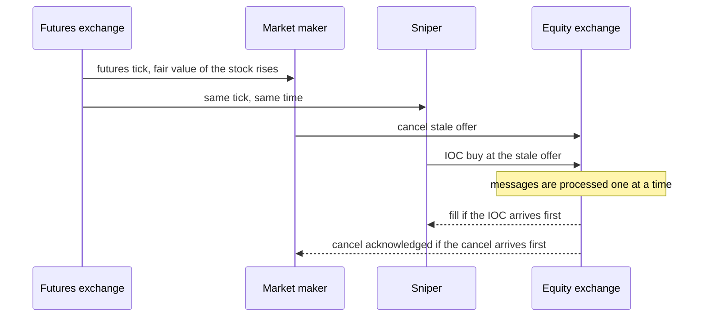

# Latency Arbitrage and the Value of Speed

## TL;DR

- When a public signal moves fair value (a futures tick, a trade on another venue), every resting quote that has not yet moved is stale; fast traders race to take it while its owner races to cancel, and a continuous order book serves whoever arrives first.
- Budish, Cramton and Shim show that ES and SPY prices, almost perfectly correlated at human time scales, decouple at millisecond horizons, creating frequent arbitrage opportunities whose median duration fell from 97 ms in 2005 to 7 ms in 2011 while the profits stayed (in their 2013 working-paper data).
- In their model the market maker's zero-profit condition puts the cost of being sniped into the spread: $\lambda_{\text{jump}} \Pr(J > s/2)\, \mathbb{E}[J - s/2 \mid J > s/2] = \lambda_{\text{fund}}\, s/2$, so investors pay for the arms race through wider spreads.
- Frequent batch auctions replace continuous matching with uniform-price auctions at short discrete intervals: a speed edge $\delta$ only matters for signals that arrive in the last $\delta$ of an interval $\tau$, and competition moves from speed to price.
- Speed bumps such as IEX's 350-microsecond delay are a narrower fix: they delay incoming orders so that the exchange's own pegged orders can reprice before snipers arrive; the SEC treats delays under a millisecond as potentially de minimis for protected-quote status.

## Learning objectives

- Explain stale-quote sniping and why speed matters to market makers.
- Discuss frequent batch auctions and speed bumps as market design responses.
- Solve the Budish-Cramton-Shim zero-profit condition for the equilibrium spread and entry.
- Compute the expected cost of losing latency races and the value of a speed bump.

## Core concepts

### Anatomy of a stale-quote race

The market maker and the snipers react to the same public information.
Nothing is learned that the market maker did not also know; the only question is who gets to the matching engine first.
With $N$ equally fast participants racing (one maker, $N - 1$ snipers), the maker loses with probability $(N - 1)/N$.
This is the latency component of adverse selection in [Adverse Selection and Flow Toxicity](05-Adverse-Selection-and-Flow-Toxicity.md): a fill that happens only because your quote was stale.

### The empirical case (Budish, Cramton and Shim)

Using millisecond direct-feed data on the E-mini S&P 500 future (ES) and the SPDR S&P 500 ETF (SPY), 2005 to 2011, the 2013 working-paper version reports:

- correlations between ES and SPY returns are close to one at minute horizons and essentially zero at high enough frequency; in 2011 the correlation reaches 0.50 at a 142 ms interval, against 2,627 ms in 2005;
- the breakdown creates mechanical arbitrage opportunities, about a thousand a day, worth on the order of $75 million a year in ES-SPY alone (as low as $35 million in 2005 and as high as $195 million in 2008), most of them initiated by a price change in ES;
- the median duration of an opportunity fell from 97 ms in 2005 to 7 ms in 2011, while the profit per opportunity did not fall: competition in speed raised the bar for capturing the prize without shrinking the prize.

They also recount Spread Networks' New York to Chicago fibre, reported to cost about $300 million, which cut round-trip time from 16 to 13 ms before microwave links cut it further to 10, 9 and 8.5 ms.

### The model: sniping is a tax on liquidity

A signal $y$ (fair value) jumps at rate $\lambda_{\text{jump}}$ by $J$; fundamental investors arrive at rate $\lambda_{\text{fund}}$ and pay half the spread $s/2$.
One market maker provides liquidity; $N - 1$ others snipe.
When a jump exceeds $s/2$, the maker's quote is stale, everyone races, and the maker loses with probability $(N-1)/N$.
Zero profit for the liquidity provider and for each sniper, with speed costing $c_{\text{speed}}$ per unit time, gives two equations whose combination is

$$
\lambda_{\text{fund}}\,\frac{s}{2} = N\, c_{\text{speed}}, \qquad
\lambda_{\text{jump}} \Pr\!\left(J > \tfrac{s}{2}\right) \mathbb{E}\!\left[J - \tfrac{s}{2} \,\middle|\, J > \tfrac{s}{2}\right] = \lambda_{\text{fund}}\,\frac{s}{2}.
$$

The first says that all spending on speed is paid by fundamental investors through the spread.
The second pins the spread: the left side (sniping cost per unit time, falling in $s$) equals the right side (revenue from investors, rising in $s$), so the solution is unique.
Speed investment is a prisoner's dilemma: everyone would be better off not investing, but each firm's best response is to invest.

### Frequent batch auctions

Budish, Cramton and Shim propose replacing the continuous limit order book with uniform-price sealed-bid double auctions held at frequent discrete intervals.
Two effects:

- A speed advantage $\delta$ only matters if the signal arrives in the last $\delta$ of a batch interval $\tau$, so its value shrinks roughly in proportion to $\delta/\tau$; with a one-second batch, a one-millisecond edge is worth about a thousandth as much as in continuous trading.
- Within a batch, several market makers who all saw the signal can all update their quotes, and the auction clears at one price, so competition is on price rather than on who is first.

Costs and objections: orders wait for the next batch, cross-venue and cross-asset batching must be coordinated, and the design changes the economics of every participant, which is why adoption has been limited.

### Speed bumps

A speed bump delays messages by a fixed time.
IEX was approved as a national securities exchange on 2016-06-17 (Release 34-78101) with a point-of-presence and coil delay of 350 microseconds on inbound orders, while inbound market data from other venues to IEX does not pass through the coil.
That asymmetry is the point: IEX's own pegged orders reprice from undelayed market data before a sniper's order, delayed by 350 microseconds, reaches the matching engine; IEX also uses a crumbling-quote signal to anticipate when the NBBO is about to move.
The same day, the SEC interpreted "immediate" for automated quotations under Rule 611 to include de minimis delays, stating its preliminary belief that delays of less than a millisecond "may be at a de minimis level" (Release 34-78102), so a venue with such a bump can still have protected quotes.

Asymmetric bumps that delay only liquidity-taking orders, while letting makers cancel immediately, protect makers directly; symmetric bumps only shift everyone's clock unless the venue itself acts on undelayed information.

### How practitioners think about speed

- For a market maker, speed is defensive: the value of a microsecond is the reduction in sniping losses, $\lambda_{\text{jump}} \times \Pr(\text{stale}) \times \text{loss} \times \Delta\Pr(\text{lose race})$, not a source of alpha.
- For a taker, speed is offensive and the prize is the stale quote; the profit pool depends on how often signals move fair value by more than the half-spread.
- Quoting wider or smaller when the futures or a lead venue is moving, or using venue protections, are substitutes for raw speed.
- Physical limits bound the race: light covers 1,000 km in 3.34 ms in vacuum and about 4.90 ms in fibre (refractive index about 1.47), which is why microwave and millimetre-wave links between data centres exist.

## Worked examples

### Example 1: equilibrium spread with exponential jumps

Hypothetical parameters per second: fundamental investors arrive at $\lambda_{\text{fund}} = 1$, jumps at $\lambda_{\text{jump}} = 0.5$ with exponential size of mean 1 cent, speed costs $c_{\text{speed}} = 0.0005$ dollars per second.
For exponential jumps $\Pr(J > h)\,\mathbb{E}[J - h \mid J > h] = \mu_J e^{-h/\mu_J}$, so the condition is $0.5 \times 0.01\,e^{-h/0.01} = h$.
With $u = h/0.01$, $0.5\,e^{-u} = u$, so $u = W(0.5) = 0.351734$ (Lambert W) and $h = 0.0035173$: a spread of 0.0070346 dollars.
Entry is $N = \lambda_{\text{fund}}\,h / c_{\text{speed}} \approx 7.03$ firms, whose total speed spending equals the investors' spread payments.

Comparative statics:

- twice as many jumps (more volatile signal): spread 0.0113429;
- twice as many fundamental investors: spread 0.0040778.

### Example 2: batching shrinks the sniping term

If only jumps landing in the last $\delta$ of each batch can be sniped, the sniping term scales by $\delta/\tau$ in this stylised version.
With $\delta/\tau = 0.1$ the spread falls to 0.00095345; with $\delta/\tau = 0.001$ (a 1 ms edge in a 1 s batch) to 0.00000999.
The full Budish-Cramton-Shim analysis is richer, but the direction and the $\delta/\tau$ scaling are the core intuition.

### Example 3: one race

"SPY offer at 450.01 for 1,000 shares; a futures tick moves SPY's fair value to 450.035."
A sniper who wins buys 1,000 shares worth 0.025 more than he pays: 25 dollars.
With five equally fast participants (the maker and four snipers) the maker loses the race with probability 0.8, an expected loss of 20 dollars, and each sniper expects 5 dollars.
At 1,000 such events a day the maker loses about 20,000 dollars a day, which it must recover from the spread or by being faster.

### Example 4: an asymmetric speed bump

The maker's cancel reaches the matching engine 50 microseconds after the signal, the sniper's IOC 10 microseconds after it.
Without a bump the sniper wins.
With a 350-microsecond delay on takers only, the sniper's order arrives at 360 microseconds and the maker's cancel is 310 microseconds ahead.

## Pitfalls

- Calling latency arbitrage "front-running"; the snipers trade on public information, the problem is the race the market design creates.
- Assuming the arms race competes the profits away; the empirical point is that it raises the speed needed while the prize per opportunity persists.
- Thinking a symmetric speed bump helps makers by itself; it delays cancels too, unless the venue reprices on undelayed data.
- Treating the BCS figures as current market statistics; they come from 2005 to 2011 ES-SPY data.
- Measuring the value of speed by gross P&L of fast fills instead of the reduction in adverse selection on resting quotes.
- Forgetting that a batch auction changes queue priority, order types and every participant's tactics, not only latency.

## Interview questions

> [!question]- ms-lat-stale-quote | What is stale-quote sniping?
> Taking a resting quote whose price has not yet been updated after a public signal moved fair value.
> The maker and the sniper see the same signal; the continuous book serves whoever arrives first.

> [!question]- ms-lat-race-numeric | Stale offer 450.01 x 1,000, new fair value 450.035, five equally fast participants. Maker's expected loss?
> 20 dollars: 25 dollars of value lost with probability 4/5.
> Each sniper expects 5 dollars.

> [!question]- ms-lat-bcs-findings | What did Budish, Cramton and Shim find in ES-SPY data?
> Correlation breaks down at high frequency, creating about a thousand arbitrage opportunities a day worth on the order of 75 million dollars a year; their median duration fell from 97 ms (2005) to 7 ms (2011) while profits per opportunity did not fall.
> Figures from their 2013 working paper.

> [!question]- ms-lat-zero-profit | Write the BCS zero-profit condition for the spread.
> $\lambda_{\text{jump}} \Pr(J > s/2)\,\mathbb{E}[J - s/2 \mid J > s/2] = \lambda_{\text{fund}}\,s/2$: sniping losses equal revenue from fundamental investors.
> Sniping cost falls and revenue rises in $s$, so the solution is unique.

> [!question]- ms-lat-who-pays | In the BCS model, who pays for speed investment?
> Fundamental investors, through the spread: $\lambda_{\text{fund}}\,s/2 = N c_{\text{speed}}$.
> Sniping is zero-sum among market makers.

> [!question]- ms-lat-exp-jumps | Jumps are exponential with mean 1 cent at 0.5 per second, investors arrive at 1 per second. Equilibrium spread?
> About 0.70 cents: $h = 0.01\,W(0.5) = 0.0035173$, spread $2h$.

> [!question]- ms-lat-prisoners-dilemma | Why is the speed race a prisoner's dilemma?
> All market makers would be better off if none invested, but each one's best response is to invest, so all do and the prize is unchanged.

> [!question]- ms-lat-fba | What is a frequent batch auction and why does it reduce sniping?
> A uniform-price sealed-bid double auction run at short discrete intervals.
> A speed edge matters only for signals in the last $\delta$ of an interval $\tau$ (value scales like $\delta/\tau$), and within a batch makers compete on price, not arrival order.

> [!question]- ms-lat-fba-costs | What are the costs of frequent batch auctions?
> Orders wait up to one interval, venues and related instruments must coordinate batch times, and participants must redesign order types and tactics.

> [!question]- ms-lat-iex | How does IEX's speed bump work?
> Inbound orders pass a 350-microsecond point-of-presence and coil delay while IEX's market data from other venues does not, so IEX's pegged orders reprice before a sniper's delayed order arrives.
> The SEC approved IEX as an exchange on 2016-06-17.

> [!question]- ms-lat-de-minimis | Can a venue with an intentional delay still display protected quotes?
> Yes if the delay is de minimis; in 2016 the SEC said delays under a millisecond may be de minimis for "immediate" response under Rule 611 (Release 34-78102).

> [!question]- ms-lat-asymmetric-bump | Why does an asymmetric speed bump protect makers but a symmetric one may not?
> Delaying only takers gives cancels a head start; a symmetric bump delays cancels too, so relative arrival order is unchanged unless the venue acts on undelayed data.

> [!question]- ms-lat-value-of-speed | How should a market maker value a latency improvement?
> As the reduction in expected sniping losses: jump rate times probability the quote is stale times loss per event times the change in probability of losing the race.
> Compare with the cost of the technology.

> [!question]- ms-lat-light | How long does light take to travel 1,000 km in fibre?
> About 4.9 ms (refractive index about 1.47), against 3.34 ms in vacuum.
> This is why microwave links beat fibre on long routes.

> [!question]- ms-lat-not-front-running | Is latency arbitrage front-running?
> No: front-running means trading ahead of a known client order; latency arbitrage trades on public information faster than the quote's owner can update.

> [!question]- ms-lat-quote-defence | Besides speed, how can a market maker reduce sniping losses?
> Widen or reduce size when lead instruments are moving, use venues with protections (bumps, pegs that reprice on undelayed data), and skew quotes using lead-lag signals.

## In this repo and SDE-Interview-Prep

- Code: [latency_arb.py](code/latency_arb.py) reproduces every number above (`python latency_arb.py`).
- [Colocation and physical layer (SDE-Interview-Prep)](https://github.com/shreejitverma/SDE-Interview-Prep/blob/main/14-Low-Latency-Systems/06%20-%20Networking/Colocation%20and%20Physical%20Layer%20Infrastructure.md)
- [Continuous trading vs discrete auctions (SDE-Interview-Prep)](https://github.com/shreejitverma/SDE-Interview-Prep/blob/main/14-Low-Latency-Systems/01%20-%20Market%20%26%20Microstructure%20Fundamentals/Continuous%20Trading%20vs%20Discrete%20Auctions.md)

## Further reading

- Budish, Cramton and Shim (2015), The High-Frequency Trading Arms Race: Frequent Batch Auctions as a Market Design Response, *Quarterly Journal of Economics* 130(4).
- Foucault, Kozhan and Tham (2017), Toxic Arbitrage, *Review of Financial Studies* 30(4).
- SEC Release 34-78101 (2016), IEX exchange registration order, and Release 34-78102 (2016), automated quotations interpretation.
- Related notes: [Adverse Selection and Flow Toxicity](05-Adverse-Selection-and-Flow-Toxicity.md), [Fragmentation, Reg NMS and Routing](09-Fragmentation-Reg-NMS-and-Routing.md), [Low-Latency Engineering](../12-Quant-Development/03-Low-Latency-Engineering.md).
