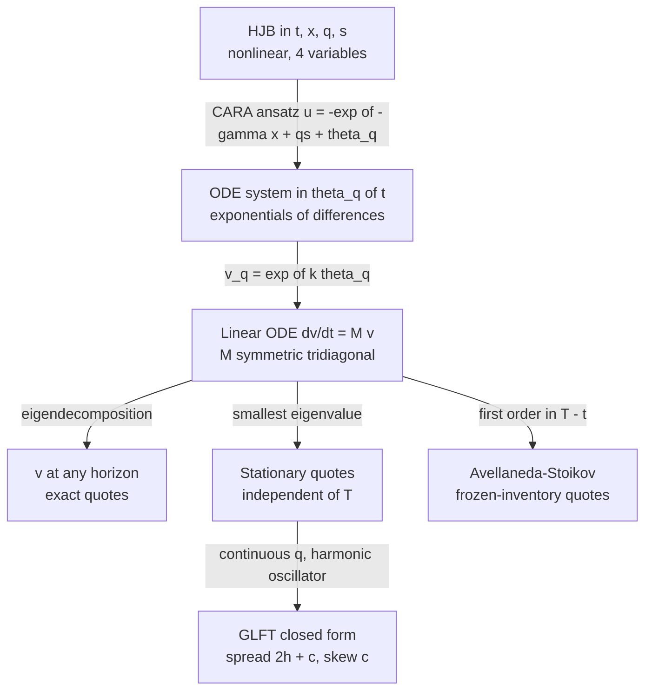

# Gueant-Lehalle-Fernandez-Tapia and Extensions

## TL;DR

- Gueant, Lehalle and Fernandez-Tapia (GLFT, 2013) solve the Avellaneda-Stoikov problem exactly once inventory is bounded, $\lvert q\rvert \le Q$: the substitution $u = -e^{-\gamma(x + qs)}v_q(t)^{-\gamma/k}$ turns the nonlinear HJB into a linear ODE system $\dot v = Mv$, so $v(t) = e^{-M(T-t)}\mathbf{1}$.
- Quotes: $\delta^b = \frac1k\ln\frac{v_q}{v_{q+1}} + \frac1\gamma\ln(1 + \frac\gamma k)$ and $\delta^a = \frac1k\ln\frac{v_q}{v_{q-1}} + \frac1\gamma\ln(1 + \frac\gamma k)$; far from $T$ they converge to stationary quotes given by the ground-state eigenvector of $M$.
- Closed form (a Gaussian approximation to that eigenvector): $\delta^{b,a} \approx \frac1\gamma\ln(1 + \frac\gamma k) \pm \frac{2q \pm 1}{2}\,c$ with $c = \sqrt{\frac{\sigma^2\gamma}{2kA}(1 + \frac\gamma k)^{1 + k/\gamma}}$; spread $\approx \frac2\gamma\ln(1 + \frac\gamma k) + c$, skew $c$ per unit, no dependence on $T$.
- On the repo's Avellaneda-Stoikov parameters the exact skew is about $0.052$ per unit against AS's frozen-inventory $0.4$ at $T - t = 1$: AS is right only for short horizons, where there is no time to trade inventory away.
- The same machinery extends to a drift (inventory target $\mu/(\gamma\sigma^2)$) and to fill-triggered price moves (widening $\xi/2$ per side), both in GLFT, and, in a closed form derived here, to several correlated assets (skew driven by $\Sigma^{1/2}q$).

## Learning objectives

- Explain the inventory-bounded solution and its closed-form approximation.
- Extend to multiple assets, adverse selection and signals.
- Solve the finite-inventory system numerically and quantify how far the closed form and the Avellaneda-Stoikov approximation are from it.
- Say when each approximation is safe to use on a desk.

## Core concepts

### The problem, restated with a bound

The model is the one in [Inventory Risk and Avellaneda-Stoikov](03-Inventory-Risk-and-Avellaneda-Stoikov.md): mid $dS = \sigma\,dW$, bid and ask fills at Poisson intensity $Ae^{-k\delta}$ at distance $\delta$ from the mid, CARA utility $-e^{-\gamma(X_T + q_TS_T)}$.
GLFT add one realistic constraint: inventory must stay in $\{-Q, \dots, Q\}$, so at $q = Q$ the market maker shows no bid and at $q = -Q$ no ask.
The value function $u(t, x, q, s)$ solves

$$
\partial_t u + \tfrac12\sigma^2\partial_{ss}u
+ \mathbb{1}_{q < Q}\sup_{\delta^b} Ae^{-k\delta^b}\big[u(t, x - s + \delta^b, q + 1, s) - u\big]
+ \mathbb{1}_{q > -Q}\sup_{\delta^a} Ae^{-k\delta^a}\big[u(t, x + s + \delta^a, q - 1, s) - u\big] = 0
$$

with $u(T, x, q, s) = -e^{-\gamma(x + qs)}$.

### The change of variables that linearises the HJB

Write $u = -e^{-\gamma(x + qs + \theta_q(t))}$.
Then $u(x - s + \delta^b, q + 1) - u = (-u)\big(1 - e^{-\gamma(\delta^b + \theta_{q+1} - \theta_q)}\big)$, and the bid supremum is the same one-variable problem as in Avellaneda-Stoikov:

$$
\sup_\delta Ae^{-k\delta}\big(1 - e^{-\gamma(\delta + c)}\big) \text{ at } \delta^* = -c + \tfrac1\gamma\ln\big(1 + \tfrac\gamma k\big), \text{ with value } \tfrac\gamma k\,\eta\, e^{kc}, \qquad \eta = A\big(1 + \tfrac\gamma k\big)^{-(1 + k/\gamma)}.
$$

Dividing the HJB by $-u$ gives

$$
\gamma\dot\theta_q - \tfrac12\gamma^2\sigma^2q^2 + \tfrac\gamma k\,\eta\big(e^{k(\theta_{q+1} - \theta_q)} + e^{k(\theta_{q-1} - \theta_q)}\big) = 0.
$$

The exponentials of differences are the trouble, and $v_q = e^{k\theta_q}$ removes them.
Multiplying by $\frac k\gamma v_q$:

$$
\dot v_q = \alpha q^2 v_q - \eta\,(v_{q+1} + v_{q-1}), \qquad \alpha = \tfrac12 k\gamma\sigma^2, \qquad v_q(T) = 1,
$$

with the $v_{Q+1}$ and $v_{-Q-1}$ terms dropped.
This is linear: $v(t) = e^{-M(T-t)}\mathbf{1}$ with $M$ the $(2Q + 1)$-square tridiagonal matrix with $\alpha q^2$ on the diagonal and $-\eta$ off it.
$M$ is symmetric, so one eigendecomposition gives $v$ at every horizon.
Because $M$'s off-diagonal entries are non-positive, $e^{-M\tau}$ is also $e^{-c\tau}e^{P\tau}$ with $P = cI - M \ge 0$ entrywise, and the Taylor series of $e^{Ph}$ has no cancellation; the repo code uses that series, which keeps the tiny entries of $v$ at large $\lvert q\rvert$ accurate on every platform, and checks it against the eigendecomposition.
Reading off $\delta^* = -c + \frac1\gamma\ln(1 + \frac\gamma k)$ with $c = \theta_{q+1} - \theta_q$:

$$
\delta^b(t, q) = \frac1k\ln\frac{v_q(t)}{v_{q+1}(t)} + \frac1\gamma\ln\Big(1 + \frac\gamma k\Big), \qquad
\delta^a(t, q) = \frac1k\ln\frac{v_q(t)}{v_{q-1}(t)} + \frac1\gamma\ln\Big(1 + \frac\gamma k\Big).
$$

The second term is the Avellaneda-Stoikov market-power markup; all inventory dependence sits in the first.

### Short horizon: Avellaneda-Stoikov is the first-order term

For small $\tau = T - t$, $v \approx \mathbf{1} - \tau M\mathbf{1}$, so for an interior $q$, $v_q \approx 1 - \tau(\alpha q^2 - 2\eta)$ and

$$
\frac1k\ln\frac{v_q}{v_{q+1}} \approx \frac{\tau\alpha}{k}\big((q + 1)^2 - q^2\big) = (2q + 1)\frac{\gamma\sigma^2\tau}{2}.
$$

That is exactly the Avellaneda-Stoikov reservation-bid offset $s - r^b$.
GLFT (2013, Section 4) make the same point: the Avellaneda-Stoikov approximations are the Taylor expansions of the exact quotes for $t$ close to $T$.
The frozen-inventory approximation is the leading term of the exact solution when there is too little time left to trade inventory away; it is not a good approximation for longer horizons.

### Long horizon: the ground state and the closed form

As $\tau \to \infty$, $e^{-M\tau}\mathbf{1}$ is dominated by the eigenvector $f$ of the smallest eigenvalue, so the quotes converge to the stationary $\delta^b(q) = \frac1k\ln(f_q/f_{q+1}) + \frac1\gamma\ln(1 + \frac\gamma k)$, independent of $T$.
The convergence rate is the spectral gap $\lambda_1 - \lambda_0$.

To get a formula, treat $q$ as continuous: $f_{q+1} + f_{q-1} \approx 2f_q + f''_q$, so $\lambda f = (\alpha q^2 - 2\eta)f - \eta f''$, a harmonic oscillator.
Its ground state is $f(q) = e^{-\frac12\beta q^2}$ with $\beta = \sqrt{\alpha/\eta}$, and its level spacing is $2\sqrt{\alpha\eta}$.
Then $\frac1k\ln(f_q/f_{q+1}) = \frac{\beta}{2k}(2q + 1)$, which gives the GLFT closed form

$$
\delta^b_\infty(q) \approx \frac1\gamma\ln\Big(1 + \frac\gamma k\Big) + \frac{2q + 1}{2}\,c, \qquad
\delta^a_\infty(q) \approx \frac1\gamma\ln\Big(1 + \frac\gamma k\Big) - \frac{2q - 1}{2}\,c, \qquad
c = \frac{1}{k}\sqrt{\frac{\alpha}{\eta}} = \sqrt{\frac{\sigma^2\gamma}{2kA}\Big(1 + \frac\gamma k\Big)^{1 + \frac k\gamma}}.
$$

These are the GLFT (2013) Section 4 approximations; the paper obtains them by replacing the discrete eigenvalue problem with the continuous one $\min \int (\alpha x^2 f^2 + \eta f'^2)\,dx$, whose minimiser is the same Gaussian.

| Quantity | Closed form |
| :--- | :--- |
| Spread $\delta^a + \delta^b$ | $\frac2\gamma\ln(1 + \frac\gamma k) + c$ |
| Skew (shift of both quotes per unit of inventory) | $c$ |
| Centre of the quotes | $s - qc$ |
| Dependence on $T$ | none |

Compare Avellaneda-Stoikov's skew $\gamma\sigma^2(T - t)$: GLFT's skew grows like $\sigma\sqrt{\gamma/(kA)}$, so it rises with volatility and risk aversion but falls with the fill rate $A$, because a market maker who trades often can work inventory off by skewing slightly.
$A$ cancels from the AS quotes; it does not cancel here, which is the clearest sign that GLFT prices the option to unwind.

### Extension 1: drift and short-term signals

With $dS = \mu\,dt + \sigma\,dW$ the same substitution gives $\dot v_q = (\alpha q^2 - k\mu q)v_q - \eta(v_{q+1} + v_{q-1})$, still symmetric.
Completing the square, the Gaussian ground state is centred at $q_0 = \mu/(\gamma\sigma^2)$, so

$$
\delta^b \approx \frac1\gamma\ln\Big(1 + \frac\gamma k\Big) + \Big(\frac{2q + 1}{2} - \frac{\mu}{\gamma\sigma^2}\Big)c, \qquad
\delta^a \approx \frac1\gamma\ln\Big(1 + \frac\gamma k\Big) + \Big(\frac{\mu}{\gamma\sigma^2} - \frac{2q - 1}{2}\Big)c.
$$

This is GLFT (2013) Proposition 4 and its closed-form approximation.
A drift acts as an inventory target: the market maker skews towards holding $\mu/(\gamma\sigma^2)$ units, the Merton-style mean-variance position.
On a desk $\mu$ is a short-horizon alpha (order-book imbalance, futures lead, see [Fair Value and Theoretical Pricing](02-Fair-Value-and-Theoretical-Pricing.md)) and the same formula says how far to lean.
Cartea, Jaimungal and Ricci (2014) treat a stochastic short-term alpha and adverse selection in a related market-making model.

### Extension 2: several correlated assets

The closed form in this subsection is derived here as an illustration; it is not taken from the papers.
For $d$ assets with covariance $\Sigma$ and, for simplicity, the same $A$ and $k$ for every asset, the diagonal of $M$ becomes $\frac{k\gamma}{2}q^\top\Sigma q$ and each asset contributes a nearest-neighbour coupling $-\eta$.
The Gaussian ansatz $f = e^{-\frac12 q^\top Bq}$ in the continuous approximation needs $\eta B^2 = \frac{k\gamma}{2}\Sigma$, so $B = \sqrt{\frac{k\gamma}{2\eta}}\,\Sigma^{1/2}$ and

$$
\delta^b_i \approx \frac1\gamma\ln\Big(1 + \frac\gamma k\Big) + \frac1k\sqrt{\frac{k\gamma}{2\eta}}\Big[(\Sigma^{1/2}q)_i + \tfrac12(\Sigma^{1/2})_{ii}\Big],
$$

with the mirror formula for the ask.
For one asset this is the GLFT closed form.
The point for a desk: a long position in asset $j$ skews the quotes of a correlated asset $i$, through the matrix square root $\Sigma^{1/2}$ rather than through $\Sigma$ itself.
This derivation assumes equal $(A, k)$ and is checked against the exact two-asset solution in Example 6.
Bergault, Evangelista, Gueant and Vieira (2021) derive closed-form approximations for the general multi-asset problem by a different route (a quadratic approximation of the Hamiltonian); their asymptotic inventory matrix also involves a matrix square root of the covariance, $\Gamma = D^{-1/2}(D^{1/2}\Sigma D^{1/2})^{1/2}D^{-1/2}$ with $D$ built from the intensity parameters, which is proportional to $\Sigma^{1/2}$ when every asset has the same $(A, k)$.
Gueant (2017) treats general intensity shapes and multiple assets.

### Extension 3: adverse selection

Avellaneda-Stoikov and GLFT have no adverse selection: fills are independent of future moves.
Two ways to add it, both computed in the code:

- Static (a one-line illustration, not from the papers): if the mid moves $\xi$ against you after each fill, a risk-neutral single-fill quoter maximises $Ae^{-k\delta}(\delta - \xi)$ and quotes $\delta = \frac1k + \xi$, one full $\xi$ wider per side.
- Dynamic (GLFT 2013, Section 5.2, "the case of market impact", Proposition 5): let each fill move the mid permanently by $\xi$ in the aggressor's direction, $dS = \sigma\,dW + \xi\,dN^a - \xi\,dN^b$; the paper reads this both as market impact and as adverse selection.
  Written with the plain substitution $u = -e^{-\gamma(x + qs)}v_q^{-\gamma/k}$ it gives $\dot v_q = \alpha q^2v_q - \eta\big(e^{-k(q+1)\xi}v_{q+1} + e^{k(q-1)\xi}v_{q-1}\big)$, linear again, and $D = \text{diag}(e^{k\xi q^2/2})$ symmetrises it with coupling $\eta e^{-k\xi/2}$.
  GLFT absorb $D$ into the ansatz instead, $u = -e^{-\gamma(x + qs + \frac12\xi q^2)}w_q^{-\gamma/k}$, which gives the symmetric system with coupling $\eta e^{-k\xi/2}$ and terminal condition $w_q(T) = e^{-\frac12 k\xi q^2}$; the two forms give identical quotes, and the code checks both.
  With $\delta^b = (q + 1)\xi + \frac1k\ln\frac{v_q}{v_{q+1}} + \frac1\gamma\ln(1 + \frac\gamma k)$ (equivalently $\frac\xi2 + \frac1k\ln\frac{w_q}{w_{q+1}} + \frac1\gamma\ln(1 + \frac\gamma k)$), GLFT's stationary closed form is $\delta^b \approx \frac1\gamma\ln(1 + \frac\gamma k) + \frac\xi2 + \frac{2q + 1}{2}ce^{k\xi/4}$.
  Long-run widening is $\xi/2$ per side, not $\xi$: in this model a buy fill followed by a sell fill moves the mid down then back up, so a round trip loses $\xi$ in total.
  The second effect, the factor $e^{k\xi/4}$ on the skew, is what GLFT call the side effect: quoting deeper means fewer fills, so inventory is harder to work off and the skew must be steeper.
  Whether real flow behaves like this (impact that later reverses) or like information that never comes back is exactly what markouts measure; see [Market Making P&L Attribution and Markouts](09-Market-Making-PnL-Attribution-and-Markouts.md).

Cartea, Jaimungal and Penalva (2015, chapter 10) give the textbook treatment of market making with adverse selection and alpha signals in a risk-neutral setting with an inventory penalty.

### How desks use this

- The closed form is a parametrisation, not a production model: spread $= 2h + c$, skew $= c$ per unit, with $h = \frac1\gamma\ln(1 + \frac\gamma k)$ the market-power half-spread, and with $h$ and $c$ calibrated to fill data and risk budget rather than to $\gamma$.
- The exact solution is cheap ($2Q + 1$ states, one eigendecomposition) and shows where the closed form breaks: near the inventory limits, where the bounded system skews harder than the Gaussian approximation.
- Inventory limits are a risk control first and a model input second; GLFT makes the quoting logic consistent with them, so the quote does not jump when the limit is hit.
- Real books also need tick-size rounding, queue position, minimum quote obligations and a separate adverse-selection widening; none is in the base model.

## Worked examples

All examples use the repo simulator's parameters (as in the Avellaneda-Stoikov note): $\sigma = 2$, $\gamma = 0.1$, $k = 1.5$, $A = 140$, and $Q = 20$ unless stated.
Every number is printed and asserted by [gueant_lehalle_glft.py](code/gueant_lehalle_glft.py).

### Example 1: the constants and the closed form

"First the building blocks: $\alpha = \frac12 k\gamma\sigma^2 = 0.3$ and $\eta = 140(1 + 1/15)^{-16} \approx 49.85$.
The market-power half-spread is $10\ln(16/15) \approx 0.6454$.
The inventory coefficient is $c = \sqrt{\alpha/\eta}/k \approx 0.0517$.
So the closed-form spread is $2 \times 0.6454 + 0.0517 \approx 1.3425$ and every unit of inventory shifts both quotes by about 0.0517.
At $q = 3$ the bid sits $0.6454 + 3.5 \times 0.0517 \approx 0.8264$ below the mid and the ask $0.6454 - 2.5 \times 0.0517 \approx 0.5161$ above it."
Avellaneda-Stoikov at $T - t = 1$ skews by $\gamma\sigma^2 = 0.4$ per unit, about 7.73 times as much.

### Example 2: exact quotes against the closed form

Solving $v = e^{-M}\mathbf{1}$ with $Q = 20$ and $T - t = 1$:

| $q$ | exact $\delta^b$ | closed form $\delta^b$ | exact $\delta^a$ | closed form $\delta^a$ |
| ---: | ---: | ---: | ---: | ---: |
| 0 | 0.6716 | 0.6712 | 0.6716 | 0.6712 |
| 1 | 0.7241 | 0.7230 | 0.6191 | 0.6195 |
| 2 | 0.7764 | 0.7747 | 0.5667 | 0.5678 |
| 3 | 0.8285 | 0.8264 | 0.5144 | 0.5161 |

The closed form is within 0.0021 of the exact bid for $q \le 3$.
The exact spread at $q = 0$ is 1.3433 and the exact skew from $q = 0$ to $q = 1$ is 0.0524.
The ground-state eigenvector gives the same quotes to four decimals ($0.6716$ at $q = 0$, $0.8285$ at $q = 3$), so one unit of time is already the stationary regime.
The spectral gap is about 7.66 (the oscillator estimate $2\sqrt{\alpha\eta}$ gives 7.73), a relaxation time of about 0.1306.
For comparison, Avellaneda-Stoikov at $q = 3$, $T - t = 1$ quotes the bid 2.0454 below the mid and the ask at $-0.3546$, through the mid.

### Example 3: where AS is right and where it is not

Exact and AS quotes for $q = 1$ as the horizon grows:

| $T - t$ | exact $\delta^b$ | AS $\delta^b$ | exact $\delta^a$ | AS $\delta^a$ |
| ---: | ---: | ---: | ---: | ---: |
| 0.01 | 0.6514 | 0.6514 | 0.6434 | 0.6434 |
| 0.1 | 0.6959 | 0.7054 | 0.6286 | 0.6254 |
| 0.25 | 0.7206 | 0.7954 | 0.6203 | 0.5954 |
| 1 | 0.7241 | 1.2454 | 0.6191 | 0.4454 |

At $T - t = 0.01$ the two agree to about $0.12 \times 10^{-4}$, as the short-horizon expansion predicts.
By $T - t = 0.25$ the exact quotes have nearly stopped moving while AS keeps widening linearly in $T - t$.
"The AS reservation price assumes I hold today's inventory to the end; when fills come every few hundredths of a unit of time that is the wrong risk to charge for."

### Example 4: the inventory bound

With $Q = 5$ instead of 20 (same $T - t = 1$), the bid at $q = 0$ moves only from 0.6716 to 0.6777, but at $q = 3$ it is 0.9225 instead of 0.8285 and at $q = 4$ it is 1.1259 instead of 0.8803.
At $q = 5$ there is no bid, and the ask sits only 0.1649 above the mid.
Running $Q = 10$ and $Q = 40$ changes the quotes for $\lvert q\rvert \le 3$ by less than $10^{-3}$ relative to $Q = 20$, so the gap to AS in Example 3 is not caused by the bound.

### Example 5: a drift of 0.5

With $\mu = 0.5$ the inventory target is $\mu/(\gamma\sigma^2) = 1.25$ units.
At $q = 0$ the exact bid distance falls to 0.6060 and the ask distance rises to 0.7372; the drift-adjusted closed form gives 0.6066 and 0.7359.
"I am below my target of 1.25 units, so I lean to buy: tighter bid, wider offer."
At $q = 1$, still below target, the bid is 0.6585.

### Example 6: two correlated assets

Two assets with $\sigma_1 = \sigma_2 = 2$, correlation 0.6, $Q = 8$ per asset and $T - t = 1$ (289 inventory states).
$\Sigma^{1/2}$ has diagonal 1.8974 and off-diagonal 0.6325.

| inventory $(q_1, q_2)$ | exact $\delta^b_1$ | closed form $\delta^b_1$ |
| :--- | ---: | ---: |
| (0, 0) | 0.6708 | 0.6699 |
| (0, 3) | 0.7184 | 0.7190 |
| (3, 0) | 0.8248 | 0.8171 |

Holding 3 units of asset 2 widens asset 1's bid by 0.0477, against 0.1540 for holding 3 units of asset 1 itself.
"I am long the correlated name, so I am less keen to buy this one, but only about a third as much as if I were long this name."

### Example 7: adverse selection

With $\xi = 0.2$, the static risk-neutral optimum moves from $1/k \approx 0.6667$ to $0.8667$.
In the dynamic jump model the bid at $q = 0$ starts at $0.6454 + 0.2 = 0.8454$ when $T - t = 0$ and settles at 0.7737 by $T - t = 1$ (closed form 0.7733).
The $q = 0$ spread is 1.5474 against 1.3433 without jumps.
The script cross-checks the symmetrised solution against a direct Runge-Kutta integration of the unsymmetrised system ($Q = 10$, 20,000 steps) and against GLFT's own Proposition 5 formulation.

### Example 8: simulating the two policies

4,000 paths over $T = 1$ with step 0.001, the same random numbers for both policies (seed 11), Bernoulli fills with probability $Ae^{-k\delta}\,dt$:

| Policy | mean P&L | sd of P&L | CARA certainty equivalent | sd of final inventory |
| :--- | ---: | ---: | ---: | ---: |
| Exact GLFT | about 67.73 | about 8.20 | about 64.48 | about 3.50 |
| AS approximation | about 64.17 | about 7.28 | about 61.60 | about 3.32 |

The exact policy earns more and carries more risk, and its certainty equivalent $-\frac1\gamma\ln\mathbb{E}[e^{-\gamma W_T}]$, the quantity both policies are trying to maximise, is higher by about 2.9.
These are measured facts for this seed and this discretisation, not a proof of optimality.

## Pitfalls

- Treating the AS reservation price as exact: it is the short-horizon limit and overstates the skew badly once fills are frequent relative to the horizon.
- Forgetting that $A$ enters the GLFT quotes: halving the fill rate raises $c$ by $\sqrt2$.
- Computing $e^{-M\tau}\mathbf{1}$ with a raw `exp` of eigenvalues: the smallest eigenvalue is negative and large $\tau$ overflows; shift by $\lambda_{\min}$ (quotes depend only on ratios of $v$).
- Trusting an eigendecomposition for the entries of $v$ at large $\lvert q\rvert$: they can be far below round-off of the largest entry and come out zero or negative, differently on different machines; a non-negative series (uniformisation) keeps them positive.
- Using the closed form near the inventory limit: the bounded solution skews harder there (Example 4).
- Reading the multi-asset skew off $\Sigma$ instead of $\Sigma^{1/2}$.
- Adding adverse selection as a full $\xi$ per side when the model says $\xi/2$, or the reverse: the answer depends on whether post-fill moves persist or revert, which only markout data can tell you.
- Mixing units: $\sigma^2$ per unit time, $k$ per price unit, $\gamma$ per price unit; recalibrate all three together when moving from dollars to ticks.

## Interview questions

> [!question]- mm-glft-change-of-variables | What substitution linearises the GLFT market-making HJB, and what system results?
> $u = -e^{-\gamma(x + qs)}v_q(t)^{-\gamma/k}$.
> Then $\dot v_q = \alpha q^2v_q - \eta(v_{q+1} + v_{q-1})$ with $\alpha = \frac12 k\gamma\sigma^2$, $\eta = A(1 + \gamma/k)^{-(1 + k/\gamma)}$, $v_q(T) = 1$: linear, so $v(t) = e^{-M(T-t)}\mathbf{1}$.

> [!question]- mm-glft-exact-quotes | Given $v_q(t)$, write the GLFT optimal bid and ask distances.
> $\delta^b = \frac1k\ln(v_q/v_{q+1}) + \frac1\gamma\ln(1 + \gamma/k)$ and $\delta^a = \frac1k\ln(v_q/v_{q-1}) + \frac1\gamma\ln(1 + \gamma/k)$.
> The second term is the AS markup; all inventory dependence is in the log-ratio.

> [!question]- mm-glft-closed-form | State the GLFT closed-form spread and skew.
> Spread $\frac2\gamma\ln(1 + \gamma/k) + c$, skew $c$ per unit, with $c = \sqrt{\frac{\sigma^2\gamma}{2kA}(1 + \gamma/k)^{1 + k/\gamma}}$.
> It comes from a Gaussian approximation to the ground-state eigenvector of $M$ and does not depend on $T$.

> [!question]- mm-glft-hermite-derivation | How do you get the GLFT closed form from the eigenvector problem?
> Treat $q$ as continuous: $f_{q+1} + f_{q-1} \approx 2f + f''$, so $\lambda f = (\alpha q^2 - 2\eta)f - \eta f''$, a harmonic oscillator.
> Its ground state $e^{-\frac12\sqrt{\alpha/\eta}\,q^2}$ gives $\frac1k\ln(f_q/f_{q+1}) = \frac{2q + 1}{2k}\sqrt{\alpha/\eta}$.

> [!question]- mm-glft-as-short-horizon | How are the Avellaneda-Stoikov quotes related to the exact GLFT solution?
> They are its first-order expansion in $T - t$.
> With $v \approx \mathbf{1} - \tau M\mathbf{1}$, $\frac1k\ln(v_q/v_{q+1}) \approx (2q + 1)\gamma\sigma^2\tau/2$, exactly the AS reservation-bid offset.

> [!question]- mm-glft-numeric-skew | $\sigma = 2$, $\gamma = 0.1$, $k = 1.5$, $A = 140$. What are the closed-form skew and spread, and AS's skew at $T - t = 1$?
> Skew about 0.0517, spread about 1.3425 ($2 \times 0.6454 + 0.0517$).
> AS skews by $\gamma\sigma^2(T - t) = 0.4$, about 7.7 times more.

> [!question]- mm-glft-why-a-matters | Why does the fill rate $A$ appear in the GLFT skew but not in the AS quotes?
> GLFT values the ability to work inventory off through future fills; more fills mean less time holding risk, so less skew ($c \propto 1/\sqrt{A}$).
> AS freezes inventory to $T$, so $A$ only scales profit and cancels from the first-order condition.

> [!question]- mm-glft-stationary | What happens to the exact GLFT quotes far from the horizon, and how fast?
> They converge to stationary quotes set by the eigenvector of the smallest eigenvalue of $M$.
> The rate is the spectral gap $\lambda_1 - \lambda_0$: about 7.66 with the repo parameters (the oscillator estimate $2\sqrt{\alpha\eta}$ gives 7.73), so a relaxation time near 0.13.

> [!question]- mm-glft-boundary | How do quotes behave near the inventory limit $Q$ compared with the closed form?
> At $q = Q$ there is no bid, and just inside the limit the exact solution skews harder than the closed form.
> With $Q = 5$ the bid at $q = 4$ is about 1.126 below the mid against 0.880 with $Q = 20$.

> [!question]- mm-glft-drift | How does a drift $\mu$ change the GLFT closed form?
> It shifts the inventory the quotes centre on to $q_0 = \mu/(\gamma\sigma^2)$: replace $q$ by $q - q_0$ in the skew.
> With $\mu = 0.5$, $\gamma = 0.1$, $\sigma = 2$, the target is 1.25 units.

> [!question]- mm-glft-multi-asset | In a multi-asset GLFT-type model with common $(A, k)$, what drives the skew of asset $i$?
> $(\Sigma^{1/2}q)_i$: the matrix square root of the covariance applied to the inventory vector.
> So inventory in a correlated asset skews asset $i$, but the weight is $(\Sigma^{1/2})_{ij}$, not $\Sigma_{ij}$.

> [!question]- mm-glft-adverse-static | Fill intensity $Ae^{-k\delta}$ and the mid moves $\xi$ against you after each fill. Risk-neutral optimal distance?
> $\delta = \frac1k + \xi$.
> Maximise $Ae^{-k\delta}(\delta - \xi)$: the first-order condition is $1 - k(\delta - \xi) = 0$. With $k = 1.5$, $\xi = 0.2$ that is about 0.8667.

> [!question]- mm-glft-adverse-roundtrip | If every fill moves the mid $\xi$ in the aggressor's direction permanently, why can the long-run optimal widening be only $\xi/2$ per side?
> This is GLFT's (2013) market-impact extension, $dS = \sigma\,dW + \xi\,dN^a - \xi\,dN^b$.
> A buy fill then a sell fill move the mid down then back up, so the round trip loses $\xi$ in total, shared across two quotes.
> If instead the post-fill move never reverses (pure information), each side must carry the full $\xi$; markouts tell you which world you are in.

> [!question]- mm-glft-numerical-stability | What goes wrong if you compute $e^{-M\tau}\mathbf{1}$ naively for large $\tau$, and the fix?
> The smallest eigenvalue of $M$ is negative, so $e^{-\lambda\tau}$ overflows (or everything underflows if you flip signs), and entries of $v$ at large $\lvert q\rvert$ fall below round-off and can turn negative.
> Shift by $\lambda_{\min}$ and normalise $v$ (quotes depend only on ratios $v_q/v_{q\pm1}$), or use the non-negative series $e^{-c\tau}e^{(cI - M)\tau}$.

> [!question]- mm-glft-calibration | How would you take GLFT to production?
> Use it as a parametrisation: spread $2h + c$, skew $c$ per unit, calibrate $h$ to fill-probability data and $c$ to the inventory risk budget and fill rate, then add a separate adverse-selection widening from markouts and round to ticks.
> Recalibrate when volatility or fill rates move, because $c \propto \sigma\sqrt{\gamma/(kA)}$.

> [!question]- mm-glft-limits-design | Why do inventory limits belong in the quoting model rather than only in a risk check?
> If only the risk check enforces them, quotes jump from normal to absent at the limit, so you oscillate and get picked off at the boundary.
> In GLFT the skew steepens smoothly as $q \to Q$ and the bid disappears exactly at $Q$, so the limit is rarely hit.

## In this repo and SDE-Interview-Prep

- Code: [gueant_lehalle_glft.py](code/gueant_lehalle_glft.py) (exact solution, closed forms, drift, two assets, adverse selection, simulation) and [avellaneda_stoikov_mm.py](code/avellaneda_stoikov_mm.py) (the base model).
- Prerequisite: [Inventory Risk and Avellaneda-Stoikov](03-Inventory-Risk-and-Avellaneda-Stoikov.md).
- Next: [Quote Management: Skew, Width and Size](05-Quote-Management-Skew-Width-and-Size.md) and [Hedging and Risk for Market Makers](06-Hedging-and-Risk-for-Market-Makers.md).

## Further reading

- O. Gueant, C.-A. Lehalle and J. Fernandez-Tapia, "Dealing with the inventory risk: a solution to the market making problem", *Mathematics and Financial Economics* 7(4), 477-507 (2013).
- M. Avellaneda and S. Stoikov, "High-frequency trading in a limit order book", *Quantitative Finance* 8(3), 217-224 (2008).
- O. Gueant, *The Financial Mathematics of Market Liquidity: From Optimal Execution to Market Making*, Chapman and Hall/CRC (2016).
- O. Gueant, "Optimal market making", *Applied Mathematical Finance* 24(2), 112-154 (2017).
- P. Bergault, D. Evangelista, O. Gueant and D. Vieira, "Closed-form approximations in multi-asset market making", *Applied Mathematical Finance* 28(2), 101-142 (2021).
- A. Cartea, S. Jaimungal and J. Penalva, *Algorithmic and High-Frequency Trading*, Cambridge University Press (2015), chapter 10.
- A. Cartea, S. Jaimungal and J. Ricci, "Buy low, sell high: a high frequency trading perspective", *SIAM Journal on Financial Mathematics* 5(1), 415-444 (2014).
