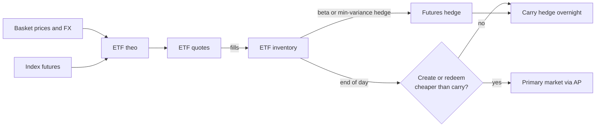

# ETF and Futures Market Making

## TL;DR

- An ETF's fair value is its basket: NAV per share is basket value plus the cash component, divided by the creation-unit size; the quoting theo is the live basket, or a futures- and FX-adjusted estimate when the underlying market is closed.
- Creation and redemption by authorised participants bound the ETF price inside a band around the basket: above basket ask plus creation costs, create and sell; below basket bid minus redemption costs, buy and redeem.
- Index futures trade at $F = (S - PV(D))e^{rT}$; the basis $F - S$ is carry, and the no-arbitrage band around it is set by borrow-lend spreads and trading costs.
- A beta-one hedge of ETF inventory uses $N = V/(\text{multiplier} \times F)$ contracts; a sector ETF needs the minimum-variance ratio $\rho\sigma_E/\sigma_F$ and leaves $\sigma_E\sqrt{1 - \rho^2}$ of risk.
- The desk loop is: quote off basket theo, hedge intraday with futures, and net inventory at the close by creating or redeeming when that is cheaper than carrying the hedge.

## Learning objectives

- Quote ETFs from basket fair value, including creation and redemption costs.
- Hedge with futures and manage the basis.
- Compute an ETF's fair value when its underlying market is closed.
- Decide between carrying a futures hedge and creating or redeeming units.

## Core concepts

### The ETF wrapper and the primary market

- Investors trade ETF shares on exchange (the secondary market) like a stock.
- Authorised participants (APs), broker-dealers with an agreement with the fund, trade with the fund in the primary market: they deliver a basket of securities plus a cash component and receive a creation unit of ETF shares, or the reverse for a redemption.
- SEC Rule 6c-11 (17 CFR 270.6c-11, adopted in Release No. 33-10695, 2019) defines a creation unit as a specified number of ETF shares the fund issues or redeems in exchange for a basket, and an authorised participant as a member or participant of a registered clearing agency with a written agreement with the fund or one of its service providers that lets it place orders to create and redeem.
- The same rule requires each ETF to publish on its website, each business day, the portfolio holdings that form the basis of the next NAV calculation, the prior day's NAV, market price and premium or discount, and the median bid-ask spread over the last 30 calendar days (from the national best bid and offer sampled every 10 seconds); it does not require an intraday indicative value.
- Exchanges and data vendors still publish intraday indicative values (iNAV or IIV), but a market maker computes its own theo from live prices because published values can be stale.

In-kind creation means the AP's cost is the cost of trading the basket, plus a fixed creation or redemption fee per order set by the fund, plus financing and settlement friction.

### Fair value of an ETF

For a basket of $n_i$ shares of stock $i$ per creation unit of $U$ ETF shares and a cash component $C$:

$$
\text{NAV per share} = \frac{\sum_i n_i P_i + C}{U}.
$$

A market maker evaluates this at three price vectors: mids (theo), bids (what the basket fetches if sold) and asks (what it costs to buy).
The theo is also adjusted for anything the basket mids miss: stale or closed underlying markets, FX for foreign holdings, accrued dividends and fees, and for bond ETFs the fact that many constituents do not trade continuously.

### The arbitrage band

Let $f$ be the fee per creation or redemption order and $\iota$ the expected market impact of trading the basket, as a fraction of its value.
Then, per ETF share,

$$
\text{upper bound} = \frac{V^{ask}(1 + \iota) + f}{U}, \qquad \text{lower bound} = \frac{V^{bid}(1 - \iota) - f}{U}.
$$

If the ETF bid is above the upper bound, an AP buys the basket, creates units and sells ETF shares; if the ETF ask is below the lower bound, it buys ETF shares, redeems and sells the basket.
So the ETF's quotes are anchored inside the band, and a market maker with AP access can quote aggressively inside it because the primary market is its exit.
The band widens when the basket is hard to trade (small caps, high-yield bonds, a foreign market that is shut), which is why less liquid ETFs show larger premiums and discounts.

### When the underlying is closed

A US-listed ETF holding Japanese stocks trades while Tokyo is shut.
Its last NAV is stale; the theo has to be projected with instruments that are trading:

$$
\text{FV} = \text{NAV}_{close} \times (1 + \beta\, r_{fut}) \times \frac{\text{FX}_{close}}{\text{FX}_{now}},
$$

with $r_{fut}$ the return of an index future since the local close, $\beta$ the basket's sensitivity to it, and FX quoted as yen per dollar.
The ETF trading at a "premium to NAV" in this situation is usually not mispricing: it is the market's price discovery for a basket that cannot trade.

### Index futures fair value and the basis

Carry gives, with discrete dividends $D_j$ paid at $t_j < T$ and continuously compounded rate $r$,

$$
F = \Big(S - \sum_j D_je^{-rt_j}\Big)e^{rT}.
$$

- The basis $F - S$ is financing minus dividends; it decays to zero at expiry.
- A futures price above fair implies a higher financing rate than the market's (the implied repo rate); market makers watch it as a funding signal and an arbitrage trigger.
- $\partial F/\partial r \approx TF$: a rates move changes fair basis, so a long-ETF, short-futures book has interest-rate risk until expiry.
- Dividend expectations are the other basis risk: a dividend cut raises fair $F$ and hurts a short-futures hedge.
- With a borrowing rate above the lending rate and cash-trading costs, fair value is a band, not a point; inside it there is no riskless arbitrage.
- The calendar spread $F(T_2) - F(T_1)$ is the carry between the two expiries and is what you trade when you roll a hedge.

See [Forwards, Futures and Cost of Carry](../05-Derivatives-and-Volatility/01-Forwards-Futures-and-Carry.md) for the replication argument and [Commodities and Futures Curves](../06-Fixed-Income-and-Asset-Classes/09-Commodities-and-Futures-Curves.md) for curves with convenience yield.

### Hedging ETF inventory with futures

- Same-index ETF: the ETF and the future both move with the index, so the hedge is a notional match, $N = V/(\text{multiplier} \times F)$.
  Daily variation margin settles futures P&L as it accrues, so today's spot exposure is hedged with today's futures notional (the form Hull uses for daily-settled futures) and no extra discount factor; the $e^{-r(T-t)}$ tailing factor is for an exposure that pays at expiry.
- Different-index ETF (sector, country, small cap): use the minimum-variance ratio $h^* = \rho\sigma_E/\sigma_F$ on dollar values, and accept residual risk $\sigma_E\sqrt{1 - \rho^2}$; hedge the residual in single stocks or the sector's own future if it exists.
- Contract rounding leaves a residual; the micro or a related ETF absorbs it.
- The hedge is a theo input too: when futures lead the cash market, the ETF theo moves with the futures before the basket prints (see [Fair Value and Theoretical Pricing](02-Fair-Value-and-Theoretical-Pricing.md)).

The E-mini S&P 500 future is $\$50$ times the index with a tick of 0.25 index points, so $\$12.50$ per tick (CME contract specification, as of 2026-10).

### The desk's daily loop

1. Pre-open: load the fund's published basket and cash component; check corporate actions.
2. Intraday: quote the ETF off basket theo with width set by hedge cost, adverse selection and inventory; hedge deltas with futures (fast, cheap) and single stocks or the basket when the residual matters.
3. Close: decide whether to flatten by trading, to create or redeem, or to carry the futures hedge overnight.
   Carrying costs borrow fees on a short ETF, roll and basis risk; creating or redeeming costs the fee plus trading the basket.

## Worked examples

Every number below is printed and asserted by [etf_futures_mm.py](code/etf_futures_mm.py); prices, fees, rates and vols are hypothetical inputs.

### Example 1: NAV and the arbitrage band

A creation unit is 50,000 shares with this basket:

| Stock | shares per unit | bid | ask |
| :--- | ---: | ---: | ---: |
| AAA | 10,000 | 149.99 | 150.01 |
| BBB | 25,000 | 79.99 | 80.01 |
| CCC | 40,000 | 44.99 | 45.01 |
| DDD | 5,000 | 409.95 | 410.05 |

plus a cash component of $\$12{,}500$.
"At mids the basket is worth $\$7{,}362{,}500$, so NAV is $147.25$ per share.
At bids it fetches $147.23$ per ETF share and at asks it costs $147.27$, a half-spread of about 1.36 bp.
With a $\$500$ creation fee and 2 bp of impact, creating costs $147.27 \times 1.0002 + 500/50{,}000 \approx 147.3095$ per share, about 4.04 bp over NAV; redeeming nets about 147.1906, about 4.04 bp under."
If the ETF is bid at 147.35, an AP creates one unit and sells it for a profit of about $\$2{,}027.30$.

### Example 2: a Japan ETF in US hours

NAV at the Tokyo close is $\$40.00$; since then the index future is up 1.2% ($\beta = 1$) and USDJPY has gone from 150.00 to 151.50.
"The yen move alone is worth $150/151.5 - 1 \approx -0.99\%$ in dollars, so the fair value is $40 \times 1.012 \times 150/151.5 \approx 40.0792$, only about 0.20% above the stale NAV."
If the ETF trades at 40.30, it looks 75 bp rich to NAV but is only about 55.09 bp rich to fair value, and most of that may be the market's view of moves the future does not capture.

### Example 3: futures fair value, implied financing and the band

Index 6,000, $r = 4\%$ continuous, dividends of 18 points at $t = 0.10$ and 12 points at $t = 0.20$, expiry $T = 0.25$.
"PV of dividends is about 29.8325 points, so $F = (6000 - 29.8325)e^{0.01} \approx 6030.1687$, a fair basis of about 30.17 points."
A one-basis-point rise in rates adds about $TF \times 10^{-4} \approx 0.1508$ points (0.1512 including the effect on the dividend discounting).
If the future trades at 6,034, it is about 3.83 points (about $\$191.57$ per E-mini) rich, and the financing rate that would justify it is about 4.2534%.
With borrowing at 4.4%, lending at 3.8% and 3 bp each way to trade the basket, the no-arbitrage band is about 6025.3371 to 6038.0217, about 12.68 points wide, so 6,034 is rich but not an arbitrage.
With a 1.4% continuous dividend yield instead, the calendar spread between the 0.25-year and 0.5-year expiries, $S(e^{(r-q)0.5} - e^{(r-q)0.25})$ is about 39.38 points.

### Example 4: hedging ETF inventory

The desk is long 40,000 shares of an S&P 500 ETF at $\$585$, $\$23.4$m, and the E-mini is at 5,900, $\$295{,}000$ per contract.
"$23.4\text{m}/295{,}000 \approx 79.32$, so I sell 79 contracts and am left with $\$95{,}000$ of delta, about 0.41% of the position."
For a sector ETF with 1.5% daily vol, futures vol 1.1% and correlation 0.85, the minimum-variance ratio is $0.85 \times 1.5/1.1 \approx 1.1591$, so $\$10$m of the ETF needs about 39.29 contracts.
The hedge removes $\rho^2 = 72.25\%$ of the variance but only $1 - \sqrt{1 - \rho^2} \approx 47.32\%$ of the volatility; about 0.79% daily vol is left.
A seeded simulation of 400,000 days (seed 5) recovers an OLS beta of about 1.1577 and residual vol of about 0.7904%.

### Example 5: carry the hedge or create?

At the close the desk is short 100,000 ETF shares (NAV 147.25, about $\$14.7$m) hedged with 50 E-minis ($14.725\text{m}/295{,}000 \approx 49.92$).
Carrying costs the borrow fee: at 0.30% a year on act/360 that is about $\$122.71$ a day.
Creating two units costs the basket half-spread plus 2 bp impact (about $\$4{,}945.40$), two $\$500$ fees, and unwinding the futures at half a tick ($50 \times 0.125 \times 50 = \$312.50$), about $\$6{,}257.90$ in total.
"Break-even is about 51 days of borrow, so if I expect the client flow to reverse within a few weeks I carry; if the borrow fee spikes or the short is structural I create."

## Pitfalls

- Using the fund's published intraday value as theo: it can lag the basket, and for international or bond funds it can be badly stale.
- Forgetting the cash component or accrued dividends in NAV.
- Treating a premium to stale NAV as an arbitrage when the underlying market is closed.
- Hedging a sector ETF with an index future at beta one, or at notional, instead of the minimum-variance ratio.
- Ignoring the rate and dividend risk in a cash-versus-futures position: the basis moves with both.
- Applying the $e^{-r(T-t)}$ tailing factor to a spot exposure hedged with daily-settled futures.
- Comparing creation cost with one day of carry: the comparison is against the expected holding period.
- Forgetting that a borrow fee can change overnight and that a hard-to-borrow ETF short may be recalled.

## Interview questions

> [!question]- mm-etf-nav-formula | How do you compute an ETF's NAV per share from its creation basket?
> $(\sum_i n_iP_i + C)/U$: basket value plus the cash component, divided by the creation-unit size.
> Evaluate it at mids for theo and at bids and asks for the redemption and creation bounds.

> [!question]- mm-etf-arb-band | What bounds an ETF's price relative to its basket, and why?
> Creation and redemption by authorised participants: above basket ask plus fee and impact they create and sell, below basket bid minus costs they buy and redeem.
> So the ETF trades inside a band whose width is the cost of trading the basket plus the fee.

> [!question]- mm-etf-band-numeric | Basket ask 147.27 per ETF share, 2 bp impact, 500 dollar fee, 50,000-share unit. Creation bound?
> About 147.3095.
> $147.27 \times 1.0002 + 500/50{,}000$; about 4.04 bp over a 147.25 NAV.

> [!question]- mm-etf-ap-role | What does an authorised participant do, and why does a market maker want AP access?
> An AP exchanges baskets for creation units with the fund (and the reverse).
> With access, the primary market is an exit for inventory, so the market maker can quote tighter inside the arbitrage band.

> [!question]- mm-etf-6c11-disclosure | What does SEC Rule 6c-11 require ETFs to publish daily, and does it require an intraday indicative value?
> Portfolio holdings behind the next NAV, prior-day NAV, market price and premium or discount, and the median bid-ask spread over the last 30 calendar days.
> It does not require an intraday indicative value.

> [!question]- mm-etf-closed-market-fv | A Japan ETF: NAV 40.00 at the Tokyo close, futures +1.2%, USDJPY 150.00 to 151.50. Fair value?
> About 40.08.
> $40 \times 1.012 \times 150/151.5$; the weaker yen offsets most of the equity move.

> [!question]- mm-etf-premium-not-arb | An international ETF trades 75 bp above NAV during US hours. Is it an arbitrage?
> Usually not: NAV is stale because the underlying market is closed, and the ETF price is discovering the basket's value from futures and FX.
> Compare with a projected fair value; in Example 2 the premium to fair is about 55 bp, and the band is wide because the basket cannot be traded.

> [!question]- mm-futures-fv-discrete-div | Index 6000, r = 4%, dividends 18 at t = 0.1 and 12 at t = 0.2, T = 0.25. Fair futures price?
> About 6030.17.
> $(6000 - 18e^{-0.004} - 12e^{-0.008})e^{0.01}$.

> [!question]- mm-futures-rate-sensitivity | How sensitive is an index future's fair value to the interest rate?
> $\partial F/\partial r \approx TF$: about 0.15 index points per bp for $F \approx 6030$ and $T = 0.25$.
> A long-cash, short-futures book therefore loses when rates rise (fair basis widens against the short future) until expiry.

> [!question]- mm-futures-implied-repo | What is the implied financing (repo) rate of an index future and how do you use it?
> The rate that makes the carry formula hold at the market futures price.
> Compare it with your funding cost: above it, cash-and-carry earns more than funding; it also signals balance-sheet pressure in the basis.

> [!question]- mm-futures-arb-band | Why is futures fair value a band rather than a point?
> Borrowing costs more than lending and trading the basket costs a spread.
> Cash-and-carry needs $F$ above $(S(1 + c) - PV(D))e^{r_bT}$; reverse needs $F$ below $(S(1 - c) - PV(D))e^{r_lT}$.

> [!question]- mm-futures-beta-one-hedge | Long 23.4m dollars of an S&P 500 ETF, E-mini at 5,900. How many contracts?
> Sell about 79 (79.32).
> $23.4\text{m}/(50 \times 5900)$; rounding leaves about $\$95{,}000$ of long delta.

> [!question]- mm-futures-sector-hedge | Sector ETF vol 1.5%, futures vol 1.1%, correlation 0.85. Hedge ratio and residual vol?
> $h^* \approx 1.159$ and residual about 0.79% a day.
> $h^* = \rho\sigma_E/\sigma_F$, residual $\sigma_E\sqrt{1 - \rho^2}$; the hedge removes 72% of variance but only 47% of volatility.

> [!question]- mm-futures-no-tailing | Do you apply the $e^{-r(T-t)}$ tailing factor to a futures hedge of spot ETF inventory?
> No: daily variation margin realises futures P&L at the same time as the spot P&L, so you match today's notional, $V/(\text{multiplier} \times F)$.
> The $e^{-r(T-t)}$ factor is for hedging an exposure that pays at expiry.

> [!question]- mm-etf-create-vs-carry | You are short ETF shares, hedged with futures, at the close. How do you decide whether to create units?
> Compare the one-off cost of creating (fee plus basket trading plus unwinding the hedge) with the daily cost of carrying (borrow fee, roll, basis and recall risk) times the expected holding period.
> In Example 5 the break-even is about 51 days.

> [!question]- mm-etf-basis-risks | What risks remain in a long-ETF, short-futures position?
> Tracking error between ETF and index, dividend changes, rate moves through the basis, roll cost at expiry, and contract rounding.
> Each is small per day but none is zero, so the hedge has its own limits.

> [!question]- mm-etf-bond-premium | Why do bond ETFs show larger and longer-lasting premiums and discounts than large-cap equity ETFs?
> Their baskets are costly and slow to trade, so the arbitrage band is wide, and their NAVs use evaluated prices that lag in stress.
> The ETF price is often the better estimate of value then, not the NAV.

## In this repo and SDE-Interview-Prep

- Code: [etf_futures_mm.py](code/etf_futures_mm.py).
- Related: [ETFs and Index Arbitrage](../06-Fixed-Income-and-Asset-Classes/08-ETFs-and-Index-Arbitrage.md), [Forwards, Futures and Cost of Carry](../05-Derivatives-and-Volatility/01-Forwards-Futures-and-Carry.md), [Hedging and Risk for Market Makers](06-Hedging-and-Risk-for-Market-Makers.md) and [Fair Value and Theoretical Pricing](02-Fair-Value-and-Theoretical-Pricing.md).

## Further reading

- SEC, Rule 6c-11 under the Investment Company Act of 1940, 17 CFR 270.6c-11, and the adopting release, Exchange-Traded Funds, Release No. 33-10695 (2019).
- CME Group, E-mini S&P 500 futures contract specifications.
- John C. Hull, *Options, Futures, and Other Derivatives*, 11th edition, chapters 3 (hedging with futures) and 5 (determination of forward and futures prices).
- Larry Harris, *Trading and Exchanges: Market Microstructure for Practitioners* (2003).
- Ananth Madhavan, *Exchange-Traded Funds and the New Dynamics of Investing* (2016).
