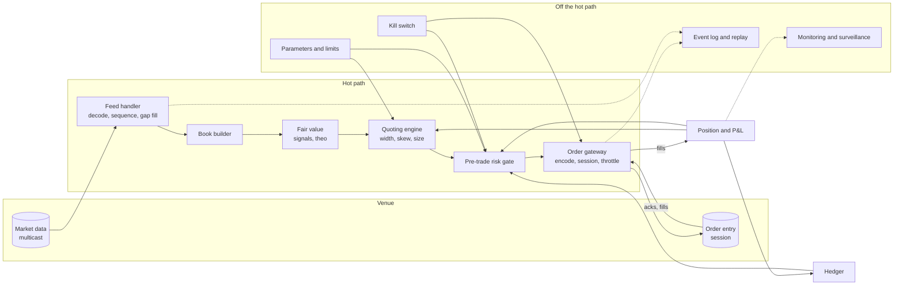
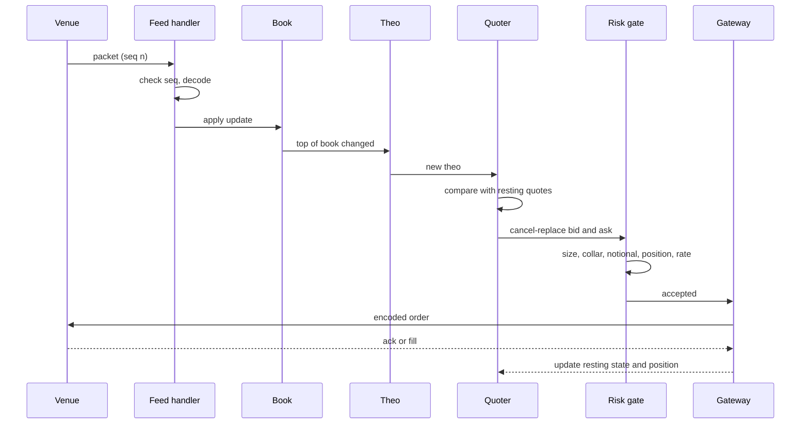
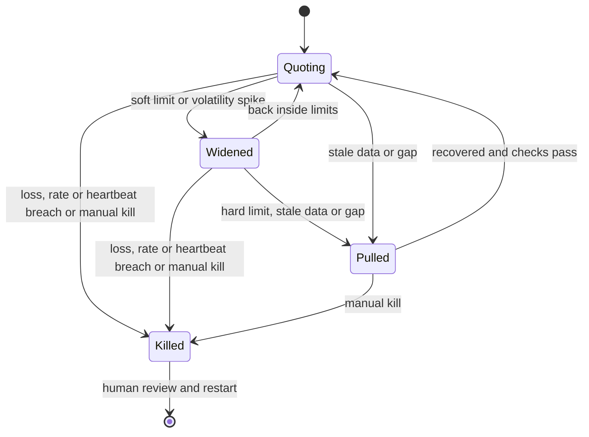

# Market Making Systems Architecture

## TL;DR

- The wire-to-wire path is feed handler, book builder, fair value, quoting engine, pre-trade risk, order gateway; everything else (hedging, P&L, surveillance, parameter changes) hangs off it asynchronously.
- Latency matters only where you race: reacting to a price change before a taker picks off your quote, or reaching the queue first. Everything off the critical path should be optimised for correctness and determinism instead.
- Budget tail latency, not medians: stage p99s do not add (independent stages give a smaller end-to-end p99, a shared shock gives exactly the sum), and queueing delay explodes as utilisation approaches 1.
- Pre-trade risk sits in-line on every order: size, price collar, notional, worst-case position including open orders, message rate; regulation (SEC Rule 15c3-5, MiFID II RTS 6) requires such controls and an immediate cancel-all kill function.
- Design for failure: sequence gaps, stale data, crossed books, runaway loops and lost sessions must each have a defined safe state, usually "pull quotes".

## Learning objectives

- Describe the wire-to-wire path: feed handler, book, fair value, quoting engine, risk, order gateway.
- Explain where latency and determinism matter and where they do not.
- Design the pre-trade risk and kill-switch layer.
- Size queues and buffers from message rates, and reason about tail latency.
- List the main failure modes and the safe response to each.

## Core concepts

### The components

| Component | Job | Must get right |
| :--- | :--- | :--- |
| Feed handler | Decode venue messages (e.g. Nasdaq ITCH over multicast), check sequence numbers, recover gaps from snapshot or retransmission | No silent gaps; arbitration between redundant A and B feeds |
| Book builder | Apply adds, executes, cancels and replaces to per-instrument books | Never crossed or locked by your own bug; O(1) updates at the top |
| Fair value | Turn books, related instruments (futures, ETF baskets, options surface) and signals into a theo | Deterministic given inputs; stale-input detection |
| Quoting engine | Width, skew and size from theo, inventory and risk parameters; decide add, modify or cancel | Bounded order rate; no oscillation; respects tick and lot sizes |
| Pre-trade risk gate | Reject orders that breach limits | In-line, cheap, fail closed |
| Order gateway | Encode (OUCH, FIX, binary), manage sessions, sequence numbers, throttles | Exactly-once intent; reconcile with drop copy |
| Position and P&L | Apply fills, mark positions, feed back to quoting and risk | Same numbers as the post-trade system |
| Kill switch | Cancel all and block new orders, by strategy, account or firm | Works when everything else is broken |

See the [Quant Dev Market Making Guide](Quant-Dev-MM-Guide/README.md) for protocol detail, in particular [ITCH 5.0](Quant-Dev-MM-Guide/02_Market_Data_Protocol_ITCH_5_0.md), [OUCH and FIX](Quant-Dev-MM-Guide/05_Exchange_Connectivity_OUCH_FIX.md) and [Trading System Architecture Design](Quant-Dev-MM-Guide/06_Trading_System_Architecture.md).

### The critical path, step by step

Tick-to-trade is the time from the packet arriving at the NIC to the order leaving it.
The usual software techniques: kernel-bypass networking, a single pinned thread per hot path with no locks or allocation, pre-allocated pools, cache-friendly book layouts, and binary protocols encoded from templates.
FPGA or hardware paths take the simplest decisions (cancel on a futures tick) when software is too slow; see [Low-Latency Engineering](../12-Quant-Development/03-Low-Latency-Engineering.md).

### Where latency matters and where it does not

Latency matters when there is a race:

- Cancelling: when information arrives (a futures tick, a related stock prints), every resting quote that is now stale can be picked off by whoever reacts first.
  Budish, Cramton and Shim (2015) model exactly this race as the cost that market makers pass on in the spread.
- Queue priority: in price-time books the first order at a new price level gets filled first.
- Hedging: the faster the hedge, the less the price moves against it.

Latency does not matter, and correctness and determinism dominate, for:

- Parameter and limit changes, end-of-day P&L, risk reports, surveillance.
- Fair-value models that update on slow inputs (dividends, borrow, vol surface fits).
- Recovery logic, which must be right more than fast.

Determinism is a design goal of its own: if the hot path is a pure function of its input event stream, then recording the stream lets you replay any incident bit for bit, test changes against yesterday's market, and run the same code in simulation and production.

### Measuring latency honestly

- Report distributions (p50, p99, p99.9, max), never averages.
- Timestamp in hardware at the NIC where possible; software timestamps miss queueing in the kernel or NIC.
- Avoid coordinated omission: a benchmark that waits for each response before sending the next hides the queueing a burst would cause.
- Budgets are for planning; the only truth is wire-to-wire measurement on the production path.

### Queues, bursts and back-pressure

Market data arrives in bursts (opening auctions, macro releases, index rebalances), not at the average rate.
Two models size the system:

- Steady state: with Poisson arrivals at rate $\lambda$ and a fixed service time $s$, the mean queueing delay is the Pollaczek-Khinchine M/D/1 result $W_q = \frac{\rho s}{2(1 - \rho)}$ with $\rho = \lambda s$.
  It grows without bound as $\rho \to 1$.
- Bursts: if $B$ messages arrive in a window $w$ and you serve $w/s$ of them, the backlog is $B - w/s$ and it takes $(B - w/s)s$ to drain; the ring buffer must hold the backlog, or you drop data.

A market maker should shed load in a defined way under stress: conflate book updates per instrument, and pull quotes rather than quote on a book it is behind on.

### Pre-trade risk and the kill switch

SEC Rule 15c3-5 (the market access rule, 17 CFR 240.15c3-5) requires a broker-dealer with market access to have controls that prevent orders exceeding pre-set credit or capital thresholds and reject erroneous orders that exceed price or size parameters or are duplicative, and to review them at least annually with a CEO certification.
Commission Delegated Regulation (EU) 2017/589 (MiFID II RTS 6) requires, in Article 12, the ability to cancel immediately, as an emergency measure, any or all unexecuted orders, and in Article 15 pre-trade controls including price collars, maximum order values, maximum order volumes and maximum message limits.

A typical in-line gate, cheapest check first:

| Check | Rejects | Typical implementation |
| :--- | :--- | :--- |
| Kill state | everything once killed | one atomic flag read |
| Message rate | bursts beyond the venue or internal limit | token bucket per session |
| Max order size | fat-finger quantities | compare with a per-instrument limit |
| Price collar | prices too far from a reference | band around last trade, theo or NBBO |
| Max notional | orders too large in money | quantity times price |
| Worst-case position | orders that could breach a position limit if every open order filled | position plus open orders on that side plus the new order |
| Credit and capital | aggregate exposure per account | running totals updated on ack and fill |

The kill switch must be independent of the strategy process (a separate path to cancel-all, ideally also the venue's cancel-on-disconnect), triggered automatically by loss, position, order-rate or heartbeat breaches and manually by a human, and it must fail closed: if the risk process dies, orders stop.

The Knight Capital incident is the standard cautionary tale: according to the SEC (press release 2013-222), on 1 August 2012 Knight's router sent more than 4 million orders while trying to fill 212 customer orders in about the first 45 minutes of trading, traded more than 397 million shares and lost more than $\$460$ million; Knight agreed to pay a $\$12$ million penalty for violating Rule 15c3-5.

### Failure modes

| Failure | Detection | Safe response |
| :--- | :--- | :--- |
| Packet loss or sequence gap | sequence number jumps | mark book stale, pull quotes, recover by retransmission or snapshot |
| Stale data (feed silent, venue halted) | heartbeat or last-update age | pull quotes on affected instruments |
| Crossed or locked own book | invariant check after each update | pull quotes, rebuild from snapshot |
| Runaway quoting loop | order-rate and message-to-fill ratio | throttle, then kill |
| Lost order-entry session | session heartbeat | rely on cancel-on-disconnect; reconcile via drop copy before resuming |
| Position mismatch | gateway position against drop copy | stop new risk, reconcile |
| Bad parameter push | limit sanity checks, staged rollout | reject the change, keep last good parameters |
| Clock drift | PTP offset monitoring | alert; timestamps feed latency and regulatory reporting |

## Worked examples

All numbers are printed and asserted by [mm_system_design.py](code/mm_system_design.py); every latency, rate and limit is hypothetical.

### Example 1: a latency budget (hypothetical)

| Stage | p50 (us) | p99 (us) |
| :--- | ---: | ---: |
| NIC receive and kernel-bypass poll | 0.8 | 1.5 |
| Feed decode and sequence check | 0.4 | 0.9 |
| Book update | 0.3 | 0.8 |
| Fair value update | 0.6 | 1.6 |
| Quote decision | 0.4 | 1.0 |
| Pre-trade risk checks | 0.3 | 0.6 |
| Order encode and session layer | 0.5 | 1.1 |
| NIC transmit | 0.8 | 1.5 |
| Sum | 4.1 | 9.0 |

"About 75.61% of the median is spent outside the two strategy stages, so the first wins are in I/O and plumbing, not in the model."
Modelling each stage as lognormal with these p50 and p99 and simulating a million trades (seed 17): with independent stages the end-to-end p99 is about 5.8177 us and the median about 4.3041 us; with one shared shock driving every stage the p99 is about 9.0006 us, the sum of the stage p99s.
"Summing p99s is the worst case, reached when the tail events are correlated, for example a burst that slows every stage at once, which is exactly when you need the speed."

### Example 2: queueing in the feed handler

Decoding takes a fixed 400 ns per message, so capacity is 2.5 million messages a second.
At 2.0 million a second ($\rho = 0.80$) the M/D/1 mean wait is $\frac{0.8 \times 400}{2 \times 0.2} = 800$ ns, longer than the processing itself; a simulation of 400,000 messages (seed 3) gives about 793.6318 ns.
At 2.375 million a second ($\rho = 0.95$) the mean wait is 3,800 ns.
"A 19% rise in load multiplies the queueing delay by 4.75; plan the hot path with headroom at the peak rate you care about, not the average."

### Example 3: a microburst

10,000 messages arrive in 1 ms and the handler serves 2,500 in that time.
The backlog is 7,500 messages, it takes 3 ms to drain, and a power-of-two ring buffer needs 8,192 slots.
Every quote decided during those 3 ms is decided on a book that is up to 3 ms old, which is why the quoting engine should check book age and pull quotes rather than trade on it.

### Example 4: the cost of losing a latency race

Your cancel reacts in $N(6, 1)$ us and the fastest taker in $N(5, 1)$ us, independently.
"You lose when your time exceeds theirs: $P = \Phi(1/\sqrt2) \approx 0.7602$." (a million simulated races, seed 23, give about 0.7598)
Cutting 1 us makes the race a coin flip (0.5); cutting 2 us brings it to about 0.2398.
With 500 such events a day, 2 lots exposed and $\$12.50$ per tick, the expected pick-off cost is about $\$9{,}503.12$ a day and 1 us saves about $\$3{,}253.12$ a day, the number to set against the engineering cost.

### Example 5: the risk gate on a scripted order stream

Limits: max order 500, collar 2% around a reference of 100, long and short limits 1,000, notional $\$2$m.
Starting position long 800 with 150 bought on open orders:

| Order | Result | Why |
| :--- | :--- | :--- |
| Buy 100 at 100.00 | reject | worst-case long $800 + 150 + 100 = 1050 > 1000$ |
| Buy 50 at 100.00 | accept | worst case exactly 1,000 |
| Sell 600 at 100.00 | reject | above max order size |
| Sell 100 at 103.00 | reject | 3% from the reference, outside the collar |
| Sell 400 at 99.50 | accept | all checks pass |

A token bucket of 20 refilled at 100 a second accepts 20 of a 50-order burst sent over 10 ms: the bucket empties after 20 and refills only one token every 10 ms.
Replaying the same order stream gives a byte-identical decision log, the property that makes incidents reproducible.

### Example 6: a sequence gap

The feed delivers sequence numbers 1 to 6, then 9 to 15, 15 again, then 16 to 20.
The handler detects 7 and 8 missing (2 messages to request from retransmission) and drops one duplicate; until 7 and 8 arrive the affected books are marked stale and their quotes pulled.

## Pitfalls

- Optimising the median while the tail, which is where the races are lost, gets worse.
- Summing stage p99s and calling it the end-to-end p99, or assuming stage tails are independent.
- Sizing buffers for average message rates instead of bursts.
- Position checks that ignore open orders: ten resting bids can each pass alone and breach the limit together.
- A kill switch that runs inside the strategy process it is meant to stop.
- Failing open: on a risk-service timeout the gateway sends the order anyway.
- Quoting on a book with a known gap, or after a session reconnect without reconciling fills.
- Non-deterministic hot paths (wall-clock reads, hash-map iteration order, uninitialised memory) that make replays diverge.
- Pushing parameter changes without limits on the parameters themselves.

## Interview questions

> [!question]- mm-sys-wire-path | Describe the wire-to-wire path of a market-making system.
> Feed handler (decode, sequence check, gap recovery), book builder, fair value, quoting engine, pre-trade risk gate, order gateway to the venue; fills come back through the gateway to position, which feeds quoting, risk and the hedger.
> Everything else is off the hot path.

> [!question]- mm-sys-latency-where | Where does latency matter in market making, and where does it not?
> It matters where there is a race: cancelling stale quotes before a taker hits them, queue priority, and fast hedges.
> It does not for parameters, P&L, reports, slow model inputs and recovery logic, where correctness and determinism come first.

> [!question]- mm-sys-p99-sum | Stage p99s sum to 9 us. Is the end-to-end p99 9 us?
> Only if the stage tails are perfectly correlated; with independent stages it is lower (about 5.8 us in the repo's lognormal model).
> Real systems sit in between, and bursts correlate the tails, so measure end to end.

> [!question]- mm-sys-md1 | Messages take 400 ns each and arrive as a Poisson stream at 2 million a second. Mean queueing delay?
> 800 ns.
> M/D/1: $W_q = \rho s/(2(1 - \rho))$ with $\rho = 0.8$; at $\rho = 0.95$ it is 3,800 ns.

> [!question]- mm-sys-microburst | 10,000 messages arrive in 1 ms and you process one every 400 ns. Backlog, drain time and buffer size?
> Backlog 7,500, drain 3 ms, buffer of 8,192 slots.
> You serve 2,500 in the 1 ms window; draining 7,500 at 400 ns each takes 3 ms.

> [!question]- mm-sys-race-probability | Your cancel latency is N(6, 1) us and the taker's N(5, 1) us. Probability you are picked off?
> About 0.76.
> $P(L_{you} > L_{taker}) = \Phi(1/\sqrt2)$; cutting 1 us makes it 0.5.

> [!question]- mm-sys-pretrade-checks | Which pre-trade checks would you put in-line, and in what order?
> Kill flag, message-rate throttle, max order size, price collar, max notional, worst-case position including open orders, credit.
> Cheapest and most frequently binding first; every check fails closed.

> [!question]- mm-sys-worst-case-position | Why must the position check include open orders?
> Because every resting order can fill; the exposure you control is position plus open orders on that side.
> Long 800 with 150 bid, a new bid of 100 could take you to 1,050 against a 1,000 limit.

> [!question]- mm-sys-15c3-5 | What does SEC Rule 15c3-5 require?
> Broker-dealers with market access must have controls that block orders exceeding pre-set credit or capital thresholds and reject erroneous orders (price or size parameters, duplicates), plus regulatory controls.
> They must review them at least annually with a CEO certification.

> [!question]- mm-sys-rts6-kill | What does MiFID II RTS 6 require of a kill function?
> Article 12 of Delegated Regulation (EU) 2017/589: the ability to cancel immediately, as an emergency measure, any or all unexecuted orders, across venues.
> Article 15 adds pre-trade price collars, maximum order value, maximum order volume and maximum message limits.

> [!question]- mm-sys-kill-switch-design | How would you design a kill switch?
> Independent of the strategy process, with its own path to cancel-all and venue cancel-on-disconnect as a backstop.
> Triggered automatically (loss, position, rate, heartbeat) and manually, scoped by strategy, account or firm, failing closed, and requiring human review to restart.

> [!question]- mm-sys-gap-handling | Your feed handler sees sequence 6 then 9. What do you do?
> Mark the affected books stale, pull or freeze quotes on them, request 7 and 8 from retransmission (or rebuild from snapshot), and resume only after the book is consistent.
> Never quote on a book you know is missing updates.

> [!question]- mm-sys-determinism | Why make the hot path deterministic, and what breaks determinism?
> So a recorded event stream replays any incident exactly and the same code runs in simulation and production.
> Wall-clock reads, unordered container iteration, uninitialised memory, thread timing and floating-point differences across builds break it.

> [!question]- mm-sys-knight | What happened at Knight Capital on 1 August 2012, per the SEC?
> Its router sent over 4 million orders trying to fill 212 customer orders in about 45 minutes, traded over 397 million shares and lost over 460 million dollars.
> The SEC fined it 12 million dollars under Rule 15c3-5; the lessons are deployment control, kill switches and limits that cannot be bypassed.

> [!question]- mm-sys-stale-book | Under a burst your feed handler is 3 ms behind. What should the quoting engine do?
> Detect book age and pull or widen quotes on affected instruments rather than quote on stale prices.
> Conflating updates per instrument and shedding non-critical work lets the hot path catch up.

> [!question]- mm-sys-coordinated-omission | What is coordinated omission in latency measurement?
> A load generator that waits for each response before sending the next stops sending exactly when the system is slow, so the queueing a real burst would cause never appears in the histogram.
> Send on a fixed schedule and measure from the intended send time.

> [!question]- mm-sys-utilisation | Why plan a hot path well below full utilisation?
> Queueing delay grows like $\rho/(1 - \rho)$: from $\rho = 0.80$ to $0.95$ the M/D/1 mean wait goes from 800 ns to 3,800 ns.
> Peak rates, not averages, set the utilisation that matters.

## In this repo and SDE-Interview-Prep

- Code: [mm_system_design.py](code/mm_system_design.py) (latency budget, queueing, bursts, races, risk gate, gap detection).
- Deep dive in this repo: the [Quant Dev Market Making Guide](Quant-Dev-MM-Guide/README.md).
- Related: [System Design for Trading](../12-Quant-Development/06-System-Design-for-Trading.md), [Market Data Feed Handlers and Protocols](../12-Quant-Development/08-Market-Data-Feed-Handlers-and-Protocols.md), [Risk Checks and Order Management](../12-Quant-Development/13-Risk-Checks-and-Order-Management.md), [Hedging and Risk for Market Makers](06-Hedging-and-Risk-for-Market-Makers.md) and [Latency Arbitrage and Speed](../07-Market-Microstructure/10-Latency-Arbitrage-and-Speed.md).
- [Low-latency systems vault (SDE-Interview-Prep)](https://github.com/shreejitverma/SDE-Interview-Prep/blob/main/14-Low-Latency-Systems/00%20Home.md)
- [Pre-trade risk checks at wire speed (SDE-Interview-Prep)](https://github.com/shreejitverma/SDE-Interview-Prep/blob/main/14-Low-Latency-Systems/02%20-%20Exchange%20Architecture/Pre-Trade%20Risk%20Checks%20at%20Wire%20Speed.md)
- [Participant-side pre-trade risk gates (SDE-Interview-Prep)](https://github.com/shreejitverma/SDE-Interview-Prep/blob/main/14-Low-Latency-Systems/11%20-%20Participant-Side%20Systems/Participant-Side%20Pre-Trade%20Risk%20Gates.md)
- [Tick-to-trade critical path optimization (SDE-Interview-Prep)](https://github.com/shreejitverma/SDE-Interview-Prep/blob/main/14-Low-Latency-Systems/11%20-%20Participant-Side%20Systems/Tick-to-Trade%20Critical%20Path%20Optimization.md)
- [Automated kill switches and risk circuit breakers (SDE-Interview-Prep)](https://github.com/shreejitverma/SDE-Interview-Prep/blob/main/14-Low-Latency-Systems/13%20-%20Reliability,%20Ops%20&%20Testing/Automated%20Kill%20Switches%20and%20Risk%20Circuit%20Breakers.md)
- [Deterministic replay and packet injection testing (SDE-Interview-Prep)](https://github.com/shreejitverma/SDE-Interview-Prep/blob/main/14-Low-Latency-Systems/13%20-%20Reliability,%20Ops%20&%20Testing/Deterministic%20Replay%20and%20Packet%20Injection%20Testing.md)
- [Coordinated omission in low latency systems (SDE-Interview-Prep)](https://github.com/shreejitverma/SDE-Interview-Prep/blob/main/14-Low-Latency-Systems/07%20-%20Time%20&%20Measurement/Coordinated%20Omission%20in%20Low%20Latency%20Systems.md)
- [War story: the 2012 Knight Capital disaster (SDE-Interview-Prep)](https://github.com/shreejitverma/SDE-Interview-Prep/blob/main/14-Low-Latency-Systems/02%20-%20Exchange%20Architecture/War%20Story%20-%20The%202012%20Knight%20Capital%20Disaster.md)

## Further reading

- SEC Rule 15c3-5, Risk Management Controls for Brokers or Dealers with Market Access, 17 CFR 240.15c3-5.
- Commission Delegated Regulation (EU) 2017/589 (MiFID II RTS 6), Articles 12 (kill functionality) and 15 (pre-trade controls).
- SEC press release 2013-222, "SEC Charges Knight Capital With Violations of Market Access Rule" (16 October 2013).
- E. Budish, P. Cramton and J. Shim, "The High-Frequency Trading Arms Race: Frequent Batch Auctions as a Market Design Response", *Quarterly Journal of Economics* 130(4) (2015).
- Leonard Kleinrock, *Queueing Systems, Volume 1: Theory* (1975), chapter 5 on M/G/1 and the Pollaczek-Khinchine formula.
- Larry Harris, *Trading and Exchanges: Market Microstructure for Practitioners* (2003).
