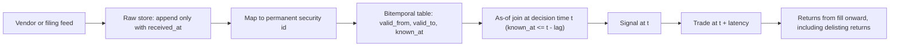

# Point-in-Time Data and Survivorship

## TL;DR

- Every datum has two times: the period it describes (valid time) and the moment you could first have known it (knowledge time); a backtest may only join on knowledge time, through an as-of join.
- Survivorship bias comes from building history out of today's universe: dead names, and their delisting returns, vanish; in this note's simulation survivors-only data lifts an equal-weight return by about 3.6 points a year and turns a losing "buy losers" strategy into a Sharpe of about 1.1.
- The bias is not one-signed: takeovers delist with positive returns, and a strategy short the losers is hurt rather than helped, so you cannot correct a survivor-biased backtest by subtracting a constant.
- Look-ahead hides in timestamps: fundamentals stamped at period end instead of the filing date, restated values replacing first releases, today's index members, back-adjusted prices used as filters, full-sample normalisation, and vendor backfill.
- Defences are structural: bitemporal storage, permanent security identifiers, delisting returns, conservative publication lags, exchange-local clocks with DST, and delay tests that check the signal survives one extra bar.

## Learning objectives

- Build point-in-time datasets: corporate actions, restatements, index membership.
- Detect look-ahead bias and survivorship bias in a pipeline.
- Handle timestamps, time zones and publication lags.
- Quantify how much each bias inflates a backtest, and in which direction.

## Core concepts

### Valid time and knowledge time

A point-in-time (PIT) database is bitemporal: each record carries the period it describes and the timestamp at which it became available to you.
Quarterly earnings for the period ending 31 March describe Q1 but are knowable only when filed or announced weeks later; a later amendment is a new record with a new knowledge time, not an overwrite.
The backtest question is always "what did the database say at time $t$?", answered by an **as-of join**: for each decision time $t$, take the latest record with knowledge time $\le t$ (minus any processing lag).
A naive join on period end commits two errors at once: it uses data before it was published, and it uses the final vintage instead of the one that existed then.

Engineering rules that make this hold by construction:

- Store raw data append-only with the time you received it; never update in place.
- Key everything on a permanent identifier (for example CRSP PERMNO or a vendor's security master id), not on tickers, which are reused and changed.
- Keep vintages: macro series are revised (GDP, payrolls), and ALFRED from the St. Louis Fed exists precisely to serve the value as first published.
- When the vendor does not provide knowledge times, impose a conservative lag (for example the regulatory filing deadline) rather than assuming same-day availability.

### Publication lags and filing deadlines

US issuers file the annual 10-K within 60, 75 or 90 days of fiscal year end (large accelerated, accelerated, other filers; Form 10-K General Instruction A(2)) and the quarterly 10-Q within 40 days (large accelerated and accelerated) or 45 days (others) of quarter end (Form 10-Q General Instruction A.1), as of 2026-10.
Earnings press releases usually come earlier than the filing, so the right knowledge time is the first public release you can timestamp, and the filing deadline is a safe upper bound when you cannot.
Announcements made after the close belong to the next session's signal.

### Time zones, calendars and clocks

Store timestamps in UTC and convert to exchange-local time with a real time-zone database for session logic.
The New York close at 16:00 is 20:00 UTC in summer (EDT, UTC-4) and 21:00 UTC in winter (EST, UTC-5), so a hard-coded UTC cut-off is wrong for part of every year.
Use the exchange's holiday and half-day calendar, and distinguish event time (exchange stamp), vendor time and your receive time; latency-sensitive research needs all three.

### Survivorship bias

Survivorship bias arises when the universe at each historical date is built from names that exist today.
Names that died are missing, and they died for a reason: performance delistings follow large losses and usually carry a final, very negative delisting return.
Shumway (1997) shows that CRSP had missing delisting returns for many performance-related delistings and suggests a replacement value of about $-30\%$ for NYSE and AMEX stocks.
Brown, Goetzmann, Ibbotson and Ross (1992) and Elton, Gruber and Blake (1996) document the same effect in fund-performance studies, where dead funds drop out of databases.

Three databases, in order of increasing bias:

| Database | What is missing | Typical effect |
| :--- | :--- | :--- |
| PIT with delisting returns | nothing | unbiased |
| PIT, delisting-month returns dropped | the last, often extreme, return | biased up by performance delistings, down by takeovers |
| Survivors only | every name that later died | biased up, strongly for strategies that buy distressed names |

The direction depends on the strategy.
Buying losers, deep value, small caps and high leverage are biased up because the dead names sat in the long leg.
A short-losers book (momentum) is biased the other way, and takeover targets delist with positive premia, so dropping them biases down.

### Index membership

"Backtest on the S&P 500" means the members at each date, not today's members run backwards.
Today's large caps are disproportionately yesterday's winners that grew into the index, so a hindsight universe embeds the momentum of the whole sample.
Membership history needs both the announcement date and the effective date; trading on the change between the two is a strategy of its own, and using the effective-date list at the announcement date is look-ahead.

### Corporate actions

Splits, dividends, spin-offs, mergers and ticker changes all break naive price series.
Returns must be computed from split- and dividend-adjusted prices (or directly from a total-return field), but **levels** must come from the raw price that traded that day.
Back-adjustment rewrites history every time a new action occurs: after a 1-for-10 reverse split a stock that traded at 0.80 shows a historical adjusted price of 8.00, so a "price above 5" liquidity filter on adjusted prices admits a penny stock, and admits it only because you know it later did a reverse split.

### Where look-ahead hides

| Source | The leak | The fix |
| :--- | :--- | :--- |
| Fundamentals | stamped at period end | stamp at first release or filing, as-of join |
| Restatements and revisions | final vintage replaces first release | keep vintages, join on knowledge time |
| Index and universe | today's members | PIT membership with announcement and effective dates |
| Prices | back-adjusted levels in filters | raw levels for filters, adjusted only for returns |
| Normalisation | full-sample mean, volatility or ranks | expanding or rolling windows ending at $t$ |
| Vendor history | backfilled history created after the vendor launched | use first-seen dates; treat pre-launch history as in-sample at best |
| Identifiers | ticker reused by a different company | permanent ids and a dated mapping table |
| Execution | signal and fill on the same bar | trade at $t$ + latency at a realistic price |

### Detecting leaks

- Delay test: lag the signal one extra bar; a real slow signal loses a little, a leak loses almost everything.
- Too-good diagnostics: IC above about 0.1 on daily stock returns, Sharpe above 3 for a slow signal, or IC that peaks at lag 0 rather than decaying from lag 1, all deserve a timestamp audit first.
- Frozen snapshot replay: rerun the backtest on data as captured live during a paper-trading period and compare it with the same period rebuilt from today's database.
- Universe audit: count names per date, check that dead names and delisting returns are present, and compare against an independent PIT membership list.

## Worked examples

All numbers come from [pit_survivorship.py](code/pit_survivorship.py) (seeded simulations, so simulated values are quoted as "about").

### 1. As-of join versus period-end join

One stock's EPS records: Q3 2024 (filed 2024-10-30) 1.05; Q4 2024 (filed 2025-02-20) 1.10; Q4 2024 amended on 2025-04-15 to 0.95; Q1 2025 (filed 2025-05-01) 1.20.

| Query date | As-of (knowledge time) | Naive (period end, final vintage) |
| :--- | :--- | :--- |
| 2025-01-31 | 1.05 | 0.95 |
| 2025-03-03 | 1.10 | 0.95 |
| 2025-04-30 | 0.95 | 1.20 |
| 2025-05-02 | 1.20 | 1.20 |

On 2025-01-31 the naive join uses a Q4 number that was not filed for three weeks and, worse, the amended value that appeared in April.
On 2025-04-30 it uses Q1 numbers a day before they were published.
The two joins agree only once the latest record is both published and final.

### 2. A DST trap

A news item stamped 20:30 UTC: on 2025-07-15 it is 16:30 in New York (after the close, next session's signal); on 2025-01-15 it is 15:30 (before the close, same session).
A pipeline that hard-codes "UTC hour $\ge$ 20 means after the close" misclassifies every such winter item for half the year.

### 3. Survivorship in a simulated universe

1,000 names with identical expected returns (0.8% a month, 10% monthly volatility), replaced one for one when they delist over 20 years.
A name trading below 40% of its listing price delists with probability 6% a month at a $-30\%$ delisting return; any name is taken over with probability 0.25% a month at $+25\%$.
The run produces 575 performance delistings and 582 takeovers.

| Database | Equal-weight return per year |
| :--- | :--- |
| PIT with delisting returns | 9.47% |
| PIT, only performance-delisting returns dropped | 10.36% (+0.89) |
| PIT, all delisting returns dropped | 9.65% (+0.18) |
| Today's 1,000 survivors only | 13.04% (+3.57) |

Dropping all delisting returns looks almost harmless (+0.18) only because the positive takeover premia offset the negative performance delistings; the two effects are each several times larger.
Survivors-only data overstates the market by about 3.6 points a year with no anomaly anywhere in the data.

### 4. Survivorship flatters "buy the losers"

Long the bottom decile of trailing 12-month return, short the top decile, monthly, equal weight, on the same simulated universe:

- Full PIT data: about $-2.0\%$ a year, Sharpe about $-0.37$; losers are where the $-30\%$ delistings happen.
- Survivors only: about $+7.2\%$ a year, Sharpe about 1.06.

The survivors-only universe keeps only losers that later recovered, so the conditioning on future survival is the entire "alpha".

### 5. Today's index members run backwards

2,000 names with identical expected returns; the index is the top 500 by market cap, reconstituted annually.

- Point-in-time members: about 10.0% a year.
- Today's top 500 backtested over 20 years: about 15.2% a year, a bias of about 5.2 points.
- Only about 63% of the year-1 members are in today's top 500; the rest of today's list grew into it, and their growth is the bias.

### 6. Timing and restatements in IC terms

Model: first-release surprise $f \sim N(0,1)$; the restated value $e = f + 0.7v$ adds information that arrives later; the filing-month return is $0.02f + 0.08\varepsilon$; the next month's return is $0.02(e - f)/3 + 0.002f + 0.08\varepsilon'$ (a third of the revision is learned, plus a small post-announcement drift).

- Signal stamped at period end, scored on the filing-month return: $\text{IC} = 0.02/\sqrt{0.02^2 + 0.08^2} = 0.243$ (simulation about 0.241), a pure timing leak.
- Point-in-time signal (first release, at the filing date) on next month: $\text{IC} = 0.002/0.0802 = 0.025$ (simulation about 0.026); this is the only tradable number.
- Restated value at the filing date: $\text{cov}(e, r) = 0.02\times0.49/3 + 0.002 = 0.00527$, so $\text{IC} = 0.00527/(1.2207\times0.0802) = 0.054$ (simulation about 0.058), more than double the truth.

### 7. Corporate actions

- Close 100, then a 2-for-1 split and a close of 51: the raw return is $-49.0\%$, the split-adjusted return $+2.0\%$.
- A stock at 0.80 that later reverse-splits 1-for-10 shows an adjusted historical price of 8.00 and passes a "price above 5" filter it would have failed in real time.

## Pitfalls

- Joining fundamentals on fiscal period end, or on the vendor's "date" field without checking what it means.
- Overwriting history when a restatement arrives instead of appending a new vintage.
- Building the universe from today's index list or today's listed stocks.
- Dropping delisting returns, or assuming they are zero.
- Mapping by ticker, so a reused ticker splices two companies together.
- Using back-adjusted prices for price, market-cap or liquidity filters.
- Normalising features with full-sample statistics.
- Treating a vendor's backfilled history as if it had been available live.
- Hard-coding UTC offsets for exchange sessions, ignoring DST and half-days.
- Assuming a survivorship correction is a constant to subtract: its sign and size depend on the strategy.

## Interview questions

> [!question]- alpha-pit-bitemporal | What two timestamps does a point-in-time database store for every record, and which one does a backtest join on?
> The valid time (the period the value describes) and the knowledge time (when it became available).
> The backtest joins on knowledge time with an as-of join: at decision time $t$, take the latest record known at or before $t$ minus any processing lag.

> [!question]- alpha-pit-asof-two-errors | What two errors does joining fundamentals on fiscal period end commit?
> It uses numbers before they were published, and it uses the final (possibly restated) vintage rather than the one that existed then.
> The fix is an as-of join on first-release or filing time with every vintage kept.

> [!question]- alpha-pit-survivorship-definition | What is survivorship bias in a backtest?
> Building each historical universe from names that exist today, so dead names and their final returns are missing.
> Names die for a reason, usually after losses, so the surviving sample has systematically better history than the investable one.

> [!question]- alpha-pit-survivorship-sign | Does survivorship bias always inflate backtest returns?
> No.
> It inflates strategies long distressed names (losers, deep value, small caps), but deflates strategies short them (momentum), and takeovers delist with positive premia, so dropping those biases returns down.

> [!question]- alpha-pit-delisting-returns | Why do delisting returns matter even in a point-in-time universe?
> The delisting month often has the most extreme return of a name's life.
> Shumway (1997) found many CRSP performance delisting returns missing and suggested replacing them with about $-30\%$ for NYSE and AMEX stocks; dropping them makes distressed names look better than they were.

> [!question]- alpha-pit-sim-magnitude | In a simulated universe with identical expected returns, how much did survivors-only data inflate the equal-weight return?
> About 3.6 points a year (13.0% versus 9.5%).
> No name had an anomaly; the gap is entirely the conditioning on future survival.

> [!question]- alpha-pit-buy-losers | A "buy last year's losers" strategy has Sharpe 1.1 on a survivors-only database. What do you expect on point-in-time data?
> Much worse; in this note's simulation it fell to about $-0.37$.
> Losers are where performance delistings at $-30\%$ happen, and the survivors-only universe kept only the losers that later recovered.

> [!question]- alpha-pit-delisting-offset | Dropping all delisting returns moved a simulated equal-weight return by only 0.18 points. Is the bias small?
> No, two large biases offset.
> Dropping only performance delistings added 0.89 points; dropping takeover premia subtracted most of it back; a strategy concentrated in either group sees the full effect.

> [!question]- alpha-pit-index-hindsight | Why is backtesting today's S&P 500 members over 20 years biased, and in which direction?
> Upward: today's members are disproportionately past winners that grew into the index.
> In a simulation with identical expected returns, today's top 500 run backwards earned about 5.2 points a year more than the point-in-time members.

> [!question]- alpha-pit-restatement-ic | Why does a signal built on restated fundamentals look better than it was?
> The restated value contains information that arrived after the original release, and prices move as that information is learned.
> In the note's model the IC rises from 0.025 (first release) to 0.054 (restated), with no change in the true tradable signal.

> [!question]- alpha-pit-period-end-ic | An earnings-surprise signal shows IC 0.24 on monthly returns. What is the first thing you check?
> Whether it is stamped at period end rather than at the release, so it scores the announcement return it could not have known.
> In the note's model the timing leak gives IC 0.243 versus 0.025 for the tradable version; ICs that large on monthly stock returns are almost always leaks.

> [!question]- alpha-pit-filing-deadlines | What are the US 10-Q and 10-K filing deadlines, and why do they matter to a researcher?
> 10-Q: 40 days after quarter end for large accelerated and accelerated filers, 45 for others; 10-K: 60, 75 or 90 days after fiscal year end (as of 2026-10).
> When a dataset lacks release timestamps, the deadline is a safe conservative lag for the as-of join.

> [!question]- alpha-pit-dst | A pipeline treats any news after 20:00 UTC as after the New York close. What goes wrong?
> In winter the close is 21:00 UTC, so items between 20:00 and 21:00 UTC arrive before the close and are pushed to the wrong session.
> 20:30 UTC is 16:30 in July but 15:30 in January; convert with a time-zone database and the exchange calendar.

> [!question]- alpha-pit-reverse-split-filter | How can a "price above 5" filter introduce look-ahead?
> If it uses back-adjusted prices: a stock at 0.80 that later reverse-splits 1-for-10 shows an adjusted price of 8.00 and passes.
> Use raw traded prices for level filters and adjusted prices only for returns.

> [!question]- alpha-pit-split-return | A stock closes at 100, splits 2-for-1 and closes at 51. What return should the backtest record?
> $+2.0\%$, not $-49.0\%$.
> Adjust the prior close by the split factor: $51\times2/100 - 1 = 0.02$.

> [!question]- alpha-pit-identifiers | Why key a research database on permanent identifiers rather than tickers?
> Tickers change and are reused by different companies, so joining on ticker can splice two firms' histories.
> Use a permanent id (for example CRSP PERMNO or a vendor security-master id) with a dated ticker mapping.

> [!question]- alpha-pit-vendor-backfill | A new alternative-data vendor offers 10 years of history but launched 2 years ago. How do you treat the first 8 years?
> As backfill constructed with hindsight: panel, mapping and cleaning choices were made knowing what happened.
> Use first-seen or delivery timestamps, give most weight to the live period, and expect live performance below the backfilled backtest.

> [!question]- alpha-pit-macro-vintages | Your macro signal uses the current GDP series. What is wrong?
> GDP is revised, so the series mixes in values that were not known at the time.
> Use real-time vintages (for example ALFRED) and take the value as first published at each date.

> [!question]- alpha-pit-leak-detection | Name three practical tests for look-ahead in a pipeline.
> A delay test (one extra bar should cost a little, not everything), checking that IC decays from lag 1 rather than peaking at lag 0, and replaying a period from data captured live versus rebuilt from today's database.
> Implausibly high IC or Sharpe for a slow signal is itself a red flag that triggers a timestamp audit.

> [!question]- alpha-pit-full-sample-norm | Why is z-scoring a feature with its full-sample mean and standard deviation a leak?
> The statistics include future observations, so each historical score encodes where the series later went.
> Use expanding or rolling windows that end at $t$, or cross-sectional normalisation at each date.

## In this repo and SDE-Interview-Prep

- Code: [pit_survivorship.py](code/pit_survivorship.py) reproduces every number above; [simple_event_driven.py](code/simple_event_driven.py) shows the fill-on-next-bar rule.
- Related notes: [Backtesting Methodology and Pitfalls](07-Backtesting-Methodology-and-Pitfalls.md), [Signals, Features and Alpha Decay](03-Signals-Features-and-Alpha-Decay.md), [Alternative Data and Feature Engineering](14-Alternative-Data-and-Feature-Engineering.md), [Time-Series Cross-Validation, Purging and Embargo](../10-Machine-Learning-for-Finance/02-Time-Series-Cross-Validation-Purging-Embargo.md).
- SDE-Interview-Prep event-driven backtester: [event_driven_backtester.py](https://github.com/shreejitverma/SDE-Interview-Prep/blob/main/05-Quantitative-Finance/03-Algo-Trading/Backtesting/event_driven_backtester.py).

## Further reading

- Marcos Lopez de Prado, *Advances in Financial Machine Learning*
- Michael Isichenko, *Quantitative Portfolio Management*
- Shumway (1997), The Delisting Bias in CRSP Data, Journal of Finance.
- Brown, Goetzmann, Ibbotson and Ross (1992), Survivorship Bias in Performance Studies, Review of Financial Studies.
- Elton, Gruber and Blake (1996), Survivorship Bias and Mutual Fund Performance, Review of Financial Studies.
- SEC Form 10-K and Form 10-Q General Instructions (sec.gov).
